# PLAYER-1: 합성 경험으로부터 게임을 배우다 (PLAYER-1: LEARNING TO PLAY FROM SYNTHETIC EXPERIENCE)

- 원제: Player-1: Learning to Play from Synthetic Experience
- 원문: [https://arxiv.org/abs/2610.20584](https://arxiv.org/abs/2610.20584)
- PDF: [https://arxiv.org/pdf/2610.20584](https://arxiv.org/pdf/2610.20584)
- arXiv ID: `2610.20584`

---

# PLAYER-1: 합성 경험으로부터 게임을 배우다 (PLAYER-1: LEARNING TO PLAY FROM SYNTHETIC EXPERIENCE)

Mingyu Ouyang1,2,\*, Yiran Wang2,†, Siyuan Hu³, Xingyilang Yin², Huiqiang Sun², Guangzhi Wang², Junfu Pu², Cheng Cheng², Honghao Chen², Ying Shan², Mike Zheng Shou1,‡, Hwee Tou Ng1,‡

1싱가포르 국립대학교 2ARC Lab, Tencent IEG 3난양 기술대학교

**Project:** player-1-project.github.io/ **Code:** github.com/TencentARC/Player-1

#### **초록 (ABSTRACT)**

컴퓨터 사용 에이전트는 화면을 해석하고 키보드 및 마우스 동작을 실행하는 데 강력한 능력을 보여왔다. 그러나 시각적으로 풍부한 세계와 다양한 메커니즘을 가진 게임은 여전히 도전적이며 일반 디지털 제어로 나아가는 까다로운 다음 단계이다. 현재의 게임 에이전트 학습 파이프라인은 종종 동적 게임 상태를 제한적으로만 다루는 대규모 시연에 의존하며, 상호작용 학습을 위한 확장 가능한 환경을 확보하기가 어렵다. 우리는 PLAYER-1을 도입한다. 이는 시연을 넘어 합성 경험을 통해 게임 제어를 학습하는 사후 훈련 프레임워크다. 우리는 상대 포인터 움직임, 지속 입력, 복합 동작을 포함하도록 컴퓨터 사용 동작 공간을 확장한다. 감독 초기화를 위해 우리는 6,044개의 선별된 게임플레이 궤적에 기록된 동작과 과제 지시 및 시각적 추론을 매칭시켜 컴퓨터 사용 모델을 미세 조정한다. 우리는 게임 전반에 걸쳐 공유되는 제어 요구를 중심으로 설계된 16개의 합성 2D 및 3D 환경인 PLAYER-1-GYM을 구축한다. 프로그래밍적으로 검증 가능한 보상과 무작위 관측 및 제어 역학은 PPO를 이용한 다중 환경 강화 학습을 지원한다. 결과적으로 Player-1-9B와 Player-1-35B-A3B는 각각 SFT 정책 대비 MineDojo-300 성공률을 27.8% 포인트와 17.7% 포인트 향상시킨다. Player-1-9B는 가장 강력한 평가 기준 대비 12.63%에서 38.33%로 성공률을 달성하며, ViZDoom-10과 GameWorld에서도 SFT를 능가한다. 추가 분석은 더 넓은 합성 환경 범위가 전이(transfer)를 개선하고, RL 동안 복합 동작(다중 키보드 및 마우스 입력을 결합한 동작)의 사용이 증가함을 보여준다. 우리는 합성 경험에서 학습이 감독 초기화를 넘어 게임 제어를 크게 향상시키며, RL 훈련 세트 외부에서도 일반화되는 이득을 입증한다.

## 1 서론 (Introduction)

기반 모델은 시각적 이해, 추론 및 지시 따르기에서 광범위한 능력을 개발했다 (OpenAI, 2024; Anthropic, 2025; Gemini Team, 2025). 컴퓨터 사용 에이전트는 이러한 능력을 디지털 인터페이스에 적용하여 화면을 해석하고 키보드 및 마우스 동작을 실행한다 (Wang et al., 2025a; Bai et al., 2025; Lu et al., 2026). 게임은 일반 디지털 제어로 나아가는 까다로운 다음 단계이며, 시각적으로 복잡한 환경과 다양한 메커니즘은 동적이고 급변하는 시각적 피드백 하에서 정밀하고 지속적이며 동시에 제어를 요구한다 (Luo et al., 2026a).

최근 게임 에이전트는 대규모 게임플레이 시연과 상호작용 경험에서 학습한다 (Wang et al., 2025b; Magne et al., 2026; SIMA Team, 2025; Shi et al., 2026). 그러나 시연은 에이전트가 개방형 과제에서 마주칠 수 있는 상태의 한정된 부분만을 다루며, 상호작용 학습을 위한 확장 가능한 환경을 확보하기가 어렵다. 외관과 규칙이 다름에도 불구하고 우리는 많은 게임이 정밀 조준, 지속

*인턴십 기간 동안 ARC Lab, Tencent IEG에서 수행. † 프로젝트 리드. ‡ 공동 교신 저자.

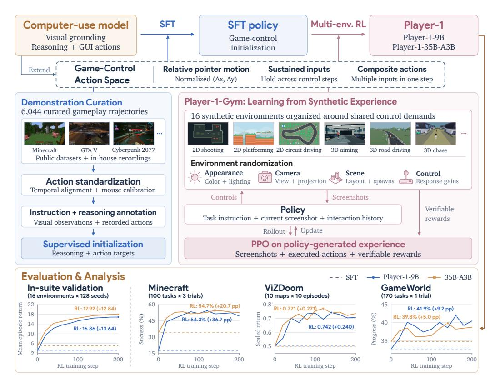

Figure 1: **PLAYER-1** 개요: 시연을 넘어 게임 제어를 학습한다. 공유 게임 제어 액션 공간은 게임플레이 시연에서의 감독 초기화와 **PLAYER-1-GYM**의 다중 환경 RL을 연결한다. 검증 가능한 보상을 갖는 합성 경험으로부터 학습하면 SFT를 넘어서는 제어 능력이 향상되며, 그 이득은 RL 훈련 세트 외의 게임에도 일반화된다.

움직임과 조정된 입력. 이는 우리의 핵심 질문을 부추긴다: 합성 경험이 감독 초기화를 넘어서는 게임 제어 능력을 향상시킬 수 있는가? 그 이득은 RL 훈련 세트 외의 게임에도 일반화될 수 있는가?

이 접근법을 형성하는 세 가지 도전 과제. 첫째, 이질적인 입력 규칙과 시간 해상도로 기록된 게임플레이 시연은 공유 액션 공간으로 변환되어야 하며, 플레이어의 의도를 반영하는 과제 지시와 시각적 추론과 짝을 이뤄야 한다. 둘째, 시연을 넘어서는 학습은 정책이 자체적으로 수행한 행동으로 도달한 상태에 대한 피드백을 필요로 하지만, 다양한 상용 게임에 걸친 프로그램식 보상을 구현하는 것은 확장성이 어렵다. 셋째, 서로 다른 제어 요구, 역학, 보상 규모를 가진 환경에서의 경험은 훈련 세트 외에도 일반화되는 공유 정책에 통합되어야 한다. 이러한 도전 과제는 선별된 시연으로부터 감독 초기화를 수행하고, 검증 가능한 보상을 갖는 제어 가능한 합성 환경에서 학습을 이어가는 동기를 부여한다.

우리는 Figure 1에 도식된 대로 시연을 넘어서는 게임 제어를 합성 경험을 통해 학습하는 사후 훈련 프레임워크 **PLAYER-1**을 제시한다. 우리는 상대 포인터 움직임, 지속 입력, 복합 액션을 포함하도록 컴퓨터 사용 액션 공간을 확장한다. 선별된 게임플레이 시연은 기록된 행동을 과제 지시와 시각적 추론과 짝지어 게임 제어를 초기화한다. **PLAYER-1-GYM**은 사격, 전투, 운전, 탐색, UI 상호작용 등 반복되는 제어 요구를 중심으로 설계된 16개의 합성 2D 및 3D 환경을 제공한다. 프로그램식 게임 상태 보상과 관측 및 제어 역학의 무작위화는 검증 가능한 보상(RLVR)을 갖는 다중 환경 강화 학습을 지원하며, 그 결과 Player-1-9B와 Player-1-35B-A3B가 생성된다. Table 1은 대표적인 게임 에이전트 학습 파이프라인의 차이점과 초점을 요약한다.

우리의 결과는 합성 경험으로부터 학습하면 게임 제어 능력이 향상되며, 그 이득은 RL 훈련 세트 외에도 일반화된다는 것을 보여준다. MineDojo-300에서 Player-1-9B는 SFT 이후 10.54% 성공률에서 38.33%로 개선되었으며, 이는 12.63%의 가장 강력한 외부 기초선보다 우수하다.

Table 1: 감독, RL 환경, 평가 범위, 파이프라인 및 모델 가용성을 포함한 대표적인 게임 에이전트 학습 파이프라인 비교.

| 방법 | 학습 초점 | 감독 | RL 환경 | 평가 | 가용성 |
|-----------|-------------------------|--------------------|---------------------|--------------------|--------------|
| Game-TARS | 대규모 사전학습 | 추론 + 행동 | _ | 보류된 게임 | Х |
| SIMA 2 | 구현된 지원 | 추론 + 행동 | 게임 + 세계 모델 | 보류된 게임 | X |
| NitroGen | System-1 generalist | 행동 | _ | 게임 + 적응 | ✓ |
| Odysseus | Long-horizon RL | 추론 + 행동 | 5 Mario levels | Mario games | ✓ |
| PLAYER-1 | 시연을 넘어 | 추론 + 행동 | 16개의 합성 환경 | RL 보류 게임 | ✓ |

우리의 평가 프로토콜에 따라. 같은 정책은 ViZDoom-10과 GameWorld에서도 개선되며, 두 환경 모두 RL 훈련 세트 외부에 있다. 우리는 주요 기여를 다음과 같이 요약한다:

- 우리는 PLAYER-1, 즉 지도 학습 초기화를 기반으로 합성 경험에서 전이 가능한 게임 제어 능력을 학습하는 사후 훈련 프레임워크를 제시한다. 공유된 행동 공간은 상대 포인터 움직임, 지속 입력, 복합 동작을 지원하며, 6,044개의 선별된 게임플레이 경로가 이후 상호작용 학습을 위한 지도 학습 초기화를 제공한다.
- 우리는 PLAYER-1-GYM, 즉 게임 전반에 걸친 반복되는 제어 요구를 중심으로 설계된 16개의 합성 2D 및 3D 환경을 도입한다. 프로그램적으로 검증 가능한 보상과 무작위 관측 및 제어 역학이 결합되어 시연을 넘어선 다중 환경 강화 학습을 위한 다양한 경험을 제공한다.
- 우리는 **합성 경험에서의 학습이 지도 시연을 넘어 게임 제어 능력을 향상시킨다**: Player-1-9B와 Player-1-35B-A3B는 각각 MineDojo-300 성공률에서 27.8 및 17.7 pp를 달성하며, RL 훈련 세트 외부의 ViZDoom 및 GameWorld에서도 추가 성과를 보인다. 추가 분석은 더 넓은 환경 범위와 RL 중 복합 동작 사용 증가를 통해 전이가 개선되었음을 보여준다.

## 2 관련 연구 (RELATED WORK)

범용 및 컴퓨터 사용 에이전트. 기초 모델은 일반 목적 에이전트를 뒷받침하는 폭넓은 언어, 추론, 멀티모달 능력을 제공한다 (OpenAI, 2024; Anthropic, 2025; Gemini Team, 2025; Yang et al., 2025). 시각-언어 모델(VLMs)은 시각 인식과 언어를 연결하여 장면 이해와 공간 기반화를 지원한다 (Bai et al., 2025). 컴퓨터 사용 에이전트(CUAs)는 스크린샷 기반 상호작용을 위해 이러한 능력을 특화시켜 키보드 및 마우스 동작을 사용해 다단계 작업을 완수한다 (Hu et al., 2024; Qin et al., 2025; Wang et al., 2025a; Lu et al., 2026).

게임 에이전트, 개발 및 환경. 게임-에이전트 연구는 계획 기반 시스템(Tan et al., 2025b), 학습된 시각 정책 및 비전—언어—행동(VLA) 모델(SIMA Team, 2024; Tan et al., 2025a; Li et al., 2025; Wang et al., 2025b; Magne et al., 2026; Yue et al., 2026), 그리고 공동 비디오—행동 모델(Guo et al., 2026)을 포함한다. 강화 학습은 자기 개선과 장기 제어(SIMA Team, 2025; Shi et al., 2026)를 추가로 지원한다. 최근에는 Jev가 텍스트 전용 인터페이스를 통해 저지연 게임 제어를 시연하며, 스크린샷 관측 대신 구조화된 게임 상태 표현에 의존한다(Almeida, 2026). 보완 벤치마크는 게임 플레이(Ouyang et al., 2026)와 에이전트 게임 개발(Chi et al., 2026; Luo et al., 2026b)을 평가한다. 규칙과 궤적에서 합성된 코드 세계 모델은 계획(Lehrach et al., 2026)을 지원하고, 게임 엔진 개발은 세계 모델 훈련을 위한 궤적 데이터를 제공함으로써 게임 제작과 학습을 연결한다(Zhou et al., 2026; Luo et al., 2026a).

**검증 가능한 보상으로 인한 에이전트 사후 훈련.** 검증 가능한 보상으로 인한 사후 훈련은 에이전트가 자신의 행동 결과에서 학습하도록 한다. 환경 합성 접근법은 검증 가능한 보상을 갖는 상호작용 작업을 구성함으로써 훈련 범위를 확장한다(Dong et al., 2026; Wang et al., 2026a). 적응형 접근법은 생성할 환경을 학습하거나 정책, 환경, 보상 모델을 공동으로 개선한다(Liu et al., 2026; Wang et al., 2026b). 게임에서는 SIMA 2가 감독 초기화와 온라인 RLVR을 결합하고, Genie 3 환경에서 자기 개선 전이를 추가로 시연한다[(SIMA Team, 2025)](#page-10-4).

Genie 3 환경에서[(SIMA Team, 2025)](#page-10-4). PLAYER-1은 감독 초기화와 공유 제어 요구를 중심으로 조직된 환경에서 합성 경험 학습을 결합하여 게임 제어 이득을 보여주며, 이는 RL 훈련 세트 외에도 일반화된다.

## 3 방법 (METHOD)

PLAYER-1은 감독 초기화와 합성 경험 학습을 공유 게임-제어 액션 공간을 통해 연결한다. 먼저 컴퓨터 사용 액션을 확장하여 동적 게임 제어를 지원하고, 선별된 게임플레이 시연을 사용해 정책을 초기화한다. 이후 PLAYER-1-GYM의 합성 환경에서 검증 가능한 보상을 가진 PPO를 사용해 정책을 최적화한다.

### 3.1 EXTENDING THE COMPUTER-USE ACTION SPACE (EXTENDING THE COMPUTER-USE ACTION SPACE)

우리는 동적 게임 제어를 위해 컴퓨터 사용 액션 공간을 확장하면서 스크린샷 기반 의사결정을 유지한다. t번째 턴에서 정책은 작업 지시 q, 스크린샷 I_t, 그리고 상호작용 이력 CH(h<t)를 받는다 (참고: [Section 3.2)](#page-4-0):)

$$(z_t, \hat{a}_t) \sim \pi_{\theta}(\cdot \mid q, I_t, C_H(h_{< t})).$$

여기서 z^t는 추론이며 aˆ^t는 제안된 행동이다. 게임-제어 액션 공간은 기본 모델의 컴퓨터 사용 액션에 상대 포인터 움직임, 지속 입력, 복합 액션을 추가한다.

상대 포인터 움직임. 마우스 액션의 경우 CUAs는 일반적으로 정규화된 절대 좌표를 사용해 화면에 보이는 타깃의 위치를 지정한다. 게임플레이 상황에서 보이는 포인터 없이 카메라를 제어하기 위해 이 액션 공간을 상대 변위로 확장한다:

$$\mathcal{A}_{\text{pointer}} = \underbrace{\{\text{absolute}(x,y)\}}_{\text{Retained CUA coordinates}} \ \cup \underbrace{\{\text{relative}(\Delta x, \Delta y)\}}_{\text{Relative-motion extension}}.$$

절대 좌표는 x, y ∈ [0, 1000]을 만족하며, 상대 변위 ∆x, ∆y ∈ [−1000, 1000]은 화면 너비와 높이로 정규화된다. 양수 ∆x는 오른쪽 이동, 양수 ∆y는 아래쪽 이동을 의미한다. 결과적으로 발생하는 뷰 회전은 게임의 카메라 게인에 따라 달라진다.

지속 입력. 우리는 탭과 클릭을 ∆t 길이의 전체 제어 단계 동안 지속되는 홀드로 확장한다. 키 또는 마우스 버튼 b에 대해, 누르기 또는 장시간 홀드 액션 공간은

$$\mathcal{A}_{\text{press}}(b) = \underbrace{\left\{\text{tap/click}(b)\right\}}_{\text{Retained CUA taps/clicks}} \ \cup \ \underbrace{\left\{\text{hold}(b; \Delta t)\right\}}_{\text{Sustained extension}}.$$

연속 제어 단계에서 홀드를 반복하면 움직임과 상호작용이 지속된다.

복합 액션. 우리는 복합 액션을 하나의 제어 단계 내에서 동시에 실행되는 두 개 이상의 호환되는 키보드 또는 마우스 입력으로 정의한다. 단계 액션 공간은

$$\mathcal{A}_{\text{step}} = \underbrace{\{\text{wait}\} \cup \mathcal{A}_{\text{keyboard}} \cup \mathcal{A}_{\text{mouse}}}_{\text{Individual CUA inputs}} \ \cup \underbrace{\{\text{input}_1 \parallel \cdots \parallel \text{input}_m\}}_{\text{Composite-action extension}}.$$

각 입력 i ∈ Akeyboard ∪ Amouse; ∥는 동시 실행을 나타내며 m ≥ 2이다. 이러한 조합은 게임 제어에 필수적인 조정된 움직임과 전투를 지원한다. 예를 들어, 'W'를 홀드하면서 'Space'를 탭하면 달리기 점프가 가능하고, 오른쪽 버튼을 홀드하고 왼쪽 버튼을 클릭하면 동시에 조준과 사격이 가능하다.

### 3.2 SUPERVISED INITIALIZATION FOR GAME CONTROL (SUPERVISED INITIALIZATION FOR GAME CONTROL)

Section 3.1에서 확장된 액션 공간은 사용 가능한 제어를 정의하지만, 정책은 언제 그리고 어떻게 사용해야 하는지를 학습해야 한다. 이 절에서는 SFT를 선별된 게임플레이 시연의 소규모 컬렉션에 적용해 컴퓨터 사용 모델을 초기화하고 이후 합성 경험으로부터 학습하도록 하는 방법을 설명한다.

#### (a) Demonstrated game controls (Demonstrated game controls)

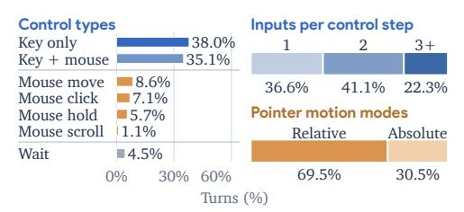

#### (b) Goal and reasoning annotation (Goal and reasoning annotation)

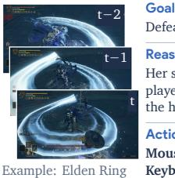

보스 Rellana, Twin Moon Knight를 물리치라.

#### Reasoning (Reasoning)

그녀의 베기는 플레이어 위에서 스윙 경로를 완성하고 있다. 무거운 공격으로 전진하면 회복 창 동안 타격이 연결된다.

#### Action (Action)

**마우스: click(left)**

**키보드: hold(w) + hold(shift)**

그림 2: 감독 초기화를 위한 정제된 게임플레이 시연. (a) 제어 유형, 제어 단계당 입력 수, 포인터-모션 모드에 따라 정리된 기록된 제어를 우리 시연 트랙트리에서 보여준다. 두 개 이상의 동시 입력은 복합 동작을 형성한다. (b) 기록된 동작과 주석이 달린 작업 지시 및 시각적 추론을 매칭한 시연 샘플.

시연 트랙트리 정제. 우리는 공개 데이터셋 [(Choi et al., 2026;](#page-9-9) [Markov AI, 2026;](#page-10-15) [Yue et al., 2026;](#page-11-3) [Baker](#page-9-10) [et al., 2022)](#page-9-10)와 사내 녹음에서 6,044개의 게임플레이 트랙트리(총 295,097 상호작용 턴)를 정제하며, 기록된 제어를 Section [3.1.](#page-3-0)에서 정의한 공유 게임-제어 동작 공간에 매핑한다. 제어는 공유 동작 간격에 맞춰 정렬되고, 소스별 마우스 보정은 정규화된 픽셀 등가 좌표에서 상대 입력을 표현한다. 불완전하거나 중복된 녹음을 필터링한 뒤, 우리는 VLM [(Google DeepMind, 2026)](#page-9-11)을 사용해 기록된 동작에 작업 지시와 턴별 시각적 추론을 주석한다. 추론 주석을 위해 VLM은 작업 지시, 현재 및 과거 관찰, 그리고 동작 목표를 조건으로 한다. Figure [2](#page-4-1)은 입력 범위와 주석이 달린 시연을 보여준다. Appendix [B](#page-12-0)은 소스, 정렬, 보정, 주석 절차를 상세히 설명한다.

감독 기반 미세 조정. 우리는 각 SFT 예제를 (q, It, CH(h<t), zt, at)로 구성한다. 여기서 작업 지시 q, 현재 스크린샷 It, 그리고 보존된 이력 CH(h<t)는 정책 입력을 형성하며, 시각적 추론 zt와 동작 at는 감독을 제공한다. [Wang et al.](#page-11-1) [(2025b)](#page-11-1)을 따라, 우리의 SFT, RL, 그리고 평가 모두 2 + 2 이력 설정을 공유한다: 최근 두 개의 시각–동작 턴과 이전 두 개의 동작 전용 턴이며, 추론은 제외된다. 우리는 정책을 미세 조정하여 작업 지시, 현재 스크린샷, 보존된 이력에 조건화된 (zt, at)를 예측하도록 한다. Appendix [D.1](#page-15-0)에 상세히 기술된 *action-balanced sampling*을 사용해 덜 빈번한 제어와 복합 동작에 대한 노출을 증가시킨다.

### 3.3 PLAYER-1-GYM: 합성 경험에서 학습 (PLAYER-1-GYM: LEARNING FROM SYNTHETIC EXPERIENCE)

우리는 PLAYER-1-GYM을 구축한다. 이는 게임 전반에 걸쳐 공유되는 제어 요구를 중심으로 구성된 합성 환경 모음이다. 프로그램적으로 검증 가능한 보상과 무작위화된 관측 및 제어 역학이 결합되어 SFT-초기화된 정책의 다중 환경 PPO 훈련을 지원한다.

검증 가능한 환경 구축. 우리는 게임 전반에 걸쳐 반복되는 제어 요구를 식별하고 훈련 과제를 다섯 개의 가족으로 구성한다: 조준, 전투, 운전, 탐색, 그리고 UI 상호작용. 예를 들어, 조준 과제는 포인터 기반 또는 카메라 상대 타깃 추적을 요구하며, 전투 과제는 이동과 공격 타이밍을 결합한다. 자체 공유 2D 및 3D 엔진, 재사용 가능한 자산, 그리고 장면 템플릿을 기반으로 우리는 이 제어 형태를 요구하는 16개의 환경을 구현한다. Figure [3(](#page-5-0)a–b)에서 보여진다. 통합 런타임은 스크린샷 관측을 제공하고 공유 게임-제어 액션 공간을 실행한다. 이 공유 기반은 새로운 환경을 추가하면서 일관된 관측 및 액션 인터페이스를 유지하도록 돕는다.

검증 가능한 훈련 피드백을 제공하기 위해 각 환경은 변화하는 게임 상태에 대한 게임 및 과제별 점수 규칙을 정의한다. 점수 증가량은 단계별 보상을 제공하며, 학습된 판사가 없이도 밀집되고 검증 가능한 피드백을 제공한다. 동시에 특권 상태는 정책에 노출되지 않는다.

환경 무작위화. 각 환경 내에서 훈련 경험을 더욱 넓히기 위해, 우리는 PLAYER-1-GYM에서 네 가지 보완적인 차원을 무작위화한다: (1) 외관 (Appearance): 색상, 조명, 자산; (2) 카메라 (Camera): 투영, 배치, 초기 방향; (3) 장면 (Scene): 배치, 생성 지점, 작업별 구성; (4) 제어 (Control): 카메라 회전, 이동에 대한 입력-반응 이득,

## (a) 작업군과 제어 요구 (Task families and control demands)

Player-1-Gym: 16 synthetic environments

| 작업 패밀리 $\rightarrow$ | 제어 요구 $\rightarrow$ | 환경 |
|---------------------------|-----------------------------------------------------|-------------------------------------------------------------------------------|
| 조준 (2) | 포인터 또는 카메라를 정렬하여 목표를 명중한다. | 2D 조준; 3D 조준 |
| 전투 (5) | 이동, 조준 및 공격 타이밍을 조정한다. | 2D 사격; 3D 전투 아레나; 3D 창 격투; 3D 검 격투; 3D 근접 아레나 |
| 운전 (4) | 경로를 따라 차량의 방향과 위치를 제어한다. | 2D 차선 운전; 2D 서킷 운전; 3D 도로 운전; 3D 차선 운전 |
| 항법 (4) | 목표를 향해 이동하고 장애물을 피하며 점프 타이밍을 맞춘다. | 2D 수집 회피; 2D 플랫폼; 3D 탐색; 3D 추격 |
| UI 상호작용 (1) | 인터페이스 요소를 선택하고 조작한다. | 2D UI 제작 |

#### (b) 환경 뷰 (Environment views)

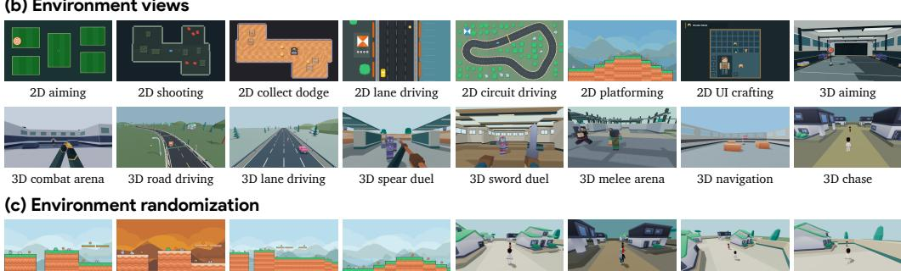

Figure 3: PLAYER-1-GYM: 검증 가능한 보상을 갖는 합성 경험. (a) 다섯 개의 작업군에 걸친 공유 제어 요구. (b) 십육 개의 2D 및 3D 환경 시각화. (c) 동일 환경에 적용된 외관, 카메라, 장면 랜덤화 예시.

3D 원본

외관

운전 및 조향(해당되는 경우). 모든 네 차원은 지원되는 경우 훈련 중에 함께 랜덤화된다. 예시는 Figure 3(c)에 제공된다. Appendix C는 분포와 환경별 설정을 추가로 명시한다.

다중 환경 강화 학습. 우리는 SFT 초기화된 정책을 PPO와 함께 서로 다른 제어 요구, 역학, 보상 규모를 가진 랜덤화된 환경에서 공동 최적화한다. 보상 규모 차이가 정책 업데이트 크기에 미치는 영향을 제한하기 위해, 환경별 이점 정규화를 일반화 이점 추정치(GAE)에 적용한다:

$$\widetilde{A}_{i,j} = \frac{A_{i,j} - \mu_e}{\sqrt{\sigma_e^2 + \epsilon}}, \quad \mu_e = \frac{\sum_{(i,j) \in \mathcal{S}_e} A_{i,j}}{N_e}, \quad \sigma_e^2 = \frac{\sum_{(i,j) \in \mathcal{S}_e} (A_{i,j} - \mu_e)^2}{N_e - 1}.$$

(1)

여기서 i는 턴을, j는 응답 토큰을 나타낸다. 각 환경 e에 대해, $S_e$는 롤아웃 배치에서 해당 환경의 응답 토큰 인덱스를 포함하며, $N_e = |\mathcal{S}_e|$이다. 우리는 $(i,j) \in \mathcal{S}_e$에 대해 해당 이점 평균 $\mu_e$와 샘플 분산 $\sigma_e^2$를 사용해 각 $A_{i,j}$를 정규화한다. Return-to-go 목표는 이후 턴의 보상을 누적하여, 이후 결과가 이전 제어 결정을 알릴 수 있도록 한다. Appendix D.2는 보상 구성, 교차 턴 크레딧, 손실 집계 및 최적화에 대해 추가로 상세히 설명한다.

### **실험** (EXPERIMENTS)

### 4.1 실험 설정 (EXPERIMENTAL SETUP)

**훈련 설정.** 우리는 Player-1-9B와 Player-1-35B-A3B를 각각 Qwen3.5-9B와 Qwen3.5-35B-A3B 백본에서 초기화한다. 두 모델은 전체 시연 데이터셋에서 행동 균형 샘플링을 사용해 두 epoch의 SFT를 수행한다. 이후 16개 환경의 PLAYER-1-GYM 스위트에서 근접 정책 최적화(PPO)를 적용한다. 두 모델 크기는 200 RL 단계 예산으로 전체 16개 환경 스위트에서 훈련된다. 각 훈련 단계는 환경마다 균등하게 할당된 256 에피소드를 수집하며, 에피소드당 최대 50번의 상호작용 턴을 가진다. 추가 훈련 세부 사항 및 하이퍼파라미터는 Appendix D에 제공된다.

**평가.** 16개 PLAYER-1-GYM 환경의 도메인 내 평가 외에, 우리는 MineDojo-300(마인크래프트의 MineDojo (Fan et al., 2022) 작업 모음에서 300개 작업을 포함)과 ViZDoom-10(12개 사용 가능한 ViZDoom 맵 중 10개 맵을 포함)을 구성한 두 평가 스위트를 만든다. 또한 GameWorld [(Ouyang et al., 2026)]에서 브라우저 게임 상호작용을 평가하며, 34개 게임에 걸쳐 170개 작업을 다룬다. 우리의 표준화된 평가 프로토콜은 MineDojo 작업당 8회, ViZDoom 맵당 50회, GameWorld 작업당 3회를 사용한다. Appendix [E](#page-18-0)는 벤치마크 구성, 지표 및 예산을 상세히 설명한다.

우리는 게임 전용 모델인 JARVIS-VLA [(Li et al., 2025)](#page-10-10), NitroGen [(Magne et al., 2026)](#page-10-3), Open-P2P [(Yue et al., 2026)](#page-11-3), GameWAM [(Guo et al., 2026)](#page-9-4)과 컴퓨터 사용 모델인 UI-TARS-1.5-7B [(ByteDance Seed, 2025)](#page-9-14) 및 우리 Qwen3.5 기반 모델을 비교한다. 우리는 벤치마크 전반에 걸쳐 이들의 원본 전처리 및 추론 절차를 유지한다. 또한 기본 모델, SFT 초기화 모델, 최종 PLAYER-1 모델을 비교해 SFT와 합성 경험에서 오는 이득을 분리한다.

### 4.2 주요 결과 (MAIN RESULTS)

Minecraft에서의 작업 지향 제어. MineDojo-300에서 SFT는 9B의 성공률을 9.21%에서 10.54%로, 35B-A3B의 성공률을 7.79%에서 23.38%로 상승시킨다. Interactive learning은 9B의 성공률을 38.33%로 끌어올리며, SFT 대비 27.79 퍼센트 포인트의 큰 향상을 보인다. 8번 시도 중 최소 4번 이상 완료된 작업 수는 20에서 136으로 증가하여, 작업 범위와 반복성 모두에서 향상을 나타낸다.

Table 2: MineDojo-300에서의 작업 성공률 및 범위. 결과는 작업당 8번의 시도를 사용한다. Coverage는 성공 임계값을 충족하는 작업 수를 세며, 괄호 안은 95% 작업 부트스트랩 신뢰 구간을 표시한다.

|  |  |  | 성공률(%) ↑ | 성공에 따른 커버리지 (n/300) ↑ |  |  |  |
|----------------------|--------|---------|----------------------|---------------------------------|---------|---------|---------|
| 방법 | 전투 | 수확 | 전체 [95% CI] |  | ≥1/8 | ≥2/8 | ≥4/8 |
| JARVIS-VLA | 7.56 | 5.00 | 6.71 [5.38, 8.08] |  | 95/300 | 41/300 | 5/300 |
| UI-TARS-1.5-7B | 0.56 | 0.00 | 0.38 [0.13, 0.67] |  | 8/300 | 1/300 | 0/300 |
| NitroGen | 0.00 | 0.00 | 0.00 [-] |  | 0/300 | 0/300 | 0/300 |
| Open-P2P-1.2B | 0.44 | 0.00 | 0.29 [0.08, 0.50] |  | 7/300 | 0/300 | 0/300 |
| GameWAM | 14.00 | 9.88 | 12.63 [10.79, 14.54] |  | 155/300 | 79/300 | 16/300 |
| Qwen3.5-9B | 11.75 | 4.13 | 9.21 [7.50, 11.00] |  | 106/300 | 59/300 | 13/300 |
| Qwen3.5-35B-A3B | 8.69 | 6.00 | 7.79 [6.25, 9.46] |  | 99/300 | 50/300 | 8/300 |
| Player-1-9B-SFT | 12.50 | 6.63 | 10.54 [8.67, 12.50] |  | 120/300 | 63/300 | 20/300 |
| Player-1-35B-A3B-SFT | 30.31 | 9.50 | 23.38 [20.63, 26.21] |  | 172/300 | 133/300 | 76/300 |
| Player-1-9B | 52.31 | 10.38 | 38.33 [35.13, 41.58] |  | 209/300 | 173/300 | 136/300 |
| Player-1-35B-A3B | 55.56 | 12.00 | 41.04 [37.83, 44.29] |  | 224/300 | 182/300 | 142/300 |

표 3: ViZDoom-10에서 1인칭 제어, 각 맵마다 50번의 시도. 평균 스케일된 반환을 보고한다. 맵별 보상 설정 및 스케일링 계수는 부록 [E.4.](#page-20-0)에 제공된다.

표 4: GameWorld에서 브라우저 게임 제어, 170개의 작업과 34개의 게임에 걸쳐 각 작업마다 3번의 시도.

| 방법 | 정밀도 사격 | 목표 항법 | 모바일 전투 | 생존 | 전반 | 방법 | 성공 (%) | 진행 (%) |
|----------------------|-----------------------|--------------------|------------------|----------|---------|----------------------|----------------|-----------------|
| JARVIS-VLA | −0.6270 | −0.1459 | 0.1340 | 0.1565 | −0.1458 | JARVIS-VLA | 6.47 | 17.61 |
| UI-TARS-1.5-7B | −0.6648 | −0.1064 | 0.0587 | 0.1444 | −0.1743 | UI-TARS-1.5-7B | 5.49 | 19.71 |
| NitroGen | −0.3877 | −0.0732 | 0.0740 | 0.1471 | −0.0793 | NitroGen | 8.82 | 23.41 |
| Open-P2P-1.2B | −0.5385 | −0.0174 | 0.6493 | 0.1525 | 0.0602 | Open-P2P-1.2B | 2.35 | 10.37 |
| GameWAM | 0.1175 | −0.1285 | 1.1860 | 0.1424 | 0.3938 | GameWAM | 5.88 | 16.91 |
| Qwen3.5-9B | 0.2257 | 0.1155 | 0.4340 | 0.3822 | 0.2975 | Qwen3.5-9B | 10.39 | 29.22 |
| Qwen3.5-35B-A3B | 0.3376 | 0.1147 | 0.5627 | 0.4909 | 0.3912 | Qwen3.5-35B-A3B | 13.14 | 33.49 |
| Player-1-9B-SFT | 0.4403 | 0.1839 | 0.5293 | 0.5423 | 0.4361 | Player-1-9B-SFT | 13.14 | 31.43 |
| Player-1-35B-A3B-SFT | 0.7376 | 0.3019 | 0.5380 | 0.6065 | 0.5644 | Player-1-35B-A3B-SFT | 15.49 | 34.60 |
| Player-1-9B | 1.0772 | 0.5974 | 0.3033 | 0.7927 | 0.6922 | Player-1-9B | 15.88 | 34.45 |
| Player-1-35B-A3B | 1.0423 | 0.2628 | 0.5960 | 0.8979 | 0.7236 | Player-1-35B-A3B | 17.25 | 38.79 |

우리는 RL 훈련 스위트 외의 일반화를 보여 준다. 동일한 정책이 외부 게임에서 성능을 향상시킨다. ViZDoom-10에서 Player-1-9B는 SFT 이후 0.4361에서 0.6922로 스케일된 리턴을 증가시킨다. Player-1-35B-A3B는 전체 스케일된 리턴 0.7236을 달성하며, 가장 강력한 외부 기준인 GameWAM(0.3938)을 83.7%만큼 능가한다. GameWorld의 3 × 170 에피소드에서 진행률이 31.43%에서 34.45%로 상승한다. 이 결과들은 PLAYER-1-GYM에서 획득한 제어 경험이 RL을 위한 합성 환경을 넘어 일인칭 슈팅과 별도 브라우저 게임으로 전이된다는 것을 보여준다. 이러한 이득은 각 대상 게임에서 강화 학습 없이 합성 경험을 사용해 전이 가능한 제어 능력을 개발할 수 있음을 뒷받침한다.

**작업 지시** 도보로 탐색하고 차를 찾아 들어간 뒤 도시를 운전한다.

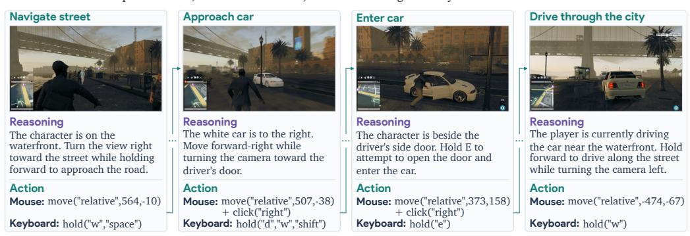

Figure 4: 보류된 상용 게임 *Watch Dogs 2*에서 Player-1-9B: 도보 탐색, 차 접근, 차량 진입, 도시 운전. 이 시퀀스는 탐색 중 조정된 움직임과 카메라 제어를 보여 주며, 차량 진입 및 운전에 대한 지정된 입력을 포함한다. 추론 및 행동 텍스트는 가독성을 위해 약간 축약되고 재구성되었다.

사례 예시: 보이지 않은 상용 게임에서의 제어. 우리는 시각 입력과 키보드–마우스 제어를 사용한 관찰–행동 루프를 통해 PLAYER-1을 상용 게임에 통합한다. Figure [4](#page-7-0)은 SFT와 RL 모두에서 보이지 않은 게임 *Watch Dogs 2*에서의 예시 시퀀스를 보여 준다. 훈련 중 획득한 경험은 에이전트가 도보 탐색, 목표 접근, 차량 상호작용, 운전 시나리오 전반에서 추론하고 행동할 수 있게 한다.

## 5 분석 (ANALYSIS)

### 5.1 학습 동역학 (LEARNING DYNAMICS)

본 절에서는 SFT-초기화된 정책의 RL 단계에 따른 학습 동역학을 보여 준다. Figure [5(](#page-7-1)a,b)는 벌칙이 부과된 에피소드 리턴과 벌칙이 부과되지 않은 게임 점수를 분리하며, 각 지표는 열여섯 개 환경에서 평균화된다.

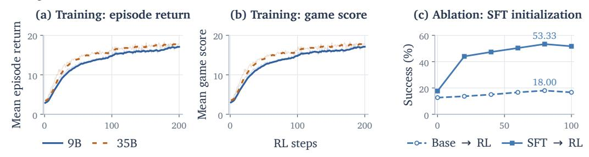

Figure 5: 훈련 동역학 및 감독 초기화의 효과. (a,b) 200 RL 단계 동안 16 환경에서 9B와 35B-A3B의 평균 에피소드 리턴과 게임 점수; 희미한 궤적은 원시 값을, 굵은 곡선은 EMA를 보여 준다. (c) 0–100 RL 단계 동안 9B의 Base→RL과 SFT→RL.

SFT를 넘어선 학습. Figure [5(](#page-7-1)a,b)에서 보듯이, 평균 에피소드 리턴과 평균 게임 점수는 RL 훈련 단계에 따라 상승한다. 이득은 훈련 초기에 가장 크며 이후 점진적으로 감소한다. 35B-A3B 곡선은 두 지표 모두에서 9B 곡선보다 약간 높은 수준에서 끝난다. 이러한 추세는 합성 경험에서의 학습이 SFT를 넘어 게임 제어를 향상시킨다는 것을 시사한다.

감독 초기화의 효과. Figure [5(](#page-7-1)c)는 100 RL 단계 동안 9B의 Base→RL과 SFT→RL 궤적을 대비한다. SFT→RL은 Minecraft 성공률이 17.67%에서 51.67%로 상승하는 반면, Base→RL은 12.67%에서 16.67%로 상승하여 100 단계에서 35.00 퍼센트 포인트의 격차를 남긴다.

환경 전반에 걸친 학습. Figure [6](#page-8-0)는 열여섯 개 훈련 환경에서 에피소드 리턴을 분해한다. 두 모델 모두 넓은 순이득을 보이지만, 학습 궤적은 환경마다 다르다.

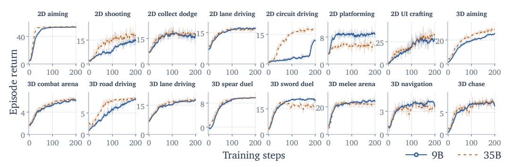

Figure 6: 200 RL 단계 동안 9B와 35B-A3B의 환경별 에피소드 리턴. 곡선은 학습 진행, 리턴 규모 및 다양한 합성 환경에서의 상대적 모델 성능 차이를 보여 준다.

환경들. 예를 들어, 2D 조준과 같은 단순한 작업에서의 성능은 빠르게 향상되었다가 정체되며, 반면 2D 회로 운전에서의 이득은 훨씬 나중에 나타난다.

### 5.2 환경 확장 (Environment Scaling)

훈련 세트 확장.  
스케일링 비교는 동일한 Player-1-9B-SFT 체크포인트에서 시작하여 2, 4, 8, 또는 16 환경에 걸쳐 100개의 RL 단계에 걸쳐 25,600개의 에피소드를 고정 예산으로 할당한다.  
각 구성은 단계당 256개의 에피소드를 사용하며, 이는 환경마다 균등하게 할당된다.  
부록 D.4는 하위 집합과 프로토콜을 명시한다.

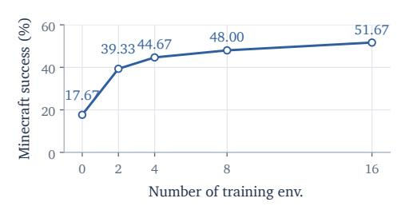

Figure 7: 고정 예산 25,600 에피소드를 100 RL 단계에 걸쳐 2, 4, 8, 또는 16 환경에서 스케일링. Zero는 SFT 기준을 나타낸다.

### 5.3 행동 구성의 진화 (EVOLUTION OF ACTION COMPOSITION)

Figure 8은 RL 중 복합 행동 사용이 증가함을 보여준다. Player-1-9B의 인-스위트 검증 궤적 전반에 걸쳐 복합 행동이 포함된 턴 비율이 RL 시작 시 64.7%에서 50 단계 후 85.4%, 100 단계 후 93.2%로 상승한다. 이 점진적 증가는 행동 구성에 대한 명시적 보상이 없으면서 발생하며, 이는 작업 중심 RL이 게임 제어에 흔히 사용되는 조정된 입력(예: 사격 중 조준, 카메라 조정 중 이동)을 강화함을 시사한다.

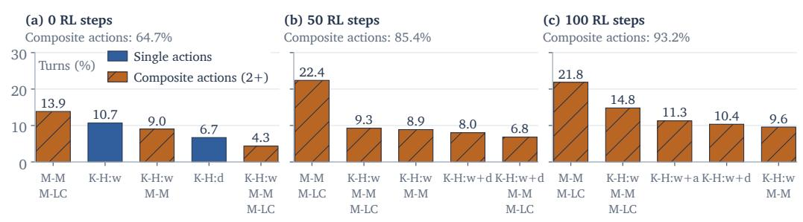

Figure 8: **PLAYER-1-GYM** 검증 중 행동 구성의 진화. 복합 행동 사용률이 100 RL 단계에 걸쳐 64.7%에서 93.2%로 상승한다. 막대는 각 체크포인트에서 가장 빈번한 행동을 전체 턴 대비 비율로 표시한다. K-H: 키 보유; M-M: 마우스 이동; M-LC: 마우스 왼쪽 클릭.

## 6 결론 (Conclusion)

우리는 **PLAYER-1**을 제시하였다. 이는 시뮬레이션 경험을 통해 시연을 넘어 게임 제어를 학습하는 사후 훈련 프레임워크이다. 선별된 게임플레이 시연은 공유 게임 제어 행동 공간에서 컴퓨터 사용 모델을 초기화한다. **PLAYER-1-GYM**은 공유 제어 요구를 중심으로 구성된 16개의 시뮬레이션 환경을 제공하며, 검증 가능한 보상과 무작위 관측 및 제어 역학을 통해 다중 환경 RL을 가능하게 한다. MineDojo-300, ViZDoom-10, 그리고

GameWorld는 시뮬레이션 경험에서 학습이 SFT를 넘어 게임 제어 능력을 향상시키며, RL 훈련 세트 외에서도 일반화되는 이득을 제공함을 보여준다. 추가 분석은 더 큰 훈련 세트에서 전이 성능이 향상됨을 나타낸다. 이 결과들은 시뮬레이션 경험이 각 대상 게임에서 온라인 훈련 없이 전이 가능한 게임 제어를 학습하는 효과적인 자원임을 확립한다.

## 참고문헌 (REFERENCES)

- Diogo Almeida. System One 모델 및 Jev 도입. TypeSafe AI Blog, 2026년 9월. URL [https:](https://typesafe.ai/blog/introducing-system-one-models-and-jev) [//typesafe.ai/blog/introducing-system-one-models-and-jev](https://typesafe.ai/blog/introducing-system-one-models-and-jev).

- Anthropic. Claude 4 도입. 기술 발표, 2025년. URL [https://www.anthropic.com/](https://www.anthropic.com/news/claude-4) [news/claude-4](https://www.anthropic.com/news/claude-4).

- Shuai Bai, Yuxuan Cai, Ruizhe Chen, Keqin Chen, Xionghui Chen, Zesen Cheng, Lianghao Deng, Wei Ding, Chang Gao, Chunjiang Ge, et al. Qwen3-VL 기술 보고서. arXiv 사전 인쇄 arXiv:2511.21631, 2025년. URL <https://arxiv.org/abs/2511.21631>.

- Bowen Baker, Ilge Akkaya, Peter Zhokhov, Joost Huizinga, Jie Tang, Adrien Ecoffet, Brandon Houghton, Raul Sampedro, and Jeff Clune. Video pretraining (VPT): 라벨이 없는 온라인 비디오를 관찰하여 행동을 학습하기. arXiv 사전 인쇄 arXiv:2206.11795, 2022년.

- ByteDance Seed. UI-TARS-1.5-7B, 2025년. URL [https://huggingface.co/ByteDance-Seed/](https://huggingface.co/ByteDance-Seed/UI-TARS-1.5-7B) [UI-TARS-1.5-7B](https://huggingface.co/ByteDance-Seed/UI-TARS-1.5-7B). 모델 출시.

- Wayne Chi, Yixiong Fang, Arnav Yayavaram, Siddharth Yayavaram, Seth Karten, Qiuhong Anna Wei, Runkun Chen, Alexander Wang, Valerie Chen, Ameet Talwalkar, and Chris Donahue. GameDevBench: 게임 개발을 통한 에이전트 능력 평가. arXiv 사전 인쇄 arXiv:2602.11103, 2026년.

- Suhwan Choi, Jaeyoon Jung, Haebin Seong, Minchan Kim, Minyeong Kim, Yongjun Cho, Yoonshik Kim, Yubeen Park, Youngjae Yu, and Yunsung Lee. D2E: 데스크톱 데이터를 이용한 시각-행동 사전 훈련을 확장하여 구현형 AI로 전이. In International Conference on Learning Representations, 2026년.

- Guanting Dong, Junting Lu, Junjie Huang, Wanjun Zhong, Longxiang Liu, Shijue Huang, et al. Agent-World: 일반 에이전트 지능을 진화시키기 위한 실제 환경 합성 확장. arXiv 사전 인쇄 arXiv:2604.18292, 2026년.

- Linxi Fan, Guanzhi Wang, Yunfan Jiang, Ajay Mandlekar, Yuncong Yang, Haoyi Zhu, Andrew Tang, De-An Huang, Yuke Zhu, and Anima Anandkumar. MineDojo: 인터넷 규모 지식을 활용한 개방형 구현형 에이전트 구축. In Advances in Neural Information Processing Systems, volume 35, pp. 18343–18362, 2022년.

- Gemini Team. Gemini 2.5: 고급 추론, 다중모달성, 장기 컨텍스트, 차세대 에이전트 능력으로 한계를 확장. 기술 보고서, Google DeepMind, 2025년. URL [https://storage.googleapis.com/deepmind-media/gemini/gemini_v2_5_report.pdf](https://storage.googleapis.com/deepmind-media/gemini/gemini_v2_5_report.pdf) [googleapis.com/deepmind-media/gemini/gemini_v2_5_report.pdf](https://storage.googleapis.com/deepmind-media/gemini/gemini_v2_5_report.pdf).

- Google DeepMind. Gemini 3.8 Flash. 모델 카드, 2026년. URL [https://deepmind.google/models/](https://deepmind.google/models/model-cards/gemini-3-8-flash/) [model-cards/gemini-3-8-flash/](https://deepmind.google/models/model-cards/gemini-3-8-flash/).

- Yuncheng Guo, Zhanqiu Zhang, Yiwen Guo, and Weijia Li. GameWAM: 비디오 게임을 위한 세계 행동 모델. arXiv 사전 인쇄 arXiv:2608.26200, 2026년. URL <https://arxiv.org/abs/2608.26200>.

- Siyuan Hu, Mingyu Ouyang, Difei Gao, and Mike Zheng Shou. GUI 에이전트의 새벽: Claude 3.5 컴퓨터 사용을 통한 예비 사례 연구. arXiv 사전 인쇄 arXiv:2411.10323, 2024년. URL [https://arxiv.org/abs/2411.10323](https://arxiv.org/abs/2411.10323) [org/abs/2411.10323](https://arxiv.org/abs/2411.10323).

- Michał Kempka, Marek Wydmuch, Grzegorz Runc, Jakub Toczek, and Wojciech Jaskowski. ViZDoom: 시각 강화 학습을 위한 도미 기반 AI 연구 플랫폼. In IEEE Conference on Computational Intelligence and Games, pp. 341–348, 2016년. doi: 10.1109/CIG.2016.7860433. URL [https://arxiv.org/abs/1605.02097](https://arxiv.org/abs/1605.02097) [org/abs/1605.02097](https://arxiv.org/abs/1605.02097).

- Wolfgang Lehrach, Daniel Hennes, Miguel Lazaro-Gredilla, Xinghua Lou, Carter Wendelken, Zun Li, Antoine Dedieu, Marc Lanctot, Atil Iscen, John Schultz, Marcus Chiam, Ian Gemp, Piotr Zielinski, Satinder Singh, and Kevin Murphy. 일반 게임 플레이를 위한 코드 월드 모델. In The Fourteenth International Conference on Learning Representations, 2026년. URL <https://openreview.net/forum?id=1UoB7IWiku>.

- Muyao Li, Zihao Wang, Kaichen He, Xiaojian Ma, and Yitao Liang. JARVIS-VLA: 사후 훈련 대규모 시각 언어 모델을 사용해 키보드와 마우스로 시각 게임을 플레이하기. In *Findings of the Association for Computational Linguistics: ACL 2025*, pp. 17878–17899, 2025. doi: 10.18653/v1/2025.findings-acl.920.

- Bo Liu, Simon Yu, Yiding Jiang, Ao Qu, Andrew Zhao, Zichen Liu, Junsu Kim, Zijian Zhou, Seungone Kim, Tongzheng Ren, Mickel Liu, Hanfei Yu, Zhaorun Chen, Weiyan Shi, Paul Pu Liang, Luke Zettlemoyer, Yejin Choi, and Natasha Jaques. SPADE: 적응형 합성 실행 환경에서의 셀프 플레이. *arXiv preprint arXiv:2608.19197*, 2026.

- Dunjie Lu, Shuai Bai, Tianyi Bai, Sicheng Fan, Chang Gao, Jian Guan, Feng Hu, Mianqiu Huang, Xingyang Huang, Yizhen Jiang, et al. Qwen-CUA: 거의 모든 것을 위한 네이티브 컴퓨터 사용. *arXiv preprint arXiv:2608.02352*, 2026. URL <https://arxiv.org/abs/2608.02352>.

- Meng Luo, Yanlin Li, Hao Li, Hongzhan Lin, Pengfei Zhou, Tianjie Ju, Ran Zhang, Yeying Jin, Mong-Li Lee, and Wynne Hsu. 기반 모델 시대의 게임을 위한 AI. *arXiv preprint arXiv:2609.16679*, 2026a. URL <https://arxiv.org/abs/2609.16679>.

- Tongxu Luo, Rongsheng Wang, Jiaxi Bi, Chenming Xu, Zhengyang Tang, Jianlong Chen, Juhao Liang, Ke Ji, Shuqi Guo, Yuhao Du, Fan Bu, Wenyu Du, Xiaotong Zhang, Kyle Li, Shaobo Wang, Linfeng Zhang, Yuxuan Liu, Xin Lai, Chenxin Li, Yiduo Guo, Zhexin Zhang, Xinyuan Wang, Tianyi Bai, Ziniu Li, and Benyou Wang. GameCraft-Bench: 에이전트가 실제 게임 엔진에서 엔드-투-엔드로 플레이 가능한 게임을 만들 수 있는가? *arXiv preprint arXiv:2606.17861*, 2026b. URL <https://arxiv.org/abs/2606.17861>.

- Loïc Magne, Anas Awadalla, Guanzhi Wang, Yinzhen Xu, Joshua Belofsky, Fengyuan Hu, Joohwan Kim, Ludwig Schmidt, Georgia Gkioxari, Jan Kautz, Yisong Yue, Yejin Choi, Yuke Zhu, and Linxi Fan. NitroGen: 일반화 게임 에이전트를 위한 공개 기반 모델. In *Proceedings of the IEEE/CVF Conference on Computer Vision and Pattern Recognition*, pp. 21511–21521, 2026.

- Markov AI. Gaming 500 hours. Hugging Face dataset, 2026. URL [https://huggingface.co/](https://huggingface.co/datasets/markov-ai/gaming-500-hours) [datasets/markov-ai/gaming-500-hours](https://huggingface.co/datasets/markov-ai/gaming-500-hours).

- OpenAI. GPT-4o 시스템 카드. *arXiv preprint arXiv:2410.21276*, 2024. URL [https://arxiv.org/abs/](https://arxiv.org/abs/2410.21276) [2410.21276](https://arxiv.org/abs/2410.21276).

- Mingyu Ouyang, Siyuan Hu, Kevin Qinghong Lin, Hwee Tou Ng, and Mike Zheng Shou. GameWorld: 다중 모달 게임 에이전트의 표준화 및 검증 가능한 평가를 향해. *arXiv preprint arXiv:2604.07429*, 2026.

- Yujia Qin, Yining Ye, Junjie Fang, Haoming Wang, Shihao Liang, Shizuo Tian, Junda Zhang, et al. UI-TARS: 네이티브 에이전트와의 자동 GUI 상호작용을 선도하다. *arXiv preprint arXiv:2501.12326*, 2025.

- Chengshuai Shi, Wenzhe Li, Xinran Liang, Yizhou Lu, Wenjia Yang, Ruirong Feng, Seth Karten, Ziran Yang, Zihan Ding, Gabriel Sarch, Danqi Chen, Karthik Narasimhan, and Chi Jin. Odysseus: 강화 학습을 통해 게임에서 100턴 이상 의사결정을 수행하는 VLM을 확장하다. *arXiv preprint arXiv:2605.00347*, 2026.

- SIMA Team. 다수의 시뮬레이션 세계에서 지시 가능한 에이전트를 확장하다. *arXiv preprint arXiv:2404.10179*, 2024. URL <https://arxiv.org/abs/2404.10179>.

- SIMA Team. SIMA 2: 가상 세계를 위한 일반화 구현형 에이전트. *arXiv preprint arXiv:2512.04797*, 2025. URL <https://arxiv.org/abs/2512.04797>.

- Weihao Tan, Xiangyang Li, Yunhao Fang, Heyuan Yao, Shi Yan, Hao Luo, Tenglong Ao, Huihui Li, Hongbin Ren, Bairen Yi, Yujia Qin, Bo An, Libin Liu, and Guang Shi. Lumine: 3D 오픈 월드에서 일반화 에이전트를 구축하기 위한 공개 레시피. *arXiv preprint arXiv:2511.08892*, 2025a. URL [https://arxiv.org/abs/](https://arxiv.org/abs/2511.08892) [2511.08892](https://arxiv.org/abs/2511.08892).

- Weihao Tan, Wentao Zhang, Xinrun Xu, Haochong Xia, Ziluo Ding, Boyu Li, Bohan Zhou, Junpeng Yue, Jiechuan Jiang, Yewen Li, Ruyi An, Molei Qin, Chuqiao Zong, Longtao Zheng, Yujie Wu, Xiaoqiang Chai, Yifei Bi, Tianbao Xie, Pengjie Gu, Xiyun Li, Ceyao Zhang, Long Tian, Chaojie Wang, Xinrun Wang, Borje F. Karlsson, Bo An, Shuicheng Yan, and Zongqing Lu. Cradle: 일반 컴퓨터 제어를 향한 기반 에이전트의 역량 강화. In *Proceedings of the 42nd International Conference on Machine Learning*, volume 267 of *Proceedings of Machine Learning Research*, pp. 58658–58725, 2025b. URL <https://proceedings.mlr.press/v267/tan25h.html>.

- Bowen Wang, Dunjie Lu, Junli Wang, Tianyi Bai, Shixuan Liu, Zhipeng Zhang, Haiquan Wang, Hao Hu, Tianbao Xie, Shuai Bai, Dayiheng Liu, Que Shen, Junyang Lin, and Tao Yu. CUA-Gym: 컴퓨터 사용 에이전트를 위한 검증 가능한 훈련 환경 및 과제를 확장하다. *arXiv preprint arXiv:2605.25624*, 2026a.

- Haoming Wang, Haoyang Zou, Huatong Song, Jiazhan Feng, Junjie Fang, Junting Lu, Longxiang Liu, Qinyu Luo, Shihao Liang, Shijue Huang, Wanjun Zhong, Yining Ye, Yujia Qin, et al. UI-TARS-2 technical report: Advancing GUI agent with multi-turn reinforcement learning. *arXiv preprint arXiv:2509.02544*, 2025a.
- Yinjie Wang, Tianbao Xie, Ke Shen, Mengdi Wang, and Ling Yang. RLAnything: Forge environment, policy, and reward model in completely dynamic RL system. *arXiv preprint arXiv:2602.02488*, 2026b.
- Zihao Wang, Xujing Li, Yining Ye, Junjie Fang, Haoming Wang, Longxiang Liu, et al. Game-TARS: Pretrained foundation models for scalable generalist multimodal game agents. *arXiv preprint arXiv:2510.23691*, 2025b. URL <https://arxiv.org/abs/2510.23691>.
- An Yang, Anfeng Li, Baosong Yang, Beichen Zhang, Binyuan Hui, Bo Zheng, Bowen Yu, Chang Gao, Chengen Huang, Chenxu Lv, et al. Qwen3 technical report. *arXiv preprint arXiv:2505.09388*, 2025. URL <https://arxiv.org/abs/2505.09388>.
- Yuguang Yue, Irakli Salia, Samuel Hunt, Chris Green, Wenzhe Shi, and Jonathan J. Hunt. Scaling behavior cloning improves causal reasoning: An open model for real-time video game playing. *arXiv preprint arXiv:2601.04575*, 2026. URL <https://arxiv.org/abs/2601.04575>.
- Pengfei Zhou, Hexin Wang, Zhengfeiyang Zhang, Yixing Ma, Zhenglin Wan, Kaipeng Zhang, Wangbo Zhao, and Yang You. Agentic game development as a verifiable trajectory data engine for scaling world models. *arXiv preprint arXiv:2608.25518*, 2026. URL <https://arxiv.org/abs/2608.25518>.

## 게임 제어 인터페이스 (A GAME-CONTROL INTERFACE)

## A.1 좌표 및 복합 동작 (A.1 COORDINATES AND COMPOSITE ACTIONS)

표 [5](#page-12-1)는 섹션 [3.1.](#page-3-0)에서 소개한 동작의 실행 의미를 명시한다. 관측값의 너비 W와 높이 H에 대해 정규화된 절대 위치와 상대 변위는 픽셀에 다음과 같이 매핑된다

$$(x,y)\mapsto (xW/1000,yH/1000), \qquad (\Delta x,\Delta y)\mapsto (\Delta xW/1000,\Delta yH/1000).$$

원점은 왼쪽 상단이며, 양수 변위는 오른쪽과 아래쪽을 가리킨다. 한 번의 움직임은 절대 좌표 또는 상대 좌표 중 하나를 사용한다. 키는 같은 단계에서 동시에 보유와 탭을 할 수 없으며, 마우스 버튼도 동시에 보유와 클릭을 할 수 없다.

표 5: 게임 제어 의미. 복합 동작에서 입력은 한 단계 내에서 동시에 실행되며, 바인딩은 환경이 지원하는 것에 한정된다.

| Component | Semantics |
|--------------------|-------------------------------------------------------------------------------------------------------|
| Key hold / tap | 단계 전체에 걸쳐 키 세트를 보유하거나 잠시 눌러서 놓는다. |
| Mouse movement | 절대 화면 위치로 이동하거나 상대 변위를 적용한다. |
| Mouse hold / click | 단계 전체에 걸쳐 한 버튼을 보유하거나 한 버튼을 클릭한다. 서로 다른 버튼이 동시에 실행될 수 있다. |
| Mouse scroll | 한 단계의 위쪽 또는 아래쪽 스크롤을 적용한다. |
| Wait | 작업 없음. 키보드나 마우스 입력 없이 한 단계 진행한다. |

## A.2 실행 및 시각적 피드백

상대적 움직임은 보편적인 카메라 각도가 아니라 입력 변위(displacement)를 요청한다. 픽셀당 카메라 이득 g에 대해 요청된 요(yaw)와 피치(pitch) 증가량 δψ와 δϕ는 다음과 같은 크기를 갖는다

$$|\delta\psi| = gW|\Delta x|/1000,$$

$|\delta\phi| = gH|\Delta y|/1000,$

원래 카메라 한계 이전에; 마우스 변위는 동작 지속 시간에 곱해지지 않는다. 7개의 마우스 제어 3D PLAYER-1-GYM 환경은 기본적으로 관측 픽셀당 0.00196 라디안의 명목 이득 g0를 사용한다. 제어 무작위화(Control randomization)와 함께, 실제 이득은 g = g0L이며, 여기서 L은 부록 [C.2.](#page-15-3)에서 정의된다. 관측 기하학과 카메라 제약은 체크포인트 비교 내에서 고정된다. 벤치마크별 설정은 부록 [E.](#page-18-0)에 제공된다.

## A.3 관측 및 상호작용 기록

SFT, RL, 그리고 평가 모두 최근 두 번의 시각-행동(turn)과 이전 두 번의 행동 전용을 사용한다. 이전 행동 전용에서는 스크린샷이 <image omitted>로 대체되고, 보존된 모든 과거에서의 추론은 <thinking omitted>로 대체된다. 현재 스크린샷과 실행된 과거 행동은 보존된다.

## B 게임플레이 시연: 구성 및 주석

## B.1 출처 및 통계

두 모델 크기는 Figure [9:](#page-13-0)에 있는 컬렉션으로 훈련되며, 2,544개의 소스-자격을 갖춘 녹화 세션과 172개의 게임에서 6,044개의 궤적과 295,097개의 턴을 포함한다. 샘플링된 제어 시간은 턴 수 × 200 ms와 같으며, 전체 주석 데이터셋에 대해 총 16.4시간에 해당한다.

품질 선택. 우리는 소스레벨(sourcelevel)과 수동 검토를 보완하는 유효성, 활동성, 반복성 검사를 자동화하였다. 이는 녹화 완전성, 관측–행동 정렬, 시퀀스 다양성의 수동 검토를 포함한다. 컬렉션에는 총 268,000 턴과 5,360개의 게임플레이 궤적, 27,097 턴과 684개의 인게임 UI 궤적이 포함된다.

행동 통계. Figure [2(](#page-4-1)a)는 데이터셋의 모든 샘플에서 각 행동의 분포를 계산한다. 키보드–마우스 복합은 우선순위를 갖는다. 마우스 전용 턴은 움직임, 클릭, 보유, 스크롤 순으로 할당된다. 단계별 입력은 각 키 탭/보유와 마우스 동작을 별도로 계산하며, 대기(wait)는 하나의 no-op으로 간주된다. 포인터 모드 공유는 마우스 이동을 포함한 모든 턴을 사용한다.

#### **(a) 출처 및 규모**

#### **(b) 게임 분포**

| 출처 | Traj. |  | 턴 수(시간) |
|-------------------------------------|-------|---------------|-------------|
| 공개 데이터셋 |  |  |  |
| Desktop to Embodied AI (2026) 1,005 |  | 49,883 | 2.8 |
| Gaming 500 Hours (2026) | 985 | 48,652 | 2.7 |
| Open Pixel2Play (2026) | 1,140 | 57,000 | 3.2 |
| Video PreTraining (2022) | 1,153 | 56,431 | 3.1 |
| 사내 녹음 |  |  |  |
| 사내 게임플레이 녹음 | 1,761 | 83,131 | 4.6 |
| 총계 |  | 6,044 295,097 | 16.4 |

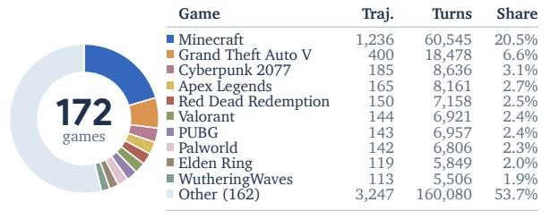

Figure 9: SFT에 사용된 6,044개의 게임플레이 시연의 출처 및 게임 분포. (a) 출처 및 규모, 샘플링된 제어 시간. (b) 게임 분포.

## B.2 행동 표준화 (ACTION STANDARDIZATION)

시간 정렬. 연속 게임플레이의 경우, 소스 타임스탬프가 150–250 ms의 연속 구간을 정의하며, 누적 경계치를 사용해 200 ms 타깃 그리드에 투영된다. 상대 입력은 각 소스 구간 내에서 합산된다. 100 ms 미만의 키보드 눌림은 탭으로, 더 긴 눌림은 겹치는 타깃 단계에서 홀드로 처리된다. 최대 300 ms 지속되는 마우스 눌림은 클릭으로 변환된다. 각 타깃은 하나의 제어 단계 내에서 동시에 실행될 수 있는 호환되는 기록된 입력을 요약한다.

UI 트래젝터리도 기록된 연산 경계에 따라 움직인다. 클릭은 기록된 타깃을 그대로 유지하고, 키 시퀀스는 개별 눌림으로 확장되며, 드래그는 시작 및 종료 컨트롤과 명시적 해제를 사용하고, 스크롤 제스처는 방향 단계로 변환된다. 실행은 공유된 200 ms 액션 공간을 사용한다. 샘플링된 제어 시간은 타깃 실행 시간을 사용하고, UI 트래젝터리는 기록된 연산에 따라 의존하는 타이밍을 유지한다.

공간 정렬. 네이티브 상대 마우스 입력 스케일은 데이터 소스와 녹화 설정에 따라 다르다. 따라서 같은 녹화 세션의 자유롭게 움직이는 GUI 포인터를 사용해 픽셀에 상응하는 변위로 보정한다. 이 매핑은 포인터 잠금 녹화에도 적용된다. 카메라 반응은 부록 [A.2.](#page-12-2) 에 정의된다. 네이티브 입력 합계(rx, ry), 계수(kx, ky), 그리고 논리적 녹화 크기(Wm, Hm)에 대해 정규화된 타깃은 다음과 같다

$$\Delta x = \text{round}(1000k_x r_x/W_m), \qquad \Delta y = \text{round}(1000k_y r_y/H_m).$$

마우스 이동 보정. 사내 및 D2E 보정은 안정된 포커스와 기하학을 가진 GUI 창, 정렬된 타임스탬프, 포인터 클리핑이나 재중심화 없이 사용된다. 쌍으로 된 네이티브 입력 ri와 포인터 변위 pi에 대해 창 및 풀 세션 추정치는 다음과 같다

$$k_i = \frac{r_i^\top p_i}{r_i^\top r_i}, \qquad \hat{k} = \frac{\sum_i r_i^\top p_i}{\sum_i r_i^\top r_i}.$$

D2E는 소스 수준 계수에 대해 창-동일 추정치를 사용하고, 사내 계수는 녹화별이다. Pixel2Play는 최소 두 개의 안정적이고 겹치지 않는 2초 GUI 블록에 대해 축별 Huber 회귀를 사용한다. 범위 초과 투영은 클리핑 대신 거부되어 액션 품질을 보장한다. Table [6](#page-13-1) 에는 소스 매핑이 나열되어 있다.

Table 6: 소스별 마우스-액션 매핑. 상대 입력은 녹화 기하학에 바인딩된 보정 계수를 사용하고, UI 작업은 절대 엔드포인트를 사용한다.

| 소스(source) | 매핑(mapping) |
|-------------|------------------------------------------------------------------------------------------------------------|
| 사내(in-house) | 녹화 전용 보정 계수. |
| D2E | 소스 수준(source-level) kx = ky = 0.66은 상대 입력에 사용되며, UI 작업에 대해서는 절대 끝점을 사용한다. |
| Pixel2Play | 계층적 선택: 세션 GUI 적합 → 메타데이터 프로필 → 디스플레이 스케일. |
| VPT | kx = ky = 2는 논리적 1280 × 720 좌표에서 상대 입력에 사용되며, UI 작업에 대해서는 절대 끝점을 사용한다. |
| Gaming 500h | 캡처 기하학을 사용해 투영된 기록된 절대 위치. |

## B.3 목표 및 추론 주석 (GOAL AND REASONING ANNOTATION)

우리는 Gemini 3.8 Flash를 사용하여 궤적상의 각 게임에 대해 규칙, 역할, 입력 및 예시의 재사용 가능한 프로필을 구축하고, 기록‑제어 범위와 동작 유효성을 확인한다. 목표를 할당한다

각 프로필, 전체 경로 스토리보드, 그리고 행동 타임라인에서 가져옵니다. 서로 다른 데이터 소스의 같은 게임은 동일한 조합된 프로필을 공유해야 합니다. 턴별 추론 주석을 위해 목표, 고정 행동 대상, 현재 및 과거 프레임을 재사용합니다.

## C PLAYER-1-GYM: 과제, 보상 및 무작위화 (C PLAYER-1-GYM: TASKS, REWARDS, AND RANDOMIZATION)

## C.1 과제 및 검증 가능한 보상 (TASKS AND VERIFIABLE REWARDS)

주요 과제별로, 16개의 환경은 조준(2), 전투(5), 운전(4), 탐색(4), UI 상호작용(1)으로 구성된다. 표 [7](#page-14-1)과 [8](#page-14-2)는 그들의 과제, 점수 구성요소, API 상태 필드를 명시한다. 상호작용 테스트, 점수 검사, 그리고 인간 검토는 제어, 관찰 가능한 전이, 보상 이벤트를 인간이 정의한 규칙에 따라 검증한다.

우리는 공유된 Three.js 브라우저 런타임을 설계하여 제어 가능한 재설정, 키보드–마우스 실행, 스크린샷, 보상을 제공하며, 추론 지연과 무관한 고정 단계 시뮬레이션을 구현했다. 각 환경은 누적 점수 Se(s)를 정의하고, 보상으로 증분 re,t = Se(st+1) − Se(st)를 제공한다. 보상 계산 및 평가는 특권 상태를 사용하고, 정책은 스크린샷과 과제/제어 텍스트만을 받는다. 에피소드는 네이티브 완료 또는 실패 시, 또는 과제가 제한 내에서 완료되지 않은 경우 턴 한계에서만 종료된다.

표 7: 2D 환경, 제어, 그리고 검증 가능한 점수 구성요소. 상태 필드는 gameGymAPI.getState().metrics에서 읽어오며, 기본 점수는 누적 점수를 제공한다.

| 환경 | 작업 및 제어 | 점수 구성요소 | 상태 필드(API) |
|--------------------|-----------------------------------|---------------------------------------------------------------------------------|---------------------------------------------------------------------------------------------------------------------------|
| 2D 조준 | 이동 중인 타깃을 추적하고 클릭 타깃 | 타격 +0.1× 누적 정밀도 | 수집된 타깃, 정밀도 합계 |
| 2D 사격 | 이동, 조준, 사격 | 적 처치 | 킬 |
| 2D 수집 회피 | 위험을 회피하며 수집 위험 | 코인 수집 | 코인 수집 |
| 2D 차선 운전 | 시간 차선 변경 | 코인 수집 | 코인 수집 |
| 2D 순환 운전 | 경로를 따라 조향 | 체크포인트 도달 | 체크포인트 통과 |
| 2D 플랫폼 게임 | 달리기, 점프, 대시 | 코인, 갭/스파이크 제거, 깃발 | 코인 수집, 갭 제거, 스파이크 제거, 깃발 도달 |
| 2D UI 제작 | 상담, 제작, 장착 | 레시피 상담 + 재료 보상 +3배 제작 + 선택 +2배 장착 | 레시피 북 보상, 올바른 재료 보상, 목표 제작, 올바른 장비 선택, 장비 장착 |

Table 8: 3D 환경, 제어, 검증 가능한 점수 구성요소. 상태 필드는 gameGymAPI.getState().metrics에서 읽어오며, 기본 점수는 최종 누적 점수를 제공한다.

| 환경 | 작업 및 제어 | 점수 구성요소 | 상태 필드 |
|-----------------|-------------------------------------------|------------------------------------------------|-------------------------------------|
| 3D 조준 | 추적 및 타깃 히트 | 타깃 히트 | 히트 |
| 3D 전투장 | 좌표 이동, 조준, 발사 | 적 처치 | 킬 |
| 3D 도로 운전 | 곡선 및 체크포인트 따라가기 | 체크포인트 도달 | 체크포인트 통과 |
| 3D 차선 운전 | 차선 변경으로 수집 및 회피 | 코인 수집 | 코인 수집 |
| 3D 창 대결 | 추적, 돌진, 방출, 그리고 회피 | 창 히트 −0.5× 피해 받은 | 창 히트, 받은 피해 |
| 3D 검 대결 | 접근, 조준, 그리고 타격 | 공격 히트 + 처치 −0.5× 받은 피해 | 공격 히트, 킬, 받은 피해 |
| 3D 근접 전투장 | 방향, 사거리, 그리고 이동 | 공격 히트 + 처치 −0.5× 받은 피해 | 공격 히트, 킬, 받은 피해 |
| 3D 탐색 | 연속 플래그 도달 | 목표 도달 | 목표 도달 |
| 3D 추격 | 장애물 주위 추적 | 타깃 도달 | 타깃 도달 |

#### C.2 랜덤화 및 샘플링 (RANDOMIZATION AND SAMPLING)

Figure 10은 Appearance, Camera, Scene의 개별 및 공동 변화를 보여준다. Appearance, Camera, Scene, Control에 대한 파라미터, 분포, 적용 가능한 환경은 표 9에 명시되어 있다. 구체적으로, Appearance는 충돌 기하학과 기능적 역할을 보존한다; Scene은 레이아웃, 스폰, 이후 엔티티 생성을 변동시켜 작업 난이도를 바꿀 수 있다. Appearance와 Camera는 리셋 시 샘플링되어 각 에피소드 내에서 고정되며, 삼각형 모드는 기본값에서 샘플링된다. 배경 밝기와 채도, 주변 강도, 키 라이트 강도는 하나의 샘플링된 분위기를 공유하며, 연결된 자산 구성요소는 호환되는 색상 변화를 받는다. 직교 확대는 기본 뷰에 상대적이며 2D 플랫폼을 포함한다. 초기 1인칭 시점의 요/피치는 카메라-리그 피치와 구분된다.

**Control-response sampling.** Control은 카메라 투영 및 장면 구성을 독립적으로 입력 반응을 변동시킨다. 각 지원되는 반응 파라미터 k에 대해 우리는 독립적으로 샘플링한다.

$$c_{e,k} \sim \text{Tri}(a_{e,k}, 1, b_{e,k}), \qquad c_{e,k}(t) = c_{e,k}(0)$$

에피소드 전반에 걸쳐. (2)

Control 시드는 도메인 랜덤화와 독립적이다. 별도 파라미터 서브스트림은 리셋 시 값을 설정하며 재생 시 변경되지 않는다. 좁은 추적, 플랫폼, 점프 범위는 추적 속도와 이동 제약을 보존한다. 충돌 규칙, 중력, 공격 타이밍, 제어 바인딩, 보상 정의는 고정된다. 표 10은 훈련 혼합을 명시한다.

#### D 사후 훈련 세부사항 (POST-TRAINING DETAILS)

#### D.1 감독형 미세조정 (SUPERVISED FINE-TUNING)

감독형 미세조정에서는 두 모델 크기 모두 현재 턴의 추론과 행동에 대해 토큰 수준 교차 엔트로피를 사용하며, 기록은 부록 A.3에 있다.

Action-balanced sampling. 인간 게임플레이 녹음에서는 일부 행동이 전체 플레이 시간의 아주 작은 비율을 차지하지만 게임 진행에 필수적이다. 예를 들어, 원본 녹음에서 왼쪽 마우스 버튼 입력은 유효 입력의 1 % 미만을 차지하며, 이는 키보드 입력과 마우스 움직임이 지배적이다. 데이터 수집 시 행동 범위 확보를 위해 시연을 선택·필터링하는 것 외에도, 우리는 Action-balanced sampling을 사용해 이러한 드물지만 중요한 행동에 대한 감독을 강화한다. 각 턴을 현재 기록된 행동에 따라 겹치는 풀로 분류한다: keyboard, mouse movement, click, hold, any mouse button, keyboard—mouse, movement—click, keyboard—click, keyboard—movement—click. Keyboard는 보유 및 탭 키를 포함한다; keyboard—mouse는 스크롤을 포함한 모든 마우스 입력을 포함한다. Other는 나머지 턴을 포함하며, 대기 및 스크롤 전용 행동을 포함한다. 각 추출은 가중치(각 제어 풀에 대해 1, Other에 대해 0.1)에 비례해 풀을 선택한 뒤, 교체를 허용하며 턴을 균일하게 샘플링한다.

#### D.2 다중 환경 강화 학습 (MULTI-ENVIRONMENT REINFORCEMENT LEARNING)

RL 중에 우리는 두 액터 크기에 대해 Qwen3.5-9B에서 초기화된 조밀한 크리틱을 사용한 동기화 PPO를 사용한다. 액터 업데이트가 시작되기 전에 크리틱은 동일한 환경 설정에서 다섯 번의 워밍업 반복을 거친다. 롤아웃은 생성 시 사용된 관측, 프롬프트, 응답, 마스크, 행동 로그 확률을 보존하며, 최적화 중 동일한 조건을 유지한다.

**Reward and cross-turn credit.** 환경 e에서 턴 t에 대해, 패널티가 부여된 단계 보상과 할인되지 않은 반환-투-고를 정의한다.

$$\widetilde{r}_{e,t} = r_{e,t} - p_{e,t}^{\text{invalid}} - p_{e,t}^{\text{length}}, \qquad G_{e,t} = \sum_{u=t}^{T} \widetilde{r}_{e,u},$$

(3)

여기서 $r_{e,t}$는 게임 점수 증가량(부록 C.1)이며, T는 종료 턴이다. 훈련 곡선은 에피소드 반환 $G_{e,1}$을 평균한다. 패널티는

$$p_{e,t}^{\text{무효}} = \mathbf{1}[\text{무효 동작}], \qquad p_{e,t}^{\text{length}} = \min\{1,\, 0.005 \max(0, n_t^{\text{이유}} - 64)\},$$

여기서 $n_t^{\rm reason}$는 생성된 추론/문장 토큰 수를 세어준다. 무효 동작은 런타임의 대기 대체를 실행한다. 추가적인 터미널 실패 패널티나 작업별 보상 재스케일링을 적용하지 않는다. $\gamma=\lambda=1$일 때, 반환 목표는 전체 경로를 기준으로 계산되며, 교차 턴 크레딧을 보존한다.

Table 9: 외관, 카메라, 장면, 그리고 제어-응답 무작위화 구성. 곱셈기들은 각 게임의 기본 설정에 비례한다. U는 균일 샘플링을 나타내며, Tri는 하한, 모드, 상한으로 매개변수화된다. Rig 매개변수는 게임에서 사용되는 카메라 구성요소에만 영향을 미친다. 장면 변형은 작업별이며, 이미 기본 설정에 존재할 수 있다.

| 네이티브 |  |  | 적용 대상 |  |
|-----------------------------------------|------------------------------------------------------------------------------------------------------------------|-------------------------------------------------------------------------------------------------------------------------------------------------------------------------------------------------------------------------------------------------------------------------------------------------------------------------------------------------------------------------------------------------------------------------------------------------------------------------------------------------------------------------------------------------------------------------------------------------------------------------------------------------------------------------------------------------------------------|------------------------------------------------------------------------------------------------------------------------------------------------------------------------------------------------------------------------------------------------------------------------------------------------------------------------------------------------------------------------------------------------------------------------------------------------------------------------------------------------------------------------------------------------------------------------------------------------------------------------------------------------------------------------------------------------------------------------------------------------------|--|
| ◦ |  | ◦ | 모든 게임 |  |
|  |  |  | 모든 게임 |  |
|  |  |  | 모든 게임 |  |
| ◦ |  |  | 모든 게임 |  |
|  |  |  | 모든 게임 |  |
|  |  |  | 모든 게임 |  |
|  |  |  | 모든 게임 |  |
|  |  |  | 3D 게임 |  |
|  |  |  | 3D 게임 |  |
|  |  |  | 3D 게임 |  |
|  |  |  | 3D 게임 |  |
| 네이티브 |  |  | 모든 게임 |  |
|  |  |  |  |  |
| 네이티브 | 왜곡된 분포 | 적용 대상 |  |  |
| 1 | U(0.80, 1.00) | 2D 게임 |  |  |
| ◦ |  |  |  |  |
|  |  |  |  |  |
|  |  |  | 3D 도로/차선 운전, 근접 아레나, 추격 |  |
|  |  |  |  |  |
|  |  |  |  |  |
|  |  |  |  |  |
|  |  |  |  |  |
|  |  |  |  |  |
|  |  |  |  |  |
|  |  |  |  |  |
|  |  |  |  |  |
|  |  |  |  |  |
|  |  |  |  |  |
|  |  |  |  |  |
|  |  |  |  |  |
|  |  |  |  |  |
|  |  |  |  |  |
|  |  |  |  |  |
|  |  |  |  |  |
|  |  |  |  |  |
|  |  |  |  |  |
|  |  |  |  |  |
|  |  |  |  |  |
|  |  |  |  |  |
| 연결된 안뜰, 문, 스폰 |  |  |  |  |
| 장애물, 시작, 목표 위치 |  |  |  |  |
|  |  |  |  |  |
|  |  |  |  |  |
|  |  |  |  |  |
| 1 | Tri(0.8, 1, 1.2) | 운전 제외 3D |  |  |
| 1 | Tri(0.8, 1, 1.2) |  | 2D 사격, 수집 회피, 차선 운전; 3D 전투 아레나, 차선 운전, 창 결투, |  |
|  |  |  |  |  |
|  |  |  | 검 결투, 근접 아레나, 탐색 |  |
| 1 | Tri(0.9, 1, 1.1) | 3D 추격 |  |  |
| 1 | Tri(0.95, 1, 1.05) | 2D 플랫폼 |  |  |
| 1 1 | Tri(0.8, 1, 1.2) Tri(0.8, 1, 1.2) | 4 운전 게임 3D 도로 운전 |  |  |
|  | 0 1 1 0 1 1 중립 1 1 0 ◦ 1 0 1 1 0 0 0 0 0 네이티브 | 게임. 장면 변동은 작업별이며 이미 네이티브 설정에 존재할 수 있다. U(0.95, 1.25) U(0.96, 1.15) Tri(−10, 0, 10)◦ Tri(0.55, 1, 1.05) Tri(0.32, 1, 1.04) Tri(0.35, 1, 1.15) Tri(0.45, 1, 1.20) −120◦/0 Tri(0.78, 1, 1) U(−8, 8)◦ U(0.90, 1.10) U(0.85, 1.15) U(−0.05, 0.05) rad U(−0.10, 0.10) rad U(−0.05, 0.05) rad U(−0.20, 0.20) rad U(−0.05, 0.05) rad 작업별 변동 초기 차선 및 물체 시퀀스 연결된 방, 커버, 스폰 도로 곡률, 단계, 반사 초기 차선 및 물체 시퀀스 아레나 기하학 및 상대 스폰 플랫폼, 커버, 스폰 왜곡된 분포 | 왜곡된 분포 / 선택 0, 60, 120, 180, 240, 300 중 균일 분포 웜 / 뉴트럴 / 쿨: 0.2/0.6/0.2 ◦/120◦: 0.2/0.6/0.2 호환 가능한 비네이티브 변형 3D 게임 3D 게임 운전 제외 3D 3D 조준, 3D 전투 아레나 3D 결투/근접 게임 3D 탐색, 3D 추격 세 그룹 모두 타깃 위치, 움직임, 공간 배치 연결된 벽, 적 영역, 스폰 연결된 레이아웃, 동전, 움직이는 장애물 회로 기하학, 방향, 규모, 반사 플랫폼, 틈, 위험, 경로 폭 레시피, 수량, 방해 요소, 인벤토리 배치 타깃 방향, 거리, 스폰 건물 기하학, 시작, 타깃 경로 적용 대상 |  |

Jump impulse J 1 Tri(0.975, 1, 1.025) 2D platforming; 3D combat arena

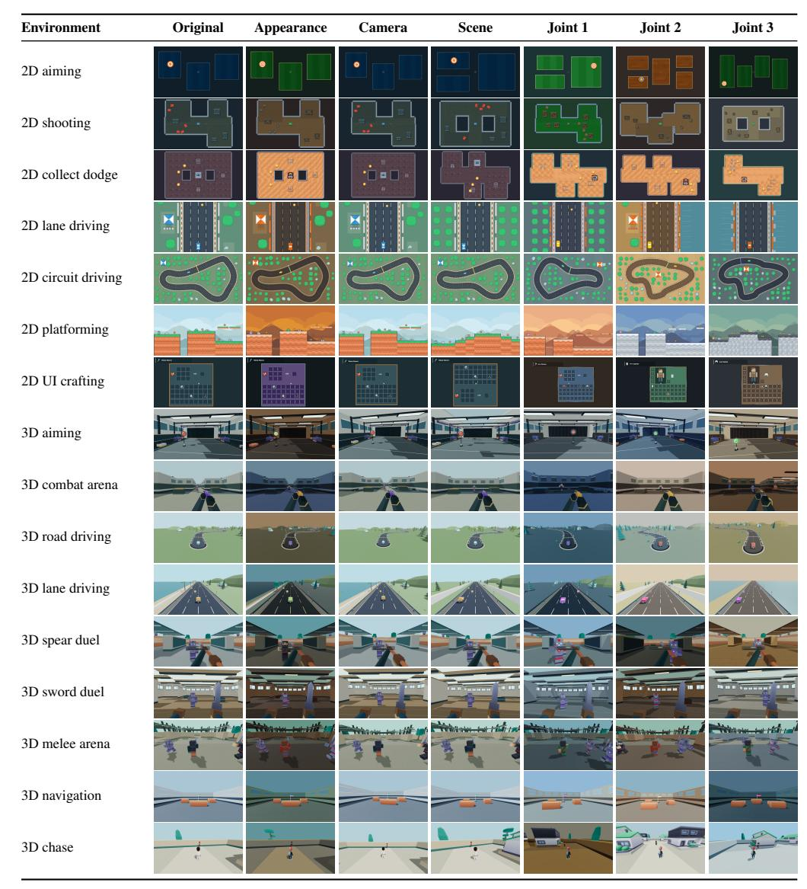

Figure 10: PLAYER-1-GYM 랜덤화의 시각적 예시: 16개 환경 × 7개 뷰. 원본은 기본 프로필을 사용; Appearance, Camera, Scene은 하나의 도메인을 변경; Joint 1–3은 이 세 차원을 결합. Control-response 변동은 동작 시퀀스가 필요하므로 정적 스크린샷으로는 효과를 나타낼 수 없으므로 생략.

장점 정규화 및 손실 감소. 우리는 GAE에서 장점을 전역적으로 정규화하고, 그 다음 환경 내에서 방정식 [(1)](#page-5-1)을 사용하여 정규화한다. Ne ≥ 2 및 ϵ = 10−8 ; 비평가 반환 목표는 변하지 않는다. 미니배치 B에 대해, Ti를 손실 마스크에 의해 선택된 i번째 턴의 비어 있지 않은 응답 토큰 집합이라고 하자. 클리핑된 PPO 손실은 턴 내에서 평균을 내고, 그 다음 턴 간에 평균을 낸다:

$$\mathcal{L}_{\text{policy}}(\theta) = \frac{1}{|\mathcal{B}|} \sum_{i \in \mathcal{B}} \frac{1}{|\mathcal{T}_i|} \sum_{j \in \mathcal{T}_i} \ell_{i,j}^{\text{PPO}}(\theta; \widetilde{A}_{i,j}). \tag{4}$$

비평가는 같은 감소를 사용한다. 정규화는 환경 내에서 토큰 가중치를 적용하며, 손실은 턴을 동일하게 가중한다. 따라서 각 환경은 포함된 턴에 비례하여 기여한다.

## D.3 TRAINING IMPLEMENTATION (Training Implementation)

Table [10](#page-18-2)는 두 모델 크기에 대한 공통 레시피를 요약한다. 각 모델 크기마다 SFT 단계는 32개의 NVIDIA H200 GPU를 사용하며 약 24시간이 소요되고, 200단계 RL 실행은 64개의 H200 GPU를 사용하며 약 36시간이 걸린다. 두 기간 모두 검증을 포함한다. 브라우저 롤아웃은 클러스터 전체에 걸쳐 32개의 워커 풀을 사용하며, 각 워커는 최대 16개의 독립 Playwright 브라우저 컨텍스트를 관리하여 총 512개의 동시 환경을 지원한다. 브라우저 프로세스와 컨텍스트는 에피소드 간에 재사용되어 시작 비용을 분산한다.

Table 10: 사후 훈련 구성. 두 모델 크기는 아래 설정을 공유하지만 actor 아키텍처를 제외한다. 각 RL 단계는 롤아웃 수집과 PPO 업데이트를 포함하며, critic 전용 워밍업은 제외된다.

| 설정 | Player-1-9B | Player-1-35B-A3B |
|---------------------------------------|---------------------------------------------------|------------------------|
| Actor / critic | Dense 9B / dense 9B | MoE 35B-A3B / dense 9B |
| SFT |  |  |
| 훈련 경로 | 6,044 |  |
| 기록 (시각–행동 + 행동-전용) | 2 + 2 |  |
| 샘플링 | 풀 가중치: 아홉 개 행동 풀 각각 1; 기타 0.1 |  |
| 에폭 예산 / 전역 배치 | 2 / 512 턴 |  |
| 학습률 / 워밍업 비율 | 5 × 10−7 / 0.03 |  |
| 인터랙티브 학습 |  |  |
| 알고리즘 / 할인율 / GAE 파라미터 | PPO / γ = 1 / λ = 1 |  |
| RL 훈련 단계 | 200 |  |
| 비평가 전용 워밍업 | 5 반복 |  |
| 기록 (시각–행동 + 행동-전용) | 2 + 2 |  |
| 관찰 해상도 | 480P |  |
| 롤아웃 배치 / PPO 미니배치 | 256 에피소드 / 64 턴 응답 |  |
| 에피소드 한계 | 50 턴 |  |
| 턴당 출력 한계 | 256 토큰 |  |
| 액터 학습률 | 10−6 |  |
| 비평가 학습률 | 10−5 |  |
| 옵티마이저 / 학습률 스케줄 | AdamW / constant |  |
| AdamW β1, β2 / weight decay | (0.9, 0.999) / 0.01 |  |
| 롤아웃 배치당 PPO 에폭 | 1 |  |
| 그라디언트 노름 클립 / PPO 클립 | 1.0 / 0.2 |  |
| 보상 재스케일링 | None |  |
| 우위 정규화 / 손실 | 환경별 / 토큰 평균, 이후 턴 평균 |  |
| 환경 할당 | 16 환경에 걸쳐 균등 |  |
| 무작위 혼합 | 100% Appearance + Camera + Scene + Control |  |

## D.4 환경 스케일링 프로토콜 (ENVIRONMENT-SCALING PROTOCOL)

섹션 [5.2,](#page-8-2)에서 9B 정책은 동일한 SFT 체크포인트에서 독립적으로 시작하며, PPO, 히스토리, 보상, 그리고 무작위화 설정을 표 [10.](#page-18-2)에서 공유한다. 표 [11](#page-18-3)은 스위트와 일치된 에피소드 예산을 제공하며, 상호작용 길이와 계산량은 서로 다른 에피소드 내에서 달라질 수 있다. 비교는 Minecraft 개발 작업과 시험 시드를 공유하며, SFT는 제로-환경 기준으로 사용된다.

Table 11: 9B 스케일링을 위한 환경 서브셋. 모든 실행은 100 RL 스텝과 25,600 에피소드를 사용하며(스텝당 256개), 환경마다 균등하게 할당된다.

| Envs. | 환경 서브셋 | 에피소드 / 환경 / 스텝 |
|-------|--------------------------------------------------------------------------------|------------------------|
| 2 | 2D 사격; 3D 탐색 | 128 |
| 4 | 2-환경 서브셋 + 2D 회로 주행; 3D 조준 | 64 |
| 8 | 4-환경 서브셋 + 2D UI 제작; 2D 플랫폼; 3D 검격; 3D 도로 주행 | 32 |
| 16 | 전체 PLAYER-1-GYM 스위트 | 16 |

## E 평가 및 결과

Table [12](#page-19-0)은 전체 패널과 예산을 나열한다. 방법들은 각 패널의 작업, 시드, 결정 예산을 공유하면서 모델별 전처리 및 추론 일정을 유지한다. RL 단계에서 주기적인 평가는 100개의 Minecraft 작업(각 3번 시도), 10개의 ViZDoom 맵(각 10 에피소드), 170개의 GameWorld 작업(각 1번 시도)을 사용한다. Qwen3.5, Player-1-SFT, 그리고 최종 Player-1-9B는 부록 [A.3.](#page-12-3)의 기록과 함께 배포된다.

Table 12: 평가 패널, 예산, 보고 단위. 결정 한계는 에피소드별(게임월드에서 역할별)이다. 세 개의 외부 벤치마크는 PLAYER-1-GYM 외부 환경을 사용한다.

| 패널 | 작업 / 지도 | 시도 | 예산 | 지표 |
|--------------|---------------------|------------|---------------------|-------------------------------|
| PLAYER-1-GYM | 16 게임 | 128 / 게임 | 50 결정 | 평균 에피소드 리턴 |
| MineDojo-300 | 300 작업 | 8 / 작업 | 1,000 결정 | 성공; 작업 범위 수 |
| ViZDoom-10 | 10 지도 | 50 / 지도 | 150–2,100 결정 | 스케일된 리턴 |
| GameWorld | 170 작업; 34 게임 | 3 / 작업 | 400 결정 | 성공; 진행 |

평가 비용.  
우리의 전체 MineDojo-300, ViZDoom-10, 그리고 GameWorld 프로토콜은 모델당 최대 3.14백만 에이전트 결정 턴을 할당한다.  
인-스위트 검증 기록은 시각적 컨텍스트와 생성된 추론을 포함하여 턴당 평균 약 3,000 입력 토큰과 100 출력 토큰을 기록한다.  
이 관측된 길이를 작업 부하 대리로 사용하면, GPT-6 Astra의 표준 API 요금인 입력 토큰당 USD$10, 출력 토큰당 USD$50(백만 단위)에서 캐싱 할인 전, 전체 예산 평가 비용은 약 USD$110,000이 된다.[1](#page-19-1)  
실제 비용은 모델별 토크나이제이션, 추론, 에피소드 길이에 따라 달라진다.  
추정 비용을 고려할 때, 우리는 독점 API 모델보다 대표적인 공개 게임 제어 및 컴퓨터 사용 정책에 주로 집중한다.

## E.1 베이스라인 추론 및 액션 어댑터 (BASELINE INFERENCE AND ACTION ADAPTERS)

우리는 JARVIS-VLA를 액션-토큰 디코더와 두 개의 히스토리 엔트리와 함께 배포하여 각 결정마다 하나의 액션을 예측한다.  
UI-TARS-1.5-7B는 이전 세 장의 스크린샷, 결정론적 디코딩, 그리고 400 토큰 출력 한계를 사용한다.  
그 어댑터는 픽셀 좌표 액션을 하나의 벤치마크 간격에 매핑하며, 드래그와 더블클릭은 지원하지 않는다.  
NitroGen은 18개 액션 청크를 여섯 개의 벤치마크 결정(각 결정당 세 개의 네이티브 액션)으로 집계하며, 각 청크 후에 이미지를 새로 고친다.  
GameWAM은 16개의 액션을 예측하고 재계획 전 8개를 실행하며, Doom 외부에서는 Minecraft 체크포인트, Doom에서는 ViZDoom 체크포인트를 사용한다.  
Open-P2P는 시각 전용 조건화와 세션별 순환 상태를 사용한다.  
모든 시간적 추론 상태는 에피소드 간에 격리된다.

모델 입력은 각 베이스라인의 최선 실천을 위해 공개된 전처리를 유지한다: Minecraft는 864 × 480으로 렌더링된다.  
우리는 스크린샷을 JARVIS-VLA와 UI-TARS용 640 × 360, NitroGen용 256 × 256, GameWAM용 224 × 224, Open-P2P용 192 × 192로 리사이즈한다.  
JARVIS-VLA와 GameWAM은 네이티브 도수 기반 Minecraft 카메라 액션을 유지하며, Open-P2P는 원시 마우스 픽셀당 0.15도 어댑터 이득을 사용한다.  
브라우저 게임 어댑터는 네이티브 액션을 게임별 및 역할별 바인딩에 투영한다.  
벤치마크 액션 간격은 고정되어 있으므로, 네이티브 액션 청크는 벤치마크 간에 서로 다른 시뮬레이션 지속 시간을 가질 수 있다.

## E.2 플레이어-1-짐 인-스위트 검증 (PLAYER-1-GYM IN-SUITE VALIDATION)

인-스위트 검증은 Table [12](#page-19-0)에서 시드된 패널과 훈련 랜덤화 설정을 사용한다.  
환경 e에서 T 턴의 에피소드에 대해 리턴은

$$G_{e,1} = \sum_{t=1}^{T} \left( r_{e,t} - p_{e,t}^{\text{invalid}} - p_{e,t}^{\text{length}} \right).$$

여기서 re,t = Se(st+1) − Se(st)는 네이티브 게임 점수 증가량(부록 [C.1)](#page-14-3)이며, 무효 액션 및 길이 패널티는 부록 [D.2.](#page-15-1)에 정의된다. 우리는 각 환경 내에서 시도들을 평균한 뒤, 16개 환경에 대해 동일하게 평균한 평균 에피소드 리턴을 보고한다.

## E.3 마인도조-300 (MINEDOJO-300)

MineDojo-300은 MineDojo에서 가져온 200개의 전투 및 100개의 수확 과제를 포함하며, Minecraft 1.16.5의 MineStudio로 포팅되었다.  
세계 및 과제 시드는 각 과제와 시도에서 결정론적으로 파생된다.  
성공은 수확 과제의 재고 획득 또는 전투 과제의 목표 사냥 후 초기화에서 검증된다.  
우리는 각 과제 내에서 시도들을 평균한 뒤, 과제별로 동일하게 평균한다.  
하나의 결정은 50밀리초 시뮬레이터 틱을 진행한다.  
PLAYER-1의 카메라 어댑터는 관측 픽셀당 0.00196 라디안의 명목 이득을 사용하며, 네이티브 제약을 따른다.

1<https://developers.openai.com/api/docs/models/gpt-6-astra>, 접속일: 2026년 9월 24일.

우리는 또한 **Task coverage**를 $C_m = \sum_{i=1}^N \mathbf{1}[s_i \ge m]$ 에 대해 보고한다, 여기서 $m \in \{1, 2, 4\}$이며, $s_i$는 작업 i에 대한 여덟 번의 시도 중 성공 수를 센다. 항목 $C_m/N$ (N=300)은 각 임계값을 충족하는 작업 수를 나타낸다. 전체 성공 구간은 Combat과 Harvest별로 층화된 100,000 퍼센타일 작업-클러스터 부트스트랩 복제본을 사용하며, 각 작업의 모든 여덟 번 시도와 패널의 카테고리 가중치를 유지한다. 95% 구간은 패널 내 작업 샘플링 불확실성을 정량화한다. 모든 결과가 0인 경우, 우리는 [-]를 보고한다.

#### 밤 평원에서 철검, 방패, 다이아몬드 갑옷으로 박쥐 사냥 (Hunt a Bat in Night Plains with an Iron Sword, Shield, and Diamond Armor)

Task instruction: "밤 평원에서 아이언 소드, 방패, 그리고 완전한 다이아몬드 아머 세트를 사용해 박쥐를 사냥하라"

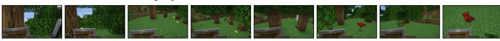

밤 사막에서 아이언 소드, 방패, 다이아몬드 아머를 사용해 헐크와 싸우기

Task instruction: "밤 사막에서 아이언 소드, 방패, 그리고 완전한 다이아몬드 아머 세트를 사용해 허스크와 전투하라"

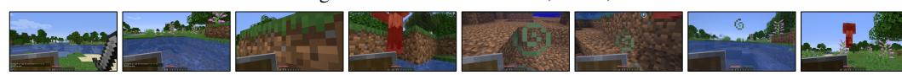

#### **한 평원에서 하나의 로그를 얻는다** (Obtain One Log in Plains)

Task instruction: "평원에서 목재를 획득하라"

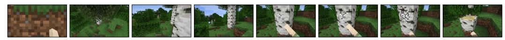

Figure 11: MineDojo-300의 예시 작업 및 장면

#### E.4 VIZDOOM-10 (E.4 VIZDOOM-10)

Table 13: ViZDoom-10 지도 카테고리, 원시 보상 규칙, 고정 스케일. 보상은 에피소드 동안 누적된다; tic은 하나의 시뮬레이터 틱이다. Scaled Return는 원시 에피소드 반환을 $c_m$ 으로 나눈다.

| 카테고리 | 지도 | 원시 보상 규칙 | 스케일 $c_m$ |
|--------------------|--------------------------|-------------------------------------------------------------------------------------|-------------|
| 정밀 사격 | 기본 | +106 for 목표 제거; $-5$ per 사격; $-1$ per 틱. | 100 |
|  | 센터 방어 | +1 per 킬; $-1$ on 사망. | 10 |
|  | 라인 방어 | +1 per 킬; $-1$ on 사망. | 10 |
| 목표 탐색 | 치명적 복도 | 복도 따라 전진 위치; 방어구 수집 시 $+1000$; 사망 시 $-100$. | 1000 |
|  | 내 길 | +1 for 목표 도달; $-0.0001$ per 틱. | 1 |
| 모바일 전투 | 전투 1 | +1 per 킬. | 10 |
|  | 전투 2 | +1 per 킬. | 10 |
|  | 데스매치 | 적 종류에 따라 달라지는 킬 보너스, 6개 적 유형에 대해 1, 3, 3, 4, 3, 10. | 10 |
| 생존 | 체력 수집 | +1 per 틱 생존; $-100$ on 사망. | 2100 |
|  | 체력 수집 최고 | +1 per 틱 생존; $-100$ on 사망. | 2100 |

표 13은 선택된 10개의 맵, 제어 카테고리, 네이티브 보상, 고정 반환 스케일을 나열한다. ViZDoom 1.3.0은 $640 \times 480$ RGB 관측을 제공한다. 각 결정은 시뮬레이터 틱을 두 번 진행한다. Basic은 150개의 결정을 허용하고, Deathmatch는 2,100, 나머지 맵은 1,050을 허용하며, 이는 이전 네이티브 종료에 따라 제한된다. **PLAYER-1**의 카메라 어댑터는 네이티브 피치 제약을 가진 관측 픽셀당 0.00196 라디안을 사용한다.

원시 반환 $R_{m,s}$와 맵별 스케일 $c_m > 0$에서, 우리는 맵, 카테고리 $(\mathcal{M}_c)$ 및 전체 스케일된 반환을 계산한다:

$$S_m = \frac{1}{N} \sum_{s=1}^{N} \frac{R_{m,s}}{c_m}, \qquad S_c = \frac{1}{|\mathcal{M}_c|} \sum_{m \in \mathcal{M}_c} S_m, \qquad S_{\text{overall}} = \frac{1}{10} \sum_{m=1}^{10} S_m.$$

평가는 각 맵마다 N=50개의 고정 시드와 모델 간 동일한 스케일을 사용한다. 생존 스케일 2,100은 네이티브 시간-보상 예산에 해당하며, 사망 패널티는 유지된다. 관측 기하학, 타이밍, 카메라 제약은 각 백본 내에서 일치한다.

## 치명적 복도 (Deadly Corridor)

작업 지시: 복도를 통과해 녹색 갑옷에 도달하고 살아남는다.

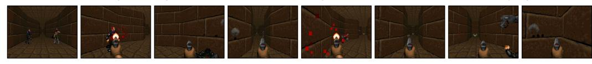

#### 전투 2 (Battle 2)

작업 지시: 몬스터를 물리치고 총 에피소드 보상을 최대화한다. 아레나를 이동하며 적을 시야에 두고 정확히 사격하면서 살아남는다.

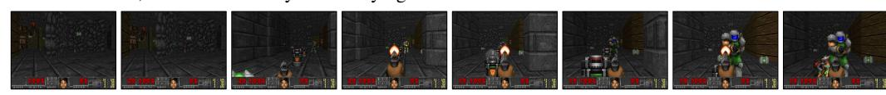

#### 최고의 건강 수집 (Health Gathering Supreme)

작업 지시: 해로운 미로에서 의료 사례를 찾고, 독약을 피하며 가능한 한 오래 살아남는다.

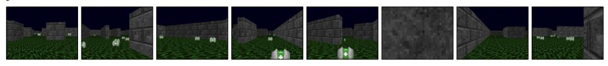

그림 12: ViZDoom-10의 예시 작업 및 장면.

## E.5 게임월드 (E.5 GAMEWORLD)

GameWorld는 34개의 다양한 브라우저 게임에 걸쳐 170개의 작업을 포함한다. 우리는 시드 0, 1, 2로 세 번의 시도를 평가한다 (표 [12] (#page-19-0)). 정책은 스크린샷, 규칙, 지시를 받고, 평가자 상태는 숨겨진다. 행동 지속 시간, 관측 기하학, 허용되는 제어는 각 게임의 구성에 따라 따르며, 다중 역할 게임은 별도의 기록을 유지한다. 성공은 완료를 보고한 시도 비율이며, 진행은 초기값에서 목표값까지 달성된 비율을 [0, 1]로 클리핑한다. 평가자는 목표를 평균화하고 가장 높은 작업 진행을 유지한다. 보고된 성공과 진행은 각 작업 내에서 시도를 평균화한 뒤, 작업 간에 동일하게 평균화한다.

## OVO (OVO)

작업 지시: 레벨 3에 진입하고 레벨 3을 정리한 뒤 레벨 4 이상에 도달한다.

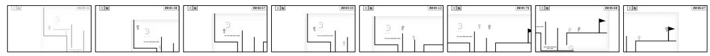

#### 템플 런 2 (Temple Run 2)

작업 지시: 한 번의 실행에서 4000점 이상을 획득하고, 미끄러짐, 사망, 부활 없이 달성한다.

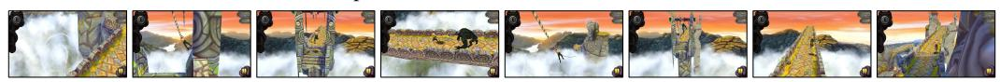

#### 남자들의 모험 (Another Gentleman's Adventure)

작업 지시: 현재 레벨에서 최소 4개의 동전을 수집한다.

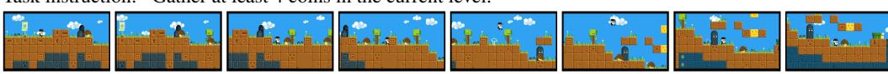

그림 13: GameWorld의 예시 작업 및 장면.

