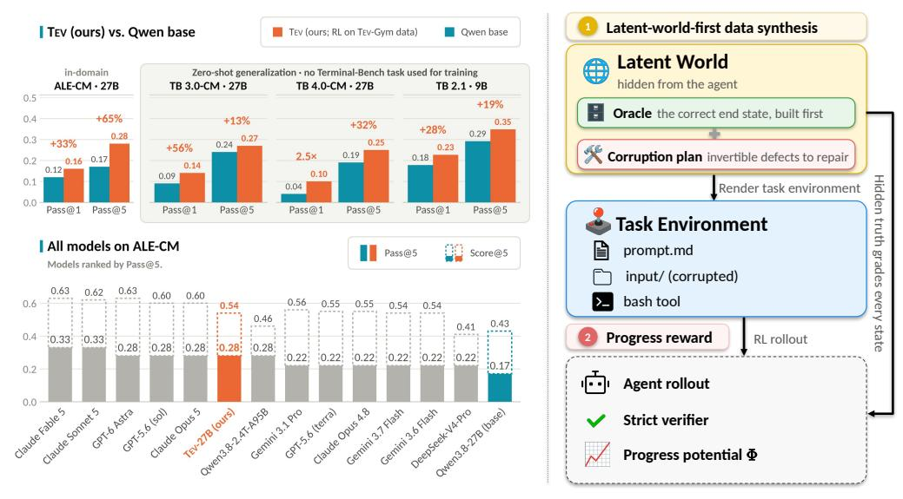
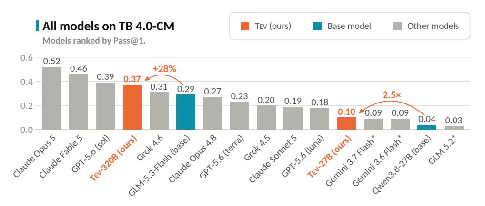
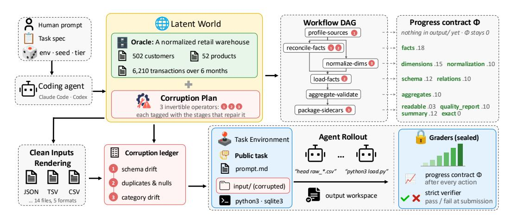
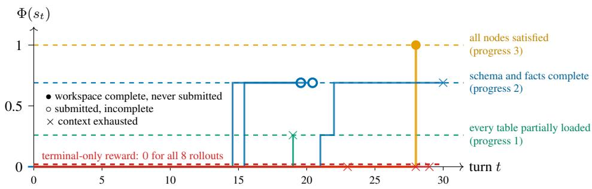
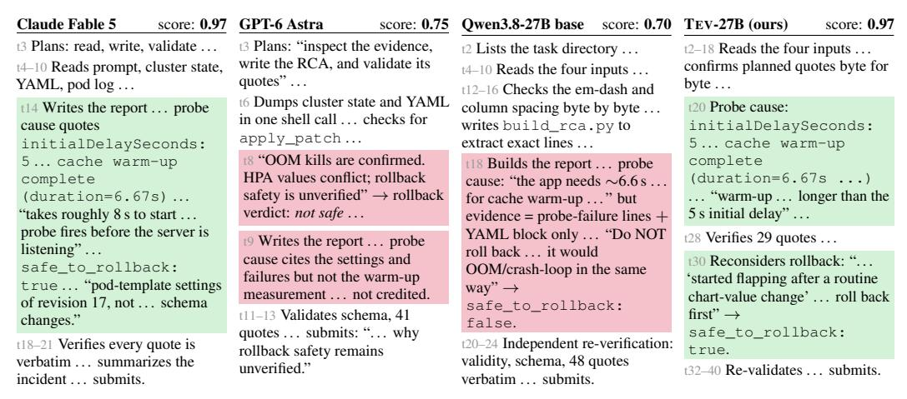
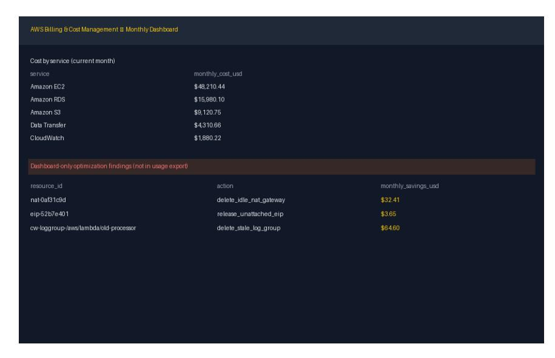
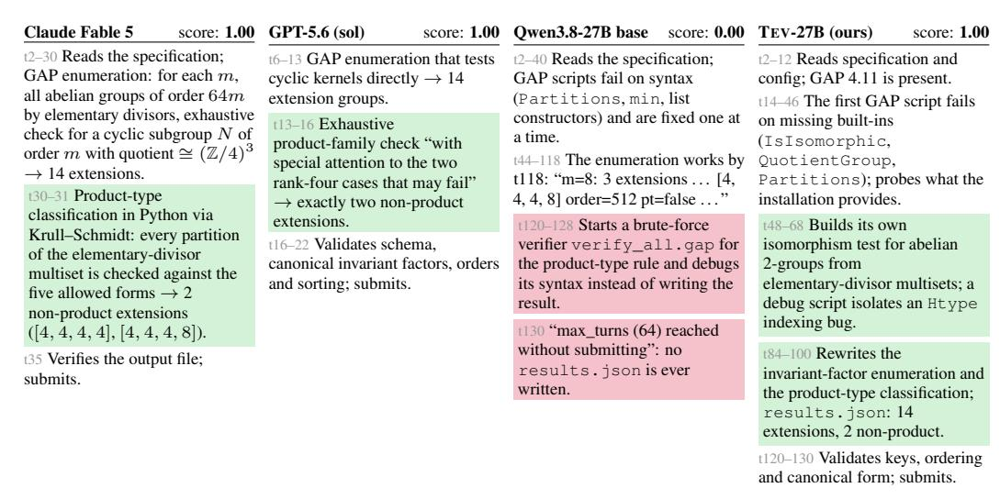

# TEV: 장기 호라이즌 에이전트 환경을 밀도 높은 진행 보상으로 확장하기 (TEV: SCALING LONG-HORIZON AGENTIC ENVIRONMENTS WITH DENSE PROGRESS REWARDS)

- 원제: Tev: Scaling Long-Horizon Agentic Environments with Dense Progress Rewards
- 원문: [https://arxiv.org/abs/2610.18868](https://arxiv.org/abs/2610.18868)
- PDF: [https://arxiv.org/pdf/2610.18868](https://arxiv.org/pdf/2610.18868)
- arXiv ID: `2610.18868`

---

# TEV: 장기 호라이즌 에이전트 환경을 밀도 높은 진행 보상으로 확장하기 (TEV: SCALING LONG-HORIZON AGENTIC ENVIRONMENTS WITH DENSE PROGRESS REWARDS)

Wenbo Hu1,<sup>2</sup> Shraman Pramanick<sup>1</sup> Krishna Kumar Singh<sup>1</sup> Nanyun Peng<sup>2</sup> Kai-Wei Chang<sup>2</sup> Yong Jae Lee<sup>1</sup> <sup>1</sup>Adobe Research <sup>2</sup>University of California, Los Angeles

**[https://tev-agent.github.io](https://tev-agent.github.io/)**

# 요약 (ABSTRACT)

장기 호라이즌 에이전트는 경제적으로 가치 있는 작업(시간당 몇 시간에서 며칠 동안 자율적으로 수행할 수 있는 능력)에서 점점 더 많은 관심을 받고 있으며, 이는 자동 탐지 및 재귀적 자기 개선(RSI)에 필수적인 능력이다. 그러나 오픈소스 모델은 여전히 장기 호라이즌 작업에서 어려움을 겪고 있다. 이는 주로 훈련 데이터와 실용적인 레시피가 부족하고, 둘 다 확장하기가 어렵기 때문이다: 장기적이고 복잡한 작업은 선별 및 검증이 어렵고 보상이 희박하다. 우리는 이 두 문제를 동시에 해결한다. 첫째, 우리는 검증 가능한 밀도 높은 진행 보상을 갖춘 *첫 번째* 장기 호라이즌 에이전트 훈련 데이터셋인 TEV-GYM을 소개한다—7개 도메인에 걸쳐 1,170개의 검증된 작업 환경. 이 데이터셋은 *latent-world-first* 접근법을 기반으로 하며, 먼저 *latent world*를 구축한다: 작업 도메인, 워크플로우, 각 단계 후 예상 상태를 완전하고 정확하게 숨겨진 사양으로 만든다. 이후 각 작업은 이 사양에서 점진적으로 에이전트가 접근할 수 있는 환경으로 렌더링되어, 제어 가능한 복잡도와 자연스러운 진행 지표를 제공한다. 둘째, 우리는 이 지표를 훈련 레시피로 전환한다: 진행 잠재 보상 형성(PPRS)을 통해 진행을 밀도 높은 단계별 보상으로 변환하여 훈련 효율을 향상시키고, 그렇지 않으면 훈련이 불가능한 작업을 훈련 가능하게 만든다. 이 레시피로 훈련된 TEV-27B는 Agents' Last Exam 컴퓨팅 및 수학 과학 도메인(ALE-CM)에서 상당한 성과를 달성하며, GPT-6 Astra와 Claude Opus 5와 동일한 Pass@5를 달성한다. ALE 관련 데이터만으로 훈련했음에도 불구하고, TEV는 Terminal-Bench(TB) 3.0 및 4.0 하위 집합에 일반화되며, GLM 5.2와 Gemini 3.7 Flash를 능가하고, TB 2.1과 같은 중간 호라이즌 작업에서 Claude Opus 4.8 수준의 성능을 달성한다.

<span id="page-0-0"></span>

Figure 1: 우리는 TEV의 ALE-CM에서의 결과와 왼쪽에 Terminal-Bench(TB) 3.0-CM, 4.0-CM, 2.1에 대한 일반화, 오른쪽에 우리의 *latent-world-first* 데이터 합성 접근법 요약을 보여준다. TEV는 두 모델 규모에서 상당한 성능 향상을 보여주며, TEV-27B는 ALE-CM에서 GPT-6 Astra와 Claude Opus 5와 동일한 Pass@5를 달성한다.

<span id="page-1-0"></span>

Figure 2: Terminal-Bench 4.0 \"CM\" 하위 집합(TB 4.0-CM)에서 모든 모델을 Pass@1 기준으로 순위 매긴다. TEV-320B와 TEV-27B는 각각 GLM-5.3-Flash와 Qwen3.8-27B에서 우리의 레시피로 훈련되었으며, 각 화살표는 기초 모델 대비 상대적 향상을 나타낸다.

## 1 서론 (Introduction)

대형 언어 모델(LLM)의 최근 진전은 장기 호라이즌 에이전트에 대한 관심을 끌어올렸다 (OpenAI, 2026; Anthropic, 2026; Moonshot AI, 2026). 이 에이전트는 복잡하고 경제적으로 가치 있는 작업(시간당 몇 시간에서 며칠 동안 자율적으로 수행)에서 자율적으로 작업할 수 있다 (Sun et al., 2026; Styles et al., 2024; Zhu et al., 2026a). 장기 호라이즌 작업은 수학 및 과학의 미해결 문제 해결, 자동화된 기계 학습 연구 수행, 코딩 및 보안 시스템 발전 등 자동 탐지 및 재귀적 자기 개선의 기초가 된다.

이러한 유망한 돌파구에도 불구하고, 오픈소스 커뮤니티에서의 코딩 에이전트(progress) 발전은 SWE-Smith (Yang et al., 2025a), TMAX (Ivison et al., 2026), Endless Terminals (Gandhi et al., 2026), CLI-Gym (Lin et al., 2026), SETA (Shen et al., 2026), Terminal-Universe (Wu et al., 2026)와 같은 대규모 에이전트 기반 훈련 코퍼스를 통해 확장된 짧은 및 중간 기간 작업에 초점을 맞추어 왔다. 이 데이터셋들은 수천에서 수만 개의 환경을 포함하지만, 각 환경은 풀 리퀘스트 규모의 수정 또는 짧은 터미널 세션만을 포함하며, 단위 테스트 기반 평가가 터미널 통과/불통과 신호 또는 통과된 테스트 비율만을 제공한다. 반면, 진정한 장기 기간 작업은 인간이 작성한 벤치마크(Merrill et al., 2026; Li et al., 2026b)에서만 제공된다. 이 벤치마크들은 수십에서 수백 개의 인스턴스만을 포함하며, 각 인스턴스는 전문가의 수주에 걸친 노력이 필요하다. 그들은 수작업 체크포인트를 통해서만 부분 점수를 제공하고, 존재하는 것은 평가 세트에 한정된다. 따라서 장기 기간 작업의 훈련 코퍼스는 존재하지 않는다: 에이전트 기반 훈련 코퍼스는 크지만 짧은 기간이며, 장기 기간 작업은 작은, 인간이 작성한 평가 세트로만 존재한다.

장기 목표 작업을 선별하려면 두 가지 상충되는 목표를 균형 있게 달성해야 한다: 작업은 의미 있는 학습을 제공할 만큼 충분히 길고 구조적으로 복잡해야 하며 동시에 정확히 검증 가능해야 한다 (Zeng et al., 2026a). 장기 목표 환경을 학습용으로 확장하는 것은 보상이 희박하고 작업 완료 시에만 제공되므로 장기 작업이 유용한 학습 신호를 잃게 되어 더욱 어렵다. 두 가지 한계를 해결하기 위해 우리는 *latent-world-first* 합성 접근법을 도입한다. 이 접근법은 작업 도메인의 완전하고 정확한 숨겨진 사양인 *latent world*를 먼저 구축하는 것으로 시작한다. 우리는 먼저 기본 워크플로를 *latent world* 내에서 방향이 있는 비순환 그래프(DAG)로 표현한 뒤, 그 세계에서 점진적으로 입력 파일을 렌더링한다. 이 절차는 모든 올바른 중간 상태를 보존하면서 작업 복잡도를 제어할 수 있게 하며, 이는 진행 상황을 측정하는 자연스러운 지표를 제공하고 따라서 학습에 대한 검증 가능한 밀집 보상을 제공한다. 실제 답이 없는 언어 모델에게 작업, 입력, 검사기를 생성하도록 요구하는 파이프라인과 달리, 우리의 *latent world*는 신뢰할 수 있는 검증을 위한 정확한 정답 키 역할을 한다.

장기 과제 (long-horizon tasks)는 희소 보상 (sparse rewards)을 갖으며, 이는 과제 완료 및 제출 시에만 도착한다. 이러한 보상은 장기 꼬리 샘플 (long-tail samples)에서 학습을 굶어버린다 (Yu et al., 2025; Shen et al., 2026; Zeng et al., 2026a). 그룹 상대 정책 최적화 (group-relative policy optimization, GRPO; Shao et al., 2024)는 동일 과제의 G 롤아웃 그룹 내에서 보상을 정규화한다. 따라서 종료 시점 보상만 (terminal-only reward)인 경우, 모든 G 롤아웃이 실패한 그룹은 전부에서 우위가 0이며 기울기에 기여하지 않는다. 중간 기간 파이프라인 (mid-horizon pipelines)은 이러한 그룹을 버릴 수 있다 (Ivison et al., 2026; Yu et al., 2025), 왜냐하면 그곳에서는 드물기 때문이다. 그러나 장기 과제에서는 학습 초기에 가장 흔하며, 이때 정책이 가장 약하고 신호가 가장 필요하다. 따라서 우리는 진행 잠재 보상 형상화 (progress-potential reward shaping, PPRS)를 강화 학습 (reinforcement learning, RL)에 도입한다. 이는 학습을 효율적으로 만들고, 그렇지 않으면 해결 불가능한 것을 가능하게 한다.

Table 1: **TEV-GYM versus prior agentic task corpora.** "Agent time"는 Gemini 3.6 Flash의 롤아웃당 첫 번째 행동부터 마지막 단계까지의 중간값과 평균 벽시계 분을 나타낸다 (자세한 내용은 부록 A.8 참조). 난이도는 Gemini 3.6 Flash가 모든 데이터셋에서 측정한 Pass@k이다.

<span id="page-2-0"></span>

| 데이터셋 | 크기 | # Domains (Domains) | Agent tin | ne (min) | Oracle | 평가 | 점진적 | P@1 | P@8 |
|-----------------------------------------|-------|-----------|-----------|----------|--------------|---------------------------|-------------|-----|-----|
| Buttaset | Sille | " Domains | 중앙값 | 평균 | oracio | 지표 | 보상 |  |  |
| SWE-Smith (Yang et al., 2025a) | 50.1k | 1 | 2.0 | 2.4 | 단위 테스트 | pass/fail | Х | 47% | 52% |
| Terminal-Universe (Wu et al., 2026) | 32.0k | 3 | NA | NA | pytest | pass/fail | X | NA | NA |
| TMAX-15K (Ivison et al., 2026) | 14.6k | 3 | 1.3 | 2.1 | 단위 테스트 | pass/fail | X | 74% | 80% |
| SETA (Shen et al., 2026) | 4.5k | 4 | 1.2 | 2.1 | 단위 테스트 | 테스트 비율 | X | 80% | 88% |
| Endless Terminals (Gandhi et al., 2026) | 3.3k | 2 | 0.5 | 0.7 | 단위 테스트 | pass/fail | X | 83% | 89% |
| CLI-Gym (Lin et al., 2026) | 1.7k | 4 | 1.9 | 2.3 | 단위 테스트 | pass/fail | × | 69% | 74% |
| TEV-GYM (ours) | 1,170 | 7 | 12.4 | 14.8 | 잠재 세계 | staged $\Phi$ + pass/fail | ✓ | 29% | 40% |

작업은 훈련 가능하다. PPRS는 잠재 세계( latent world)에서 알려진 정확한 중간 상태와 비교하여 각 턴 t 이후에 에이전트의 작업 공간을 점수화하며, 진행 잠재력( progress potential) $\Phi(s_t) \in [0,1]$ 를 제공한다. 이 잠재력은 워크플로가 완료될수록 상승하고, 회귀 시 하락한다. $\Phi$ 로 형성된 보상은 첫 턴부터 그룹 내 분산을 제공하며, 시뮬레이션이 끝나지 않아도 동일하다.

그림 1은 우리의 접근법과 TEV의 결과를 요약하고, 그림 2는 Terminal-Bench (TB) 4.0 "CM" 하위 집합에서 Pass@1 기준으로 모든 모델을 순위 매긴다. 잠재 세계 우선 합성 접근법을 사용하여 우리는 TEV-GYM을 도입한다. TEV-GYM은 1,170개의 검증된 장기 목표 작업 환경으로 구성되며, 7개 도메인(소프트웨어 공학 (software engineering), 데이터 공학 (data engineering), AI/CS 연구 (AI/CS research), 수학 및 운영 연구 (mathematics and operations research), 보안 및 포렌식 (security and forensics), 인프라 관리 (infrastructure administration), 양자 컴퓨팅 (quantum computing))에 걸쳐 있다. 표 1에 나타난 바와 같이, TEV-GYM의 작업은 프론티어 에이전트에게 시뮬레이션당 중간 12.4분을 소요하며, 이는 가장 시간 소모가 큰 이전 코퍼스(Yang et al., 2025a)보다 약 6배 길고, 가장 낮은 통과율을 보인다. 이는 우리의 훈련 데이터가 복잡하고 품질이 높음을 입증한다. 또한 TEV-GYM은 고정된 컬렉션을 넘어 확장될 수 있다. 시드와 규모 계층을 가로질러 새로운 검증된 환경을 생성하는 생성기를 작성하는 에이전트를 코딩함으로써 추가 모델 호출 없이 확장 가능하다.

우리는 TEV-9B와 TEV-27B를 도입한다. 이 모델들은 각각 PPRS를 사용해 unit tier와 TEV-GYM 전체 코퍼스에서 훈련되었다. ALE-CM, 즉 Agents' Last Exam(Agents' Last Exam)의 컴퓨팅-수학 분할(Sun et al., 2026)에서 TEV-9B는 Qwen3.5-9B 대비 Pass@5를 83% 향상시키며, TEV-27B는 Qwen3.8-27B 대비 65% 향상시켜 0.28에 도달, GPT-6 Astra와 Claude Opus 5와 일치한다. ALE 관련 데이터만으로 훈련했음에도 TEV-27B는 TB 3.0과 TB 4.0 하위 집합(Merrill et al., 2026; Marten et al., 2026; Marten, 2026)에서 각각 Pass@1을 56%와 150% 향상시켜 GLM 5.2와 Gemini 3.7 Flash를 능가한다. 중간 horizon인 TB 2.1에서 TEV-9B는 zero-shot Pass@1을 28% 향상시키고, TEV-27B는 0.794 Pass@1에 도달해 Claude Opus 4.8 수준의 성능과 일치한다. 이 레시피는 더 큰 기반에도 전이된다: GLM-5.3-Flash에 적용하면 TEV-320B가 생성되며, 이는 TB 3.0과 TB 4.0 하위 집합에서 Pass@1을 각각 35%와 28% 향상시키고, TB 4.0에서는 Claude Opus 5, Claude Fable 5, GPT-5.6 (sol)만을 따라간다.

우리의 주요 기여는 다음과 같이 요약된다:

- 우리는 **latent‑world‑first synthesis**를 제안한다. 이 파이프라인은 알려진 정답이 있는 세계에서 역방향으로 장기 에이전트 과제를 구성하여 정확한 검증, 조절 가능한 난이도 사다리, 그리고 중간 단계에서 점진적 보상을 제공한다.
- 우리는 **TEV‑GYM**을 도입한다. 이는 점진적 보상을 갖는 최초의 장기 에이전트 훈련 데이터셋이며, 7개 도메인에 걸쳐 1,170개의 검증된 장기 과제 환경으로 구성된다.
- 우리는 **Tev‑27B**를 제시한다. 이 모델은 PPRS를 사용해 Tev‑GYM에서 훈련되었으며, ALE‑CM, TB 3.0 및 TB 4.0 하위 집합, 그리고 TB 2.1에서 뛰어난 성능을 입증한다. 동일한 레시피를 GLM‑5.3‑Flash에 적용하면 **Tev‑320B**가 생성되며, 이는 성능을 더욱 향상시킨다.

## <span id="page-2-2"></span>2 장기 환경 합성

Figure 3은 장기 환경 재구성의 메커니즘을 자세히 설명한다. 이 섹션에서는 잠재 세계 (§2.1)에서 역방향으로 환경이 합성되는 방식을 정의하고, TEV-GYM (§2.2)에서 커버리지, 난이도, 정확성이 어떻게 적용되는지를 설명한다.

### <span id="page-2-1"></span>2.1 잠재 세계 우선 작업 합성

**Stage 0: 작업 소스.** 우리의 훈련 데이터는 ALE-CM을 대상으로 하며, 그 커버리지를 일곱 개의 주요 도메인으로 그룹화한다. 각 도메인 내에서 사양을 무작위로 샘플링하고, 각 사양을 중심으로 자체 생성기를 작성한다. 자세한 내용은 부록 A.1을 참고하라.

<span id="page-3-0"></span>

Figure 3: 잠재 세계 우선 합성, 한 예시 TEV-GYM 환경에서. 이 환경의 작업은 "Retail Warehouse ETL Recovery"이며, 목표는 6개월간의 혼란스러운 소매 데이터를 정리하여 깨끗한 스타-스키마 SQLite 웨어하우스를 구축하고 두 개의 사실적인 JSON 사이드카를 생성하는 것이다.

1단계: 세계 구축. 각 생성기는 시드가 지정된 프로그램이다. 시드와 스케일 티어를 주면, 잠재 세계 W를 프로시저적으로 생성한다. 이는 도메인의 완전하고 정확한 상태(예를 들어, 소매 창고의 고객, 제품 및 거래, 또는 분산 체크포인트의 텐서 샤드 및 토폴로지)이며, 우리는 W를 환경의 불변성(고유 식별자, 유효 조인, 유한 측정)과 검증한다. 같은 단계에서 시드에서 파생된 결함 계획을 그려낸다: 나중에 손상될 W의 레코드, 샤드 또는 필드와, 어떤 선언된 연산자에 의해 손상될지를 정확히 지정한다.

2단계: 작업 흐름 그래프. 우리는 환경의 작업 흐름을 명시적 종속성, 허용된 병렬성 및 각 단계별 의미적 작업 추정(예: profile-sources → reconcile-facts / normalize-dimensions → load-facts → aggregate-validate → package-sidecars)을 갖는 방향성 비순환 그래프로 컴파일한다. DAG는 W의 스케일에 따라 코드로 구축되며, 모델은 루프에 포함되지 않는다. 그 핵심 경로, 즉 종속 단계의 가장 긴 체인은 작업의 수평선을 정의하며, 그 단계들은 [§3.](#page-4-1)에서 진행 잠재력의 골격을 형성한다.

3단계: 아티팩트 렌더링. 우리는 W를 환경이 선언한 공개 인터페이스에 *투영*하여, CSV 및 TSV 파티션, JSON 레코드, SQLite 데이터베이스, safetensors 샤드, 스트립된 바이너리, 또는 인프라 매니페스트와 같은 대상 와이어 포맷으로 깨끗한 입력 파일을 재현한다. 렌더링은 W의 순수 함수이며, 진행하기 전에 라운드 트립이 성립함을 주장한다. 즉, 렌더링된 파일에서 W가 정확히 복원되는 것이다. 4단계의 가역적 손상과 함께, 이는 에이전트의 작업 공간 s<sup>0</sup>이 W를 완전히 결정하게 하여, 에이전트가 실제로 보는 것에서 정답을 계산할 수 있고, 정답은 구성에 의해 정확하다.

4단계: 제어된 손상. 우리는 1단계의 결함 계획을 렌더링된 파일에 적용하여, 스키마 드리프트, 중복 및 누락된 레코드, 범주형 드리프트, 뒤섞인 샤드 인덱스, 오래된 캐시 등과 같은 손상을 주입한다 (그림 [3](#page-3-0)은 한 환경의 세 연산자를 보여준다). 손상된 트리 s<sup>0</sup>는 에이전트가 받는 작업이며, 손상되지 않은 세계 W는 *이다* 정답이다. 렌더링이 라운드 트립을 수행하고 손상이 선언되고 가역적이므로, s<sup>0</sup>는 W를 완전히 결정한다. 따라서 정답은 에이전트가 보는 것에서 계산 가능하며, 해결자를 실행하지 않고도 정확히 알려진다. 더 일반적으로, 환경의 모든 구성 요소는

<span id="page-3-1"></span>

$$E = (x, s_0, \text{ver}_W, \Phi_W), \tag{1}$$

이는 동일한 W의 함수이다: 작업 프롬프트(x), 입력 트리(s0), 에이전트의 출력 파일을 W와 비교하는 엄격한 통과/불통과 검증기(ver<sup>W</sup>), 그리고 [§3.](#page-4-1)의 진행 잠재력(Φ<sup>W</sup>)이다. 이 단일 앵커는 *아티팩트 드리프트(artifact drift)*를 방지한다[(Ivanov & Rana,](#page-12-2) [2026)](#page-12-2), 즉 별도로 생성된 환경(environment), 작업(task), 검증기(verifier)가 각각 독립적으로 유효해 보이지만 서로 다른 문제를 설명하는 상황이다.

5단계와 6단계: 공개 사양 (public specification)과 숨겨진 스위트 (hidden suite).  
우리는 공개 계약 (public contract), 작업 프롬프트 x (입력 역할 (input roles), 필수 출력 아티팩트 (required output artifacts) 및 그 스키마 (schemas), 순서화된 요구사항 (ordered requirements), 권한 우선 규칙 (authorityprecedence rules), 그리고 허용된 도구 체인 (permitted toolchain))을 발행한다. 이는 에이전트가 보는 유일한 설명이다.  
에이전트의 관점 밖에서, 우리는 검증 시에 사용되는 숨겨진 스위트를 봉인한다: 메타모픽 변환 (metamorphic transforms), 이는 의미 보존 재작성 (semantics-preserving rewrites)으로서 등급 (grade)을 변경해서는 안 되며, 오래된 출력 반사실 (stale-output counterfactuals), 이는 그럴듯하지만 잘못된 상태 (plausible-but-wrong states)로서 실패해야 한다.

<span id="page-4-3"></span>

Figure 4: 한 그룹(G=8) 롤아웃의 진행 잠재력. 훈련된 27B 모델의 8개의 롤아웃이 하나의 창고 환경에서 실행되며, 매 턴마다 실시간으로 평가된다. 단일 종료 보상(빨간색) 하에서는 모든 롤아웃이 0점을 기록한다. 반면 진행 보상 하에서는 두 개가 미완성 창고(원형)를 제출하고, 다섯 개가 65k 토큰 컨텍스트를 소진(십자형), 한 개가 완전한 창고를 구축하여 보상이 그룹 내에서 다양해진다.

우리는 자원 제약 때문에 ALE-CM 도메인에 집중하지만, 이 접근법은 다른 ALE 도메인에도 적용된다. Appendix [A.10](#page-24-0)은 파이프라인으로 구축된 세 가지 환경을 안내한다: 멀티모달 AWS 비용 최적화 과제와 그 청구 대시보드 스크린샷을 우리의 잠재 세계에서 렌더링한 것(클라우드 운영), EnergyPlus 모델(엔지니어링)의 폐쇄 루프 건물 제어, 그리고 SEC 스타일 파일링(금융)에서 재무제표 재구성.

### <span id="page-4-0"></span>2.2 커버리지, 캘리브레이션, 그리고 자격 (Coverage, Calibration, and Qualification)

다양성. 모든 환경은 19개의 커버리지 축(Appendix [A.3)](#page-19-1)에 따라 라벨링된다. 서브도메인, 스케일, 네 개의 수평 축, 워크플로우 단계, 도구 역량, 아티팩트 역할, 관계 유형, 그리고 손상 클래스. 훈련에 중요한 축은 행동적이다: 그 값이 바뀌면 에이전트가 수리해야 할 것(손상 클래스), 수리 방식(워크플로우 단계, 도구 역량), 그리고 파일을 통해(아티팩트 역할, 관계 유형) 어떻게 수리해야 하는지가 바뀐다. For more details, please see our Appendix [A.3.](#page-19-1)

제어 가능한 난이도. 두 개의 제어가 작업의 난이도를 바꾼다. 스케일 티어(기본적으로 *unit*, *small*, 또는 *full*)는 W를 증가시키고(Appendix [A.4)](#page-20-0) 운영 수평을 늘린다: 읽고, 결합하고, 쓰는 양. Stage 2의 워크플로우 DAG와 결함 계획의 손상 클래스 수가 종속 깊이를 결정한다: 출력이 올바르기 전에 몇 단계가 완료되어야 하고, 어떤 순서로 진행해야 하는가. Appendix [A.5](#page-21-0)에서는 수평과 난이도를 어떻게 측정하고, 기본 모델과 최전선 해결률을 보고하는지 설명한다.

자격 게이트와 청결성. 합성된 환경은 모든 여덟 개의 벤치마크 독립 게이트를 통과해야만 허용된다. 이는 생성 시 자동으로 확인되며, 각 게이트는 명명된 실패 클래스(표 [7)](#page-22-1)와 매칭된다. 이 중 세 개는 [§3.2]의 진행 잠재력을 뒷받침한다: 모든 14개의 게임 프로브가 0점을 가져야 한다(*악용 저항*), 잠재력은 부분적으로 올바른 상태에서 0과 1 사이에 있어야 하고, 참조 경로를 따라 단조롭게 1로 증가해야 한다(*진행 유효성*), 그리고 진행 점수 매기기, 엄격한 검증자, 참조 해결자가 서로 겹치지 않는 코드 클로저를 가져야 한다(*역할 독립성*). Appendix [A.6](#page-21-1)에서는 모든 게이트를 공식적으로 명시하고, 검증자 독립 솔버 감사를 포함하며, Appendix [A.9](#page-23-0)에서는 구조적 오염 제거 검사를 설명한다.

## <span id="page-4-1"></span>3 긴 수평 RL을 위한 조밀 보상 (DENSE REWARD FOR LONG-HORIZON RL)

작업 완료를 평가하는 잠재 세계는 중간 단계도 평가한다. 이 섹션에서는 이를 훈련 신호로 전환한다: 왜 단일 종료 보상이 그룹 상대 RL을 굶게 만드는지 정량화하고, 모든 TEV-GYM 환경이 제공하는 진행 잠재력을 정의하며, 모양 보상을 상세히 설명한다.

### <span id="page-4-2"></span>3.1 단일 종료 보상이 그룹 상대 RL을 굶게 만드는 이유 (TERMINAL REWARD STARVES GROUP-RELATIVE RL)

GRPO [(Shao et al.,](#page-14-3) [2024)](#page-14-3)를 고려하라. 이는 우리가 그리고 최신 에이전시 RL 파이프라인이 사용하는 추정기이다. 작업 x에 대해 정책은 G개의 롤아웃 τ1, …, τ<sup>G</sup>를 샘플링하고 보상 R1, …, RG를 부여하며, 각 롤아웃은 그룹 정규화된 이점을 기준으로 가중된다.

<span id="page-4-4"></span>

$$\hat{A}_i = \frac{R_i - \text{mean}(R_{1:G})}{\text{std}(R_{1:G}) + \epsilon}.$$

(2)

종단 보상 $R_i=\mathbbm{1}[\tau_i \ passes]$ 으로, 롤아웃이 *passes* 하는 것은 정책이 제출 액션을 발행하고 엄격한 검증기 $\text{ver}_W$ 가 제출된 작업공간을 수락할 때이다. 모든 롤아웃이 실패하는 그룹은 모든 i에 대해 $\hat{A}_i=0$ 이므로, 작업은 기울기에 기여하지 않으며 그 G개의 롤아웃은 낭비된다. 정책이 확률 p로 작업을 해결하면 낭비되는 그룹 비율은 $(1-p)^G$ 이며, $p{=}0.05$ 와 $G{=}8$ 일 때 66%, $p{=}0.01$ 일 때 92% (Appendix B). 장기 수평 작업에서는 훈련되지 않은 공개 모델의 p가 대략 10분의 1 이하인 경우 (§4), 그러한 그룹을 드롭하거나 재샘플링(Ivison et al., 2026; Yu et al., 2025) 하면 배치의 대부분이 버려진다. 단일 성공을 가진 그룹은 조금 더 나아지지만, 하나의 긍정 롤아웃과 G-1개의 실패가 동일한 부정적 이점을 받으므로 기울기는 거의 진행이 없었던 롤아웃과 거의 실패한 롤아웃을 구분할 수 없다.

### <span id="page-5-0"></span>3.2 잠재 세계에서의 진행 잠재력

모든 TEV-GYM 환경은 진행 계약을 제공한다: 노드 집합 V, 각 노드는 §2.1의 워크플로우 DAG에서 파생된 출력 작업공간의 검사 가능한 상태이며, 가중치 $w_v > 0$, $\sum_v w_v = 1$, 그리고 전제 집합 $\operatorname{pre}(v)$ 를 갖는다 (Appendix B 예시). 부분 스코어러 $c_v(s) \in [0,1]$ 은 에이전트의 현재 작업공간 s 를 노드 v 에 대해 잠재 세계와 직접 비교하여 평가한다. 신용은 전제에 의해 가드된다: $\tilde{c}_v(s)$ 는 v와 그 모든 직접 및 간접 전제 중 가장 낮은 부분 점수이다. 잠재력, 즉 Eq.(1)의 $\Phi_W$ 를 $\Phi$ 로 표기한 것은 가중 합이다:

<span id="page-5-3"></span>

$$\Phi(s) = \sum_{v \in V} w_v \; \tilde{c}_v(s) \in [0, 1]. \tag{3}$$

**보상 해킹 방지.** 세 가지 속성이 $\Phi$ 를 사용 가능한 훈련 신호로 만들며, 각각은 자격 게이트 (§2.2)에 의해 강제된다: 그것은 *anchored* (악용 방지)이며, 손대지 않은 공개 트리와 모든 게임 프로브가 $\Phi=0$ 과 $\Phi=1$ 을 정확히 엄격한 검증기가 작업공간을 수락할 때만 기록한다; *monotone* (진행 유효성)으로, 노드가 완료될 때 상승하고 완료된 작업이 파괴될 때 하락한다; 그리고 *independent* (역할 독립성)으로, 검증기와 참조 솔버의 코드 클로저와 분리된 스코어러에 의해 계산되므로 한 그레이더의 결함이 다른 그레이더에게 전파되지 않는다; 이 모든 그레이딩 코드는 공개 트리에 포함되지 않는다.

**확장 가능한 보상 설계.** 잠재 세계가 작업 생성 전에 정의되므로, 모든 올바른 중간 상태는 직접 렌더링되고 $c_v$ 로 평가될 수 있다. 이는 프로세스 보상 모델(Lightman et al., 2024), 훈련된 보상 모델, 또는 언어 모델 판사에서 사용되는 인간 단계 라벨 없이도 모든 생성된 시드와 규모에 대해 정확하고 결정론적인 진행 피드백을 제공한다.

### <span id="page-5-1"></span>3.3 진행-잠재력 보상 형상화 (PPRS)

$s_0,\ldots,s_T$ 를 롤아웃 $\tau$ 를 따라 작업공간 상태라 하면, $s_0$ 는 손대지 않은 공개 트리이며, 따라서 $\Phi(s_0)=0$ 이다. 잠재 기반 보상 형상화(PBRS; Ng et al., 1999)와 같이, 단계별 형상 보상은 잠재력의 변화인 $r_t=\Phi(s_t)-\Phi(s_{t-1})$ 이고, 롤아웃 보상은

<span id="page-5-2"></span>

$$R(\tau) = \mathbb{1}[\tau \text{ passes}] + \lambda \sum_{t=1}^{T} r_t = \mathbb{1}[\tau \text{ passes}] + \lambda \Phi(s_T), \tag{4}$$

모든 실행에서 $\lambda=0.25$를 사용한다 (Appendix C.1). PBRS는 최적 정책이 변하지 않도록 터미널 포텐셜을 0으로 만드는 반면, PPRS는 $\lambda\Phi(s_T)$를 유지하고 의도적으로 목표를 변경한다 (Appendix B). 제출은 상태가 아니라 행동이다: $\Phi$는 워크스페이스를 평가하고, 터미널 항은 정책이 제출한 워크스페이스를 평가한다. 턴이나 토큰 예산을 소진하고 제출하지 않은 롤아웃은 터미널로 평가되지 않으며 $\lambda\Phi(s_T)$만을 얻는다; 이것이 Figure 4의 완전하지만 제출되지 않은 롤아웃이 $\Phi=1$에 도달하면서 터미널 보상이 0이 되는 방식이다. 왜냐하면 $\Phi$는 워크스페이스에만 의존하는 함수이므로 $R(\tau)$는 롤아웃이 최종 상태 $s_T$를 통해서만 의존한다: 서로 다른 경로, 다른 단계 순서 또는 다른 구현으로 같은 워크스페이스에 도달한 두 롤아웃은 동일한 보상을 받는다. 테레스코핑 형태는 터미널 보상의 순위를 최상위에 유지한다: $\Phi \leq 1$이므로 어떤 통과 롤아웃이라도 $1+\lambda$를 얻으며, 이는 실패한 롤아웃보다 엄격히 더 크다. 따라서 단일 롤아웃이 완전함과 부분 진행을 교환해 보상을 받는 경우는 없다. 확률적 정책의 경우 Appendix B는 선호도가 반전될 수 있는 시점을 제한한다. Appendix B는 무엇이 보존되고 무엇이 보존되지 않는지를 명시한다.

식 (4)를 식 (2)에 대입하면 GRPO의 기아 현상을 왜 이 방법이 해결하는지 보여준다.  
롤아웃이 통과하지 않는 그룹은 이제 보상 $R_i = \lambda \Phi(s_T^{(i)})$ 를 갖는다. 여기서 $s_T^{(i)}$ 는 $\tau_i$ 의 최종 작업공간이다.  
롤아웃이 서로 다른 깊이까지 진행될 때마다 이 값은 달라지므로, 그룹의 이점은 0이 아니며 롤아웃을 진행 정도에 따라 순위 매긴다. 그림 4는 그러한 그룹 중 하나를 보여주며, 부록 B에는 우리가 조사한 24개의 그룹이 있다.

표 2: Agents' Last Exam (ALE)의 ALE-CM, 컴퓨팅 및 수학 과학 영역에 대한 주요 결과. 각 셀은 평균 등급 점수(S@1)와 완전히 해결된 과제 비율(P@1)을 보고하며, 이는 과제당 5번의 롤아웃을 평균한 값이며, 그에 대한 best‑of‑5 대안(S@5, P@5)도 함께 제공된다.

<span id="page-6-1"></span>

| 모델 | 하네스 | 수학 및 과학 |  |  |  | ML |  |  |  | 코딩 및 시스템 |  |  |  |  | 전체 (평균) |  |  |
|-------------------------------------------|-------------|----------------|-------|-------|-------|--------|-------|------|------|-----------------|-------|------|------|-------|-----------|-------|-------|
| 1110001 | Turness | S@1 | S@5 | P@1 | P@5 | S@1 | S@5 | P@1 | P@5 | S@1 | S@5 | P@1 | P@5 | S@1 | S@5 | P@1 | P@5 |
|  |  |  |  |  | Fron | 티어 A | PI mo | dels |  |  |  |  |  |  |  |  |  |
| GPT-6 Astra | Codex | 0.58 | 0.58 | 0.38 | 0.38 | 0.48 | 0.49 | 0.20 | 0.20 | 0.81 | 0.85 | 0.20 | 0.20 | 0.62 | 0.63 | 0.28 | 0.28 |
| Claude Fable 5 | Claude Code | 0.47 | 0.51 | 0.38 | 0.38 | 0.52 | 0.57 | 0.24 | 0.40 | 0.83 | 0.90 | 0.20 | 0.20 | 0.58 | 0.63 | 0.29 | 0.33 |
| GPT-5.6 (sol) | Codex | 0.50 | 0.51 | 0.38 | 0.38 | 0.46 | 0.49 | 0.20 | 0.20 | 0.82 | 0.85 | 0.20 | 0.20 | 0.58 | 0.60 | 0.28 | 0.28 |
| GPT-5.6 (terra) | Codex | 0.51 | 0.56 | 0.38 | 0.38 | 0.25 | 0.26 | 0.00 | 0.00 | 0.75 | 0.83 | 0.20 | 0.20 | 0.50 | 0.55 | 0.22 | 0.22 |
| Claude Opus 5 | Claude Code | 0.51 | 0.53 | 0.38 | 0.38 | 0.43 | 0.46 | 0.20 | 0.20 | 0.85 | 0.87 | 0.20 | 0.20 | 0.58 | 0.60 | 0.28 | 0.28 |
| Claude Sonnet 5 | Claude Code | 0.50 | 0.51 | 0.38 | 0.38 | 0.39 | 0.56 | 0.12 | 0.40 | 0.80 | 0.87 | 0.20 | 0.20 | 0.55 | 0.62 | 0.26 | 0.33 |
| Claude Opus 4.8 | Claude Code | 0.48 | 0.51 | 0.38 | 0.38 | 0.31 | 0.33 | 0.00 | 0.00 | 0.80 | 0.86 | 0.20 | 0.20 | 0.52 | 0.55 | 0.22 | 0.22 |
| Gemini 3.7 Flash | Gemini CLI | 0.48 | 0.50 | 0.38 | 0.38 | 0.26 | 0.29 | 0.00 | 0.00 | 0.84 | 0.86 | 0.20 | 0.20 | 0.52 | 0.54 | 0.22 | 0.22 |
| Gemini 3.6 Flash | Gemini CLI | 0.48 | 0.51 | 0.35 | 0.38 | 0.25 | 0.26 | 0.00 | 0.00 | 0.81 | 0.86 | 0.20 | 0.20 | 0.51 | 0.54 | 0.21 | 0.22 |
| Gemini 3.1 Pro | Gemini CLI | 0.49 | 0.52 | 0.35 | 0.38 | 0.27 | 0.29 | 0.00 | 0.00 | 0.82 | 0.88 | 0.20 | 0.20 | 0.52 | 0.56 | 0.21 | 0.22 |
|  |  |  |  |  | Ope | n-sour | се то | dels |  |  |  |  |  |  |  |  |  |
| Qwen3.8-2.4T-A95B | Vanillux2 | 0.20 | 0.38 | 0.20 | 0.38 | 0.10 | 0.20 | 0.04 | 0.20 | 0.74 | 0.86 | 0.16 | 0.20 | 0.32 | 0.46 | 0.14 | 0.28 |
| DeepSeek-V4-pro | Vanillux2 | 0.12 | 0.25 | 0.12 | 0.25 | 0.10 | 0.20 | 0.04 | 0.20 | 0.73 | 0.88 | 0.16 | 0.20 | 0.29 | 0.41 | 0.11 | 0.22 |
| Qwen3.5-9B (base) | Vanillux2 | 0.07 | 0.12 | 0.00 | 0.00 | 0.19 | 0.26 | 0.00 | 0.00 | 0.59 | 0.73 | 0.20 | 0.20 | 0.25 | 0.33 | 0.06 | 0.06 |
| TEV-9B (ours) | Vanillux2 | 0.14 | 0.29 | 0.04 | 0.12 | 0.23 | 0.26 | 0.00 | 0.00 | 0.56 | 0.73 | 0.20 | 0.20 | 0.29 | 0.40 | 0.07 | 0.11 |
| $\Delta_{\text{TeV-9B}}$ - Qwen3.5-9B | _ | 0.07↑ | 0.17↑ | 0.04↑ | 0.12↑ | 0.04↑ | _ | - | _ | 0.03↓ | _ | - | - | 0.04↑ | 0.07↑ | 0.01↑ | 0.05↑ |
| Qwen3.8-27B (base) | Vanillux2 | 0.15 | 0.25 | 0.15 | 0.25 | 0.21 | 0.32 | 0.00 | 0.00 | 0.74 | 0.82 | 0.20 | 0.20 | 0.33 | 0.43 | 0.12 | 0.17 |
| TEV-27B (ours) | Vanillux2 | 0.23 | 0.50 | 0.23 | 0.50 | 0.26 | 0.29 | 0.00 | 0.00 | 0.82 | 0.86 | 0.20 | 0.20 | 0.40 | 0.54 | 0.16 | 0.28 |
| $\Delta_{\mathrm{TEV-27B}}$ - Qwen3.8-27B | - | 0.08↑ | 0.25↑ | 0.08↑ | 0.25↑ | 0.05↑ | 0.03↓ | _ | - | 0.08↑ | 0.04↑ | _ | - | 0.07↑ | 0.11 | 0.04↑ | 0.11 |

## <span id="page-6-0"></span>4 실험 (EXPERIMENTS)

우리의 주요 실험은 세 가지 질문을 제기한다. RL이 TEV‑GYM에서 장기 목표 작업에서 오픈 모델을 향상시키는가, 그 이득이 더 긴 시간 범위의 작업에도 일반화되는가, 그리고 모델이 표준 중간 길이 벤치마크 (§4.2)에서 일반적인 코딩 역량을 유지하는가? 마지막으로 §4.3에서는 우리의 잠재 세계 우선 데이터와 밀집 보상 접근법을 각각 제거한다.

### <span id="page-6-2"></span>4.1 설정 (SETUP)

**훈련.** 우리는 DPPO(Qi et al., 2026)를 사용해 Qwen3.5-9B와 Qwen3.8-27B를 훈련시키며, 보상은 Eq. (4)에 따른다. 훈련 데이터와 모델을 함께 스케일링한다: 9B 모델은 TEV‑GYM의 *unit* 난이도 티어에서 264개 작업의 하위 집합을 사용하고, 이는 이 모델 규모에 더 적합하다. 반면 27B 모델은 전체 코퍼스를 사용한다. 우리는 각 단계마다 8개 작업에 대해 G=24 롤아웃을 선택하고, 롤아웃당 65,536 토큰(턴당 16,384 토큰)의 응답 예산과 최대 64개의 도구 호출을 허용하며, 단일 bash 도구를 노출하는 샌드박스를 사용한다. 27B 모델은 약 4일 동안 B200 GPU 4개 노드 또는 A100 GPU 8개 노드에서 훈련된다. 자세한 내용은 부록 C를 참조하라. 레시피가 더 큰 기반 모델에 전이되는지 테스트하기 위해 동일한 레시피로 GLM‑5.3‑Flash를 훈련시켜 TEV‑320B를 얻었으며, 이를 TB 3.0 및 4.0 하위 집합에서 평가한다.

**평가.** 장기 목표 에이전트 평가 작업은 드물고 비용이 많이 들며, 각 작업은 최대 8시간이 소요된다. 우리의 도메인 내부 스위트인 ALE‑CM은 Agents’ Last Exam(Sun et al., 2026)의 컴퓨팅‑과‑수학 분할이며, 부록 C.2(표 12)에 나열되어 있다. TB 3.0 및 4.0(Merrill et al., 2026; Marten et al., 2026; Marten, 2026)에서는 “CM” 하위 집합(22개 및 18개 작업)을 평가한다. 이를 구성하기 위해 우리는 Claude에게 각 TB 3.0 작업이 컴퓨팅‑과‑수학 도메인에 속하는지 여부를 판단하도록 요청했으며, 선택 및 전체 작업 목록은 부록 C.2(표 13)에 제공된다. 우리는 전체 ALE, TB 3.0, TB 4.0 벤치마크의 리더보드 모델 성능을 해당 하위 집합의 성능과 비교한다. 결과는 우리의 하위 집합이 전체 집합 성능을 대표함을 보여주며, TB 3.0 P@1에 대해 r = 0.96, TB 4.0 P@1에 대해 r = 0.97의 피어슨 상관계수를 보인다(부록 C.2; 표 14, 15, 16).

**훈련/평가 오염 제거.** 우리는 평가 세트마다 어휘 누출을 측정한다: TEV‑GYM의 어떤 환경도 ALE‑CM, TB 3.0, TB 4.0 또는 TB 2.1의 작업과 13‑그램 또는 8‑그램을 공유하지 않으며, 평가 작업과 데이터셋 간의 가장 가까운 이웃 프롬프트 Jaccard는 TB 3.0/4.0에서 0.13, ALE‑CM에서 0.22이며, 동일 벤치마크의 작업끼리 비교할 때는 0.24–0.25 및 0.28이다. 자세한 내용은 부록 A.9, 표 10을 참조하라.

표 3: **Terminal-Bench (TB) 3.0 및 4.0 “CM” 하위 집합**. 리더보드 행은 공식 per‑trial 결과(작업당 5회 실험)에서 가져온 것이며, *우리에 의해 평가된 결과이며 공식 리더보드에 포함되지 않는다.

<span id="page-7-1"></span>

|  | TB 3.0 (22 작업) |  |  |  |  |  |  |  |  |  | TB 4.0 (18 작업) |  |  |  |  |  |  |  |  |  |
|--------------------------------------------|-------------------|-------|-------|-------|------------|------|-------|----------|-------|-------|-------------------|----------|-------|-------|-------|------------|-------|----------|-------|-------|
| 모델 | 소프트웨어 |  | 머신러닝 |  | 운영 |  | Seci | 보안 |  | 전체 |  | 소프트웨어 |  | 머신러닝 |  | 운영 |  | 보안 |  | 전체 |
|  | P@1 | P@5 | P@1 | P@5 | P@1 | P@5 | P@1 | P@5 | P@1 | P@5 | P@1 | P@5 | P@1 | P@5 | P@1 | P@5 | P@1 | P@5 | P@1 | P@5 |
| Claude Fable 5 | 0.50 | 0.80 | 0.45 | 0.50 | 0.15 | 0.25 | 0.40 | 0.75 | 0.41 | 0.64 | 0.53 | 0.62 | 0.60 | 0.75 | 0.05 | 0.25 | 0.70 | 1.00 | 0.46 | 0.61 |
| Claude Opus 5 | 0.54 | 0.60 | 0.60 | 0.75 | 0.40 | 0.50 | 0.55 | 0.75 | 0.53 | 0.64 | 0.47 | 0.62 | 0.75 | 1.00 | 0.20 | 0.50 | 0.90 | 1.00 | 0.52 | 0.72 |
| GPT-5.6 (sol) | 0.32 | 0.50 | 0.65 | 0.75 | 0.10 | 0.25 | 0.70 | 0.75 | 0.41 | 0.55 | 0.33 | 0.62 | 0.70 | 1.00 | 0.00 | 0.00 | 0.80 | 1.00 | 0.39 | 0.61 |
| GPT-5.6 (terra) | 0.22 | 0.50 | 0.55 | 0.75 | 0.05 | 0.25 | 0.50 | 0.75 | 0.30 | 0.55 | 0.10 | 0.38 | 0.50 | 0.75 | 0.00 | 0.00 | 0.70 | 1.00 | 0.23 | 0.44 |
| GPT-5.6 (luna) | 0.18 | 0.30 | 0.25 | 0.50 | 0.00 | 0.00 | 0.30 | 0.50 | 0.18 | 0.32 | 0.12 | 0.25 | 0.25 | 0.50 | 0.05 | 0.25 | 0.50 | 0.50 | 0.18 | 0.33 |
| Grok 4.6 | 0.24 | 0.50 | 0.50 | 0.75 | 0.00 | 0.00 | 0.55 | 0.75 | 0.30 | 0.50 | 0.30 | 0.50 | 0.55 | 0.75 | 0.00 | 0.00 | 0.50 | 1.00 | 0.31 | 0.50 |
| Claude Sonnet 5 | 0.18 | 0.40 | 0.25 | 0.50 | 0.00 | 0.00 | 0.20 | 0.25 | 0.16 | 0.32 | 0.28 | 0.62 | 0.20 | 0.75 | 0.00 | 0.00 | 0.20 | 0.50 | 0.19 | 0.50 |
| Claude Opus 4.8 | 0.20 | 0.70 | 0.10 | 0.25 | 0.05 | 0.25 | 0.40 | 0.50 | 0.19 | 0.50 | 0.20 | 0.50 | 0.35 | 0.50 | 0.05 | 0.25 | 0.80 | 1.00 | 0.27 | 0.50 |
| Grok 4.5 | 0.14 | 0.30 | 0.45 | 1.00 | 0.15 | 0.50 | 0.50 | 0.75 | 0.26 | 0.55 | 0.12 | 0.12 | 0.35 | 0.75 | 0.00 | 0.00 | 0.60 | 1.00 | 0.20 | 0.33 |
| GLM 5.2 | 0.04 | 0.20 | 0.05 | 0.25 | 0.00 | 0.00 | 0.05 | 0.25 | 0.04 | 0.18 | 0.06* | 0.24* | 0.02* | 0.10* | 0.00* | 0.00* | 0.00* | 0.00* | 0.03* | 0.13* |
| Gemini 3.7 Flash* | 0.08 | 0.20 | 0.00 | 0.00 | 0.00 | 0.00 | 0.20 | 0.50 | 0.07 | 0.18 | 0.12 | 0.25 | 0.00 | 0.00 | 0.00 | 0.00 | 0.30 | 0.50 | 0.09 | 0.17 |
| Gemini 3.6 Flash* | 0.04 | 0.20 | 0.00 | 0.00 | 0.00 | 0.00 | 0.00 | 0.00 | 0.02 | 0.09 | 0.20 | 0.25 | 0.00 | 0.00 | 0.00 | 0.00 | 0.00 | 0.00 | 0.09 | 0.11 |
| Qwen3.8-27B (base) | 0.17 | 0.43 | 0.00 | 0.00 | 0.00 | 0.00 | 0.05 | 0.25 | 0.09 | 0.24 | 0.07 | 0.31 | 0.05 | 0.25 | 0.00 | 0.00 | 0.00 | 0.00 | 0.04 | 0.19 |
| TEV-27B | 0.15 | 0.39 | 0.19 | 0.25 | 0.00 | 0.00 | 0.20 | 0.25 | 0.14 | 0.27 | 0.17 | 0.33 | 0.12 | 0.46 | 0.00 | 0.00 | 0.00 | 0.00 | 0.10 | 0.25 |
| $\Delta_{\text{TeV-27B}}$ - Qwen3.8-27B | 0.02↓ | 0.04↓ | 0.19↑ | 0.25↑ | - | _ | 0.15↑ | - | 0.05↑ | 0.03↑ | 0.10↑ | 0.02↑ | 0.07↑ | 0.21↑ | _ | _ | _ | _ | 0.06↑ | 0.06↑ |
| GLM-5.3-Flash (base) | 0.18 | 0.60 | 0.35 | 0.50 | 0.05 | 0.25 | 0.22 | 0.50 | 0.20 | 0.50 | 0.16 | 0.50 | 0.60 | 0.75 | 0.05 | 0.25 | 0.68 | 1.00 | 0.29 | 0.56 |
| TEV-320B | 0.21 | 0.70 | 0.40 | 0.50 | 0.10 | 0.25 | 0.45 | 0.50 | 0.27 | 0.55 | 0.25 | 0.50 | 0.65 | 0.75 | 0.15 | 0.25 | 0.70 | 1.00 | 0.37 | 0.56 |
| $\Delta_{\text{TeV-320B}}$ - GLM-5.3-Flash | 0.03↑ | 0.10↑ | 0.05↑ | - | 0.05↑ | - | 0.23↑ | _ | 0.07↑ | 0.05↑ | 0.09↑ | _ | 0.05↑ | - | 0.10 | . – | 0.02↑ | - | 0.08↑ | - |

### <span id="page-7-0"></span>4 주요 결과 (MAIN RESULTS)

**장기 시점 작업에서의 결과.** 표 2에 나타난 바와 같이, TEV-9B는 평균 S@1을 16% 향상시키고 Qwen3.5-9B 대비 best-of-5 해결률을 거의 두 배로 끌어올리며, TEV-27B는 Qwen3.8-27B보다 33% 더 많은 완전 솔루션을 생성한다. 전체 코퍼스를 대상으로 훈련된 TEV-27B는 단위 계층 대신, 모든 지표에서 TEV-9B보다 더 큰 절대적 이득을 보이며 동일한 하네스 하에서 P@1에서 Qwen3.8-2.4T-A95B를 능가한다. Claude Fable 5가 0.33 P@5에 머물러 있지만, 훈련을 통해 27B 모델은 0.17에서 0.28로 상승하여 최전선 점수의 85%를 달성하고 원래 격차의 2/3 이상을 해소한다.

장기 시점 작업에서의 결과. TB 3.0 및 4.0 "CM" 하위 집합은 더욱 까다로우며, 각 작업은 전문가가 8시간을 필요로 한다. 우리의 27B 기반 모델은 각각 시도된 작업의 9%와 4%만 완전히 해결한다. 표 3에 나타난 바와 같이, TEV-27B는 TB 4.0에서 P@1을 0.04에서 0.10(2.5배)으로, TB 3.0에서 0.09에서 0.14(56%)로 상승시킨다. 특히 TEV-27B는 리더보드에서 가장 강력한 오픈소스 모델인 GLM 5.2를 능가한다. 그러나 최전선 모델과 비교하면 상당한 격차가 남아 있다. 두 스위트 모두에서 가장 강력한 에이전트인 Claude Opus 5는 TB 3.0에서 0.53, TB 4.0에서 0.52의 P@1 점수를 달성하며, 보다 강력한 오픈소스 기반 모델이 필요함을 시사한다.

<span id="page-7-2"></span>Table 4: **Terminal-Bench (TB) 2.1 결과.** Frontier-reference 행은 공식 TB 2.1 리더보드(5번 시도, 89작업)에서 가져왔다.

| , |  |  |
|---------------------------------------------------------|--------|--------|
| 모델 | Pass@1 | Pass@5 |
| GPT-6 Astra (Codex, high) | 0.874 | 0.944 |
| Fable 5 (Claude Code, xhigh) | 0.838 | 0.933 |
| Opus 4.8 (Claude Code, high) | 0.789 | 0.944 |
| Sonnet 5 (Claude Code, high) | 0.746 | 0.921 |
| Qwen3.5-9B (base) | 0.178 | 0.292 |
| TEV-9B (ours) | 0.227 | 0.348 |
| $\Delta_{\mathrm{TEV}\text{-}9\mathrm{B}}$ - Qwen3.5-9B | 0.049↑ | 0.056↑ |
| Qwen3.8-27B (base) | 0.764 | 0.864 |
| TEV-27B (ours) | 0.794 | 0.884 |
| $\Delta_{\mathrm{TEV-27B}}$ - Qwen3.8-27B | 0.030↑ | 0.020↑ |

우리는 고품질이지만 도전적인 TEV-GYM에서 이점을 얻는다.

기반 모델을 확장합니다. 이와 일치하게, 레시피는 더 강력한 기반에도 그대로 적용됩니다. 이를 GLM-5.3-Flash에 적용하면 TEV-320B가 생성되며, TEV-320B의 P@1은 TB 3.0에서 0.20에서 0.27로, TB 4.0에서는 0.29에서 0.37로 상승합니다. 두 스위트 모두에서 모든 카테고리에서 향상되며, 특히 TB 3.0 보안에서 가장 큰 향상(0.22에서 0.45)을 보입니다. 향상은 주로 P@1에 집중됩니다: P@5는 TB 3.0에서 0.05를 얻고 TB 4.0에서는 변하지 않으므로, 훈련은 모델이 이미 도달할 수 있는 작업을 보다 신뢰성 있게 해결하도록 주로 만듭니다. TEV-320B는 두 하위 집합 모두에서 가장 강력한 오픈소스 모델이며, TB 3.0에서는 Grok 4.5와 Claude Opus 4.8을 앞서고, TB 4.0에서는 Claude Opus 5, Claude Fable 5, GPT-5.6 (sol)만이 P@1에서 뒤처집니다 (Figure 2).

**중간-수평 작업에서의 결과.** 우리는 다음으로 TB 2.1 (Table 4), 표준 중간-수평 종단 벤치마크에서 모델을 평가합니다. TB 2.1을 대상으로 한 데이터가 없음에도 불구하고, 모델은 강력한 *zero-shot* 성능을 보입니다. TEV-9B는 훈련 후 기반 모델을 크게 능가하며, P@1을 28% 상승시키고 P@5를 19% 상승시킵니다. 이는 장기 수평 작업에 대한 훈련이 표준 중간 수평 작업에서도 성능을 향상시킨다는 것을 보여줍니다. 우리의 27B 모델은 P@1 0.794와 P@5 0.884를 달성하며, 이는 더 작지만

Table 5: **ALE-CM (Qwen3.5-9B)에서의 Ablations.** 여기서 *GPU-h/step*은 한 훈련 단계의 평균 시간에 레시피의 32개의 H100 GPU를 곱한 값으로, H100 GPU-시간 단위입니다.

<span id="page-8-1"></span>

| 방법 |  | 다 | ıta |  | 보상 |  | GPU-h |  |  | ALE-CM |  |  |  |  |  |
|------------------------------------------------------------------------------------------------|------------------------------------------------------------------|-----|--------|---------------------------|-------------------|-------------|-------|------|------|--------|------|--|--|--|--|
| Wediod | World DAG Hidden truth S |  | 신호 | 신호 크레딧 |  | / 단계 | S@1 | S@5 | P@1 | P@5 |  |  |  |  |  |
| Qwen3.5-9B (base) | _ | _ | - | no RL | _ | _ | _ | 0.25 | 0.33 | 0.06 | 0.06 |  |  |  |  |
| TEV-9B (ours) | ✓ | ✓ | ✓ | $\Delta\Phi_t$ + terminal | $G_t, \gamma = 1$ | 턴당 | 9.0 | 0.29 | 0.40 | 0.07 | 0.11 |  |  |  |  |
| 데이터 절제: 한 건설 단계 대신 LLM을 사용하고, 종단 보상을 Sparse와 비교 |  |  |  |  |  |  |  |  |  |  |  |  |  |  |  |
| Public-view verifier | 1 | / | LLM | 종단 | 전체 롤아웃 | 롤아웃당 | 22.3 | 0.24 | 0.35 | 0.04 | 0.06 |  |  |  |  |
| Prompt-first | LLM | LLM | LLM | 종단 | 전체 롤아웃 | 롤아웃당 | 11.8 | 0.23 | 0.32 | 0.06 | 0.06 |  |  |  |  |
| 보상 절제: T를 유지 | 보상 절제: TeV-Gym을 유지하고, $\Phi$가 훈련에 들어가는 방식을 변경 |  |  |  |  |  |  |  |  |  |  |  |  |  |  |
| Sparse (종단 전용) | 1 | / | 1 | 종단 | 전체 롤아웃 | 롤아웃당 | 16.7 | 0.25 | 0.32 | 0.06 | 0.06 |  |  |  |  |
| PPRS, 풀드 노름. | 1 | ✓ | 1 | $\Delta\Phi_t$ + terminal | $G_t, \gamma = 1$ | 롤아웃당 | 10.9 | 0.28 | 0.35 | 0.06 | 0.06 |  |  |  |  |
| 직접 보상 (덧셈) | 1 | ✓ | ✓ | $\Phi(s_t)$ + 종단 | $G_t, \gamma = 0$ | 턴당 | 9.7 | 0.29 | 0.35 | 0.06 | 0.06 |  |  |  |  |

기반 모델 대비 일관된 향상과 Claude Opus 4.8과 동등하지만 여전히 Claude Fable 5와 GPT‑6 Astra보다 뒤처진다.

정성적 결과. Figure 5는 k8s_payment_api_root_cause_analysis 과제에서 네 개의 롤아웃에 대한 주요 결정 지점을 추적한다: 모든 에이전트가 동일한 근본 원인을 찾지만 TEV‑27B와 Claude Fable 5는 생명성 프로브 원인을 이를 설명하는 측정값에 기반하여 판단하고 롤백을 안전하다고 판단한다. 반면 기반 모델과 GPT‑6 Astra는 오직 증상만을 인용하고 롤백을 거부하여 결정적 평가자 구성요소를 포기한다. 보다 많은 정성적 예시는 부록 C.3을 참고한다.


### <span id="page-8-0"></span>4.3 ABLATION STUDY (제거 연구)


자원 제약으로 인해 우리는 §4.1의 9B 설정에서 ablation 연구를 수행한다.

**데이터 큐레이션 방법에 대한 제거 실험 (Ablation).**  
우리 파이프라인은 표준 LLM-합성 코퍼스와 두 가지 핵심적인 차이점을 가진다: 작업은 기존의 잠재적 세계와 그 코드‑컴파일된 워크플로우 DAG에서 파생되며, 검증자는 에이전트가 볼 수 있는 파일만이 아니라 이 숨겨진 진실에 대해 평가한다. Table 5는 각 ablation이 보유한 구성요소를 보여주며, GPT‑5.6 (sol, xhigh)가 다른 것들을 대체한다. *Public‑view verifier*는 모델에게 에이전트 관점에서 검증기를 작성하도록 요청함으로써 숨겨진 진실에 대한 접근만을 제거한다. *Prompt‑first*는 표준 self‑instruct 기준선으로, 전체 구축 파이프라인을 대체하고 각 프롬프트를 입력, 검증기, 솔루션 앞에 생성하여 잠재적 세계나 DAG를 남기지 않는다. Public‑view 변형은 훈련 중 샘플링된 그룹의 88%를 버리게 한다. 두 변형 모두 종단 보상을 사용하므로 우리는 *Sparse* 행과 비교한다: S@1(0.24와 0.23 vs. 0.25)에서 기반 모델보다 개선되지 않지만, 우리의 전체 방법은 S@1에서 0.05–0.06, P@5에서 0.05를 앞선다.

밀집 보상에 대한 소거 실험. TEV-GYM을 고정한 채, 우리는 반환-투-고($G_t$)를 사용하고 $\gamma=1$이며 턴 인덱스로 보상을 정규화하는 PPRS를, 단일 종말 보상만을 사용하는 희소 보상, 롤아웃별 정규화(풀링 정규화)를 적용한 PPRS, 그리고 $\Phi(s_t)$를 사용하고 $\gamma=0$인 직접적 가산 보상을 비교한다 (Yuan et al., 2026). 본 방법은 성능과 학습 효율성의 최적 균형을 제공하며, 희소 보상 대비 S@1을 0.04 향상시킨다. 턴 인덱스 정규화는 전체 롤아웃 평균과 비교할 때 작은 반환을 피함으로써 이후 턴의 신용을 보존하고, $\gamma=1$은 진행 상황을 이전 행동으로 전파한다. 반대로, 직접 가산 보상은 신용을 전파하지 않고 고잠재력 상태를 반복적으로 보상하여, 제출 전에 더 많은 롤아웃이 컨텍스트 창을 소진하고 더 긴 궤적을 생성한다. 희소 보상 대비 이점은 27B에서 더욱 확대되며, 이때 형상 보상은 완전 학습을 수행하지만 단일 최적화 단계조차 완료하지 못하는 거의 전부가 0-이득 그룹을 생성한다.


## 5 RELATED WORK (관련 연구)


코딩 및 터미널 에이전트를 위한 합성 코퍼스. 최근 코퍼스는 일반적으로 저장소에서 이슈와 테스트를 추출하거나 언어 모델을 사용해 버그가 삽입된 저장소와 재구성된 터미널 세션과 같은 작업을 생성한다 (Jimenez et al., 2024; Yang et al., 2025a; Ivison et al., 2026; Lin et al., 2026). 다른 연구는 실행 가능한 도구 사용 환경과 그 성공 조건을 확장한다 (Cai et al., 2025; Fang et al., 2025), 하지만 확장은 난이도가 통제될 때만 도움이 된다 (Zhu et al., 2026b). 반면, 우리의 환경은 수학·과학, 기계 학습, 코딩, 시스템 전반에 걸친 길고 다단계 워크플로우를 포함하며, 시드 생성 코드에 의해 인스턴스화되고 언어 모델이 직접 작성한 것이 아니라; 그리고 모든 작업에 대해 밀집된 진행 신호를 제공한다.



Figure 5: ALE-CM 작업에 대한 정성적 예시: k8s 결제 API 근본 원인 분석 (코딩 & 시스템). kubectl 캡처, Deployment/HPA YAML 및 충돌한 파드의 로그에서 에이전트는 *verbatim* 증거 문자열과 롤백 판결을 포함한 JSON 근본 원인 보고서를 작성한다. 녹색은 구성 요소를 획득하는 결정을 표시하고, 빨간색은 포기하는 결정을 표시한다.

백워드 구성. 알려진 솔루션에서 작업을 도출하는 것은 확립된 가족이다: 노이즈 제거, 제어된 오류 주입, 코드 변이, 환경 재생, 지시어 역번역, 절차적 퍼즐 생성 등은 모두 이미 알려진 진실을 가진 단일 아티팩트를 손상하거나 반전시킨다 [(Lewis et al.,](#page-12-5) [2020;](#page-12-5) [Arocena et al.,](#page-11-2) [2015;](#page-11-2) [Tran et al.,](#page-14-5) [2013;](#page-14-5) [Yang et al.,](#page-15-0) [2025a;](#page-15-0) [Hariharan et al.,](#page-12-6) [2025;](#page-12-6) [Lin et al.,](#page-13-2) [2026;](#page-13-2) [Li et al.,](#page-13-9) [2023;](#page-13-9) [Wu et al.,](#page-15-2) [2024;](#page-15-2) [Stojanovski et al.,](#page-14-6) [2025;](#page-14-6) [Chen et al.,](#page-11-3) [2025a;](#page-11-3) [Liu et al.,](#page-13-10) [2025;](#page-13-10) [Li et al.,](#page-12-7) [2025)](#page-12-7). 우리는 대신 전체 잠재 세계의 렌더링을 손상시켜, 작업, 검증자, 진행 신호가 모두 그 한 세계의 함수가 되도록 한다. 이는 별도로 생성되어 서로 멀어질 수 있는 요소들이 아니라 한 세계에 종속된다 [(Zeng et al.,](#page-16-1) [2026a;](#page-16-1) [Ivanov & Rana,](#page-12-2) [2026)](#page-12-2).

에이전트형 RL에서 희소 보상과 조밀한 신호. 기존 방법은 동일 보상을 필터링하거나 정책의 현재 능력에 가까운 과제를 선택하거나 전문가 접두사를 추가함으로써 정보가 없는 롤아웃 그룹을 회피한다 [(Yu et al.,](#page-16-2) [2025;](#page-16-2) [Florensa et al.,](#page-12-8) [2018;](#page-12-8) [Zhang et al.,](#page-16-4) [2025c)](#page-16-4). 다른 접근법은 학습된 판사들을 통해 더 조밀한 피드백을 제공하거나 테스트 통과율과 같은 대리 신호를 사용한다 [(Cui et al.,](#page-11-4) [2025;](#page-11-4) [Choudhury,](#page-11-5) [2025)](#page-11-5) 또는 [(Du et al.,](#page-12-9) [2025;](#page-12-9) [Shen et al.,](#page-14-2) [2026;](#page-14-2) [Yang et al.,](#page-15-3) [2026)](#page-15-3), 그러나 이들은 추가 모델을 필요로 하거나 단지 최종 결과만 포착한다. 우리의 잠재력 Φ는 비판자나 언어 모델 판사 없이도 각 워크플로 단계에서 잠재 세계에 대한 정확한 진행 및 회귀를 측정한다. 관련 작업 전체는 부록 D를 참조하라 [D.](#page-35-2)

## <span id="page-9-1"></span>6 결론 (CONCLUSION)

우리는 검증 가능한 장기 수평 에이전트 훈련을 확장하기 위한 잠재 세계 우선 접근법을 제시한다. 각 작업은 알려진 정답인 잠재 세계에서 역방향으로 구축되며, 이는 상호 연결된 파일로 렌더링되고, 제어된 손상을 통해 수정되며, 정확한 검증과 조밀한 진행 보상을 위해 재사용된다. 우리는 이 접근법을 TEV-GYM에 구현하였다. TEV-GYM은 7개 도메인에 걸친 1,170개의 검증된 환경을 포함하며, 훈련이 ALE-CM에서 9B 및 27B 오픈 모델 모두를 향상시키고, 이득이 다른 수평을 가진 Terminal-Bench 작업과 320B 베이스 모델에 전이되는 것을 보여준다. 현재 연구의 한계는 합성 종단 환경에 초점을 맞춘 것이며, 가장 어려운 벤치마크는 여전히 우리 모델과 선도적인 최첨단 에이전트 사이에 격차를 보인다. 새로운 워크플로를 지원하려면 추가 환경 구성 요소를 작성하고 검증해야 한다. 향후 작업은 이 과정을 단순화하고 도메인 범위를 확장하며, 생성된 데이터를 더 강력한 오픈 모델과 결합하여 인간 단계 라벨이나 언어 모델 판사 없이 재현 가능한 RL을 위한 보다 전문적인 워크플로를 제공할 수 있다.

# 감사의 글 (ACKNOWLEDGMENTS)

우리는 Adobe Research의 Scott Cohen에게 프로젝트 전반에 걸친 멘토링, 지도, 지원에 감사하며, Adobe Research가 이 작업을 지원해 준 것에 감사한다. Adobe Research와 UCLA의 동료들에게 유익한 논의와 피드백에 감사한다.

### AI 사용 선언 (AI USE STATEMENT)

우리는 공개가 필요한 다음 작업에 대해 생성형 AI 도구를 사용했습니다. *Generating synthetic data and implementing methods:* 코딩 에이전트가 TEV-GYM의 생성기(즉, 환경 사양 및 참조 솔버, 엄격한 검증기, 진행 스코어)를 작성하는 데 도움을 주었습니다 ([§2;](#page-2-2) Appendix [A.2)](#page-19-2)). 작성된 후, 생성기는 결정론적 시드 프로그램이므로 환경이 생성, 검증, 보상될 때 언어 모델이 참여하지 않습니다; 모든 생성기는 Appendix [A.6,](#page-21-1) 의 자격 검증을 통과했고, 저자들이 각 사양을 검토했습니다. *Qualitative data analysis:* Claude는 TB 3.0 및 4.0 작업 중 우리 훈련 데이터의 컴퓨팅-수학 도메인과 관련된 작업을 판단하는 데 도움을 주었으며, 이는 우리의 "CM" 평가 하위 집합을 정의합니다; Appendix [C.2](#page-32-2)는 절차와 결과 작업 목록을 제공하고, Appendix [C.2](#page-34-0)는 하위 집합이 전체 벤치마크 성능을 추적하는지 확인합니다. 코딩 어시스턴트는 평가 및 분석 스크립트 작성에도 도움을 주었습니다. 별도로, 언어 모델은 저자에게 도움을 주는 것이 아니라 연구 대상 객체로 실험에 등장합니다: GPT-5.6 (sol)은 두 개의 데이터-절감 기준선([§4.3)](#page-8-0))을 구축하고, Gemini 3.6 Flash는 말뭉치 난이도 비교의 고정 평가자(Appendix [A.8)](#page-22-0))이며, 프런티어 모델은 기준선으로 평가됩니다. 생성형 모델은 어떤 작업도 평가하거나 훈련 보상을 생성하지 않습니다. 권고된 공개가 필요한 작업 중, 우리는 생성형 AI 도구를 사용해 관련 문헌을 검색·요약하고 텍스트 일부를 초안·편집했습니다. 번역, 설문, 인터뷰, 전사 등은 이 작업에 적용되지 않습니다. 우리는 모든 AI 지원 작업을 검토했으며, 모든 주장, 수치, 인용은 저자에 의해 확인되었습니다. 우리는 생성형 AI의 도움으로 생성된 텍스트, 주장, 산출물 등 이 작업의 최종 내용에 대해 책임을 집니다.

#### 윤리 성명서 (ETHICS STATEMENT)

TEV-GYM은 완전히 합성적입니다: 모든 환경은 시드에서 프로시저적으로 생성되며, 사람으로부터 수집된 데이터가 없고 인간 피험자를 포함하지 않으므로 말뭉치가 개인 기록이나 독점 코드를 인코딩하지 않습니다. 작업 사양은 공개 벤치마크와 참조 자료(Appendix [A.1)](#page-19-0))에서 가져오지만, 에이전트가 보는 모든 아티팩트는 환경 자체에 의해 생성되며, 평가 및 비교에 사용되는 제3자 벤치마크와 말뭉치는 그들의 공개 라이선스](#page-22-0)) 하에 사용됩니다. 환경은 데이터 재조정, 체크포인트 통합, 시스템 관리, 그리고 캡처-더-플래그 연습 스타일의 합성 바이너리 및 패킷 캡처 분석과 같은 전문 워크플로를 시뮬레이션합니다. 각 환경은 공개 계약에서 도구 체인을 선언하고, 에이전트의 작업 공간은 공개 트리만으로 시드되며, 작업은 실제 소프트웨어, 시스템, 사람을 대상으로 하지 않습니다. 장기 터미널 작업에서 오픈-웨이트 에이전트를 개선하는 것은 더 강력한 코딩 에이전트의 일반적인 이중 사용 고려 사항을 수반합니다; 우리의 보안 지향 작업은 합성 아티팩트에 대한 분석 및 포렌식 연습이며, 이는 이미 공개 터미널-에이전트 벤치마크에 존재하는 동일한 작업 클래스입니다. 훈련 믹스의 일부가 ALE-CM 인터페이스에 대해 구축되었으므로, 우리는 모든 평가 세트에 대해 훈련/평가 겹침을 측정하고 그 보정과 함께 보고합니다([§4.1;](#page-6-2) Appendix [A.9)](#page-23-0)). 프런티어 기준선은 그들의 네이티브 에이전트 하네스에서 실행되며, 이는 그들에게 가장 유리한 설정(Appendix [C.2)](#page-32-2))이며, 우리는 결과의 한계를 [§6.](#page-9-1)에서 논의합니다.

#### 재현성 성명서 (REPRODUCIBILITY STATEMENT)

우리는 논문과 부록을 작성하여 모든 결과를 그들로부터 재현할 수 있도록 했다.  
*데이터.*  
TEV-GYM의 모든 환경은 생성기, 시드, 스케일 티어의 결정적이며 모델-프리 함수([§2.1;](#page-2-1) 부록 [A.2)](#page-19-2)로, 따라서 코퍼스는 정확히 재생성될 수 있으며, 환경당 중앙값 30초의 CPU 시간과 모델 호출 없이 재생성된다.  
생성 단계는 [§2.1;](#page-2-1) 작업 소스와 부록 [A.1](#page-19-0) (표 [6)](#page-20-1)의 도메인 분류에 명시되어 있다; 커버리지 정책은 부록 [A.3;](#page-19-1) 스케일 사다리와 수평 및 난이도 측정은 부록 [A.4](#page-20-0)와 [A.5;](#page-21-0)에서, 자격 게이트는 부록 [A.6](#page-21-1) (표 [7)](#page-22-1)에서, 그리고 도메인별 통계는 부록 [A.7](#page-21-2) (표 [8)](#page-22-2)에서 제공된다.  
부록 [A.10](#page-24-0)은 세 개의 완전한 훈련 환경을 순차적으로 안내하며, 각 환경은 공개된 뷰와 그 뒤에 숨겨진 실제 값을 제공하므로, 구축 과정을 끝까지 따라갈 수 있다 (목록은 패키지 파일의 발췌본이다).  
*보상 및 훈련.*  
진행 잠재력과 형상 보상은 방정식 [(3)](#page-5-3)과 [(4)](#page-5-2)에 의해 완전히 명시된다.  
세 개의 기본 모델은 모두 공개되어 있으며 DPPO는 발표된 목표이다; [§4.1](#page-6-2)에서는 각 모델이 학습되는 코퍼스를 명시하고, 표 [11](#page-32-3)은 모든 실행에서 공유되는 하이퍼파라미터를 나열한다.  
각 개별 제거는 이 레시피의 단일 구성 요소만을 변경한다.  
*평가.*  
모든 평가 벤치마크는 공개되어 있다.  
부록 [C.2](#page-32-2)는 하네스, 턴 및 토큰 예산, 롤아웃 수, 지표 정의를 제공한다; 부록 [C.2](#page-32-2)는 ALE-CM과 TB 3.0/4.0 'CM' 하위 집합의 모든 작업을 나열한다 (표 [12](#page-33-0)과 [13)](#page-34-0)); 그리고 부록 [C.2](#page-34-0)은 하위 집합이 전체 벤치마크 성능을 추적함을 보여준다.  
표 [1](#page-2-0)의 난이도 비교는 부록 [A.8,](#page-22-0)에서 평가자, 하네스, 샘플링 예산, 서브샘플 시드를 고정하고, 학습/평가 중첩은 부록 [A.9.](#page-23-0)의 프로토콜로 측정된다.

# 참고문헌 (REFERENCES)

- <span id="page-11-0"></span>Anthropic. Claude Fable 5 and Claude Mythos 5. [https://www.anthropic.com/news/](https://www.anthropic.com/news/claude-fable-5-mythos-5) [claude-fable-5-mythos-5](https://www.anthropic.com/news/claude-fable-5-mythos-5), 2026. Accessed 2026-09-25.
- <span id="page-11-2"></span>Patricia C. Arocena, Boris Glavic, Giansalvatore Mecca, Renée J. Miller, Paolo Papotti, and Donatello Santoro. BART와 함께 혼란을 일으키다: 데이터 정리 알고리즘 평가를 위한 오류 생성. *Proceedings of the VLDB Endowment*, 9(2), 2015.
- <span id="page-11-7"></span>Ibragim Badertdinov, Alexander Golubev, Maksim Nekrashevich, Anton Shevtsov, Simon Karasik, Andrei Andriushchenko, Maria Trofimova, Daria Litvintseva, and Boris Yangel. SWE-rebench: 소프트웨어 엔지니어링 에이전트의 작업 수집 및 오염 제거 평가를 위한 자동화 파이프라인. *arXiv preprint arXiv:2505.20411*, 2025.
- <span id="page-11-1"></span>Shihao Cai, Runnan Fang, Jialong Wu, Baixuan Li, Xinyu Wang, Yong Jiang, Liangcai Su, Liwen Zhang, Wenbiao Yin, Zhen Zhang, Fuli Feng, Pengjun Xie, and Xiaobin Wang. AutoForge: 에이전트 기반 강화 학습을 위한 자동화된 환경 합성. *arXiv preprint arXiv:2512.22857*, 2025.
- <span id="page-11-11"></span>Jun Shern Chan, Neil Chowdhury, Oliver Jaffe, James Aung, Dane Sherburn, Evan Mays, Giulio Starace, Kevin Liu, Leon Maksin, Tejal Patwardhan, Lilian Weng, and Aleksander M ˛adry. MLEbench: 머신러닝 엔지니어링에서 머신러닝 에이전트 평가. In *International Conference on Learning Representations (ICLR)*, 2025.
- <span id="page-11-9"></span>Aili Chen, Chi Zhang, Junteng Liu, Jiangjie Chen, Chengyu Du, Yunji Li, Ming Zhong, Qin Wang, Zhengmao Zhu, Jiayuan Song, Ke Ji, Junxian He, Pengyu Zhao, and Yanghua Xiao. DIVE: 일반화 가능한 도구 사용을 위한 에이전트 기반 작업 합성에서 다양성 확장. *arXiv preprint arXiv:2603.11076*, 2026a.
- <span id="page-11-10"></span>Guhong Chen, Chenghao Sun, Cheng Fu, Qiyao Wang, Zhihong Huang, Chaopeng Wei, Guangxu Chen, Feiteng Fang, Ahmadreza Argha, Bing Zhao, Xander Xu, Qi Han, Hamid Alinejad-Rokny, Qiang Qu, Binhua Li, Shiwen Ni, Min Yang, Hu Wei, and Yongbin Li. 수량을 넘어: 코드 에이전트를 위한 궤적 다양성 확장. In *Findings of the Association for Computational Linguistics: ACL 2026*, pp. 15676–15691, 2026b.
- <span id="page-11-3"></span>Jiangjie Chen, Qianyu He, Siyu Yuan, Aili Chen, Zhicheng Cai, Weinan Dai, Hongli Yu, Qiying Yu, Xuefeng Li, Jiaze Chen, Hao Zhou, and Mingxuan Wang. Enigmata: 합성 검증 가능한 퍼즐을 통한 대형 언어 모델에서 논리적 추론 확장. *arXiv preprint arXiv:2505.19914*, 2025a.
- <span id="page-11-6"></span>Xuanzhong Chen, Zile Qiao, Guoxin Chen, Liangcai Su, Zhen Zhang, Xinyu Wang, Pengjun Xie, Fei Huang, Jingren Zhou, and Yong Jiang. AgentFrontier: ZPD-가이드 데이터 합성을 통한 LLM 에이전트의 능력 경계 확장. *arXiv preprint arXiv:2510.24695*, 2025b.
- <span id="page-11-5"></span>Sanjiban Choudhury. LLM 에이전트를 위한 프로세스 보상 모델: 실용적 프레임워크와 방향. *arXiv preprint arXiv:2502.10325*, 2025.
- <span id="page-11-4"></span>Ganqu Cui, Lifan Yuan, Zefan Wang, Hanbin Wang, Yuchen Zhang, Jiacheng Chen, Wendi Li, Bingxiang He, Yuchen Fan, Tianyu Yu, Qixin Xu, Weize Chen, Jiarui Yuan, Huayu Chen, Kaiyan Zhang, Xingtai Lv, Shuo Wang, Yuan Yao, Xu Han, Hao Peng, Yu Cheng, Zhiyuan Liu, Maosong Sun, Bowen Zhou, and Ning Ding. 암시적 보상을 통한 프로세스 강화. *arXiv preprint arXiv:2502.01456*, 2025.
- <span id="page-11-8"></span>Guanting Dong, Junting Lu, Junjie Huang, Wanjun Zhong, Longxiang Liu, Shijue Huang, Zhenyu Li, Yang Zhao, Xiaoshuai Song, Xiaoxi Li, Jiajie Jin, Yutao Zhu, Hanbin Wang, Fangyu Lei, Qinyu Luo, Mingyang Chen, Zehui Chen, Jiazhan Feng, Ji-Rong Wen, and Zhicheng Dou. Agent-World: 일반 에이전트 지능 진화를 위한 실제 환경 합성 확장. *arXiv preprint arXiv:2604.18292*, 2026.

- <span id="page-12-9"></span>Yaxin Du, Yuzhu Cai, Yifan Zhou, Cheng Wang, Yu Qian, Xianghe Pang, Qian Liu, Yue Hu, and Siheng Chen. SWE-Dev: 자율 기능 기반 소프트웨어 개발의 평가 및 훈련. *arXiv 사전 인쇄 arXiv:2505.16975*, 2025.

- <span id="page-12-4"></span>Runnan Fang, Shihao Cai, Baixuan Li, Jialong Wu, Guangyu Li, Wenbiao Yin, Xinyu Wang, Xiaobin Wang, Liangcai Su, Zhen Zhang, Shibin Wu, Zhengwei Tao, Yong Jiang, Pengjun Xie, Fei Huang, and Jingren Zhou. 환경 스케일링을 통한 일반 에이전트 지능 향상. *arXiv 사전 인쇄 arXiv:2509.13311*, 2025.

- <span id="page-12-16"></span>Lang Feng, Zhenghai Xue, Tingcong Liu, and Bo An. LLM 에이전트 훈련을 위한 그룹-인-그룹 정책 최적화. *arXiv 사전 인쇄 arXiv:2505.10978*, 2025.

- <span id="page-12-8"></span>Carlos Florensa, David Held, Xinyang Geng, and Pieter Abbeel. 강화 학습 에이전트를 위한 자동 목표 생성. *제35회 국제 기계 학습 회의(ICML) 논문집*, 80권 *기계 학습 연구 논문집*, pp. 1515–1528, 2018.

- <span id="page-12-1"></span>Kanishk Gandhi, Shivam Garg, Noah D. Goodman, and Dimitris Papailiopoulos. 끝없는 터미널: 터미널 에이전트를 위한 RL 환경 스케일링. *arXiv 사전 인쇄 arXiv:2601.16443*, 2026.

- <span id="page-12-15"></span>Anisha Gunjal, Anthony Wang, Elaine Lau, Vaskar Nath, Yunzhong He, Bing Liu, and Sean Hendryx. 보상으로서의 루브릭: 검증 가능한 영역을 넘어선 강화 학습. *arXiv 사전 인쇄 arXiv:2507.17746*, 2025.

- <span id="page-12-14"></span>Jiacheng Guo, Ling Yang, Peter Chen, Qixin Xiao, Yinjie Wang, Xinzhe Juan, Jiahao Qiu, Ke Shen, and Mengdi Wang. GenEnv: LLM 에이전트와 환경 시뮬레이터 간 난이도 정렬 공동 진화. *arXiv 사전 인쇄 arXiv:2512.19682*, 2025.

- <span id="page-12-6"></span>Kaivalya Hariharan, Uzay Girit, Atticus Wang, and Jacob Andreas. Breakpoint: LLM 코드 에이전트에서 시스템 수준 추론의 확장 가능한 평가. *arXiv 사전 인쇄 arXiv:2506.00172*, 2025.

- <span id="page-12-13"></span>Jujie He, Jiacai Liu, Chris Yuhao Liu, Rui Yan, Chaojie Wang, Peng Cheng, Xiaoyu Zhang, Fuxiang Zhang, Jiacheng Xu, Wei Shen, Siyuan Li, Liang Zeng, Tianwen Wei, Cheng Cheng, Bo An, Yang Liu, and Yahui Zhou. Skywork Open Reasoner 1 기술 보고서. *arXiv 사전 인쇄 arXiv:2505.22312*, 2025.

- <span id="page-12-12"></span>Yuki Imajuku, Kohki Horie, Yoichi Iwata, Kensho Aoki, Naohiro Takahashi, and Takuya Akiba. ALE-Bench: 장기 목표 기반 알고리즘 공학을 위한 벤치마크. *arXiv 사전 인쇄 arXiv:2506.09050*, 2025.

- <span id="page-12-2"></span>Maksim Ivanov and Abhijay Rana. Anchor: 에이전트 벤치마크 생성에서 아티팩트 드리프트 완화. *arXiv 사전 인쇄 arXiv:2605.26321*, 2026.

- <span id="page-12-0"></span>Hamish Ivison, Junjie Oscar Yin, Rulin Shao, Teng Xiao, Nathan Lambert, and Hannaneh Hajishirzi. Tmax: 터미널 에이전트를 위한 간단한 레시피. *arXiv 사전 인쇄 arXiv:2606.23321*, 2026.

- <span id="page-12-10"></span>Naman Jain, Jaskirat Singh, Manish Shetty, Liang Zheng, Koushik Sen, and Ion Stoica. R2E-Gym: 오픈-웨이트 SWE 에이전트 스케일링을 위한 절차적 환경 및 하이브리드 검증기. *arXiv 사전 인쇄 arXiv:2504.07164*, 2025.

- <span id="page-12-11"></span>Minbyul Jeong and Chanwoong Yoon. AgentMercury: 귀하의 에이전트가 대규모 비즈니스 시나리오를 위한 검증 가능한 환경을 합성할 수 있다. *arXiv 사전 인쇄 arXiv:2608.20634*, 2026.

- <span id="page-12-3"></span>Carlos E. Jimenez, John Yang, Alexander Wettig, Shunyu Yao, Kexin Pei, Ofir Press, and Karthik Narasimhan. SWE-bench: 언어 모델이 실제 GitHub 이슈를 해결할 수 있는가? *제2024년 학습 표현 국제 회의(ICLR)*, 2024.

- <span id="page-12-5"></span>Mike Lewis, Yinhan Liu, Naman Goyal, Marjan Ghazvininejad, Abdelrahman Mohamed, Omer Levy, Ves Stoyanov, and Luke Zettlemoyer. BART: 자연어 생성, 번역 및 이해를 위한 디노이징 시퀀스-투-시퀀스 사전 훈련. *제58회 컴퓨터 언어학 연합(ACL) 연례 회의 논문집*, pp. 7871–7880, 2020.

- <span id="page-12-7"></span>Peiji Li, Jiasheng Ye, Yongkang Chen, Linyang Li, Yichuan Ma, Zijie Yu, Ganqu Cui, Haozhan Li, Jiacheng Chen, Chengqi Lyu, Wenwei Zhang, Qipeng Guo, Dahua Lin, Bowen Zhou, and Kai Chen. InternBootcamp: 검증 가능한 작업 스케일링으로 LLM 추론 강화. *arXiv 사전 인쇄 arXiv:2508.08636*, 2025.

- <span id="page-13-9"></span>Xian Li, Ping Yu, Chunting Zhou, Timo Schick, Omer Levy, Luke Zettlemoyer, Jason Weston, and Mike Lewis. *자기 정렬: 지시 역번역*. *arXiv preprint arXiv:2308.06259*, 2023.  
- <span id="page-13-12"></span>Zhongzhi Li, Yucheng Shi, Zongxia Li, Ruhan Wang, Anhao Li, Zixun Huang, Junyao Yang, Lei Ke, Ninghao Liu, Haitao Mi, and Leowei Liang. *장기-수평 터미널 과제에 대한 재귀 합성*. *arXiv preprint arXiv:2608.05466*, 2026a.  
- <span id="page-13-4"></span>Zongxia Li, Zhongzhi Li, Yucheng Shi, Ruhan Wang, Junyao Yang, Zhichao Liu, Xiyang Wu, Anhao Li, Yue Yu, Ninghao Liu, Lichao Sun, Haotao Mi, and Leowei Liang. *장기-수평-터미널 벤치: 밀집 보상 기반 평가를 통한 장기-수평 터미널 과제에서 에이전트의 한계 테스트*. *arXiv preprint arXiv:2607.08964*, 2026b.  
- <span id="page-13-7"></span>Hunter Lightman, Vineet Kosaraju, Yura Burda, Harri Edwards, Bowen Baker, Teddy Lee, Jan Leike, John Schulman, Ilya Sutskever, and Karl Cobbe. *한 단계씩 검증해 보자*. In *국제 학습 표현 회의*, 2024.  
- <span id="page-13-2"></span>Yusong Lin, Haiyang Wang, Shuzhe Wu, Lue Fan, Feiyang Pan, Sanyuan Zhao, and Dandan Tu. *CLI-Gym: 에이전트 환경 반전을 통한 확장 가능한 CLI 과제 생성*. *arXiv preprint arXiv:2602.10999*, 2026.  
- <span id="page-13-10"></span>Junteng Liu, Yuanxiang Fan, Zhuo Jiang, Han Ding, Yongyi Hu, Chi Zhang, Yiqi Shi, Shitong Weng, Aili Chen, Shiqi Chen, Yunan Huang, Mozhi Zhang, Pengyu Zhao, Junjie Yan, and Junxian He. *SynLogic: 대규모로 검증 가능한 추론 데이터를 합성하여 논리 추론 및 그 이상의 학습*. *arXiv preprint arXiv:2505.19641*, 2025.  
- <span id="page-13-6"></span>Ryan Marten. Terminal-Bench 4.0. [https://www.tbench.ai/news/](https://www.tbench.ai/news/terminal-bench-4-0) [terminal-bench-4-0](https://www.tbench.ai/news/terminal-bench-4-0), 2026. Accessed 2026-09-23.  
- <span id="page-13-5"></span>Ryan Marten, Alex Shaw, and Andy Konwinski. Terminal-Bench 3.0. [https://www.tbench.](https://www.tbench.ai/news/terminal-bench-3-0) [ai/news/terminal-bench-3-0](https://www.tbench.ai/news/terminal-bench-3-0), 2026. Accessed 2026-09-23.  
- <span id="page-13-3"></span>Mike A. Merrill, Alexander G. Shaw, Nicholas Carlini, Boxuan Li, Harsh Raj, Ivan Bercovich, Lin Shi, Jeong Yeon Shin, Thomas Walshe, E. Kelly Buchanan, Junhong Shen, Guanghao Ye, Haowei Lin, Jason Poulos, Maoyu Wang, Marianna Nezhurina, Jenia Jitsev, Di Lu, Orfeas Menis Mastromichalakis, Zhiwei Xu, Zizhao Chen, Yue Liu, Robert Zhang, Leon Liangyu Chen, Anurag Kashyap, Jan-Lucas Uslu, Jeffrey Li, Jianbo Wu, Minghao Yan, Song Bian, Vedang Sharma, Ke Sun, Steven Dillmann, Akshay Anand, Andrew Lanpouthakoun, Bardia Koopah, Changran Hu, Etash Guha, Gabriel H. S. Dreiman, Jiacheng Zhu, Karl Krauth, Li Zhong, Niklas Muennighoff, Robert Amanfu, Shangyin Tan, Shreyas Pimpalgaonkar, Tushar Aggarwal, Xiangning Lin, Xin Lan, Xuandong Zhao, Yiqing Liang, Yuanli Wang, Zilong Wang, Changzhi Zhou, David Heineman, Hange Liu, Harsh Trivedi, John Yang, Junhong Lin, Manish Shetty, Michael Yang, Nabil Omi, Negin Raoof, Shanda Li, Terry Yue Zhuo, Wuwei Lin, Yiwei Dai, Yuxin Wang, Wenhao Chai, Shang Zhou, Dariush Wahdany, Ziyu She, Jiaming Hu, Zhikang Dong, Yuxuan Zhu, Sasha Cui, Ahson Saiyed, Arinbjörn Kolbeinsson, Jesse Hu, Christopher Michael Rytting, Ryan Marten, Yixin Wang, Alex Dimakis, Andy Konwinski, and Ludwig Schmidt. *Terminal-Bench: 명령줄 인터페이스에서 어려운 현실적인 과제에 대한 에이전트 벤치마킹*. *arXiv preprint arXiv:2601.11868*, 2026.  
- <span id="page-13-1"></span>Moonshot AI. Kimi K3: 개방형 프런티어 인텔리전스. [https://github.com/MoonshotAI/](https://github.com/MoonshotAI/Kimi-K3) [Kimi-K3](https://github.com/MoonshotAI/Kimi-K3), 2026. Accessed 2026-09-18.  
- <span id="page-13-8"></span>Andrew Y. Ng, Daishi Harada, and Stuart Russell. *보상 변환 하에서의 정책 불변성: 이론 및 보상 형성에의 적용*. In *국제 기계 학습 회의*, 1999.  
- <span id="page-13-0"></span>OpenAI. GPT-6 Astra. <https://openai.com/index/gpt-6-astra/>, 2026. Accessed 2026-09-18.  
- <span id="page-13-11"></span>Jiayi Pan, Xingyao Wang, Graham Neubig, Navdeep Jaitly, Heng Ji, Alane Suhr, and Yizhe Zhang. *SWE-Gym을 이용한 소프트웨어 엔지니어링 에이전트 및 검증자 훈련*. In *42번째 국제 기계 학습 회의 논문집*, volume 267 of *Proceedings of Machine Learning Research*, pp. 47717–47737, 2025.

- <span id="page-14-4"></span>Penghui Qi, Xiangxin Zhou, Zichen Liu, Tianyu Pang, Chao Du, Min Lin, and Wee Sun Lee. LLM 강화학습에서 신뢰 영역을 재고하다. *arXiv preprint arXiv:2602.04879*, 2026.
- <span id="page-14-7"></span>John Schulman, Filip Wolski, Prafulla Dhariwal, Alec Radford, and Oleg Klimov. 근접 정책 최적화 알고리즘. *arXiv preprint arXiv:1707.06347*, 2017.
- <span id="page-14-12"></span>Tommy Sha, Skylar Zhai, and Siqi Zhao. ThinkPrior: RLVR에서 콜드 스타트 프롬프트 선택을 위한 Zero-Rollout 난이도 사전. *arXiv preprint arXiv:2609.09075*, 2026.
- <span id="page-14-3"></span>Zhihong Shao, Peiyi Wang, Qihao Zhu, Runxin Xu, Junxiao Song, Xiao Bi, Haowei Zhang, Mingchuan Zhang, Y. K. Li, Y. Wu, and Daya Guo. DeepSeekMath: 개방형 언어 모델에서 수학적 추론의 한계를 확장하다. *arXiv preprint arXiv:2402.03300*, 2024.
- <span id="page-14-2"></span>Qijia Shen, Zhiqi Huang, Vamsidhar Kamanuru, Aznaur Aliev, Jay Rainton, Ahmed Awelkair, Zhichen Zeng, Jiajun Li, Shi Dong, Yueming Yuan, Boyuan Ma, Qizheng Zhang, Jiwei Fu, Yuzhen Mao, Wendong Fan, Ping Nie, Philip Torr, Bernard Ghanem, Changran Hu, Jonathan Lingjie Li, Urmish Thakker, and Guohao Li. SETA: 터미널 에이전트를 위한 환경 확장. *arXiv preprint arXiv:2607.10891*, 2026.
- <span id="page-14-8"></span>Xiaoshuai Song, Haofei Chang, Guanting Dong, Yutao Zhu, Ji-Rong Wen, and Zhicheng Dou. EnvScaler: 프로그래밍 합성을 통한 LLM 에이전트를 위한 도구-인터랙티브 환경 확장. *arXiv preprint arXiv:2601.05808*, 2026.
- <span id="page-14-11"></span>Giulio Starace, Oliver Jaffe, Dane Sherburn, James Aung, Jun Shern Chan, Leon Maksin, Rachel Dias, Evan Mays, Benjamin Kinsella, Wyatt Thompson, Johannes Heidecke, Amelia Glaese, and Tejal Patwardhan. PaperBench: AI가 AI 연구를 복제하는 능력을 평가하다. In *Proceedings of the 42nd International Conference on Machine Learning (ICML)*, volume 267 of *Proceedings of Machine Learning Research*, pp. 56843–56873, 2025.
- <span id="page-14-6"></span>Zafir Stojanovski, Oliver Stanley, Joe Sharratt, Richard Jones, Abdulhakeem Adefioye, Jean Kaddour, and Andreas Köpf. REASONING GYM: 검증 가능한 보상을 가진 강화학습을 위한 추론 환경. *arXiv preprint arXiv:2505.24760*, 2025.
- <span id="page-14-1"></span>Olly Styles, Sam Miller, Patricio Cerda-Mardini, Tanaya Guha, Victor Sanchez, and Bertie Vidgen. WorkBench: 현실적인 직장 환경에서 에이전트를 위한 벤치마크 데이터셋. *arXiv preprint arXiv:2405.00823*, 2024.
- <span id="page-14-0"></span>Yiyou Sun, Xinyang Han, Weichen Zhang, Yuanbo Pang, Tianyu Wang, Yuhan Cao, Yixiao Huang, Chris Duroiu, Haoyun Zhang, Jeffrey Lin, Weishu Zhang, Tyler Zeng, Ying Yan, Bo Liu, Hanson Wen, Mingyang Xu, Xiaoyuan Liu, Zimeng Chen, Weiyan Shi, Amanda Dsouza, Vincent Sunn Chen, Patrick Bryant, Carl Boettiger, Yamini Rangan, Bradley Rothenberg, Kyle Steinfeld, Arvind Rao, Tapio Schneider, Georgios Yannakakis, Laure Zanna, Kaan Ozbay, Ida Sim, Tarek Zohdi, George Em Karniadakis, Jack Gallant, Teresa Head-Gordon, et al. Agents' Last Exam. *arXiv preprint arXiv:2606.05405*, 2026.
- <span id="page-14-5"></span>Khoi-Nguyen Tran, Dinusha Vatsalan, and Peter Christen. GeCo: 온라인 개인 데이터 생성기 및 변조기. In *Proceedings of the ACM International Conference on Information and Knowledge Management (CIKM)*, 2013.
- <span id="page-14-10"></span>Harsh Trivedi, Tushar Khot, Mareike Hartmann, Ruskin Manku, Vinty Dong, Edward Li, Shashank Gupta, Ashish Sabharwal, and Niranjan Balasubramanian. AppWorld: 인터랙티브 코딩 에이전트를 벤치마킹하기 위한 앱과 사람의 제어 가능한 세계. In *Proceedings of the 62nd Annual Meeting of the Association for Computational Linguistics (Volume 1: Long Papers)*, pp. 16022–16076, 2024.
- <span id="page-14-9"></span>Dunwei Tu, Hongyan Hao, Hansi Yang, Yihao Chen, Yi-Kai Zhang, Zhikang Xia, Yu Yang, Yueqing Sun, Xingchen Liu, Furao Shen, Qi Gu, Hui Su, and Xunliang Cai. ScaleEnv: 범용 인터랙티브 도구 사용 에이전트 훈련을 위한 환경 합성을 처음부터 확장하다. *arXiv preprint arXiv:2602.06820*, 2026.
- <span id="page-14-13"></span>Hanlin Wang, Chak Tou Leong, Jiashuo Wang, Jian Wang, and Wenjie Li. SPA-RL: 단계별 진행 속성 부여를 통한 LLM 에이전트 강화. *arXiv preprint arXiv:2505.20732*, 2025.

- <span id="page-15-4"></span>Yu Wang. The dark room in the reward channel: Dense prediction rewards collapse GRPO-Trained LLM agents – and the channel, not the content, decides what works. *arXiv preprint arXiv:2607.21273*, 2026.
- <span id="page-15-11"></span>Yuxiang Wei, Olivier Duchenne, Jade Copet, Quentin Carbonneaux, Lingming Zhang, Daniel Fried, Gabriel Synnaeve, Rishabh Singh, and Sida I. Wang. SWE-RL: Advancing LLM reasoning via reinforcement learning on open software evolution. *arXiv preprint arXiv:2502.18449*, 2025.
- <span id="page-15-5"></span>Lorenz Wolf, Connor Watts, Roger Creus Castanyer, Geoffrey Bradway, Maxwill Lin, Augustine N. Mavor-Parker, and Matthew Daborn-Sargent. Breaking the solver bottleneck: Training task generators at the learnable frontier. *arXiv preprint arXiv:2606.18284*, 2026.
- <span id="page-15-1"></span>Jie Wu, Zhenru Zhang, Beichen Zhang, Xuwu Wang, Yuhui Su, Mouxiang Chen, Peng Wang, Zhihai Wang, Que Shen, Hao Zhou, An Yang, Fei Huang, Yujiu Yang, and Dayiheng Liu. Terminal-Universe: Turning agent trajectories into scalable terminal environments. *arXiv preprint arXiv:2609.04148*, 2026.
- <span id="page-15-2"></span>Yutong Wu, Di Huang, Wenxuan Shi, Wei Wang, Lingzhe Gao, Shihao Liu, Ziyuan Nan, Kaizhao Yuan, Rui Zhang, Xishan Zhang, Zidong Du, Qi Guo, Yewen Pu, Dawei Yin, Xing Hu, and Yunji Chen. InverseCoder: Self-improving Instruction-Tuned code LLMs with Inverse-Instruct. *arXiv preprint arXiv:2407.05700*, 2024.
- <span id="page-15-8"></span>Zhiheng Xi, Jixuan Huang, Chenyang Liao, Baodai Huang, Honglin Guo, Jiaqi Liu, Rui Zheng, Junjie Ye, Jiazheng Zhang, Wenxiang Chen, Wei He, Yiwen Ding, Guanyu Li, Zehui Chen, Zhengyin Du, Xuesong Yao, Yufei Xu, Jiecao Chen, Tao Gui, Zuxuan Wu, Qi Zhang, Xuanjing Huang, and Yu-Gang Jiang. AgentGym-RL: Training LLM agents for Long-Horizon decision making through Multi-Turn reinforcement learning. *arXiv preprint arXiv:2509.08755*, 2025.
- <span id="page-15-12"></span>Tianle Xia, Ming Xu, Lingxiang Hu, Yiding Sun, Wenwei Li, Linfang Shang, Liqun Liu, Peng Shu, Huan Yu, and Jie Jiang. Search-P1: Path-Centric reward shaping for stable and efficient agentic RAG training. In *Proceedings of the 64th Annual Meeting of the Association for Computational Linguistics (Volume 6: Industry Track)*, pp. 517–534, 2026.
- <span id="page-15-7"></span>Tianbao Xie, Danyang Zhang, Jixuan Chen, Xiaochuan Li, Siheng Zhao, Ruisheng Cao, Toh Jing Hua, Zhoujun Cheng, Dongchan Shin, Fangyu Lei, Yitao Liu, Yiheng Xu, Shuyan Zhou, Silvio Savarese, Caiming Xiong, Victor Zhong, and Tao Yu. OSWorld: Benchmarking multimodal agents for Open-Ended tasks in real computer environments. In *Advances in Neural Information Processing Systems (NeurIPS), Datasets and Benchmarks Track*, 2024.
- <span id="page-15-9"></span>Frank F. Xu, Yufan Song, Boxuan Li, Yuxuan Tang, Kritanjali Jain, Mengxue Bao, Zora Z. Wang, Xuhui Zhou, Zhitong Guo, Murong Cao, Mingyang Yang, Hao Yang Lu, Amaad Martin, Zhe Su, Leander Maben, Raj Mehta, Wayne Chi, Lawrence Jang, Yiqing Xie, Shuyan Zhou, and Graham Neubig. TheAgentCompany: Benchmarking LLM agents on consequential real world tasks. *arXiv preprint arXiv:2412.14161*, 2024.
- <span id="page-15-6"></span>Minrui Xu, Zilin Wang, Mengyi Deng, Zhiwei Li, Zhicheng Yang, Xiao Zhu, Yinhong Liu, Boyu Zhu, Baiyu Huang, Chao Chen, Heyuan Deng, Fei Mi, Lifeng Shang, Xingshan Zeng, and Zhijiang Guo. EnvFactory: Scaling Tool-Use agents via executable environments synthesis and robust RL. *arXiv preprint arXiv:2605.18703*, 2026.
- <span id="page-15-0"></span>John Yang, Kilian Lieret, Carlos E. Jimenez, Alexander Wettig, Kabir Khandpur, Yanzhe Zhang, Binyuan Hui, Ofir Press, Ludwig Schmidt, and Diyi Yang. SWE-smith: Scaling data for software engineering agents. *arXiv preprint arXiv:2504.21798*, 2025a.
- <span id="page-15-3"></span>Junyao Yang, Yucheng Shi, Zhongzhi Li, Ruhan Wang, Zongxia Li, Haitao Mi, and Leowei Liang. T1: Terminal agent reinforcement learning for Long-Horizon tasks. *arXiv preprint arXiv:2609.11042*, 2026.
- <span id="page-15-10"></span>Zonghan Yang, Shengjie Wang, Kelin Fu, Wenyang He, Weimin Xiong, Yibo Liu, Yibo Miao, Bofei Gao, Yejie Wang, Yingwei Ma, Yanhao Li, Yue Liu, Zhenxing Hu, Kaitai Zhang, Shuyi Wang, Huarong Chen, Flood Sung, Yang Liu, Yang Gao, Zhilin Yang, and Tianyu Liu. Kimi-Dev: Agentless training as skill prior for SWE-Agents. *arXiv preprint arXiv:2509.23045*, 2025b.

- <span id="page-16-8"></span>Shunyu Yao, Noah Shinn, Pedram Razavi, and Karthik Narasimhan. τ -bench: 실제 도메인에서 Tool-Agent-User 상호작용을 위한 벤치마크. In *국제 학습 표현 회의*, 2025.
- <span id="page-16-2"></span>Qiying Yu, Zheng Zhang, Ruofei Zhu, Yufeng Yuan, Xiaochen Zuo, Yu Yue, Weinan Dai, Tiantian Fan, Gaohong Liu, Lingjun Liu, Xin Liu, et al. DAPO: 대규모에서 실행되는 오픈소스 LLM 강화학습 시스템. *arXiv preprint arXiv:2503.14476*, 2025.
- <span id="page-16-3"></span>Huining Yuan, Zelai Xu, Huaijie Wang, Xiangmin Yi, Jiaxuan Gao, Xiao-Ping Zhang, Yu Wang, Chao Yu, and Yi Wu. 에이전트적 추론을 위한 검증 가능한 프로세스 보상. *arXiv preprint arXiv:2605.10325*, 2026.
- <span id="page-16-5"></span>Liang Zeng, Yongcong Li, Yuzhen Xiao, Changshi Li, Chris Yuhao Liu, Rui Yan, Tianwen Wei, Jujie He, Xuchen Song, Yang Liu, and Yahui Zhou. Skywork-SWE: LLM에서 소프트웨어 엔지니어링을 위한 데이터 스케일링 법칙 공개. *arXiv preprint arXiv:2506.19290*, 2025.
- <span id="page-16-1"></span>Xingshan Zeng, Zishan Xu, Boju Zhang, Yuzhou Wu, Lingzhi Wang, Jianghao Lin, Liangyou Li, Yasheng Wang, Lifeng Shang, Xin Jiang, Weinan Zhang, Yong Yu, Qun Liu, and Weiwen Liu. 좋은 에이전트적 데이터를 만드는 요소는? LLM 에이전트를 위한 데이터 생성에 대한 ACE 관점. *arXiv preprint arXiv:2608.27260*, 2026a.
- <span id="page-16-7"></span>Yucheng Zeng, Weipeng Lu, Linyun Liu, Shupeng Li, Zitian Qu, Chenghao Zhu, Shaofei Li, Zhengdong Tan, Mengyue Liu, Haotian Zhao, Zhe Zhou, and Jianmin Wu. LOGIGEN: 검증 가능한 에이전트 과제를 위한 논리 기반 생성. *arXiv preprint arXiv:2603.00540*, 2026b.
- <span id="page-16-10"></span>Chenghao Zhang, Yuxi Cheng, Saisai Hu, Canran Xiao, Yikai Mao, and Dan Roth. 신뢰할 수 있는 세계가 필요한 훈련: 에이전트 학습을 위한 검증된 합성 웹 환경. *arXiv preprint arXiv:2608.21898*, 2026.
- <span id="page-16-11"></span>Jiayi Zhang, Yiran Peng, Fanqi Kong, Cheng Yang, Yifan Wu, Zhaoyang Yu, Jinyu Xiang, Jianhao Ruan, Jinlin Wang, Maojia Song, HongZhang Liu, Xiangru Tang, Bang Liu, Chenglin Wu, and Yuyu Luo. AutoEnv: 교차 환경 에이전트 학습을 측정하기 위한 자동화된 환경. *arXiv preprint arXiv:2511.19304*, 2025a.
- <span id="page-16-6"></span>Lei Zhang, Jiaxi Yang, Min Yang, Jian Yang, Mouxiang Chen, Jiajun Zhang, Zeyu Cui, Binyuan Hui, and Junyang Lin. SWE-Flow: 테스트 주도 방식으로 소프트웨어 엔지니어링 데이터 합성. *arXiv preprint arXiv:2506.09003*, 2025b.
- <span id="page-16-4"></span>Xuechen Zhang, Zijian Huang, Yingcong Li, Chenshun Ni, Jiasi Chen, and Samet Oymak. BREAD: 전문가 앵커에서 분기된 롤아웃이 SFT와 RL을 연결하여 추론을 지원. *arXiv preprint arXiv:2506.17211*, 2025c.
- <span id="page-16-14"></span>Yifan Zhang and Lanser Contributors. 컴파일러 및 언어 서버 피드백을 통한 강화학습. *arXiv preprint arXiv:2510.22907*, 2025.
- <span id="page-16-9"></span>Shuyan Zhou, Frank F. Xu, Hao Zhu, Xuhui Zhou, Robert Lo, Abishek Sridhar, Xianyi Cheng, Tianyue Ou, Yonatan Bisk, Daniel Fried, Uri Alon, and Graham Neubig. WebArena: 자율 에이전트 구축을 위한 현실적인 웹 환경. In *국제 학습 표현 회의*, 2024a.
- <span id="page-16-13"></span>Yifei Zhou, Andrea Zanette, Jiayi Pan, Sergey Levine, and Aviral Kumar. ArCHer: 계층적 다중 턴 RL을 통한 언어 모델 에이전트 훈련. In *41번째 국제 기계 학습 회의*, volume 235 of *Proceedings of Machine Learning Research*, pp. 62178–62209, 2024b.
- <span id="page-16-12"></span>Yifei Zhou, Song Jiang, Yuandong Tian, Jason Weston, Sergey Levine, Sainbayar Sukhbaatar, and Xian Li. SWEET-RL: 협업 추론 과제에서 다중 턴 LLM 에이전트 훈련. *arXiv preprint arXiv:2503.15478*, 2025.
- <span id="page-16-0"></span>Deyao Zhu, Xin Zhou, Shengling Qin, Xuekai Zhu, Hangliang Ding, Shu Zhong, Zixin Wen, Zhonglin Xie, Chenhui Gou, Linxuan Ren, Yueyang Wang, Junfeng Zhong, Rui Liu, Tian Gao, Yangguang Lin, Jingyuan Zhang, Maojia Song, Xuan Qi, Jinhong Wu, Chenyang Zhang, Yinzhu Piao, Ziru Niu, Hongbin Lin, Lingxiang Meng, Peng Tang, Chengyao Tang, Shanyu Wu, Huanyu Zheng,

Yu Liu, Liya Zhu, He Wang, Ming Ding, Ziyu Wan, Hao Liu, Sibo Wang, Haotian Zhu, Xintian Zhang, Nan Chai, Yipeng Liu, Panhao Lai, Sihang Yuan, Zixin Su, Ge Zhang, Wangchunshu Zhou, Yantao Du, Wenhao Huang, and Guang Shi. EdgeBench: Unveiling scaling laws of learning from Real-World environments. *arXiv preprint arXiv:2607.05155*, 2026a.

<span id="page-17-0"></span>Kejian Zhu, Zhuoran Jin, Dongqi Huang, Hongbang Yuan, Yupu Hao, Kang Liu, and Jun Zhao. Beyond simply environment scaling: Designing effective environment distributions for multimodal agent learning. *arXiv preprint arXiv:2608.03571*, 2026b.

# 부록 내용 (APPENDIX CONTENTS)

| A | 데이터 구축 세부 사항 | 20 |
|---|----------------------------------------------------------|----|
|  | A.1<br>작업 소스 및 도메인 분류 | 20 |
|  | A.2<br>결정론성, 재현성 및 생성 비용 | 20 |
|  | A.3<br>커버리지 축 및 커버링 어레이<br> | 20 |
|  | A.4<br>스케일 사다리<br> | 21 |
|  | A.5<br>수평선 및 난이도 측정<br> | 22 |
|  | A.6<br>자격 게이트<br> | 22 |
|  | A.7<br>데이터셋 통계<br> | 22 |
|  | A.8<br>비교 프로토콜<br> | 23 |
|  | A.9<br>오염 제거<br> | 24 |
|  | A.10 세 개의 실전 훈련 환경<br> | 25 |
| B | 밀집 보상 세부 사항 | 32 |
| C | 훈련 및 평가 세부 사항 | 33 |
|  | C.1<br>훈련 레시피 및 하이퍼파라미터<br> | 33 |
|  | C.2<br>평가 프로토콜 | 33 |
|  | C.3<br>ALE-CM에 대한 정성적 예시<br> | 36 |
| D | 확장된 관련 연구 | 36 |

# <span id="page-19-3"></span>데이터 구축 세부사항

이 부록은 [§2.](#page-2-2)의 축약된 설명을 확장한다.

### <span id="page-19-0"></span>작업 출처 및 도메인 분류

TEV-GYM의 생성기들은 Agents' Last Exam [(Sun](#page-14-0) [et al.,](#page-14-0) [2026)](#page-14-0)의 일곱 개의 컴퓨팅 및 수학 하위 도메인을 대상으로 하며, 이는 ALE-CM을 구성하고, 우리는 전반적으로 TEV-GYM의 일곱 도메인이라고 부른다: 소프트웨어 엔지니어링(9.1), 데이터 및 분석 엔지니어링(9.2), AI 엔지니어링, 안전 및 CS 연구(9.3), 수학 및 운영 연구(9.4), 사이버 보안 및 디지털 포렌식(9.5), 인프라 엔지니어링 및 클라우드 운영(9.6), 그리고 양자 컴퓨팅(9.7). 표 [6](#page-20-1)은 각 도메인의 범위와 검증되는 결정적 신호를 제공한다; 하위 도메인 ID와 이름은 ALE 분류에서 가져오며, 범위 요약은 O*NET/SOC 2018과 공개된 ALE 작업 사양을 재구성한 것이다. 부록 [A.3](#page-19-1)의 범위 정책은 각 도메인이 최소 두 개의 생성기로 채워져야 한다고 요구한다.

소싱. 각 도메인마다 실제 작업 사양 풀을 구성한다: 인터넷에서 추출한 사양, MLE-bench(82개의 Kaggle 대회), 또는 도메인 9.7(양자 컴퓨팅)에서는 벤치마크 세트가 없으므로 공개 참조 자료(MQT Bench의 회로 세트, Qiskit Experiments 매뉴얼, TeNPy's DMRG 예시)를 사용한다. 이 풀에서 무작위로 사양을 샘플링하고 각 선택을 기반으로 자체 생성기를 작성한다: 각 생성기는 구조와 난이도만을 위해 샘플링된 사양을 활용하는 새로운 절차적 설계이며, 프롬프트, 입력, 답변, 평가자 텍스트를 재현하지 않는다. 실현 가능성 필터는 먼저 구성으로부터 진실값을 알 수 있고 배치/CPU 전용으로 실행 가능한 사양만을 후보로 제한한다; 라이브 서비스, 시각/음성, 무거운 툴체인, GPU 커널, 그리고 개방형 "이것을 개선하라" 작업을 제외한다. 유사성 게이트는 새 생성기의 코드, 사양, 생성된 데이터를 이미 등록된 모든 생성기와 비교하여 근접 중복을 거부한다; 그리고 적대적 검토 단계는 구현 전에 각 수락된 생성기의 사양에 숨겨진 지름길, 너무 짧은 수평선, 또는 위장된 출처를 공격한다.

### <span id="page-19-2"></span>결정론, 재현성 및 생성 비용

[§2.1](#page-2-1)의 모든 단계는 순수한 시드 함수이며, 언어 모델은 생성에 참여하지 않는다. 각 생성기의 코드는 코딩 에이전트가 한 번 작성하고 저자들이 검토한다(AI 사용 선언 참조); 실행은 모델 없이 수행된다. 따라서 환경은 생성기, 시드, 스케일 티어만으로 완전히 재현 가능하며, 동일 생성기의 두 시드는 증명 가능한 서로 다른 세계를 만든다(부록 [A.6)](#page-21-1)의 여섯 시드 다양성 게이트). 환경의 비용은 두 부분으로 나뉜다. 생성기당 일회성 작성 비용은 인스턴스화되는 모든 시드와 스케일 티어에 걸쳐 분산된다. 한계 비용은 컴퓨팅 시간(초)이다: 한 환경을 생성하고, 두 참조 솔버를 실행하며, 숨겨진 스위트를 봉인하고, 진행 잠재력 Φ<sup>W</sup> 를 미리 보는 작업은 CPU 시간의 중앙값이 30초(90번째 백분위수 82초)이며 모델 호출이 없고, 수작업으로 작성된 작업당 수 시간의 전문가 시간을 절약한다. 각 환경은 공개 계약에 툴체인(예: python3, sqlite3)을 선언하며, 에이전트의 작업 공간은 공개 트리만으로 시드된다.

#### <span id="page-19-1"></span>범위 축 및 커버링 배열

모든 환경은 19개의 축에 대해 라벨링된다. 이는 코퍼스 커버리지 정책에서 요구되는 축들이다: 커리큘럼 레이어, 서브도메인, 생성기 리비전, 스케일 티어, 네 개의 호라이즌 축(의미, 행동, 운영, 검증), 워크플로우 단계, 툴 능력, 아티팩트 역할, 관계 유형, 손상 클래스, 소스 종류, 라이선스 클래스, 보상 구성요소, 관측 보상 밴드, 결과 카테고리, 그리고 실패 카테고리. 코퍼스는 이 축들에 대해 강도-2 커버링 어레이(strength-2 covering array)를 만족해야 한다: 두 축에 대해, 그 값들의 모든 유효한 쌍이 적어도 하나의 허용된 환경에서 동시에 나타나야 한다. 커버리지는 현재 아직 커버되지 않은 쌍을 가장 많이 채우는 생성기, 시드, 스케일 티어를 선택함으로써 탐욕적으로 확장된다. 따라서 "다양성(diverse)"은 주장이라기보다 코퍼스의 검증 가능한 속성이다. 쌍별 커버리지는 강제된 다양성과 명목상의 다양성을 구분하며 *템플릿 락킹(template locking)* [(Zeng et al.,](#page-16-1) [2026a)](#page-16-1)을 방지한다: 코퍼스는 각 축을 개별적으로 균형 있게 할 수 있지만, 그 축 값들은 몇 개의 고정된 조합에만 나타날 수 있다. 강도-2 커버링 어레이는 모든 축 쌍에 대해 이를 방지한다. 커버리지는 허용된 환경에서만 확인되며, 부록 [A.6.](#page-21-1) 부록 [A.7](#page-21-2)에서는 도메인과 능력 카테고리 전반에 걸친 결과 균형을 보고한다.

<span id="page-20-1"></span>표 6: TEV-GYM이 포함하는 ALE-CM의 일곱 개 컴퓨팅 및 수학 서브도메인. 에이전트의 마지막 시험(Agents' Last Exam)의 컴퓨팅 및 수학 도메인(Computing & Math)의 서브도메인(9.1–9.7) [(Sun et al.,](#page-14-0) [2026)](#page-14-0), 이를 우리는 TEV-GYM의 일곱 도메인이라고 부른다. Id와 이름은 ALE 분류에서 가져왔으며, 범위 요약은 O*NET/SOC 2018과 공개된 ALE 작업 사양을 재구성한 것이다. “Verified by”는 엄격한 검증기와 진행 잠재력을 구축하는 결정적 신호를 명명한다.

| 서브도메인 | 범위 |
|-----------------------------------------------------------------|----------------------------------------------------------------------------------------------------------------------------------------------------------------------------------------------------------------------------------------------------------------------------------------------------------------------------------------------------------------------------------------------------------------|
| 9.1 소프트웨어 엔<br>지니어링 | 기능 구현, 디버깅, 리팩토링, 그리고 테스트 작성이 실제<br>코드베이스에서 수행되며, 이슈와 사양을 작동 가능한 테스트된 코드 변경으로 전환합니다. 검증은 다음과 같습니다:<br>테스트 스위트 통과 (게이트 후 점수), 고정 입력에 대한 행동적 정확성, 그리고 회귀가 없음을<br>확인합니다. |
| 9.2 데이터 & 애널리틱스 엔<br>지니어링 | ETL/ELT 파이프라인, 추천 및 랭킹 시스템, 기능 엔지니어링, 그리고<br>분석 워크플로우가 원시 데이터를 검증된 데이터셋, 기능, 그리고 모델<br>출력으로 전환합니다. 검증은 다음과 같습니다: 출력 값이 정확하거나 허용 오차 범위 내에 있으며, 스키마 유효성 (게이트),<br>지표 재현성, 그리고 참조와의 기능 일치성을 확인합니다. |
| 9.3 AI 엔지니어<br>링, Safety & CS<br>리서치 | 모델 훈련 및 평가 파이프라인, 연구 논문 재현, 체크포인트<br>및 구성 관리, 그리고 정렬/안전 실험이 사양과 코드를 재현된 결과로 전환합니다. 검증은 다음과 같습니다: 재현된 지표가 허용 오차 범위 내에 있습니다 (FID,<br>정확도 등), 구성 및 정렬 정확성, 아티팩트 유효성, 그리고 시드에 따라 결정되는<br>결과의 결정론적 특성을 확인합니다. |
| 9.4<br>수학적 & 운영<br>연구 | 조합 최적화, 게임 이론적 균형 계산, 응용 수학<br>학과 수학, 그리고 확률적 추정 및 필터링이 사양에 따라 구현됩니다. 검증은 다음과 같습니다: 목표값 또는 해가 정확하거나 허용 오차 범위 내에 있으며, 최적성/실현 가능성 인증서 (게이트), 그리고 고정 시드 하에서의 재현성을 확인합니다. |
| 9.5<br>사이버보안<br>&<br>디지털<br>포렌식 | 역공학 및 악성코드 구성 추출, 네트워크 및 패킷 triage,<br>크랙미 및 키 생성 분석, 그리고 사건 포렌식이 바이너리와<br>캡처를 추출된 아티팩트와 결과물로 전환합니다. 검증은 다음과 같습니다: 추출된 값의 정확성<br>참조(해시/문자열)와 일치, 결과 집합의 정밀도와 재현율, 그리고 디코딩된<br>아티팩트 정확성을 확인합니다. |
| 9.6<br>인프라스트럭처 엔지니어링<br>& 클라우드 운영 | Kubernetes 마이그레이션 및 구성, 운영 환경 사고의 근본 원인 분석,<br>OS 및 보안 강화, 그리고 인프라스트럭처-as-code가 인프라 사양과 사고를<br>작동하고 보안된 시스템으로 전환합니다. 검증은 다음과 같습니다: 시스템의 세계<br>상태(리소스/건강)가 고정 입력 하에서, 참조에 대한 구성 정확성,<br>사고 원인 정확성, 그리고 정책 검사 통과 (게이트)를 확인합니다. |
| 9.7<br>양자<br>컴퓨팅 | 양자 회로 구축 및 시뮬레이션, 양자 오류 정정 코드 분석,<br>그리고 회로 수준 잡음 시뮬레이션이 회로와 코드 사양을 측정된<br>결과와 논리 오류 추정으로 전환합니다. 검증은 다음과 같습니다: 통계와 오류율이 참조에 대해 허용 오차 범위 내에 있으며,<br>고정 시드 하에서의 재현성, 그리고 회로/구조 유효성을 확인합니다. |

다중 형식 아티팩트. 텍스트 전용 작업은 실제 터미널 작업을 과소평가하므로, 각 환경은 관계형 데이터베이스, 컬럼형 및 구분자 텍스트, 직렬화된 모델 샤드, 컴파일된 바이너리, 서비스 매니페스트 등 표준 도구를 통해 검사되는 구체적이고 이질적인 아티팩트를 제공한다. 일부 환경은 멀티모달로, 잠재 세계의 일부가 이미지로 렌더링된다. 예시 1 (Appendix [A.10)](#page-24-0))의 청구 대시보드 스크린샷이 그 예이다.

시드별 세계 변동. 재시드하면 생성기는 엔티티 식별자, 값, 레이아웃, 텐서 이름, 그리고 모든 오염의 배치를 바꾸므로 두 환경이 동일한 공개 트리를 공유하지 않는다 (Appendix [A.6)](#page-21-1)). 이는 스케일과 오염 제거 두 가지 메커니즘의 근간이다.


### <span id="page-20-0"></span>A.4 스케일 래더 (SCALE LADDER)


각 생성기는 세계의 크기를 조정하는 스케일 축을 노출한다. 창고 환경의 경우, 계층은 30명의 고객과 월 48건의 거래(소형)에서 480명의 고객과 월 960건의 거래(대형)까지 진행되며, 중복과 누락 값은 비례적으로 증가한다. 체크포인트 통합 환경에서는 래더가 샤드 수와 병렬성 토폴로지(순수 텐서 병렬성부터 텐서‑, 파이프라인‑, 전문가 병렬 레이아웃 결합까지)를 교차한 것이다. 작업은 작업 흐름 DAG에 정의되므로, 일반적으로 단계 간 종속성을 갖는 다섯에서 여섯 개의 핵심 단계가 존재하며, 작업, 운영, 검증 수평은 계층에 따라 일급, 제어 가능한 양으로 성장한다. 우리는 래더 전반에 걸쳐 샘플링하여 코퍼스가 일관되게 단순하거나 일관되게 해결 불가능하지 않도록 한다. 세 가지 스케일 계층 모두에서 인스턴스화된 생성기에서는 중앙값 입력 트리가

17개의 파일과 51 KB(단위)에서 20개의 파일과 168 KB(작음) 그리고 28개의 파일과 586 KB(전체)로 증가하지만 워크플로우 DAG는 변하지 않는다.

#### <span id="page-21-0"></span>A.5 수평 및 난이도 측정 (MEASURING HORIZON AND DIFFICULTY)

We quote the critical path of the workflow DAG (Stage 2 of §2.1), not the observed rollout length T, as the structural measure of horizon, because it does not inflate with an agent's detours. The scale tier and the dependency depth of the DAG are generation controls, not difficulty scores; difficulty is relative to a learner  $\pi$ , so we report it as verified success under a declared harness,  $p_{\pi}(E) = \Pr_{\tau \sim \pi(\cdot|E)} \left[ \operatorname{ver}_W(s_T) = 1 \right]$ . Appendix A.7 reports this success rate for an untrained Qwen3.8-27B under the training harness and for a fixed frontier evaluator (Table 8). Where  $p_{\pi}(E)$  saturates at zero, the progress potential  $\Phi_W(s_T)$  of §3 still resolves difficulty; this is the regime the dense reward is built for. Table 1 positions TEV-GYM against recent agentic corpora.

#### <span id="page-21-1"></span>A.6 자격 통과 기준 (QUALIFICATION GATES)

합성 환경은 아래의 모든 게이트를 통과할 때만 허용된다. 모든 게이트는 벤치마크 독립적이며, 각 생성기가 작성될 때와 각 환경이 생성될 때 자동으로 확인된다.

- 보상 인과성. 각 보상 구성요소 c는 작업 공간에서 그 원인이 변형될 때 값이 감소해야 한다: $c(\mu_c(s^*)) < c(s^*)$는 통과된 작업 공간 $s^*$와 그 원인 변형 $\mu_c$에 대해 성립한다.  
- 악용 방지. 14개의 게임 전략(빈 출력, 최소 스키마-유효 출력, 복사된 입력, 단일 시드 하드코딩, 경로 탐색, 개인 조회 등)에 대한 각 프로브 $s^{(k)}$는 엄격한 검증기와 진행 점수자 모두에서 0점을 가져야 한다: $\operatorname{ver}_W(s^{(k)}) = \Phi_W(s^{(k)}) = 0$.  
- 역할 독립성. 참조 솔버, 대체 솔버, 엄격 검증기, 진행 점수자는 서로 독립적이며, 코드 클로저가 분리되어 있고 감사 대상이며, 서로를 가져오지 않는다.  
- 솔버 합의. 출력 점수가 정확히 1.0인 참조 솔버 $\pi^{\mathrm{ref}}$는 $\mathrm{ver}_W(\pi^{\mathrm{ref}}(s_0)) = \Phi_W(\pi^{\mathrm{ref}}(s_0)) = 1$이며, 독립적으로 작성된 대체 솔버 $\pi^{\mathrm{alt}}$는 모든 시드에서 동일한 출력 트리를 생성해야 한다: $\pi^{\mathrm{ref}}(s_0) = \pi^{\mathrm{alt}}(s_0)$. 불일치는 해결되지 않은 사양으로 간주되어 환경이 거부된다.  
- **진행 유효성.** 잠재력 $\Phi_W$는 부분적으로 올바른 상태에서 $0 < \Phi_W(s) < 1$을 만족하며, 참조 궤적을 따라 1.0으로 단조 증가하고, 회귀 시 음수 증가를 생성한다.  
- **메타모픽 불변성.** 올바른 출력의 의미 보존 변환은 등급을 변경하지 않으며, 오래된 출력 가상 시나리오는 실패한다.  
- **6시드 다양성.** 최소 여섯 개의 시드가 서로 다른 세계 ID, 공개 트리 해시, 그리고 작업 ID를 생성한다.  
- **공개 계약 위생성.** 프롬프트 x나 공개 트리 $s_0$에 사적 권한, 참조 출력, 또는 검증기 코드는 나타나지 않는다.

우리가 생성 시점에서 게이트를 적용하는 이유. 솔버 감사는 검증자와 독립적이다: $\pi^{\rm ref}$와 $\pi^{\rm alt}$는 검증자 코드를 가져오지 않으므로, 이들의 일치는 사양에 대한 증거이며 평가자에 대한 증거가 아니다. 검증을 건너뛰고 다운스트림 RL이 해결 불가능한 과제를 부드럽게 필터링하도록 의존하는 파이프라인과 달리 (Ivison et al., 2026), 우리는 생성 시점에서 게이트를 적용한다. 왜냐하면 밀집된 진행 신호는 인과적이며 게임을 방지할 때만 유용하기 때문이다. 절차적 시딩은 또한 오염 제거를 구조적으로 만든다: 두 환경이 공통의 공개 트리를 공유하지 않으며, $s_0(E) 
eq s_0(E')$ for $E 
eq E'$, 그리고 평가 인스턴스와 공유되는 트리가 없다 (Appendix A.9).

#### <span id="page-21-2"></span>A.7 데이터셋 통계 (DATASET STATISTICS)

**Balance.** 균형을 정규화된 엔트로피 점수 Balance $= \exp(H)/K$ 로 정량화한다. 여기서 $H = -\sum_{i=1}^K p_i \log p_i$ 이고 $p_i$ 는 K개의 버킷 중 i번째 버킷에 속한 환경의 비율이다. 점수는 [1/K, 1] 범위에 있으며 1은 완전 균일함을 의미한다. TEV-GYM은 세 가지 능력 범주에서 0.89, 일곱 도메인에서 0.91을 달성한다. **Horizon.** 한 환경은 중앙값이 6개의 워크플로우 단계(범위 3–12), 8개의 진행 노드, 6개의 보상 구성요소, 2개의 삽입된 부패(1–7)를 갖는다. 또한 에이전트에게 중앙값이 12개의 입력 파일(최대 501개)을 노출하며, 총 51 KB(최대 6.1 MB)를 23개의 와이어 포맷(32개의 파일 확장자)으로 제공한다. 이는 중앙값 583 토큰의 작업 프롬프트( Qwen 토크나이저; 최대

<span id="page-22-1"></span>Table 7: **내재적 자격 게이트.** 모든 작업 환경은 모든 게이트를 통과해야 한다. 각 게이트는 벤치마크 독립적이며, 각 생성자가 작성될 때 시행되고, 각 환경이 생성될 때 자동으로 확인된다. 세 번째 열은 각 게이트가 매칭되는 실패 클래스를 명시한다. 하나의 게이트를 통과했다고 해서 관찰하지 않는 속성에 대한 증거로 간주되지 않는다.

| 게이트 | 강제하는 내용 | 대상 실패 클래스 |
|------------------------------------------------------------------------------------------------------------------------------------------------------------|---------------------------------------------------------------------------------------------------------------------------------------------------------------------------------------------------------------------------------------------------------------------------------------------------------------------------------------------------------------------------------------------------------------------|--------------------------------------------------------------------------------------------------------------------------------------------------------------------------------------------------------------------------------------------------------------------------------------------------------------|
| 보상 인과성(Reward causality) 악용 저항성(Exploit resistance) 역할 독립성(Role independence) 해결자 일치(Solver agreement) 진행 유효성(Progress validity) 메타모픽 불변성(Metamorphic invariance) 6시드 다양성(Six-seed diversity) 공개 계약 위생(Public-contract hygiene) | 각 보상 구성요소는 그 원인이 변형될 때 감소한다 모든 14개의 게임 프로브는 0점을 기록한다 분리된 참조/대체/검증자/진행 클로저 참조와 대안 솔버는 동일한 트리를 생성한다 $0 < \Phi < 1$; 단조; 회귀 의미 보존 재작성 시 감소하지만 등급은 유지된다; 오래된 출력은 구분된 세계 / 공개 트리 / 작업 ID ( $\geq$ 6)에서 실패하며, 프롬프트나 공개 트리에 사설 권한이 없다 | 보상이 잘못된 결과를 인정한다<br>검증자 루프홀, 지름길 수용<br>해결자와 평가자 간의 공유 편향<br>검증자 전용 수용, 미해결 사양<br>유효하지 않은 프로세스 신호<br>과도하게 좁은 검증자; 오래된 상태 수용<br>퇴화된 환경, 템플릿 반복<br>답변 누출 |

Table 8: **TEV-GYM의 기능 범주별 구성.** Counts는 작업 환경 수를 의미한다; horizon 열은 범주(작업 흐름 단계, 에이전트가 보는 입력 파일, 주입된 오염)별로 각 환경의 중앙값을 나타낸다; "formats"는 입력 중 서로 다른 와이어 포맷 수를 나타낸다. Base P@1은 훈련 하네스 하에서 훈련되지 않은 Qwen3.8-27B의 단일 롤아웃 통과율이며, 이는 우리 환경에서 한 번의 프로브를 통해 얻은 값이다; frontier P@1은 부록 A.8의 고정 평가자이며, 그 92개 환경 하위 샘플에 대해 적용된다.

|  |  | 환경별 수평선 (중앙값) |  |  | 난이도 |  |  |
|-----------------|------------|----------------------------------|-------------|-------------|------------------|----------|----------|
| 카테고리 | 작업 환경. | 단계 | 입력 파일 | 오염 | 형식 | 기본 27B | 프론티어 |
| 수학 & 과학 | 264 | 6 | 8 | 1 | 7 | 0.04 | 0.31 |
| 머신러닝 | 242 | 6 | 12 | 1 | 11 | 0.03 | 0.24 |
| 코딩 & 시스템 | 664 | 6 | 14 | 3 | 19 | 0.03 | 0.30 |
| TEV-GYM (총계) | 1,170 | 6 | 12 | 2 | 15 | 0.03 | 0.29 |

944). §4.1의 훈련 하네스 하에서, 훈련되지 않은 Qwen3.8-27B는 도구 호출의 중앙값이 19이고, 롤아웃당 30k 토큰을 생성하며, 롤아웃의 52%가 제출 전에 65,536 토큰 컨텍스트를 소진한다.

**Difficulty.** 동일한 롤아웃은 기본 모델 난이도를 보여준다: 단일 롤아웃 프로브(각 환경당 하나)에서, 환경의 3.2%가 완전히 해결되며(평균 등급 점수 0.06), 따라서 종료 보상만으로는 대부분의 코퍼스에서 거의 0에 가깝다. 이는 §3이 다루는 영역이다. 부록 A.8의 고정 평가자 아래에서, Gemini 3.6 Flash는 고정된 92-환경 서브샘플(표 1)에서 pass@1 29%와 pass@8 40%를 달성한다. 따라서 오픈-프론티어 격차는 29% 대비 약 3% 정도이다. 그 92 환경 중 26개와 소규모 및 전체 규모 티어에서 추가로 조사된 52개 환경에서는 아무것도 해결하지 못하고 롤아웃의 최대 29%에서만 답을 제출한다. 따라서 TEV-GYM의 상당 부분은 현재 프론티어 도달 범위를 넘어선다.

#### <span id="page-22-0"></span>A.8 비교 프로토콜 (COMPARISON PROTOCOL)

**Agent time.** "Agent time"은 표 1에서 측정된 값이며 추정된 값이 아니다. 아래 난이도 프로토콜의 고정 평가자, Gemini 3.6 Flash는 각 코퍼스의 고정된 100개 작업 서브샘플에서 실행되며, 각 롤아웃마다 에이전트의 첫 번째 행동부터 마지막 단계까지의 실제 시간을 기록한다. 이 간격은 모든 모델 호출, 재시도 및 중간 명령 실행을 포함하지만, 첫 번째 행동 전의 샌드박스 설정과 마지막 단계 이후 별도 테스트 실행(TEV-GYM의 제출 시 호스트 측 등급, 중앙값 0.3초)은 제외한다. 표는 롤아웃별 중앙값과 평균을 분 단위로 보고한다. 이전 코퍼스의 경우, 이는 아래 난이도 측정(하버 터미널-2, 60턴, 작업당 8 롤아웃, 하버의 에이전트 실행 간격으로 타임스탬프)에서의 롤아웃이다. 그 예산은 롤아웃의 1–13%에서만 종료되며, 종료된 모든 롤아웃은 이미 코퍼스 중앙값보다 오래 실행되었으므로 보고된 이전 코퍼스 중앙값은 무제한 예산의 중앙값과 동일하다(평균만 상승 가능). TEV-GYM의 롤아웃은 더 오래 실행된다(28%가 60개 도구 호출 이상 사용). 따라서 TEV-GYM에 대해 예산을 더 이상 제약하지 않을 때까지 인상한다: 모든 1,170개 환경에서 고정된 100-환경 서브샘플(시드 20260915, 도메인 9.1–9.7에 따라 층화)을 추출하고 §4.1의 단일-바시 하네스에서 300개의 도구 호출과 롤아웃당 2시간의 에이전트 월클록 예산으로 평가자를 실행한다(각 환경당 2 롤아웃). 어느 롤아웃도 한계에 도달하지 않으며(중앙값 41 도구 호출, 최대 145), 값은 잘리지 않는다: 중앙값 12.4분, 평균 14.8분, 이는 이전 코퍼스의 중앙값 0.5–2.0분과 대비된다. 이 측정은 하나의 평가자 아래에서 코퍼스를 비교하며 인간 노력의 추정이 아니다. Terminal-Universe는 환경을 공개하지 않으며 타이밍이 불가능하다. "Progressive reward"는 중간 워크스페이스에서 정의된 훈련 신호를 표시한다.

<span id="page-23-1"></span>Table 9: **최근 에이전틱 코퍼스가 어떻게 생성되고 게이트되는가.** 축은 ACE 렌즈(Zeng et al., 2026a)를 따른다. *Anchor*는 다른 요소가 파생되는 기준이다; *model in generation*은 언어 모델이 작성하는 내용을 나열한다; *validation*은 작업을 허용하고 언제 허용되는지를 나타낸다; *difficulty*와 *coverage*는 코퍼스가 이를 제어하는지를 기록한다 ("–"는 명시적 제어가 보고되지 않았음을 표시한다); *progress signal*은 학습자가 최종 통과 없이 받는 신호이다. Prior-corpus 셀은 인용된 논문에서 전사된다.

| 코퍼스 | 앵커 | 생성 시 모델 | 검증 | 난이도 제어 | 커버리지 제어 | 진행 신호 |
|-----------------------------------------------------------------------|-------------------------------|-------------------------------------------------|----------------------------------------------|--------------------------|---------------------------|-----------------------|
| SWE-Smith (Yang et al., 2025a)<br>Terminal-Universe (Wu et al., 2026) | 저장소 | 버그 주입, 작업 텍스트 | 테스트 사후 실행 | - | - | none |
| TMAX-15K (Ivison et al., 2026) | 에이전트 궤적<br>작업 텍스트 | 궤적, 작업 텍스트<br>작업, 컨테이너, 테스트 | pytest 사후<br>없음; RL 소프트 필터 | _ | 주제 균형 | none |
| SETA (Shen et al., 2026)<br>Endless Terminals (Gandhi et al., 2026) | 작업 텍스트<br>작업 텍스트 | 작업, 테스트<br>작업, 컨테이너, 테스트 | 해결 가능성 사후<br>해결 가능성 사후 | _ | - | 테스트 비율<br>없음 |
| CLI-Gym (Lin et al., 2026) | 에이전트 궤적 | 궤적, 작업 텍스트 | 테스트 사후 | _ | _ | none |
| TEV-GYM (ours) | 잠재 세계 | 생성기 코드 (한 번, 검토됨) | 생성 시 8개의 게이트 | 배율 $\times$ DAG 깊이 | strength-2 커버링 어레이 | 단계별 Φ |

에피소드 동안의 상태 (§3); SETA의 테스트 비율은 에피소드 끝에서 한 번 계산되므로 자격이 없다.

**난이도.** 우리는 난이도를 균일하게 측정한다: 단일 평가자, **Gemini 3.6 Flash**, 를 동일한 예산(도구 호출 60회, 작업당 8회 롤아웃, 온도 1.0)으로 모든 코퍼스의 고정 서브샘플에 대해 실행하고, pass@1(롤아웃 평균)과 편향이 없는 pass@8(작업별 매크로)을 보고한다. TEV-GYM의 경우, 평가자는 §4.1의 single-bash 하네스에서 고정 92-환경 서브샘플에 대해 실행되어 pass@1 29%와 pass@8 40%를 달성한다; 92개 중 26개와 소규모 및 전체 티어에서 탐색된 추가 52개 환경에서는 아무것도 해결하지 못한다(부록 A.7). 이전 코퍼스의 경우, 우리는 동일한 평가자를 공식 Harbor terminus-2 에이전트 아래에서 각 코퍼스의 고정 100-작업 서브샘플에 대해 실행한다(시드 20260915, 코퍼스 자체 도메인 또는 저장소 필드가 있으면 그에 따라 층화): SETA 80/88(camel-ai/seta-env-release, CC BY-SA 4.0; 100/100 작업), TMAX-15K 74/80(allenai/TMax-15K의 사전 변환 Harbor 릴리스, ODC-BY; 100/100), Endless Terminals 83/89(obiwan96/endless-terminals, MIT; 99/100), SWE-Smith 47/52(SWE-bench/SWE-smith, MIT; 100/100), 그리고 CLI-Gym 69/74(LiberCoders/CLI-Gym, MIT; 89/100). Docker 샌드박스가 충실히 빌드할 수 없는 작업은 제외된다: 11개의 CLI-Gym과 1개의 Endless 작업은 공개된 Dockerfile이 릴리스에 없거나 빌드 시 /etc/hosts 또는 /proc에 쓰기를 수행하는 빌드-컨텍스트 파일을 참조한다(이것은 CLI-Gym의 가장 어려운 시스템 수준 손상이며, 따라서 그 수치는 약간의 상한값이다); 하나의 TMAX 작업은 과소 샘플링된다. 모든 제외는 기록된다. Terminal-Universe는 32k 환경이 공개되지 않은 작업 생성 방법이므로 난이도를 측정할 수 없으며, 그 셀은 NA로 표시된다. 평가자와 예산은 모든 행에서 공유된다; 스캐폴드만 다르다(이전 코퍼스는 terminus-2, TEV-GYM은 single-bash). 크기는 각 코퍼스가 보고한 대로이며, "oracle"은 작업을 평가하는 방식을, "grading metric"은 학습자에게 전달되는 것을 명시하며, 코퍼스는 터미널 스칼라보다 더 많은 것을 방출할 때에만 점진적 보상을 받는다.

표 9는 생성 파이프라인이 설계상에서 차이가 나는 축과 함께 크기 및 난이도 비교를 보완한다: 생성의 기준이 되는 요소, 모델이 루프에 포함되는지 여부, 작업을 허용하는 시점과 조건, 난이도와 범위가 제어되는지 아니면 단지 보고되는지, 그리고 학습자가 터미널 패스를 제외하고 받는 것이 무엇인지.

#### <span id="page-23-0"></span>A.9 오염제거 (DECONTAMINATION)

**구조적 정결성.** 각 작업은 새로 시드된 절차적 세계에서 투영되므로, 두 환경이 서로 공유하거나, 특히 환경과 평가 인스턴스가 공개 트리를 공유하지 않는다; six-seed diversity gate는 해시를 통해 이를 강제한다. 따라서 TEV-GYM은 평가 작업의 그대로 복사본을 포함하지 않는다.

**측정된 중복.** 우리는 추가로 1,170개의 환경 각각의 작업 프롬프트와 우리의 평가 세트 사이의 어휘 중복을 13-그램 슬라이딩 윈도우(소문자 알파벳 숫자 토큰)로 측정한다, 표준 오염 방지 프로토콜을 따른다. 평가 텍스트는 18개의 컴퓨팅-수학 작업 카드(그리고 그보다 큰 세트인 23개의 작업; 9,010개의 고유 13-그램), 74 TB 3.0/4.0 작업의 지침(21,138) 및 89 TB 2.1 작업의 지침(13,292)이다. 어떤 환경도 평가 작업과 13-그램을 공유하지 않는다(각 세트에 대해 1,170개 중 0개; 최대 공유 비율 0.0%), 8-그램도 공유하지 않는다; 중복은 5-그램에서만 나타나며, `"input 아래 파일을 수정하지 않음"`과 같은 일반적인 문구에서 발생한다. 대조군은 비교자가 민감함을 확인한다: 두 TB 세트는 서로 156개의 13-그램을 공유한다.

**세트별 분석.** 표 10은 이러한 진술 뒤에 있는 세트별 관점을 제공하며, TB 3.0과 TB 4.0을 분리(전체 세트와 표 3의 CM 하위 세트)하고 TB 2.1을 포함하며, 세 가지 통계치를 추가한다.

Table 10: TEV-GYM의 1,170개 환경과 각 평가 세트 간의 어휘 겹침.  
*Hits*: 평가 과제들이 어떤 환경 프롬프트와 최소 하나의 13-그램(또는 8-그램) 소문자 알파벳-숫자 토큰을 공유하는 경우.  
*Max token cov.*: 가장 어려운 평가 과제에 대해, 그 과제의 토큰 중 8-그램으로도 나타나는 토큰이 환경 프롬프트에 존재하는 비율.  
*NN Jaccard*: 각 평가 과제마다, 어떤 환경 프롬프트와의 최대 토큰 집합 Jaccard 유사도; 과제별 중앙값 / 최댓값.  
CM = Table [3.](#page-7-1)에서 평가된 22- / 18개 과제의 컴퓨팅-수학(subset) 세트.  
보정 블록은 동일 벤치마크, 다른 과제 쌍에 동일한 코드를 적용한다.

| 평가 세트 (Evaluation set) | 작업 (Tasks) | 13-gram hits | 8-gram hits | 최대 토큰 커버리지 (Max token cov.) | NN Jaccard 평균 / 최대 (NN Jaccard med. / max) |
|----------------------------------------------|-------|--------------|-------------|----------------|-----------------------|
| ALE-CM | 18 | 0 | 0 | 0.0% | 0.22 / 0.38 |
| TB 3.0, all | 74 | 0 | 0 | 0.0% | 0.13 / 0.18 |
| TB 3.0, CM subset | 22 | 0 | 0 | 0.0% | 0.14 / 0.18 |
| TB 4.0, all | 66 | 0 | 0 | 0.0% | 0.13 / 0.18 |
| TB 4.0, CM subset | 18 | 0 | 0 | 0.0% | 0.14 / 0.18 |
| TB 2.1 | 89 | 0 | 0 | 0.0% | 0.10 / 0.16 |
| Calibration: same code, same-benchmark tasks |  |  |  |  |  |
| ALE-CM task vs. other ALE-CM tasks | 18 | 2 | 13 | 26.0% | 0.28 / 0.34 |
| TB 3.0 CM task vs. other TB 3.0 tasks | 22 | 22 | 22 | 42.5% | 0.24 / 0.37 |
| TB 4.0 CM task vs. other TB 4.0 tasks | 18 | 18 | 18 | 42.5% | 0.25 / 0.37 |

13-gram 수에 도달합니다. *8-gram hits*는 짧은 창에서 수를 반복합니다; *max token coverage*는 최악의 평가 작업에 대해, 그 토큰의 일부가 8-gram에 포함되어 있는 환경 프롬프트 안에 들어 있는 비율입니다; *NN Jaccard*는 각 평가 작업의 가장 큰 토큰 집합 Jaccard 유사도를 1,170개의 프롬프트 중 하나와 비교한 값으로, 작업별 중간값과 최대값으로 요약됩니다. 보정 블록은 같은 코드를 사용해 자신의 벤치마크의 다른 작업에 대해 점수를 매긴 작업에 적용되며, 이는 모든 TB 사례에서 13-gram(공통 닫는 지시문)을 공유하고 0.37의 최근접 이웃 Jaccard를 달성합니다. 그 스케일에 대해, 어떤 평가 작업도 환경과 8-gram을 공유하지 않으며, 전체 데이터셋에 대한 최근접 이웃 유사도는 TB 3.0 및 4.0에서 0.13(중앙값)과 0.18(최대값), TB 2.1에서 0.10과 0.16, 그리고 ALE-CM에서는 0.22와 0.38입니다.

#### <span id="page-24-0"></span>A.10 THREE WORKED TRAINING ENVIRONMENTS (세 개의 훈련 환경)

§2.1의 두 가지 일반화는 구체적인 환경에서 가장 쉽게 확인할 수 있다. 첫째, 공개 트리 s<sup>0</sup>는 텍스트일 필요가 없다: 예시 1은 TEV-GYM의 일곱 도메인 중 하나인 클라우드-운영 과제로, CSV에 나타나지 않는 세 가지 발견 사항이 포함된 청구 대시보드 스크린샷을 단계화한다. 둘째, 파이프라인의 어떤 부분도 일곱 개의 컴퓨팅-수학 도메인에 특화되어 있지 않다: 예시 2와 3은 동일한 파이프라인으로 Agents' Last Exam의 다른 두 도메인인 에너지 공학(폐쇄 루프 건물 제어)과 회계(재무제표 재구성)에서 합성되었다. 각 예시마다 우리는 훈련 환경만을 두 부분으로 제시한다: *public view*인 프롬프트 x와 입력 트리 s<sup>0</sup>—에이전트가 받은 전부—와 그 뒤에 봉인된 *ground truth*인 잠재 세계 W, 그로부터 파생된 참조 산출물, 그리고 채점자가 비교하는 내용. 세 예시는 잠재 세계가 참조를 어떻게 기반화하는 두 가지 방식을 모두 포괄한다: 예시 1과 3에서는 세계가 생성된 기록 세트이며, 참조는 그에 따라 구성된다; 예시 2에서는 세계가 고정된 시뮬레이터와 선언된 절차로 구성되어 있으므로 참조는 *tool oracle*이며, 봉인된 이미지 내부에서 그 절차를 한 번 실행함으로써 생성된다. 경로는 에이전트의 작업 디렉터리 상대이며, 에이전트는 산출물을 output/에 기록하고, 세 환경 모두 네트워크가 비활성화된 고정 컨테이너에서 실행된다.

#### EXAMPLE 1: MULTIMODAL CLOUD COST OPTIMIZATION (CLOUD OPERATIONS) (다중모달 클라우드 비용 최적화 (클라우드 운영))

공개 보기. 컨테이너는 python3와 pandas를 제공한다. 에이전트는 아래 프롬프트와 세 가지 입력을 받는다: 430개의 EC2, RDS, S3 리소스와 사용률 백분위가 포함된 인벤토리 CSV, 가격표, 그리고 렌더링된 청구 대시보드 스크린샷(Figure [6)](#page-25-0))—아래 패널에 세 가지 발견 사항(유휴 NAT 게이트웨이, 연결되지 않은 Elastic IP, 오래된 CloudWatch 로그 그룹)이 나열되어 있으며, 이는 CSV에 나타나지 않는다. 이는 생성기의 초대형 인스턴스이다.

# AWS 비용 최적화 분석 (430 인벤토리 리소스) (AWS cost optimization analysis (430 inventory resources))

당신은 Linux에서 일하는 AWS 비용 최적화 분석가입니다. 세 개의 입력이 'input/' 아래에 준비되어 있습니다:

- `input/aws_billing_dashboard.png` - 합성 AWS 청구 대시보드 스크린샷. 서비스별 비용 분해와 함께 사용량 CSV에 존재하지 않는 세 가지 **대시보드 전용** 발견을 보여준다. 이미지를 직접 확인하여 이들을 복원한다.  
- `input/resource_usage.csv` - EC2/RDS/S3 인벤토리로, 열은 `resource_id, resource_type, name, state, instance_type, cpu_p95, mem_p95, connections_p95, size_gb, ia_access_ratio`를 포함한다.  
- `input/aws_pricing_reference.csv` - 결정적 가격표(`sku, dimension, unit, price_usd`).  
이 규칙을 적용해 가격표에서 모든 절감액을 계산한다:  
- `cpu_p95 < 20` 및 `mem_p95 < 50`인 실행 중인 EC2 인스턴스를 한 단계 다운사이즈한다.  
- `cpu_p95 < 25` 및 `connections_p95 < 10`인 사용 가능한 RDS 인스턴스를 한 단계 다운사이즈한다.  
- `ia_access_ratio < 0.10` 및 `size_gb >= 100`인 S3 버킷을 Infrequent Access로 이동한다.  
- 세 가지 대시보드 전용 발견을 포함한다(유휴 NAT 게이트웨이 삭제, 연결되지 않은 Elastic IP 해제, 오래된 CloudWatch 로그 그룹 삭제).  
`output/optimization_report.json`에 `executive_summary` 객체와 `recommendations` 배열을, `output/savings_summary.csv`에 `resource_id, resource_type, name, action, current_cost, projected_cost, monthly_savings` 열을 작성한다.  
점수는 다음과 같이 가중치가 부여된다: 30% 커버리지 F1(숨겨진 추천 세트 포함 세 가지 대시보드 전용 리소스), 30% 행동 정확도, 25% 절감액 정확도(±20% 상대 오차 내에서 전액 인정), 15% 보고서 완전성.

input/
 aws_billing_dashboard.png 900 x 560 px 대시보드 렌더링: 서비스별 비용 + 3 개의 인사이트
 resource_usage.csv 430 행: 220 EC2 인스턴스, 80 RDS 인스턴스, 130 S3 버킷
 aws_pricing_reference.csv 11 SKU: 5 EC2 티어, 4 RDS 티어, 2 S3 스토리지 클래스

<span id="page-25-0"></span>

그림 6: **input/aws_billing_dashboard.png**으로 예시 1에서 단계화된 대시보드 스크린샷(900 × 560 px, 잠재 세계에서 생성된 생성기에 의해 그려짐). 상단 표는 per-service context이며 채점에 역할을 하지 않는다; 하단 표는 CSV에 나타나지 않는 세 개의 대시보드 전용 발견을 보유하고 있으므로, 에이전트는 이미지에서 그들의 ID, 행동, 절감액을 복원해야 한다.

두 개의 CSV는 단순한 표이며; 인벤토리는 리소스 유형에 적용되지 않는 열을 비워 둔다.

sku,dimension,unit,price_usd
t3.medium,ec2_compute,시간,0.041600
m5.large,ec2_compute,시간,0.096000
m5.xlarge,ec2_compute,시간,0.192000
m5.2xlarge,ec2_compute,시간,0.384000
m5.4xlarge,ec2_compute,시간,0.768000
db.t3.medium,rds_compute,시간,0.068000
db.m5.large,rds_compute,시간,0.171000
db.m5.xlarge,rds_compute,시간,0.342000
db.m5.2xlarge,rds_compute,시간,0.684000
s3-standard,s3_storage,GB_월,0.023000

s3-standard-ia,s3 저장소(s3_storage),GB/월(gb_month),0.012500
# 입력/resource_usage.csv (6 of 430 rows)
자원 ID(resource_id),자원 유형(resource_type),이름(name),상태(state),인스턴스 유형(instance_type),CPU 95퍼센타일(cpu_p95),메모리 95퍼센타일(mem_p95),연결 수 95퍼센타일(connections_p95),크기(GB)(size_gb),
    ,→ ia 접근 비율(ia_access_ratio)
db-000067,rds,rds-svc-067,사용 가능(available),db.m5.xlarge,62.12,,346,,
db-000048,rds,rds-svc-048,사용 가능,db.m5.xlarge,18.48,,8,,
i-000161,ec2,ec2-app-161,실행 중(running),m5.2xlarge,45.55,74.81,,,
i-000000,ec2,ec2-app-000,실행 중,m5.2xlarge,11.97,41.34,,,
s3-000015,s3,data-bucket-015,,,,,,5923,0.052
s3-000118,s3,data-bucket-118,,,,,,19,0.596

실제 값. 잠재 세계 W는 생성기의 항해 기록이다: 활용률 백분위와 크기가 포함된 430개의 재고 행, 선언된 순서대로 정렬된 가격 단계, 그리고 대시보드 전용 발견으로 삽입된 세 개의 항목과 그 대시보드 보고 비용. 렌더링은 W를 세 가지 형식으로 분할한다: 재고는 resource_usage.csv가 되고, 단계는 aws_pricing_reference.csv가 되며, 세 개의 발견은 PNG에만 그려지고, 서비스별 비용 표와 함께 배치되어 텍스트 파일에는 포함되지 않는다. 참조는 가격표와 함께 프롬프트의 네 가지 규칙을 적용하여 W에서 파생된다: 월 730시간, 선언된 순서대로 한 단계 낮추기, S3 Standard를 GB-월당 Infrequent Access로 전환, 그리고 절감액이 큰 순서대로 정렬한 뒤 id 순으로 정렬한다. 각 권고의 현재 비용, 예상 비용, 절감액은 반올림되지 않은 가격에서 계산되고 별도로 센트 단위로 반올림된다. 따라서 한 행의 절감액은 두 개의 반올림된 비용 차이와 한 센트 차이가 있을 수 있다 (s3-000126, 7,734 GB: 177.88 − 96.68 = 81.20, 절감액 81.21). 위의 여섯 행 중 세 개가 자격을 갖는다: db-000048 (CPU 18.48, 8 연결)은 db.m5.large로 다운그레이드되어 124.83을 절감; i-000000 (CPU 11.97, 메모리 41.34)은 m5.xlarge로 다운그레이드되어 140.16을 절감; s3-000015 (5,923 GB, 5.2% 인프리퀀트 액세스)는 Infrequent Access로 이동하여 62.19를 절감. 이 시드에서 규칙은 148개의 권고, 74개의 EC2 다운사이즈, 27개의 RDS 다운사이즈, 44개의 S3 단계 이동, 그리고 세 개의 대시보드 발견을 생성한다. 임원 요약은 반올림된 행을 열별로 합산한다: 현재 비용 32,629.73 USD, 예상 비용 16,234.79, 월간 절감액 16,395.02. 절감액 총합은 현재 비용에서 예상 비용을 뺀 값(16,394.94)보다 0.08 USD 더 크며, 이는 12개의 S3 행에서 발생한 한 센트 잔여의 합으로, 채점자의 20 % 절감 허용 범위 안에 있다. 채점자는 두 가지 강제 조건을 적용한다 (두 파일이 파싱 가능하고 비어 있지 않으며, 총 절감액이 0과 현재 비용 총액 사이에 있다). 이후 프롬프트가 발표한 가중 루브릭으로 점수를 매긴다: 숨겨진 집합에 대한 권고 ID의 F1 커버리지(30 %), 일치하는 ID에 대한 행동 정확도(30 %), 절감액 정확도는 20 % 상대 오차 내에서 전점수 부여 및 100 %에서 선형 감소(25 %), 그리고 요약 필드, 각 권고 열, CSV 헤더의 완전성(15 %). 또한 세 개의 대시보드 전용 ID의 재현율을 별도로 보고하며, 대시보드에 표시된 CloudWatch ID를 표준 ID의 별칭으로 인정한다.

# reference/optimization_report.json (148개의 권고; 발췌, 재구성)

{"executive_summary": {"resource_count": 430, "recommendation_count": 148,
     "dashboard_only_finding_count": 3, "total_current_cost": 32629.73,
     "total_projected_cost": 16234.79, "total_monthly_savings": 16395.02},
 "recommendations": [
  {"resource_id": "i-000003", "resource_type": "ec2", "name": "ec2-app-003",
   "action": "downsize_ec2", "current_cost": 560.64, "projected_cost": 280.32,
   "monthly_savings": 280.32},
  {"resource_id": "i-000006", "resource_type": "ec2", "name": "ec2-app-006",
   "action": "downsize_ec2", "current_cost": 560.64, "projected_cost": 280.32,
   "monthly_savings": 280.32},
  ...
  {"resource_id": "cw-loggroup-old-processor", "resource_type": "cloudwatch_log_group",
   "name": "/aws/lambda/old-processor", "action": "delete_stale_log_group",
   "current_cost": 64.6, "projected_cost": 0.0, "monthly_savings": 64.6},
  ...
  {"resource_id": "nat-0af31c9d", "resource_type": "nat_gateway",
   "name": "nat-gw-prod-1c", "action": "delete_idle_nat_gateway",
   "current_cost": 32.41, "projected_cost": 0.0, "monthly_savings": 32.41},
  ...
  {"resource_id": "eip-52b7e401", "resource_type": "elastic_ip",
   "name": "eip-orphaned-legacy", "action": "release_unattached_eip",
   "current_cost": 3.65, "projected_cost": 0.0, "monthly_savings": 3.65},
  ...]}

# reference/savings_summary.csv (148개의 행; 처음 3개)

resource_id,resource_type,name,action,current_cost,projected_cost,monthly_savings
i-000003,ec2,ec2-app-003,downsize_ec2,560.64,280.32,280.32
i-000006,ec2,ec2-app-006,downsize_ec2,560.64,280.32,280.32
i-000024,ec2,ec2-app-024,downsize_ec2,560.64,280.32,280.32

### 예시 2: 폐쇄 루프 건물 MPC (에너지, 전력 및 핵공학) (EXAMPLE 2: CLOSED-LOOP BUILDING MPC (ENERGY, POWER & NUCLEAR ENGINEERING))

공개 보기. 컨테이너는 engineering-energyplus-mpc 프로필(EnergyPlus 22.1.0, cvxpy 1.6.5, numpy 2.1.3; 4코어, 8GB, 5시간 벽시계)이다. 에이전트는 아래 프롬프트와 그 뒤를 따르는 입력 트리를 받고, 다른 것은 받지 않는다. 이는 생성기의 중간 규모 인스턴스이다.

# EnergyPlus closed-loop building MPC (7 days at 15 minutes)

'input/instance.json'에 선언된 정확한 툴체인을 사용한다. 'input/model.idf', 'input/weather.epw', 'input/experiment_plan.json', 그리고 'input/output_contract.json'을 검사한다. 모델은 선언된 내부 질량 변환과 'MPC Cooling Sink'를 구동하는 일정 액추에이터를 갖춘 고정된 EnergyPlus 22.1 일대기 예제이다. 15분 해상도로 결정론적 온도조절기 기준선과 제공된 자극을 실행한다. 두 EnergyPlus 트레이스에 대해 선언된 2차 입력-출력 열 모델을 적합시키고, 그 훈련 및 보류된 진단을 보존한다. 이는 물리적 저항 및 정전용량 매개변수가 식별되었다고 주장하는 것이 아니라 3R2C와 비교 가능한 동적 차수 모델이다. 선언된 가격, 피크 부하, 편안함, 전환 가중치를 사용하여 두 개의 별도 cvxpy/OSQP 재귀 수평 정책을 구현한다. 각각을 EnergyPlus Python API를 통해 배포한다: 각 구역 타임스텝에서 시뮬레이션된 구역 온도를 읽고, 정책을 해결하며, 첫 번째 제어를 실행한다. 사전 계산된 개방 루프 일정은 이 작업을 만족하지 않는다. 'input/output_contract.json'에 명시된 아홉 개의 산출물을 작성한다. 세 개의 데이터 트레이스는 전체 시뮬레이션 창을 포함한다. 두 개의 액션 파일과 비교 지표는 마지막 24시간을 포함한다. RC 로그는 모델 계수, 훈련 및 보류된 보정, 정책별 폐쇄 루프 오류, 목표 가중치, 그리고 솔버 상태 수를 노출해야 한다. 채점자는 고정된 프로파일에서 EnergyPlus 22.1 및 cvxpy로 생성 및 재실행된 참조와 아홉 개의 산출물을 밀접하게 비교한다.

input/
 question.md 위의 작업 프롬프트
 instance.json horizon, schedules, tariff, controller weights (아래 발췌)
 experiment_plan.json 네 번 실행, 식별 레시피 및 분할, 두 정책
 output_contract.json 아홉 개의 산출물, 그 열, 그리고 반올림 규칙 (아래)
 model.idf 한 영역 EnergyPlus 모델, 고정 예제에서 재현
 weather.epw Golden, CO (NREL) TMY3 날씨 파일, 같은 고정 설치에서

#### instance.json은 절차가 의존하는 모든 양을 선언한다; 그 일곱 개의 672개 항목 스케줄은 여기서 생략된다.

```
{
 "kind": "energyplus_second_order_closed_loop_mpc_cosimulation", "seed": 6610,
 "energyplus_version": "22.1.0", "cvxpy_version": "1.6.5", "numpy_version": "2.1.3",
 "source_focus": "energyplus_1zoneuncontrolled_22_1",
 "source_idf_sha256": "53e3fb38...", "source_epw_sha256": "65041e11...",
 "weather_window": "golden_tmy3_july",
 "run_period_start_month": 7, "run_period_start_day": 1, "run_period_days": 7,
 "timestep_minutes": 15, "horizon_steps": 672,
 "prediction_horizon_steps": 24, "reporting_window_steps": 96,
 "cooling_capacity_kw": 2.0406, "cooling_cop": 3.0, "internal_mass_area_m2": 48.0,
 "baseline_deadband_c": 0.5, "baseline_on_fraction": 0.85, "identification_ridge": 1e-08,
 "occupancy": [0, 0, ...], // 672 값; 08:00~20:00 사이 1
 "is_peak_period": [0, 0, ...], // 672 값; 17:00~20:00 사이 1
 "setpoint_c": [27.5, 27.5, ...], // 점유 시 24.2, 그렇지 않으면 27.5
 "comfort_min_c": [17.0, 17.0, ...], // 점유 시 20.5, 그렇지 않으면 17.0
 "comfort_max_c": [28.0, 28.0, ...], // 점유 시 24.5, 그렇지 않으면 28.0
 "energy_price_per_kwh": [0.061587, ...], // 672 값; [0.058, 0.250]
 "excitation_schedule": [0.9, 0.1, 0.9, ...], // 672 값; {0.1, 0.9}
 "policy_objectives": {
   "energy_saving": {"energy_weight": 0.35, "price_weight": 1.0, "peak_weight": 0.1,
     "on_peak_weight": 0.1, "comfort_weight": 2.0, "switch_weight": 0.12},
   "demand_response": {"energy_weight": 0.05, "price_weight": 0.35, "peak_weight": 5.0,
     "on_peak_weight": 2.0, "comfort_weight": 4.0, "switch_weight": 0.12}
 }
}
```

### output_contract.json은 아홉 개의 산출물을 명시하고 그 스키마를 고정한다.

{
  "trace_files": {"baseline": "baseline_data.csv",
                  "energy_saving": "mpc_energy_saving_data.csv",
                  "demand_response": "mpc_demand_response_data.csv"},
  "trace_columns": ["step", "hour", "cooling_w", "t_zone", "setpoint", "outdoor_temp_c",
                    "occupancy", "cooling_fraction", "electric_kw", "price_per_kwh",
                    "comfort_min_c", "comfort_max_c", "one_step_predicted_zone_temp_c"],
}

```
"action_files": ["mpc_actions_energy_saving.csv", "mpc_actions_demand_response.csv"],
  "rc_log_files": ["rc_log_energy_saving.json", "rc_log_demand_response.json"],
  "metrics_file": "metrics_comparison.csv",
  "metrics_rows": ["baseline", "mpc_energy_saving", "mpc_demand_response"],
  "metrics_columns": ["cooling_kwh", "elec_kwh", "cost_usd", "peak_load_kw",
                      "peak_hour_avg_kw", "discomfort_dh", "calibration_rmse_c"],
  "summary_file": "results_summary.json",
  "numeric_rounding": {"csv": 8, "model_coefficients": 10, "summary": 8}
}
```

실제값. 잠재 세계는 고정된 시뮬레이터와 선언된 절차(에너지플러스 모델, 날씨 파일, 일정, 가중치, instance.json의 식별 레시피)가 함께 존재하며, 이는 아홉 개 산출물의 각 필드에 대해 고유한 정확한 값을 고정한다. 따라서 참조는 동일한 고정 이미지 내부에서 그 절차를 한 번 실행함으로써 생성되며, 이는 에이전트가 절대 보지 못하는 봉인된 참조 빌더에 의해 수행된다. 빌더는 (i) 전달된 1ZoneUncontrolled.idf와 Golden TMY3 날씨 파일의 SHA-256을 instance.json에 고정된 값과 비교하고, 선언된 편집을 모델에 적용한다 (실행 기간 7월 1–7일, 시간당 4 단계, 내부 질량 48 m², Schedule:Constant 액추에이터가 2.0406 kW OtherEquipment 냉각 싱크를 구동); (ii) EnergyPlus를 Python API를 통해 두 번 실행한다. 한 번은 두 위치 온도조절기(선언된 설정점 일정, 데드밴드 0.5°C, 온 비율 0.85) 하에서, 다른 한 번은 지정된 0.9/0.1 자극 일정 하에서, 각 영역 타임스텝에서 영역 온도를 읽고 액추에이터를 기록한다; (iii) 선언된 2차 입력–출력 모델을 적합한다.

$$T[t] = a_1 T[t-1] + a_2 T[t-2] + b_0 T_{\text{out}}[t] + b_1 T_{\text{out}}[t-1] + c_0 u[t] + c_1 u[t-1] + d$$

각 트레이스의 처음 80%를 사용하고 마지막 20%를 보류한 상태에서 릿지 최소제곱(λ = 10<sup>−</sup><sup>8</sup>)을 적용하며, 냉각 이득이 음수임을 주장한다, c<sup>0</sup> + c<sup>1</sup> < 0; (iv) 빌더는 폐루프에서 EnergyPlus를 두 번 더 실행하며, 각 영역 타임스텝에서 정책이 선언한 가중치를 사용한 24단계 cvxpy/OSQP 재귀 수평 문제를 해결하고 첫 번째 제어를 실행한다; (v) 선언된 반올림 규칙에 따라 아홉 개의 산출물을 기록한다: 672행의 세 개 트레이스, 마지막 24시간 동안의 두 개 96행 액션 파일, 일곱 개 계수, 훈련 및 보류된 RMSE, 폐루프 일단계 RMSE, 목표 가중치, 그리고 solverstatus 카운트, 3×7 메트릭스 표, 그리고 요약. 라운드트립 자체 검증은 모델을 재적합하고 그레이더가 읽는 방식으로 모든 산출물을 다시 읽는다 (계수는 10<sup>−</sup><sup>7</sup> 이내, 행 수, 고유한 정책 가중치) 환경이 공개되기 전에. 그레이더는 이후 에이전트의 아홉 개 파일을 참조와 셀 단위(CSV) 및 리프 단위(JSON)로 비교하며, 허용오차는 10<sup>−</sup><sup>4</sup> 이다. 각 산출물은 일치하는 필드 비율에 따라 점수를 부여한다. 모든 산출물은 폐루프 궤적의 함수이므로, 사전 계산된 개방 루프 일정, 1차 모델, 또는 단일 정책으로는 재현할 수 없다.

### 예시 3: 재무제표 재구성 (EXAMPLE 3: FINANCIAL-STATEMENT RECONSTRUCTION (ACCOUNTING & FINANCE))

공개 보기. 컨테이너는 finance-foss-headless 프로필(파이썬 3.10 전용; 4코어, 4GB, 30분 워크클록)이다. 에이전트는 아래 프롬프트, 정책 문서, 그리고 가상의 회사 Juniper Ridge Holdings plc의 제출 패킷을 받는다. 이는 분석가가 실제로 접하는 두 가지 형태: SEC "companyfacts" JSON과 inline-XBRL HTML 제출물이다. 이는 생성기의 중간 규모 인스턴스이다.

# 연간 재무제표 재구성 및 조정 (Reconstruct and reconcile annual financial statements)

'input/filings/' 아래의 다중 문서 제출 패킷과 SEC 형태의 'input/companyfacts.json'에서 연간 재무제표를 재구성한다.  
'input/filing_index.json', 'input/account_mapping.csv', 그리고 'input/reconstruction_policy.md'에 있는 권위 및 대체 규칙을 사용한다.  
다음 세 가지 산출물을 작성한다:

- 'output/financial_statements.json', 회사 메타데이터, USD-백만 단위 메타데이터, 그리고 대차대조표, 손익계산서, 현금흐름표 섹션을 포함하는 'periods' 배열을 포함한다.  
- 'output/evidence.csv', 정확한 열 'period, statement, line_item, selected_value, concept, source_file, locator, citation, authority_basis'를 포함하며, period와 매핑 순서대로 정렬한다. 모든 locator는 선택된 소스 값을 가리켜야 한다.  
- 'output/exceptions.json', 모든 다중 소스 충돌, 명시적 수정 재진술, 수용된 분류학 별칭, 그리고 누락된 구조화된 사실 대체와 그 정책 기반 해결을 나열한다.  

정수형 USD-백만 단위는 그대로 유지한다.  
모든 기간에 대해 회계, 수익, 현금 롤포워드 항목이 일치하는지 확인한 뒤 파일을 작성한다.  
분기별, 비감사, 프로포마, 또는 잘못된 단위 증거는 사용하지 않는다.

input/ question.md 위의 작업 프롬프트  
instance.json 2 회계연도, 16 항목, 3 산출물  
reconstruction_policy.md 권한 및 대체 규칙(아래)  
filing_navigation.md 개정은 재진술된 행만 포함; ID는 위치 지정자  
account_mapping.csv 16 항목 -> 재무제표, 라벨, 수용된 개념  
filing_index.json 4 제출물: 양식, 접근 번호, 제출 날짜, 상태(아래)  
companyfacts.json SEC 형태의 사실: 16 개의 us-gaap 개념 × 3, 전체 USD  
filings/2025/form10-k.htm FY2025 10-K, 16 개의 inline-XBRL 행 (fact-2025-000..015)  
filings/2025/form10-k-a.htm FY2025 10-K/A, 한 행 재진술  
filings/2025/current-report.htm FY2025 8-K, 분기별(Q3) 수치 포함  
filings/2024/form10-k.htm FY2024 10-K

#### The policy document is the agent's only statement of precedence (정책 문서는 에이전트의 유일한 우선순위 선언이다)

# 연간 재무제표 재구성 정책 (Annual statement reconstruction policy)

모든 출력 값은 USD 백만 단위이다. Companyfacts의 'USD' 값은 전체 USD이며 1,000,000으로 나누어야 한다. 정확한 회계연도 및 기간 종료 일치, 연간 'FY' 사실, 그리고 Forms 10-K 또는 10-K/A만 사용한다. 분기별, 비USD, 프로포마, 및 무감사 보충 사실은 무시한다. Companyfacts 내에서, 'filed' 날짜가 가장 최신인 것을 선택하고, 그 다음으로 'account_mapping.csv'에 있는 모든 수락된 개념 중에서 접근 번호를 선택한다. 신고 문서 내에서, 10-K/A는 명시적으로 재진술한 행만을 덮어쓰며, 그렇지 않으면 원래 10-K 행을 유지한다. 최신 구조화된 사실과 최신 신고 행이 불일치할 경우, 구조화된 Companyfacts 값이 우선한다. 수락된 구조화된 사실이 없으면, 가장 최신의 적용 가능한 신고 행을 사용한다. 모든 교차 소스 충돌, 수정 재진술, 분류 체계 별칭, 및 구조화된 사실 대체를 'exceptions.json'에 기록한다. 모든 증거 행은 선택된 값으로 해석되는 정확한 JSON 포인터 또는 HTML 조각을 인용해야 한다.

아래 발췌는 FY2025의 현금 및 현금성 자산 라인 항목을 따라 패킷 전체에 걸쳐 보고되며, 그 재무제표 개념 하에서 다섯 번 보고되었으나 네 가지 다른 값이 있다.

# account_mapping.csv (16개 행 중 첫 번째)
statement,line_item,filing_label,canonical_concept,accepted_concepts,period_type
balance_sheet,cash,Cash and cash equivalents,us-gaap:CashAndCashEquivalentsAtCarryingValue,us
    ,→ -gaap:CashAndCashEquivalentsAtCarryingValue|jrh:
    ,→ CashCashEquivalentsRestrictedCashAndRestrictedCashEquivalents,instant
# filing_index.json
{"cik": "8899426957", "company": "Juniper Ridge Holdings plc", "filings": [
  {"accession": "8899426957-25-000001", "document": "filings/2025/form10-k.htm",
   "filed": "2026-01-30", "fiscal_year": 2025, "form": "10-K", "status": "original"},
  {"accession": "8899426957-25-000002", "document": "filings/2025/form10-k-a.htm",
   "filed": "2026-02-15", "fiscal_year": 2025, "form": "10-K/A",
   "status": "amendment_explicit_rows_only"},
  {"accession": "8899426957-25-000004", "document": "filings/2025/current-report.htm",
   "filed": "2025-10-15", "fiscal_year": 2025, "form": "8-K",
   "status": "current_report_decoy"},
  {"accession": "8899426957-24-000001", "document": "filings/2024/form10-k.htm",
   "filed": "2025-01-30", "fiscal_year": 2024, "form": "10-K", "status": "original"}]}
# companyfacts.json, node /facts/us-gaap/CashAndCashEquivalentsAtCarryingValue/units/USD
[{"accn": "8899426957-25-000001", "form": "10-K", "fy": 2025, "fp": "FY",
  "end": "2025-12-31", "filed": "2026-01-30", "val": 239000000},
 {"accn": "8899426957-25-000002", "form": "10-K/A", "fy": 2025, "fp": "FY",
  "end": "2025-12-31", "filed": "2026-02-15", "val": 246000000},
 {"accn": "8899426957-24-000001", "form": "10-K", "fy": 2024, "fp": "FY",
  "end": "2024-12-31", "filed": "2025-01-30", "val": 256000000}]
# filings/2025/form10-k.htm, 대차대조표 (USD 단위, 백만)
<tr><th scope="row">Cash and cash equivalents</th><td><ix:nonFraction id="fact-2025-000"
  name="us-gaap:CashAndCashEquivalentsAtCarryingValue" contextRef="FY2025" unitRef="USD"
  scale="6" format="ixt:numdotdecimal">239</ix:nonFraction></td></tr>
# filings/2025/form10-k-a.htm, 그가 재진술한 유일한 행
<tr><th scope="row">Cash and cash equivalents</th><td><ix:nonFraction
  id="amended-fact-2025-000" name="us-gaap:CashAndCashEquivalentsAtCarryingValue"
  contextRef="FY2025" unitRef="USD" scale="6" ...>243</ix:nonFraction></td></tr>
# filings/2025/current-report.htm, 분기별 문맥을 가진 8-K
<tr><th scope="row">Cash and cash equivalents</th><td><ix:nonFraction
  id="current-report-fact-2025-000" name="us-gaap:CashAndCashEquivalentsAtCarryingValue"
  contextRef="Q32025" unitRef="USD" scale="6" ...>230</ix:nonFraction></td></tr>

실제값(ground truth). 잠재 세계 W는 회사의 실제 두 기간 재무제표이다: 2025년과 2024년 회계연도에 대한 16개의 정수형 항목(USD 백만 단위)으로, 각 회계연도는 12월 31일에 종료된다. W는 다음을 만족한다

프롬프트가 에이전트에게 검증하도록 요구하는 세 가지 항등식은 자산 = 부채 + 자본, 순이익 = 매출 − 매출원가 − 영업비용, 말기 현금 = 시작 현금 + 영업 + 투자 + 재무 현금흐름이며, 실제 재무제표를 연결하는 관계도 포함된다: 네 개의 자산 항목 합계가 총 자산과 일치한다 (FY2025: 246 + 147 + 62 + 732 = 1,187), 재무제표 현금은 각 연도의 현금흐름 말기 현금과 같다 (246 및 256), 그리고 FY2025 시작 현금은 FY2024 말기 현금과 같다 (256). 프로젝트 W를 두 개의 공개 형식으로 렌더링한다: 각 값은 us‑gaap 개념 아래에서 companyfacts.json에 정수형 구조화 사실이 되고, 재무 연도의 10‑K에 백만 단위와 안정적인 조각 ID를 가진 inline‑XBRL 행이 된다. 그 후 결함 계획은 깨끗한 패킷을 손상시키지만, 정책이 거부하는 소스에 대해서만 손상된다. 원본 FY2025 10‑K는 세 개의 재무제표 항목을 잘못 표시한다. 행과 구조화 사실 모두에서 (현금 239, 매출채권 138, 기타 유동자산 726, W에서는 246, 147, 732). 10‑K/A는 한 행을 재진술한다 (현금, 239 → 243), 그리고 재진술된 값은 여전히 잘못된다. 전체 FY2025 사실 집합은 true 값으로 companyfacts.json에 10‑K/A 접근 번호 아래에 재제출되므로 구조화 피드와 수정안이 동일한 재진술에 대해 불일치한다. 8‑K는 분기별 Q32025 컨텍스트에서 동일한 개념을 보고한다. 제출물에는 "감사되지 않은 보충 데이터" 섹션이 포함된다. 유출은 회계 괄호 안에 표시된다 (110); 그리고 각 항목은 이 시드가 사용하지 않는 두 번째 회사 확장 개념 (jrh:)을 허용한다. 결함 계획이 선언되었기 때문에, 각 항목의 올바른 해결책은 솔버를 실행하지 않아도 알려져 있으며, 세 개의 참조 산출물은 W, 결함 계획, 정책 문서에서 파생된다. 모든 결함이 거부된 소스에 존재하므로, 정책이 선택하는 값은 W의 값이며, financial_statements.json은 W 자체이다. 거부된 값은 또한 연결을 깨뜨리는 값이다: 원본 10‑K의 자산 항목 합계는 1,165이며, 총 자산 1,187과 일치하지 않는다. 239도 243도 말기 현금 246과 일치하지 않는다. exceptions.json는 결함 계획이 만든 정확히 네 가지 충돌을 나열하며, 각 충돌은 정책이 지시하는 해결책을 가진다. 수정 항목은 제출 수준 선택(10‑K/A 행, 243이 원본 239를 대체함)을 기록하며, 선택된 값은 두 값을 모두 대체하는 구조화된 246이다. evidence.csv는 각 항목과 기간마다 한 행을 보유하며, 총 32개이며, 그 위치는 최신 연간 사실의 JSON 포인터이며, 권한 근거는 해당 값을 선택한 규칙을 명시한다. 라운드‑트립 자체 검사는 공개 패킷에서 모든 값을 재선택하고, 모든 기간에 대해 위의 세 항등식과 세 연결을 검증하며, 환경이 게시되기 전에 관측된 예외 집합이 예상 집합과 일치함을 주장한다. 채점자는 에이전트의 세 파일을 이 참조와 잎 단위 및 셀 단위로 비교하며, 허용 오차 없이 수행한다.

# reference/financial_statements.json (USD 백만; 재구성)
{"cik": "8899426957", "company": "Juniper Ridge Holdings plc", "currency": "USD",
 "unit": "millions", "periods": [
  {"period": "2025", "period_end": "2025-12-31",
   "balance_sheet": {"cash": 246, "accounts_receivable": 147, "inventory": 62,
                     "other_assets": 732, "assets": 1187, "liabilities": 598,
                     "equity": 589},
   "income_statement": {"revenue": 1852, "cost_of_revenue": 666,
                        "operating_expense": 927, "net_income": 259},
   "cash_flow": {"beginning_cash": 256, "operating_cash_flow": 365,
                 "investing_cash_flow": -110, "financing_cash_flow": -265,
                 "ending_cash": 246}},
  {"period": "2024", "period_end": "2024-12-31",
   "balance_sheet": {"cash": 256, "accounts_receivable": 73, "inventory": 30,
                     "other_assets": 546, "assets": 905, "liabilities": 508,
                     "equity": 397},
   "income_statement": {"revenue": 1583, "cost_of_revenue": 601,
                        "operating_expense": 777, "net_income": 205},
   "cash_flow": {"beginning_cash": 106, "operating_cash_flow": 333,
                 "investing_cash_flow": -146, "financing_cash_flow": -37,
                 "ending_cash": 256}}]}

# reference/exceptions.json (재구성)
[{"kind": "cross_source_conflict", "period": "2025", "line_item": "accounts_receivable",
  "structured_value": 147, "filing_value": 138, "selected_value": 147,
  "resolution": "structured_feed_priority"},
 {"kind": "amendment_restatement", "period": "2025", "line_item": "cash",
  "original_value": 239, "amended_value": 243, "selected_value": 246,
  "resolution": "explicit_amendment_over_original"},
 {"kind": "cross_source_conflict", "period": "2025", "line_item": "cash",
  "structured_value": 246, "filing_value": 243, "selected_value": 246,
  "resolution": "structured_feed_priority"},
 {"kind": "cross_source_conflict", "period": "2025", "line_item": "other_assets",
  "structured_value": 732, "filing_value": 726, "selected_value": 732,
  "resolution": "structured_feed_priority"}]

# reference/evidence.csv (32개 중 2개 행)
period,statement,line_item,selected_value,concept,source_file,locator,citation, ,→ authority_basis
period,statement,line_item,selected_value,concept,source_file,locator,citation, ,→ authority_basis

2025,balance_sheet,cash,246,us-gaap:CashAndCashEquivalentsAtCarryingValue,companyfacts.json
    ,→ ,#/facts/us-gaap/CashAndCashEquivalentsAtCarryingValue/units/USD/1,"SEC Companyfacts
    ,→ JSON, us-gaap:CashAndCashEquivalentsAtCarryingValue, FY 2025, companyfacts.json#/
    ,→ facts/us-gaap/CashAndCashEquivalentsAtCarryingValue/units/USD/1",
    ,→ latest_exact_period_annual_structured_fact
2024,balance_sheet,cash,256,us-gaap:CashAndCashEquivalentsAtCarryingValue,companyfacts.json
    ,→ ,#/facts/us-gaap/CashAndCashEquivalentsAtCarryingValue/units/USD/2,"SEC Companyfacts
    ,→ JSON, us-gaap:CashAndCashEquivalentsAtCarryingValue, FY 2024, companyfacts.json#/
    ,→ facts/us-gaap/CashAndCashEquivalentsAtCarryingValue/units/USD/2",
    ,→ latest_exact_period_annual_structured_fact

# <span id="page-31-0"></span>B DENSE 보상 세부사항

이 부록은 §3을 확장한다.

종료 보상에서 낭비되는 그룹. [§3.1](#page-4-2)의 모든 실패 비율 (1 − p) <sup>G</sup>는 그룹이 커져도 여전히 높으며, G=16에서 p=0.05일 때 44%를 유지한다. 합성된 종료 작업에서도 [Shen et al.](#page-14-2) [(2026)](#page-14-2)는 이진 보상 하에서 모든 작업의 절반 정도만 보상 변동성을 갖는다는 것을 발견한다. 같은 기아 현상은 PPO [(Schulman et al.,](#page-14-7) [2017)](#page-14-7)와 같은 액터-크리틱 방법에도 부드러운 형태로 영향을 미친다. 왜냐하면 거의 상수적인 보상을 맞춘 크리틱이 거의 제로의 이점을 제공하기 때문이다; GRPO는 이를 정확하게 만든다.

정책 불변 모양과의 관계. PPRS (Eq. [(4)](#page-5-2))는 [Ng et al.](#page-13-8) [(1999)](#page-13-8)의 의미에서 정책 불변 모양이 아니다. 고전적 모양은 종료 상태의 잠재력을 0으로 만들므로 모양 항목들은 모든 궤적에서 같은 상수 −Φ(s0) = 0을 합산하고 목표를 바꾸지 않는다. 우리는 종료 잠재력을 유지하므로 모양된 보상은 종료 성공과 λ Φ(s<sup>T</sup> )이며, 이는 등급이 매겨진 목표를 정의한다; 이를 0으로 만들면 모든 실패 그룹이 다시 동일한 보상을 받게 되고 [§3.1,](#page-4-2)의 기아 현상이 재현되므로 이 항목을 유지한다. 보존되는 것은 궤적의 순위이다: 통과 궤적은 1 + λ을 얻고 실패 궤적은 최대 λ만을 얻으므로, 하나의 목표를 최대화하는 결정론적 정책은 다른 목표도 최대화하며, 궤적이 완성을 부분 진행과 교환해 보상받는 일은 없다. 기대값에서 확률론적 정책의 순위는 보존되지 않는다. π<sup>1</sup>과 π<sup>2</sup>가 각각 p<sup>1</sup> < p<sup>2</sup>의 확률로 통과하고 Φ¯ <sup>k</sup> ∈ [0, 1]이 그들의 실패 롤아웃의 평균 최종 잠재력이라면, 그때

$$\mathbb{E}_{\pi_1}[R] - \mathbb{E}_{\pi_2}[R] = (p_1 - p_2)(1 + \lambda) + \lambda \left[ (1 - p_1)\bar{\Phi}_1 - (1 - p_2)\bar{\Phi}_2 \right] \ \leq \ (p_1 - p_2)(1 + \lambda) + \lambda (1 - p_1),$$

따라서 형태화된 목적은 \(p<sup>2</sup> - p<sup>1</sup> < \lambda(1 - p1)/(1 + \lambda) \le \lambda/(1 + \lambda)\)인 경우에만, 즉 \(\lambda = 0.25\)에서 0.2가 되는 경우에, 그리고 그 정책의 실패가 거의 완전하게 끝나고 다른 정책의 실패가 거의 비어 있는 경우에만 덜 성공적인 정책을 선호할 수 있다.  
우리가 보고하는 모든 결과는 엄격한 검증기 하에서의 최종 통과율이며, 따라서 그러한 왜곡은 표에 직접적으로 나타날 것이다; 동일한 과제에서 최종 보상만을 사용해 훈련된 Table [5,](#page-8-1)의 희소 arm은 대조군이다.  
\(\lambda\)는 모든 실행에서 0.25로 고정되었으며 조정되지 않았다.

예시 진행 계약. Figure [3](#page-3-0)의 창고 환경에서 노드는 readable, schema, dimensions, facts, normalization, relations, aggregates, quality_report, summary이며; 예를 들어 relations는 dimensions과 facts를 필요로 한다. 부분 점수 매기기 c<sup>v</sup>는 기록값 출력에 대해 집합 정밀도와 재현율을 사용하고, 숫자 출력에 대한 선언된 허용오차를 사용하며, 엄격한 검증기를 다시 실행하지 않는다. 각 노드의 크레딧은 그 노드의 가장 약한 전제([§3.2)](#page-5-0))에 의해 제한되므로, 잘못된 fact 테이블 위에 구축된 올바른 집계는 아무것도 얻지 못한다.

측정된 그룹들. §3.1의 굶주림을 실제 롤아웃에서 확인하기 위해, 우리는 미학습 Qwen3.8-27B와 학습된 27B 체크포인트에 대해 창고 환경의 12개 시드마다 G=8 롤아웃을 수행하고, 각 턴마다 작업 공간을 평가했다. 학습 하네스(65k-token 컨텍스트, 60 도구 호출)에서는 정책이 submit 명령을 발행할 때만 최종 보상을 평가한다. 최종 보상은 모든 192 롤아웃에서 0이므로, 24개의 그룹 모두 Eq. [(2)](#page-4-4)에서 이점이 0이다. 그러나 Φ 아래에서 모든 그룹은 0이 아닌 분산을 가지며, 롤아웃은 전제 조건 가드된 플라토 0.05(읽을 수 있고 스키마가 부분적으로 존재), 0.26(모든 테이블이 부분적으로 로드됨), 0.69(스키마와 사실이 완전), 0.78, 0.90, 그리고 1에서 끝난다. Figure [4](#page-4-3)은 이러한 그룹 중 하나를 보여준다.

실패하는 그룹 내에서의 모양 지정. 롤아웃이 통과하지 않는 그룹에서는 λ가 소거되고 잠재력(Φ)이 목표가 된다; [Wang](#page-15-4) [(2026)](#page-15-4)은 이때 작업과 정렬되지 않은 모양 지정 항이 있을 때 GRPO 에이전트가 붕괴되는 것을 보여주며, 여기서는 Φ가 실제 세계에 대한 정확한 진행을 나타내기 때문에 안전하다. 실패한 롤아웃 중에서 모양 지정 보상은 그들이 완료한 워크플로우의 양에 따라 전체 순서를 부여하고, r<sup>t</sup> < 0과 같은 부정적 증가분을 통해 올바른 테이블을 손상된 테이블로 덮어쓰는 것과 같은 회귀를 처벌한다. 기울기를 제공하는 그룹의 비율은 1 − (1 − p)<sup>G</sup>에서 롤아웃이 모두 같은 단계에서 정체되지 않은 그룹의 비율로 상승한다. 훈련에서는 R(τ) 가 per-turn credit(Appendix [C)](#page-32-1)와 함께 들어간다: 턴 t는 증가분 λr<sup>t</sup>를 받고, 마지막 턴은 추가로 종료 항을 받는다.

Potential-based shaping과의 관계. Potential-based shaping [(Ng et al.,](#page-13-8) [1999)](#page-13-8)의 언어에서 Φ는 잠재력이고 r<sup>t</sup>는 그 차이이다. 고전적 모양 지정은 모양 지정 목표가 원본과 동일한 최적 정책을 가져야 한다고 요구하지만, 우리는 의도적으로 그렇지 않다. 전체 포인트는 모양 지정 목표가 부분 진행에 무관심하지 않다는 것이다. 우리는 최적화자(모든 통과 롤아웃이 실패 롤아웃보다 높은 점수를 얻음)와 고정점(Φ = 1은 검증기가 통과할 때 정확히 일치함)에 대한 일치를 유지한다. 따라서 작업의 수락 집합은 변하지 않는다. 이는 학습자의 경계 너머의 작업에 대한 일반적인 해결책인 단순화, 스캐폴딩, 또는 일부 롤아웃이 성공할 때까지 작업을 연기하는 것과 반대의 경로이다 [(Florensa et al.,](#page-12-8) [2018;](#page-12-8) [Chen et al.,](#page-11-6) [2025b;](#page-11-6) [Wolf et al.,](#page-15-5) [2026;](#page-15-5) [Zeng et al.,](#page-16-1) [2026a)](#page-16-1); 우리는 작업과 하네스를 고정하고 보상의 해상도를 높인다. 우리는 [Shen et al.](#page-14-2) [(2026)](#page-14-2)의 테스트 통과 비율과 [Yang et al.](#page-15-3) [(2026)](#page-15-3)의 통과-주장 수보다 작업에 정렬된 잠재력을 선호한다. 이들은 단지 종료 테스트가 탐지하는 것만을 점수화하고 회귀 개념을 갖지 않는다. 신호는 성공을 포함하는 그룹 내에서도 더 조밀하다: 단일 통과 롤아웃은 구분되지 않은 실패 무게와 대조되는 것이 아니라 근접 실패의 등급 스펙트럼과 대조된다. Φ는 검증기와 분리된 코드 클로저를 가진 스코어러에 의해 생성되고 Appendix [A.6,](#page-21-1)의 인과성 및 악용 방지 게이트를 통과했으므로, 공개 트리에 적용된 탐지된 게임 전략 중 어느 것도 Φ > 0를 얻지 못하며, Φ는 출력 트리가 워크플로우의 올바른 중간 및 최종 산출물의 더 많은 부분과 일치할 때만 상승한다.

# <span id="page-32-1"></span>C 훈련 및 평가 세부 사항 (Training and Evaluation Details)

# <span id="page-32-0"></span>C.1 훈련 레시피 및 하이퍼파라미터 (Training Recipe and Hyperparameters)

우리는 DPPO를 사용해 최적화한다: 그룹 중심의 이점, 정책 비율에 대한 총 변동성(divergence) 한계 0.1, KL 앵커는 사용하지 않는다. 보상이 0 분산인 그룹은 폐기하고 활성 샘플링으로 재채우므로, 매 단계마다 8개의 유익한 그룹을 본다. 보상은 Eq. [(4)](#page-5-2)와 λ = 0.25를 사용하며, 턴마다 크레딧을 부여한다: 턴 t는 증가분 λrt를 받고, 마지막 턴은 추가로 종료 항을 받는다. 각 턴의 이점은 그 턴의 반환-투-고(return-to-go)에서 같은 턴 인덱스의 그룹 평균 반환을 뺀 값이다. Table [11](#page-32-3)은 모든 실행에서 공유되는 레시피를 나열한다; 실행은 코퍼스 서브셋, 보상 메커니즘, 모델 크기, 그리고 실행된 하드웨어만 다르다.

Table 11: 본 논문에서 모든 RL 실행에 공유되는 훈련 하이퍼파라미터.

<span id="page-32-3"></span>

| 설정 | 값 |
|---------------------------|-----------------------------------------------------------------------------------------------|
| 목표 | 그룹 상대 정책 경사(group-relative policy gradient)와 중심화된 보상(centred advantages) (Eq. (2)) |
| 신뢰 영역(Trust region) | 정책 비율(policy ratio)에 대한 총 변동 편차 한계 0.1(DPPO loss); KL 앵커 없음(β=0) |
| 작업당 롤아웃 수(G) | 24 |
| 단계당 고유 작업 수 | 8 (단계당 192 롤아웃) |
| 활성 샘플링 | 분산이 0인 그룹은 제외하고 재채우기 |
| 최적화기 | AdamW, 학습률 10−6, 일정 스케줄, 배치당 한 epoch |
| 샘플링 온도 | 1.0 |
| 프롬프트/응답 예산 | 2,048 프롬프트 토큰; 65,536 응답 토큰 |
| 턴당 예산 | 16,384 토큰; 롤아웃당 최대 64개의 도구 호출 |
| 도구 | 작업별 컨테이너에 단일 bash 도구 (python:3.13-slim base image) |
| 보상 | Eq. (4) with λ=0.25; 턴당 크레딧, 반환-투-고 γ=1, 턴당 인덱스 그룹 기준선 |
| 종료 보상 | 제출 시 엄격한 검증자 점수, 통과 시 1.0 |
| 정밀도/병렬성 | bf16과 fp32 LM 헤드; ZeRO-3, 시퀀스 병렬성 4 (9B) |
| 학습자/추론 분할 | 32-GPU 실행 시 16 학습자 GPU + 16 추론 엔진; 64-GPU 27B 실행 시 16 + 48 |
| 시드 | 42 |

# <span id="page-32-2"></span>C.2 평가 프로토콜 (EVALUATION PROTOCOL)

ALE-CM은 세 가지 역량 범주(수학 & 과학 8개 과제; ML 5개; 코딩 & 시스템 5개)에서 18개의 전문가가 작성한 장기 목표 과제를 포함하며, 각 과제는 자체 엄격한 평가자에 의해 [0, 1] 범위로 평가된다. 모든 Qwen 모델(기본형 또는 훈련형)은 훈련에 사용된 단일 bash harness인 Vanillux2에서 실행되며, 64턴과 턴당 16,384 토큰, 과제당 5개의 독립 롤아웃을 수행한다. 프론티어 모델은 가장 유리한 설정인 자체 에이전트 harness(코덱스, 클로드 코드, 제미니 CLI)에서 실행된다; 가장 큰 공개 모델인 Qwen3.8-2.4T-A95B는 Vanillux2에서 실행된다. 우리는 평균 평가 점수, 과제를 완전히 해결한 롤아웃 비율, 그리고 그들의 best-of-5 대안을 보고한다. TB 3.0 및 4.0(Merrill et al., 2026; Marten et al., 2026; Marten, 2026)에서는 "CM" 하위 집합(22개 및 18개 과제; 선택은 아래에 설명됨)을 평가한다; TB 2.1(89개 과제)에서는 벤치마크의 참조 에이전트 Terminus-2를 27B 모델에, Vanillux2를 9B 모델에 사용하며, k=5를 적용한다. 과제 선택 및 평가 규칙은 표 캡션에 명시되어 있다.

“CM” 하위 집합과 작업 목록의 선택. 우리의 훈련 생성기는 컴퓨팅 및 수학이라는 하나의 도메인만을 다루는 반면, TB 3.0은 여러 도메인을 포괄하므로 우리는 그 도메인에 해당하는 TB 작업만을 평가한다. 이를 선택하기 위해 우리는 74개의 TB 3.0 작업 디렉터리와 우리의 컴퓨팅 및 수학 도메인에 대한 설명을 Claude에게 제공하고, 작업마다 그 작업이 그 도메인에 조금이라도 속하는지 판단하도록 요청했다. 우리는 CPU 전용 하네스가 실행하고 평가할 수 있는 도메인 내 작업만 보관한다. 이로써 22개의 작업으로 구성된 TB 3.0 하위 집합이 생성되고, 이 중 18개가 TB 4.0에 남아 TB 4.0 하위 집합을 형성한다. Agents' Last Exam의 컴퓨팅 및 수학 분할은 23개의 작업을 포함하며, ALE-CM은 Linux Docker 컨테이너에서 실행되는 18개를 보관한다. 나머지 5개는 전체 가상 머신이 필요하며, 그 샌드박스는 이를 제공하지 않는다. 네 개는 IDA, Ghidra, x64dbg, Wireshark와 같은 데스크톱 도구로 Windows 바이너리 또는 패킷 캡처를 분석하기 위해 Windows 10 게스트를 부팅한다(ghidra_malware_config_extraction_01, pcap_enterprise_triage_01, tris_crackme, newyear_keygen2); 다섯 번째인 k8s_migration_1은 Docker 내부에서 Docker를 실행해야 하는 Minikube 클러스터를 실행하기 위해 Ubuntu 22 게스트를 부팅한다. 제외는 실행 시간만으로 결정되며 작업 난이도와는 무관하며, 표 2의 모든 모델(우리와 최첨단 모델)은 동일한 18개 작업에서 점수를 매긴다. 18개의 ALE-CM 작업은 표 12에, TB 하위 집합은 표 13에 나열되어 있다.

Table 12: **The 18 ALE-CM tasks** (Agents' Last Exam의 computing-and-math 분할), Table 2에서 사용된 능력 범주별로 그룹화됨.

| 카테고리 | 작업 | 제목 |
|---------------------|---------------------------------------------------------------------------------------------------------------------------------------------------------------------------------------------------------------------------------------------------------------------|----------------------------------------------------------------------------------------------------------------------------------------------------------------------------------------------------------------------------------------------------------------------------------------------|
| 수학 및 과학 (Math & Science) (8) | 분기 한정 ATSP<br>cfr 게임 이론 균형<br>파티클 필터 비선형 추적<br>k3 아벨 확장<br>합성 인과 구조 추론<br>집계된 순환 코드 회로 수준 시뮬레이션<br>
ising 포스트 측정 1<br>go 게임 재구성 1 | 분기 한정 ATSP 솔버 CFR 게임 이론 균형 파티클 필터 비선형 추적 유한 아벨 확장 분류 합성 인과 구조 추론 클러스터링된 순환 코드 회로 시뮬레이션 양자 이징 체인의 측정 후 상태 고 게임 재구성 1 |
| 머신러닝 (ML) (5) | dit_pipeline_cfg_alignment_fid_256_001 paper_reproduction_instance_1 ranking_node_feature_parity_recovery_instance_1 mp_checkpoint_consolidation_v2 recsys_cold_start_instance_1 | Standalone DiT 파이프라인 CFG 정렬 수리<br>LCA-on-the-Line 표 2 재현<br>Ranking Node Feature Parity 복구<br>체크포인트 통합 V2<br>Hybrid Recommender Cold-Start 벤치마크 |
| 코딩 & 시스템 (Coding & System) (5) | k8s_payment_api_root_cause_analysis<br>os_log_permission_guard_v1<br>data_pipeline_etl_instance_1<br>cp_test_gen_1<br>cost_optimization_1 | Kubernetes 결제 API 근본 원인 분석<br>OS 로그 권한 가드<br>리테일 ETI. 창고 정리<br>경쟁 프로그래밍 테스트 생성기 – 이진 문자열 복사<br>AWS 비용 최적화 분석 |

"CM" 하위 집합의 대표성. 표 14와 15는 표 3의 모든 공식 리더보드 행에 대해, 우리 22작업(TB 3.0) 및 18작업(TB 4.0) 하위 집합에서의 점수와 전체 74‑작업 및 66‑작업 벤치마크에서의 점수를 비교한다. 양쪽 점수는 동일한 공식 per‑trial 결과(작업당 5회 시도, 등급이 없는 시도는 0점, P@1은 작업당 평균 보상, P@5는 편향이 없는 pass@5 추정치, 작업별 매크로 평균)에서 계산된다; 전체 세트 P@1은 리더보드에 게시된 정확도를 0.01 이내로 재현하며, 잔차는 리더보드가 우리 스냅샷 이후 재계산한 시도에서 비롯된다. GLM 5.2는 TB 4.0 항목이 없으며, 우리 자체 Gemini 및 Qwen 실행은 리더보드 행이 아니므로 제외된다. 하위 집합 점수는 대부분 모델에서 전체 세트 점수보다 다소 높지만, 두 점수는 모델 간 비교에서 밀접하게 일치한다: 모델 간에 Pearson r(점수의 선형 일치도)은 TB 3.0에서 P@1이 0.96, P@5가 0.89이며 TB 4.0에서 0.97과 0.92이고, Spearman $\rho$(모델 순위 일치도)는 0.94/0.83과 0.90/0.91이다.

ALE-CM의 경우 공식 Agents' Last Exam 리더보드는 모델 및 하네스별 집계 점수(전체 152개 과제 벤치마크에 대한 평균 점수와 합격률, 과제당 한 번 실행)만을 게시하고, 과제별 결과는 제공하지 않는다. 따라서 Table 16은 동일한 하네스 패밀리에서 동일 모델의 헤드라인 항목(its default row, the reasoning-effort)과 비교하여 18-task split에서 우리 자체 Table 2 실행을 설정한다.

<span id="page-34-0"></span>Table 13: Terminal-Bench 'CM' 하위 집합은 Table [3:](#page-7-1)에서 평가되며, 컴퓨팅 및 수학 도메인의 22개 TB 3.0 과제와 공식 TB 카테고리, 그리고 과제가 TB 4.0 (18 do)에서 남아 있는지 여부를 포함한다.

| TB task | TB category | In TB 4.0 |
|-----------------------------|--------------------------------|-----------|
| batched-eval-parity | ML / Evaluation | yes |
| cargo-flight-dispatch | Operations / Logistics | yes |
| cli-2ph-simplex | Software / Algorithms | – |
| ctr-optimization | Operations / Marketing | yes |
| data-anonymization | Software / Data engineering | yes |
| distributed-dedup | Software / Systems | yes |
| fix-uautomizer-soundness | Software / Languages | – |
| freight-dispatch-shift | Operations / Logistics | yes |
| ico-path-patch | Security / Reverse engineering | – |
| live-database-cutover | Software / Databases | yes |
| memcached-backdoor | Security / Reverse engineering | – |
| mp-checkpoint-consolidation | ML / Inference | yes |
| mvcc-lsm-compaction | Software / Databases | yes |
| payments-pipeline-fix | Software / Systems | yes |
| pretrain-shard-corruption | ML / Training | yes |
| production-planning | Operations / Supply chain | yes |
| risk-scorer-replay | ML / Evaluation | yes |
| session-window-debug | Software / Systems | yes |
| shadow-relay | Security / Forensics | yes |
| telecom-entity-resolution | Software / Data engineering | yes |
| uefi-bootkit | Security / Forensics | yes |
| wal-recovery-ordering | Software / Databases | yes |

Table 14: TB 3.0: 우리 22개 과제 "CM" 서브셋과 전체 74개 과제 벤치마크를 비교한 공식 리더보드 행(Table [3.](#page-7-1)의 "Official acc."은 공개된 리더보드 정확도이다. 10개 모델에 대해 Pearson r=0.96 (P@1) 및 0.89 (P@5); Spearman ρ=0.94 및 0.83.

Table 15: TB 4.0: 우리 18개 과제 "CM" 서브셋과 전체 66개 과제 벤치마크를 비교한 동일한 행과 프로토콜(Table [14](#page-34-1)과 동일) (GLM 5.2는 4.0 항목이 없음). 9개 모델에 대해 Pearson r=0.97 (P@1) 및 0.92 (P@5); Spearman ρ=0.90 및 0.91.

| 모델 |  | Subset (22) |  | Full (74) | 공식 (Official) |
|-----------------|------|-----------------|------|-----------|----------|
|  |  | P@1 P@5 P@1 P@5 |  |  | acc. |
| Claude Fable 5 | 0.41 | 0.64 | 0.34 | 0.61 | 0.34 |
| Claude Opus 5 | 0.53 | 0.64 | 0.42 | 0.58 | 0.43 |
| GPT-5.6 (sol) | 0.41 | 0.55 | 0.34 | 0.55 | 0.35 |
| GPT-5.6 (terra) | 0.30 | 0.55 | 0.20 | 0.38 | 0.21 |
| GPT-5.6 (luna) | 0.18 | 0.32 | 0.13 | 0.27 | 0.14 |
| Grok 4.6 | 0.30 | 0.50 | 0.26 | 0.45 | 0.26 |
| Claude Sonnet 5 | 0.16 | 0.32 | 0.14 | 0.34 | 0.15 |
| Claude Opus 4.8 | 0.19 | 0.50 | 0.21 | 0.42 | 0.21 |
| Grok 4.5 | 0.26 | 0.55 | 0.15 | 0.34 | 0.16 |
| GLM 5.2 | 0.04 | 0.18 | 0.04 | 0.14 | 0.05 |

| 모델 |  | 부분집합 (18) |  | 전체 (66) | 공식 |
|-----------------|------|-----------------|------|-----------|----------|
|  |  | P@1 P@5 P@1 P@5 |  |  | 정확도 |
| Claude Fable 5 | 0.46 | 0.61 | 0.45 | 0.68 | 0.45 |
| Claude Opus 5 | 0.52 | 0.72 | 0.52 | 0.71 | 0.52 |
| GPT-5.6 (sol) | 0.39 | 0.61 | 0.37 | 0.61 | 0.37 |
| GPT-5.6 (terra) | 0.23 | 0.44 | 0.22 | 0.44 | 0.22 |
| GPT-5.6 (luna) | 0.18 | 0.33 | 0.17 | 0.33 | 0.17 |
| Grok 4.6 | 0.31 | 0.50 | 0.20 | 0.39 | 0.20 |
| Claude Sonnet 5 | 0.19 | 0.50 | 0.12 | 0.35 | 0.12 |
| Claude Opus 4.8 | 0.27 | 0.50 | 0.24 | 0.47 | 0.24 |
| Grok 4.5 | 0.20 | 0.33 | 0.12 | 0.27 | 0.12 |

가장 높은 통과율을 가진 변형, 2026-09-18에 검색됨). 표 2의 다섯 개 최전선 행에 해당 항목이 존재하지만, Claude Sonnet 5, Gemini Flash 모델, Qwen3.8-2.4T-A95B는 해당 항목이 없다. 두 측이 하네스 구성과 롤아웃 수가 다르기 때문에, TB보다 일치도가 낮다: 다섯 모델에 대해 Spearman  $\rho$  는 통과율에 대해 0.95, 점수에 대해 0.63이며 (Pearson r 0.75 및 0.56), Gemini 3.1 Pro가 주요 이상치로, 분할에서의 Gemini CLI 실행에서 전체 벤치마크보다 훨씬 높은 점수를 기록한다. 밀접한 일치가 예상되거나 우리의 목표가 아니다: 전체 벤치마크는 컴퓨팅과 수학을 넘어 공학, 금융, 멀티모달, 3D 작업 등 다양한 도메인을 포함하지만, ALE-CM은 우리 데이터가 목표로 하는 단일 도메인만을 고립한다.

<span id="page-35-0"></span>Table 16: 에이전트의 최종 시험: 우리 18개 과제 ALE-CM 분할 (표 2, 과제당 5 롤아웃) 대 공식 전체 152개 과제 리더보드 (과제당 한 번 실행; 동일 하네스 패밀리의 모델에 대한 리더보드 기본 행, 추론 노력 설정 포함). 다섯 모델에 대해: Pearson r=0.56 (점수) 및 0.75 (통과율); Spearman  $\rho$ =0.63 및 0.95.

| 모델 | 하네스 | 우리의 ALE- | CM 분할 (18개 과제) | 공식 전체 ALE (152개 과제) |  | 공식 |
|----------------------------------------------------------------------------------------|------------------------------------------------------------|--------------------------------------|--------------------------------------|--------------------------------------|--------------------------------------|----------------------------------------|
| 1110 0001 | 114111000 | S@1 | P@1 | 점수 | 통과율 | 노력 |
| GPT-5.6 (sol)<br>GPT-5.6 (terra)<br>Claude Opus 5<br>Claude Opus 4.8<br>Gemini 3.1 Pro | Codex<br>Codex<br>Claude Code<br>Claude Code<br>Gemini CLI | 0.58<br>0.50<br>0.58<br>0.52<br>0.52 | 0.28<br>0.22<br>0.28<br>0.22<br>0.21 | 0.54<br>0.51<br>0.55<br>0.45<br>0.33 | 0.31<br>0.28<br>0.32<br>0.27<br>0.16 | 매우 높음<br>최대<br>높음<br>최대<br>기본 |

### <span id="page-35-1"></span>C.3 ALE-CM에 대한 정성적 예시 (QUALITATIVE EXAMPLES ON ALE-CM)

Table 2는 18개의 작업과 5개의 롤아웃을 집계한다; 여기서는 Figure 5의 레이아웃에서 세 개의 추가 작업에 대한 단일 롤아웃을 추적한다. Figure 5는 k8s_payment_api_root_cause_analysis 작업을 보여준다: 가장 강력한 프론티어 에이전트(Claude Fable 5)의 롤아웃, 두 번째 프론티어 에이전트(GPT-6 Astra 또는 GPT-5.6)의 롤아웃, 훈련되지 않은 Qwen3.8-27B 베이스 모델의 일반적인 롤아웃, 그리고 TEV-27B의 롤아웃. 이 작업들은 우리 롤아웃이 기본 롤아웃보다 우수한 작업이며, Table 17은 등급 점수를 나열한다. 모든 Qwen 롤아웃은 64턴의 단일 bash 도구인 Vanillux2에서 실행되었으며, 프론티어 롤아웃은 본래 하네스에서 실행되었다. 아래의 모든 작업은 최소 하나의 프론티어 에이전트에 의해 해결되므로, 우리 모델이 독자적으로 수행할 수 있는 작업은 아니다; 그림은 롤아웃이 어떻게 다른지를 보여준다. 초록색은 채점자가 점수를 부여하는 결정을 표시하고, 빨간색은 점수를 잃는 결정을 표시하며, 회색 선은 일상적인 단계를 요약하고, t는 궤적 단계를 나타낸다.

<span id="page-35-3"></span>Table 17: **Figure 5 및 Figures 7–9에서 추적된 롤아웃의 등급 점수**. 각 셀은 해당 열에 표시된 단일 롤아웃의 점수이며, 프론티어 롤아웃은 본래 하네스에서, Qwen 롤아웃은 Vanillux2에서 실행된다.

| 작업 | 카테고리 | 최우수 프론티어 롤아웃 | 두 번째 프론티어 롤아웃 | 기본 롤아웃 | 우리의 |
|-------------------------------------|---------------|-----------------------|-------------------------|--------------|------|
| k8s_payment_api_root_cause_analysis | 코딩 & 시스템 | 0.97 (Claude Fable 5) | 0.75 (GPT-6 Astra) | 0.70 | 0.97 |
| ising_post_measurement_1 | 수학 & 과학 | 1.00 (Claude Fable 5) | 1.00 (GPT-5.6 sol) | 0.00 | 1.00 |
| branch_bound_atsp | 수학 & 과학 | 1.00 (Claude Fable 5) | 1.00 (GPT-5.6 sol) | 0.00 | 1.00 |
| k3_abelian_extensions | 수학 & 과학 | 1.00 (Claude Fable 5) | 1.00 (GPT-5.6 sol) | 0.00 | 1.00 |

### <span id="page-35-2"></span>D 확장된 관련 연구 (Extended Related Work)


코딩 및 터미널 에이전트를 위한 합성 코퍼스. 에이전트 훈련 데이터의 첫 번째 파도는 실제 저장소를 채굴했다: SWE-bench (Jimenez et al., 2024)와 SWE-Gym (Pan et al., 2025)은 GitHub 이슈와 그 테스트를 수집하고, SWE-rebench (Badertdinov et al., 2025)와 Skywork-SWE (Zeng et al., 2025)는 채굴을 자동화한다. 두 번째 파도는 작업을 합성한다: SWE-smith (Yang et al., 2025a)는 동작 중인 저장소에 버그를 주입하고, SWE-Flow (Zhang et al., 2025b)는 런타임 종속성 그래프를 따라 저장소를 단순화하며, R2E-Gym (Jain et al., 2025)은 커밋에서 문제 진술을 역번역한다. 터미널 코퍼스는 더 큰 규모에서 동일한 패턴을 따른다. 언어 모델이 작업, 컨테이너, 테스트를 작성하고, 이후 해결 가능성에 따라 필터링하는 방식으로, 예를 들어 Endless Terminals (Gandhi et al., 2026), SETA (Shen et al., 2026), 그리고 recursive solution extension (Li et al., 2026a) (TMAX (Ivison et al., 2026)는 이 필터를 건너뛰고 RL이 해결되지 않은 작업을 버리도록 한다), 또는 에이전트 궤적에서 환경을 재구성하는 방식으로, 예를 들어 CLI-Gym (Lin et al., 2026)과 Terminal-Universe (Wu et al., 2026). 이 모든 것은 *instances* 수를 확장한다: 각 instance은 풀 리퀘스트 크기이거나 단일 세션이며, 검증자는 작업이 가질 수 있는 복잡도를 제한하는 테스트 스위트이며, 생성은 출력이 모델에 달려 있다.

#### <span id="page-36-0"></span>점수: 1.00 GPT-5.6 (sol) Qwen3.8-27B 기본 점수: 0.00 TEV-27B (ours) Claude Fable 5 점수: 1.00  
아니면 ancilla 파일이 스테이지되지 않음 → t3-9 사양을 읽음 및 t2-14 사양을 읽음 및 12-12 사양을 읽음: critical-ancilla 규칙; NumPy/SciPy를 venv에 설치합니다. config: 고정된 config를 설치합니다: ancilla가 unstaged: uv로 고정된 NumPy/SciPy를 설치합니다. 고정된 의존성을 설치합니다. NumPy/SciPy를 uv venv에 설치합니다.  
t14 stage1.py는 사이트를 빌드합니다. t20-21 정확한 대각화. t16-42 Trotter화된 연산자를 구현합니다. 20-33 Trotter화된 연산자와 (idx >> b) 가상 시간 진화 및 spec 1의 (eigsh)를 사용합니다. 여기서 b는 비트 마스크(512)입니다. 해밀토니언; H'를 구축하고 모든 1,024 $(\Delta t = 0.0002, K = 50000)$에 대해 벡터화된 프로토콜을 만듭니다. 256, ...), 비트 위치가 아니라, 따라서 기저 상태, 교차 검증된 결과: $H_m$ 일련의 고정된 대형 엔디언 다섯 개의 10개의 $Z_j$가 희소 정확한 텐서-모양 버그에 대해 붕괴합니다.  
규약: 상수를 확인합니다. 정확한 대각화: 에너지 정규화, Hermiticity 및 대각화 및 t44-50 A 건전성 검사 플래그 "rho1 -12.78491 양쪽 모두, 상관관계 일관성. 가상 시간 진화는 Hermiticity를 공유하며 최대 오차: 0.183"; 불일치 $1.0 \times 10^{-7}$; 이 표를 계산합니다: "infid ED vs XZ: 3.49e-08", $E_0 = -17.03$는 자체 검사를 추적합니다 (a t23-26 독립 재로드 검사: $a(j), a(j,k), V_{jk}, m_j, H',$ 모양, dtypes, 양성, 대신 $\rho_1^{\dagger}$) 및 모든 1,024 결과에 대해 $H_m$을 확인합니다. 실제 값이 -12.78인 곳. 해밀토니언 잔차 $8.1 \times 10^{-13}$, 확률 $\langle Z \rangle$, $\langle X \rangle$는 $\rho_1$에서 읽어 비트-플립 인덱싱에 대해. $8.1 \times 10^{-13}$, 확률 합계 $1 - 2 \times 10^{-16}$; 제출합니다.  
t18-32 프로토콜을 작성합니다; 독립적으로 계산된 t33-36을 수정합니다. 모양과 dtypes를 검증하고, $|\langle X \rangle| \leq 1$ 상관관계가 10 단위 트레이스를 잡아 모양 버그를 포착하고 모든 검사의 Hermiticity를 확인합니다. 154-58 별도의 $\rho_1$을 작성하고, 34-42에서 상관관계를 재계산합니다. "독립적인 루프 기반 crosscheck.py가 $\rho_1$을 재구성합니다; 제출합니다. 검증 ... Kronecker 곱에서 H와 일치합니다, 기계 정밀도 ... E0는 저장된 psi c: -17.0267(정확한 eigsh, 모든 기저 상태를 재유도합니다)." 검사는 양을 재사용하고 저장된 동일한 연산자 테이블과 비교합니다, 따라서 파일: $p 1.1 \times 10^{-4}$, $\rho_1$ $2.9 \times 10^{-4}$, $\langle Z \rangle 5.7 \times 10^{-4}$ 일치가 아무것도 증명하지 못합니다; 불일치 $\langle X \rangle 3.8 \times 10^{-4}$(참조 $10^{-4} / 10^{-2}$에 대한 허용오차 0.79)를 가진 상태를 제출합니다. t60-62 출력 파일과 변경되지 않은 입력을 확인합니다; 제출합니다.

Figure 7: ALE-CM 과제의 질적 예시 ising_post_measurement_1 (수학 및 과학). 10-퀴트 비판적 수평장 이징 체인을 정확히 계산하고, ancilla 복사와 결합한 뒤, 모든 $2^{10}$ 프로젝트 ancilla 결과에 대해 사후 측정 확률, site-1 감소된 밀도 행렬 및 일체 상관관계를 도출합니다; 네 개의 배열은 숨겨진 참조와 이진 점수로 평가됩니다. 초록은 결과를 확보하는 결정을 표시하고, 빨간색은 포기하는 결정을 표시합니다. 세 개의 해결 롤아웃은 H의 *독립적인* 구성을 통해 기저 상태를 교차 검증합니다; 기본 모델의 정확한 대각화와 가상 시간 코드는 하나의 버그가 있는 연산자 테이블을 공유하므로 그들의 일치는 아무것도 증명하지 못합니다.

| Claude Fable 5 점수: 1.00 | <b>GPT-5.6 (sol)</b> 점수: <b>1.00</b> | Qwen3.8-27B 기본 점수: 0.00 | <b>TEV-27B (ours)</b> 점수: <b>1.00</b> |
|------------------------------------------------------------------------------------------------------------------------------------------------------------------------------------------------------------------------------------------------------------------------------------------------------------------------------------------------------------------------------------------------|----------------------------------------------------------------------------------------------------------------------------------------------------------------------------------------------------------------------------------------------------------------------------------------------------------------------------|--------------------------------------------------------------------------------------------------------------------------------------------------------------------------------------------------------------------------------------------------------------------------------------------------------------------------------------------|-----------------------------------------------------------------------------------------------------------------------------------------------------------------------------------------------------------------------------------------------------------------------------------------------------------------------------------------------------------|
| 할당 완화 분기 한정 (assignment-relaxation branch-and-bound) with Carpaneto—Toth 부분순환 분기 (Carpaneto—Toth subtour branching); 비 ASCII 식별자를 고친다. 129—35 Tiers 1과 2가 29 및 657 노드에서 최적임이 증명되었으며, tier 3은 백그라운드에서 실행된다. 139—47 Tier 3이 0.49999 %에 도달하며, "just under the 0.005 threshold" → 독립적으로 재계산
every tour 및 비용, 그 다음 tier 1을 정확한 Held—Karp 동적 프로그램과 비교해 확인한다. | t6–16 부분순환 분기 솔버<br>헝가리식 경계와<br>방향성 지역 탐색을 사용; tier 1<br>27 노드에서 최적임이 증명된다. | t8–18 시스템에서 SciPy를 찾는다<br>Python; 최근접 이웃 + 2-opt<br>최적값; 헝가리식 솔버를 벤치마크한다. | 비대칭. 128–36 최우선 분기 한정 (Best-first branch-and-bound) with 할당 완화 (assignment relaxation): 12 도시가 13 노드에서, 20 도시가 378 노드에서; 보고된 경계가 최적값보다 뒤처지는 것을 인지하고 경계 기록을 고친다. 142–58 Held—Karp DP가 12 도시 최적값을 확인한다; 단순 경계는 35 도시에서 360k 노드 이후 1.95 %에서 정체된다 → 라그랑주 부분 그래디언트 경계 (Lagrangian subgradient bound). |
|  | t19-31 "The first branching scheme is too redundant on Tier 2" — 버그를 찾는다 (이미 강제된 아크가 재분기됨), 파티션을 유한하게 만든다; 라그랑주 경계 (Lagrangian bound)가 tier 3을 즉시 닫는다. 136-42 독립 재계산으로 모든 순회와 갭을 검증한다 (tier 3 갭 0.2498 %); 임시 런타임을 정리하고 제출한다. | t24-32 할당 경계 분기 한정 (Assignment-bound branch-and-bound) with shape, heap-sign 및 int8-overflow 버그; 순수 할당 경계 (330 대 최적 411.7)가 20 % 갭을 남기고 12 도시 탐색이 435k 노드로 폭발한다. t40-58 Held—Karp가 12 도시 최적값을 확인한다; 라그랑주 경계가 네 번 재작성된다 (dual sign, multipliers stuck at 0, |  |
|  |  | overflow) t58에서 tier 1을 루트에서 증명하고 tier 3을 879.98로 경계한다. 160-64 보고서 작성 대신 incumbent heuristics (subtour patching, Or-opt)로 전환한다; 컨텍스트 윈도우가 오버플로우되어 results.json이 없다. |  |

Figure 8: ALE-CM 과제 branch_bound_atsp (수학 & 과학)에서의 정성적 예시. Python/NumPy/SciPy로 세 개의 비대칭 TSP 인스턴스(12개 도시, 20개 도시에서 최적해를 증명, 35개 도시에서 0.5 % 이내의 격차)를 해결하는 분기 한정( branch-and-bound ) 솔버를 구현한다. 결과는 숨겨진 최적값과 비교해 검증된 JSON 파일에 보고된다. 초록은 결과를 확보하는 결정을, 빨강은 포기하는 결정을 표시한다. 세 개의 해결 롤아웃은 전달물을 작성한 뒤 독립적으로 검증한다; 기본 모델은 t58까지는 바운드가 작동하지만 휴리스틱을 계속 개선하며 파일을 작성하지 않는다.

<span id="page-37-0"></span>

Figure 9: ALE-CM 과제 **k3_abelian_extensions** (수학 & 과학)에서의 정성적 예시. GAP에서 m = 1, …, 8에 대해 0 → Z/m → G → (Z/4)<sup>3</sup> → 0 인 모든 유한 아벨 군 G를 열거하고, 곱셈 유형을 분류한 뒤 정확히 일치하는 JSON을 작성한다. 초록은 결과를 확보하는 결정을, 빨강은 포기하는 결정을 표시한다. GAP 빌드에는 IsIsomorphic이 없지만, 우리 모델은 이를 우회해 전달물을 작성한다. 반면 기본 모델은 t118까지는 열거를 완료하지만 나머지 턴을 브루트포스 검증에 쓰고 파일을 작성하지 않는다.

사후에 검증되어야 한다. 우리는 *환경*을 확장한다: 코딩 에이전트가 각 생성기를 한 번만 작성하고, 저자들이 검토하며, 인스턴스화는 모델을 포함하지 않는다; 검증은 테스트 스위트가 아니라 잠재 세계에 대해 수행된다. 정신적으로 더 가깝게는 실행 가능하고 상태를 갖는 도구 환경의 프로그래밍적 합성, AutoForge [(Cai et al.,](#page-11-1) [2025)](#page-11-1), EnvScaler [(Song et al.,](#page-14-8) [2026)](#page-14-8), ScaleEnv [(Tu et al.,](#page-14-9) [2026)](#page-14-9), Agent-World [(Dong et al.,](#page-11-8) [2026)](#page-11-8), EnvFactory [(Xu et al.,](#page-15-6) [2026)](#page-15-6), 그리고 LOGIGEN [(Zeng et al.,](#page-16-7) [2026b)](#page-16-7), 이 또한 환경을 규모 단위로 취급한다 [(Fang et al.,](#page-12-4) [2025)](#page-12-4); 이들은 짧은 도구 사용 에피소드를 위한 API 세계이며, 오직 LOGIGEN만이 진행 신호를 방출한다. 이는 데이터베이스가 목표 상태에 가까워질 때마다 한 턴 보상을 제공한다. 그 라인에서 두 가지 발견이 이어진다: 더 많은 환경만으로는 난이도 제어 없이 도움이 되지 않으며 [(Zhu et al.,](#page-17-0) [2026b)](#page-17-0), 그리고 수가 아니라 범위가 전이의 동인이 된다 [(Chen et al.,](#page-11-9) [2026a](#page-11-9)[;b;](#page-11-10) [Xu et al.,](#page-15-6) [2026)](#page-15-6). 우리의 환경은 이 가족과 두 가지 주요 속성에서 차이가 있다: 각 환경은 짧은 도구 사용 에피소드가 아니라 수학·과학, ML, 코딩·시스템 도메인에 걸친 긴 다단계 워크플로우를 포괄하며, 그리고 모든 환경은 단순 성공 조건이 아니라 [§3](#page-4-1)의 진행 잠재력 Φ<sup>W</sup>를 제공한다. 따라서 이 두 발견이 요구하는 난이도 제어와 밀집 신호는 범위를 제공하는 동일한 생성기에서 나온다.

역방향 구성. 잠재 세계 우선 합성은 해결책에서 작업을 도출하는 오래된 방법들의 연장선에 속한다. 노이즈 제거 목표는 텍스트를 손상시키고 복원하는 방법을 학습한다 [(Lewis et al.,](#page-12-5) [2020)](#page-12-5); 데이터 정리 커뮤니티는 수리 가능성을 통제한 오류를 깨끗한 데이터베이스에 주입하여 수리 알고리즘을 평가하고 [(Arocena et al.,](#page-11-2) [2015)](#page-11-2) 합성 인물 기록을 손상시켜 기록 연결을 벤치마크한다 [(Tran et al.,](#page-14-5) [2013)](#page-14-5); 변이 및 버그 주입은 동작 중인 코드를 손상시킨다 [(Yang et al.,](#page-15-0) [2025a;](#page-15-0) [Hariharan et al.,](#page-12-6) [2025)](#page-12-6); CLI-Gym은 정상 환경을 이전의 손상된 상태로 되돌린다 [(Lin](#page-13-2) [et al.,](#page-13-2) [2026)](#page-13-2); 지시 역번역은 답변에서 프롬프트를 도출한다 [(Li et al.,](#page-13-9) [2023;](#page-13-9) [Wu et al.,](#page-15-2) [2024)](#page-15-2); 그리고 규칙 기반 검증기를 갖춘 절차적 생성기는 구성에 의해 답이 알려진 무제한의 단일 턴 추론 문제를 제공한다 [(Stojanovski et al.,](#page-14-6) [2025;](#page-14-6) [Chen et al.,](#page-11-3) [2025a;](#page-11-3) [Liu](#page-13-10) [et al.,](#page-13-10) [2025;](#page-13-10) [Li et al.,](#page-12-7) [2025)](#page-12-7). 모든 경우에 손상된 객체는 기존 오라클에 의해 평가되는 단일 아티팩트이거나 일단계 퍼즐이다. 우리는 전체 세계의 렌더링을 서로 상호 제약적인 다양한 형식의 파일들로 손상시키며, 오라클은 바로 그 세계이다; 이것이 정확성과 모든 중간 단계의 진리값이 수시간에 걸쳐 살아남게 하는 이유이다. Zeng 등 [(2026a)](#page-16-1)의 분류에서 생성 파이프라인은 환경, 작업, 궤적, 또는 이들을 조정하는 청사진에 고정된다; 검증된 최종 상태 자체에 고정하는 것이 작업, 환경, 검증기 간의 아티팩트 드리프트를 제거하는 방법이며, 이는 별도로 생성된 요인들이 초래한다 [(Ivanov & Rana,](#page-12-2) [2026)](#page-12-2). 구체적으로, 우리는 그 분류에서 어떤 객체보다 한 단계 앞서 잠재 세계 W 자체에 고정한다; 따라서 작업 x, 입력 트리 s0, 엄격한 검증기 ver<sup>W</sup>, 그리고 진행 잠재력 Φ<sup>W</sup> (Eq. [(1)](#page-3-1))

이는 한 객체의 네 가지 관점이며, 청사진이 사후에 동기화해야 할 네 개의 아티팩트가 아니다. CLI-Gym은 이들 중 메커니즘이 가장 유사하지만, 단일 실행 환경을 이전의 손상된 상태로 되돌리고 한 번의 통과/실패 검사에서 멈춘다 [(Lin](#page-13-2) [et al.,](#page-13-2) [2026)](#page-13-2);

세계 상태 검증, 환경 확장, 장기 지연 벤치마크. 시뮬레이션된 세계의 최종 상태에 대해 에이전트를 검증하는 방식은 AppWorld [(Trivedi et al.,](#page-14-10) [2024)](#page-14-10), τ -bench [(Yao et al.,](#page-16-8) [2025)](#page-16-8), WebArena [(Zhou et al.,](#page-16-9) [2024a)](#page-16-9), 그리고 OSWorld [(Xie et al.,](#page-15-7) [2024)](#page-15-7)에서 확립되었으며, 모두 수작업으로 작성된 평가 과제를 사용한다. 최근 연구에서는 세계를 생성하기도 한다: AgentMercury [(Jeong & Yoon,](#page-12-11) [2026)](#page-12-11)은 실행 가능한 불변 조건을 갖는 지속적인 비즈니스 세계를 모델이 작성하도록 한다, 그리고 [Zhang et al.](#page-16-10) [(2026)](#page-16-10)은 생성된 웹사이트에 대한 진행 예측자에서 밀집 보상을 도출한다; 두 연구 모두 선언된 변조를 사용하지 않으며, 세계를 작성하는 데 모델에 의존한다. 증가하는 문헌은 환경이 에이전트형 RL의 병목 현상이라고 주장한다 [(Xi et al.,](#page-15-8) [2025;](#page-15-8) [Fang et al.,](#page-12-4) [2025;](#page-12-4) [Song et al.,](#page-14-8) [2026;](#page-14-8) [Zhang et al.,](#page-16-11) [2025a;](#page-16-11) [Gandhi et al.,](#page-12-1) [2026)](#page-12-1), 단, 더 많은 환경만으로는 난이도 제어 없이는 도움이 되지 않는다 [(Zhu et al.,](#page-17-0) [2026b)](#page-17-0). 우리의 논지는 더 좁다: 확장할 가치가 있는 환경은 잠재 세계가 오라클과 진행 신호를 모두 제공하는 환경이다. 부분 점수를 부여하는 장기 벤치마크인 TheAgentCompany [(Xu](#page-15-9) [et al.,](#page-15-9) [2024)](#page-15-9), Long-Horizon Terminal-Bench [(Li et al.,](#page-13-4) [2026b)](#page-13-4), PaperBench [(Starace et al.,](#page-14-11) [2025)](#page-14-11), MLE-bench [(Chan et al.,](#page-11-11) [2025)](#page-11-11), 그리고 ALE-Bench [(Imajuku et al.,](#page-12-12) [2025)](#page-12-12)는 우리가 훈련하는 영역을 목표로 하지만, 그 체크포인트는 각 과제마다 수작업으로 작성되거나 모델에 의해 평가되며, 수십 개의 인스턴스에서 평가 세트가 된다.

에이전트 RL에서 희소 보상과 조밀한 신호. 그룹 상대적 방법은 동일한 보상을 가진 롤아웃 그룹을 버린다 [(Yu et al.,](#page-16-2) [2025;](#page-16-2) [He et al.,](#page-12-13) [2025;](#page-12-13) [Ivison et al.,](#page-12-0) [2026)](#page-12-0), 난이도에 따라 프롬프트를 스케줄링한다 [(Yang et al.,](#page-15-10) [2025b;](#page-15-10) [Sha et al.,](#page-14-12) [2026)](#page-14-12), 또는 전문가 접두사로 그룹을 시드한다 [(Zhang et al.,](#page-16-4) [2025c)](#page-16-4); 이 모든 방법은 배치를 채우기에 충분한 해결 가능한 프롬프트를 가정한다. 보상 대신 과제를 이동시키는 보완적인 접근은 학습자의 현재 성공 밴드 근처에서 과제를 생성하거나 선택한다 [(Florensa](#page-12-8) [et al.,](#page-12-8) [2018;](#page-12-8) [Guo et al.,](#page-12-14) [2025;](#page-12-14) [Chen et al.,](#page-11-6) [2025b;](#page-11-6) [Wolf et al.,](#page-15-5) [2026)](#page-15-5); 이는 그룹을 유익하게 유지하면서 현재 정책이 때때로 끝낼 수 있는 난이도로 제한한다. 조밀한 신호는 학습되거나 판단된 단계 보상에서 비롯된다 [(Cui et al.,](#page-11-4) [2025;](#page-11-4) [Choudhury,](#page-11-5) [2025;](#page-11-5) [Wang et al.,](#page-14-13) [2025;](#page-14-13) [Zhou et al.,](#page-16-12) [2025;](#page-16-12) [2024b;](#page-16-13) [Gunjal et al.,](#page-12-15) [2025)](#page-12-15), 반복 상태에 대한 이점에서 [(Feng et al.,](#page-12-16) [2025)](#page-12-16), 또는 정확하지만 대리량에서: 오라클 패치와의 유사성 [(Wei et al.,](#page-15-11) [2025)](#page-15-11), 통과된 테스트 비율 [(Du et al.,](#page-12-9) [2025;](#page-12-9) [Shen et al.,](#page-14-2) [2026)](#page-14-2), 통과된 어설션 수 [(Yang et al.,](#page-15-3) [2026)](#page-15-3), 컴파일러 진단 [(Zhang &](#page-16-14) [Lanser Contributors,](#page-16-14) [2025)](#page-16-14), 증거 수집을 위한 경로 중심 크레딧 [(Xia et al.,](#page-15-12) [2026)](#page-15-12), 또는 폐쇄 도메인에서의 상징적 오라클 [(Yuan et al.,](#page-16-3) [2026)](#page-16-3). 테스트 비율 보상은 우리와 가장 가깝고 SETA와 T1이 종료 과제에서 훈련할 수 있게 해 주지만, 이는 종료 테스트가 탐지하는 것만을 점수화하고, 워크플로 진행에 대해 단조롭지 않으며, 회귀 개념을 담고 있지 않다. 우리의 잠재력은 각 워크플로 단계에서 잠재 세계에 대한 정확한 진행을 나타내며, 검증자가 통과할 때 Φ = 1이 정확히 되도록 고정되고, 모든 시드에 대해 자유롭다. 최근 발견은 이러한 신호를 어떻게 사용해야 하는지를 형성한다: 과제와 정렬되지 않은 형성 항은 GRPO 에이전트를 붕괴시킨다, 왜냐하면 모든 실패 그룹에서 그것이 전체 목표가 되기 때문이다 [(Wang,](#page-15-4) [2026)](#page-15-4). 위에서 언급한 학습되거나 판단된 단계 보상과 달리, Φ는 훈련된 비평가나 LM 판단자가 필요하지 않으며, 고전적인 잠재 기반 형성 [(Ng et al.,](#page-13-8) [1999)](#page-13-8)과의 관계는 부록 [B.](#page-31-0)에서 논의된다.

