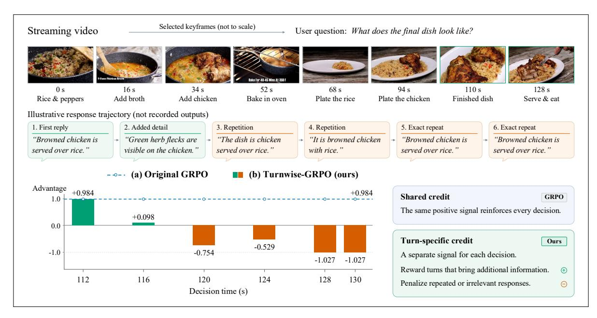
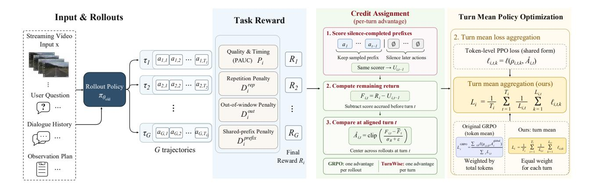
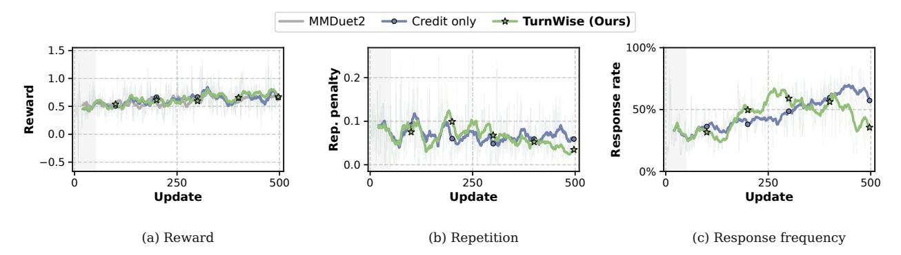
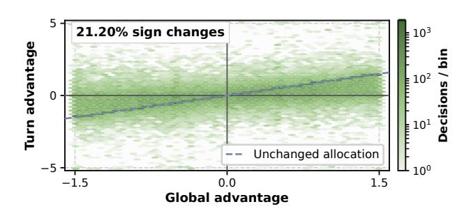
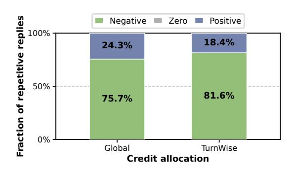

# Turns Matter: Advancing Streaming Video RL via Turn-Level Credit

- 원제: Turns Matter: Advancing Streaming Video RL via Turn-Level Credit
- 원문: [https://arxiv.org/abs/2611.06728](https://arxiv.org/abs/2611.06728)
- PDF: [https://arxiv.org/pdf/2611.06728](https://arxiv.org/pdf/2611.06728)
- arXiv ID: `2611.06728`

---


# 턴이 중요하다: 턴 수준 신용을 통한 스트리밍 비디오 RL 향상 (Turns Matter: Advancing Streaming Video RL via Turn-Level Credit)

**Shuai Dong**1,2,3,\* , **Kanghui Tian**1,3,5,\* , **Linghan Chen**1,\* , **Wenqi Shao**3,‡, **Hongrui Wu**3,4, **Haowen Hou**2,3, **Yongfu Zhu**<sup>3</sup>, **Xuehui Wang**<sup>3</sup>, **Ziyue Wang**3,7, **Wenpu Liu**3,7, **Weichu Xie**3,7, **Yuqi Xu**<sup>3</sup>, **Congcong Wang**<sup>3</sup>, **Kaiwen Tuo**3,9, **Caoyuan Ma**3,8, **Taiqiang Wu**3,10, **Ji Zhao**2,3, **Wenzheng Chang**3,5, **Dianyi Wang**1,2, **Siyuan Wang**6,†, **Zhongyu Wei**1,2,†, **Yu Qiao**2,5, **Jiaqi Wang**<sup>3</sup>

푸단대학교 (Fudan University), 상하이 혁신 연구소 (Shanghai Innovation Institute), 3 JD.com, 스탠포드 대학교 (Stanford University), 상하이 인공지능 연구소 (Shanghai Artificial Intelligence Laboratory), 홍콩 중국 대학교 (The Chinese University of Hong Kong), 베이징 대학교 (Peking University), 도쿄 대학교 (The University of Tokyo), 홍콩 과학기술 대학 (The Hong Kong University of Science and Technology), 홍콩 대학교 (The University of Hong Kong)

> <sup>∗</sup>Equal contribution, ‡Project leader, †Corresponding authors.

**[코드](https://github.com/XD111ds/turn-wise-rl) [모델](https://huggingface.co/shuai22/turns-matter-rl-ckpt) [데이터셋](https://huggingface.co/datasets/shuai22/mmduet2-training-data)**

#### **초록** (Abstract)

스트리밍 비디오 이해는 모델이 반복적으로 응답할지 계속 관찰할지를 결정하도록 요구한다. 최근 Group Relative Policy Optimization (GRPO)가 이 설정에 적용되었으며, 기존 접근법은 보상 설계에 중점을 두면서 턴마다 단일 궤적 수준의 이점을 유지한다. 이러한 공유 신용은 이전 성공 이후 중복된 답변을 강화하고, 이전 실패 이후 유용한 후속 조치를 억제할 수 있다. 우리는 턴 수준 GRPO 프레임워크인 TurnWise를 제안한다. TurnWise는 학습을 개별 스트리밍 결정에 맞추어 궤적 수준 피드백과 턴 수준 상호작용 사이의 불일치를 해결하고, 정보성 응답을 촉진하며 중복을 줄인다. 구체적으로, 턴 수준 신용 할당은 침묵 완성 프리픽스 스코어링을 사용해 각 결정의 남은 보상으로부터 그룹 상대 이점을 구성하여 학습 신호를 이전 보상과 분리한다. 턴 평균 정책 최적화는 각 턴 내 토큰 손실을 평균화한 뒤 턴 간에 평균을 내어 응답과 대기 결정을 출력 길이에 관계없이 동일한 가중치를 부여한다. 이러한 상호 보완적 설계는 학습된 비평가나 추가 롤아웃 없이 스트리밍 정책 학습을 향상시킨다. 광범위한 실험 결과, 우리의 방법은 스트리밍 비디오 이해를 위한 기존 RL 접근법보다 우수하다.

## **1 서론** (Introduction)

스트리밍 비디오 이해는 모델이 진화하는 시각적 세계를 해석하고, 관측이 아직 진행 중인 동안 상호작용하도록 요구한다 [&#91;4,](#page-10-0) [19,](#page-11-0) [32&#93;](#page-12-0). 완전한 비디오가 답변 전에 제공되는 오프라인 비디오 이해와 달리 [&#91;34&#93;](#page-12-1), 스트리밍 상호작용은 부분 관측 하에서 반복적인 결정을 통해 전개된다. 각 턴에서 모델은 응답할지 계속 관찰할지를 결정해야 한다 [&#91;24,](#page-12-2) [26&#93;](#page-12-3). 유용한 보조자는 새로운 증거가 답변을 요구할 때 응답하고, 필요할 때 후속 정보를 제공하며, 다른 답변이 거의 가치를 더하지 않을 때는 침묵해야 한다. 따라서 적절한 행동은 다음에만 의존한다



**그림 1 공유 이점이 중복 답변을 강화할 수 있다.** GRPO는 모든 턴에 단일 궤적 수준 이점을 할당하므로 이후 반복은 이전 성공에서 긍정적 신용을 상속받을 수 있다. TurnWise는 각 결정 전에 그룹 상대 누적 보상을 빼서 이후 턴이 남은 보상에 따라 신용을 받도록 한다. 대화는 예시를 보여준다. 이점 플롯은 기록된 TurnWise 이점과 해당 GRPO 대조 가설을 사용한다.

현재 시각적 증거[7,] [11,] [30]뿐만 아니라 모델이 이미 전달한 내용에 대해서도. 이러한 응답 및 대기 결정 시퀀스를 학습하려면 답변 품질과 상호작용 타이밍을 반영하는 피드백이 필요하다.

강화 학습은 상호작용 수준의 피드백으로부터 이러한 결정을 학습할 수 있는 자연스러운 방법을 제공하며, 최근 접근법은 Group Relative Policy Optimization(GRPO) [21]을 채택하고 있다. MMDuet2 [26]는 PAUC 기반 보상 [25]을 사용하여 사전적 상호작용을 최적화하고, ThinkStream [16]은 점진적 추론과 정확성, 형식, 응답 타이밍에 대한 보상을 결합한다. StreamPro [13]는 턴 수준과 트레젝터리 수준의 보상을 모두 통합하여 개별 응답과 전체 상호작용 품질을 평가한다. 보상 설계와 짧은 기간 훈련 [26]은 상호작용 피드백을 개선하지만, 여기서 고려한 트레젝터리 수준의 GRPO 공식은 여전히 하나의 이점을 모든 의사결정 턴에 전파한다. 따라서 턴 수준의 점수 매기기와 턴별 정책 신용은 서로 다른 설계 선택이다.

좋은 궤적은 나쁜 전환을 포함할 수 있고, 나쁜 궤적은 좋은 전환을 포함할 수 있다. 성공적인 초기 반응 이후에 중복된 답변이 여전히 긍정적 궤적 이점을 상속받을 수 있다. 이는 보상이 반복을 처벌하더라도 가능하다[(그림 1)](#page-1-0). 반대로, 이전 실패 이후의 유용한 후속 조치는 궤적이 그룹 평균 이하에 머무르기 때문에 부정적 이점을 받을 수 있다. 두 경우 모두 현재 결정 이전에 누적된 보상이 학습 신호에 영향을 미쳐, 그 전환에서 응답하거나 대기하는 가치가 흐려질 수 있다. 따라서 우리는 스트리밍 결정의 학습 신호가 이전에 누적된 보상보다 그 전환 이후의 보상에 초점을 맞춰야 한다고 주장한다.

이 원칙에 따라 우리는 TurnWise를 제안한다. TurnWise는 스트리밍 결정을 반영하도록 이점 추정과 손실 집계가 정렬되는 턴 수준 GRPO 프레임워크이다. return-to-go 원리[22]를 기반으로 TurnWise는 명시적 대기 행동을 활용해 남은 턴을 무음으로 설정한 상태에서 각 궤적 접두사를 점수화한다. 이 접두사 기준을 전체 궤적 보상에서 빼면 남은 보상이 도출되며, 이를 통해 그룹 상대적이며 턴별 이점을 구성한다. 무음으로 완료된 접두사 점수화는 궤적 피드백을 턴별 남은 보상 이점으로 변환한다. 이 계산은 기존 롤아웃 평가를 재사용하므로 학습된 비평가나 추가 롤아웃이 필요 없다.

TurnWise는 턴별 신용을 반응과 대기 결정에 동일한 가중치를 부여하여 결합한다. 토큰 평균(tokenmean) 집계 하에서는 긴 응답이 짧은 대기 행동보다 여전히 더 큰 집계 가중치를 받는다. 따라서 우리는 턴 평균 손실 집계(turn-mean loss aggregation)를 도입한다. 이는 각 턴 내에서 토큰 손실을 평균화한 뒤, 각 궤적 내에서 턴을 평균화한다. 턴 평균 집계는 샘플링된 반응과 대기 결정을 RL 목표에 직접 균형을 맞추어, 각 턴의 가중치를 출력 길이에 독립적으로 만든다. 두 설계는 결정을 턴 단위로 공통 단위로 만들어, 보상 추정과 손실 집계에서 턴이 어떻게 신용을 받는지와 정책 최적화 중 피드백이 어떻게 가중되는지를 동시에 해결한다.

In summary, our contributions are as follows:

- 우리는 스트리밍 비디오 RL에서 세분화 불일치를 식별한다. 공유된 궤적 이점은 이후 결정의 가치를 흐릴 수 있으며, 토큰 평균 손실 집계는 턴 가중치를 응답 길이에 따라 달라지게 만든다.

- 우리는 TurnWise를 도입한다. TurnWise는 무음으로 완료된 접두어 점수를 사용해 턴별 남은 반환 이점을 계산하고, 턴 평균 손실 집계를 결합하며, 학습된 비평가나 추가 롤아웃 없이 수행된다.

- 우리는 ProactiveVQA [&#91;25&#93;](#page-12-6), OVO-Timing [&#91;17&#93;](#page-11-6), 그리고 StreamingBench [&#91;15&#93;](#page-11-7)에서 두 Qwen 백본을 사용해 최상의 집계 점수를 달성했으며, 턴 평균 집계가 신용만 최적화에 비해 응답 타이밍을 개선하고 반복을 줄인다는 것을 보여준다.

## **2 관련 연구 (Related Work)**

### **2.1 스트리밍 비디오 상호작용 (Streaming Video Interaction)**

스트리밍 비디오 상호작용은 모델이 들어오는 관측을 처리하고 언제 통신할지 결정하도록 요구함으로써 오프라인 비디오 이해를 확장한다 [34]. 전체 비디오를 본 뒤에 답변하는 것과 달리, 이 모델들은 관측된 접두어에서 동작하며 진화하는 사용자 쿼리를 수용해야 한다. VideoLLM-online [4]는 온라인 비디오-언어 모델링을 도입하고, MMDuet [24]는 비디오-텍스트 대화를 교차시켜 시간에 민감한 이해를 확장한다. Dispider [19]는 인식, 결정, 반응을 분리하고, Stream-Bridge [23]는 오프라인 모델에 가벼운 사전 활성화 모듈을 장착한다. TimeChat-Online [28]은 시각적 중복을 줄이고, Flash-VStream [33]은 긴 비디오 스트림의 실시간 이해를 위해 압축 메모리를 유지한다. Streamo [27]는 대규모 지침 튜닝을 통해 내레이션, 이벤트 캡션, 시간에 민감한 질문 응답 등 다양한 스트리밍 작업을 추가로 지원한다. ProactiveVideoQA [25], OVO-Bench [17], StreamingBench [15] 등 벤치마크는 실시간 인식, 역사적 이해, 사전 응답 타이밍을 다룬다. 이 연구들은 응답 및 대기 결정 학습의 설정을 마련하며, 본 연구는 이러한 결정들에 걸쳐 RL 피드백이 어떻게 할당되고 가중치가 부여되는지에 초점을 둔다.

### **2.2 비디오 이해를 위한 강화 학습 (Reinforcement Learning for Video Understanding)**

PPO [20]와 GRPO [21]는 언어 모델 정책 최적화를 위한 널리 사용되는 기초를 제공한다. 이들의 비디오 모델 적용은 선호도 정렬에서 시간적 추론 및 장기 비디오 훈련으로 발전해 왔다. VLM-RLAIF [1]은 AI가 생성한 피드백을 비디오 지침 튜닝에 활용한다. Video-R1 [9]은 T-GRPO를 통해 시간적 추론을 장려하고, VideoChat-R1 [14]은 강화 학습 미세 조정을 통해 시공간 인식을 강화하며, LongVILA-R1 [6]은 RL 훈련을 장기 비디오 입력에 확장한다. 정책 증류는 이후 RL 초기화를 개선할 수 있다 [8,] [29]. 스트리밍 환경에서는 MMDuet2 [26]가 PAUC 기반 상호작용 보상을 최적화하고, 짧은 기간 훈련을 사용해 보상 희소성과 시간적 신용 할당을 완화한다. ThinkStream [16]은 정확성, 형식, 타이밍 보상을 통해 점진적 추론을 훈련하고, StreamPro [13]는 턴 수준 응답 점수와 궤적 수준 일관성 보상을 결합한다. 이러한 접근법은 샘플링된 상호작용 평가를 향상시키지만, 그들의 궤적 수준 GRPO 공식은 집계된 보상에서 공유 이점을 도출한다. TurnWise는 그룹 상대 나머지 반환 크레딧과 턴 평균 손실 집계를 통해 스트리밍 정책 최적화를 결정 턴과 정렬한다.

<span id="page-3-0"></span>

그림 2는 TurnWise의 개요를 보여준다. 스트리밍 비디오 입력 x, 사용자 질의, 대화 기록, 그리고 관측 계획이 주어지면, 정책은 궤적 집합 $\{\tau_i\}_{i=1}^G$ 를 샘플링한다. TurnWise는 궤적 보상 $R_i$ 를 침묵 완성 접두어 점수를 통해 그룹 상대 남은 반환 이점 $\hat{A}_{i,t}$ 로 변환한다. 턴 평균 집계는 이후 궤적 손실 $L_i$ 에서 모든 응답 또는 대기 결정에 동일한 가중치를 부여한다.

## 3 방법론 (Methodology)

그림 2는 TurnWise의 개요를 제시한다. TurnWise는 두 가지 결합된 메커니즘을 통해 정책 최적화를 스트리밍 결정과 정렬한다: 그룹 상대 남은 반환 이점과 결정 턴의 동등 가중치.

### 3.1 스트리밍 결정 및 궤적 보상 (Streaming Decisions and Trajectory Rewards)

A streaming instance comprises video input x, user queries, initial dialogue history  $h_0$ , and an observation plan specifying the decision-time grid. At decision turn t, the policy's context  $h_{i,t}$  contains only the available video-text prefix and its previously generated actions in sampled trajectory i. The policy  $\pi_{\theta}$  generates either a textual response or the explicit waiting output NO REPLY, denoted by  $\varnothing$ . Waiting produces no user-visible answer, but remains a generated action optimized alongside responses. To learn these decisions, we sample G trajectories  $\tau_i = (a_{i,1}, \ldots, a_{i,T_i})$  from the rollout policy, with  $a_{i,t} \sim \pi_{\theta_{\text{old}}}(\cdot \mid h_{i,t})$ . Here,  $T_i$  denotes the number of decision turns in trajectory i; aligned trajectories within a group follow the same observation plan and have a common horizon, while different instances may have different horizons. Their observations are shared, but their dialogue histories can differ through earlier sampled responses. Consequently, the value of a new response depends on both the evidence available so far and the information already communicated.

MMDuet2 [26] 를 따라, 우리는 각 완전 궤적을 PAUC 기반 보상으로 평가한다:

<span id="page-3-2"></span>

$$R_i = \mathcal{R}(\tau_i) = 3P_i - 2D_i^{\text{rep}} - 0.5D_i^{\text{out}} - 2D_i^{\text{prefix}}.$$

(1)

여기서 $P_i$ 는 주석이 달린 답변 창 내에서 응답 품질과 시기성을 측정한다 [25]. 주어진 품질 향상에 대해, 더 일찍 응답하면 창 전체에서 기여도가 증가하여 답변 내용과 응답 시기를 연결한다. 나머지 항목은 원치 않는 응답 행동을 벌한다: $D_i^{\text{rep}}$ 는 이전 응답에 이미 포함된 정보를 가진 비침묵 응답의 비율이며, $D_i^{\text{out}}$ 는 모델이 응답하는 창 밖 결정 턴의 비율, $D_i^{\text{prefix}}$ 는 $T_i$ 로 정규화된 과도하게 긴 공유 접두어 위반 횟수이다. 분모가 비어 있으면 0을 기여하며, 반복 검사에는 실제 초기 대화에서 비침묵 보조자 응답이 포함된다. 이러한 응답 수준 평가는 궁극적으로 단일 상호작용 점수를 생성한다. 고정 궤적 스코어러는 신용 할당과 손실 집계를 제어된 최적화 변수로 만든다.

GRPO [21] 은 이 점수를 각 궤적에 대한 그룹 상대 이점으로 변환한다:

<span id="page-3-1"></span>

$$A_i^{\text{global}} = \frac{R_i - \bar{R}}{\sigma_R + \epsilon}, \qquad \bar{R} = \frac{1}{G} \sum_{j=1}^G R_j,$$

(2)

$\sigma_R$ 는 그룹 내 최종 보상의 표본 표준 편차이다. $A_i^{\text{global}}$ 를 모든 행동 토큰에 방송하면 전체 궤적에 대한 선호를 표현하지만, 턴 이전에 획득한 보상과 그 턴 이후에 얻은 이득을 구분하지 않는다. 따라서 이후 결정은 이전의 성공 또는 실패로부터 신용을 상속받을 수 있다. TurnWise 는 그룹 상대 남은 반환을 통해 이 시간적 불일치를 해결한다.

### <span id="page-4-3"></span>3.2 턴 수준 신용 할당 (Turn-Level Credit Assignment)

우리는 순차 관측 스트림과 명시적 대기 동작을 활용하여 GRPO의 공유된 궤적 이점을 비판자 모델 없이 턴 수준 보상으로 정제한다. 스트리밍 관측은 공유 관측 계획에 따라 진행되며, 어시스턴트는 각 결정 지점에서 응답하거나 침묵할 수 있다. 이 구조는 스트림이 계속되지만 추가 응답이 없을 때 트레젝터리 접두사가 달성하는 것을 점수화할 수 있게 하여, 학습된 상태 가치 함수 대신 트레젝터리 점수 매기기에서 직접 누적 보상 참조를 제공한다. 구체적으로, 우리는 첫 번째 t개의 샘플된 행동을 보존하고 이후 모든 행동을 침묵으로 설정한다:

<span id="page-4-2"></span>

$$U_{i,t} = \mathcal{R}(a_{i,1}, \dots, a_{i,t}, \underbrace{\varnothing, \dots, \varnothing}_{T_i - t}), \qquad 0 \le t \le T_i.$$

(3)

모든 접두사는 전체 트레젝터리와 동일한 초기 이력, 결정 타임스탬프, 응답 창, 평가 수평선으로 점수화된다. 따라서 $U_{i,t}$는 추가 응답이 없을 때 보존된 결정이 달성하는 것을 측정한다. 끝점에서 $U_{i,0}$는 공유된, 반드시 0은 아닌, 모든 침묵 참조이며 $U_{i,T_i} = R_i$이다.

점수 차이 $r_{i,t} = U_{i,t} - U_{i,t-1}$은 Fig. 2에 표시된 턴 수준 보상 증가를 제공한다. 이 증가량은 모든 침묵 참조에 대한 트레젝터리 점수를 정확히 분해한다. 결정 t에 대해 $C_{i,t-1} = U_{i,t-1} - U_{i,0}$는 이미 획득된 보상을 측정하고, $F_{i,t} = R_i - U_{i,t-1}$는 그 턴에서 시작되는 샘플링된 연속에서 추가 수익을 측정한다. $F_{i,t}$를 $R_i$ 대신 사용하면 현재 결정의 신용에서 이전 보상을 제외하여 반환-투-고 원칙[22]을 따른다. 수렴 도출과 비가산 보상 항에 대한 적용 가능성은 섹션 A에 제시된다. 우리는 각 롤아웃 그룹 내에서 이 남은 수익을 비교한다:

<span id="page-4-0"></span>

$$\hat{A}_{i,t} = \left[ \frac{F_{i,t} - \bar{F}_t}{\sigma_R + \epsilon} \right]_{-a_{\text{max}}}^{a_{\text{max}}} 
= \left[ A_i^{\text{global}} - \frac{C_{i,t-1} - \bar{C}_{t-1}}{\sigma_R + \epsilon} \right]_{-a_{\text{max}}}^{a_{\text{max}}}.$$

(4)

여기서 $\bar{F}_t = G^{-1} \sum_j F_{j,t}$ 이고 $\bar{C}_{t-1} = G^{-1} \sum_j C_{j,t-1}$ 이다. 연산자 $[z]_l^u = \min\{u, \max\{l, z\}\}$ 은 정규화된 이점을 $[-a_{\max}, a_{\max}]$ 로 클리핑한다. 여기서 $a_{\max} > 0$ 은 고정된 클리핑 임계값이며 (우리 실험에서는 $a_{\max} = 5$) 과도하게 큰 이점 크기가 정책 업데이트에 미치는 영향을 제한한다. 두 번째 등식은 크레딧 보정을 명시적으로 만든다: 현재 결정 이전에 이미 누적된 그룹 상대 보상을 빼는 것이다 (유도는 섹션 A.3 참조). 평균 이상의 초기 성공은 더 이상 이후 중복 답변을 직접적으로 부스트하지 않으며, 평균 이하의 초기 성과는 더 이상 유용한 후속 답변을 직접적으로 억제하지 않는다. 특히 $R_i > \bar{R}$ 인 궤적은 $F_{i,t} < \bar{F}_t$ 이면 부정적인 이후 턴 이점 $\hat{A}_{i,t}$ 를 받을 수 있다. 반대로, 종단 보상 평균 이하인 궤적은 남은 반환이 그룹 평균을 초과할 때 이후 턴에서 양의 크레딧을 받을 수 있다. 첫 턴 크레딧 보정은 $C_{i,0} = 0$ 이므로 0 이고, $\sigma_R$ 를 유지하면 턴 간에 공통된 GRPO 정규화 스케일을 보존한다.

이전 보상이 얼마나 강하게 제거되는지를 제어하기 위해, 클리핑 전에 누적 보상 보정을 스케일링하기 위해 $\alpha \in [0,1]$ 를 도입한다:

<span id="page-4-1"></span>

$$\hat{A}_{i,t}^{(\alpha)} = \left[ A_i^{\text{global}} - \alpha \frac{C_{i,t-1} - \bar{C}_{t-1}}{\sigma_R + \epsilon} \right]_{-a_{\text{max}}}^{a_{\text{max}}}.$$

(5)

이것은 클리핑 전에 전역 및 잔여 반환 이점을 보간하는 것과 동일하다. $\alpha = 0$ 일 때는 모든 턴이 클리핑된 GRPO 이점을 공유하며, $\alpha = 1$ 일 때는 $\hat{A}_{i,t}^{(1)} = \hat{A}_{i,t}$ 가 방정식 (4)에서 완전히 보정된 턴별 이점이다. 섹션 4.1에 자세히 설명된 바와 같이, 우리는 스케줄된 업데이트의 처음 10% 동안 $\alpha$ 를 0에서 1로 선형적으로 증가시키고 이후에는 1로 유지하여 공유에서 턴별 신용으로 점진적으로 전환한다.

이러한 이점은 샘플링된 궤적의 품질 및 반복 평가를 재사용한다: 무음 접미사는 보존된 응답이나 그 이전의 답변을 변경하지 않는다. 결정론적 스캔은 접두사 점수와 그

분모를 업데이트하여 추가 롤아웃이나 판사 호출 없이 비평가 없는 턴 수준 이점을 제공한다. 각 결과 이점은 해당 턴 내에서 생성된 행동 토큰에 할당된다.

### <span id="page-5-3"></span>3.3 턴 평균 정책 최적화 (Turn-Mean Policy Optimization)

스트리밍 GRPO 내에서 턴 수준 이점은 개별 결정에 신용을 부여하지만, 토큰 평균 손실 집계는 여전히 이 결정들을 응답 길이에 따라 가중한다. $L_{i,t}$ 를 턴 t에서 생성된 행동 토큰 수라고 하자. 토큰 평균 집계 하에서는 이 턴이 가중치 $L_{i,t}/\sum_s L_{i,s}$ 를 받으므로 긴 응답이 짧은 대기 행동보다 더 큰 영향을 미친다. 우리는 스트리밍 결정마다 출력 길이에 관계없이 동일한 집계 가중치를 부여하기 위해 턴 평균 정책 최적화를 도입한다.

$\rho_{i,t,k}(\theta)$ 를 턴 이력 및 이전 행동 토큰에 조건부인 토큰 $a_{i,t,k}$ 에 대한 현재-대-롤아웃 정책 확률 비율이라고 하자. GRPO는 클리핑된 확률 비율 대리자 [20, 21] 로 생성 토큰을 최적화한다:

<span id="page-5-2"></span>

$$\ell_{\text{clip}}(\rho, A) = -\min\{\rho A, [\rho]_{1-\delta}^{1+\delta} A\},\tag{6}$$

$\delta$ 가 확률 비율 클리핑을 제어한다. $\ell(\rho, A)$ 를 섹션 B에 자세히 설명된 이중 클리핑 보호 기능이 있는 이 대리자로 둔다. TurnWise는 수정된 그룹 상대 이점을 각 턴의 토큰에 적용하여 $\ell_{i,t,k}(\theta) = \ell(\rho_{i,t,k}(\theta), \hat{A}_{i,t}^{(\alpha)})$ 를 제공한다.

그림 2에 나타난 바와 같이, 우리는 먼저 각 턴 내에서 토큰 손실을 평균화한 뒤 턴 간에 평균을 취한다:

<span id="page-5-0"></span>

$$L_i(\theta) = \frac{1}{T_i} \sum_{t=1}^{T_i} \frac{1}{L_{i,t}} \sum_{k=1}^{L_{i,t}} \ell_{i,t,k}(\theta),$$

(7)

각 응답-대기 결정은 $1/T_i$ 가중치를 받으며, 이는 응답 길이가 정책 손실의 비중을 결정하지 않도록 한다. 알고리즘 1은 각 GRPO 업데이트 동안 이 턴 평균 집계를 적용한다.

### 3.4 통합 턴별 목표 (Unified TurnWise Objective)

TurnWise objective는 턴별 남은 반환 이점과 길이와 무관한 결정 가중치를 결합한다. GRPO는 먼저 각 롤아웃 그룹 내에서 $R_i$ 를 정규화하여 방정식 (2)에서 공유 이점 $A_i^{\text{global}}$ 를 얻는다. KL 정규화 없이 B개의 샘플링된 궤적에 대한 궤적 평균 GRPO 손실은

$$\mathcal{L}_{GRPO}(\theta) = \sum_{i,t,k} \frac{\ell(\rho_{i,t,k}(\theta), A_i^{global})}{B \sum_{s=1}^{T_i} L_{i,s}}.$$

(8)

각 토큰은 동일한 궤적 수준의 크레딧을 사용하고, 각 턴의 기여는 출력 길이에 비례한다.

우리는 방정식 (5)를 사용해 공유된 이점을 보정하고, 방정식 (7)에서 턴 평균 집계 방식을 채택하여 통합 목표를 도출한다:

<span id="page-5-1"></span>

$$\hat{A}_{i,t}^{(\alpha)} = \left[ A_i^{\text{global}} - \alpha \frac{C_{i,t-1} - \bar{C}_{t-1}}{\sigma_R + \epsilon} \right]_{-a_{\text{max}}}^{a_{\text{max}}},$$

$$\mathcal{L}_{\text{TW}}(\theta) = \sum_{i,t,k} \frac{\ell(\rho_{i,t,k}(\theta), \hat{A}_{i,t}^{(\alpha)})}{BT_i L_{i,t}}.$$

(9)

우리는 현재 결정 이전에 누적된 보상을 제거하는 장점 보정(advantage correction)을 사용하며, 분모 $BT_iL_{i,t}$는 결정 가중치를 응답 길이에 독립적으로 만든다. 완전 보정 $\alpha=1$일 때, 정책은 응답 또는 대기 granularity에서 그룹 상대 나머지 수익을 학습한다. 알고리즘 1은 그룹 샘플링, 궤적 점수 매기기, 턴 수준 장점 보정, 턴 평균 정책 업데이트를 이 GRPO 학습 루프에 결합한다.

#### <span id="page-6-1"></span>알고리즘 1 GRPO-스타일 턴별 훈련 (Algorithm 1 GRPO-Style TurnWise Training)

Require: 스트리밍 인스턴스 \mathcal{D}, 정책 \pi_{\theta}, 트레저리 스코어 \mathcal{R}, 롤아웃 그룹 크기 G, GRPO 업데이트 S, 학습률 \eta.  
Ensure: 학습된 스트리밍 정책 \pi_{\theta}.  
 1: AdamW를 학습률 \eta 로 초기화  
 2: GRPO 반복 s = 0, …, S-1 에 대해  
           \theta_{\text{old}} \leftarrow \theta  
 3:  
           \alpha \leftarrow \min\{1, s/\lceil 0.1S \rceil\}  
                                                                                                                                                       ▷ 크레딧 워밍업  
 4:  
           배치의 스트리밍 인스턴스를 \mathcal{D} 에서 샘플링  
 5:  
 6:  
           배치의 모든 스트리밍 인스턴스에 대해  
                π_{\theta_{\text{old}}} 로 정렬된 \{\tau_i\}_{i=1}^G 를 샘플링  
 7:  
                                                                                                                                                       ▶ 응답 또는 대기  
                R_i = \mathcal{R}(\tau_i)를 평가하고 응답 점수를 캐시  
 8:  
                식 (3)을 통해 \{U_{i,t}\} 를 계산  
                                                                                                                                                            ▷ 캐시 스캔  
 9:  
                \{R_i\}_{i=1}^G 로부터 \bar{R} 와 \sigma_R 를 계산  
10:  
                \begin{array}{l} \textbf{if} \ \sigma_R = 0 \ \textbf{then} \\ \hat{A}_{i,t}^{(\alpha)} \leftarrow 0 \ \text{모든} \ i,t \ \text{그룹에} \end{array}  
11:  
12:  
13:  
                      A_i^{\text{global}} 를 식 (2)를 통해 계산  
14:  
                     각 정렬된 결정 턴 t 에 대해  
15:  
                          F_{i,t} \leftarrow R_i - U_{i,t-1} (모든 i 에 대해)  
\bar{F}_t \leftarrow G^{-1} \sum_{j=1}^G F_{j,t}  
Compute \hat{A}_{i,t}^{(\alpha)} via equation (5)  
16:  
17:  
18:  
19:  
                end if  
20:  
21:  
           end for  
22:  
           배치에 대해 토큰 비율 \rho_{i,t,k}(\theta)를 계산  
           턴 이점 \hat{A}_{i,t}^{(\alpha)} 를 사용해 \ell_{i,t,k} 를 계산  
23:  
           식 (7)를 통해 L_i 를 계산  
24:  
                                                                                                                                                        ▶ 턴 평균 손실  
           B \leftarrow 샘플링된 트레저리의 총 수  
25:  
           식 (9)를 통해 \mathcal{L}_{TW} 를 계산  
26:  
           AdamW와 ∇_θ \mathcal{L}_{TW} 를 사용해 θ 를 업데이트  
27:   ```

## 4 실험 (Experiments)

28: end for

우리의 평가는 벤치마크 성능, 크레딧 할당과 손실 집계의 상호 보완적 효과, 그리고 그에 따른 응답 행동의 변화를 측정한다.

### 4.1 훈련 파이프라인 (Training Pipeline)

우리는 먼저 Qwen2.5-VL-3B [3]와 Qwen3-VL-4B [2]를 EgoExo4D [10], EgoExoLearn [12], Live-WhisperX [5], Tarsier2 [31], 그리고 LLaVA-Video [34]에 대해 미세 조정한다. 두 모델은 100,874개의 유효 지시 예시로 구성된 동일한 SFT 코퍼스를 사용하며, 그 중 1%를 검증용으로 보류한다. SFT는 시각 타워를 고정한 상태에서 학습률 10<sup>-5</sup>로 한 에폭 동안 실행된다. 이후 우리는 GRPO 스타일 강화 학습 [21]을 사용해 샘플링된 궤적 그룹으로 상대적 이점 신호를 형성하여 스트리밍 정책을 최적화한다. 강화 학습은 20초 길이의 목표 세그먼트, 초기 대화 맥락, 그리고 두 초마다 최대 90프레임을 샘플링한 3,983개의 스트리밍 인스턴스를 사용하며, 이는 MMDuet2 [26]를 따른다. 우리는 방정식 (1)에서 PAUC 기반 보상을 사용하며, 이는 gpt-oss-20b [18]에 의해 평가된다.

모든 RL 구성은 배치 크기 8과 인스턴스당 G=4 롤아웃을 사용하며, 온도 1.2와 top-k=10을 따른다, MMDuet2 [26]을 따른다. 우리는 AdamW를 사용해 학습률 $10^{-6}$로 한 epoch 동안 훈련하고, 배치마다 한 번의 정책 최적화 epoch을 수행하며, KL 또는 엔트로피 정규화를 사용하지 않는다. TurnWise는 비전 타워를 고정하고 턴-평균 집계를 사용하며, $\alpha$를 선형적으로 가열해 첫 번째 10%의 예정된 업데이트 동안 1까지 증가시킨다. 우리는 $\epsilon=10^{-6}$, $a_{\rm max}=5$, $\delta=0.2$, 그리고 c=3을 설정한다.

<span id="page-7-0"></span>**Table 1** TurnWise는 두 백본 모두에서 ProactiveVQA, OVO-Timing, StreamingBench에서 가장 높은 집계 점수를 달성한다. 각 백본 내에서 가장 우수한 결과와 두 번째 우수한 결과는 각각 **굵게**와 밑줄로 표시된다. ∆는 각 집계 열에서 TurnWise와 가장 강력한 비-턴와이즈 결과의 차이를 나타낸다.

| 방법 | ProactiveVQA<br>PAUC ↑ |  |  |  | OVO-Timing<br>Timing F1 ↑ |  |  | StreamingBench |  |  |  |  |
|---------------|------------------------|-------|-------|-------|---------------------------|-------|-------|----------------|-----------|--------|--------|-------|
|  |  |  |  |  |  |  |  | 실시간 | 전향적 | 평균 ↑ |  |  |
|  | 자아 | TV | VAD | 웹 | 전체 | CRR | SSR | REC | 평균 | 정확도 ↑ | 정확도 ↑ |  |
| Qwen2.5-VL-3B |  |  |  |  |  |  |  |  |  |  |  |  |
| 기준선 | 9.32 | 27.85 | 8.98 | 42.45 | 22.15 | 0.00 | 0.53 | 3.46 | 1.33 | 69.42 | 22.40 | 45.91 |
| + SFT | 26.05 | 27.60 | 26.30 | 35.00 | 28.74 | 0.00 | 0.95 | 0.76 | 0.57 | 74.68 | 22.80 | 48.74 |
| + MMDuet2 | 44.10 | 39.70 | 28.70 | 45.90 | 39.60 | 13.86 | 17.56 | 21.76 | 17.72 | 74.88 | 20.40 | 47.64 |
| + ThinkStream | 32.90 | 34.48 | 15.72 | 55.43 | 34.63 | 4.09 | 4.54 | 15.60 | 8.08 | 72.52 | 16.40 | 44.46 |
| + StreamPro | 39.73 | 37.96 | 22.15 | 52.29 | 38.03 | 7.98 | 6.49 | 29.02 | 14.50 | 75.16 | 20.40 | 47.78 |
| + TurnWise | 44.69 | 43.01 | 29.18 | 57.36 | 43.56 | 18.02 | 14.61 | 32.15 | 21.59 | 75.85 | 23.00 | 49.43 |
| ∆ |  |  |  |  | +3.96 |  |  |  | +3.87 |  |  | +0.69 |
| Qwen3-VL-4B |  |  |  |  |  |  |  |  |  |  |  |  |
| 기준선 | 24.00 | 31.80 | 15.09 | 48.42 | 29.83 | 4.21 | 4.56 | 16.66 | 8.48 | 73.57 | 32.80 | 53.19 |
| + SFT | 29.10 | 27.07 | 28.46 | 36.33 | 30.24 | 2.78 | 0.95 | 1.06 | 1.60 | 77.56 | 35.60 | 56.58 |
| + MMDuet2 | 24.30 | 28.57 | 24.95 | 42.91 | 30.18 | 11.88 | 4.25 | 11.57 | 9.23 | 77.28 | 30.40 | 53.84 |
| + ThinkStream | 41.29 | 38.49 | 19.47 | 45.48 | 36.18 | 5.67 | 6.09 | 15.09 | 8.95 | 77.04 | 34.80 | 55.92 |
| + StreamPro | 36.39 | 36.43 | 14.82 | 51.02 | 34.67 | 4.34 | 4.63 | 16.52 | 8.50 | 78.24 | 32.80 | 55.52 |
| + TurnWise | 42.63 | 37.73 | 31.95 | 57.45 | 42.44 | 8.68 | 7.35 | 17.43 | 11.15 | 79.52 | 38.40 | 58.96 |
| ∆ |  |  |  |  | +6.26 |  |  |  | +1.92 |  |  | +2.38 |

### **4.2 Benchmarks (Benchmarks)**

우리는 ProactiveVQA [&#91;25&#93;](#page-12-6)에서 300개의 인스턴스를 사용해 Ego, TV, VAD, Web 영역에서 답변 품질과 응답 창 내 시기성을 평가한다. OVO-Timing [&#91;17&#93;](#page-11-6)은 CRR, SSR, REC에서 이벤트 트리거 응답을 평가한다. StreamingBench [&#91;15&#93;](#page-11-7)은 관찰된 비디오 프리픽스에서 Real-Time Visual Understanding을 통해 답변 정확성을, Proactive Output을 통해 답변 정확성과 시기성을 동시에 평가한다. 이 세 벤치마크는 스트리밍 정책의 보완적 측면을 평가한다: 사전 답변 품질, 이벤트 트리거 시기성, 실시간 시각 이해.

### **4.3 Evaluations (Evaluations)**

우리는 TurnWise를 SFT 모델과 동일한 스트리밍 GRPO 프레임워크에서 구현된 RL 기반 기준 모델인 MMDuet2, ThinkStream [&#91;16&#93;](#page-11-4), Stream-Pro [&#91;13&#93;](#page-11-5)와 비교한다. 모든 모델은 관찰된 비디오 프리픽스와 이전 응답을 컨텍스트로 사용해 그리디 디코딩을 수행한다.

ProactiveVQA에서는 GPT-5.6-luna에 의해 판단된 ω = 0.5를 적용한 PAUC를 보고하며, 네 개 카테고리에서 동일 가중치로 평균한다. 비음성 응답 중 반복률도 함께 보고한다. OVO-Timing은 ±2초 이내 일대일 매칭을 사용한 Timing F1을 사용한다. 우리는 각 태스크별 인스턴스당 평균 정밀도와 재현율을 계산해 F1을 구하고, CRR, SSR, REC를 동일 가중치로 평균한다. StreamingBench에서는 Real-Time Visual Understanding에서 다중 선택 정확도와 Proactive Output에서 ±2초 이내의 답변 및 시기성 정확도를 보고하며, 이 두 지표를 동일 가중치로 평균한다.

## **5 결과 및 논의 (Results and Discussions)**

### **5.1 주요 결과 (Main Results)**

TurnWise는 두 백본 모두에서 세 벤치마크에 대해 가장 높은 종합 점수를 달성한다. 구성요소 분석에 따르면 턴 수준의 크레딧과 턴 평균 집계의 결합이 과제 성능을 향상시키면서 중복 응답을 줄인다.



Fig. 3 TurnWise는 신용만 최적화에 비해 더 높은 후기 보상을 더 적은 중복 답변으로 달성한다. 패널 a는 보상을, 패널 b는 답변-정규화된 반복 패널티 크기를, 패널 c는 비-무음 결정 비율을 보여준다. 희미한 궤적은 배치 평균이다. 실선은 뒤따르는 20개 업데이트 평균이다. 회색 음영은 신용 워밍업을 표시한다.

**Table 2** Qwen2.5-VL-3B에서 턴 수준 신용과 턴 평균 집계의 상호 보완 효과. 이들의 조합은 가장 높은 과제 점수를 달성하고, 각 구성 요소만 사용했을 때보다 반복을 줄인다. PAUC, F1, Avg.는 벤치마크 수준 점수이며, Rep.는 비-무음 답변 중 반복을 측정한다. 가장 좋은 결과와 두 번째 좋은 결과는 **굵게** 표시되고 <u>밑줄</u>이 그려져 있다.

| 방법 | 크레딧 |  | Proac<br>VQ |  | OVO-<br>Timing | Streaming<br>Bench |  |
|-------------|--------------|--------------|------------------------------------|--------------------------------------|----------------|--------------------|--|
| 111001101 | Assign. | 평균 | $\overline{\mathbf{PAUC}\uparrow}$ | $\overline{\mathbf{Rep.}}\downarrow$ |  | Avg. ↑ |  |
| 기본 | _ | _ | 22.15 | 65.40 | 1.33 | 45.91 |  |
| SFT | _ | _ | 28.74 | 3.79 | 0.57 | 48.74 |  |
| MMDuet2 | _ | _ | 39.60 | 6.08 | 17.72 | 47.64 |  |
| + 턴 평균 | _ | $\checkmark$ | 41.87 | 9.78 | 8.17 | 47.58 |  |
| + 크레딧 | $\checkmark$ | _ | 43.12 | 15.53 | 18.63 | 48.94 |  |
| TurnWise | ✓ | ✓ | 43.56 | 5.98 | 21.59 | 49.43 |  |

**Table 3** 턴-평균 집계와 함께, $\alpha=1$이 Qwen2.5-VL-3B에서 네 가지 지표 모두에서 가장 좋다. 지표는 Table 2를 따른다; **bold**/<u>underline</u>는 각 구성 내에서 최상/두 번째 최상의 값을 표시한다.

| α | Proac<br>VQ |  | OVO-<br>Timing | Streaming<br>Bench |  |  |  |  |
|-------------------|---------------|-------------|---------------------------------------|--------------------|--|--|--|--|
|  | PAUC ↑ | Rep. ↓ | ————————————————————————————————————— | Avg. ↑ |  |  |  |  |
| 크레딧 할당(Credit Assignment) |  |  |  |  |  |  |  |  |
| 0.25 | 44.50 | 16.81 | 19.51 | 47.46 |  |  |  |  |
| 0.50 | 43.34 | 18.91 | <u>19.41</u> | 48.30 |  |  |  |  |
| 0.75 | 44.24 | 25.16 | 12.97 | 46.84 |  |  |  |  |
| 1.00 | 43.12 | 15.53 | 18.63 | 48.94 |  |  |  |  |
| Cred | it Assignment | + Turn Mear | $\iota$ |  |  |  |  |  |
| 0.25 | 41.37 | 12.49 | <u>16.68</u> | 48.05 |  |  |  |  |
| 0.50 | 41.71 | 36.04 | 10.53 | 46.44 |  |  |  |  |
| 0.75 | 42.00 | 12.95 | 9.73 | 46.95 |  |  |  |  |
| 1.00 | 43.56 | 5.98 | 21.59 | 49.43 |  |  |  |  |

벤치마크 결과. 표 1은 TurnWise와 SFT 및 GRPO 기반 RL 기준선들을 세 개의 스트리밍 벤치마크에서 비교한다. TurnWise는 두 백본 모두에서 세 벤치마크에 대해 최상의 총합 점수를 달성한다. Qwen2.5‑VL‑3B에서, TurnWise는 ProactiveVQA에서 43.56 PAUC, OVO‑Timing에서 평균 Timing F1 21.59, StreamingBench에서 평균 정확도 49.43을 기록하며, 가장 강력한 비‑TurnWise 결과보다 각각 3.96, 3.87, 0.69 포인트를 초과한다. Qwen3‑VL‑4B에서는 점수가 42.44, 11.15, 58.96이며, 이때의 이득은 각각 6.26, 1.92, 2.38 포인트이다.

개선은 사전적 상호작용과 시각적 이해 모두에 걸쳐 있다. ProactiveVQA에서는 TurnWise가 3B 백본으로 모든 네 개 카테고리에서 선두를 달리고, 4B 백본으로는 네 개 중 세 개에서 선두를 달린다. 후자의 경우 VAD와 Web이 가장 강력한 경쟁 결과보다 각각 3.49점과 6.43점을 향상시킨다. StreamingBench에서는 TurnWise가 두 백본 모두에서 가장 높은 실시간 및 사전적 정확도를 달성한다. 특히 4B 모델은 사전적 정확도를 38.40으로 기록하며, 가장 강력한 기준선인 35.60과 비교된다. 또한 실시간 정확도를 78.24에서 79.52로 향상시킨다. 두 백본 모두에서 TurnWise는 사전적 상호작용, 응답 타이밍, 실시간 시각적 이해를 개선한다.

신용 할당과 턴 평균 집계의 상호 보완적 효과.

Qwen2.5-VL-3B에서 턴 수준 신용 할당과 턴 평균 집계를 결합하면, 신용 할당만을 최적화한 경우에 비해 반복이 61.5 % 감소하여 15.53에서 5.98로 줄어들고, 동시에 Timing F1이 2.96 포인트 상승하며 StreamingBench 평균이 향상된다.

<span id="page-9-0"></span>



a Decision-level credit redistribution

b Repetitive replies, 2,972 total

**Fig. 4 Turn-level credit는 양의 전역 이점을 가진 반복 답변(432/722) 중** 59.83%에 **부정적 이점을 할당한다**.

두 할당은 Qwen2.5-VL-3B 훈련에서 동일한 샘플링 그룹을 사용하며, 완전한 궤적과 α = 1에서의 전체 크레딧 보정을 사용한다. Panel a는 84,184개의 결정에 대한 이점 밀도를 보여준다. 턴 이점은 훈련과 같이 ±5로 클리핑된다. 점선 대각선은 변경되지 않은 할당을 표시한다. Panel b는 이 집단에서 2,972개의 Judge-라벨링된 반복 답변에 대한 이점 부호를 보여준다.

정확도가 0.49 포인트 향상되었다 [(Table 2)](#page-8-0).  
턴 수준 크레딧은 각 결정의 학습 방향을 결정하고, 턴 평균 집계는 정책 업데이트에서 그 가중치를 결정한다.  
이 두 요소의 결합은 평가된 구성 요소 설정 중 가장 높은 총합 작업 점수를 달성한다.  
턴 평균 집계만을 사용한 경우에 비해 두 요소를 결합하면 타이밍 F1이 13.42 포인트 향상되고 반복이 38.9% 감소한다.

알파 감도. Qwen2.5-VL-3B에서 완전한 TurnWise 프레임워크 내에서, 전체 보정(α = 1)은 테스트된 보정 강도 중에서 가장 높은 PAUC, Timing F1, StreamingBench 정확도와 가장 낮은 반복을 달성한다 [(Table 3)](#page-8-1). 이는 전체 누적 보상 보정을 TurnWise의 운영 지점으로 식별한다.

### **5.2 훈련 역학 및 응답 행동 (Training Dynamics and Response Behavior)**

턴-평균 집계는 최종 50번 업데이트 동안 평균 보상을 0.657에서 0.711로 상승시키면서 반복-벌점 크기를 0.069에서 0.036으로 감소시킨다 [(Fig. 3,](#page-8-2) 패널 a와 b). 두 구성 모두 동일한 턴-레벨 크레딧 규칙과 Qwen2.5-VL-3B SFT 초기화를 497번 업데이트에 걸쳐 사용한다. 외부-창(reply) 비율은 0.537에서 0.289로 감소하고, 비-무음 결정 비율은 62.2 %에서 37.0 %로 떨어진다 (패널 c). 높은 보상은 턴-평균 집계 하에서 보다 선택적인 응답 행동과 함께한다.

### **5.3 실제 훈련 경로에서의 신용 재분배 (Credit Redistribution on Real Training Trajectories)**

턴 수준의 크레딧은 분석된 코호트에서 양의 전역 이점을 받는 반복 응답의 59.83%—722개 중 432개—에 부정적 이점을 할당한다. [그림 4](#page-9-0)는 같은 샘플링 그룹과 종단 보상으로부터 계산된 전역 이점과 기록된 턴 이점을 비교한다. 분석은 α = 1에서 전체 크레딧 보정이 적용된 11,116개의 완전한 Qwen2.5‑VL‑3B 훈련 궤적을 다루며, 이는 84,184개의 결정 턴을 포함한다. [그림 4]의 패널 a에 표시된 바와 같이, 결정의 21.20 %가 전역 할당에 비해 이점 부호를 바꾸며, 궤적의 53.15 %는 양의 및 부정적 턴 이점을 모두 받는다. 따라서 단일 궤적은 그 구성 결정에 대해 서로 다른 학습 방향을 제공한다.

이러한 차별화는 양성 순위가 매겨진 궤적 내에서 중복 응답을 목표로 한다. [그림 4]의 패널 b는 턴 수준 크레딧이 이 코호트의 모든 2,972개의 Judge‑라벨링된 반복 응답에서 부정적 이점을 받는 비율을 75.7 %에서 81.6 %로 증가시킴을 보여준다. 이 기록된 이점은 턴 수준 크레딧이 궤적 내에서 서로 다른 학습 방향을 할당하고, 양성 순위가 매겨진 궤적에서 중복 응답에 억제 신호를 제공함을 시사한다.

### **5.4 토론 (Discussion)**

[표 2](#page-8-0)와 [표 3](#page-8-1) 그리고 [그림 3](#page-8-2)와 [그림 4](#page-9-0)는 크레딧 할당과 손실 집계의 상호 보완적 역할을 강조한다: 전자는 각 턴의 학습 신호를 결정하고, 후자는 그 최적화 가중치를 제어한다. Remainingreturn 이점은 크레딧 할당을 개선하고, 턴 평균 집계는 응답과 대기 결정을 균형 있게 한다. 이들의 조합은 과제 점수와 Timing F1을 향상시키면서 중복 및 외부 윈도우 응답을 감소시킨다. TurnWise는 결정 턴 수준에서 크레딧 할당과 정책 최적화를 통합한다. 캐시된 PAUC 평가의 결정론적 스캔은 추가 롤아웃이나 판사 호출 없이 프리픽스 참조를 계산한다. 평가된 설정 전반에서 이 정렬은 과제 성능과 응답 타이밍을 개선하고 중복 응답을 줄인다.

## **6 결론 (Conclusion)**

TurnWise는 스트리밍 비디오 RL에서 결정 턴을 크레딧 할당과 정책 최적화의 공통 단위로 만든다. Silence‑completed 프리픽스 참조는 이전에 누적된 보상을 이후 턴 크레딧에서 제거하고, 턴 평균 집계는 응답과 대기 결정을 동일한 가중치로 부여하며, 학습된 비평가나 추가 롤아웃 없이 수행된다. 두 개의 Qwen 백본 전반에서 TurnWise는 세 개의 평가 벤치마크에서 가장 우수한 총합 결과를 달성하며, 구성 요소 분석은 더 높은 품질, 더 나은 타이밍, 그리고 더 선택적인 응답을 지원한다.

#### **참고문헌 (References)**

- <span id="page-10-3"></span>[1] Daechul Ahn, Yura Choi, Youngjae Yu, Dongyeop Kang, and Jonghyun Choi. AI 피드백을 통한 강화 학습으로 비디오용 대형 멀티모달 모델을 튜닝한다. Association for Computational Linguistics 제62회 연례 회의 논문집(Volume 1: Long Papers)에서, 페이지 923–940, 방콕, 태국, 2024. Association for Computational Linguistics.

- <span id="page-10-6"></span>[2] Shuai Bai, Yuxuan Cai, Ruizhe Chen, Keqin Chen, Xionghui Chen, Zesen Cheng, Lianghao Deng, Wei Ding, Chang Gao, Chunjiang Ge, Wenbin Ge, Zhifang Guo, Qidong Huang, Jie Huang, Fei Huang, Binyuan Hui, Shutong Jiang, Zhaohai Li, Mingsheng Li, Mei Li, Kaixin Li, Zicheng Lin, Junyang Lin, Xuejing Liu, Jiawei Liu, Chenglong Liu, Yang Liu, Dayiheng Liu, Shixuan Liu, Dunjie Lu, Ruilin Luo, Chenxu Lv, Rui Men, Lingchen Meng, Xuancheng Ren, Xingzhang Ren, Sibo Song, Yuchong Sun, Jun Tang, Jianhong Tu, Jianqiang Wan, Peng Wang, Pengfei Wang, Qiuyue Wang, Yuxuan Wang, Tianbao Xie, Yiheng Xu, Haiyang Xu, Jin Xu, Zhibo Yang, Mingkun Yang, Jianxin Yang, An Yang, Bowen Yu, Fei Zhang, Hang Zhang, Xi Zhang, Bo Zheng, Humen Zhong, Jingren Zhou, Fan Zhou, Jing Zhou, Yuanzhi Zhu, and Ke Zhu. Qwen3-VL 기술 보고서. arXiv 사전 인쇄 arXiv:2511.21631, 2025.

- <span id="page-10-5"></span>[3] Shuai Bai, Keqin Chen, Xuejing Liu, Jialin Wang, Wenbin Ge, Sibo Song, Kai Dang, Peng Wang, Shijie Wang, Jun Tang, Humen Zhong, Yuanzhi Zhu, Mingkun Yang, Zhaohai Li, Jianqiang Wan, Pengfei Wang, Wei Ding, Zheren Fu, Yiheng Xu, Jiabo Ye, Xi Zhang, Tianbao Xie, Zesen Cheng, Hang Zhang, Zhibo Yang, Haiyang Xu, and Junyang Lin. Qwen2.5-VL 기술 보고서. arXiv 사전 인쇄 arXiv:2502.13923, 2025.

- <span id="page-10-0"></span>[4] Joya Chen, Zhaoyang Lv, Shiwei Wu, Kevin Qinghong Lin, Chenan Song, Difei Gao, Jia-Wei Liu, Ziteng Gao, Dongxing Mao, and Mike Zheng Shou. VideoLLM-online: 스트리밍 비디오를 위한 온라인 비디오 대형 언어 모델. IEEE/CVF 컴퓨터 비전 및 패턴 인식 회의(CVPR) 논문집에서, 페이지 18407–18418, 2024.

- <span id="page-10-7"></span>[5] Joya Chen, Ziyun Zeng, Yiqi Lin, Wei Li, Zejun Ma, and Mike Zheng Shou. LIVE: 대규모 스트리밍 음성 전사와 함께 비디오 LLM을 학습한다. IEEE/CVF 컴퓨터 비전 및 패턴 인식 회의 논문집에서, 페이지 29083–29095, 2025.

- <span id="page-10-4"></span>[6] Yukang Chen, Wei Huang, Baifeng Shi, Qinghao Hu, Hanrong Ye, Ligeng Zhu, Zhijian Liu, Pavlo Molchanov, Jan Kautz, Xiaojuan Qi, Sifei Liu, Hongxu Yin, Yao Lu, and Song Han. 장기 비디오에 RL을 확장한다. Advances in Neural Information Processing Systems에서, 2025.

- <span id="page-10-1"></span>[7] Shuai Dong, Siyuan Wang, Xingyu Liu, Chenglin Li, Haowen Hou, and Zhongyu Wei. 선택적 지각 모델링과 함께 교차된 잠재적 시각적 추론. Association for Computational Linguistics 제64회 연례 회의 논문집에서, 페이지 29316–29335, 캘리포니아 샌디에이고, 미국, 2026. Association for Computational Linguistics.

- <span id="page-10-2"></span>[8] Shuai Dong, Yongfu Zhu, Yuqi Xu, Weichu Xie, Liuwenpu, Ziyue Wang, Kaiwen Tuo, Congcong Wang, Siyuan Wang, Wenqi Shao, Shuai Yang, Ji Zhao, Caoyuan Ma, Wenzheng Chang, Taiqiang Wu, Xinlei Yu, Hongrui Wu, Xiaoxuan He, Fangke Chen, Dianyi Wang, Kanghui Tian, Sirry Chen, Xingyu Liu, Xiangnan Wu, Jiawei Guo, Haowen Hou, LingHan Chen, Zhongyu Wei, and Jiaqi Wang. RL이 RL보다 먼저 시작한다: 더 나은 강화 학습을 위한 정책 디스틸레이션. arXiv 사전 인쇄 arXiv:2609.28145, 2026.

- <span id="page-11-8"></span>[9] Kaituo Feng, Kaixiong Gong, Bohao Li, Zonghao Guo, Yibing Wang, Tianshuo Peng, Junfei Wu, Xiaoying Zhang, Benyou Wang, and Xiangyu Yue. Video-R1: MLLMs에서 비디오 추론 강화. 신경 정보 처리 시스템의 발전에서, 2025.
- <span id="page-11-10"></span>[10] Kristen Grauman, Andrew Westbury, Lorenzo Torresani, Kris Kitani, Jitendra Malik, Triantafyllos Afouras, Kumar Ashutosh, Vijay Baiyya, Siddhant Bansal, Bikram Boote, Eugene Byrne, Zach Chavis, Joya Chen, Feng Cheng, Fu-Jen Chu, Sean Crane, Avijit Dasgupta, Jing Dong, Maria Escobar, Cristhian Forigua, Abrham Gebreselasie, Sanjay Haresh, Jing Huang, Md Mohaiminul Islam, Suyog Jain, Rawal Khirodkar, Devansh Kukreja, Kevin J Liang, Jia-Wei Liu, Sagnik Majumder, Yongsen Mao, Miguel Martin, Effrosyni Mavroudi, Tushar Nagarajan, Francesco Ragusa, Santhosh Kumar Ramakrishnan, Luigi Seminara, Arjun Somayazulu, Yale Song, Shan Su, Zihui Xue, Edward Zhang, Jinxu Zhang, Angela Castillo, Changan Chen, Xinzhu Fu, Ryosuke Furuta, Cristina Gonzalez, Prince Gupta, Jiabo Hu, Yifei Huang, Yiming Huang, Weslie Khoo, Anush Kumar, Robert Kuo, Sach Lakhavani, Miao Liu, Mi Luo, Zhengyi Luo, Brighid Meredith, Austin Miller, Oluwatumininu Oguntola, Xiaqing Pan, Penny Peng, Shraman Pramanick, Merey Ramazanova, Fiona Ryan, Wei Shan, Kiran Somasundaram, Chenan Song, Audrey Southerland, Masatoshi Tateno, Huiyu Wang, Yuchen Wang, Takuma Yagi, Mingfei Yan, Xitong Yang, Zecheng Yu, Shengxin Cindy Zha, Chen Zhao, Ziwei Zhao, Zhifan Zhu, Jeff Zhuo, Pablo Arbelaez, Gedas Bertasius, Dima Damen, Jakob Engel, Giovanni Maria Farinella, Antonino Furnari, Bernard Ghanem, Judy Hoffman, C.V. Jawahar, Richard Newcombe, Hyun Soo Park, James M. Rehg, Yoichi Sato, Manolis Savva, Jianbo Shi, Mike Zheng Shou, and Michael Wray. Ego-Exo4D: 1인칭 및 3인칭 관점에서 숙련된 인간 활동 이해. IEEE/CVF 컴퓨터 비전 및 패턴 인식 회의 논문집, 페이지 19383–19400, 2024.
- <span id="page-11-1"></span>[11] Jiawei Guo, Yu Chen, Xiang Wang, Shuai Li, Xinpei Zhao, Huaxing Liu, Shuai Dong, Feifei Zhai, and Yu Zhou. Beyond visual memory: 잠재적 시각 추론의 기전적 진단. arXiv 사전 인쇄 arXiv:2606.01287, 2026.
- <span id="page-11-11"></span>[12] Yifei Huang, Guo Chen, Jilan Xu, Mingfang Zhang, Lijin Yang, Baoqi Pei, Hongjie Zhang, Lu Dong, Yali Wang, Limin Wang, and Yu Qiao. EgoExoLearn: 실제 세계에서 비동기적 자아 및 외부 중심 관점의 절차적 활동을 연결하는 데이터셋. IEEE/CVF 컴퓨터 비전 및 패턴 인식 회의 논문집, 페이지 22072–22086, 2024.
- <span id="page-11-5"></span>[13] Ao Li, Zihan Xiao, Zihao Yue, Boshen Xu, Linli Yao, Jiaze Li, Pei Fu, Jianzhong Ju, Jian Luan, and Qin Jin. StreamPro: 반응적 인식에서 사전적 의사결정으로 스트리밍 비디오. arXiv 사전 인쇄 arXiv:2605.16381, 2026.
- <span id="page-11-9"></span>[14] Xinhao Li, Ziang Yan, Desen Meng, Lu Dong, Xiangyu Zeng, Yinan He, Yali Wang, Yu Qiao, Yi Wang, and Limin Wang. VideoChat-R1: 강화 미세조정을 통한 시공간 인식 강화. arXiv 사전 인쇄 arXiv:2504.06958, 2025.
- <span id="page-11-7"></span>[15] Junming Lin, Zheng Fang, Chi Chen, Haoxuan Cheng, Zihao Wan, Fuwen Luo, Ziyue Wang, Peng Li, Yang Liu, and Maosong Sun. StreamingBench: MLLMs가 스트리밍 비디오 이해를 달성하기 위한 격차 평가. ICASSP 2026 – 2026 IEEE 국제 음향, 음성 및 신호 처리 회의 (ICASSP), 페이지 12147–12151. IEEE, 2026.
- <span id="page-11-4"></span>[16] Zikang Liu, Longteng Guo, Handong Li, Ru Zhen, Xingjian He, Ruyi Ji, Xiaoming Ren, Yanhao Zhang, Haonan Lu, and Jing Liu. Thinking in streaming video. arXiv 사전 인쇄 arXiv:2603.12938, 2026.
- <span id="page-11-6"></span>[17] Junbo Niu, Yifei Li, Ziyang Miao, Chunjiang Ge, Yuanhang Zhou, Qihao He, Xiaoyi Dong, Haodong Duan, Shuangrui Ding, Rui Qian, Pan Zhang, Yuhang Zang, Yuhang Cao, Conghui He, and Jiaqi Wang. OVO-Bench: 실제 온라인 비디오 이해에서 당신의 Video-LLMs가 얼마나 떨어져 있는가? IEEE/CVF 컴퓨터 비전 및 패턴 인식 회의 논문집, 페이지 18902–18913, 2025.
- <span id="page-11-12"></span>[18] OpenAI. gpt-oss-120b & gpt-oss-20b 모델 카드. arXiv 사전 인쇄 arXiv:2508.10925, 2025.
- <span id="page-11-0"></span>[19] Rui Qian, Shuangrui Ding, Xiaoyi Dong, Pan Zhang, Yuhang Zang, Yuhang Cao, Dahua Lin, and Jiaqi Wang. Dispider: 분리된 인식, 의사결정 및 반응을 통한 실시간 상호작용으로 비디오 LLMs 활성화. IEEE/CVF 컴퓨터 비전 및 패턴 인식 회의 논문집, 페이지 24045–24055, 2025.
- <span id="page-11-2"></span>[20] John Schulman, Filip Wolski, Prafulla Dhariwal, Alec Radford, and Oleg Klimov. 근접 정책 최적화 알고리즘. arXiv 사전 인쇄 arXiv:1707.06347, 2017.
- <span id="page-11-3"></span>[21] Zhihong Shao, Peiyi Wang, Qihao Zhu, Runxin Xu, Junxiao Song, Xiao Bi, Haowei Zhang, Mingchuan Zhang,

- Y. K. Li, Y. Wu, and Daya Guo. DeepSeekMath: Pushing the limits of mathematical reasoning in open language models. arXiv preprint arXiv:2402.03300, 2024.
- <span id="page-12-5"></span>[22] Richard S. Sutton and Andrew G. Barto. Reinforcement Learning: An Introduction. MIT Press, Cambridge, MA, 2nd edition, 2018.
- <span id="page-12-7"></span>[23] Haibo Wang, Bo Feng, Zhengfeng Lai, Mingze Xu, Shiyu Li, Weifeng Ge, Afshin Dehghan, Meng Cao, and Ping Huang. StreamBridge: Turning your offline video large language model into a proactive streaming assistant. In Advances in Neural Information Processing Systems, 2025.
- <span id="page-12-2"></span>[24] Yueqian Wang, Xiaojun Meng, Yuxuan Wang, Jianxin Liang, Jiansheng Wei, Huishuai Zhang, and Dongyan Zhao. VideoLLM knows when to speak: Enhancing time-sensitive video comprehension with video-text duet interaction format. In Findings of the Association for Computational Linguistics: EMNLP 2025, pages 6338–6359, Suzhou, China, 2025. Association for Computational Linguistics.
- <span id="page-12-6"></span>[25] Yueqian Wang, Xiaojun Meng, Yifan Wang, Huishuai Zhang, and Dongyan Zhao. ProactiveVideoQA: A comprehensive benchmark evaluating proactive interactions in video large language models. arXiv preprint arXiv:2507.09313, 2025.
- <span id="page-12-3"></span>[26] Yueqian Wang, Songxiang Liu, Disong Wang, Nuo Xu, Guanglu Wan, Huishuai Zhang, and Dongyan Zhao. MM-Duet2: Enhancing proactive interaction of video MLLMs with multi-turn reinforcement learning. In International Conference on Learning Representations (ICLR), 2026.
- <span id="page-12-10"></span>[27] Jiaer Xia, Peixian Chen, Mengdan Zhang, Xing Sun, and Kaiyang Zhou. Streaming video instruction tuning. In Proceedings of the IEEE/CVF Conference on Computer Vision and Pattern Recognition (CVPR), pages 31219– 31229, 2026.
- <span id="page-12-8"></span>[28] Linli Yao, Yicheng Li, Yuancheng Wei, Lei Li, Shuhuai Ren, Yuanxin Liu, Kun Ouyang, Lean Wang, Shicheng Li, Sida Li, Lingpeng Kong, Qi Liu, Yuanxing Zhang, and Xu Sun. TimeChat-Online: 80% visual tokens are naturally redundant in streaming videos. In Proceedings of the 33rd ACM International Conference on Multimedia, pages 10807–10816. Association for Computing Machinery, 2025.
- <span id="page-12-11"></span>[29] Xinlei Yu, Gen Li, Qingyi Si, Guibin Zhang, Yuqi Xu, Congcong Wang, Shuai Dong, Kaiwen Tuo, Xiangyu Zeng, Kaituo Feng, Qunzhong Wang, Yang Shi, Xiaobin Hu, Xiangyu Yue, Jiaqi Wang, and Shuicheng Yan. DOPD: Dual on-policy distillation. arXiv preprint arXiv:2606.30626, 2026.
- <span id="page-12-4"></span>[30] Xinlei Yu, Chengming Xu, Zhangquan Chen, Yudong Zhang, Shilin Lu, Cheng Yang, Jiangning Zhang, Shuicheng Yan, and Xiaobin Hu. Visual document understanding and reasoning: A multi-agent collaboration framework with agent-wise adaptive test-time scaling. In Proceedings of the IEEE/CVF Conference on Computer Vision and Pattern Recognition (CVPR), pages 12300–12311, 2026.
- <span id="page-12-12"></span>[31] Liping Yuan, Jiawei Wang, Haomiao Sun, Yuchen Zhang, and Yuan Lin. Tarsier2: Advancing large visionlanguage models from detailed video description to comprehensive video understanding. arXiv preprint arXiv:2501.07888, 2025.
- <span id="page-12-0"></span>[32] Xiangyu Zeng, Yuandong Yang, Zhiqiu Zhang, Yuhan Zhu, Xinhao Li, Qingyi Si, Dingyu Yao, Changlian Ma, Haoran Chen, Xinyu Chen, Yansong Shi, Junhao Zhou, Yifei Li, Jun Zhang, Chuanyu Qin, Chenxu Yang, Xinlei Yu, Kun Ouyang, Yuchen Shao, Qianshan Wei, Changhai Zhou, Jun Gao, Jiaqi Wang, and Limin Wang. OneStreamer: Unifying perception, memory, and proactive response in streaming video interaction. arXiv preprint arXiv:2610.01762, 2026.
- <span id="page-12-9"></span>[33] Haoji Zhang, Yiqin Wang, Yansong Tang, Yong Liu, Jiashi Feng, and Xiaojie Jin. Flash-VStream: Efficient real-time understanding for long video streams. In Proceedings of the IEEE/CVF International Conference on Computer Vision (ICCV), pages 21059–21069, 2025.
- <span id="page-12-1"></span>[34] Yuanhan Zhang, Jinming Wu, Wei Li, Bo Li, Zejun Ma, Ziwei Liu, and Chunyuan Li. LLaVA-Video: Video instruction tuning with synthetic data. Transactions on Machine Learning Research, 2025.

# **부록 (Appendix)**

#### <span id="page-13-0"></span>**턴 수준 신용 할당의 도출 (A Derivation of Turn-Level Credit Assignment)**

이 섹션은 [section 3.2.](#page-4-3)에서 사용된 보상 분해 및 이점 보정 방식을 도출한다. 아래의 모든 그룹 평균은 동일한 스트리밍 인스턴스의 G 정렬된 롤아웃을 가리킨다.

### **A.1 무음-완료된 접두어 점수 (Silence-Completed Prefix Scores)**

각 샘플링된 궤적 i에 대해, [equation (3)](#page-4-2)는 첫 t개의 행동을 유지하고 나머지 모든 행동을 ∅로 대체한다. 점수 부여 맥락—초기 대화, 결정 타임스탬프, 응답 창, 평가 시점은 변하지 않는다. 이 고정된 시점은 이전 답변의 PAUC 기여를 그 답변 창의 나머지 부분에 걸쳐 보존하며, 추가 답변이 생성되지 않아도 동일하다. 또한 시점에 의존하는 페널티의 분모를 그대로 유지한다. 무음 완성은 전체 상호작용 시점에서 보존된 답변의 기여를 분리한다.

t = 0에서, 모든 롤아웃은 동일한 무음 상호작용으로 대체되므로 Ui,<sup>0</sup> = U<sup>0</sup>는 그룹의 모든 i에 대해 같다. 공유 참조 U<sup>0</sup>는 초기 대화를 포함하고 그룹 상대 신용 비교에서 상쇄된다. 다른 끝점에서는 모든 샘플링된 행동이 보존되어 Ui,T<sup>i</sup> = R<sup>i</sup>가 된다.

### **A.2 누적 보상 및 남은 반환 (Accrued Reward and Remaining Return)**

ri,t = Ui,t − Ui,t−<sup>1</sup>는 행동 t가 무음 대신 보존될 때 완전 궤적 점수의 변화를 나타내며, 이후 모든 행동은 여전히 무음이다. 이러한 차이를 결정 t 이전에 합산하면

$$C_{i,t-1} = \sum_{s=1}^{t-1} r_{i,s}$$

$$= \sum_{s=1}^{t-1} (U_{i,s} - U_{i,s-1})$$

$$= U_{i,t-1} - U_0.$$

(A.1)

중간 접두어 점수는 상쇄되어 무음 참조에 대한 보존된 이력의 누적 보상이 남는다. 결정 t부터 마지막 턴까지 합산하면 유사하게

$$F_{i,t} = \sum_{s=t}^{T_i} r_{i,s}$$

$$= \sum_{s=t}^{T_i} (U_{i,s} - U_{i,s-1})$$

$$= U_{i,T_i} - U_{i,t-1}$$

$$= R_i - U_{i,t-1}.$$

(A.2)

Thus, the quantities used in the main paper obey

$$r_{i,t} = U_{i,t} - U_{i,t-1},$$

$$C_{i,t-1} = U_{i,t-1} - U_0,$$

$$F_{i,t} = R_i - U_{i,t-1},$$

$$C_{i,t-1} + F_{i,t} = R_i - U_0.$$

(A.3)

마지막 항등식은 공유된 기준에 대해 원래의 궤적 점수를 누적 보상과 남은 반환으로 분할한다. 이 정확한 분할은 이후 결정에 원래 궤적 점수기 하에서 남은 반환에 대한 신용을 부여한다. 기준 U<sup>0</sup>은 아래 그룹-상대 비교에서 소거된다.

테레스코핑 분해는 비가산 궤적 점수기, 특히 비율 기반 반복 패널티에 대해 정확하다. 특히 새로운 답변은 비율 기반 패널티의 분자와 분모를 모두 바꿀 수 있다. 예를 들어 식 (1)에서 반복 비율 $D_i^{\text{rep}}$ 같은 경우다. 완전한 점수 함수를 사용해 각 $U_{i,t}$ 를 계산하면 $r_{i,t}$ 에서의 변화를 모두 포함한다; 따라서 증가분을 합산하면 점수 차이를 정확히 복원한다. 접두사 계산은 캐시된 품질 및 반복 평가를 재사용한다. 보존된 답변과 그 이전 기록이 동일하기 때문이다.

#### <span id="page-14-0"></span>**그룹-상대 신용 보정 (A.3 Group-Relative Credit Correction)**

우리는 $\bar{U}_{t-1} = G^{-1} \sum_{j} U_{j,t-1}$ 를 정의한다. 모든 무음 참조가 그룹 내에서 공유되기 때문에,

$$\bar{C}_{t-1} = \bar{U}_{t-1} - U_0, 
\bar{F}_t = \bar{R} - \bar{U}_{t-1}.$$

(A.4)

따라서 남은 수익을 중앙화하면

$$F_{i,t} - \bar{F}_t = (R_i - U_{i,t-1}) - (\bar{R} - \bar{U}_{t-1})$$

$$= (R_i - \bar{R}) - (U_{i,t-1} - \bar{U}_{t-1})$$

$$= (R_i - \bar{R}) - (C_{i,t-1} - \bar{C}_{t-1}).$$

(A.5)

GRPO와 동일한 최종 보상 스케일로 나누면

$$\frac{F_{i,t} - \bar{F}_t}{\sigma_R + \epsilon} = A_i^{\text{global}} - \frac{C_{i,t-1} - \bar{C}_{t-1}}{\sigma_R + \epsilon}.$$

(A.6)

같은 클리핑 연산자를 양쪽에 적용하면 방정식 (4)가 된다. 이 보정은 결정 이전에 누적된 평균 이상 또는 이하의 보상을 제거하면서, 턴 간에 공통적인 정규화 스케일을 유지한다. 첫 번째 턴에서는 $C_{i,0} = \bar{C}_0 = 0$ 이므로, 보정된 신호와 전역 신호는 클리핑 전에 일치한다.

TurnWise는 각 롤아웃의 대화 기록을 사용해 정렬된 결정 시점에서 샘플된 연속 반환 $F_{i,t}$ 를 비교하고, 해당 롤아웃의 누적 보상 기준을 빼서 계산한다.

## A.4 보간 강도와 워밍업 (Interpolation Strength and Warm-Up)

For  $\alpha \in [0,1]$ , scaling the accrued-reward correction gives the unclipped signal

α ∈ [0,1]인 경우, 누적 보상 보정의 스케일링은 클리핑되지 않은 신호를 제공한다.

$$\begin{split} \widetilde{A}_{i,t}^{(\alpha)} &= A_i^{\text{global}} - \alpha \frac{C_{i,t-1} - \bar{C}_{t-1}}{\sigma_R + \epsilon} \\ &= (1 - \alpha) A_i^{\text{global}} + \alpha \frac{F_{i,t} - \bar{F}_t}{\sigma_R + \epsilon}. \end{split} \tag{A.7}$$

첫 번째 줄은 방정식 (5)에서 사용되는 스케일된 보정이다; 두 번째 줄은 방정식 (A.6)에서 직접 유도되며 그에 상응하는 보간 형태를 제공한다. 예를 들어, $\alpha = 0.5$는 누적 보상 보정의 절반을 제거하고 클리핑 전에 전역 및 잔여 반환 신호를 동일하게 가중한다. 보간은 경로 점수기와 롤아웃 세트를 보존하면서 누적 보상 크레딧 제거 비율을 제어한다. 우리는 클리핑되지 않은 신호를 보간한 뒤 공유 클리핑 연산자를 적용한다.

훈련 스케줄은 이 보정을 점진적으로 도입한다:

$$\alpha(s) = \min\left\{1, \frac{s}{\lceil 0.1S \rceil}\right\},\tag{A.8}$$

<span id="page-14-1"></span>여기서 s는 완료된 최적화 업데이트 수를, S는 예정된 총 수를 나타낸다. 훈련은 공유된, 클리핑된 GRPO 크레딧으로 시작하여 워밍업 이후 전체 턴별 보정에 도달하고, 이후에는 $\alpha = 1$을 유지한다.

#### **B 정책 최적화 세부사항 (Policy Optimization Details)**

GRPO 토큰 대체물은 [section 3.3](#page-5-3)에서 PPO [&#91;20&#93;](#page-11-2)의 확률 비율 클리핑 구조를 따르며, [equation (6),](#page-5-2)에서 정의된 이중 클리핑 보호 기능을 갖는다. A ≥ 0 인 경우 ℓ(ρ, A) = ℓclip(ρ, A). A < 0 인 경우 다음을 사용한다:

$$\ell(\rho, A) = \min\{\ell_{\text{clip}}(\rho, A), -cA\},\tag{B.1}$$

여기서 c > 1 은 음수 이점에 대한 손실을 제한하며, 우리는 c = 3 으로 설정한다.

턴 평균 집계는 각 샘플된 궤적의 생성된 액션 토큰 범위에 대해 계산된다. 관측값, 사용자 텍스트, 프롬프트 헤더, 패딩은 손실에서 제외된다. 텍스트 응답과 생성된 대기 출력 NO REPLY 도 모두 결정 턴으로 포함된다.

