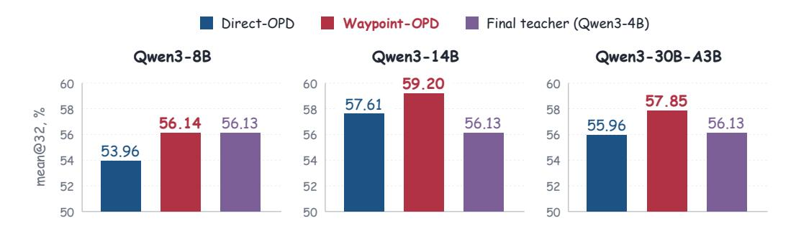
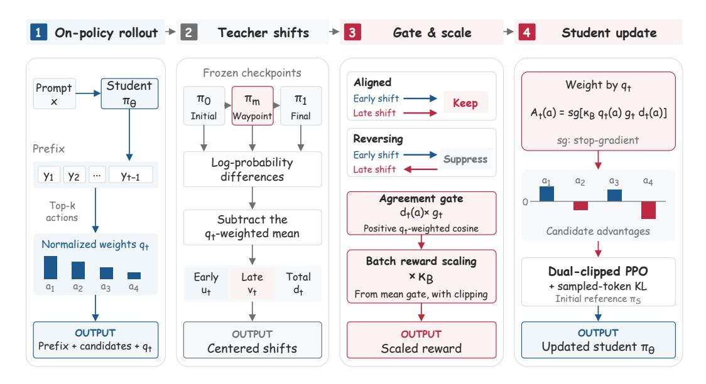
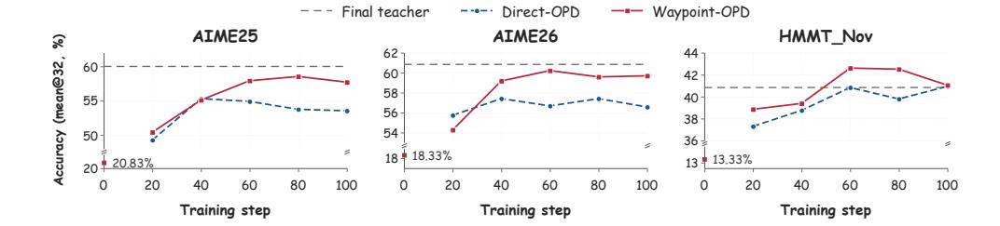
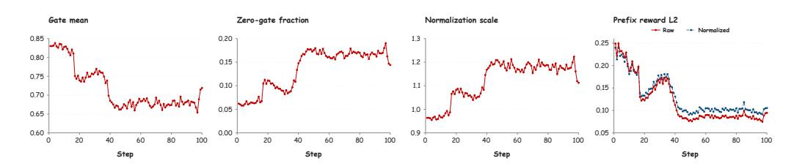
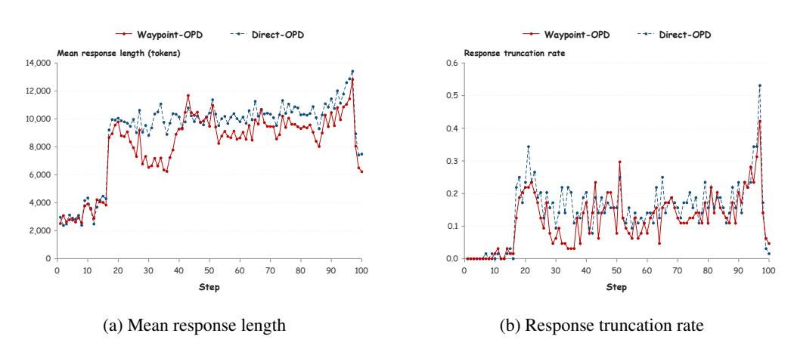

# Waypoint-OPD: RL-유도 정책 변화를 게이트된 온-정책 디스틸레이션으로 전달 (WAYPOINT-OPD: TRANSFERRING RL-INDUCED POLICY SHIFTS VIA GATED ON-POLICY DISTILLATION)

- 원제: Waypoint-OPD: Transferring RL-Induced Policy Shifts via Gated On-Policy Distillation
- 원문: [https://arxiv.org/abs/2610.21601](https://arxiv.org/abs/2610.21601)
- PDF: [https://arxiv.org/pdf/2610.21601](https://arxiv.org/pdf/2610.21601)
- arXiv ID: `2610.21601`

---

# Waypoint-OPD: RL-유도 정책 변화를 게이트된 온-정책 디스틸레이션으로 전달 (WAYPOINT-OPD: TRANSFERRING RL-INDUCED POLICY SHIFTS VIA GATED ON-POLICY DISTILLATION)

Bingxi Hou, Guochao Jiang, Guofeng Quan, Weiqing Li, Wenfeng Feng, Guohua Liu, Yuewei Zhang*

Alibaba Cloud Computing

{anyue.jgc, liyou.zyw}@alibaba-inc.com

#### **요약 (ABSTRACT)**

정책-변경 디스틸레이션은 강화 학습(RL) 전후의 교사 로그 확률 차이를 학생이 생성한 경로에 대한 감독으로 재사용한다. 그러나 이 최종 정책 변동은 교사 훈련 중에 지역 행동 선호도가 일관되게 진화했는지 여부를 드러내지 못한다. 동일한 최종 변동은 강화되거나 부분적으로 상쇄되는 초기 및 후기 변동에서 발생할 수 있다. 우리는 초기와 후기 교사 정책 변동 간의 일치가 선택적 전송을 안내할 수 있는지 조사한다. 우리는 Waypoint-OPD(Waypoint-guided On-Policy **Distillation**)를 도입한다. 이는 동일한 RL 실행에서 중간 교사 체크포인트를 사용하여 학생이 방문한 접두어에서 상대 행동 선호도의 초기 및 후기 변동을 비교한다. 우리는 초기와 후기 변동 간의 방향적 일치에 따라 최종 변동을 게이트한다. 반대 방향을 가리키면 이를 억제한다. 최종 변동 전용 전송과 비교할 때, 우리 방법은 한 번의 추가 고정 교사 점수 매김 패스를 필요로 한다. RL-훈련된 Qwen3-4B 교사를 사용하여, 우리는 Qwen3-8B, Qwen3-14B, 그리고 Qwen3-30B-A3B를 학생 모델로 하여 수학 및 코드 추론에서 우리 방법을 평가한다. 여섯 개 도메인 학생 설정 모두에서 Waypoint-OPD는 비교된 디스틸레이션 방법 중 가장 높은 도메인 평균 점수를 달성한다. Qwen3-8B 학생을 사용한 절감 실험은 게이트를 제거하거나 섞으면 수학 추론 성능이 감소함을 보여준다. 이 결과는 초기와 후기 교사 정책 변동 간의 방향적 일치를 사용하여 학생 훈련 중 최종 변동에 가중치를 부여하는 것을 지지한다. 우리의 코드는 https://github.com/hhhbxloveai/WaypointOPD 에서 확인할 수 있다.

Figure 1: 수학 추론이 세 학생 모델에서 어떻게 달라지는가. mean@32 정확도(%)는 일곱 벤치마크를 평균한 값이다. Waypoint-OPD는 Direct-OPD보다 각각 2.18, 1.59, 1.89 퍼센트 포인트 향상한다. 교사 점수는 최종 Qwen3-4B 체크포인트에서 나온 것이다.

## 1 서론 (Introduction)

강화 학습은 인간 선호에서 학습된 보상을 사용하여 언어 모델의 지시 따르기를 개선할 수 있다(Ouyang et al., 2022), 그리고 검증 가능한 수학 및 코드 추론을 향상시킬 수 있다.

*Corresponding author.

보상 [(Shao et al., 2024;](#page-12-0) [Guo et al., 2025;](#page-10-0) [Yu et al., 2025)](#page-13-0). 후자는 온-정책 응답의 반복 생성, 검증 및 최적화를 요구한다.

표준 온-폴리시 디스틸레이션(OPD)은 학생이 생성한 접두사에서 교사의 토큰 분포와 일치하도록 훈련한다 [(Agarwal et al., 2024)](#page-9-0). 이 감독은 교사의 절대 정책과 능력 한계에 묶여 있다. 온-폴리시 델타 디스틸레이션(OPD2)은 추론 튜닝된 교사와 그 기반 모델 사이의 변화를 사용하며, 중심화된 변화가 중심화된 표준 디스틸레이션 신호와 부호가 일치할 때 토큰 수준 신호를 유지한다 [(Heo et al., 2026)](#page-10-1). Direct On-Policy Distillation(Direct-OPD)은 RL에 의해 유도된 개선에 초점을 맞춘다. 이는 RL 전후 교사 체크포인트 간 로그 확률 비율을 학생이 생성한 상태에 대한 밀집된 암시적 보상으로 사용하며, 교사의 정책 변화를 절대 분포와 일치시키지 않고 전이한다 [(Feng et al.,](#page-10-2) [2026)](#page-10-2). 두 방법 모두 교사 모델 쌍에서 변화를 추출하지만, 교사 RL 중 연속적인 변화가 호환되는 방향을 가리키는지 직접 측정하지는 않는다.

초기-최종 로그 확률 비율은 교사 정책이 RL 훈련 전후의 변화만을 포착한다. 동일한 엔드포인트 신호는 유사하거나 반대 방향으로 가는 초기 및 후기 정책 변화에서 발생할 수 있다. 엔드포인트 전이만으로는 이러한 경우를 구분할 수 없다. 우리는 초기와 후기 변화 간의 일치가 학생이 생성한 접두사에서 엔드포인트 변동에 할당할 가중치를 결정하는 근거를 제공한다고 가정한다.

이 가설을 바탕으로 우리는 연속적인 교사 변동 간의 일치를 이용해 엔드포인트 전이 신호를 게이트하는 Waypoint-OPD를 제안한다. 동일한 교사 RL 실행에서 세 개의 체크포인트를 보존한다: RL 전 초기(Initial), 중간 RL 단계의 Waypoint, RL 종료 시점의 Final. 각 학생이 생성한 접두사에서 가장 확률이 높은 상위 k개의 다음 토큰 후보를 선택한다. 이 후보들 위에서 교사의 상대적 선호가 Initial에서 Waypoint로, 그리고 Waypoint에서 Final로 어떻게 변하는지 비교한다. 이들의 일치는 중심화된 Initial-to-Final 신호를 게이트하며, 정렬된 변화를 유지하고 반전을 억제한다. 따라서 Waypoint는 엔드포인트 변동에 가중치를 부여할 근거를 제공하며, 이는 전이된 신호로 남는다. 엔드포인트 전이만에 비해, 이는 추가적인 고정 교사 점수 매김 패스를 필요로 하며, 학생 전이 중 새로운 교사 훈련이나 검증자 호출이 필요 없다.

우리의 기여는:

- 시간적 일치를 선택적 전이의 기준으로 사용한다. Waypoint 체크포인트를 활용해 학생이 생성한 접두사에서 시간적 일치를 평가함으로써, 단지 종단 쌍만으로는 알 수 없는 방향성 정보를 드러낸다.  
- Waypoint-유도 게이팅을 통한 종단 신호 제어. 우리는 Waypoint-OPD라는 밀집 온폴리시 목표를 개발하였다. 이 목표는 시간적 일치를 이용해 각 학생이 생성한 접두사에서 종단 신호를 가중치화하며, 추가로 한 번의 동결된 교사 평가 단계를 포함한다.  
- 도메인 및 모델 크기 전반에 걸친 평균 성능 향상. 우리는 Qwen3-8B, Qwen3-14B, Qwen3-30B-A3B[(Yang et al., 2025)](#page-12-1)를 수학 및 코드 영역에서 평가한다. Waypoint-OPD는 모든 여섯 설정에서 평가된 기준선 중 가장 높은 도메인 평균을 기록한다(그림 [1](#page-0-0) 및 표 [1](#page-6-0), [2](#page-6-1)). Qwen3-8B 수학적 추론에 대한 제거 실험은 시간적 게이팅의 가치를 뒷받침한다(표 [3](#page-7-0)).

## 2 PRELIMINARIES

### 2.1 PROBLEM SETUP AND NOTATION

x ∼ D 를 프롬프트, y = (y1, …, yT) 를 응답, st = (x, y<t) 를 후보 토큰 a 가 점수화되는 접두사라 하자. 학생 πθ는 온폴리시 응답 y ∼ πθ(· | x)를 생성한다. 그 초기화 πS는 전이 과정에서 참조로서 고정된다.

우리는 초기, 중간, 최종 교사의 정책을 각각 π0, πm, π1이라고 표기한다. 세 체크포인트는 동일한 교사 RL 실행에서 나온 것: 초기은 RL 이전, 중간(Waypoint)은 중간 단계, 최종(Final)은 RL 이후이다. 이들은 전송 과정에서 고정된다. 우리는 교사의 RL에 의해 유도된 변화를 π0에 대해 측정하고, 학생 업데이트를 학생 초기화 πS에 대해 정규화한다. 교사와 학생은 토크나이저를 공유하여 같은 토큰에 대한 확률을 직접 비교할 수 있다.

### 2.2 온-폴리시 디스틸레이션 (On-Policy Distillation)

온-폴리시 증류는 학생으로부터 응답을 샘플링하고, 학생이 방문하는 접두어에서 다음 토큰 분포를 교사의 분포와 정렬한다 (Agarwal et al., 2024). 최종 교사  $\pi_1$ , OPD는 역 KL 목표를 최소화한다

$$\mathcal{L}_{\text{OPD}}(\theta) = \mathbb{E}_{x \sim \mathcal{D}, y \sim \pi_{\theta}(\cdot \mid x)} \left[ \sum_{t=1}^{T} D_{\text{KL}}(\pi_{\theta}(\cdot \mid s_{t}) \parallel \pi_{1}(\cdot \mid s_{t})) \right]. \tag{1}$$

### 2.3 직·직 온-폴리시 디스틸레이션 (DIRECT ON-POLICY DISTILLATION)

Direct-OPD는 교사의 RL에 의해 유도된 정책 변화를 학생이 생성한 응답에 대한 암묵적 보상으로 사용한다 (Feng et al., 2026). 초기-최종 shift는 토큰 수준의 로그 확률 비율로 분해된다:

$$\Delta^{(0,1)}(y \mid x) = \log \frac{\pi_1(y \mid x)}{\pi_0(y \mid x)} = \sum_{t=1}^T \delta_t(y_t), \tag{2}$$

여기서

$$\delta_t(a) = \log \pi_1(a \mid s_t) - \log \pi_0(a \mid s_t).$$

(3)

양수 시프트는 교사 RL이 $s_t$에서 토큰의 확률을 증가시켰음을 나타내며, 음수 시프트는 감소를 의미한다. KL 정규화를 통해 $\pi_0$에 대한 이상적인 교사 최적화에서는 시퀀스 로그비가 보상과 양수 스케일 및 프롬프트에 종속적인 상수(rafailov et al., 2023)까지 복원된다(Feng et al., 2026)와 같이 사용된다. 이는 엔드포인트 신호를 동기화한다; 우리는 유한 단계 교사 RL이 이 최적에 도달한다고 가정하지 않는다.

이상적인 시퀀스 수준 목표는 이 shift를 최대화하면서 학생을 자신의 초기화에 정규화한다:

$$\mathcal{J}_{\text{Direct-OPD}}(\theta) = \mathbb{E}_{x \sim \mathcal{D}} \left[ \mathbb{E}_{y \sim \pi_{\theta}(\cdot \mid x)} [\Delta^{(0,1)}(y \mid x)] - \beta D_{\text{KL}}(\pi_{\theta}(\cdot \mid x) \parallel \pi_{S}(\cdot \mid x)) \right], \tag{4}$$

여기서  $\beta > 0$  은 학생 KL 패널티를 제어한다.  
실제로, Direct-OPD는  $\delta_t(a)$  를 학생이 생성한 접두사에서 즉각적인 토큰 수준 보상으로 사용하며, 검증자 쿼리를 수행하지 않는다.

## 3 방법론 (3 METHOD)

Waypoint-OPD는 Section 2.3에서 동일한 교사 RL 실행의 Waypoint 체크포인트 $\pi_m$을 사용하여 엔드포인트 신호를 보강한다. 초기와 후기 이동 간의 일치는 학생이 방문한 접두사에 대한 엔드포인트 신호에 가중치를 부여한다. Waypoint는 모방 목표가 아니라 일관성 증거를 제공한다. 그림 2는 파이프라인을 보여준다.

### 3.1 학생-지역 궤적 일관성 (STUDENT-LOCAL TRAJECTORY CONSISTENCY)

학생이 방문한 접두사 $s_t$에서, $\mathcal{K}_t = \operatorname{TopK}(\pi_{\theta}(\cdot \mid s_t), k)$는 가장 높은 학생 확률을 가진 k개의 토큰 후보를 선택한다. 이 지원 집합에서 정규화된 학생 분포는

$$q_t(a) = \frac{\pi_{\theta}(a \mid s_t)}{\sum_{b \in \mathcal{K}_t} \pi_{\theta}(b \mid s_t)}, \qquad a \in \mathcal{K}_t.$$

(5)

이 가중치는 비교를 가장 가능성 높은 학생 행동에 집중시킨다. 일관성은 학생 업데이트를 받는 지역 지원 집합에서 평가되며, 더 높은 확률을 가진 후보가 더 큰 가중치를 받는다. 우리는 이 후보들을 세 개의 고정된 교사와 함께 점수화한다. 연속된 두 교사 시프트는 다음과 같다

$$\delta_t^{(1)}(a) = \log \pi_m(a \mid s_t) - \log \pi_0(a \mid s_t), \tag{6}$$

$$\delta_t^{(2)}(a) = \log \pi_1(a \mid s_t) - \log \pi_m(a \mid s_t), \tag{7}$$

그리고 전개하여 $\delta_t = \delta_t^{(1)} + \delta_t^{(2)}$

모든 후보에 대한 균일한 이동은 상대적 선호도를 변하지 않게 하지만, 원시 시프트 벡터 사이의 각도에는 영향을 줄 수 있다. 우리는 이 행동 독립적 구성요소를 $q_t$-centering operator와 함께 제거한다.

$$C_{q_t}[z](a) = z(a) - \mathbb{E}_{b \sim q_t}[z(b)]$$

(8)

Figure 2: **Waypoint-OPD의 훈련 파이프라인.** 학생이 생성한 프리픽스에서 초기, 웨이포인트, 최종 점수 후보. 이들의 중심화된 세그먼트 시프트는 엔드포인트 시프트에 대한 합의 게이트를 정의한다. 배치 스케일링과 분리된 후보 이점은 학생 업데이트를 진행하며 웨이포인트 측정의 일관성만을 운용한다.

그리고 $u_t = C_{q_t}[\delta_t^{(1)}]$, $v_t = C_{q_t}[\delta_t^{(2)}]$, $d_t = C_{q_t}[\delta_t] = u_t + v_t$ 를 정의한다. 우리는 내부곱 $\langle u_t, v_t \rangle_{q_t} = \sum_{a \in \mathcal{K}_t} q_t(a) u_t(a) v_t(a)$ 를 사용해 학생 확률에 따라 후보를 가중한다. 로컬 시간적 합의와 가중 노름은

$$c_{t} = \frac{\langle u_{t}, v_{t} \rangle_{q_{t}}}{\|u_{t}\|_{q_{t}} \|v_{t}\|_{q_{t}}}, \quad \|u_{t}\|_{q_{t}} = \sqrt{\langle u_{t}, u_{t} \rangle_{q_{t}}}, \quad \|v_{t}\|_{q_{t}} = \sqrt{\langle v_{t}, v_{t} \rangle_{q_{t}}}.$$

(9)

### 3.2 합의 게이팅 및 배치 스케일 정규화 (AGREEMENT GATING AND BATCH-SCALE NORMALIZATION)

두 중심화된 세그먼트 노름이 $\varepsilon = 10^{-8}$ 를 초과하면, 우리는 양수 코사인 게이트를 사용한다.

$$g_t = \max(0, c_t). \tag{10}$$

어느 한 노름이 $\varepsilon$ 이하이면, 우리는 저노름 대체값으로 $g_t=1$ 을 사용한다. 게이트 $g_t \in [0,1]$ 은 프리픽스 $s_t$ 에서 모든 후보에 공유된다. 이 대체값을 벗어나면, $c_t \le 0$ 일 때 엔드포인트 신호를 제거하고, 그렇지 않으면 그 크기를 $c_t$ 로 스케일한다. 알고리즘 및 구현 규칙은 부록 B에 명시되어 있다.

예시로, 비제로 $q_t$-중심화 엔드포인트 d 를 두 가지 분해를 고려한다. 두 경우 모두 저노름 대체값을 벗어난다. u=v=d/2 인 경우 c=1, g=1 이고, u=2d, v=-d 인 경우 c=-1, g=0 이다. 두 경우 모두 u+v=d 를 만족하므로 엔드포인트 전용 전송만으로는 구분할 수 없다. 부록 A.1 은 고정된 학생 프리픽스와 가중치에서 엔드포인트가 웨이포인트와 독립적임을 유도한다. 방향적 합의만으로는 유익한 감독을 보장하지 않는다.

배치 전반에 걸친 평균 게이트 스케일을 안정화하기 위해, 배치 B에서 모든 게이트된 보상을 다음으로 곱한다

$$\kappa_B = \operatorname{clip}\left(\frac{\tau}{\max\left(|B_{\operatorname{pref}}|^{-1} \sum_{t \in B_{\operatorname{pref}}} g_t, \varepsilon_{\operatorname{num}}\right)}, \kappa_{\min}, \kappa_{\max}\right),\tag{11}$$

$B_{\rm pref}$ 는 배치 B 에서 유효한 응답 프리픽스를 포함하고, $\varepsilon_{\rm num}>0$ 은 제로 나눗셈을 방지하는 수치 하한이다. 비율은 평균 재스케일된 게이트 $\tau>0$ 를 목표로 하며, 클리핑은 $\kappa_B$ 를 $[\kappa_{\rm min},\kappa_{\max}]$ 로 제한한다. 여기서 $0<\kappa_{\rm min}\leq\kappa_{\max}$ 이다. 이 공유 양수 승수는 상대적 게이트 가중치와 제로 게이트를 보존한다. 효과 승수 $\kappa_B g_t$ 는 1을 초과할 수 있으며, 배치 스케일링은 보상 벡터 노름을 고정하지 않는다.

### 3.3 밀집 후보 목표 (DENSE CANDIDATE OBJECTIVE)

후보 행동 a ∈ K^{t} 에 대한 최종 계수는

$$A_t(a) = \operatorname{sg}[\kappa_B \, q_t(a) \, g_t \, d_t(a)] \,. \tag{12}$$

Eq. [4,](#page-2-1) 의 신호-마이너스-KL 형태를 따라, 최적화할 로컬 온-폴리시 대리 함수는

$$\mathcal{J}_{WP}(\theta) = \mathbb{E}_{x \sim \mathcal{D}} \left[ \mathbb{E}_{y \sim \pi_{\theta}(\cdot \mid x)} \left[ \sum_{t=1}^{T} \sum_{a \in \mathcal{K}_{t}} A_{t}(a) \log \pi_{\theta}(a \mid s_{t}) \right] - \beta \, \widehat{D}_{KL}(\pi_{\theta}(\cdot \mid x) \parallel \pi_{S}(\cdot \mid x)) \right],$$

(13)

롤아웃 샘플과 후보 지원은 이 대리 함수의 미분 시 고정되며, stopgradient 연산자 sg는 At의 모든 인자를 분리한다. 후보 크레딧은 Kt에서 밀집되어 있고, KL 패널티는 샘플링된 응답 토큰에서 추정되어 학생을 πS에 고정시킨다. 구현은 dual-clipped PPO를 사용하며, 이는 롤아웃 정책에서 이 대리 함수와 동일한 기울기를 갖는다 (Appendix [B)](#page-14-0)).

Direct-OPD와 비교하면 Waypoint-OPD는 추가적인 학습 가능한 파라미터나 학생 롤아웃 없이 하나의 동결된 교사 체크포인트와 점수 매기기 단계를 추가한다. 유도식과 신호 특성은 부록 [A.](#page-14-2)에 나타난다.

## 4 실험 (Experiments)

우리는 세 가지 질문을 검토한다:

- Q1. Waypoint-OPD가 수학, 코드, 모델 규모 전반에 걸친 전이 성능을 향상시키는가?  
- Q2. 시간적 일관성이 엔드포인트 전이와 Final-teacher 모방에 개선되는가?  
- Q3. 게이트 할당, 평균 정규화, 그리고 Waypoint 위치가 성능에 어떤 영향을 미치는가?

보충적인 훈련 시간 및 응답 길이 분석은 Appendix [H.](#page-19-0)에 나타난다.

### 4.1 모델, 데이터, 및 평가 (MODELS, DATA, AND EVALUATION)

교사 체크포인트와 학생 모델. 각 도메인마다 같은 Qwen3-4B [(Yang et al., 2025)](#page-12-1) RL 실행에서 세 개의 체크포인트를 사용한다: RL 이전 초기(π0), RL 단계 600에서 웨이포인트(πm), RL 단계 1200에서 최종(π1). 수학 및 코드 교사는 비생각 RL을 사용한다. 세 개의 체크포인트는 전이 동안 고정된다. 우리는 교사의 RL에 의해 유도된 정책 변화를 사용해 Qwen3-8B, Qwen3-14B, Qwen3-30B-A3B 학생들을 훈련한다. 이 학생들은 세 가지 규모와 밀집 및 MoE 아키텍처를 하나의 가족 내에서 호환되는 토크나이저와 함께 사용한다. 전이 목표는 교사가 학생을 능가할 필요가 없다. 우리는 결과 표에 세 개의 교사 체크포인트와 베이스 학생들을 보고하여 전이 전 성능을 보여준다.

훈련 및 평가 데이터. 수학 전이는 DAPO-Math-17K 프롬프트를 사용한다 [(Yu et al., 2025)](#page-13-0). 우리는 AIME 2024, AIME 2025, AIME 2026, HMMT 2025년 2월, HMMT 2025년 11월, HMMT 2026년 2월, 그리고 AMC 2023의 일곱 벤치마크에서 평가한다. 각 문제마다 mean@32는 32개의 생성된 응답에 대한 평균 정확도를 측정한다. 벤치마크 점수는 문제별로 이 값을 평균내며, Avg.는 벤치마크 간 가중치 없이 평균한 값이다.

코드 전이(transfer)는 Codeforces에서 파생된 프롬프트 세트를 사용한다. 평가에는 EvalPlus의 378문제 MBPP+ 세트[(Liu et al., 2023)](#page-11-1)를 사용하며, 원본 MBPP 테스트[(Austin et al., 2021)](#page-9-1)와 원본에 추가 테스트(MBPP+)를 모두 보고하고, LiveCodeBench v4, v5, v6[(Jain et al.,](#page-11-2) [2025)](#page-11-2)와 함께한다. 우리는 mean@8을 보고한다. 이는 각 문제마다 생성된 8개의 응답에 대한 정확도를 평균한 뒤, 각 벤치마크의 문제들에 대해 평균을 취한 것이다. Code Avg.는 이 다섯 평가 점수의 가중치 없는 평균이다. 각 벤치마크 내에서 방법들은 프롬프트 템플릿, 디코딩 파라미터, 최대 생성 길이, 샘플 수를 공유한다.

학생 체크포인트 선택. 두 도메인 모두에서 AIME 2024를 검증 세트로 사용하고, 각 훈련된 학생의 체크포인트 중 검증 정확도가 가장 높은 것을 선택한다. 해당 학생의 모든 벤치마크 결과는 이 선택된 체크포인트를 사용한다.

구현. 우리는 verl[(Sheng et al., 2025)](#page-12-3)를 기반으로 하며, 학생의 상위 16개 토큰 ID를 세 개의 고정된 교사와 점수화한다. 전이 목표는 밀집된 증류 보상과 학생 KL 패널티를 결합한다. 답변 그레이더는 평가에만 사용된다. 구현 및 훈련/평가 구성은 부록 [B](#page-14-0)와 [C.](#page-15-0)에 나타난다.

### 4.2 기준선 및 통제 (BASELINES AND CONTROLS)

우리는 Base student, Final teacher의 표준 on-policy distillation (OPD) [(Agarwal et al., 2024)](#page-9-0), 샘플링 토큰 목표를 갖는 OPD2 [(Heo et al., 2026)](#page-10-1), 그리고 log π1 − log π0 를 이용한 endpoint Direct-OPD [(Feng et al., 2026)](#page-10-2)와 비교한다. 모든 방법은 훈련 및 평가 설정을 공유하지만, 방법별 하이퍼파라미터는 다르다.

Qwen3-8B 수학에 대한 세 가지 제어는 중심화(centering)를 유지하면서 전체 방법의 한 구성요소를 변경한다. No gate는 gt = 1을 설정하지만 gate-mean 정규화 규칙은 유지한다. Shuffled gate는 배치 내 유효한 응답 접두사들 사이에서 게이트를 순열(permuted)하며, 각 접두사의 후보 가중치와 중심화된 endpoint 신호를 보존한다. No normalization은 κB = 1을 고정하면서 양의 코사인 게이트(positive-cosine gate)를 유지한다. Appendix [E](#page-16-0) 에서는 shuffle control의 정의와 불변량을 제공한다. 우리는 별도로 Qwen3-8B에서 교사 RL 단계 500, 600, 700에서 수학 Waypoint를 변형한다 (Appendix [F.](#page-17-0)).

## 5 결과 및 분석 (Results and Analysis)

우리는 세 가지 학생 규모에서 수학과 코드의 전이 성능을 비교한다 (Section [5.1)](#page-5-0)). 우리는 Qwen3-8B 수학에서 Final teacher와의 상대적 학습 궤적과 성능을 조사한다 (Section [5.2)](#page-5-1)). 우리는 시간적 게이팅, 게이트 할당, 평균 정규화의 역할을 ablation을 통해 평가한다 (Section [5.3)](#page-7-1)).

### 5.1 도메인 및 규모별 주요 결과 (MAIN RESULTS ACROSS DOMAINS AND SCALES)

Tables [1](#page-6-0)과 [2](#page-6-1)은 수학 점수와 코드 평균을 보고한다. 전체 코드 결과는 Appendix [D.](#page-16-1)에 나타난다. Waypoint-OPD는 평가된 학생 방법 중 모든 여섯 설정에서 가장 높은 도메인 평균 점수를 달성한다.

수학. Waypoint-OPD는 Direct-OPD보다, 세 학생 모두에 대해 가장 강력한 평균 기준선인 Direct-OPD를 각각 2.18, 1.59, 1.89 퍼센트 포인트 향상시킨다 (Qwen3-8B, Qwen3-14B, Qwen3-30B-A3B). 이는 21개 벤치마크 비교 중 19개에서 향상을 보인다. 예외는 14B에서 HMMT25N (47.60 → 47.08)과 30B-A3B에서 HMMT26F (33.05 → 32.77)이다. 이 결과는 학생 규모와 밀집(Dense) 및 MoE 아키텍처 모두에서 endpoint 전이보다 향상을 보여준다. 14B와 30B-A3B 학생은 각각 Final teacher의 56.13 평균을 3.07, 1.72 포인트 초과하며, 8B는 56.14에서 거의 일치한다. 14B 학생은 모든 7개 수학 벤치마크에서 교사를 능가한다.

코드. Waypoint-OPD는 Direct-OPD보다 평균 2.66, 1.52, 1.19 퍼센트 포인트 향상시켰으며, 이는 Qwen3-8B, Qwen3-14B, Qwen3-30B-A3B에 해당한다. 모든 15개 코드 비교에서 향상을 보인다. OPD2는 14B LCB v5와 30B-A3B MBPP 및 MBPP+에서 더 높은 점수를 달성하지만, Waypoint-OPD는 각 학생에 대해 가장 높은 평균을 유지한다 (Appendix [D)](#page-16-1)). 14B와 30B-A3B 학생은 각각 Final teacher의 55.37 평균을 2.45, 2.17 포인트 초과하며, 다섯 개 코드 평가 중 네 개에서 더 높은 점수를 기록한다.

endpoint 비교를 해석하면, Direct-OPD 대비 향상은 Waypoint-OPD가 두 도메인과 세 학생 규모 모두에서 전이 성능을 개선함을 보여준다. OPD와 OPD2는 각각 Final-teacher 모방과 이점 부호 일치에 기반한 선택적 증류와의 보완적 비교를 제공한다.

### 5.2 학습 역학 (LEARNING DYNAMICS)

Figure [3](#page-7-2)는 Qwen3-8B 수학 훈련 중 일치된 평가 단계에서 Waypoint-OPD와 Direct-OPD를 비교한다. Table [1,](#page-6-0)의 선택된 체크포인트 결과와 달리, 이 궤적은 동일한 100번 업데이트 동안의 성능 차이를 보여준다.

Table 1: 세 학생 규모에 대한 수학적 추론. mean@32 점수(%)는 일곱 벤치마크와 평균을 나타낸다. 굵은 글씨는 각 학생별 최고 점수를 표시한다. 교사 체크포인트는 참조이다.

| 방법 | AIME24 | AIME25 | AIME26 | HMMT25 Feb | HMMT25 Nov | HMMT26 Feb | AMC23 | 평균 |
|--------------------|------------------------|--------|--------|---------------|---------------|---------------|-------|-------|
| Teacher: Qwen3-4B |  |  |  |  |  |  |  |  |
| 초기 | 21.67 | 21.67 | 21.67 | 12.50 | 10.00 | 15.15 | 71.25 | 24.84 |
| 중간 | 58.96 | 54.79 | 56.77 | 31.35 | 35.73 | 31.72 | 93.44 | 51.82 |
| 최종 | 65.83 | 60.00 | 60.83 | 35.83 | 40.83 | 35.13 | 94.45 | 56.13 |
|  | Student: Qwen3-8B |  |  |  |  |  |  |  |
| Base | 29.17 | 20.83 | 18.33 | 11.67 | 13.33 | 18.94 | 70.00 | 26.04 |
| OPD | 63.65 | 49.69 | 54.90 | 29.06 | 38.65 | 32.58 | 88.75 | 51.04 |
| OPD2 | 64.48 | 48.33 | 53.96 | 28.44 | 40.52 | 31.53 | 92.97 | 51.46 |
| Direct-OPD | 67.29 | 55.31 | 57.40 | 31.77 | 40.83 | 33.71 | 91.41 | 53.96 |
| Waypoint-OPD | 68.85 | 57.92 | 60.21 | 34.38 | 42.60 | 36.36 | 92.66 | 56.14 |
| Student: Qwen3-14B |  |  |  |  |  |  |  |  |
| Base | 30.00 | 27.50 | 20.00 | 10.00 | 11.67 | 18.94 | 73.13 | 27.32 |
| OPD | 69.17 | 55.52 | 58.44 | 36.77 | 45.21 | 31.82 | 96.25 | 56.17 |
| OPD2 | 69.48 | 46.98 | 54.38 | 33.13 | 41.98 | 31.91 | 91.95 | 52.83 |
| Direct-OPD | 70.10 | 56.46 | 61.98 | 37.92 | 47.60 | 35.13 | 94.06 | 57.61 |
| Waypoint-OPD | 70.21 | 60.52 | 63.75 | 40.21 | 47.08 | 36.55 | 96.09 | 59.20 |
|  | Student: Qwen3-30B-A3B |  |  |  |  |  |  |  |
| Base | 31.67 | 22.50 | 22.50 | 10.00 | 13.33 | 21.21 | 75.00 | 28.03 |
| OPD | 63.54 | 49.06 | 57.50 | 30.83 | 37.71 | 28.03 | 91.88 | 51.22 |
| OPD2 | 64.90 | 51.77 | 60.42 | 31.56 | 38.54 | 30.21 | 91.33 | 52.68 |
| Direct-OPD | 69.17 | 54.69 | 61.98 | 38.96 | 41.56 | 33.05 | 92.34 | 55.96 |
| Waypoint-OPD | 70.94 | 58.44 | 63.65 | 39.90 | 44.69 | 32.77 | 94.53 | 57.85 |

표 2: 평균 코드 추론 성능. 평균 mean@8 점수(%)는 다섯 번의 평가를 통해 계산된다. Qwen3-4B 교사 체크포인트는 공유 참조이다. 볼드체는 각 학생별 최고 점수를 표시한다. 전체 결과: 부록 [D.](#page-16-1)

| 교사 참조: Qwen3-4B |  |  |  |  |  |  |
|-----------------------------|----------------|-----------------|---------------|--|--|--|
|  | 초기: 37.64 | 웨이포인트: 52.22 | 최종: 55.37 |  |  |  |
| 방법 | Qwen3-8B | Qwen3-14B | Qwen3-30B-A3B |  |  |  |
| 기본 | 41.03 | 47.72 | 50.33 |  |  |  |
| OPD | 43.91 | 51.66 | 51.91 |  |  |  |
| OPD2 | 51.21 | 55.60 | 55.96 |  |  |  |
| Direct-OPD | 50.59 | 56.30 | 56.35 |  |  |  |
| Waypoint-OPD | 53.25 | 57.82 | 57.54 |  |  |  |

훈련 체크포인트 전반에 걸친 일관된 향상. Waypoint-OPD는 두 벤치마크와 훈련 체크포인트 모두에서 Direct-OPD보다 일관된 향상을 제공한다. 공유 초기화 제외 시, 15개의 벤치마크–체크포인트 비교 중 13개에서 더 높은 점수를 기록하며, 두 예외는 훈련 초기에 나타난다. 60단계 이후부터 Waypoint-OPD는 세 벤치마크에서 모든 기록된 평가에서 선두를 유지하며, 그 이점이 훈련 종료까지 지속됨을 보여준다. 100단계에서의 향상은 AIME 2025에서 4.17, AIME 2026에서 3.13, HMMT 2025년 11월에서 0.10 퍼센트 포인트이다. 이 결과는 향상이 선택된 체크포인트를 넘어 훈련 전반에 걸쳐 지속적인 이점을 제공함을 보여준다.

Figure 3: 훈련 중 평가 정확도. Qwen3-8B 결과는 AIME 2025, AIME 2026, HMMT 2025년 11월에서 단계 0, 20, 40, 60, 80, 100에 대해 나타난다. 점수는 mean@32 비율이다. 실선 빨간 곡선은 Waypoint-OPD를, 점선 파란 곡선은 Direct-OPD를 나타낸다. 회색 점선은 Final Qwen3-4B 교사 점수를 보여준다.

최종 교사와의 비교. 회색 기준선은 엔드포인트 전이에서의 이득과 교사와의 상대적 성능을 구분한다. 2025년 11월 HMMT에서 Waypoint-OPD는 단계 60, 80, 100에서 최종 교사의 40.83을 초과하며, 단계 60에서 42.60에 도달한다. 두 AIME 벤치마크에서 기록된 점수는 해당 교사 기준선 아래에 머무른다. Direct-OPD 대비 개선은 벤치마크마다 다른 교사–학생 순서와 함께 존재한다. 지속적인 HMMT 우위는 Waypoint-OPD가 교사의 정책 변화를 활용해 최종 교사의 점수를 넘어서는 성능을 달성할 수 있음을 보여준다.

### 5.3 게이트 및 정규화 제거

Table 3: Qwen3-8B 수학적 추론에서의 게이트 및 정규화 제거. 각 열에서 가장 높은 점수는 굵게 표시된다.

| 방법 | AIME24 | AIME25 | AIME26 | HMMT25 Feb | HMMT25 Nov | HMMT26 Feb | AMC23 | 평균 |
|------------------|--------|--------|--------|---------------|---------------|---------------|-------|-------|
| 게이트 없음 | 66.25 | 54.27 | 56.67 | 32.60 | 39.79 | 34.66 | 90.23 | 53.50 |
| 셔플된 게이트 | 63.33 | 52.92 | 54.58 | 30.00 | 37.08 | 31.06 | 89.45 | 51.20 |
| 정규화 없음 | 68.13 | 56.46 | 58.33 | 34.79 | 41.56 | 35.23 | 92.03 | 55.22 |
| 직접-OPD | 67.29 | 55.31 | 57.40 | 31.77 | 40.83 | 33.71 | 91.41 | 53.96 |
| 웨이포인트-OPD | 68.85 | 57.92 | 60.21 | 34.38 | 42.60 | 36.36 | 92.66 | 56.14 |

게이트를 제거한다. Qwen3-8B 수학에서 게이트를 제거하면 평균이 56.14에서 53.50으로 낮아져 2.64점 감소하며, 모든 7개 벤치마크에서 점수가 낮아진다 (Table [3)](#page-7-0). 일관성에 의존하는 가중치 없이 중앙화와 정규화를 유지해도 전체 방법의 이득을 회복하지 못한다. 이 비교는 중앙화 효과를 고립시키지 않는다.

게이트–프리픽스 연관성을 방해한다. 게이트를 섞으면 평균이 51.20으로 낮아져 전체 방법보다 4.94점, 게이트가 없는 변형보다 2.30점 낮으며, 모든 벤치마크에서 동일한 순서를 보인다. 무작위 재배치는 이 설정에서 선택적 가중치를 제거하는 것보다 더 해롭기 때문에, 각 게이트를 그 게이트를 생성한 시계열 일치가 발생한 프리픽스와 매칭하는 것의 가치를 지지한다.

평균 정규화를 제거한다. κB = 1을 고정하고 양의 코사인 게이트를 유지하면 평균이 0.92점 낮아져 55.22가 된다. 정규화는 7개 벤치마크 중 6개를 개선한다. 예외는 HMMT 2025년 2월 (정규화 없이 34.79, 정규화와 함께 34.38). 정규화되지 않은 변형은 평균과 모든 7개 벤치마크에서 Direct-OPD를 1.26점 초과한다. 따라서 배치 정규화 없이도 이점이 지속되며, 이는 추가 평균 이점을 제공한다. 나머지 이득은 게이트에만 기인할 수 없으며, 중앙화 및 Direct-OPD와의 다른 차이점도 유지된다.

제거 실험 통찰. 이 제거 실험은 시계열 가중치, 그 프리픽스 할당, 그리고 Qwen3-8B 수학에서의 정규화에 따른 점진적 이득을 지지한다. 그 격차는 보존된 구성요소에 따라 달라지며 독립적인 가산 기여가 아니다. 고정된 롤아웃 배치에서는 섞기가 게이트 분포와 κB를 유지하지만, 이점과 기울기 노름은 게이트–신호 매칭에 추가로 의존한다 (Appendix [E)](#page-16-0). 보조 진단은 이후 배치에서 평균 게이트 감쇠가 더 강함을 보여주며, 평균 게이트 정규화는 보상 노름을 고정하지 않는다 (Appendix [G)](#page-18-0).

## 6 RELATED WORK (관련 연구)

온-폴리시 증류 및 정책-이동 전이. 지식 증류는 교사 분포 또는 생성된 시퀀스를 전이한다 [(Hinton et al., 2015;](#page-10-3) [Kim & Rush, 2016)](#page-11-3), 반면 온-폴리시 변형은 학생이 생성한 궤적을 감독한다 [(Agarwal et al., 2024)](#page-9-0). 보완 연구는 발산 목표와 교사 및 학생이 생성한 데이터를 활용한다 [(Wen et al., 2023;](#page-12-4) [Gu et al., 2024;](#page-10-4) [Ko et al., 2024;](#page-11-4) [2025)](#page-11-5). 약한-강한 일반화는 약한 감독이 더 강한 능력을 유도할 수 있는지 묻는다 [(Burns et al., 2024)](#page-9-2). WSPO와 프록시-튜닝은 각각 훈련과 디코딩에 약한 모델의 적응 대비를 재사용한다 [(Zhu et al., 2025;](#page-13-1) [Liu et al., 2024)](#page-11-6). 온-폴리시 훈련 내에서 Direct-OPD는 RL에 의해 유도된 정책 변화를 학생 롤아웃의 엔드포인트 로그비를 통해 전이한다 [(Feng et al., 2026)](#page-10-2). W2S-OPD는 약한 모델 로짓 대비를 학생 기본 로짓에 추가하여 프록시 교사를 구성하고, 그 다음 학생 롤아웃에서 역 KL을 최소화한다. 그 대비는 RL 체크포인트, 모델 규모, 정답과 오답 힌트까지 포괄한다 [(Yu et al., 2026)](#page-13-2). OPRD는 중앙화된 교사–참조 시프트를 사용해 검증자 주도 기울기의 해당 방향을 증폭한다 [(Park et al., 2026)](#page-12-5). Waypoint-OPD는 Direct-OPD를 기반으로 하며, Waypoint 체크포인트 전후의 시프트 일치도를 통해 로컬 엔드포인트 신호에 가중치를 부여한다.

선택적 감독은 지식 압축에서 사용된다. 교사–학생 호환성은 온정책 감독의 유용성에 영향을 미친다. [(Li et al., 2026)](#page-11-7). Prune-OPD는 접미사 감쇠를 위해 지원 겹침을 사용한다. [(Yang et al.,](#page-13-3) [2026)](#page-13-3). EOPD는 엔트로피 의존적 전방 KL에서 교사 불확실성을 사용한다. [(Jin et al., 2026)](#page-11-8), 반면 PW-OPSD는 참조 조건부 자기-압축에서 토큰 위치를 사용한다. [(Liu et al., 2026)](#page-11-9). OPD2는 중심화된 교사–베이스와 교사–학생 이점 간 부호 일치를 통해 샘플링된 토큰 업데이트를 게이트한다. [(Heo et al., 2026)](#page-10-1), 반면 RG-OPD는 검증자 파생 이점과 교사–학생 시퀀스 로그-가능도 차이 간 일치를 사용해 궤적을 게이트한다. [(Akhondzadeh et al., 2026)](#page-9-3). Waypoint-OPD는 다른 증거를 사용한다: 학생이 지원한 후보 행동에 대한 교사 자체 RL 궤적의 연속적 변동. 이들의 가중 방향 일치는 전이 중 검증자 피드백 없이 밀집 엔드포인트 업데이트를 위한 접두사 수준 게이트를 생성한다. 이 일치는 가중 기준이며, 정확성의 보장은 아니다.

체크포인트 선택과 점진적 압축. 교사의 최종 성능이 반드시 교육 유용성을 결정하지는 않는다: 조기 중단과 중간 체크포인트 선택이 압축을 향상시킬 수 있다. [(Cho & Hariharan, 2019;](#page-9-4) [Wang et al., 2022)](#page-12-6). Pro-KD와 점진적 압축은 연속적인 교사 체크포인트를 목표 또는 커리큘럼으로 사용한다. [(Rezagholizadeh et al., 2022;](#page-12-7) [Panigrahi et al., 2025)](#page-12-8). Direct-OPD는 전이를 위한 RL 체크포인트 선택도 연구한다. [(Feng et al., 2026)](#page-10-2). 초기와 최종 엔드포인트가 고정된 경우, Waypoint는 두 변동 사이의 방향성 일관성을 측정한다. 이것은 모방 목표도, 커리큘럼도 제공하지 않는다. 중심화된 초기-최종 변동이 전이 대상이 된다.

## 7 결론 (CONCLUSION)

우리는 연속적인 교사 변동 간 일치를 사용해 RL에 의해 유도된 정책 변화를 전이하는 Waypoint-OPD를 제시했다. 중간 Waypoint 체크포인트는 학생이 생성한 접두사에서 상대 행동 선호도의 초기 및 후기 변동이 강화되는지 반대되는지를 드러낸다. 엔드포인트 차이만으로는 얻을 수 없는 이 정보는 학생의 온정책 목표에서 중심화된 초기-최종 변동의 가중치를 결정한다. 이 방법은 전이 중 추가적인 고정 교사 점수 매김 패스 하나와 검증자 호출이 필요 없다. 수학 및 코드 추론 실험은 세 가지 Qwen3 학생 규모에서 엔드포인트 전이보다 이득을 보인다. Qwen3-8B 수학 지원에 대한 소거 실험은 접두사별 게이트 할당과 배치 규모 정규화를 보여준다. 이러한 결과는 중간 교사 체크포인트가 학생 학습 중 지역 정책 변화를 가중하는 증거를 제공함을 시사한다.

## AI 사용 선언 (AI USE STATEMENT)

우리는 언어 다듬기, 수학적 유도 명확화 지원, 표기법 및 서술 일관성 검증을 위해 생성형 AI 도구를 사용한다. 이 도구들은 실험 설계, 구현, 실행에는 사용되지 않았다. 우리는 이 작업의 최종 내용에 대해 전적으로 책임진다.

#### 윤리 성명 (ETHICS STATEMENT)

인간 주석 사용: 인간 주석은 본 작업의 초기에 방법론 연구에서만 사용되며, 제안된 해결책의 실현 가능성을 분석하는 데 도움을 주기 위해 사용된다. 주석자들은 연구 목적으로 데이터 사용에 동의하였다. 우리는 주석 과정 전반에 걸쳐 모든 주석자의 개인정보가 보호되도록 보장하며, 그들은 지역 기준에 따라 적절히 보수를 받는다. 인간 주석은 우리 방법의 평가 단계에서는 적용되지 않는다.

위험: 본 논문에서 사용되는 모든 데이터셋은 공식 출처에서 얻었다. 채택된 데이터셋은 익명화되었으며 공격적인 정보를 포함하지 않는다. 그러나 데이터셋이 사회적으로 해로운 또는 유해한 언어를 포함하지 않을 것이라고 보장할 수는 없다.

## 재현성 성명 (REPRODUCIBILITY STATEMENT)

전송 목표는 Section [3,](#page-2-2)에서 지정되며, Appendix [A](#page-14-2)에는 지원 derivations 및 신호 속성이 포함되고, Appendix [B.](#page-14-0)에는 의사코드와 최적화 세부사항이 제공된다. Section [4.1](#page-4-0)은 교사 체크포인트, 학생 모델, 훈련 및 평가 데이터, 평가 지표, 그리고 학생 체크포인트 선택을 설명한다. Appendix [C](#page-15-0)은 하이퍼파라미터, 하드웨어, 그리고 평가 설정을 보고한다.

기준선 및 제어는 Section [4.2,](#page-5-2)에서 설명되며, 게이트와 정규화 제거에 대한 정확한 정의는 Appendix [E](#page-16-0)에, Waypoint-position 제거 설정은 Appendix [F.](#page-17-0)에 있다. Benchmark별 결과와 도메인 평균은 Tables [1](#page-6-0)과 [7,](#page-17-1)에 나타나며, 게이트 및 정규화 제거 결과는 Table [3.](#page-7-0)에 나타난다.

## 참고문헌 (REFERENCES)

Rishabh Agarwal, Nino Vieillard, Yongchao Zhou, Piotr Stanczyk, Sabela Ramos Garea, Matthieu Geist, and Olivier Bachem. On-policy distillation of language models: Learning from selfgenerated mistakes. In *The Twelfth International Conference on Learning Representations, ICLR 2024, Vienna, Austria, May 7-11, 2024*. OpenReview.net, 2024. URL [https://openreview.](https://openreview.net/forum?id=3zKtaqxLhW) [net/forum?id=3zKtaqxLhW](https://openreview.net/forum?id=3zKtaqxLhW).

Mohammad Sadegh Akhondzadeh, Vijay Lingam, Atula Tejaswi, Chanakya Ekbote, Sujay Sanghavi, and Aleksandar Bojchevski. Reward-gated on-policy distillation. *arXiv preprint arXiv:2607.04037*, 2026.

Jacob Austin, Augustus Odena, Maxwell Nye, Maarten Bosma, Henryk Michalewski, David Dohan, Ellen Jiang, Carrie Cai, Michael Terry, Quoc Le, et al. Program synthesis with large language models. *arXiv preprint arXiv:2108.07732*, 2021.

Collin Burns, Pavel Izmailov, Jan Hendrik Kirchner, Bowen Baker, Leo Gao, Leopold Aschenbrenner, Yining Chen, Adrien Ecoffet, Manas Joglekar, Jan Leike, Ilya Sutskever, and Jeffrey Wu. Weak-tostrong generalization: Eliciting strong capabilities with weak supervision. In Ruslan Salakhutdinov, Zico Kolter, Katherine A. Heller, Adrian Weller, Nuria Oliver, Jonathan Scarlett, and Felix Berkenkamp (eds.), *Forty-first International Conference on Machine Learning, ICML 2024, Vienna, Austria, July 21-27, 2024*, volume 235 of *Proceedings of Machine Learning Research*, pp. 4971– 5012. PMLR / OpenReview.net, 2024. URL [https://proceedings.mlr.press/v235/](https://proceedings.mlr.press/v235/burns24b.html) [burns24b.html](https://proceedings.mlr.press/v235/burns24b.html).

Jang Hyun Cho and Bharath Hariharan. On the efficacy of knowledge distillation. In *2019 IEEE/CVF International Conference on Computer Vision, ICCV 2019, Seoul, Korea (South), October 27 - November 2, 2019*, pp. 4793–4801. IEEE, 2019. doi: 10.1109/ICCV.2019.00489. URL [https:](https://doi.org/10.1109/ICCV.2019.00489) [//doi.org/10.1109/ICCV.2019.00489](https://doi.org/10.1109/ICCV.2019.00489).

Ganqu Cui, Lifan Yuan, Zefan Wang, Hanbin Wang, Yuchen Zhang, Jiacheng Chen, Wendi Li, Bingxiang He, Yuchen Fan, Tianyu Yu, Qixin Xu, Weize Chen, Jiarui Yuan, Huayu Chen, Kaiyan Zhang, Xingtai Lv, Shuo Wang, Yuan Yao, Xu Han, Hao Peng, Yu Cheng, Zhiyuan Liu, Maosong Sun, Bowen Zhou, and Ning Ding. Process reinforcement through implicit rewards. *Trans. Mach. Learn. Res.*, 2026, 2026. URL <https://openreview.net/forum?id=9SkkifLopZ>.

Shiyuan Feng, Huan-ang Gao, Haohan Chi, Hanlin Wu, Zhilong Zhang, Zheng Jiang, Bingxiang He, Wei-Ying Ma, Ya-Qin Zhang, and Hao Zhou. Weak-to-strong generalization via direct on-policy distillation. *arXiv preprint arXiv:2607.05394*, 2026.

Yuxian Gu, Li Dong, Furu Wei, and Minlie Huang. Minillm: 대형 언어 모델의 지식 증류. In *제12회 국제 학습 표현 회의(ICLR 2024), 오스트리아 비엔나, 2024년 5월 7-11일*. OpenReview.net, 2024. URL [https://openreview.](https://openreview.net/forum?id=5h0qf7IBZZ) [net/forum?id=5h0qf7IBZZ](https://openreview.net/forum?id=5h0qf7IBZZ).

Daya Guo, Dejian Yang, Haowei Zhang, Junxiao Song, Peiyi Wang, Qihao Zhu, Runxin Xu, Ruoyu Zhang, Shirong Ma, Xiao Bi, Xiaokang Zhang, Xingkai Yu, Yu Wu, Z. F. Wu, Zhibin Gou, Zhihong Shao, Zhuoshu Li, Ziyi Gao, Aixin Liu, Bing Xue, Bingxuan Wang, Bochao Wu, Bei Feng, Chengda Lu, Chenggang Zhao, Chengqi Deng, Chong Ruan, Damai Dai, Deli Chen, Dongjie Ji, Erhang Li, Fangyun Lin, Fucong Dai, Fuli Luo, Guangbo Hao, Guanting Chen, Guowei Li, Hao Zhang, Hanwei Xu, Honghui Ding, Huazuo Gao, Hui Qu, Hui Li, Jianzhong Guo, Jiashi Li, Jingchang Chen, Jingyang Yuan, Jinhao Tu, Junjie Qiu, Junlong Li, J. L. Cai, Jiaqi Ni, Jian Liang, Jin Chen, Kai Dong, Kai Hu, Kaichao You, Kaige Gao, Kang Guan, Kexin Huang, Kuai Yu, Lean Wang, Lecong Zhang, Liang Zhao, Litong Wang, Liyue Zhang, Lei Xu, Leyi Xia, Mingchuan Zhang, Minghua Zhang, Minghui Tang, Mingxu Zhou, Meng Li, Miaojun Wang, Mingming Li, Ning Tian, Panpan Huang, Peng Zhang, Qiancheng Wang, Qinyu Chen, Qiushi Du, Ruiqi Ge, Ruisong Zhang, Ruizhe Pan, Runji Wang, R. J. Chen, R. L. Jin, Ruyi Chen, Shanghao Lu, Shangyan Zhou, Shanhuang Chen, Shengfeng Ye, Shiyu Wang, Shuiping Yu, Shunfeng Zhou, Shuting Pan, S. S. Li, Shuang Zhou, Shaoqing Wu, Tao Yun, Tian Pei, Tianyu Sun, Tao Wang, Wangding Zeng, Wen Liu, Wenfeng Liang, Wenjun Gao, Wenqin Yu, Wentao Zhang, W. L. Xiao, Wei An, Xiaodong Liu, Xiaohan Wang, Xiaokang Chen, Xiaotao Nie, Xin Cheng, Xin Liu, Xin Xie, Xingchao Liu, Xinyu Yang, Xinyuan Li, Xuecheng Su, Xuheng Lin, X. Q. Li, Xiangyue Jin, Xiaojin Shen, Xiaosha Chen, Xiaowen Sun, Xiaoxiang Wang, Xinnan Song, Xinyi Zhou, Xianzu Wang, Xinxia Shan, Y. K. Li, Y. Q. Wang, Y. X. Wei, Yang Zhang, Yanhong Xu, Yao Li, Yao Zhao, Yaofeng Sun, Yaohui Wang, Yi Yu, Yichao Zhang, Yifan Shi, Yiliang Xiong, Ying He, Yishi Piao, Yisong Wang, Yixuan Tan, Yiyang Ma, Yiyuan Liu, Yongqiang Guo, Yuan Ou, Yuduan Wang, Yue Gong, Yuheng Zou, Yujia He, Yunfan Xiong, Yuxiang Luo, Yuxiang You, Yuxuan Liu, Yuyang Zhou, Y. X. Zhu, Yanping Huang, Yaohui Li, Yi Zheng, Yuchen Zhu, Yunxian Ma, Ying Tang, Yukun Zha, Yuting Yan, Z. Z. Ren, Zehui Ren, Zhangli Sha, Zhe Fu, Zhean Xu, Zhenda Xie, Zhengyan Zhang, Zhewen Hao, Zhicheng Ma, Zhigang Yan, Zhiyu Wu, Zihui Gu, Zijia Zhu, Zijun Liu, Zilin Li, Ziwei Xie, Ziyang Song, Zizheng Pan, Zhen Huang, Zhipeng Xu, Zhongyu Zhang, and Zhen Zhang. Deepseek-r1은 강화 학습을 통해 LLM에서 추론을 유도한다. *Nat.*, 645(8081):633–638, 2025. doi: 10.1038/S41586-025-09422-Z. URL <https://doi.org/10.1038/s41586-025-09422-z>.

Zhiwei He, Tian Liang, Jiahao Xu, Qiuzhi Liu, Xingyu Chen, Yue Wang, Linfeng Song, Dian Yu, Zhenwen Liang, Wenxuan Wang, Zhuosheng Zhang, Rui Wang, Zhaopeng Tu, Haitao Mi, and Dong Yu. Deepmath-103k: 추론을 향상시키기 위한 대규모, 도전적, 오염 제거된, 검증 가능한 수학 데이터셋. In Carl Vondrick, Bharath Hariharan, Colin Raffel, Lerrel Pinto, Diyi Yang, and Aleksandra Faust (eds.), *제14회 국제 학습 표현 회의(ICLR 2026), 브라질 리우데자네이루, 2026년 4월 23-27일*. proceedings.iclr.cc, 2026. URL [https://proceedings.iclr.cc/paper\\_files/paper/2026/hash/](https://proceedings.iclr.cc/paper_files/paper/2026/hash/df7b97ccf54c528516b62aa9a012d02a-Abstract-Conference.html) [df7b97ccf54c528516b62aa9a012d02a-Abstract-Conference.html](https://proceedings.iclr.cc/paper_files/paper/2026/hash/df7b97ccf54c528516b62aa9a012d02a-Abstract-Conference.html).

Byeongho Heo, Jaehui Hwang, Sangdoo Yun, and Dongyoon Han. On-policy delta distillation. *arXiv preprint arXiv:2607.15161*, 2026.

Geoffrey Hinton, Oriol Vinyals, and Jeff Dean. Distilling the knowledge in a neural network. *arXiv preprint arXiv:1503.02531*, 2015.

- Naman Jain, King Han, Alex Gu, Wen-Ding Li, Fanjia Yan, Tianjun Zhang, Sida Wang, Armando Solar-Lezama, Koushik Sen, and Ion Stoica. Livecodebench: 대규모 언어 모델의 코드 평가를 위한 전체적이고 오염이 없는 평가. In *제13회 국제 학습 표현 회의(ICLR 2025, 싱가포르, 2025년 4월 24-28일)*. OpenReview.net, 2025. URL <https://openreview.net/forum?id=chfJJYC3iL>.

- Woogyeol Jin, Taywon Min, Yongjin Yang, Dennis Wei, Yi Zhou, Swanand Ravindra Kadhe, Nathalie Baracaldo, and Kimin Lee. 엔트로피 기반 온-정책 언어 모델 증류. In *arXiv 사전 인쇄 arXiv:2603.07079*, 2026.

- Yoon Kim and Alexander M. Rush. 시퀀스 수준 지식 증류. In Jian Su, Xavier Carreras, and Kevin Duh (eds.), *2016년 경험적 방법을 이용한 자연어 처리 회의(EMNLP 2016, 미국 텍사스 주 오스틴, 2016년 11월 1-4일) 논문집*, pp. 1317– 1327. The Association for Computational Linguistics, 2016. doi: 10.18653/V1/D16-1139. URL <https://doi.org/10.18653/v1/d16-1139>.

- Jongwoo Ko, Sungnyun Kim, Tianyi Chen, and Se-Young Yun. Distillm: 대규모 언어 모델을 위한 간소화된 증류를 향해. In Ruslan Salakhutdinov, Zico Kolter, Katherine A. Heller, Adrian Weller, Nuria Oliver, Jonathan Scarlett, and Felix Berkenkamp (eds.), *제41회 국제 기계 학습 회의(ICML 2024, 오스트리아 비엔나, 2024년 7월 21-27일)*, volume 235 of *기계 학습 연구 논문집*, pp. 24872–24895. PMLR / OpenReview.net, 2024. URL <https://proceedings.mlr.press/v235/ko24c.html>.

- Jongwoo Ko, Tianyi Chen, Sungnyun Kim, Tianyu Ding, Luming Liang, Ilya Zharkov, and Se-Young Yun. Distillm-2: 대조적 접근이 llm 증류를 강화한다. In Aarti Singh, Maryam Fazel, Daniel Hsu, Simon Lacoste-Julien, Felix Berkenkamp, Tegan Maharaj, Kiri Wagstaff, and Jerry Zhu (eds.), *제42회 국제 기계 학습 회의(ICML 2025, 캐나다 브리티시컬럼비아 주 밴쿠버, 2025년 7월 13-19일)*, volume 267 of *기계 학습 연구 논문집*. PMLR / OpenReview.net, 2025. URL [https://proceedings.mlr.press/](https://proceedings.mlr.press/v267/ko25a.html) [v267/ko25a.html](https://proceedings.mlr.press/v267/ko25a.html).

- Woosuk Kwon, Zhuohan Li, Siyuan Zhuang, Ying Sheng, Lianmin Zheng, Cody Hao Yu, Joseph Gonzalez, Hao Zhang, and Ion Stoica. 페이지어텐션을 이용한 대규모 언어 모델 서비스의 효율적인 메모리 관리. In Jason Flinn, Margo I. Seltzer, Peter Druschel, Antoine Kaufmann, and Jonathan Mace (eds.), *2023년 29회 운영 체제 원리 심포지엄(SOSP 2023, 독일 코블렌츠, 2023년 10월 23-26일) 논문집*, pp. 611–626. ACM, 2023. doi: 10.1145/ 3600006.3613165. URL <https://doi.org/10.1145/3600006.3613165>.

- Yaxuan Li, Yuxin Zuo, Bingxiang He, Jinqian Zhang, Chaojun Xiao, Cheng Qian, Tianyu Yu, Huanang Gao, Wenkai Yang, Zhiyuan Liu, et al. 대규모 언어 모델의 온-정책 증류 재고: 현상학, 메커니즘, 그리고 레시피. In *arXiv 사전 인쇄 arXiv:2604.13016*, 2026.

- Alisa Liu, Xiaochuang Han, Yizhong Wang, Yulia Tsvetkov, Yejin Choi, and Noah A Smith. 대리로 언어 모델을 조정하기. In *arXiv 사전 인쇄 arXiv:2401.08565*, 2024.

- Jiawei Liu, Chunqiu Steven Xia, Yuyao Wang, and Lingming Zhang. 당신의 코드가 chatgpt에 의해 생성된 것이 정말 올바른가? 대규모 언어 모델의 코드 생성에 대한 엄격한 평가. In Alice Oh, Tristan Naumann, Amir Globerson, Kate Saenko, Moritz Hardt, and Sergey Levine (eds.), *신경 정보 처리 시스템 36의 발전: 2023년 신경 정보 처리 시스템 연례 회의(NeurIPS 2023, 미국 루이지애나 주 뉴올리언스, 2023년 12월 10-16일)*, 2023. URL [http://papers.nips.cc/paper_files/paper/2023/hash/](http://papers.nips.cc/paper_files/paper/2023/hash/43e9d647ccd3e4b7b5baab53f0368686-Abstract-Conference.html) [43e9d647ccd3e4b7b5baab53f0368686-Abstract-Conference.html](http://papers.nips.cc/paper_files/paper/2023/hash/43e9d647ccd3e4b7b5baab53f0368686-Abstract-Conference.html).

- Xiaogeng Liu, Xinyan Wang, Yingzi Ma, Yechao Zhang, and Chaowei Xiao. 교사 토큰이 언제 신뢰할 수 있는가? 위치 가중 온-정책 자기 증류를 통한 추론. In *arXiv 사전 인쇄 arXiv:2605.21606*, 2026.

- Long Ouyang, Jeffrey Wu, Xu Jiang, Diogo Almeida, Carroll L. Wainwright, Pamela Mishkin, Chong Zhang, Sandhini Agarwal, Katarina Slama, Alex Ray, John Schulman, Jacob Hilton, Fraser Kelton, Luke Miller, Maddie Simens, Amanda Askell, Peter Welinder, Paul F. Christiano, Jan Leike, and Ryan Lowe. 인간 피드백으로 지침을 따르는 언어 모델 훈련. In Sanmi Koyejo, S. Mohamed, A. Agarwal, Danielle Belgrave, K. Cho, and A. Oh (eds.),

- *신경 정보 처리 시스템(Neural Information Processing Systems) 35편의 진보: 2022년 신경 정보 처리 시스템 연례 회의(Annual Conference on Neural Information Processing Systems 2022), NeurIPS 2022, New Orleans, LA, USA, 2022년 11월 28일 - 12월 9일*, 2022. URL [http://papers.nips.cc/paper_files/paper/2022/hash/](http://papers.nips.cc/paper_files/paper/2022/hash/b1efde53be364a73914f58805a001731-Abstract-Conference.html) [b1efde53be364a73914f58805a001731-Abstract-Conference.html](http://papers.nips.cc/paper_files/paper/2022/hash/b1efde53be364a73914f58805a001731-Abstract-Conference.html).

- Abhishek Panigrahi, Bingbin Liu, Sadhika Malladi, Andrej Risteski, and Surbhi Goel. 점진적 증류가 암묵적 커리큘럼을 유도한다. In *제13회 국제 학습 표현 회의(The Thirteenth International Conference on Learning Representations), ICLR 2025, 싱가포르, 2025년 4월 24-28일*. OpenReview.net, 2025. URL [https:](https://openreview.net/forum?id=wPMRwmytZe) [//openreview.net/forum?id=wPMRwmytZe](https://openreview.net/forum?id=wPMRwmytZe).

- Youngrok Park, Sangmin Bae, Hojung Jung, Jongwoo Ko, Yunseon Choi, Young Jin Kim, Pashmina Cameron, Aaron Courville, and Se-Young Yun. 약한-강한 일반화를 정책 기반 역증류로 유도한다. *arXiv preprint arXiv:2609.08798*, 2026.

- Rafael Rafailov, Archit Sharma, Eric Mitchell, Christopher D. Manning, Stefano Ermon, and Chelsea Finn. 직접 선호 최적화: 당신의 언어 모델은 비밀리에 보상 모델이다. In Alice Oh, Tristan Naumann, Amir Globerson, Kate Saenko, Moritz Hardt, and Sergey Levine (eds.), *신경 정보 처리 시스템 36편의 진보: 2023년 신경 정보 처리 시스템 연례 회의(Annual Conference on Neural Information Processing Systems 2023), NeurIPS 2023, New Orleans, LA, USA, 2023년 12월 10일 - 16일*, 2023. URL [http://papers.nips.cc/paper_files/paper/2023/hash/](http://papers.nips.cc/paper_files/paper/2023/hash/a85b405ed65c6477a4fe8302b5e06ce7-Abstract-Conference.html) [a85b405ed65c6477a4fe8302b5e06ce7-Abstract-Conference.html](http://papers.nips.cc/paper_files/paper/2023/hash/a85b405ed65c6477a4fe8302b5e06ce7-Abstract-Conference.html).

- Mehdi Rezagholizadeh, Aref Jafari, Puneeth S. M. Saladi, Pranav Sharma, Ali Saheb Pasand, and Ali Ghodsi. Pro-kd: 교사의 발자취를 따라가는 점진적 증류. In Nicoletta Calzolari, Chu-Ren Huang, Hansaem Kim, James Pustejovsky, Leo Wanner, Key-Sun Choi, Pum-Mo Ryu, Hsin-Hsi Chen, Lucia Donatelli, Heng Ji, Sadao Kurohashi, Patrizia Paggio, Nianwen Xue, Seokhwan Kim, Younggyun Hahm, Zhong He, Tony Kyungil Lee, Enrico Santus, Francis Bond, and Seung-Hoon Na (eds.), *29회 국제 계산 언어학 회의 논문집(Proceedings of the 29th International Conference on Computational Linguistics), COLING 2022, 경주, 대한민국, 2022년 10월 12-17일*, pp. 4714–4727. International Committee on Computational Linguistics, 2022. URL [https:](https://aclanthology.org/2022.coling-1.418) [//aclanthology.org/2022.coling-1.418](https://aclanthology.org/2022.coling-1.418).

- John Schulman, Filip Wolski, Prafulla Dhariwal, Alec Radford, and Oleg Klimov. 근접 정책 최적화 알고리즘. *arXiv preprint arXiv:1707.06347*, 2017.

- Zhihong Shao, Peiyi Wang, Qihao Zhu, Runxin Xu, Junxiao Song, Xiao Bi, Haowei Zhang, Mingchuan Zhang, YK Li, Yang Wu, et al. Deepseekmath: 공개 언어 모델에서 수학적 추론의 한계를 뛰어넘다. *arXiv preprint arXiv:2402.03300*, 2024.

- Guangming Sheng, Chi Zhang, Zilingfeng Ye, Xibin Wu, Wang Zhang, Ru Zhang, Yanghua Peng, Haibin Lin, and Chuan Wu. Hybridflow: 유연하고 효율적인 RLHF 프레임워크. In *20회 유럽 컴퓨터 시스템 회의 논문집(Proceedings of the Twentieth European Conference on Computer Systems), EuroSys 2025, 로테르담, 네덜란드, 2025년 3월 30일 - 4월 3일*, pp. 1279–1297. ACM, 2025. doi: 10.1145/3689031. 3696075. URL <https://doi.org/10.1145/3689031.3696075>.

- Chaofei Wang, Qisen Yang, Rui Huang, Shiji Song, and Gao Huang. 모델 체크포인트에서 효율적인 지식 증류. In *신경 정보 처리 시스템 35편의 진보: 2022년 신경 정보 처리 시스템 연례 회의(Annual Conference on Neural Information Processing Systems 2022), NeurIPS 2022, New Orleans, LA, USA, 2022년 11월 28일 - 12월 9일*, 2022. URL [http://papers.nips.cc/paper_files/paper/2022/hash/](http://papers.nips.cc/paper_files/paper/2022/hash/03e0712bf85ebe7cec4f1a7fc53216c9-Abstract-Conference.html) [03e0712bf85ebe7cec4f1a7fc53216c9-Abstract-Conference.html](http://papers.nips.cc/paper_files/paper/2022/hash/03e0712bf85ebe7cec4f1a7fc53216c9-Abstract-Conference.html).

- Yuqiao Wen, Zichao Li, Wenyu Du, and Lili Mou. 시퀀스 수준 지식 증류를 위한 f-다이버전스 최소화. In Anna Rogers, Jordan L. Boyd-Graber, and Naoaki Okazaki (eds.), *61회 컴퓨터 언어학 협회 연례 회의 논문집(Volume 1: Long Papers) (ACL 2023, 토론토, 캐나다, 2023년 7월 9-14일)*, pp. 10817–10834. Association for Computational Linguistics, 2023. doi: 10.18653/V1/2023.ACL-LONG.605. URL [https:](https://doi.org/10.18653/v1/2023.acl-long.605) [//doi.org/10.18653/v1/2023.acl-long.605](https://doi.org/10.18653/v1/2023.acl-long.605).

- An Yang, Anfeng Li, Baosong Yang, Beichen Zhang, Binyuan Hui, Bo Zheng, Bowen Yu, Chang Gao, Chengen Huang, Chenxu Lv, et al. Qwen3 기술 보고서. *arXiv preprint arXiv:2505.09388*, 2025.

Zhicheng Yang, Zhijiang Guo, Yifan Song, Minrui Xu, Yongxin Wang, Yiwei Wang, Xiaodan Liang, and Jing Tang. Prune-opd: Efficient and reliable on-policy distillation for long-horizon reasoning. *arXiv preprint arXiv:2605.07804*, 2026.

Deheng Ye, Zhao Liu, Mingfei Sun, Bei Shi, Peilin Zhao, Hao Wu, Hongsheng Yu, Shaojie Yang, Xipeng Wu, Qingwei Guo, Qiaobo Chen, Yinyuting Yin, Hao Zhang, Tengfei Shi, Liang Wang, Qiang Fu, Wei Yang, and Lanxiao Huang. Mastering complex control in MOBA games with deep reinforcement learning. In *The Thirty-Fourth AAAI Conference on Artificial Intelligence, AAAI 2020, The Thirty-Second Innovative Applications of Artificial Intelligence Conference, IAAI 2020, The Tenth AAAI Symposium on Educational Advances in Artificial Intelligence, EAAI 2020, New York, NY, USA, February 7-12, 2020*, pp. 6672–6679. AAAI Press, 2020. doi: 10.1609/AAAI. V34I04.6144. URL <https://doi.org/10.1609/aaai.v34i04.6144>.

Fangxu Yu, Weijia Xu, Michael Xu, Tianyi Zhou, and Zinan Lin. Weak-to-strong on-policy distillation. *arXiv preprint arXiv:2607.26246*, 2026.

Qiying Yu, Zheng Zhang, Ruofei Zhu, Yufeng Yuan, Xiaochen Zuo, Yu Yue, Weinan Dai, Tiantian Fan, Gaohong Liu, Juncai Liu, Lingjun Liu, Xin Liu, Haibin Lin, Zhiqi Lin, Bole Ma, Guangming Sheng, Yuxuan Tong, Chi Zhang, Mofan Zhang, Ru Zhang, Wang Zhang, Hang Zhu, Jinhua Zhu, Jiaze Chen, Jiangjie Chen, Chengyi Wang, Hongli Yu, Yuxuan Song, Xiangpeng Wei, Hao Zhou, Jingjing Liu, Wei-Ying Ma, Ya-Qin Zhang, Lin Yan, Yonghui Wu, and Mingxuan Wang. DAPO: an opensource LLM reinforcement learning system at scale. In Danielle Belgrave, Cheng Zhang, Laura N. Montoya, Hsuan-Tien Lin, Razvan Pascanu, Piotr Koniusz, Marzyeh Ghassemi, Nancy Chen, Ivan´ Vladimir Meza Ru´ız, and Arturo Loaiza-Bonilla (eds.), *Advances in Neural Information Processing Systems 38: Annual Conference on Neural Information Processing Systems 2025, NeurIPS 2025, San Diego, CA, USA, December 2-7, 2025 / Mexico City, Mexico, November 30 - December 5, 2025*, 2025. URL [http://papers.nips.cc/paper\\_files/paper/2025/hash/](http://papers.nips.cc/paper_files/paper/2025/hash/a4277440d50f1f15d2cb4c14f7e0c0d2-Abstract-Conference.html) [a4277440d50f1f15d2cb4c14f7e0c0d2-Abstract-Conference.html](http://papers.nips.cc/paper_files/paper/2025/hash/a4277440d50f1f15d2cb4c14f7e0c0d2-Abstract-Conference.html).

Yanli Zhao, Andrew Gu, Rohan Varma, Liang Luo, Chien-Chin Huang, Min Xu, Less Wright, Hamid Shojanazeri, Myle Ott, Sam Shleifer, Alban Desmaison, Can Balioglu, Pritam Damania, Bernard Nguyen, Geeta Chauhan, Yuchen Hao, Ajit Mathews, and Shen Li. Pytorch FSDP: experiences on scaling fully sharded data parallel. *Proc. VLDB Endow.*, 16(12):3848–3860, 2023. doi: 10.14778/3611540.3611569. URL [https://www.vldb.org/pvldb/vol16/](https://www.vldb.org/pvldb/vol16/p3848-huang.pdf) [p3848-huang.pdf](https://www.vldb.org/pvldb/vol16/p3848-huang.pdf).

Wenhong Zhu, Zhiwei He, Xiaofeng Wang, Pengfei Liu, and Rui Wang. Weak-to-strong preference optimization: Stealing reward from weak aligned model. In *The Thirteenth International Conference on Learning Representations, ICLR 2025, Singapore, April 24-28, 2025*. OpenReview.net, 2025. URL <https://openreview.net/forum?id=f7KxfUrRSb>.

#### 도출 및 신호 특성 (DERIVATIONS AND SIGNAL PROPERTIES)

#### 종단 보존 및 게이트 특성 (ENDPOINT PRESERVATION AND GATE PROPERTIES)

고정된 $s_t$, $\mathcal{K}_t$, 그리고 $q_t$에서, 유한한 교사 로그 점수와 함께, 중심화의 선형성은 다음을 제공한다.

$$u_t + v_t = C_{q_t} \left[ \delta_t^{(1)} + \delta_t^{(2)} \right] = C_{q_t} \left[ \log \pi_1 - \log \pi_0 \right] = d_t. \tag{14}$$

따라서 Waypoint는 $g_t$와 $\kappa_B$에 영향을 미치지만, 전이된 엔드포인트 $d_t$는 고정된다. 이 비교는 학생 프리픽스와 가중치가 고정된 상태에서 성립하며, 이후 훈련 경로는 달라질 수 있다.

남은 속성들은 정의에서 직접적으로 따르며, 첫 번째로 $C_{q_t}[z+b] = C_{q_t}[z]$는 어떤 행동-독립 상수 b에 대해 성립하므로, 교사 점수에서의 이러한 오프셋은 전이 신호를 변하지 않는다. 두 번째로, 저-노름 대체 외부에서 게이트는 양의 선형 상관 변위에 대해 1이고, 음수 또는 0 가중 코사인에 대해 0이다. $u_t$와 $v_t$의 독립적인 양수 재스케일링은 어느 구간도 대체에 들어가지 않는 한 이 게이트를 변하지 않게 하며, 그 합인 $d_t$는 변할 수 있다. 마지막으로 $g_t \in [0,1]$와 $\kappa_B > 0$는 $A_t(a)$가 $d_t(a)$의 부호를 반전시킬 수 없도록 보장한다. 유효 승수 $\kappa_B q_t$는 1을 초과할 수 있다: 배치 정규화는 고정 보상 노름이 아니라 평균 게이트를 목표로 한다. 이들은 구성의 특성이며, 시간 가중치의 유용성은 실험적으로 평가된다.

#### A.2 제로-합 계수와 지역 기울기

$q_t$ 아래에서 중앙화하면 즉시 다음과 같다

$$\sum_{a \in \mathcal{K}_t} A_t(a) = \kappa_B g_t \sum_{a \in \mathcal{K}_t} q_t(a) d_t(a) = 0.$$

(15)

$K_t$가 고정되고 $A_t$가 분리되면, 이는 공통 소프트맥스 항을 취소한다. $z_b$를 $s_t$에서 어휘 토큰 b의 학생 로짓으로 두면,

$$\frac{\partial}{\partial z_b} \left[ -\sum_{a \in \mathcal{K}_t} A_t(a) \log \pi_{\theta}(a \mid s_t) \right] = \begin{cases} -A_t(b), & b \in \mathcal{K}_t, \\ 0, & b 
otin \mathcal{K}_t. \end{cases}$$

(16)

PPO 대리 함수(PPO surrogate)는 롤아웃 정책(rollout policy)에서 이 기울기를 갖는다 (Appendix B.1). 이 지역적 결과는 KL 항(KL term)을 제외하며, 공유 파라미터 업데이트(shared-parameter update)가 후보 확률 질량(candidate probability mass)을 보존하거나 비후보 확률(noncandidate probabilities)을 변하지 않게 한다는 것을 의미하지 않는다.

#### In 알고리즘 및 구현 세부사항 (ALGORITHM AND IMPLEMENTATION DETAILS)

#### Algorithm 1 RL에 의해 유도된 정책 변화를 위한 합의-게이트 온-정책 증류 (Algorithm 1 Agreement-gated on-policy distillation of RL-induced policy shifts)

**Require:** 프롬프트  $\mathcal{D}$ , 학생 및 참조 정책  $\pi_{\theta}$ ,  $\pi_{S}$ , 동결된 초기, 웨이포인트, 최종 교사  $\pi_0, \pi_m, \pi_1$ , 하이퍼파라미터  $k, \tau, \varepsilon$ , 스케일 한계, 그리고 KL 계수  $\beta$ .

- 1: **for** 각 업데이트마다 **do**  
프롬프트 x와 응답 $y \sim \pi_{\theta}(\cdot \mid x)$ 를 샘플링한다.  
- **for** 각 유효한 접두사  $s_t = (x, y_{< t})$  **do**  
$\mathcal{K}_t = \text{TopK}(\pi_{\theta}(\cdot \mid s_t), k)$ 를 얻고 분리된 정규화 가중치 $q_t$ 를 구한다. 4:  
$\mathcal{K}_t$ 를 $\pi_0$ , $\pi_m$ , $\pi_1$ 로 점수화한다. 5:  
6:  
$u_t = C_{q_t}[\log \pi_m \log \pi_0]$ 와 $v_t = C_{q_t}[\log \pi_1 \log \pi_m]$ 를 형성한다. Eq. 9를 사용해 $c_t$ 를 계산하고 $g_t = \max(0, c_t)$ 로 설정한다. $g_t = 1$ 으로 사용한다, 만약 중심화된 노름이 7: 대부분 $\varepsilon$ 에 도달하면.  
8: $d_t = u_t + v_t$ 로 설정한다.  
9: end for  
10: Eq. 11을 사용해 $\kappa_B$ 를 계산한다.  
$A_t(a) = \operatorname{sg}[\kappa_B q_t(a) g_t d_t(a)]$ 를 설정한다.  
PPO 대리 함수(Equation 17)와 KL 패널티(Equation 13)를 사용해 $\pi_{\theta}$ 를 업데이트한다. 12:  
13: **end for**

#### B.1 후보별 이중 클리핑 PPO (CANDIDATE-WISE DUAL-CLIPPED PPO)

우리는 후보별 이중 클리핑된 PPO 대리 함수를 사용한다 (Schulman et al., 2017; Ye et al., 2020). $\pi_{\rm old}$를 롤아웃 시점의 학생 정책으로 두고, $r_t(a) = \pi_{\theta}(a \mid s_t)/\pi_{\rm old}(a \mid s_t)$, $\bar{r}_t(a) = {\rm clip}(r_t(a), 1-\epsilon, 1+\epsilon)$이며, c>1을 이중 클립 상수로 두고 이는 $c_t$와 구분된다. 각 후보마다 최적화된 대리 함수는

$$J_t(a) = \begin{cases} \min\{r_t(a)A_t(a), \bar{r}_t(a)A_t(a)\}, & A_t(a) \ge 0, \\ \max\{\min[r_t(a)A_t(a), \bar{r}_t(a)A_t(a)], cA_t(a)\}, & A_t(a) < 0. \end{cases}$$

(17)

손실(loss)은 후보(candidate)들 위에 $-J_t(a)$를 합산하고, 유효한 응답 토큰(valid response tokens) 위에 토큰 평균 집계(token-mean aggregation)를 사용하며, 샘플링된 토큰 KL 패널티(sampled-token KL penalty)를 $\pi_S$에 적용한다(식(Eq.) 13). 롤아웃 정책에서는 $r_t(a)=1$이며 클리핑(clipping)은 비활성화된다. 따라서 $\sum_{a\in\mathcal{K}_t}J_t(a)$를 최대화하면 식 13과 같은 로컬 디스틸레이션 업데이트(local distillation update)를 제공한다(부록(Appendix) A.2).

#### **B.2** 구현 관례 (IMPLEMENTATION CONVENTIONS)

Candidate는  $\mathcal{K}_t$  를 지원하며, 분리된 계수  $A_t(a)$  는 각 학생 업데이트 동안 고정된다. 배치-스케일 정규화는 전역 롤아웃 배치 B 전역에서 유효한 응답 접두사를 사용한다. 저-노름 대체는 세그먼트가 신뢰할 수 있는 방향을 정의할 만큼 가중 변동이 너무 적을 때 엔드포인트 신호를 유지하며,  $\varepsilon=10^{-8}$ 를 사용한다. 정규화 바닥  $\varepsilon_{\text{num}}$  은 가장 작은 양의 정상 float32 값( $\approx 1.18 \times 10^{-38}$ )이며, 저-노름 임계값과 구분된다. 학습 및 평가 구성은 부록 C에 나타난다.

## 전체 실험 프로토콜 (C FULL EXPERIMENTAL PROTOCOL)

우리는 교육에 verl (Sheng et al., 2025)을, FSDP (Zhao et al., 2023)을 사용하고, 롤아웃에는 vLLM (Kwon et al., 2023)을 사용한다. 교육과 추론은 8개의 NVIDIA H20 GPU가 장착된 단일 노드에서 수행된다. 표 4, 5, 6은 교사 및 전이 교육 하이퍼파라미터, 모델 구성, 평가 벤치마크를 요약한다.

**교사 훈련.** 수학 RL 훈련을 위해 우리는 DeepMath (DeepMath-103K) (He et al., 2026) 에서 난이도 $\geq 6$ 인 약 57K 예제를 선택한다. 코드 RL 훈련을 위해 우리는 Eurus-RL-Code (Cui et al., 2026)를 사용하며, 이는 약 25K 훈련 예제를 포함한다. 우리는 두 Qwen3-4B 교사를 그룹 상대 정책 최적화 (GRPO) (Shao et al., 2024)를 사용해 1,200 최적화 단계 동안 훈련시키며, 표 4의 동일한 하이퍼파라미터를 사용한다; 훈련 데이터셋만 다르다.

Table 4: GRPO 훈련 구성은 수학 및 코드 교사 모두에 공유된다.

| 설정 | 값 |
|-------------------------|-----------|
| 학습 배치 크기 | 128 |
| 마이크로 배치 크기 | 128 |
| 롤아웃 n | 8 |
| 최대 프롬프트 길이 | 2,048 |
| 최대 응답 길이 | 16,384 |
| 온도 | 1.0 |
| Top-p | 1.0 |
| 학습률 | $10^{-6}$ |
| 최적화 단계 | 1,200 |
| KL 계수 | 0.0 |

**Evaluation settings.** 수학과 코드 평가에서는 동일한 롤아웃 설정을 사용한다: 온도 0.7, top-p 0.95, 그리고 최대 생성 길이 16,384 토큰. 우리는 수학에 대해 mean@32, 코드에 대해 mean@8을 보고한다. 이는 각 문제마다 32개와 8개의 응답에 대한 정확도를 평균한 뒤, 각 벤치마크의 문제들에 대해 다시 평균을 취한 값이다. MBPP (Austin et al., 2021)와 EvalPlus의 MBPP+ (Liu et al., 2023)는 각각 원본 테스트와 원본에 추가 테스트를 포함한 동일한 문제를 사용한다. 또한 LiveCodeBench v4, LiveCodeBench v5, LiveCodeBench v6에서도 평가한다.

Table 5: 수학과 코드에서 공유되는 전이 구성, 전이 데이터셋을 제외하고.

| 설정 | 값 |  |
|-------------------------|--------------------|--|
| 수학 훈련 데이터셋 | DAPO-Math-17K |  |
| 코드 훈련 데이터셋 | Codeforces 파생 |  |
| 학습 배치 크기 | 256 |  |
| 미니 배치 크기 | 64 |  |
| 롤아웃 n | 1 |  |
| 최대 프롬프트 길이(maximum prompt length) | 2,048 |  |
| 최대 응답 길이(maximum response length) | 16,384 |  |
| 온도(temperature) | 1.0 |  |
| 학습률(learning rate) | 10−6 |  |
| 최적화 단계(optimization steps) | 100 |  |
| KL 계수(β) | 2.5 |  |
| 학생 지원(k) | 16 |  |
| 저노름 임계값(ε) | 10−8 |  |
| 타깃 게이트 평균(τ) | 0.8 |  |
| 스케일 클립(scale clip) | [0.75, 1.5] |  |

[(Jain et al., 2025)](#page-11-2). 두 도메인 모두에서, 우리는 각 훈련된 학생 모델의 체크포인트를 AIME 2024에서의 검증 정확도로 선택하고, 그 체크포인트에서의 모든 벤치마크 결과를 보고한다.

표 6: 모델 및 평가 구성.

| 항목 | 값 |
|------------------------------------------------------------------|------------------------------------------------------------------------------------------------------------|
| 초기 교사 중간 교사 최종 교사 학생들 | Qwen3-4B RL 단계 600 RL 단계 1200 Qwen3-8B, Qwen3-14B, Qwen3-30B-A3B |
| 수학 평가 | AIME 2024, AIME 2025, AIME 2026, HMMT 2025년 2월, HMMT 2025년 11월, HMMT 2026년 2월, AMC 2023 |
| 코드 평가 | MBPP, MBPP+, LiveCodeBench v4, LiveCodeBench v5,LiveCodeBench v6 |

## D 전체 코드 결과

표 [7](#page-17-1)은 본문에서 표 [2](#page-6-1)에 요약된 평균과 일치하는 전체 코드 평가 결과를 제시한다. 이 표에는 세 개의 교사 체크포인트와 평가된 모든 학생 방법이 포함된다.

## E 구성 요소 제거 세부 사항

표 [3.](#page-7-0)에서 Qwen3-8B 수학 추론에 대해 평가된 세 가지 제어를 상세히 기술한다. 모든 제어는 qt-중심화와 학생 KL 패널티를 유지하며 부록 [C.](#page-15-0)의 훈련 및 평가 설정을 사용한다. 각 제어는 현재 학생 정책에서 롤아웃을 수집한다.

게이트 없음. 이 제어는 유효한 응답 접두사마다 gt = 1을 설정하면서 중앙화된 종료 신호와 방정식 [11.](#page-3-2)에서의 게이트-평균 정규화 규칙을 유지한다. 기본 설정에서는 이 규칙이 상수 승수로 축소된다

$$\kappa_B = \text{clip}(0.8, 0.75, 1.5) = 0.8.$$

이 제어는 일관성에 의존하는 가중치를 제거하면서 중앙화와 정규화 규칙을 유지한다.

셔플된 게이트. 우리는 표준 규칙(저노름 대체 포함)을 사용해 게이트를 계산하고, 전역 롤아웃 배치 B에서 유효한 응답 접두사 사이에서 무작위로 순열한다. 순열에 대해

표 7: 세 학생 크기에 걸친 전체 코드 추론 결과. 점수는 mean@8 백분율이다. Avg.는 다섯 평가의 가중치 없는 평균이다. 굵은 글씨는 각 학생 블록 내에서 가장 높은 점수를 표시한다. 교사 체크포인트는 참조 행이다.

| 방법 | MBPP | MBPP+ | LCB v4 | LCB v5 | LCB v6 | 평균 |
|------------------------|-------|-------|--------|--------|--------|-------|
| 교사: Qwen3-4B |  |  |  |  |  |  |
| 초기 | 62.53 | 54.53 | 25.37 | 20.36 | 25.43 | 37.64 |
| 웨이포인트 | 83.33 | 70.37 | 36.01 | 37.20 | 34.21 | 52.22 |
| 최종 | 88.00 | 72.65 | 38.61 | 40.57 | 37.00 | 55.37 |
| 학생: Qwen3-8B |  |  |  |  |  |  |
| 베이스 | 67.16 | 58.63 | 30.82 | 23.35 | 25.21 | 41.03 |
| OPD | 69.58 | 57.67 | 35.64 | 26.95 | 29.71 | 43.91 |
| OPD2 | 79.10 | 68.68 | 36.54 | 37.72 | 34.00 | 51.21 |
| Direct-OPD | 78.14 | 65.81 | 36.63 | 37.95 | 34.43 | 50.59 |
| Waypoint-OPD | 82.97 | 69.38 | 37.87 | 40.19 | 35.86 | 53.25 |
| 학생: Qwen3-14B |  |  |  |  |  |  |
| 베이스 | 83.86 | 71.69 | 30.94 | 26.95 | 25.14 | 47.72 |
| OPD | 84.49 | 72.62 | 35.64 | 33.53 | 32.00 | 51.66 |
| OPD2 | 85.98 | 72.92 | 38.61 | 43.56 | 36.93 | 55.60 |
| Direct-OPD | 85.32 | 73.58 | 43.44 | 42.96 | 36.21 | 56.30 |
| Waypoint-OPD | 87.57 | 74.60 | 45.54 | 43.11 | 38.29 | 57.82 |
| 학생: Qwen3-30B-A3B |  |  |  |  |  |  |
| 베이스 | 86.34 | 73.18 | 32.55 | 28.67 | 30.93 | 50.33 |
| OPD | 86.61 | 72.25 | 35.15 | 32.49 | 33.07 | 51.91 |
| OPD2 | 88.23 | 74.44 | 40.10 | 41.62 | 35.43 | 55.96 |
| Direct-OPD | 87.24 | 73.77 | 42.33 | 41.54 | 36.86 | 56.35 |
| Waypoint-OPD | 88.00 | 74.21 | 43.94 | 42.89 | 38.64 | 57.54 |

σ, 이득은

$$A_t^{\text{shuffle}}(a) = \text{sg}[\kappa_B q_t(a) g_{\sigma(t)} d_t(a)].$$

후보 가중치 qt와 엔드포인트 신호 dt는 원래 접두사에 그대로 남아 있다. 고정된 롤아웃 배치에 대해, 순열은 게이트 분포와 그 평균을 보존하며 κB는 변하지 않는다. 이는 각 접두사와 그 자체의 시간-일치 가중치 사이의 연관성을 끊는다. 이득과 기울기 노름은 추가적으로 이 게이트–신호 쌍에 의존한다.

정규화 없음. 이 제어는 κB = 1을 고정하면서 중앙화, 양의 코사인 게이트, 그리고 낮은 노름 대체값을 유지한다:

$$A_t^{\text{unnorm}}(a) = \operatorname{sg}[q_t(a)g_td_t(a)].$$

고정된 배치에 대해, 공통 곱셈자를 제거하면 접두사 간의 상대적 게이트 가중치를 보존하면서, 보존된 KL 패널티에 대한 증류 신호의 배치-의존적 재스케일링을 제거한다.

## F 지점 체크포인트 선택에 대한 민감도 (F SENSITIVITY TO WAYPOINT CHECKPOINT SELECTION)

실험 설정. 우리는 전이 성능이 중간 교사 체크포인트의 정확한 위치에 따라 달라지는지 여부를 조사한다. Qwen3-8B 수학 추론에서, 우리는 기본 Waypoint를 교사 RL 단계 600에서 동일한 Qwen3-4B RL 실행의 단계 500 및 700 체크포인트로 교체한다. RL 이전의 초기 교사와 단계 1200의 최종 교사는 고정된다. 나머지 훈련 및 평가 설정은 부록 [C.](#page-15-0)에서의 기본 Qwen3-8B 수학 설정을 따른다. Table [8](#page-18-1)은 모든 일곱 개 벤치마크 점수와 그 무가중 평균을 보고한다.

집계 성능의 작은 변화. 평균 점수는 단계 500, 600, 700에 대해 각각 56.18, 56.14, 56.13이며, 전체 범위는 0.05 퍼센트 포인트에 불과하다. 상대적으로

Table 8: Qwen3-8B 수학 추론에서 Waypoint 체크포인트에 대한 민감도. 중간 교사 체크포인트만 변동되고, 초기 및 최종 교사는 고정된다. 단계 번호는 교사의 RL 훈련을 나타낸다. 볼드체는 각 열에서 가장 높은 점수를 표시한다.

| 웨이포인트 | AIME24 | AIME25 | AIME26 | HMMT25 2월 | HMMT25 11월 | HMMT26 2월 | AMC23 | 평균 |
|----------|--------|--------|--------|---------------|---------------|---------------|-------|-------|
| 스텝 500 | 69.06 | 58.13 | 59.79 | 33.96 | 42.60 | 36.74 | 92.97 | 56.18 |
| 스텝 600 | 68.85 | 57.92 | 60.21 | 34.38 | 42.60 | 36.36 | 92.66 | 56.14 |
| 스텝 700 | 69.27 | 57.60 | 59.79 | 34.58 | 42.81 | 36.36 | 92.50 | 56.13 |

기본 단계 600으로 설정했을 때, Waypoint를 앞쪽으로 이동하면 평균이 +0.04점 변하고, 뒤쪽으로 이동하면 평균이 −0.01점 변한다. 세 가지 선택 모두 Direct-OPD 평균 53.96점을 2.17–2.22점 초과하며, 모든 개별 벤치마크에서 이를 능가한다(Table [1)](#page-6-0)). 따라서 관찰된 전이 이점은 이 인접한 Waypoint들에서도 유지된다.

Waypoint 선택에 따른 안정성. 세 가지 테스트된 Waypoint 전반에 걸쳐 각 벤치마크에서 점수 범위는 최대 0.62 퍼센트 포인트이며, 가장 큰 범위는 HMMT25 February(33.96–34.58)에서 나타났다. 평균에서 0.05 포인트 범위와 Direct-OPD 대비 일관된 향상과 함께, 이러한 결과는 Qwen3-8B math에서 테스트된 인접 Waypoint 전반에 걸친 안정적인 전이 성능을 보여준다.

## G 게이트 진단 (Gate Diagnostics)

Figure [4]는 Qwen3-8B 수학적 추론에서 Waypoint-OPD(웨이포인트-OPD)의 100 단계 훈련 동안 합의 게이팅과 배치-스케일 정규화를 조사한다. 설정은 부록 [C]에 있다.

Figure 4: Qwen3-8B 수학적 추론에 대한 게이트 진단. Waypoint-OPD의 100단계 훈련에 대한 통계. 왼쪽에서 오른쪽으로: 평균 게이트 gt, 제로 게이트 비율, 배치 스케일 정규화 승수 κB, 그리고 프리픽스당 보상 벡터 L2 노름 평균. Raw는 게이트된, 학생 가중 엔드포인트 신호 qt(a)gtdt(a)를 사용하고; Normalized는 동일 실행에서 식 [12](#page-4-2)의 최종 후보 계수 At(a)를 사용한다. 모든 통계는 유효한 응답 프리픽스를 집계한다.

학습 과정에서의 시간 가중치. 평균 게이트 gt는 처음 20단계에서 0.810에서 마지막 20단계에서 0.683으로 감소하고, 동시에 제로-게이트 비율은 7.26%에서 16.59%로 증가한다. 이러한 요약은 단계별 통계의 가중치가 없는 평균이다. 따라서 게이트는 이후 배치에서 배치-스케일 정규화 이전에 더 강한 평균 감쇠를 적용하고, 유효한 응답 접두사의 더 큰 비율에서 중심화된 엔드포인트 신호를 제거한다. Initial, Waypoint, Final 교사가 고정된 상태에서, 이러한 통계는 진화하는 학생 생성 접두사와 후보 분포에 대한 시간적 일치를 추적한다.

배치-스케일 정규화. 승수 κB는 0.955에서 1.223 사이를 변동하며, 설정된 한계 [κmin, κmax] = [0.75, 1.5] 내에 머물러 있다. 첫 16 단계 동안은 1보다 작고 이후에는 1보다 크며, 평균 재스케일된 게이트를 목표 τ = 0.8에 수치 정밀도로 유지한다. Eq. [11,](#page-3-2) 에 명시된 대로 이 공유 양수 승수는 상대 게이트 가중치와 제로 게이트를 보존한다. 또한 각 프리픽스의 보상 벡터 L2 노름을 κB 로 스케일한다. 마지막 20 단계 동안 평균 프리픽스별 노름은 스케일링 전 0.0855, 스케일링 후 0.1002를 평균한다. 두 노름은 훈련 중 전반적으로 감소하지만 평균 재스케일된 게이트는 안정적이다. 이러한 진단은 배치-스케일이 어떻게

정규화가 시간 가중치가 학생 생성 프리픽스에 적응함에 따라 평균 게이트 스케일을 유지한다. 성능 이점은 Table [3]에 반영되어 평균 정규화가 Qwen3-8B 수학 평균을 55.22에서 56.14로 향상시킨다.

## H 훈련 시간 및 응답 길이 (Training Time and Response Length)

Table [9]는 평가를 제외하고 Qwen3-8B 수학에서 8개의 H20 GPU를 사용한 100 단계 훈련의 총 훈련 시간을 비교한다. 두 방법 모두 부록 [C]의 설정을 따른다. Waypoint-OPD는 훈련을 8시간 2분 21초에 완료하고, Direct-OPD는 8시간 21분 3초를 소요하여 총 훈련 시간을 18분 42초(3.73%) 단축한다. 해당 평균 단계 시간은 각각 289.41초와 300.63초이며, 단계당 11.22초 감소한다. 총 GPU-시간은 66.81시간에서 64.31시간으로 감소한다.

Table 9: Qwen3-8B 수학에서 훈련 시간 비교. 8개의 H20 GPU를 사용한 100 단계 훈련의 총 훈련 시간(평가 제외).

| 방법 | 시간 (h:m:s) | 초/단계 | GPU-시간 |
|--------------|--------------|--------------|-----------|
| Direct-OPD | 8:21:03 | 300.63 | 66.81 |
| Waypoint-OPD | 8:02:21 | 289.41 | 64.31 |

GPU-시간은 보고된 훈련 기간(시간)을 8배로 계산하고, 평가 시간은 제외한다.

Direct-OPD에 비해 Waypoint-OPD는 동일한 수의 학생 롤아웃을 사용하면서 고정된 Waypoint 체크포인트를 이용한 하나의 스코어링 패스를 추가한다. 이 추가적인 시간 일관성 정보를 통해 Waypoint-OPD는 이 설정에서 측정된 훈련 시간을 낮게 달성한다.

Figure [5](#page-19-2)는 동일한 100개의 훈련 단계에서 롤아웃 생성을 비교한다. 응답 길이는 각 훈련 단계에서 롤아웃 응답당 평균 토큰 수이며, 응답 절단률은 최대 길이 16,384 토큰에 도달한 롤아웃 응답의 비율이다. Waypoint-OPD는 100 단계 중 87 단계에서 평균 응답 길이가 낮고, 62 단계에서 응답 절단률이 낮으며, 18 단계에서는 두 방법이 동일한 비율을 보인다. 100 단계에 걸쳐 균일하게 평균을 낸 결과, 응답 절단률은 Direct-OPD의 14.83%에서 Waypoint-OPD의 11.97%로 감소하여 2.86 퍼센트 포인트 감소한다. 이 결과는 Waypoint-OPD가 대부분의 훈련 단계에서 더 짧은 응답을 생성하고 평균적으로 응답 길이 한계를 덜 자주 도달함을 보여준다.

Figure 5: 응답 길이 및 응답 절단률. 두 패널은 Qwen3-8B가 Waypoint-OPD(실선 빨강)와 Direct-OPD(점선 파랑)로 100 훈련 단계 동안 훈련된 결과를 비교한다. (a) 각 훈련 단계에서 롤아웃 응답당 평균 토큰 수. (b) 최대 길이 16,384 토큰에 도달한 롤아웃 응답의 비율; 0.2는 20%를 의미한다.

