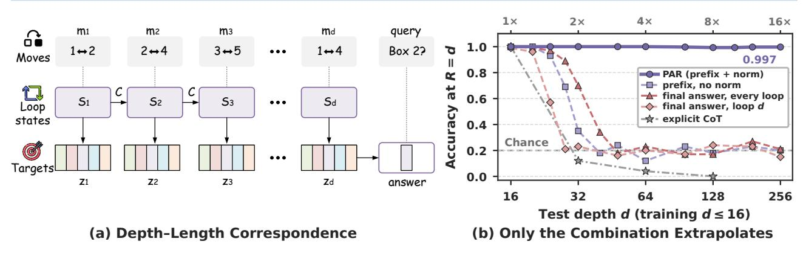
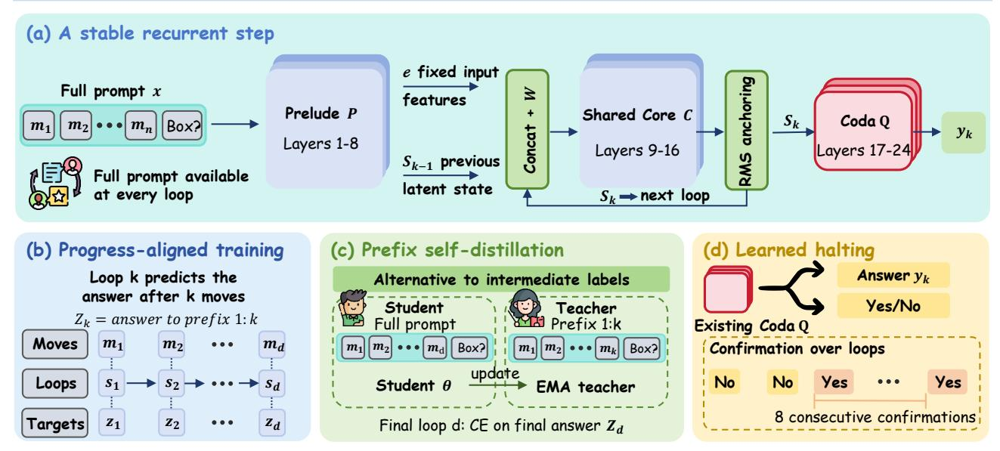
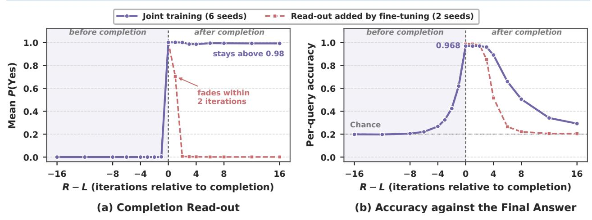

# PAR: Progress-Aligned Recurrence for Length Generalization in State Tracking

- 원제: PAR: Progress-Aligned Recurrence for Length Generalization in State Tracking
- 원문: [https://arxiv.org/abs/2610.27628](https://arxiv.org/abs/2610.27628)
- PDF: [https://arxiv.org/pdf/2610.27628](https://arxiv.org/pdf/2610.27628)
- arXiv ID: `2610.27628`

---

# **PAR: 길이 일반화를 위한 진행 정렬 재귀 (PAR: Progress-Aligned Recurrence for Length Generalization in State Tracking)**

**Pan Wang1\* Yihao Hu1\* Guangyuan Dong2\* Yitong Lin1 Hang Wang1 Zimi Liu1 Zhihao Wen1 Jianshe Li1 Jiang-Ming Yang1 Wei Wu1 Yongqi Tong1**B

1Ant International 2National University of Singapore

Contact: Pan Wang [diogenescask@gmail.com](mailto:diogenescask@gmail.com)

B Corresponding Author: Yongqi Tong [yoqitong@gmail.com](mailto:yoqitong@gmail.com)

## **초록 (Abstract)**

루프형 언어 모델은 테스트 시 더 많은 반복을 수행할 수 있지만, 추가 반복이 반드시 더 긴 문제를 해결하는 데 도움이 되는 것은 아니다. 순차적 상태 추적에서는 최종 답변 감독이 각 반복이 얼마나 진행되어야 하는지를 지정하지 않으며, 반복적인 업데이트가 재귀 상태의 규모를 바꿀 수 있다. 우리는 **Progress-Aligned Recurrence (PAR)** 를 도입한다. 이 방법은 각 반복에서 예측을 첫 번째 연산 이후의 상태와 일치하도록 훈련하고, 재귀 상태를 첫 번째 반복의 노름으로 재스케일한다. swap-5에서, 최대 32번의 이동만으로 훈련된 Qwen2.5-0.5B 모델은 512번 이동에서 평균 전체 상태 정확도 95.5%를 달성한다. 이는 훈련 길이의 16배에 해당하며, 동일한 백본에서 RLT가 보고한 55.7%와 명시적 사고 체인(chain of thought)에서 보고된 0.8%와 비교된다. 제어된 5 절감 실험은 노름 앵커링을 제거하면 외삽 인자를 16배에서 2.2배 이하로 감소시키며, 진행 정렬 목표를 최종 답변 감독으로 교체하면 최대 8배 이하로 감소시킨다는 것을 보여준다. 학습된 완성 읽기(readout)는 지정된 종료 깊이 없이 언제 답변할지를 선택한다. 중간 라벨이 없을 때, 접두사 자기-증류(prefix self-distillation)는 최종 답변만을 사용해 짧은 문제 접두사에서 대응을 유도한다. 이러한 성과는 순차적 상태 추적 과제 전반에 적용되며, 깊이 외삽에 필요한 과제 구조를 확립한다. 이러한 결과는 중간 예측과 상태 규모를 함께 훈련시켜 추가 재귀 깊이를 더 긴 문제에 유용하게 만드는 것을 지원한다.

**키워드:** 루프형 언어 모델, 길이 일반화, 상태 추적, 재귀 깊이, 잠재적 추론

## **1 서론 (Introduction)**

길이 일반화는 짧은 문제에서 훈련된 모델이 동일한 과제의 더 긴 인스턴스를 해결할 수 있는지를 묻는다 [&#91;1,](#page-7-0) [7&#93;](#page-7-1). 순차적 상태 추적은 이 질문을 연구하기 위한 통제된 환경을 제공한다: 각 연산은 이후 연산에서 사용되는 상태를 업데이트한다 [&#91;19&#93;](#page-8-0). 예를 들어, 규칙표 체인(rule-table chain)은 각 검색된 값을 사용해 다음 조회를 선택하고, 객체 추적은 각 이동 후 객체의 위치를 업데이트한다 [&#91;28,](#page-8-1) [29&#93;](#page-8-2). 이 과제들에서 규칙은 시퀀스가 길어져도 변하지 않으며, 모델은 더 많은 단계에서 이를 올바르게 적용해야 한다. 본 논문 전반에서 길이는 과제 연산의 수를 의미한다.

루프형 언어 모델은 이 길이와 함께 계산 깊이를 늘릴 수 있는 방법을 제공한다. 이 모델은 숨겨진 상태에 공유된 트랜스포머 블록을 반복적으로 적용하여 각 단계의 텍스트 설명을 생성하지 않고도 추가 계산을 가능하게 한다 [&#91;5,](#page-7-2) [9&#93;](#page-7-3), 그리고 사전 훈련된 언어 모델에 추가될 수 있다 [&#91;20&#93;](#page-8-3). 따라서 반복은 파라미터와 함께 스케일링 축으로 제안되어 테스트 시 추론을 향상시켰다.

[9]와 예측 가능한 훈련 경향 [22]을 따라. 더 긴 문제에서는 각 축이 단독으로는 도움이 되지 않는다: 5는 최대 16회 연산으로 훈련된 모델에서, 코어 깊이를 네 배로 늘린 untied 모델과 더 많은 반복으로 실행되는 재귀 모델 모두 2배 이하로 외삽하며, 고정 깊이 Qwen2.5 모델은 1.5B에서 7B까지 16배에서 거의 무작위 수준에 머든다 ([§5.1,] [§5.2]). 이전 연구는 루프 수를 작업 길이에 연결하여 길이 일반화를 보여주었고 [7], 그리고 중간 상태 감독이 사전 훈련된 모델이 연속 규칙 조회를 수행하도록 가르칠 수 있음을 보여주었다 [28]. 우리는 이러한 결과를 바탕으로 훨씬 더 긴 연산 시퀀스에서 정확한 실행을 유지하는 방법을 연구한다.

핵심적인 훈련 선택은 각 중간 루프에 무엇을 예측하도록 요구할 것인가이다. 최종 답변 목표는 일부 연산 이후의 상태를 지정하지 않는다. 그래프 도달성에서 Chen은 각 루프마다 최종 답변을 요구하면 조기 예측을 유도하고 외삽을 약화시킨다는 것을 발견했다. 중간 상태 목표는 진행 상황을 보다 직접적으로 정의하지만, 그 효과는 재귀 자체에도 달려 있다. 우리의 상태 추적 실험에서, 정규화 기준이 없는 이러한 목표는 짧은 외삽 거리 이후 정확도를 잃는다.

*동등 기여.

(§6.1). 따라서 우리는 진행에 맞춘 감독과 루프 간에 전달되는 상태의 규모를 제어하는 것을 함께 연구한다.

우리는 사전 훈련된 언어 모델을 위한 **Progress-Aligned Recurrence** (**PAR**)를 도입한다. 감독된 반복 k에서, 예측은 첫 번째 k번 연산 이후의 상태와 일치하도록 훈련된다 (그림 1a). 이 *깊이-길이 대응*은 연속적인 작업 단계를 연속적인 루프 출력에 할당한다: 예를 들어 규칙-테이블 체인에서는 반복 k가 k번 조회 후에 도달한 값을 예측한다. 상태 규모를 제어하기 위해 PAR은 각 토큰의 재귀 상태를 첫 번째 반복의 평균제곱근(RMS) 노름으로 재스케일한다. 목표는 의도된 진행을 지정하고, 정규화 기준은 공유 블록이 재사용될 때 상태 크기를 고정한다.

이 대응은 또한 언제 답변을 읽고 중간 목표를 어떻게 얻을지 안내한다. 모델이 완료 후에도 루프를 계속하면 올바른 답변이 악화될 수 있다 (§5.3). 우리는 기존 출력 층을 훈련시켜 실행이 완료되었는지 예측하도록 하고, 짧은 확인 창을 사용해 지정된 중지 깊이 없이 답변을 선택한다. 중간 라벨이 없을 때는 자체적으로 유효한 짧은 문제인 접두사를 사용한다. 우리의 *prefix self-distillation*은 이러한 접두사에 대한 예측을 전체 입력의 해당 반복에 대한 목표로 사용하며, 최종 답변 라벨만으로 학습한다.

우리의 기여는 다음과 같다:

- 우리는 루프 모델에서 길이 일반화를 깊이-길이 대응을 설정하는 것으로 공식화하고, 상태 드리프트와 정렬되지 않은 루프 목표를 이중 실패 모드로 식별하며, 진행 감독과 RMS 노름 기준을 결합한 **Progress-Aligned Recurrence (PAR)**를 제안한다.  
- 우리는 PAR을 파라미터가 없는 학습된 중지 규칙으로 확장하여 추론을 자율적으로 중지시키고, 중간 단계 라벨 없이 대응을 유도하는 prefix self-distillation을 도입한다.  
- 우리는 swap-S5에서 16배 외삽을 입증한다 (전체 상태 정확도 95.5% vs. RLT 55.7% 및 명시적 CoT 0.8%), 7B까지의 백본 전반에 걸쳐 일관된 이점을 보여주며, 통제된 소거를 통해 두 구성 요소의 필요성을 분리한다.

## 2 관련 연구 (Related Work)

루프형 및 재귀 깊이 트랜스포머.  
깊이 전반에 걸친 가중치 공유는 Universal Transformers에서 시작되었으며, 재귀는 더 어려운 사례에 대한 계산을 확장할 수 있다 [3, 27].  
언어 모델에서는 재귀 깊이가 처음부터 학습되기도 하고 [9], 사전 학습된 모델에 재구성되기도 한다 [20].  
루프형 아키텍처는 사상 체인을 시뮬레이션할 수 있고 [25], 안정적인 스케일링 동작을 보이며 [22], 깊이 간에 표현을 공유하고 [15], 암시적 모델과 연관된다 [26], 그러나 깊이는 자주 과소 활용된다 [33].  
우리는 각 반복이 무엇을 계산하는지 정의함으로써 이를 해결한다.  
길이 외삽과 중단.  
과거 연구는 루프를 연결한다

루프 수를 입력 길이 [7] 또는 명시적 추론 단계 [8]와 연결한다.  
처음부터 학습된 루프형 모델은 확률적 중단 [16], 기계적 한계 [18], 안정성 조건 [17], 그리고 빠른–느린 재귀 [30]를 조사한다; 이 중 RLT [41]는 토큰 수준 피드백을 통해 강력한 swap-$S_5$ 성능을 달성한다.  
재구성된 모델에서는 루프마다 감독이 적당한 외삽을 제공하지만 [28], 단계별 최종 답변 감독은 구성적 일반화를 저해한다 [4].  
종료 재귀를 위해 adaptive computation time [10]과 PonderNet [2]는 전용 모듈과 ponder 패널티를 사용해 중단 확률을 학습한다.  
우리의 대응에서 기존 출력 헤드는 직접적으로 완료를 감지하며, 추가 파라미터나 ponder 손실이 필요 없다.

잠재적 추론 및 자기 감독.  
Coconut [12]와 stepwise internalization [6]은 사상 체인 데이터를 사용해 시퀀스 차원에서 추론을 내부화한다.  
반대로 우리는 깊이 방향으로 계산하며, 중간 라벨이나 mean-teacher 일관성에서 영감을 받은 프리픽스 자기-디스틸레이션을 사용한다 [31], 이는 모델 자체의 출력, 상호작용, 환경에서 훈련 신호를 도출하는 연구의 정신을 따른다 [13, 32, 34, 35, 39, 42].  
무작위 위치 인코딩이 시퀀스 일반화를 향상시키는 반면 [24], 우리의 위치 스트레치는 단계 라벨 없이 더 긴 컨텍스트로 확장할 때 재귀 단계 맵을 안정화한다.

## 3 깊이-길이 대응 (Depth-Length Correspondence)

그림 2는 PAR 프레임워크를 개요한다.  
우리는 재구성된 재귀와 RMS 노름 고정화를 결합하여 정적 단계 맵을 유지함으로써 깊이-길이 대응을 실현한다 (§3.1, §3.3), 각 루프를 진행 상황에 맞는 목표로 감독한다 (§3.2), 학습된 중단을 통해 자동으로 완료를 읽어낸다 (§3.4), 그리고 프리픽스 자기-디스틸레이션을 통해 라벨이 없는 설정에서도 감독을 확장한다 (§3.5).

### 3.1 재구성된 루프형 언어 모델 (A retrofitted looped language model)

McLeish 등 [20]에 따라, Qwen2.5-0.5B의 24개 층을 프리롤 P(1–8층), 가중치 공유 코어 C(9–16층), 코다 Q(17–24층)으로 분할한다(그림 2a 참조).  
정적 입력 특징 e = P(x)와 $s_0 = e$를 사용하여 어댑터 W는 연결된 표현을 코어에 투영하고 반복한다.

$$s_k = C(W[e; s_{k-1}]), \qquad k = 1, ..., R,$$

(1)

그리고 임의의 반복에서 답변 $y_k = Q(s_k)$ 를 읽는다. 어댑터 $W \in \mathbb{R}^{h \times 2h}$ 은 $[0 \mid I]$ 로 초기화되며, R = 1일 때 리트로피트된 모델은 부모 모델과 동일한 함수를 처음에 계산한다. 모든 가중치는 학습되며, 그래디언트는 마지막 8번 반복을 통해 흐르고, 답변은 쿼리 위치에서 후보 답변 토큰에 대한 분류 헤드를 통해 읽는다.

### 3.2 반복 정의: 진행률 정렬된 목표 (Defining an iteration: progress-aligned targets)

다음과 같이 정의한다.

Figure 1: (a) 깊이-길이 대응: 반복 k가 중간 작업 상태 $z_k$ 를 예측하며, 문제 길이에 따라 계산을 확장한다. (b) 단일 쿼리 $S_5$ 에 대한 테스트 정확도 (깊이 $\leq 16$ 으로 훈련, 우연 0.2, 점선); PAR은 $16 \times (d = 256)$ 까지 거의 완벽한 정확도를 유지하지만, 이전 감독 레시피는 §6.1에서 붕괴한다.

$z_j$는 첫 번째 j 단계 이후의 답변이며, $z_d$는 최종 답변이다. Figure 2b에 나타난 바와 같이, 대응은 k번째 반복이 문제를 끝날 때까지 $z_k$를 보유하도록 요구한다. 단계 크기 c(우리는 c = 1을 사용함)로, 훈련 손실은

$$\mathcal{L}_{PAR} = \sum_{k \in \mathcal{K}} CE(Q(s_k), z_{\min(ck, d)}), \qquad (2)$$

여기서 $\mathcal{K}$는 그래디언트 윈도우 안의 반복을 포함한다. 각 반복은 정확히 c 단계씩 계산을 진행해야 하므로, 문제에 필요한 반복 수는 구성상 d/c로 증가한다. 모든 반복에서 $z_d$를 감독하면 대응이 깨진다: 초기 반복은 아직 계산할 수 없는 답변을 요구받고, 손실은 d에 비례하지 않는 지름길을 보상한다.

두 개의 깊이 스케줄이 Eq. (2)를 만족한다. *강제 깊이(forced depth)* 하에서는 각 배치가 단일 깊이 d를 포함하고, 모델은 $R = \lceil d/c \rceil$ 회 반복하며, 완료 후에는 손실이 없다. *보유(hold)* 하에서는 R이 무거운 꼬리 분포 $(1 + \text{Poisson}(\lambda))$에서 추출되고, 로그-정규 $\lambda$를 갖는다. 평균 12, 상한 48; 9) 그리고 d/c 이후의 반복은 $z_d$를 유지한다. 강제 깊이는 우리의 기본값(PAR)이다; §5.3은 테스트 시 d를 알 필요가 없도록 한다.

### 3.3 단계 매핑을 고정시키기 (Keeping the step map stationary)

외삽은 단계 매핑을 수백 번 적용하며, 이는 훈련 깊이보다 훨씬 더 멀리 떨어져 있다. 따라서 k 또는 절대 위치와 함께 드리프트되는 모든 것은 결국 매핑이 계산하는 것을 바꾼다. 우리는 두 가지 드리프트를 제거한다. *State-norm anchoring*은 각 토큰의 상태를 각 반복 후 첫 번째 반복 상태의 RMS 노름으로 재스케일한다 (Figure 2a), $s_k \leftarrow s_k \cdot \text{rms}(s_1)/\text{rms}(s_k)$, 참조에 대해 stop-gradient를 적용한다; R = 1은 변하지 않는다. *Positional stretch*는 긴 프롬프트를 다루며, 쿼리가 초기 움직임에서 멀리 떨어져 있는 경우를 해결한다: 짧은 파인튜닝 단계에서 위치 인덱스를 $s \sim U[1, s_{\text{max}}]$ 으로 곱하고, $s_{\text{max}}$를 1에서 8로 ramping한다 [cf. 24], 그리고 일반 위치로 테스트한다. 라벨-감독 PAR은 stretch 없이 $16\times$를 달성하지만, 라벨-프리 변형은 stretch와 함께 파인튜닝할 때까지 $16\times$를 달성하지 못했다 (§6.3).

### 3.4 읽기 완료: 학습된 정지 (Reading completion: learned halting)

대응에 따라 계산이 끝났는지는 반복 인덱스와 문제의 속성으로, 따라서 감독할 수 있다. Figure 2d에 나타난 바와 같이, 답변을 생성하는 코다 읽기(out)도 $ck \ge d$일 때 토큰 Yes에 확률을 두고, 그렇지 않을 때는 No에 확률을 두도록 학습된다. 이는 클래스-균형 교차 엔트로피를 사용하며, 모든 감독 반복에 가중치 0.5를 부여하고, 한 번 더 이전 반복을 추가 부정으로 사용한다. 파라미터는 추가되지 않으며, 훈련은 d를 넘어서는 반복을 실행하지 않는다. 테스트 시에는 $P(\text{Yes}) > \tau$인 첫 번째 답변 반복 R을 선택하고, 최소 k개의 반복 $R, \ldots, R+m-1$이 $\tau$를 초과하도록 한다. 이 확인 창을 검사한 뒤 R에서 예측한 값을 반환한다. 우리는 $\tau=0.5, k=6, m=8$을 사용하며, §6.2에서는 이 규칙이 어떻게 선택되었는지 설명한다.

### 3.5 단계 라벨 없이 대응: 프리픽스 자기-교사 (Correspondence without step labels: prefix self-distillation)

중간 답변 $z_j$는 합성 생성기에서 무료로 제공되지만 대부분의 실제 데이터에서는 제공되지 않는다. 대응은 그럼에도 불구하고 이를 제공한다: 문제의 처음 j 단계는 답이 $z_j$인 더 짧은 문제를 형성하며, 짧은 문제는 모델이 먼저 학습하는 문제이다. Figure 2c에 나타난 바와 같이, 프리픽스 자기-교사는 따라서 최종 답변만을 사용한다. 반복 $k \geq \lceil d/c \rceil$는 $z_d$에 대해 교차 엔트로피를 받는다. 각 예제마다, 최대 $n_k$개의 이전 반복 $k < \lceil d/c \rceil$는 KL 발산을 통해 같은 프롬프트를 ck 단계 후에 잘라서 읽고, 자신의 완료 반복에서 디코딩한 교사의 답변 분포와 일치하도록 학습된다. 교사는 학생의 지수이동평균(EMA)[31] 또는 실시간 학생이다.

### 3.6 훈련 (Training)

우리는 AdamW를 사용하며 학습률은 $2\times10^{-5}$ ($10^{-4}$는 어댑터에 해당)이고, 200개의 워밍업 스텝과 한 에폭을 약 $\approx400$ k 예시를 균일하게 분포시킨 학습 깊이에서 수행한다 (계산 세부 사항은 부록 A에 기재). 중간 토큰은 생성되지 않는다.

Figure 2: PAR 프레임워크 개요.  
(a) Architecture (§3.1, §3.3): 리트로피트된 프롤류드 P, 가중치-연결된 코어 C, 그리고 코다 Q가 RMS 노름 앵커링을 통해 반복마다 안정화된다.  
(b) Progress alignment (§3.2): 반복 k가 k번의 연산 후 중간 상태 $z_k$를 예측하여 명시적인 깊이-길이 대응을 설정한다.  
(c) Prefix self-distillation (§3.5): EMA 교사가 프리픽스 1:k에서 평가되어 반복 k를 감독하며, 최종 답변 라벨만으로 중간 상태를 유도한다.  
(d) Learned halting (§3.4): 코다가 작업 완료 여부(Yes/No)를 공동으로 예측하며, 다단계 확인 창이 충족되면 추론이 종료된다.

학습 시 또는 테스트 시.

## 4 실험 설정 (Experimental Setup)

**Tasks.** Group word problems. A prompt lists d moves on five boxes, each holding a distinct item, and queries a box. In  $swap-S_5$  each move is the identity or one of the 10 transpositions; in  $A_5$  each move is a 3-cycle. Chance accuracy per query is 0.2.  $Swap-S_5$  protocol [11, 41]: we train on at most 32 moves and test on 1,024 sequences per length. A sequence counts as correct only if all five boxes are answered correctly (full-state accuracy). Benchmarks from prior literature: the rule-table chain of Shapiro [28] (unary depth, train  $\leq 8$ , test to 64) and the graph reachability task of Chen [4] (train  $\leq 5$  hops, test to 24).

**Metrics.** 정확도는 명시되지 않은 경우 %로 보고된다. On $S_5$와 $A_5$에서 우리는 또한 외삽 계수 $G = d_{50}/d_{\rm train}$를 보고한다. 여기서 $d_{50}$는 R = d 반복에서 정확도가 기회와 100% 사이의 중간값 아래로 떨어지는 첫 번째 테스트 깊이이다. 테스트 깊이가 최대 256이고 $d_{\rm train} = 16$일 때, G = 16이 가장 큰 측정 가능한 값이다.

**Baselines.** 동일한 리트로피트된 Qwen2.5-0.5B 백본, 데이터 및 단계 예산을 PAR과 동일하게 사용하여, 전체 상태 추적을 기록하는 명시적 CoT 미세조정, 고정 깊이 모델 (R = 1), 코어를 네 번 반복한 untied 모델 (48 레이어), 그리고 state-norm을 갖는 random-R 재귀 [9]를 비교한다. swap- $S_5$ 프로토콜에서 우리는 Transformer 및 RLT와도 비교하며, 최적 분할 4 + 4 (3시드 평균)에서 Zhang et al. [41]이 보고한 값을 사용한다. PAR의 한 구성 요소를 제거한 변형, 포함하여

과거 연구의 감독 스킴은 별도로 §6에서 연구된다.

## 5 주요 결과 (Main Results)

### 5.1 Depth extrapolation (깊이 외삽)

Table 1은 PAR과 기준 모델을 비교한다. swap- $S_5$ 프로토콜에서 PAR은 $16\times$ 외삽까지 95% 이상의 전체 상태 정확도를 유지하며, RLT는 55.7%로 떨어지고 모든 PAR 시드가 RLT 평균을 초과한다. $S_5$와 $A_5$에서 PAR은 모든 시드에서 최대 측정 가능한 외삽 계수(G=16)를 달성하지만, 고정 깊이, 재귀, 48-레이어 untied 기준 모델은 $2\times$ 이하에 머물며, 반복 수나 파라미터 수만으로는 대응을 대체할 수 없다. 명시적 CoT는 훈련 범위 내에서 완벽하지만, swap- $S_5$에서 $8\times$에 도달하면 기회 수준으로 붕괴하며, 사전 훈련된 백본이 본질적으로 외삽을 부여하지 않음을 보여준다.

### 5.2 Larger and different backbones (더 크고 다른 백본)

Table 2는 $S_5$에서 더 큰 Qwen2.5 백본(1.5B, 3B, 7B)을 평가한다. 모든 백본에서 최적의 PAR 시드는 d = 256까지 100% 정확도를 유지하지만, 고정 깊이 기준 모델은 기회 수준에 근접한 ($\leq 26.5\%$) 상태를 유지한다. 시드 전반에 걸쳐 PAR은 모든 모델 크기에서 상당한 향상을 제공하며, 외삽이 불가능한 시드가 시드 간 변동성을 차지한다.

표 3은 Qwen3 family [40]의 0.6B, 1.7B, 그리고 4B 규모에서의 결과를 보고한다. PAR은 평가된 모든 깊이에서 고정 깊이를 지속적으로 능가한다: 정확도는 $2\times$에서 거의 최고 수준에 머물며, $8\times$까지 넓은 차이를 유지한다. $16\times$ 수평선 (d=256)에서 고정 깊이 모델이

|  | $S_5$ , 학습 $d \le 16$ |  |  |  | $A_5$ , 학습 $d \le 16$ | Swap- $S_5$ , 학습 $L \le 32$ |  |
|------------------------------------|--------------------------|---------|----------|----------------|--------------------------|--------------------------------|-----------------|
| 방법 | 32 (2×) | 64 (4×) | 128 (8×) | $\overline{G}$ | $\overline{G}$ | 256 (8×) | 512 (16×) |
| Transformer | _ | _ | _ | _ | _ | $0.85 \pm 0.30$ | $0.85 \pm 0.30$ |
| RLT | _ | _ | _ | _ | _ | $97.3 \pm 2.8$ | $55.7 \pm 25.8$ |
| Explicit CoT | 12 | 4 | 0 | 1.247 | 1.125 | 0.8 | 0.8 |
| 고정 깊이 $(R = 1)$ | 19 | 20 | 17 | 1.62 | 1.32 | _ | _ |
| Untied $4 \times$ core (48 layers) | 39 | 14 | _ | 1.76 | _ | _ | _ |
| Random- <i>R</i> recurrence* | 55 | 20 | 25 | 1.95 | 1.05 | _ | _ |
| PAR (우리) | 100 | 100 | 99.3 | 16 | 16 | 99.5 ± 1.2 | 95.5 ± 11.0 |

**Table 1:** 주요 결과. 정확도(%)는 R = d 반복을 사용한 $S_5$에서(한 쿼리, 기회 20%)와 Zhang et al. [41]의 swap-$S_5$ 프로토콜에서의 전체 상태 정확도(%)를 나타낸다. 열 헤더는 테스트 길이와 훈련 길이의 배수를 표시한다. G: 외삽 인자. *각 깊이별 최적 R. PAR: $S_5$에서 3개의 시드 평균, $S_5$에서 2개의 시드 평균, swap-$S_5$에서 6개의 시드 평균 (각 길이당 1,024개의 테스트 시퀀스). $S_5$: 보고되지 않음.

| 방법 | 시드 | 1.5B | 3B | 7B |
|-------------|-------|-----------------------|-----------------------|-----------------------|
| 고정 깊이 | 평균 | 22.2 ±3.8 | 21.3 ±2.4 | 18.2 ±3.8 |
|  | 최고 | 26.5 | 24.0 | 21.5 |
| PAR | 평균 | 71.7 ±42.7 | 57.8 ±42.5 | 80.7 ±33.1 |
|  | 최고 | 100 | 100 | 100 |

**Table 2:** 더 큰 Qwen2.5 백본: 정확도(%)는 d = 256(16×)에서 $S_5$에 대해 (train $d \le 16$, one query, chance 20%). 평균: mean±sd 3개의 시드에 대해; 최선: 최적 시드.

|  |  | 테스트 깊이 d |  |  |  |
|------------|--------------------|--------------|----|---------------------|-----|
| 백본 | 방법 | 32 | 64 | 128 | 256 |
| Qwen3-0.6B | 고정 깊이 PAR |  |  | 21.3 <b>60.2</b> |  |
| Qwen3-1.7B | 고정 깊이 PAR |  |  | 20.3 <b>43.8</b> |  |
| Qwen3-4B | 고정 깊이 PAR |  |  | 20.3 <b>62.3</b> |  |

**Table 3:** Qwen3 백본: 테스트 깊이별 정확도(%) $(2\times-16\times$ 훈련 깊이) $S_5$에서 (훈련 $d \le 16$, 한 쿼리, 기회 20%), mean over 3 seeds.

기회에 가까운 수준에서 붕괴되며, PAR은 4B에서 평균 정확도 53%까지 도달하고, 더 큰 모델에서 시드 분산이 증가함에도 불구하고 규모 전반에 걸쳐 이점을 유지한다.

### 5.3 언제 멈출지 학습하기 (Learning when to stop)

강제 깊이 모델은 R = L에서 정확하게 답변하지만 그 이후에는 급격히 저하되어 $16\times$에서 몇 번의 추가 반복 안에 거의 0에 가까운 정확도로 떨어진다. 따라서 추론은 실행이 언제 끝나는지 식별해야 한다. \"6 of 8\" 규칙 (§3.4)을 사용하면, 공동 훈련된 read-out은 문제 길이 L을 알지 못해도 중지된다 (Table 4): 정확도는 모든 시드에서 오라클 반복 수와 밀접하게 일치하며 $16\times$에서 92.9%에 도달한다 (RLT는 55.7%).

이 중지 메커니즘은 공동 훈련된

| PAR + 학습된 정지 | $98.7 \pm 3.1$ | $92.9 \pm 16.2$ |
|------------------------------------------|----------------|-----------------|
| PAR, 오라클 (oracle) $R = L$ | $98.7 \pm 3.1$ | $93.2 \pm 16.3$ |
| RLT | $97.3 \pm 2.8$ | $55.7 \pm 25.8$ |
| 방법 (swap- $S_5$ , 학습 $L \le 32$ ) | 256 (8×) | 512 (16×) |

**표 4 (Table 4):** 학습된 중단: 전체 상태 정확도 (%)는 문제 길이 L에 대한 접근 없이 (6 seeds, 1,024 sequences per length, step-6000 checkpoints) 측정된다. 회색: 같은 모델이 정확히 L 반복을 수행한 결과를 참고용으로 표시한다.

| 방법 (최종 답변 라벨만) | d=256 (16×) | G |
|-----------------------------------|--------------|-------------|
| 고정 깊이 $(R = 1)$ | _ | 1.62 |
| 분리되지 않은 4배 코어 (48층) | _ | 1.76 |
| Random-R 재귀 | _ | 1.95 |
| 모든 루프에서 최종 답변 | 21 / 21 | 2.14 / 1.99 |
| 루프 d에서 최종 답변 | 15 | 1.48 |
| 루프 $d$에서 최종 답변, 정규화 | 26 / 19 / 36 | <4/<4/8 |
| PAR + 접두사 자기 증류 | 85 | ≥ 16 |

**Table 5:** $S_5$에서 중간 라벨 없이 외삽 (train $d \le 16$, one query, chance 20%; accuracy in %, '/' separates seeds). 최종 답변 레시피는 Table 7에 정의되어 있다. —: d = 256에서 평가되지 않음; 이 모델들은 d = 48에서 chance에 이른다 (Table 10).

모델은 지속적인 완료 상태에 진입한다 (Figure 3a), P(Yes)가 L 이전에는 거의 0에서 L 이후에는 거의 1로 점프한다. 답변 표현 자체는 완료 이후 몇 단계만 유효하기 때문에 (Figure 3b), 규칙은 완료 신호가 시작되는 시점에서 예측을 신뢰성 있게 읽는다.

### 5.4 단계 라벨 없이 학습 (Learning without step labels)

프리픽스 자기 증류는 최종 답변만으로 대응 관계를 학습한다. 표 5의 라벨이 없는 모델들 중에서, 프리픽스 자기 증류는 $16 \times (85\%)$에서 d=256, $G \ge 16$ 조건에서 높은 정확도를 유지하는 유일한 접근법이며, 다른 최종 답변 감독 방식은 크게 저하된다. 라벨이 감독된 PAR은 가장 깊은 깊이에서 여전히 강력하지만(그림 1b), 위치 스트레치 미세조정 (§6.3)은

Figure 3: $16 \times$ 학습 길이에서 정지 (L = 512, 모든 5개 쿼리). 실선 보라색: 공동 훈련 (6개의 시드, 1,024개의 시퀀스); 점선 빨간색: 미세 조정으로 추가된 읽기 출력 (2개의 시드, 1,024개의 시퀀스). 음영 영역은 완료 전 반복(R < L)을 표시하고, 점선 수직선은 R = L을 표시한다. (a) 완료 읽기 출력은 반복 수가 L에 도달할 때까지 0을 유지한다. 공동 훈련 모델의 경우 그 이후에는 거의 1에 머물며, 미세 조정된 읽기 출력은 두 반복 내에 사라진다. (b) 정확도는 *최종* 답변에 대해 읽기 출력이 발동할 때 정확히 최고점을 찍고, 몇 반복 후에 감소한다. 따라서 답변은 "완료" 신호가 시작되는 지점에서 읽어야 한다. L 이전에는 반복이 중간 상태를 보유하며, 이는 최종 답변과 다르다 (수평 점선: 우연).

|  | 그래프 도달. |
|---------------------------|---------------------------------------------|
| $(≤ 8 \rightarrow 64)$ | $(≤ 5 \rightarrow 24)$ |
| 1.45 | 2.4 |
| _ | 3.3 |
| 1.78 | 3.45 |
| ≥ 8 | 실패* |
| 6.0 | 2.6 |
|  | $(≤ 8 \rightarrow 64)$ $1.45$ $-$ $1.78$ |

**Table 6:** *G*는 Shapiro [28] (rule chain)과 Chen [4] (graph reachability)의 벤치마크 과제에서 사용된다. 방법은 Table 7에 정의되어 있다. –: 실행되지 않음. *가장 빈번한 클래스를 예측한다.*

swap- $S_5$에서 강력한 외삽: 미세조정된 모델이 16×에서 99.7% 정확도를 달성하며 (Table 12), 단계 라벨 없이 RLT를 능가한다.

### 5.5 Prior benchmarks and scope (이전 벤치마크 및 범위)

**Benchmarks from prior literature.** Table 6은 최종 답변과 비앵커 레시피가 도입된 벤치마크 과제에서 레시피를 평가한다. 규칙-테이블 체인, 즉 본질적으로 순차적인 조회 문제에서 PAR-hold는 $G \ge 8$ (깊이 64에서 94% 정확도)을 달성하고 PAR은 6.0에 도달하지만, 정규화 앵커링 없이 프리픽스 타깃은 1.78에서 정체된다.

**Inductive bias and task structure.** Graph reachability는 고정된 단계 시퀀스 대신 병렬로 프론티어를 확장하여 해결되므로, 반복 k에 대한 고유한 중간 상태가 없으며; 모든 레시피는 그 위에서 $3.5 \times$ 이하로 머무른다. 상응은 순차 다단계 계산을 목표로 하며, 이 영역에서 고정 깊이 트랜스포머는 실패한다 [19, 21].

**Natural-language format.**

BIG-Bench-Hard-style [29] *tracking shuffled objects* 형식에서 자연어 스왑을 사용하고,  $\leq 16$ 스왑에 대해 훈련된 PAR-hold는 위치 확장(positional stretch)을 사용하여 32 스왑에서 94–96%, 64 스왑에서 79%에 도달한다(기회율 17%). 반면, 같은 위치 확장을 사용하는 random-R 및 fixed-depth 기준선은 최대 67%와 21%에 머물러 있다. 원래 BBH 항목(3, 5 및 7 개체)은 훈련 범위 내에 있으며, 모든 모델이 이 항목들에서 95–100%의 점수를 기록한다.

## 6 Ablation Studies

### 6.1 Both conditions are necessary

Table 7은 $S_5$에서 훈련 깊이 $\leq$ 16인 한 번에 하나의 조건을 변형한다. 세 가지 발견이 따른다.

Final-answer 타깃은 반복을 정의하지 않는다. 모든 반복에서 $z_d$를 감독하면 $G \approx 2$에서 정체되며, Chen [4]와 일치하지만, 반복 d에서만 감독하면 G=1.48에 도달한다. 반복 d 감독에 정규화 앵커링을 추가하면 단일 시드에 대해 외삽이 G=8까지 확장되지만, 나머지 시드는 더 일찍 감소한다; 시드 전반에 걸쳐 깊이 256에서 정확도는 평균 26.8%로, PAR이 유지하는 거의 완벽한 정확도보다 훨씬 낮다.

상응은 정적인 단계 매핑이 필요하다. 정규화 앵커링 없이 프리픽스 타깃은 두 스케줄 모두에서 $\sim 1.8 \times$에서 정체되며, 이는 비앵커 재귀 [28]에서의 발견과 일치한다. 상태 표현이 반복적으로 반복될 때 드리프트된다.

함께, 두 조건은 최소 $16 \times$에서 외삽한다. PAR은 모든 시드에서 깊이 256에서 거의 최고 정확도로 G=16에 도달한다. PAR-hold도 $12 \times$ 이상을 외삽하지만, 시드 간 일관성이 낮다.

**Positional stretch alone does not create the correspondence.** 고정 깊이 및 무작위-에 대한 미세조정으로 적용된다.

| Variant | Target at iteration k | Schedule | Norm | G | Acc. (%) |
|---------------------------------|-----------------------|----------------|--------------|--------------|----------------|
| Final answer at every loop | $z_d$ at every $k$ | heavy-tailed R | ✓ | 2.14 / 1.99 | 21 / 21 |
| Final answer at loop d | $z_d$ at $k = d$ only | forced $R = d$ | _ | 1.48 | 15 |
| Final answer at loop $d$ , norm | $z_d$ at $k = d$ only | forced $R = d$ | $\checkmark$ | <4/<4/8 | 26 / 19 / 36 |
| Prefix targets, no norm, hold | $Z_{\min}(k,d)$ | heavy-tailed R | _ | 1.84 | 16 |
| Prefix targets, no norm | $z_{\min(k,d)}$ | forced $R = d$ | _ | 1.81 | 20 |
| PAR-hold | $z_{\min(k,d)}$ | heavy-tailed R | ✓ | 16 / 12 | 75 / 30 |
| PAR | $Z_{\min}(k,d)$ | forced $R = d$ | ✓ | 16 / 16 / 16 | 100 / 100 / 99 |

**Table 7:** 두 조건에 대한 ablation on $S_5$ (train $d \le 16$, test to 256, one query, chance 20%). Norm: state-norm anchoring. G와 d=256에서의 정확도는 시드별로 제공된다. 모든 행은 백본, 데이터, 최적화기, 단계 예산을 공유한다. 행 1, 2, 5는 Chen [4], Fan et al. [7], Shapiro [28]의 감독 레시피를 우리 백본에 적용한다. R = d 반복을 가진 테스트 깊이별 정확도 곡선은 Figure 1b에 있다.

| 정지 규칙 | 256 (8×) | 512 (16×) |
|----------------------------------------------|----------------|------------------------------------|
| 단일 반복 $(k = m = 1)$ 8회 연속 | $-98.7\pm3.1$ | $77.8 \pm 25.7$ $90.3 \pm 16.4$ |
| 8개 중 6개 | $98.7 \pm 3.1$ | $92.9 \pm 16.2$ |

표 8: 동시 훈련된 read‑out(스왑- $S_5$, 전체 상태 %, 같은 6개의 시드와 체크포인트는 표 4와 동일)의 중지 규칙. —: 보고되지 않음.

R 모델, 위치 스트레칭은 깊이 48에서 두 모델을 모두 기회 수준으로 남긴다 (23%와 18%; 표 10). 단계 크기 c=2인 PAR‑hold 모델에 적용하면 이미 대응 관계가 있는 상태에서 동일한 파인튜닝은 깊이 512(학습 깊이의 32배)에서 99% 정확도를 유지한다. 이는 R=288을 고정한 한 번의 실행에서 이루어진다. 정상성은 기존 단계 맵을 재사용 가능하게 하며, 새로 만들지는 않는다. **한 번의 패스 초기화는 대응 관계를 차단한다.** $A_5$에서 사전 훈련된 부모 모델에서 학습된 PAR은 두 시드 모두에서 G=16에 도달한다 (표 1). 이미 $d \le 16$을 한 번의 패스로 해결하는 고정 깊이 모델에서 모든 층을 워밍스타트하면 $G \approx 1.4$가 된다: 모델은 한 번의 패스 솔루션을 유지하고 단계 맵을 학습하지 않는다. 프리룰만 워밍스타트하면 두 시드 중 하나에서 성공한다.

### 6.2 중지 규칙과 중단 대안

**중지 규칙.** 단일 반복에서 P(Yes)를 평가하는 것은 취약하다 (표 8), 일시적인 확률 급증이 장기 시야에서 조기 중지를 초래한다. 반대로, 완료를 확인하기 위해 8개의 연속 반복을 모두 요구하면 확률이 변동할 때 과도하게 엄격해져 예측이 변동될 때까지 중지를 지연시킨다. "6 of 8" 규칙은 견고성과 반응성을 균형 있게 조정하며, 평가된 모든 시퀀스에서 오라클 중지와 1.6 포인트 이내로 일치한다.

**공동 훈련 대 파인튜닝된 read‑out.** 기존 PAR 체크포인트를 파인튜닝하여 read‑out을 추가하면 다른 역학이 나타난다: P(Yes)는 완료 시 급격히 상승하고 두 반복 내에 감소한다. 그 결과, 다단계 확인 창은 트리거되지 않으며, 단일 반복 중지는 오라클 정확도를 복원한다. across

| 교사 | d=64 | d=256 | G |
|---------------------------------|------|-------|-------------|
| EMA 0.99 + 커리큘럼 | _ | _ | 2.6 |
| 느린 EMA + 신뢰 필터 | _ | _ | 5.6 |
| EMA 0.99, 강제 깊이 | 99 | 57 | ≈16 |
| EMA 0.99 | 97 | 61 | ≥ <b>16</b> |
| 라이브 학생 + 깊이 커리큘럼 | 98 | 85 | ≥ 16 |

**표 9:** prefix self-distillation에서 사용되는 교사 구성 ( $S_5$  (train  $d \le 16$ , single-query accuracy in % at R = d). —: 평가되지 않음. 마지막 행은 표 5에 보고된 구성이다.)

두 시드 (표 11). 그러나 미세 조정은 공동 훈련에 비해  $16 \times$ 에서 한 시드의 정확도가 약간 감소한다.

추가 반복을 통한 훈련은 대체가 되지 않는다. 명시적 중지 신호 대신 완성을 흡수 상태로 만드는 대안은 $z_d$ 를 유지해야 하는 추가 반복에서 모델을 훈련시키는 것이다. 이는 분포 내 정확도를 보존하지만 외삽에 심각한 악영향을 미친다: 정확도가  $16\times$ 에서 평가된 모든 시드에서 1% 이하로 붕괴한다. 재귀 코어가 중간 상태를 진행하면서 동시에 고정점을 수행하도록 요구하면 상충되는 목표가 생기며, 독립적인 완성 읽기(출력)는 이 경쟁을 피한다.

### 6.3 교사와 위치 스트레칭(Positional stretch) in prefix selfdistillation

**교사(Teacher).** 다섯 개 중 세 개의 교사 구성은 $G \approx 16$ 이상에 도달한다 (표 9); 깊이 커리큘럼을 가진 실시간 학생 교사는 d = 256에서 가장 높은 정확도를 유지한다.

**위치 스트레칭.** swap- $S_5$ 에서 초기 라벨-프리 모델은 부분적으로 $8\times$ 까지 외삽하지만 $16\times$ 에서 붕괴한다 (표 12). 실패는 누적적이라기보다는 급격하다: 쿼리당 정확도는 256 이동에서 높은 수준을 유지하다가 512에서 기회 수준으로 떨어진다. 이는 절대 위치 인코딩에 의해 구동되는 비정상적 단계 매핑을 가리킨다. 라벨-프리 목표와 위치 스트레칭을 결합한 짧은 미세 조정은 모든 시작 체크포인트에서 외삽을 복원하며, $16\times$ 정확도를 거의 기회 수준에서 99.7%까지 끌어올린다. 시작부터 스트레칭을 적용하면 비슷하게 완벽한 정확도를 달성하는 실행을 얻는다 at

두 길이 모두에서, 라벨-감독 PAR은 스트레칭 없이 결과를 달성한다.

## 7 결론 (Conclusion)

루프형 언어 모델은 각 반복이 정의된 작업을 가질 때 깊이 외삽한다. 반복 k를 문제의 첫 k 단계와 정렬하고 단계 매핑을 정지시킴으로써 추가 반복을 추가 추론으로 전환한다. 이 방식으로 훈련된 0.5B 모델은 swap- $S_5$ 에서 8배 및 16배 훈련 길이에서 가장 좋은 공개된 잠재적 재귀 모델을 능가한다. 같은 대응 관계는 모델이 언제 멈출지 학습하도록 하고, 최종 답변만으로 중간 상태를 학습하도록 한다. 반복이 의미하는 바를 정의하는 것은 자체적으로 훈련 목표이며, 몇 번의 반복을 실행할지 선택하는 것과 함께한다.

### 한계 (Limitations)

우리는 알고리즘 및 템플릿 기반 상태 추적 과제에서 중간 상태가 잘 정의된 경우를 평가한다; 개방형 자연어 추론 [36–38]에 대응 관계를 적용하는 것은 향후 연구로 남겨둔다. 순차적 분해가 없는 과제, 예를 들어 그래프 도달성은 범위 밖이다. 우리의 스케일링 연구는 Qwen2.5 기반 모델을 최대 7B, Qwen3 기반 모델을 최대 4B까지 다루며, 각 모델마다 세 개의 시드를 사용하고 단일 쿼리 $S_5$ 설정에서만 평가한다; swap- $S_5$ , 학습된 중지 및 prefix self-distillation은 Qwen2.5-0.5B에서만 평가된다. 더 큰 기반 모델에서는 prefix self-distillation과 마찬가지로 결과가 시드마다 훨씬 더 다양하며, Qwen2.5-0.5B의 PAR보다 (표준편차 33-43 포인트, Qwen2.5-1.5B에서 7B까지 16×에서) 정확도가 Qwen2.5 크기에 따라 단조롭게 상승하지 않으며, Qwen3 기반 모델이 Qwen2.5-0.5B에 16×에서 접근하지 못한다. 따라서 이 결과는 모델 크기에 따른 단조로운 추세를 확립하지 못하며, 더 큰 기반 모델에서 시드 변동성 메커니즘을 규명하고 재귀 스케일링을 안정화하는 것은 향후 연구의 열쇠이다.

## **윤리 선언문 (Ethics Statement)**

이 연구는 공개된 모델 [14, 40]을 사용한 합성 추론 과제에서의 학습 방법을 연구한다. 인간 피험자나 개인 데이터를 포함하지 않는다. 잠재적 추론은 중간 단계 없이 작동하므로 사유 체인보다 투명성이 낮다. 그러나 대응 관계 하에서는 각 반복을 보유한 중간 답으로 디코딩할 수 있어, 잠재적 계산을 검사할 수 있는 방법을 제공한다.

#### 참고문헌 (References)

[1] Cem Anil, Yuhuai Wu, Anders Andreassen, Aitor Lewkowycz, Vedant Misra, Vinay Ramasesh, Ambrose Slone, Guy Gur-Ari, Ethan Dyer, and Behnam Neyshabur. 대규모에서 길이 일반화 탐구

- 언어 모델. *Neural Information Processing Systems 학회(Advances in Neural Information Processing Systems)*, 35:38546–38556, 2022.

- [2] Andrea Banino, Jan Balaguer, and Charles Blundell. Pondernet: 사고를 배우다 (Pondernet: Learning to ponder). *arXiv 사전 인쇄물(arXiv preprint)* arXiv:2107.05407, 2021.

- [3] Arpit Bansal, Avi Schwarzschild, Eitan Borgnia, Zeyad Emam, Furong Huang, Micah Goldblum, and Tom Goldstein. End-to-end 알고리즘 합성: 과도한 사고 없이 외삽 (End-to-end algorithm synthesis with recurrent networks: Extrapolation without overthinking). *Neural Information Processing Systems 학회*, 35:20232–20242, 2022.

- [4] Hung-Hsuan Chen. 더 깊게 생각하라, 더 오래하지 말라: 깊이 재귀 변환기를 이용한 메모리 효율적인 테스트 타임 추론으로 구성적 일반화 (Thinking deeper, not longer: Memory-efficient test-time reasoning with depthrecurrent transformers for compositional generalization), 2026. URL https://arxiv.org/abs/2603.21676.

- [5] Mostafa Dehghani, Stephan Gouws, Oriol Vinyals, Jakob Uszkoreit, and Łukasz Kaiser. 보편적 변환기 (Universal transformers). *arXiv 사전 인쇄물* arXiv:1807.03819, 2018.

- [6] Yuntian Deng, Yejin Choi, and Stuart Shieber. 명시적 COT에서 암시적 COT로: COT를 단계별로 내부화하는 학습 (From explicit cot to implicit cot: Learning to internalize cot step by step). *arXiv 사전 인쇄물* arXiv:2405.14838, 2024.

- [7] Ying Fan, Yilun Du, Kannan Ramchandran, and Kangwook Lee. 길이 일반화를 위한 루프형 변환기 (Looped transformers for length generalization). In *Learning Representations 국제 학회(International Conference on Learning Representations)*, volume 2025, pages 14502–14520, 2025.

- [8] Ying Fan, Anej Svete, and Kangwook Lee. 잠재적 및 명시적 추론 간 격차를 루프형 변환기로 연결 (Bridging the gap between latent and explicit reasoning with looped transformers). *arXiv 사전 인쇄물* arXiv:2606.31779, 2026.

- [9] Jonas Geiping, Sean McLeish, Neel Jain, John Kirchenbauer, Siddharth Singh, Brian Bartoldson, Bhavya Kailkhura, Abhinav Bhatele, and Tom Goldstein. 잠재적 추론을 이용한 테스트 타임 연산 확장: 재귀 깊이 접근법 (Scaling up test-time compute with latent reasoning: A recurrent depth approach). *Neural Information Processing Systems 학회*, 38:41340–41391, 2026.

- [10] Alex Graves. 재귀 신경망을 위한 적응형 계산 시간 (Adaptive computation time for recurrent neural networks). *arXiv 사전 인쇄물* arXiv:1603.08983, 2016.

- [11] Riccardo Grazzi, Julien Siems, Arber Zela, Jörg Franke, Frank Hutter, et al. 음수 고유값을 통한 선형 RNN의 상태 추적 해제 (Unlocking state-tracking in linear rnns through negative eigenvalues). In *Learning Representations 국제 학회*, volume 2025, pages 36565–36597, 2025.

- [12] Shibo Hao, Sainbayar Sukhbaatar, DiJia Su, Xian Li, Zhiting Hu, Jason Weston, and Yuandong Tian. 연속 잠재 공간에서 추론하도록 대형 언어 모델을 훈련 (Training large language models to reason in a continuous latent space). *arXiv 사전 인쇄물* arXiv:2412.06769, 2024.

- [13] Yihao Hu, Zhihao Wen, Xiujin Liu, Pan Wang, Xin Zhang, and Wei Wu. Seal: Synergistic co-evolution of agents and learning environments. *arXiv preprint arXiv:2605.24426*, 2026.
- [14] Binyuan Hui, Jian Yang, Zeyu Cui, Jiaxi Yang, Dayiheng Liu, Lei Zhang, Tianyu Liu, Jiajun Zhang, Bowen Yu, Keming Lu, et al. Qwen2. 5-coder technical report. *arXiv preprint arXiv:2409.12186*, 2024.
- [15] Ahmadreza Jeddi, Marco Ciccone, and Babak Taati. Loopformer: Elastic-depth looped transformers for latent reasoning via shortcut modulation. *arXiv preprint arXiv:2602.11451*, 2026.
- [16] Hsun-Yu Kuo, El Mahdi Chayti, Patrik Reizinger, Wieland Brendel, and Martin Jaggi. Stabilizing extrapolation in looped transformers via learned stochastic stopping. *arXiv preprint arXiv:2606.29983*, 2026.
- [17] Asher Labovich. Stability and generalization in looped transformers. *arXiv preprint arXiv:2604.15259*, 2026.
- [18] Jia Liang, Xi Jin, and Liangming Pan. Beyond the training horizon: Mechanisms and limits of length generalization in looped transformers. *arXiv preprint arXiv:2609.33144*, 2026.
- [19] Bingbin Liu, Jordan T Ash, Surbhi Goel, Akshay Krishnamurthy, and Cyril Zhang. Transformers learn shortcuts to automata. *arXiv preprint arXiv:2210.10749*, 2022.
- [20] Sean McLeish, Ang Li, John Kirchenbauer, Dayal Singh Kalra, Brian R Bartoldson, Bhavya Kailkhura, Avi Schwarzschild, Jonas Geiping, Tom Goldstein, and Micah Goldblum. Teaching pretrained language models to think deeper with retrofitted recurrence. *arXiv preprint arXiv:2511.07384*, 2025.
- [21] William Merrill, Jackson Petty, and Ashish Sabharwal. The illusion of state in state-space models. *arXiv preprint arXiv:2404.08819*, 2024.
- [22] Hayden Prairie, Zachary Novack, Taylor Berg-Kirkpatrick, and Daniel Y Fu. Parcae: Scaling laws for stable looped language models. *arXiv preprint arXiv:2604.12946*, 2026.
- [23] Samyam Rajbhandari, Jeff Rasley, Olatunji Ruwase, and Yuxiong He. Zero: Memory optimizations toward training trillion parameter models. In *SC20: international conference for high performance computing, networking, storage and analysis*, pages 1–16. IEEE, 2020.
- [24] Anian Ruoss, Grégoire Delétang, Tim Genewein, Jordi Grau-Moya, Róbert Csordás, Mehdi Bennani, Shane

- Legg, and Joel Veness. Randomized positional encodings boost length generalization of transformers. In *Proceedings of the 61st Annual Meeting of the Association for Computational Linguistics (Volume 2: Short Papers)*, pages 1889–1903, 2023.
- [25] Nikunj Saunshi, Nishanth Dikkala, Zhiyuan Li, Sanjiv Kumar, and Sashank J Reddi. Reasoning with latent thoughts: On the power of looped transformers. In *International Conference on Learning Representations*, volume 2025, pages 14855–14881, 2025.
- [26] Mark Schöne, Babak Rahmani, Heiner Kremer, Fabian Falck, Hitesh Ballani, and Jannes Gladrow. Implicit language models are rnns: balancing parallelization and expressivity. *arXiv preprint arXiv:2502.07827*, 2025.
- [27] Avi Schwarzschild, Eitan Borgnia, Arjun Gupta, Furong Huang, Uzi Vishkin, Micah Goldblum, and Tom Goldstein. Can you learn an algorithm? generalizing from easy to hard problems with recurrent networks. *Advances in Neural Information Processing Systems*, 34:6695–6706, 2021.
- [28] Mark Shapiro. Retrofitting recurrent depth into a pretrained language model: Installation, extrapolation, transfer, and retention at two parameter budgets. *arXiv preprint arXiv:2608.11233*, 2026.
- [29] Mirac Suzgun, Nathan Scales, Nathanael Schärli, Sebastian Gehrmann, Yi Tay, Hyung Won Chung, Aakanksha Chowdhery, Quoc Le, Ed H Chi, Denny Zhou, et al. Challenging big-bench tasks and whether chain-of-thought can solve them. In *Findings of the Association for Computational Linguistics: ACL 2023*, pages 13003–13051, 2023.
- [30] Shota Takashiro, Masanori Koyama, Takeru Miyato, Yusuke Iwasawa, Yutaka Matsuo, and Kohei Hayashi. Exploration of fast-slow latent recurrence for trainshort, test-long generalization, 2026. URL [https://](https://arxiv.org/abs/2604.01577) [arxiv.org/abs/2604.01577.](https://arxiv.org/abs/2604.01577)
- [31] Antti Tarvainen and Harri Valpola. Mean teachers are better role models: Weight-averaged consistency targets improve semi-supervised deep learning results. *Advances in neural information processing systems*, 30, 2017.
- [32] Yongqi Tong, Pan Wang, Hang Wang, Jianshe Li, Xin Zhang, Jiang-Ming Yang, and Wei Wu. Grounded skill synthesis from code at scale for agentic intelligence. *arXiv preprint arXiv:2609.05571*, 2026.
- [33] Ha Van Dau, Thanh Tung Khuat, and Nguyen Thanh Dung. Beyond depth truncation: Controlled evaluation

- 재귀 언어 모델에서의 깊이 활용. *arXiv* 사전 인쇄 arXiv:2609.19934, 2026.
- [34] Pan Wang. REFLEX: Reflective evolution from LLM experience. In *ICML 2026 AI for Science Workshop*, 2026. URL https://openreview.net/forum?id=xftknNrW7n.
- [35] Pan Wang, Yihao Hu, Hang Wang, Zirui Lv, Xin Zhang, Jianshe Li, Jiang-Ming Yang, Wei Wu, and Yongqi Tong. Diagnosis before recovery: Turning agent failures into selective self-correction. *arXiv* 사전 인쇄 arXiv:2608.11772, 2026.
- [36] Siheng Xiong, Ali Payani, Yuan Yang, and Faramarz Fekri. Deliberate reasoning in language models as structure-aware planning with an accurate world model. In *Proceedings of the 63rd Annual Meeting of the Association for Computational Linguistics (Volume 1: Long Papers)*, 페이지 31900–31931, 2025.
- [37] Siheng Xiong, Oguzhan Gungordu, James C Kerce, and Faramarz Fekri. Adaptive information control for search-augmented llm reasoning. *arXiv 사전 인쇄 arXiv:2602.01672*, 2026.
- [38] Siheng Xiong, Ali Payani, and Faramarz Fekri. Enhancing language model reasoning with structured multi-level modeling. In *International Conference on Learning Representations*, volume 2026, 페이지 36557–36610, 2026.
- [39] Siheng Xiong, Ali Payani, Oguzhan Gungordu, and Faramarz Fekri. Dive: Unlocking self-improvement in frozen language models through diversity-driven skill evolution. *arXiv 사전 인쇄 arXiv:2608.12486*, 2026.
- [40] An Yang, Anfeng Li, Baosong Yang, Beichen Zhang, Binyuan Hui, Bo Zheng, Bowen Yu, Chang Gao, Chengen Huang, Chenxu Lv, et al. Qwen3 technical report. arXiv 사전 인쇄 arXiv:2505.09388, 2025.
- [41] Yifan Zhang, Jichen Feng, and Shihan Qin. Recurrent looped transformer, 2026. URL https://arxiv.org/abs/2610.07591.
- [42] Yiwen Zhao, Zhihao Wen, Yuchen Mao, Mingxuan Jiang, Yihao Hu, Pan Wang, Xin Zhang, and Wei Wu. Towards better agents for multi-turn user interaction: The next user turn is more than context. *arXiv 사전 인쇄 arXiv:2608.17499*, 2026.

#### **추가 결과 (Additional Results)**

**Per-depth** $S_5$ **첫 번째 레시피 버전의 결과.** Table 10은 PAR-hold와 기준선(학습 $d \le 16$)에 대한 테스트 깊이별 정확도를 제시한다.

**PAR-hold on the swap-** $S_5$  **protocol.** 6개의 시드에서 길이당 1,024개의 시퀀스를 평가한 결과, PAR-hold with positional stretch는 8×에서 84.5  $\pm$  29.4%, 16×에서 76.9  $\pm$  38.0%를 달성하며, 평균 정확도와 시드 간 일관성 모두에서 forced-depth PAR을 앞선다.

**Explicit CoT 길이별.** swap- $S_5$ 프로토콜에서, 명시적 CoT 기준선은 훈련된 길이(32 이동에서 100%)에서 완벽한 정확도를 달성하지만 그 이후에는 급격히 붕괴한다: 전체 상태 정확도는 64 이동에서 35.6%, 128 이동에서 3.1%, 256 및 512 이동에서 0.8%로 떨어진다. 마찬가지로, 단일 쿼리 $S_5$ 과제(깊이 $\leq$ 16에서 훈련)에서 CoT 정확도는 깊이 16에서 100%에서 32에서 12%, 64에서 4%, 128에서 0%로 떨어진다.

**Per-seed halting results.** Table 11은 Tables 4와 8 뒤에 있는 시드별 결과를 나열한다.

**Per-run label-free results on swap-** $S_5$ **.** Table 12는 swap- $S_5$ 프로토콜에서 위치 스트레치 미세조정 전후의 프리픽스 자기-증류 결과를 보고한다.

**Compute.** 모든 실행은 bf16으로 DeepSpeed ZeRO-2 [23]를 사용해 Qwen2.5-0.5B 및 Qwen3-0.6B에 대해 두 개의 RTX 4090 또는 3090 GPU에서, Qwen2.5-1.5B, 3B, 7B 및 Qwen3-1.7B와 4B에 대해 여덟 개의 H200 GPU에서 수행된다.

학습된 정지(halt)는 사전 학습된 부모 모델(pretrained parent)에서 한 에폭(epoch) 동안 가중치 0.5로 함께 훈련된다. 미세조정된 변형은 두 개의 PAR 체크포인트(PAR checkpoints)에서 시작하여 학습률(learning rate) $10^{-5}$로 0.3 에폭 동안 훈련된다. 라벨이 없는(label-free) 모델은 강제 깊이, decay 0.99를 갖는 EMA 교사(EMA teacher)를 사용하고, 각 예제마다 $n_k \in \{2,4\}$ 증류 반복(distilled iterations)을 수행하며 0.6 및 1 에폭 동안 훈련된다. 위치-스트레치 미세조정(positional-stretch fine-tune)은 같은 손실과 $n_k$를 사용하여 각 시작 모델을 0.5 에폭 동안 계속한다(시드(seed) 2의 step-6000 checkpoint, 시드 4와 5의 step 5000, 시드 0의 $n_k$=2인 final model). 시작부터 스트레칭(stretch-from-the-start) 모델은 $n_k$=2로 한 에폭 동안 훈련된다.

| 24 | 32 | 48 | 64 | 128 | 256 | 384 | 512 |
|------|--------------------------------------------------------------|-------------------------------------------------------------------------------------------------------------------|----------------------------------------------------------------------------------------------------------------------------------------------------------------------------------------------------------------------------------------------------------------|---------------------------------------------------------------------------------------------------------------------------------------------------------------------------------------------------------------------------------------------------------------------------------------------------------------------------------------------------------------------------------------------------------------------------------------------------------------------------------------------|---------------------------------------------------------------------------------------------------------------------------------------------------------------------------------------------------------------------------------------------------------------------------------------------------------------------------------------------------------------------------------------------------------------------------------------------------------------------------------------------------------------------------------------------------------------------------------------------------------------|---------------------------------------------------------------------------------------------------------------------------------------------------------------------------------------------------------------------------------------------------------------------------------------------------------------------------------------------------------------------------------------------------------------------------------------------------------------------------------------------------------------------------------------------------------------------------------------------------------------------------------------------------------------------------------------------------------------------|------------------------------------------------------------------------------------------------------------------------------------------------------------------------------------------------------------------------------------------------------------------------------------------------------------------------------------------------------------------------------------------------------------------------------------------------------------------------------------------------------------------------------------------------------------------------------------------------------------------------------------------------------------------------------------------------------------------------------------------------------------------------------------------------------------------------|
| 0.73 | 0.19 | 0.23 | 0.20 | 0.17 | _ | _ |  |
| 0.93 | 0.55 | 0.23 | 0.20 | 0.25 | _ | _ | _ |
| 0.88 | 0.39 | 0.20 | 0.14 | _ | _ | _ | _ |
| 0.84 | 0.35 | 0.23 | 0.16 | 0.16 | 0.19 | _ | _ |
| 0.93 | 0.60 | 0.18 | 0.18 | 0.17 | _ | _ | _ |
| 0.98 | 0.23 | 0.18 | 0.17 | 0.20 | _ | _ | _ |
| 1.00 | 1.00 | 1.00 | 0.97 | 0.95 | 0.86 | 0.72 | 0.72 |
| 1.00 | 0.98 | 0.99 | 0.99 | 0.97 | 0.92 | 0.97 | 0.91 |
| 1.00 | 1.00 | 1.00 | 1.00 | 1.00 | 1.00 | 1.00 | 0.99 |
| 0.98 | 1.00 | 0.91 | 0.69 | 0.23 | 0.26 | _ | _ |
|  | 0.73 0.93 0.88 0.84 0.93 0.98 1.00 1.00 | 0.73 0.19 0.93 0.55 0.88 0.39 0.84 0.35 0.93 0.60 0.98 0.23 1.00 1.00 1.00 0.98 1.00 1.00 | 0.73     0.19     0.23       0.93     0.55     0.23       0.88     0.39     0.20       0.84     0.35     0.23       0.93     0.60     0.18       0.98     0.23     0.18       1.00     1.00     1.00       1.00     0.98     0.99       1.00     1.00     1.00 | 0.73         0.19         0.23         0.20           0.93         0.55         0.23         0.20           0.88         0.39         0.20         0.14           0.84         0.35         0.23         0.16           0.93         0.60         0.18         0.18           0.98         0.23         0.18         0.17           1.00         1.00         1.00         0.97           1.00         0.98         0.99         0.99           1.00         1.00         1.00         1.00 | 0.73         0.19         0.23         0.20         0.17           0.93         0.55         0.23         0.20         0.25           0.88         0.39         0.20         0.14         -           0.84         0.35         0.23         0.16         0.16           0.93         0.60         0.18         0.18         0.17           0.98         0.23         0.18         0.17         0.20           1.00         1.00         1.00         0.97         0.95           1.00         0.98         0.99         0.99         0.97           1.00         1.00         1.00         1.00         1.00 | 0.73         0.19         0.23         0.20         0.17         -           0.93         0.55         0.23         0.20         0.25         -           0.88         0.39         0.20         0.14         -         -           0.84         0.35         0.23         0.16         0.16         0.19           0.93         0.60         0.18         0.18         0.17         -           0.98         0.23         0.18         0.17         0.20         -           1.00         1.00         1.00         0.97         0.95         0.86           1.00         0.98         0.99         0.99         0.97         0.92           1.00         1.00         1.00         1.00         1.00         1.00 | 0.73         0.19         0.23         0.20         0.17         -         -           0.93         0.55         0.23         0.20         0.25         -         -           0.88         0.39         0.20         0.14         -         -         -           0.84         0.35         0.23         0.16         0.16         0.19         -           0.93         0.60         0.18         0.18         0.17         -         -           0.98         0.23         0.18         0.17         0.20         -         -           1.00         1.00         1.00         0.97         0.95         0.86         0.72           1.00         0.98         0.99         0.99         0.97         0.92         0.97           1.00         1.00         1.00         1.00         1.00         1.00         1.00 |

**Table 10:**  $S_5$  정확도는 테스트 깊이에 따라 달라지며 (단일 쿼리 비율, 우연 확률 0.2). 이전 실행은 훈련 시 $R \le 32$  를 샘플링하며; c = 1, R = d 행은 d = 512에서 가장 큰 훈련 루프 수의 $16 \times$  를 사용한다. 위치 스트레칭은 진행에 맞춘 목표와 함께 있을 때만 효과가 있다.

| 256 (8×) |  |  | 512 (16×) |  |  |  |
|----------|-------|--------|------------|------|--------|------------|
| 시드 | R=L | 8개 중 6개 | 연속 8개 | R=L | 8개 중 6개 | 연속 8개 |
| 0 | 100.0 | 100.0 | 100.0 | 99.6 | 99.6 | 99.6 |
| 1 | 99.9 | 99.9 | 99.9 | 99.9 | 98.3 | 99.9 |
| 2 | 92.4 | 92.4 | 92.4 | 59.9 | 59.9 | 59.9 |
| 3 | 100.0 | 100.0 | 100.0 | 99.9 | 99.9 | 99.9 |
| 4 | 99.9 | 99.9 | 99.9 | 99.7 | 99.7 | 82.4 |
| 5 | 100.0 | 100.0 | 100.0 | 99.9 | 99.9 | 99.9 |
| 평균 | 98.7 | 98.7 | 98.7 | 93.2 | 92.9 | 90.3 |

**Table 11:** 시드별 학습된 중단 (swap- $S_5$ , full-state %, 1,024 sequences per length, step-6000 checkpoints). R=L: 오라클 반복 횟수. "6 of 8": P(Yes) > 0.5인 첫 번째 답변 반복 R을 선택하고, R~R+7 중 최소 6개가 0.5를 초과하는 시점에서 R의 예측을 확인 후 반환한다; "8 in a row": 모든 8개가 0.5를 초과해야 한다.

| 시작 모델 | 8× | 16× | q-acc 16× |
|--------------------------------|-------|-------|-----------|
| $n_k$ =2, seed 0 | 73.8 | 0.4 | 22.1 |
| + 위치 스트레치 | 76.2 | 26.7 | 74.9 |
| $n_k$ =4, seed 2 | 52.7 | 0.0 | 26.7 |
| + 스트레치 | 99.9 | 99.7 | 99.8 |
| + 스트레치, 두 번째 FT 시드 | 99.2 | 98.4 | 99.2 |
| $n_k$ =4, seed 4 | 72.3 | 5.5 | 39.4 |
| + 스트레치 | 100.0 | 99.7 | 99.9 |
| $n_k$ =4, seed 5 | 30.9 | 1.2 | 32.7 |
| + 스트레치 | 86.2 | 65.5 | 85.2 |
| 시작부터 스트레치, seed 7 | 100.0 | 100.0 | 100.0 |

**Table 12:** Prefix self-distillation on swap- $S_5$  (train  $L \leq 32$ , full-state %; q-acc: per-query accuracy, chance 20%). 모델은 stretch fine-tuning 이전에 길이마다 256개의 시퀀스를 사용하고, 나머지는 1,024; 모든 stretch fine-tuned 모델은 32 이동 범위에서 최소 99.2%를 기록한다. seed-4와 seed-5 시작 모델은 step-5000 체크포인트이다.

