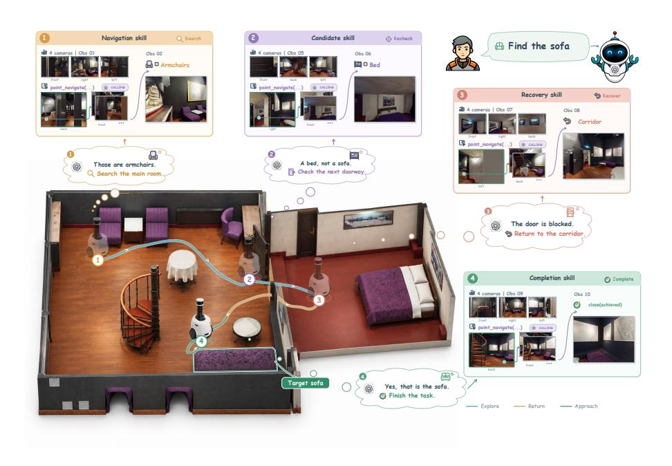
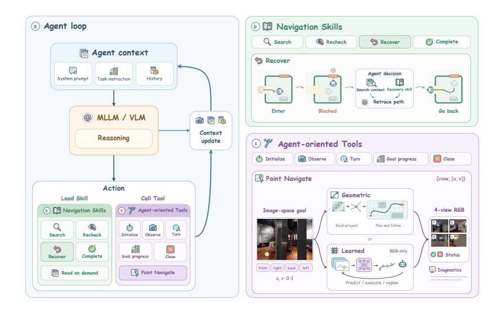
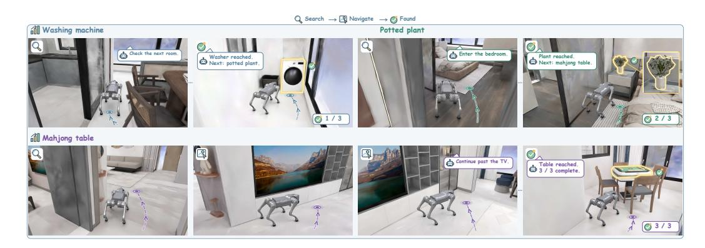
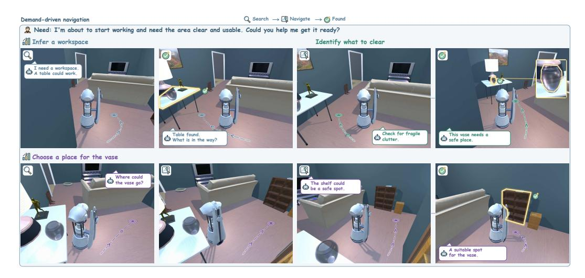
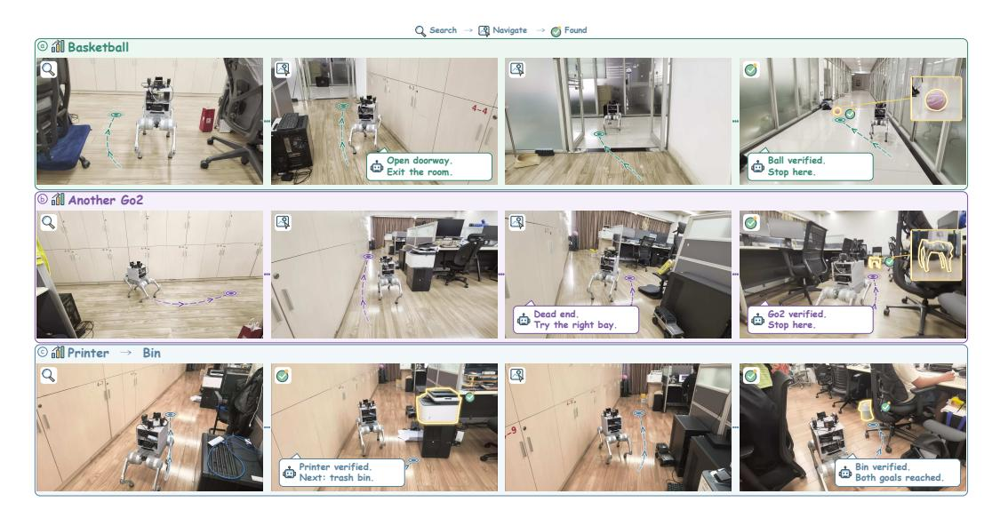
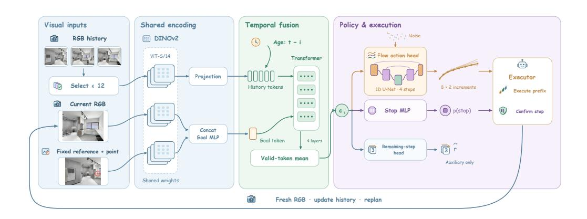
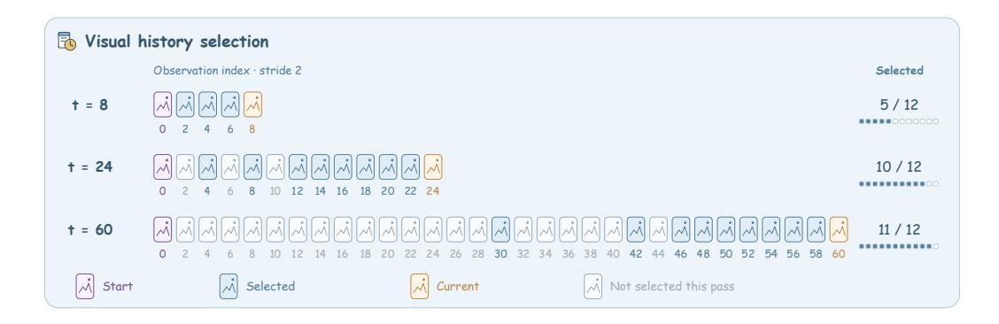

# SUPERNAV: ANY TASK, ANY SCENE를 위한 에이전트형 내비게이션 시스템 (SUPERNAV: AN AGENTIC NAVIGATION SYSTEM FOR ANY TASK IN ANY SCENE)

- 원제: SuperNav: An Agentic Navigation System for Any Task in Any Scene
- 원문: [https://arxiv.org/abs/2610.12126](https://arxiv.org/abs/2610.12126)
- PDF: [https://arxiv.org/pdf/2610.12126](https://arxiv.org/pdf/2610.12126)
- arXiv ID: `2610.12126`

---

# SUPERNAV: ANY TASK, ANY SCENE를 위한 에이전트형 내비게이션 시스템 (SUPERNAV: AN AGENTIC NAVIGATION SYSTEM FOR ANY TASK IN ANY SCENE)

Jinkai Zhang1 Jingyi Xu1 Yuanhong Yu1 Jiarui Guo1 Ruizhen Hu2 Hujun Bao1 Xiaowei Zhou1 Sida Peng1,3†

†Corresponding author

Figure 1: 스킬 기반 소파 탐색. 에이전트는 후보를 재검사하고, 막힌 문을 회피하며, 완료 여부를 확인한다.

# 초록 (ABSTRACT)

일반 목적의 서비스 로봇은 낯선 환경에서 다양한 인간 요청을 처리할 수 있는 내비게이션 시스템이 필요하며, 이는 작업 일반성(task generality)과 장면 일반성(scene generality)을 결합한다. 일부 기존 방법은 다중 모달 대형 언어 모델(MLLM)을 미세 조정하여 내비게이션 동작을 예측하도록 하여, 그 행동이 내비게이션 훈련 데이터의 범위에 의존하게 만들고 새로운 요청과 환경에 대한 일반화를 제한할 수 있다. 우리의 핵심 통찰은 MLLM이 요청 해석, 장면 이해, 의사결정에 집중하도록 하면서 그 일반 목적 기능을 보존하고 움직임 실행은 내비게이션 도구에 위임한다는 점이다. 이를 실현하기 위해 우리는 SuperNav를 도입하였다. SuperNav는 사전 훈련된 MLLM에 내비게이션 전용 미세 조정 없이 특화된 에이전트 하네스를 장착한다. 이 하네스는 Navigation Skills, 물리적 상호작용을 위한 에이전트 지향 도구, 작업 진행 및 문맥 관리를 통해 이러한 결정을 지원한다. 통합된 시각-포인트 인터페이스는 모델이 이미지를 통해 목적지를 직접 지정하고 실행 피드백으로부터 결정을 수정할 수 있게 하여 의사결정과 움직임을 연결한다. 이 구성 요소들은 서로 다른 작업 요구와 환경에서 지속적인 내비게이션을 지원한다. SuperNav는 인스턴스 수준, 다중 객체, 수요 기반 작업에서 평가된 네 개의 기준선보다 우수하며, HM3D에서의 범주 수준 평가와 실제 사족동 로봇에의 배포를 통해 환경 전반에 걸친 적용 가능성을 추가로 입증한다. 프로젝트 페이지: <https://zju3dv.github.io/SuperNav/>

1Zhejiang University 2Shenzhen University 3Causa Robotics

## 1 서론 (INTRODUCTION)

일반 목적의 서비스 로봇은 낯선 환경에서 다양한 인간 요청을 충족시킬 수 있는 내비게이션 기능이 필요하다. 이러한 요청은 특정 물체를 찾고 여러 목표를 방문하는 것부터 고수준의 필요를 충족하고 구현된 질문에 대한 증거를 수집하는 것까지 다양하다 [(Batra et al.,](#page-9-0) [2020;](#page-9-0) [Khanna et al., 2024;](#page-9-1) [Wang et al., 2023;](#page-10-0) [Zhu et al., 2025)](#page-11-0). 예를 들어, 지정된 물체를 찾으려면 의도된 목표를 식별해야 하고, "휴식할 곳을 찾는다"는 것은 필요를 해석하고 장면에서 어떤 물체가 이를 충족시킬 수 있는지 결정해야 한다. 이러한 차이는 로봇이 찾는 대상뿐 아니라 탐색 방식, 진행 상황 추적, 완료 판단 방식까지 바꾼다. 따라서 일반 내비게이션은 *작업 일반성*과 *장면 일반성*을 모두 요구한다.

작업 일반성은 모듈형 제로샷 내비게이션 시스템의 사전 정의된 워크플로우에 의해 제한된다. 이러한 방법은 일반적으로 사전 훈련된 시각-언어 모델을 사용하여 관측이 목표와 의미적으로 얼마나 관련 있는지를 평가하고, 이 평가를 목표 지향 탐색 점수에 통합한다 [(Yokoyama et al., 2024a;](#page-10-1) [Zhang et al., 2025)](#page-11-1). 이러한 점수는 새로운 관측에 맞춰 탐색을 조정하지만, 작업‑특정 논리는 여전히 모델이 언제 참여할지, 탐색이 목표 확인으로 어떻게 전환될지, 실행이 언제 끝날지를 결정한다…

엔드-투-엔드 네비게이션 방법은 단일 모델 내에서 다양한 작업을 지원하려 하지만, 작업과 장면 모두에 걸친 일반화는 네비게이션 훈련 데이터의 범위에 의해 제한된다. 이러한 접근법은 일반적으로 사전 훈련된 비전-언어 모델을 쌍으로 된 네비게이션 지시문과 궤적에 대해 미세 조정하여 시각 관찰과 언어로부터 행동을 예측한다 [(Zhang](#page-11-2) [et al., 2024b;](#page-11-2) [Zheng et al., 2024;](#page-11-3) [Zhang et al., 2024a)](#page-11-4). 결과적으로 생성된 모델은 관찰, 지시문, 네비게이션 행동 사이의 연관성을 인코딩한다; 전이 여부는 이러한 연관성이 새로운 시각적 외관, 공간 배치, 상호작용 조건에서도 유용한지에 달려 있다. 따라서 훈련 환경에서 네비게이션을 학습해도 그 환경을 넘어서는 신뢰할 수 있는 네비게이션을 확립하지 못하며, 우리의 교차 환경 평가에서는 평가된 방법들에 대해 상당한 작업 완수 격차가 드러난다 (Section [4.1)](#page-5-0)).

이러한 제약을 해결하기 위해 우리는 SuperNav를 도입한다. SuperNav는 사전 훈련된 다중모달 대형 언어 모델을 작업 및 장면 일반성을 위한 특수 에이전트 하네스로 장착하는 네비게이션 프레임워크이다 (Figure [1)](#page-0-0). 우리의 설계는 다양한 컴퓨터 사용 작업에서 일반 목적 에이전트의 성공에 영감을 받아 하네스가 지속적인 도구 사용과 컨텍스트 관리를 지원하는 것에서 동기를 얻었다 [(Lopopolo, 2026;](#page-9-2) [Young, 2025)](#page-11-5). 구체적으로, 우리는 MLLM의 기존 능력을 활용해 요청을 해석하고, 시각 관찰을 이해하며, 이후 행동에 대해 추론한다. 이러한 결정을 지속적인 물리적 상호작용으로 전환하기 위해, 우리의 하네스는 절차적 안내를 위한 선택적 *Navigation Skills*와 관찰, 움직임, 작업 관리를 위한 *agent-oriented Tools*를 제공한다. 또한 작업 진행 기록을 유지하고 상호작용 컨텍스트를 관리하여 모델이 연속적인 행동을 통해 추론을 계속할 수 있도록 한다. 이러한 책임 분담은 MLLM이 네비게이션 특화 미세 조정 없이 현재 요청과 장면에 맞게 네비게이션 기능을 적응하도록 한다.

이러한 결정을 물리적 움직임에 연결하려면 MLLM의 텍스트 출력을 관찰된 장면에 기반하도록 하는 인터페이스가 필요하다. 따라서 우리는 *unified visual-point interface*를 설계한다: MLLM이 관찰 이미지에서 직접 목적지를 지정하고, 네비게이션 도구가 움직임을 실행하며 다음 결정을 위한 피드백을 반환한다. 낮은 수준의 행동을 직접 예측하는 것[(Zhang et al., 2024b;](#page-11-2)[a)](#page-11-4)와 비교하면, 이 인터페이스는 모델이 목적지 선택에 집중하도록 하면서 동일한 상호작용 패턴을 통해 다양한 모션 백엔드를 지원한다. SuperNav는 단일 객체 및 수요 기반 작업 세트에서 이 두 행동 예측 기준보다 높은 성공률을 달성한다 (Table [1)](#page-5-1).

우리는 Habitat-GS에서 InteriorGS 장면을 사용해 단일 객체 및 순서가 지정된 다중 객체 네비게이션을 평가하기 위한 instance-navigation 벤치마크를 구축한다. 또한 Demand-Bench [(Anonymous, 2026)](#page-9-3)에서 수요 기반 네비게이션을 적응된 프로토콜 하에 평가하고, HM3Dv2와 HM3D-OVON에서 범주 수준 네비게이션을 평가하며, 실제 사족동 로봇 배치를 보완한다. SuperNav는 단일 객체 네비게이션에서 78.00%의 성공률, 수요 기반 네비게이션에서 59.50%의 성공률을 달성하며, 이는 각각 가장 강력한 기준인 UniNaVid와 OmniNav의 Action Former(34.00% 및 37.50%)보다 높다](#page-5-1). 범주 수준 네비게이션에서 SuperNav는 1 m 임계값에서 120-에피소드 HM3D-OVON val-unseen 하위 집합에서 73.33% 성공률(SR)과 경로 길이 가중 성공률(SPL) 0.4105를 달성한다. OVON‑특정 훈련이나 적응 없이. 더 엄격한 0.25 m 임계값에서는 68.33% SR과 0.3837 SPL을 달성한다 (Table [2)](#page-7-0). 이 결과는 작업 요구사항과 장면 설정 전반에 걸친 전체 시스템을 검토하며, 모션 백엔드 효과와 평가 프로토콜 차이를 Section [4.](#page-5-2)에서 분석한다.

우리의 기여는 세 가지이다:

- 우리는 SuperNav, 사전 학습된 MLLM이 도구 실행, 작업 진행 추적 및 컨텍스트 관리를 통해 서로 다른 요청에 걸쳐 탐색을 지시할 수 있도록 하는 특수 에이전트 하네스를 도입한다.
- 우리는 에이전트 지향 Tools를 설계한다. 이 Tools는 통합 시각-포인트 모션 인터페이스와 선택적 Navigation Skills를 갖추고, 모델 결정을 물리적 실행에 연결하며 검색, 검증 및 복구를 위한 재사용 가능한 지침을 제공한다.
- 우리는 카테고리 수준, 인스턴스 수준, 다중 객체, 수요 기반 탐색을 포함한 시스템을 평가하고, 실제 로봇 배포와 함께 작업 및 장면 설정 전반에 걸친 적용 가능성을 검토한다.

## 2 관련 작업 (RELATED WORK)

모듈형 탐색 파이프라인. 모듈형 시스템은 의미론적 추론을 전용 매핑, 탐색, 검증 구성요소에 통합한다. SemExp [(Chaplot et al., 2020)](#page-9-4), L3MVN [(Yu](#page-11-6) [et al., 2023)](#page-11-6), 그리고 VLFM [(Yokoyama et al., 2024a)](#page-10-1)은 학습된 탐색, 언어 사전, 또는 이미지–텍스트 관련성을 통해 객체 검색을 안내한다. VoroNav [(Wu et al., 2024)](#page-10-2)와 SG-Nav [(Yin et al., 2024)](#page-10-3)은 토폴로지 또는 장면-그래프 컨텍스트를 추가하고, ApexNav [(Zhang et al., 2025)](#page-11-1)은 적응형 탐색과 다중 프레임 대상 식별을 결합한다. 이러한 시스템은 모델에 작업 지향 파이프라인 내에서 특정 역할을 할당한다; SuperNav는 대신 MLLM이 런타임에 사용 가능한 기능을 선택하고 조정하도록 한다.

계층형 탐색 시스템. 계층형 시스템은 고수준 모델 추론을 전용 탐색 모듈과 결합한다. InstructNav [(Long et al., 2024)](#page-9-5)은 예측된 행동과 랜드마크를 값 맵을 통해 궤적으로 변환한다; OmniNav [(Xue et al., 2026)](#page-10-4)은 잠재적 탐색과 하위 목표 계획을 빠른 웨이포인트 정책과 결합한다; SysNav [(Zhu et al., 2026)](#page-11-7)은 방 수준 VLM 추론 하에서 방 내부 탐색과 움직임을 고전 알고리즘에 위임한다. 이러한 시스템은 이미 온라인 적응을 지원하며, 모델 추론과 학습된 또는 기하학적 실행 간의 협력을 보여준다. SuperNav는 모델이 작업 전반에 걸쳐 기능을 선택하고 결합하는 인터페이스와 런타임에 초점을 맞춘다.

에이전트 시스템 및 하네스. 에이전트 시스템은 호출 가능한 기능과 피드백을 통해 실행을 조직한다. Inner Monologue [(Huang et al., 2022)](#page-9-6)은 환경 피드백을 계획에 통합하고, Code as Policies [(Liang et al., 2023)](#page-9-7)은 로보틱스 API를 실행 가능한 정책으로 구성하며, SWE-agent [(Yang et al., 2024)](#page-10-5)은 행동 및 관찰 인터페이스가 소프트웨어-작업 성능에 미치는 영향을 연구한다. 구현된 하네스는 이 관점을 확장한다: Show-Harness [(Chen et al., 2026b)](#page-9-8)은 의미적 행동을 로봇 동작으로 변환하고, AgenticNav [(Li et al., 2026)](#page-9-9)은 픽셀-목표 모션과 깊이 질의 및 과거 이미지 검색을 결합하며, HarnessVLN [(Chen et al., 2026a)](#page-9-10)은 이벤트 메모리와 시공간 그래프를 유지하면서 행동 및 종료 제안을 검증한다. 동시 DemandAgent [(Anonymous, 2026)](#page-9-3)은 적응형 수요 원장, 공간 메모리 및 구현된 Skills를 통해 종속성 인식 인간 요구를 다루고 Demand-Bench를 도입한다. SuperNav는 교체 가능한 모션 백엔드를 갖춘 통합 시각-포인트 인터페이스를 통해 작업 및 장면 일반성을 연구하며, 컨텍스트 가지치기와 Navigation Skills를 지원한다. 작업 수준 행동 선택 및 의미적 완성 판단은 MLLM에 남아 있다.

## 3 네비게이션 에이전트 하네스 (NAVIGATION AGENT HARNESS)

개요. SuperNav는 사전 학습된 MLLM과 탐색 전용 하네스를 결합하여 다양한 요청에 걸쳐 의사결정과 행동을 지속하는 구현형 탐색 에이전트를 형성한다. 요청

Figure 2: 스킬과 에이전트 지향 도구를 이용한 탐색. (a) 에이전트 루프는 MLLM 추론, 스킬 로딩, 도구 호출을 위한 컨텍스트를 유지한다. (b) 탐색 스킬은 검색, 후보 재검증, 복구, 완료를 안내한다; 복구 예시는 에이전트가 막힌 구간을 지나면서 경로를 되짚는 것을 보여준다. (c) 에이전트 지향 도구는 관찰, 움직임, 목표 진행 추적, 작업 종료를 지원한다. 포인트 탐색은 기하학적 및 학습 기반 실행 백엔드에서 이미지 공간 목표 인터페이스를 공유한다.

목표, 순서가 지정된 목표 시퀀스, 또는 고수준 요구를 지정할 수 있다; 에이전트는 해당 요청을 해석하고 완료 조건이 충족되는지 판단할 때까지 행동해야 한다. MLLM은 이 해석과 의사결정을 수행하며, 하네스는 *에이전트 루프*를 통해 실행과 컨텍스트를 조직한다. 이 루프 내에서 *에이전트 지향 도구*는 관찰, 움직임, 작업 상태 관리를 위한 호출 가능한 연산이며, *탐색 스킬*은 MLLM이 검색, 검증, 복구를 위해 읽을 수 있는 지침이다. Figure [2,](#page-3-0)에서 보여지듯이, MLLM은 관측을 해석하고 도구 호출을 선택하며 반환된 피드백을 사용해 다시 판단하고, 관련이 있을 때 스킬을 참조한다. 우리는 먼저 루프가 이 기능들을 어떻게 조정하는지(Section [3.1)](#page-3-1)를 설명하고, 그 다음에 도구 인터페이스(Section [3.2)](#page-4-0)와 스킬 가이던스(Section [3.3)](#page-4-1)를 개발한다.

### 3.1 에이전트 루프 (AGENT LOOP)

연속적 의사결정. 에이전트 루프는 요청, 시각적 관측, 상호작용 기록을 연속적인 탐색 프로세스로 조직한다. 초기화는 세션을 열고 첫 번째 관측을 반환하며, MLLM은 이를 통해 요청된 목표와 완료 조건을 해석한다. 각 이후 단계에서 현재 컨텍스트와 작업 진행 상황을 사용해 관찰, 이동, 목표 상태 업데이트, 또는 관련 스킬 가이던스를 읽는 연산을 선택한다. 도구 반환과 검색된 지침은 다음 결정의 컨텍스트에 들어가 실행 피드백이 MLLM의 계획을 변경하도록 허용한다. 예를 들어, 후보에 접근한 후 MLLM은 새로운 이미지를 검사하고 후보가 요청을 충족하는지 판단하며, 완료를 기록하거나 검색을 계속한다.

작업 상태 및 컨텍스트 관리. 장기 실행은 이러한 지역적 결정이 이전 증거와 미완성 목표와 연결되어 있어야 한다. 목표 기록은 보류 중 및 완료된 항목을 유지하고, 텍스트 상호작용 기록은 검사된 영역, 후보 단서, 실패 시도를 이후 결정에 보존한다. 이미지 컨텍스트가 증가하는 것을 제어하기 위해, 하네스는 이미지의 미디어 페이로드가 처리되고 새로운 관측으로 대체되면 이후 요청에서 제거한다. 텍스트 기록, 작업 상태, 이미지 경로를 보존하며, 필요 시 MLLM은 작업 공간에서 이전 이미지를 요청할 수 있다. 이 미디어 전용 정리는 반복 이미지 전송을 제한하면서 이전 증거와 작업 진행에 대한 접근을 유지한다.

작업 종료. MLLM은 관측과 진행 기록에서 요청이 충족되었는지 또는 실행이 차단되었는지를 판단하고, 루프를 종료하기 위해 종료 도구를 선택한다. 종료 도구는 선언된 결과를 기록하고 세션을 종료한다; 성공적인 종료는 세션이 끝났음을 확인하지만 작업이 성공했음을 의미하지 않는다. 벤치마크 점수는 이 선언과 별도로 성공 여부를 평가한다. 따라서 루프는 관측을 노출하고 움직임을 실행하며 상태를 유지하는 연산에 의존하며, 그 인터페이스를 다음에서 설명한다; 런타임 제한 및 실행 한계는 부록 [A.](#page-11-8)에 나타난다.

### 3.2 에이전트 지향 탐색 도구 (AGENT-ORIENTED NAVIGATION TOOLS)

도구 모음 및 설계 원칙. 에이전트 지향 도구는 MLLM의 탐색 결정을 실행 가능한 환경 동작과 연결한다. 이 모음은 초기화, 관찰, 회전, 시각-포인트 탐색, 목표 진행 관리, 종료를 포함한다. 설계는 MLLM이 입력을 지정하기 쉽고 다음 결정을 위한 반환값이 유용하도록 하며, 목적지 표현을 모션 백엔드 간에 일관되게 유지한다. 중앙 관찰–모션 인터페이스는 시각적 목적지를 업데이트된 관찰 및 실행 피드백과 짝지어 이러한 원칙을 구현한다.

관찰 및 시각-포인트 탐색. 관찰은 캡처 시점에서 로봇의 헤딩에 상대적으로 *전면*, *우측*, *후면*, *좌측*으로 라벨링된 4개의 RGB 이미지를 반환한다. 이 라벨은 MLLM이 후보 또는 통로를 특정 뷰와 연결하고 목적지를 선택하도록 한다.

PointNav

$$(d, [u, v]), u, v \in [0, 1],$$

여기서 d는 뷰를 식별하고 u, v는 그 뷰의 왼쪽 상단 모서리에서 정규화된 가로 및 세로 좌표이다. 에이전트는 후보 또는 보이는 바닥에 점을 선택해 목표에 접근하거나 새로운 뷰를 얻을 수 있다. 도구는 내부적으로 움직임을 실행하고 새로운 4개 뷰 이미지, 실행 상태, 간결한 진단 정보를 반환한다. 회전 도구도 동일한 종류의 피드백을 제공한다. 이러한 반환값은 목적지 선택을 시각적 재검증과 연결하며, 매 움직임 후 별도의 관찰 호출이 필요하지 않다.

교환 가능한 모션 백엔드. 시각-포인트 인터페이스는 목적지 선택을 실행 메커니즘과 분리한다. 기하학적 백엔드인 *Geo-based Executor*는 깊이, 카메라 보정, 포즈를 사용해 선택된 점을 환경 위치와 연결한 뒤, 도달 가능한 목표까지 경로를 계획하고 따라간다. 시뮬레이션은 렌더링된 깊이, 카메라 포즈, 탐색 기하학을 제공하고, 로봇 배포는 감지된 기하학과 위치 추정을 사용한다 (Appendix [A.1)](#page-11-9)). 학습된 백엔드인 Learned Executor는 NoMaD의 목표 조건 생성 정책 설계 [(Sridhar et al., 2024)](#page-10-6)를 모방하여 목적지-이미지 목표를 참조 관찰에서 표시된 점으로 대체한다. 선택된 이미지–점 쌍과 최근 RGB 관찰로부터 지역 변위 증가량과 정지 신호를 예측한다. 선택된 뷰를 향해 회전하고 한 번의 도구 호출 내에서 짧은 예측된 움직임 세그먼트를 반복 실행한다. 두 백엔드는 시각적 목적지를 수락하고 실행 피드백이 포함된 관찰을 반환하므로, 에이전트는 동일한 의사결정 워크플로우를 유지할 수 있다; 학습-컨트롤러 아키텍처와 훈련 세부사항은 Appendix [C.](#page-16-0)로 연기된다.

진행 및 종료. 진행 및 종료 도구는 이 워크플로우를 개별 움직임에서 완전한 요청으로 확장한다. 진행 도구는 MLLM이 *pending*/*found* 목표를 조회하거나 업데이트하고 남은 항목을 계속하도록 한다; 종료 도구는 *achieved*/*blocked* 판단을 기록하고 세션을 종료한다. 이 기록은 MLLM의 보고를 나타내며 독립적인 의미 검증이 아니다. 더 이상 탐색할지, 후보를 재검증할지, 실패한 움직임을 복구할지를 결정하는 것은 MLLM의 책임이며, Skills는 재사용 가능한 지침을 제공한다.

### 3.3 탐색 기술 (NAVIGATION SKILLS)

기술 조직 및 발견. 탐색 기술은 재사용 가능한 탐색 경험을 절차적 안내로 구성하여 MLLM이 필요할 때 읽을 수 있도록 한다. 각 기술은 적용 가능한 상황, 검사할 증거, 권장 단계, 연결된 참조를 설명하는 Markdown 패키지이다.

표 1: 단일 객체, 다중 객체 및 수요 기반 탐색 결과. SR(%) 및 SPL(0–1): 개별 작업은 시점 지오데식 거리 < 1 m를 사용하고, 수요 기반 작업은 2 m 바운딩 박스 영역을 사용한다. 작업 수는 괄호 안에 표시되며, 굵은 글씨는 열별 최고값을 표시한다.

|  |  | 우리의 인스턴스 탐색 벤치마크 |  | 수요 기반 벤치마크 |  |  |
|-------------------------------|---------------------|-----------------------------------|--------------------|-------------------------|---------------------|--------|
|  | 단일 목표 (150) |  | 다중 목표 (150) |  | 수요 기반 (200) |  |
| 방법 | SR↑ | SPL↑ | SR↑ | SPL↑ | SR↑ | SPL↑ |
| NaVid | 24.67 | 0.1599 | 2.67 | 0.0216 | 17.00 | 0.0920 |
| UniNaVid | 34.00 | 0.1833 | 1.33 | 0.0131 | 25.00 | 0.0943 |
| StreamVLN | 13.33 | 0.1036 | 0.00 | 0.0000 | 25.50 | 0.0775 |
| OmniNav (액션 포머) | 27.33 | 0.2133 | 4.00 | 0.0275 | 37.50 | 0.1213 |
| SuperNav + 지오 기반 실행기 | 78.00 | 0.4127 | 34.00 | 0.1388 | 59.50 | 0.1801 |
| SuperNav + 학습된 실행기 | 68.00 | 0.2059 | 34.00 | 0.0862 | 45.00 | 0.1603 |

우리는 본 번들을 주요 탐색 Skill, 백엔드별 Tool 사용 지침, 탐색, 복구, 입구 검색을 위한 참조를 포함하며, 이는 탐색, 복구, 완성을 모두 포괄한다. 하네스는 Skill 이름과 설명을 노출하여 MLLM이 관련 패키지를 발견하고 그 지침이나 연결된 참조를 의사결정 컨텍스트에 로드할 수 있도록 한다.

탐색 가이드는 세 가지 반복되는 결정을 다룬다: 어디에서 탐색할 것인가, 어떻게 복구할 것인가, 언제 종료할 것인가. 탐색 가이드는 MLLM에게 검사한 영역, 보이는 개구부, 불확실한 분기점을 기록하도록 요구하며, 이후 탐색을 위해 대안을 보존한다. 재방문은 저장된 복귀 경로 대신 시각적 인식을 기반으로 한다. 복구 가이드는 움직임 실패 후 지점이나 경로를 변경하고, 후보를 검사하기 어려울 때 뒤로 물러나거나 유리로 접근이 차단될 때 입구를 찾도록 권장한다. 완성 가이드는 후보의 외관, 요청된 관계, 주변 맥락을 확인한 뒤 검증된 목표를 기록하고 남은 요청을 계속 진행하도록 요구한다. 예를 들어, 통로가 막힌 경우 MLLM은 복구 가이드를 읽고 다른 경로를 선택한 뒤 반환된 이미지에서 후보를 재평가하도록 유도할 수 있다.

에이전트 루프와의 통합. 루프는 결정을 지속하고, Tools는 실행 능력을 제공하며, Skills는 그 사용을 안내한다. Skills는 컨텍스트에 진입함으로써 결정을 영향하지만, 환경 능력을 추가하거나 프로그래밍 방식으로 행동 시퀀스나 의미적 판단을 강제하지 않는다. MLLM은 여전히 현재 요청과 피드백에서 각 작업을 선택하며, 공유 루프, 인터페이스, 가이드를 활용해 다양한 탐색 과제를 처리한다.

## 4 실험 (EXPERIMENTS)

우리는 GPT-5.6 Terra와 Geo 기반 Executor 또는 Learned Executor를 사용해 네 가지 설정에서 SuperNav를 평가하며, SR(%)와 SPL(0–1)을 보고한다. Habitat-GS와 AI2-THOR에서는 NaVid [(Zhang et al., 2024b)](#page-11-2), UniNaVid [(Zhang et al., 2024a)](#page-11-4), StreamVLN [(Wei et al., 2025)](#page-10-7), 그리고 OmniNav의 Action Former [(Xue et al., 2026)](#page-10-4)와 비교한다. 각 기준선의 네이티브 입력과 히스토리 메커니즘을 그대로 유지한다. 자세한 프로토콜은 부록 [B.](#page-13-0)에 있다.

### 4.1 인스턴스 탐색 (INSTANCE NAVIGATION IN HABITAT-GS)

우리 InteriorGS 기반 벤치마크는 150개의 단일 객체 작업과 2~5개의 타깃을 가진 150개의 순서가 지정된 다중 객체 작업을 포함한다. 도착은 승인된 타깃 관점까지 navmesh 측지 거리 1m 이하를 요구한다. 단일 객체 성공은 최종 위치를 테스트하고, 다중 객체 성공은 경로를 따라 순서대로 도착을 테스트하며, 두 경우 모두 명시적 STOP이 필요하다 (부록 [B.1–](#page-13-1)[B.3)](#page-14-0)).

결과. SuperNav는 이후 목표를 통해 그 이점을 유지한다 (Table [1;](#page-5-1) 부록 [B.3)](#page-14-0), Figure [3.](#page-6-0)에 예시된 바와 같이). 두 백엔드는 동일한 다중 객체 성공률을 달성하지만, Geo 기반 Executor는 더 효율적인 경로를 제공한다.

Figure 3: 시뮬레이션에서 순서대로 다중 객체 탐색. 에이전트는 세탁기, 화분, 마작 테이블을 순서대로 방문한다.

Figure 4: 수요 기반 탐색. 작업 공간을 준비하기 위해, 에이전트는 테이블을 찾고, 비우려는 꽃병을 식별하며, 적절한 선반을 찾는다.

### 4.2 수요 기반 탐색 (DEMAND-DRIVEN NAVIGATION)

우리는 Demand-Bench [(Anonymous, 2026)](#page-9-3)에서 200개의 AI2-THOR [(Kolve et al., 2017)](#page-9-11) 작업을 사용하며, 평가를 1~8개의 순서가 지정된 단계에 맞게 조정한다 (부록 [B.2)](#page-13-2). 성공은 각 단계의 허용 2m 경계 상자 영역을 순서대로 진입하고, 객체 재사용 없이 명시적으로 정지해야 한다.

결과. 두 백엔드 모두 SR과 SPL에서 기준선보다 향상되며](#page-5-1), 명시적 목표에서 추론된 목표로 프레임워크를 확장한다. Geo-based Executor가 가장 크게 진전하지만, 긴 시퀀스는 여전히 도전적이다 (Appendix [B.3)](#page-14-0)).

Figure [4](#page-6-1)은 연속된 추론된 목표를 향한 탐색을 보여준다.

### 4.3 HM3D 벤치마크 (HM3D BENCHMARKS)

우리는 공유 120-에피소드 HM3D-OVON 검증-미보인(subset)과 1,000 HM3Dv2 검증 에피소드 [(Ramakrishnan et al., 2021;](#page-10-8) [Yokoyama et al., 2024b)](#page-10-9)에서 범주 수준 탐색을 평가한다. Tables [2](#page-7-0)과 [3](#page-7-1]은 에이전트의 최종 위치에서 가장 가까운 목표 관점까지의 가장 짧은 탐색 가능한 경로 거리 기준으로 결과를 그룹화한다. MTU3D [(Zhu et al., 2025)](#page-11-0), AstraNav-Memory [(Ren et al.,](#page-10-10) [2025)](#page-10-10), 그리고 OmniNav의 느린 시스템의 A-star 분기 [(Xue et al., 2026)](#page-10-4)는 우리 Geo-based Executor와 동일한 기본 탐색 메쉬 경로 질의 및 추종 메커니즘을 사용한다. 따라서 우리는 주요 OVON 비교를 위해 Geo-based Executor를 사용한다; 이러한 실행 메커니즘의 세부 사항

Table 2: HM3D에서의 범주 수준 탐색. SR(%) 및 SPL(0–1)은 표시된 임계값에서 측정된다. 외부 항목은 공개된 결과이며; L3MVN, VLFM, 그리고 SG-Nav는 ApexNav의 HM3Dv2 재평가를 사용한다. 각 열에서 가장 높은 값은 굵게 표시된다.

|  | HM3D-OVON val-unseen |  |  |  | HM3Dv2 |  |  |  |
|-----------------------------------------|----------------------|--------------|-----|-----------------------------------------------------|--------|----------------|-----|----------------|
|  | 0.25 m |  |  | 1 m |  | 0.2 m | 1 m |  |
| 방법 | SR↑ | SPL↑ | SR↑ | SPL↑ | SR↑ | SPL↑ | SR↑ | SPL↑ |
| MTU3D (Zhu et al., 2025) |  | 40.80 0.1210 | — | — | — | — | — | — |
| SoftNav (Wu et al., 2026) |  | 66.70 0.2570 | — | — | — | — | — | — |
| AstraNav-Memory (Ren et al., 2025) | — |  |  | — 62.50 0.3490 | — | — | — | — |
| OmniNav (slow + CoT) (Xue et al., 2026) | — |  |  | — 59.20 0.3320 | — | — | — | — |
| L3MVN (Yu et al., 2023) | — | — | — |  |  | — 36.30 0.1570 | — | — |
| VLFM (Yokoyama et al., 2024a) | — | — | — |  |  | — 63.60 0.3250 | — | — |
| SG-Nav (Yin et al., 2024) | — | — | — |  |  | — 49.60 0.2550 | — | — |
| ApexNav (Zhang et al., 2025) | — | — | — |  |  | — 76.20 0.3800 | — | — |
| WMNav (Nie et al., 2025) | — | — | — | — | — |  |  | — 72.20 0.3330 |
| MSGNav (Huang et al., 2026) | — | — | — | — | — |  |  | — 74.10 0.3340 |
| SuperNav + Geo-based Executor |  |  |  | 68.33 0.3837 73.33 0.4105 80.30 0.3338 86.50 0.3638 |  |  |  |  |
| SuperNav + Learned Executor |  |  |  | 65.00 0.1355 70.83 0.1443 79.00 0.1288 85.40 0.1383 |  |  |  |  |

표 3: Geo 기반 실행기와 함께하는 OVON ablation. 0.25 m 및 1 m 임계값은 에이전트의 최종 위치에서 가장 가까운 목표 뷰포인트까지의 최단 탐색 가능 경로 거리에 적용된다. 각 변형은 명시되지 않는 한 120개의 에피소드와 GPT‑5.6 Terra (high)를 사용한다. SR(%) 및 SPL(0–1); 굵은 글씨는 최상의 값을 표시한다.

|  |  | 0.25 m |  | 1 m |  |
|--------------------------------|-------|--------|-------|--------|--|
| 변형(Variant) | SR↑ | SPL↑ | SR↑ | SPL↑ |  |
| Navigation Skills 없이 | 35.00 | 0.2460 | 54.17 | 0.3894 |  |
| Agent-oriented Tool Design 없이 | 52.50 | 0.2230 | 65.83 | 0.2855 |  |
| Skills and Tool Design 없이 | 31.67 | 0.1870 | 54.17 | 0.3417 |  |
| Grounding Motion Tool | 55.83 | 0.3201 | 62.50 | 0.3624 |  |
| SuperNav (GPT-6 Astra medium) | 71.67 | 0.4579 | 79.17 | 0.4974 |  |
| SuperNav (GPT-5.6 Terra high) | 68.33 | 0.3837 | 73.33 | 0.4105 |  |

Appendix [B.5.](#page-15-0)에 나타납니다. 우리의 스코어링 규칙과 공개된 비교 뒤에 있는 프로토콜은 Appendix [B.5](#page-15-0)[–B.6.](#page-15-1)에 자세히 설명되어 있습니다.

결과. Learned Executor는 Geo-based Executor의 성공을 많이 유지하지만 경로 효율성은 떨어집니다](#page-7-0). Geo-based Executor는 나열된 공개 방법들과 경쟁력이 있지만, 그들의 평가 서브셋과 프로토콜은 우리와 다릅니다.

### 4.4 하니스 및 모델 소거 (HARNESS AND MODEL ABLATIONS)

Geo-based Executor가 고정된 상태에서 우리는 네비게이션 스킬(Navigation Skills)를 제거하고, 에이전트 지향 도구(Tools)를 전면 상호작용(front-only interaction)으로 교체하거나, 언어 기반 정착(language grounding)과 후보 선택(candidate selection)을 직접 포인팅(direct pointing)으로 대체합니다 [(Grounding Motion Tool,](#page-16-1) Appendix [B.6)](#page-15-1). 결정 모델 구성 변형(decision-model configuration variant)은 GPT-6 Astra (medium)를 GPT-5.6 Terra (high) 대신 사용하며, 전체 하니스(full harness)를 보존합니다.

결과. 네비게이션 스킬을 제거하면 SR이 전면 뷰로 인터페이스를 제한하는 것보다 더 크게 감소하며, 특히 더 엄격한 임계값에서 그렇습니다 (Table [3)](#page-7-1). 도구 설계는 이 가이드를 보완합니다: 스킬이 유지되는 경우, 전면 상호작용은 SR과 SPL을 감소시키면서 상당히 더 많은 명시적 턴을 요구합니다 (Table [6)](#page-16-2). 외부 정착(external grounding)은 에이전트의 직접 포인팅(direct point selection)을 개선하지 않으며, Terra (high)를 Astra (medium)으로 교체하면 하니스가 고정된 상태에서 SR과 SPL 모두가 향상됩니다. 이는 다른 결정 모델 구성(decision-model configuration)과의 호환성을 보여줍니다.

그림 5: 실세계 탐색 on Unitree Go2. 로봇은 (a) 농구공과 (b) 다른 Go2를 찾고, (c) 프린터를 방문한 뒤 쓰레기통을 방문한다.

### 4.5 실세계 탐색 (REAL-WORLD NAVIGATION)

Unitree Go2에서 4-뷰 RGB와 LiDAR 기반 기하학적 실행을 사용하여, SuperNav는 차단된 통로에서 경로를 수정하고, 목표를 검증하며, 목표 간 전환을 수행합니다 (Figure [5;](#page-8-0) Appendix [A.1)](#page-11-9).

## 5 결론 (CONCLUSION)

우리는 SuperNav를 제시했습니다. SuperNav는 사전 학습된 MLLM이 요청을 해석하고, 장면을 이해하며, 결정을 내리면서, 움직임 실행을 도구에 위임하도록 하는 하니스입니다. 네비게이션 스킬, 작업 진행 추적(task-progress tracking), 그리고 컨텍스트 관리(context management)는 지속적인 상호작용을 지원하며, 통합된 시각-포인트 인터페이스(visual-point interface)는 결정을 물리적 움직임에 연결합니다. 범주 수준(category-level), 인스턴스 수준(instance-level), 다중 객체(multi-object), 그리고 수요 기반 탐색(demand-driven navigation)을 포함한 실험은 이 프레임워크가 작업 및 장면 설정 전반에 걸쳐 적용 가능함을 보여줍니다. 이 결과는 일반 목적 MLLM의 기존 이해와 추론을 기반으로 탐색 기능을 구축하는 것을 지원합니다.

제한점. SuperNav는 기초 MLLM의 의미 판단에 의존하므로 그 능력에 의해 제한됩니다. 기하학적 실행은 사용 가능한 지도나 장면 기하학에 의존하며, MLLM 추론은 계산 비용과 상당한 지연 변동성을 초래해 작업 기간을 예측하기 어렵게 만듭니다. 우리의 수요 기반 평가(demand-driven evaluation)는 기본 활동의 완료가 아니라 관련 목표에 대한 순서대로 탐색을 측정합니다. 더 많은 실제 환경 설정으로 평가를 확장하고, 장기 탐색 시퀀스에서 신뢰성을 향상시키는 것은 향후 연구 방향입니다.

## AI 사용 선언 (AI USE STATEMENT)

저자 개발 아이디어를 기반으로 원고 문장을 초안하고 다듬는 데 Codex와 GPT-6를 사용하였다. AI 도구는 또한 일부 비교 논문을 식별하는 데 도움을 주었다. Codex는 내비게이션 도구와 평가 코드를 구현하고, 실험을 실행 및 디버깅하는 데 도움을 주었다. 저자는 연구 아이디어, Skill 및 Tool 설계 원칙, 인터페이스 사양을 개발하고 AI 지원 코드를 테스트하였다. 우리 instance-navigation 벤치마크에서는 생성형 AI가 장면 기반 객체 주석 및 평가 지침을 생성하는 데 도움을 주었으며, 이는 사용 전에 저자가 수동으로 검토하였다. 이미지와 궤적은 시뮬레이터에 의해 생성되었다. 저자는 본 작업의 최종 내용에 대해 책임을 진다.

# 참고문헌 (REFERENCES)

- Anonymous. Demandagent: Towards an embodied agent harness for everyday human demands. In *제출됨 The Fifteenth International Conference on Learning Representations*, 2026. URL <https://openreview.net/forum?id=jWsuiC01Wm>. 심사 중.
- Dhruv Batra, Aaron Gokaslan, Aniruddha Kembhavi, Oleksandr Maksymets, Roozbeh Mottaghi, Manolis Savva, Alexander Toshev, and Erik Wijmans. Objectnav revisited: On evaluation of embodied agents navigating to objects. *arXiv preprint arXiv:2006.13171*, 2020.
- Devendra Singh Chaplot, Dhiraj Prakashchand Gandhi, Abhinav Gupta, and Russ R Salakhutdinov. Object goal navigation using goal-oriented semantic exploration. *Advances in neural information processing systems*, 33:4247–4258, 2020.
- Yang Chen, Lirong Che, Zhenyu Huang, Wenbo Fu, Chuang Wang, Xu Cao, Daqi Liu, Yuzhe Yang, Jian Su, and Lan-Zhe Guo. Harnessvln: Unifying training-free embodied navigation through an agent harness. *arXiv preprint arXiv:2609.15195*, 2026a.
- Yanzhe Chen, Zechen Bai, Zhijun Cao, Wenzheng Zeng, Kevin Qinghong Lin, Yiqi Lin, Guoqiang Liang, Kevin Yuchen Ma, Qiming Huang, and Mike Zheng Shou. Show-harness: Just a vlm agent can play robots. *arXiv preprint arXiv:2609.10522*, 2026b.
- Wenlong Huang, Fei Xia, Ted Xiao, Harris Chan, Jacky Liang, Pete Florence, Andy Zeng, Jonathan Tompson, Igor Mordatch, Yevgen Chebotar, Pierre Sermanet, Noah Brown, Tomas Jackson, Linda Luu, Sergey Levine, Karol Hausman, and Brian Ichter. Inner monologue: Embodied reasoning through planning with language models. *arXiv preprint arXiv:2207.05608*, 2022.
- Xun Huang, Shijia Zhao, Yunxiang Wang, Xin Lu, Wanfa Zhang, Rongsheng Qu, Weixin Li, Yunhong Wang, and Chenglu Wen. Msgnav: Unleashing the power of multi-modal 3d scene graph for zero-shot embodied navigation. In *Proceedings of the IEEE/CVF Conference on Computer Vision and Pattern Recognition*, pp. 37154–37163, 2026.
- Mukul Khanna, Ram Ramrakhya, Gunjan Chhablani, Sriram Yenamandra, Theophile Gervet, Matthew Chang, Zsolt Kira, Devendra Singh Chaplot, Dhruv Batra, and Roozbeh Mottaghi. Goatbench: A benchmark for multi-modal lifelong navigation. In *2024 IEEE/CVF Conference on Computer Vision and Pattern Recognition (CVPR)*, pp. 16373–16383. IEEE, 2024.
- Eric Kolve, Roozbeh Mottaghi, Winson Han, Eli VanderBilt, Luca Weihs, Alvaro Herrasti, Matt Deitke, Kiana Ehsani, Daniel Gordon, Yuke Zhu, Aniruddha Kembhavi, Abhinav Gupta, and Ali Farhadi. Ai2-thor: An interactive 3d environment for visual ai. *arXiv preprint arXiv:1712.05474*, 2017.
- Yijian Li, Changze Li, Han Zheng, Jiyuan Cai, Tong Qin, and Ming Yang. AgenticNav: Zero-shot vision-and-language navigation as a tool-calling harness. *arXiv preprint arXiv:2606.10577v3*, 2026. URL <https://arxiv.org/abs/2606.10577v3>.
- Jacky Liang, Wenlong Huang, Fei Xia, Peng Xu, Karol Hausman, Brian Ichter, Pete Florence, and Andy Zeng. Code as policies: Language model programs for embodied control. In *2023 IEEE International conference on robotics and automation (ICRA)*, pp. 9493–9500. IEEE, 2023.
- Yaron Lipman, Ricky TQ Chen, Heli Ben-Hamu, Maximilian Nickel, and Matt Le. Flow matching for generative modeling. *arXiv preprint arXiv:2210.02747*, 2022.
- Yuxing Long, Wenzhe Cai, Hongcheng Wang, Guanqi Zhan, and Hao Dong. Instructnav: Zeroshot system for generic instruction navigation in unexplored environment. *arXiv preprint arXiv:2406.04882*, 2024.
- Ryan Lopopolo. Harness engineering: leveraging Codex in an agent-first world. OpenAI Engineering Blog, February 2026. URL [https://openai.com/index/harness-engineeri](https://openai.com/index/harness-engineering/) [ng/](https://openai.com/index/harness-engineering/).
- Dujun Nie, Xianda Guo, Yiqun Duan, Ruijun Zhang, and Long Chen. Wmnav: Integrating visionlanguage models into world models for object goal navigation. In *2025 IEEE/RSJ International Conference on Intelligent Robots and Systems (IROS)*, pp. 2392–2399. IEEE, 2025.

- Maxime Oquab, Timothee Darcet, Th ´ eo Moutakanni, Huy Vo, Marc Szafraniec, Vasil Khalidov, ´ Pierre Fernandez, Daniel Haziza, Francisco Massa, Alaaeldin El-Nouby, Mahmoud Assran, Nicolas Ballas, Wojciech Galuba, Russell Howes, Po-Yao Huang, Shang-Wen Li, Ishan Misra, Michael Rabbat, Vasu Sharma, Gabriel Synnaeve, Hu Xu, Herve Jegou, Julien Mairal, Patrick Labatut, Ar- ´ mand Joulin, and Piotr Bojanowski. Dinov2: 감독 없이 견고한 시각적 특징을 학습하기. *arXiv preprint arXiv:2304.07193*, 2023.

- Santhosh K Ramakrishnan, Aaron Gokaslan, Erik Wijmans, Oleksandr Maksymets, Alex Clegg, John Turner, Eric Undersander, Wojciech Galuba, Andrew Westbury, Angel X Chang, Manolis Savva, Yili Zhao, and Dhruv Batra. Habitat-matterport 3d 데이터셋 (hm3d): 구현형 AI를 위한 1000개의 대규모 3D 환경. *arXiv preprint arXiv:2109.08238*, 2021.

- Botao Ren, Junjun Hu, Xinda Xue, Minghua Luo, Jintao Chen, Haochen Bai, Liangliang You, and Mu Xu. Astranav-memory: 장기 기억을 위한 컨텍스트 압축. *arXiv preprint arXiv:2512.21627*, 2025.

- Ajay Sridhar, Dhruv Shah, Catherine Glossop, and Sergey Levine. Nomad: 탐색 및 탐험을 위한 목표 마스킹 확산 정책. In *2024 IEEE 국제 로봇 및 자동화 학회 (ICRA)*, pp. 63–70. IEEE, 2024.

- Hongcheng Wang, Andy Guan Hong Chen, Xiaoqi Li, Mingdong Wu, and Hao Dong. Find what you want: 수요-조건화된 객체 속성 공간을 학습하여 수요 기반 탐색. *Advances in Neural Information Processing Systems*, 36:16353–16366, 2023.

- Shihao Wang, Shilong Liu, Yuanguo Kuang, Xinyu Wei, Yangzhou Liu, Zhiqi Li, Yunze Man, Guo Chen, Andrew Tao, Guilin Liu, Jan Kautz, Lei Zhang, and Zhiding Yu. Locateanything: 병렬 박스 디코딩을 통한 빠르고 고품질의 시각-언어 정합. In *2026 유럽 컴퓨터 비전 학회*, pp. 336–357. Springer, 2026.

- Meng Wei, Chenyang Wan, Xiqian Yu, Tai Wang, Yuqiang Yang, Xiaohan Mao, Chenming Zhu, Wenzhe Cai, Hanqing Wang, Yilun Chen, Xihui Liu, and Jiangmiao Pang. Streamvln: 슬로우패스트 컨텍스트 모델링을 통한 스트리밍 비전-언어 탐색. *arXiv preprint arXiv:2507.05240*, 2025.

- Pengying Wu, Yao Mu, Bingxian Wu, Yi Hou, Ji Ma, Shanghang Zhang, and Chang Liu. Voronav: 대형 언어 모델을 활용한 보로노이 기반 제로샷 객체 탐색. *arXiv preprint arXiv:2401.02695*, 2024.

- Yi Wu, Junjie An, Xiao Liu, Yiqun Zhou, Yuechen Wu, Xiaoqing Guan, Shuyang Yu, You Wang, and Guang Li. Softnav: 구현형 탐색을 위한 3D 장면 토큰을 VLMS에 주입. *arXiv preprint arXiv:2607.14586*, 2026.

- Xinda Xue, Junjun Hu, Minghua Luo, Shichao Xie, Jintao Chen, Zixun Xie, Kuichen Quan, Wei Guo, Mu Xu, and Zedong Chu. OmniNav: 전향적 탐사 및 시각-언어 탐색을 위한 통합 프레임워크, 2026. URL <https://arxiv.org/abs/2509.25687>.

- John Yang, Carlos Jimenez, Alexander Wettig, Kilian Lieret, Shunyu Yao, Karthik Narasimhan, and Ofir Press. Swe-agent: 에이전트-컴퓨터 인터페이스를 통한 자동화 소프트웨어 엔지니어링. *Advances in Neural Information Processing Systems*, 37:50528–50652, 2024.

- Hang Yin, Xiuwei Xu, Zhenyu Wu, Jie Zhou, and Jiwen Lu. Sg-nav: LLM 기반 제로샷 객체 탐색을 위한 온라인 3D 장면 그래프 프롬프트. *Advances in neural information processing systems*, 37:5285–5307, 2024.

- Naoki Yokoyama, Sehoon Ha, Dhruv Batra, Jiuguang Wang, and Bernadette Bucher. Vlfm: 제로샷 의미 탐색을 위한 시각-언어 프런티어 맵. In *2024 IEEE 국제 로봇 및 자동화 학회*, pp. 42–48. IEEE, 2024a.

- Naoki Yokoyama, Ram Ramrakhya, Abhishek Das, Dhruv Batra, and Sehoon Ha. Hm3d-ovon: 오픈-어휘 객체 목표 탐색을 위한 데이터셋 및 벤치마크. In *2024 IEEE/RSJ 국제 지능형 로봇 및 시스템 학회 (IROS)*, pp. 5543–5550. IEEE, 2024b.

- Justin Young. 장기 실행 에이전트를 위한 효과적인 하네스. Anthropic Engineering Blog, 2025년 11월. URL [https://www.anthropic.com/engineering/effective-harness](https://www.anthropic.com/engineering/effective-harnesses-for-long-running-agents) [es-for-long-running-agents](https://www.anthropic.com/engineering/effective-harnesses-for-long-running-agents).

- Bangguo Yu, Hamidreza Kasaei, and Ming Cao. L3mvn: 대형 언어 모델을 활용한 시각적 목표 탐색. 본 논문은 *2023 IEEE/RSJ International Conference on Intelligent Robots and Systems (IROS)*에서 발표되었으며, pp. 3554–3560. IEEE, 2023.

- Jiazhao Zhang, Kunyu Wang, Shaoan Wang, Minghan Li, Haoran Liu, Songlin Wei, Zhongyuan Wang, Zhizheng Zhang, and He Wang. Uni-navid: 비디오 기반 비전-언어-액션 모델로 신체화된 탐색 과제를 통합. *arXiv preprint arXiv:2412.06224*, 2024a.

- Jiazhao Zhang, Kunyu Wang, Rongtao Xu, Gengze Zhou, Yicong Hong, Xiaomeng Fang, Qi Wu, Zhizheng Zhang, and He Wang. Navid: 비디오 기반 VLM이 비전-언어 탐색을 위한 다음 단계 계획. *arXiv preprint arXiv:2402.15852*, 2024b.

- Mingjie Zhang, Yuheng Du, Chengkai Wu, Jinni Zhou, Zhenchao Qi, Jun Ma, and Boyu Zhou. Apexnav: 목표 중심 의미 융합을 통한 제로샷 객체 탐색을 위한 적응형 탐색 전략. *IEEE Robotics and Automation Letters*, 10(11):11530–11537, 2025. doi: 10.1 109/LRA.2025.3606388.

- Duo Zheng, Shijia Huang, Lin Zhao, Yiwu Zhong, and Liwei Wang. 신체화된 탐색을 위한 범용 모델 학습을 향해. 본 논문은 *2024 IEEE/CVF Conference on Computer Vision and Pattern Recognition (CVPR)*에서 발표되었으며, pp. 13624–13634. IEEE, 2024.

- Haokun Zhu, Zongtai Li, Zihan Liu, Kevin Guo, Zhengzhi Lin, Yuxin Cai, Guofei Chen, Chen Lv, Wenshan Wang, Jean Oh, and Ji Zhang. Sysnav: 다중 수준 체계적 협력이 실제 세계, 교차 신체화 객체 탐색을 가능하게 한다. *IEEE Robotics and Automation Letters*, 11(9): 10577–10584, 2026. doi: 10.1109/LRA.2026.3713730.

- Ziyu Zhu, Xilin Wang, Yixuan Li, Zhuofan Zhang, Xiaojian Ma, Yixin Chen, Baoxiong Jia, Wei Liang, Qian Yu, Zhidong Deng, Siyuan Huang, and Qing Li. 3D 장면을 이해하기 위한 움직임: 효율적이고 다재다능한 신체화된 탐색을 위한 시각적 기반화와 탐험의 연결. 본 논문은 *2025 IEEE/CVF International Conference on Computer Vision (ICCV)*에서 발표되었으며, pp. 8120–8132. IEEE, 2025.

# 방법 구현 세부 사항 (A METHOD IMPLEMENTATION DETAILS)

## A.1 실험 설정 (EXPERIMENTAL SETUP)

Unitree Go2. 지오메트릭 백엔드는 네 방향 RGB 카메라와 로봇이 제공한 LiDAR 데이터 및 오도메트리를 결합한다. 카메라 내부 파라미터, 장착 외부 파라미터, 그리고 선택된 관측과 연관된 로봇 포즈는 이미지 공간 목표를 LiDAR 맵에 연결한다. 백엔드는 선택된 픽셀의 이웃을 매핑된 3D 포인트와 연결하여 전경 표면과 접근 위치를 선택한다. 볼록 그리드 매퍼는 LiDAR 관측을 높이 기반 2D 이동 비용 맵에 축적한다; 볼록 크기와 그리드 해상도는 모두 0.05 m로 기본 설정된다. ReplanningAStarPlanner는 경로를 계산하고, 앞서 보기를 기반으로 한 추종자는 비례 헤딩 제어를 사용해 10 Hz에서 선형 및 각속도 명령을 생성한다. 위치 추정은 로봇이 보고한 오도메트리를 사용하며, 소프트웨어에 추가적인 루프 클로징 SLAM 시스템이 없다.

시뮬레이션 및 지리 기반 실행기. Habitat-Sim은 640 × 480 해상도의 RGB-D 이미지를 제공하며, 90◦ 수평 시야각과 1.25 m의 카메라 높이, 그리고 알려진 내부 파라미터와 시뮬레이터 카메라 포즈를 함께 제공한다. 지리 기반 실행기는 렌더링된 깊이를 사용해 이미지 공간 앵커를 역투영하고, 장면의 사전 계산된 네비게이션 메시에 있는 인접 후보 목적지를 확인한다. Recast/Detour 기반 PathFinder는 경로 쿼리를 제공하고; GreedyGeodesicFollower는 이산적인 전진 및 회전 동작을 실행한다. 기본값은 0.7 m의 거리 유지, 0.75 m의 후보 스냅 거리 제한, 0.3 m의 추종자 목표 반경, 그리고 200 단계의 추종자 단계이다. 이러한 지역 실행 한계는 벤치마크 성공 임계값과 별개이다.

| 변형 | 입력 스킬(Entry Skill) | 도구 사용 스킬(Tool-usage Skill) |
|--------------------|------------------------------------------------------------------------|-------------------|
| 지리 기반 Execu | global-navigation-geo-based-executor localnav-pointnav-geo-based-execu |  |
| tor |  | tor |
| 학습된 Executor(Learned Executor) | global-navigation-learned-executor | localnav-pointnav |
| 다중 목표(Multi-goal) | multi-global-navigation-learned-exe | localnav-pointnav |
|  | cutor |  |

학습된 실행기 컨트롤러. 학습된 실행기는 깊이 기반 기반화나 네비게이션 메쉬 계획 없이 RGB 관측과 이미지 공간 목표에서 동작을 생성한다. 학습된 실행기는 표시된 참조 이미지, 공유 DINOv2 인코더, 가변 길이 시각적 이력, 그리고 흐름 액션 헤드를 사용한다. 이는 Section [C.](#page-16-0) 에서 설명된 바와 같다. 시뮬레이터 위치 변화와 충돌 보고는 진행 상황 모니터링을 지원한다.

#### A.2 실행 및 도구 접근 (A.2 RUNTIME AND TOOL ACCESS)

에이전트 실행. 우리는 Codex CLI를 사용해 에이전트 루프를 구현하고 Model Context Protocol (MCP)을 통해 환경 연산을 노출한다.

작업 공간 및 권한. 학습된 실행기와 Geo 기반 실행기용으로, 하니스는 각 비상호작용 Codex 프로세스를 작업별 작업 디렉터리와 CODEX HOME을 사용해 실행한다. 이 디렉터리에는 구성, Skill 스냅샷, 로그가 포함된다. 네이티브 Skill 로딩은 파일 시스템 읽기를 필요로 하며, 실행은 인터랙티브 승인 비활성화와 함께 danger-full-access를 사용한다. 디렉터리는 운영 체제 수준 격리 없이 작업 상태와 산출물을 조직한다. 지침은 지정된 Skill 번들을 읽기 전용으로 접근하도록 허용하지만, MCP 도구를 통해 장면 인식 및 행동을 요구하며, 장면 자산, 실제 주석, 궤적, 평가자 메타데이터의 파일 시스템 또는 셸 검사를 금지한다. MCP 화이트리스트는 노출된 환경 도구를 제한한다; 파일 시스템 제한은 지침 수준 제약이다.

도구 인터페이스. 공유 시각-포인트 계약은 뷰, 정규화된 이미지 포인트, 실행 피드백이 포함된 반환 관측값으로 구성된다; 구체적 도구 이름과 보조 연산은 백엔드에 따라 다르다. 두 변형 모두 hab init scene, hab panorama, hab turn, hab clo se session을 노출하여 초기화, 관측, 현장 회전, 종료를 수행한다. 학습된 실행기는 hab local navigate를 통해 변환하며, hab localnav status와 hab localnav stop을 사용해 모니터링 및 취소를 수행한다. Geo 기반 실행기는 hab visual point navigate를 사용한다; 유효한 요청은 미리보기–확인 라운드 트립 없이 실행된다. 학습된 네비게이션 호출은 제한된 홉이 끝날 때까지 대기한다; 상태 조회는 실행 중이거나 최근 홉을 검사하고, 취소 요청은 다음 재계획 경계에서 적용된다. 이 보조 연산은 모니터링 또는 중단을 지원하며, 각 호출이 완료된 후에 필요하지 않다. 에이전트는 시각적으로 목표를 선택하고, Geo 기반 실행기는 내부적으로 특권 지오메트리를 사용한다.

반환 관측값 및 컨텍스트. 초기화와 네비게이션은 네 방향 RGB 이미지를 반환한다. 전역-작업 JSON 필터는 절대 포즈, 지도, 평가자 출력, 선택된 산출물 필드를 제거한다. 검증 또는 서비스 실패는 오직 오류만 반환할 수 있으며, 파노라마 캡처 실패는 명시적이다.

#### A.3 스킬 구성 (A.3 SKILL CONFIGURATION)

Skill 스냅샷 매니페스트는 파일 인벤토리, 파일 해시, 번들 해시를 기록하며, 설치 또는 재사용 전에 확인된다. Codex는 실행 중인 Skills 디렉터리에서 번들을 발견한다; 작업 프롬프트는 Skill을 텍스트 삽입 없이 참조하며, 생성된 지침은 장면 동작 전에 해당 엔트리 파일을 읽도록 요구한다. 가시성 프로브는 발견된 이름, 설명, 소스 경로를 검증하고 실패 시 시작을 차단한다; 결과는 동일한 백엔드, 엔트리 Skill, 스냅샷 해시에서 재사용될 수 있다. Section [3.3](#page-4-1)의 엔트리 파일은 아래에 나열되어 있다.

## A.4 실행 한계 및 평가 (A.4 EXECUTION LIMITS AND EVALUATION)

타임아웃 및 세션 종료. 벤치마크 구성은 Codex 실행당 3,600초, MCP 시작에 180초, 도구 호출당 300초의 타임아웃을 설정한다. 하니스는 hab close session에서 성공적인 종료 후에만 *달성된* 또는 *차단된* 결과를 수락한다. 유효한 종료 결과가 없는 프로세스를 자동으로 재개하지 않는다: 누락되거나 실패한 종료는 별도로 기록되며, 배치 러너는 타임아웃을 포함한 예외를 처리한 뒤 다음 작업으로 진행한다.

평가 기준. 에이전트는 Skill 가이던스를 사용하여 의미 완성을 판단한다. HM3D 결과는 Table [2.](#page-7-0)에 보고된 임계값에서 측지 거리 기준을 사용한다. 우리의 단일 객체 및 다중 객체 작업은 승인된 목표 시점에 대해 측지 거리가 1 m 미만인 경우를 사용한다; 수요 기반 작업은 2 m 수평 경계 상자 영역을 유지한다. 세 가지 모두 명시적 STOP을 요구하며, 순차 작업은 궤적을 따라 순서대로 도착한 것을 평가한다. 수요 기반 점수는 각 단계에서 허용 가능한 후보 객체를 매칭하며, 이미 매칭된 후보를 재사용하지 않는다. Appendix [B](#page-13-0)는 벤치마크별 점수 방식을 정의한다.

# B 평가 프로토콜 및 추가 결과 (B EVALUATION PROTOCOLS AND ADDITIONAL RESULTS)

#### B.1 인스턴스-내비게이션 벤치마크 구축 (INSTANCE-NAVIGATION BENCHMARK CONSTRUCTION)

우리는 Habitat-GS 시뮬레이터에서 InteriorGS 장면 자산을 사용해 인스턴스-내비게이션 벤치마크를 구축하고, 시각-언어 모델로 객체 수준의 의미적 주석을 생성한 뒤 수동으로 검토한다. 최종 평가 세트는 150개의 단일 객체 작업과 150개의 순서가 지정된 다중 객체 작업으로 구성되며, 후자는 지시마다 두 개에서 다섯 개의 목표를 포함한다.

## B.2 인스턴스- 및 수요 기반 내비게이션 지표 (INSTANCE- AND DEMAND-DRIVEN NAVIGATION METRICS)

인스턴스-내비게이션 도착 및 종료. 목표 g에 대해 Vg를 승인된 시점 집합으로 두고, dnav를 장면의 내비게이션 메시에서 가장 짧은 측지 거리를 의미한다. 위치 p에서 도착하려면

$$\min_{v \in V_g} d_{\text{nav}}(p, v) < 1 \,\text{m}.$$

단일 객체 성공은 최종 저장된 위치가 이 테스트를 만족하고 명시적 STOP을 수행해야 한다. 다중 객체 성공은 저장된 궤적 위치가 순서대로 목표를 만족하고 그 뒤에 명시적 STOP을 수행해야 하며, 이전 목표는 최종 위치 근처에 남아 있을 필요가 없다. 우리는 Habitat의 MultiGoalShortestPath를 사용해 각 단계에서 승인된 시점 집합 전체를 테스트하며, 저장된 위치 사이를 보간하지 않는다. 초기 위치가 목표를 만족할 수 있고, 하나의 위치가 연속 단계들을 만족시킬 수 있다. 점수는 실행 후에 수행되며 정책 피드백으로 반환되지 않는다.

SPL은 SiLi / max(Li, Pi)이며, 여기서 Si는 1 m 시점 기준에서의 성공, Pi는 전체 실행 경로 길이를 의미한다. 우리는 데이터셋이 제공한 *global* 참조를 사용한다: 고정된 목표 순서에서 승인된 시점들을 따라 가장 짧은 경로로, 다중 객체 작업에 대해 동적 프로그래밍으로 계산된다. 단일 객체 작업에서는 지역 및 전역 참조가 일치한다. 참조는 시점 위치 자체에 도달하며, 1 m 도착 영역으로 단축되지 않는다. 분모는 Pi < Li일 때 SPL을 1로 제한한다. 모든 방법은 각 작업에 대해 동일한 참조를 공유하며, SR과 SPL은 각 작업 세트의 150개 작업을 평균한다. 실패한 작업은 SPL이 0을 받으며, 성공적인 0 길이 참조 및 궤적은 1을 받는다.

수요 기반 내비게이션. 우리는 Demand-Bench에서 제공되는 작업을 사용하며, DemandAgent [(Anonymous, 2026)](#page-9-3)와 함께 도입된 적응 평가 프로토콜을 따른다. DemandAgent는 기능적 종속성에 대해 명시적 완성 주장을 평가하고, 적용 가능한 정면 및 가시성 검사를 포함한 1.5 m 객체 중심 또는 지원 발자국 기준을 사용한다. 우리의 평가는 대신 허용 가능한 객체에서 순서가 지정된 궤적 도착을 점수화한다; 따라서 SR과 SPL은 DemandAgent가 보고한 점수와 직접적으로 비교할 수 없다. 우리의 프로토콜은 수평 경계 상자 기준을 사용한다: 로봇에서 허용 가능한 객체의 축 정렬 상자까지의 거리가 2 m 이하이어야 하며, 상자 내부를 포함한다. 추가 가시성, 시야선, 수직 거리 검사는 필요 없다. 성공은 모든 단계의 순서대로 완료와 명시적 STOP을 요구한다. 각 단계에서 점수자는 가장 가까운 사용되지 않은 허용 가능한 객체를 선택하며, 객체 ID로 우선순위를 결정한다. 하나의 위치가 연속 단계들을 완료할 수 있다, 포함

표 4: 다중 목표 및 수요 기반 과제에 대한 순차적 진행 상황. 다중 목표 과제는 시점 지오데식 거리 < 1 m를 사용하고, 수요 기반 과제는 2 m 경계 상자 영역을 사용한다. $SR_k$는 최소 k개의 목표를 가진 과제 중 처음 k개의 목표 달성도를 측정하며, STOP을 요구하지 않는다. 전체 과제 SR은 표 1에 나타난다.

| 다중 객체 탐색 |  |  |  |  |  |  |  |  |
|-------------------------------|-----------------|-----------------|-----------------|-----------------|-----------------|-----------------|-----------------|-------------------|
| 방법 | $SR_1 \uparrow$ | $SR_2 \uparrow$ | $SR_3 \uparrow$ | $SR_4 \uparrow$ | $SR_5 \uparrow$ |  |  |  |
| 적합한 작업 | 150 | 150 | 112 | 75 | 38 |  |  |  |
| NaVid | 40.00 | 6.67 | 2.68 | 1.33 | 0.00 |  |  |  |
| UniNaVid | 36.67 | 4.00 | 1.79 | 1.33 | 0.00 |  |  |  |
| StreamVLN | 22.00 | 3.33 | 0.89 | 0.00 | 0.00 |  |  |  |
| OmniNav (Action Former) | 44.00 | 11.33 | 1.79 | 1.33 | 0.00 |  |  |  |
| SuperNav + Learned Executor | 86.00 | 63.33 | 52.68 | 42.67 | 34.21 |  |  |  |
| SuperNav + Geo-based Executor | 85.33 | 62.00 | 48.21 | 38.67 | 39.47 |  |  |  |
| 수요 기반 탐색 |  |  |  |  |  |  |  |  |
| 방법 | $SR_1 \uparrow$ | $SR_2 \uparrow$ | $SR_3 \uparrow$ | $SR_4 \uparrow$ | $SR_5 \uparrow$ | $SR_6 \uparrow$ | $SR_7 \uparrow$ | SR 8 ↑ |
| 적합한 작업 | 200 | 130 | 82 | 37 | 11 | 3 | 2 | 1 |
| NaVid | 28.50 | 11.54 | 7.32 | 0.00 | 0.00 | 0.00 | 0.00 | 0.00 |
| UniNaVid | 40.00 | 20.77 | 14.63 | 2.70 | 0.00 | 0.00 | 0.00 | 0.00 |
| StreamVLN | 45.00 | 23.08 | 12.20 | 2.70 | 0.00 | 0.00 | 0.00 | 0.00 |
| OmniNav (Action Former) | 48.50 | 26.92 | 15.85 | 8.11 | 0.00 | 0.00 | 0.00 | 0.00 |
| SuperNav + Learned Executor | 55.00 | 33.08 | 26.83 | 5.41 | 0.00 | 0.00 | 0.00 | 0.00 |
| SuperNav + Geo-based Executor | 72.00 | 55.38 | 45.12 | 24.32 | 9.09 | 0.00 | 0.00 | 0.00 |

Table 5: **Habitat-GS 및 AI2-THOR에서의 기본 관측 설정.**  
Dimensions는 각 모델의 전처리 이전에 환경에서 렌더링된 이미지의 차원을 나타낸다.  
카메라 높이는 1.25 m이다.  
모든 정책은 완전한 지시문을 받고 그들의 고유한 히스토리 메커니즘을 유지한다.

| 방법 | RGB 뷰 | 뷰당 해상도 | HFOV | 정밀도 |
|-------------------------|--------------------|---------------------|---------------|-----------|
| NaVid | 전면 | $640 \times 480$ | 90° | FP16 |
| UniNaVid | 전면 | $640 \times 480$ | $120^{\circ}$ | FP16 |
| StreamVLN | 전면 | $640 \times 480$ | $79^{\circ}$ | BF16 |
| OmniNav (Action Former) | 왼쪽, 전면, 오른쪽 | $720 \times 640$ | $110^{\circ}$ | BF16 |

초기화 시. SPL은 모든 순서대로 2m 성공 영역을 통해 참조 경로를 사용하며, 200개 작업 전체에서 평균을 내고 모든 방법에 동일한 참조를 사용한다.

**단계 분모 및 작업 구성**. $SR_k$는 최소 k개의 목표를 가진 작업 중 첫 k개의 목표를 완료한 궤적을 세며 STOP을 요구하지 않는다. 다중 목표 작업은 각각 38, 37, 37, 38개의 작업으로 구성된 2, 3, 4, 5개의 목표를 포함한다. 수요 기반 작업은 70, 48, 45, 26, 8, 1, 1, 1개의 작업으로 구성된 1~8개의 목표를 포함한다. 어떤 방법도 6단계 이상을 완료하지 않으며, 6, 7, 8단계는 각각 3, 2, 1개의 작업만이 해당된다.

#### B.3 순서대로 목표 달성 (ORDERED GOAL COMPLETION)

표 4는 다중 목표 작업에 대해 시점 지오데식 거리 1m 이하, 수요 기반 작업에 대해 2m 경계 상자 영역을 사용한 순서대로 진행 상황을 보고한다. SuperNav는 모든 다중 목표 단계와 첫 다섯 수요 기반 단계를 선도한다.

#### B.4 관측 인터페이스 및 기본 실행 (OBSERVATION INTERFACES AND BASELINE EXECUTION)

기본 구성을 통해 모델별 입력을 보존하며 공유 카메라 인터페이스를 강제하지 않는다 (표 5). NaVid는 navid-7b-full-224-video-fps-1-grid-2-r2r-rxr-training-split 체크포인트를 사용하고, UniNaVid는 uninavid-7b-full-224-video-fps-1-grid-2를 사용한다. StreamVLN은 자체 체크포인트와 네이티브 어댑터를 사용한다. OmniNav는 waypoint 및 arrival-prediction 인터페이스와 함께 필요한 self-pose 입력을 포함한 chongchongjj/OmniNav fast-system 체크포인트를 사용한다. 양성 도착 예측은 STOP으로 변환된다; 비디오-정책 어댑터의 경우, a

parsing-failure fallback는 명시적 STOP으로 인정되지 않는다. 이러한 기본 설정에는 Agentic 컨트롤러, 목표별 정책 재설정, 또는 평가자 단계 진행 신호가 추가되지 않는다.

SuperNav는 방향 라벨이 지정된 4-뷰 관측을 사용한다. InteriorGS 평가에서는 MLLM이 256×192 해상도의 이미지를 받는다. 단일 목표 탐색에서는 Geo-based Executor가 256×192 해상도의 이미지를 받는다. 수요 기반 탐색에서는 선택된 픽셀 깊이와 도달 가능한 위치 그래프를 사용한다. 어느 경우에도 상위 수준 에이전트가 평가자 목표에 접근할 수 있도록 허용하지 않는다. 모션 백엔드 비교는 컨트롤러와 그 지원 지오메트릭 자원을 모두 변경한다.

#### B.5 발표된 HM3D 프로토콜 (PUBLISHED HM3D PROTOCOLS)

HM3D-OVON. 공개 MTU3D와 AstraNav-Memory 탐색 루프는 예측된 목적지를 시뮬레이터 탐색 메시에 스냅하고, GreedyGeodesicFollower와 PathFinder를 구성하여 실행 가능한 행동을 생성한다. OmniNav의 느린 시스템은 A-star 분기에서 동일한 메커니즘을 사용한다. 이는 평가 거리 계산과는 독립적으로 모션 실행을 위해 시뮬레이터 지오메트리를 활용한 사례이다. 따라서 우리는 Geo-based Executor를 주요 OVON 비교 구성으로 사용한다. 우리의 OVON 평가는 120회 에피소드의 val-unseen 하위 집합을 사용한다. MTU3D, AstraNav-Memory, 그리고 OmniNav 느린 시스템 구현은 각각 0.25 m, 1 m, 1 m의 임계값을 사용하여 가장 가까운 목표 시점까지의 지오데식 거리를 계산한다. 그들의 평가 스크립트는 누적 행동 수가 각각 500, 2,000, 4,000 미만일 때 외부 탐색 루프를 계속한다. SoftNav는 0.25 m 임계값과 분할당 120 에피소드를 보고한다.

HM3Dv2. ApexNav 표는 36개의 장면과 6개의 대상 범주에 걸쳐 1,000개의 검증 에피소드를 보고하며, 500단계 제한과 0.2 m 임계값을 사용한다. L3MVN, VLFM, 그리고 SG-Nav 값은 HM3Dv2 재평가에서 가져온 것이다. ApexNav의 Habitat 성공 측정은 STOP과 목표 시점까지의 기하학적 거리(geodesic distance)가 0.2 m 미만이어야 한다. WMNav [(Nie et al., 2025)](#page-9-12)와 MSG-Nav [(Huang et al., 2026)](#page-9-13)은 각각 1,000개의 HM3Dv2 검증 에피소드를 보고한다; 우리는 WMNav의 표 II에서 전체 모델 결과를, MSGNav의 arXiv v5 결과를 표 2에서 사용한다. 이들의 구현은 가장 가까운 목표 시점까지의 기하학적 거리가 1 m 미만이어야 성공으로 간주하지만, Habitat STOP 플래그를 요구하지 않는다: WMNav는 STOP 또는 예산 소진 후 점수를 매기며, MSGNav는 탐색 루프가 종료된 후 점수를 매긴다. WMNav의 기본 40단계 예산은 행동 루프를 세며, Habitat 원자 행동이 아니라서 500-행동 예산과 직접적으로 동등하지 않다.

### B.6 OVON 평가 및 절제 구현 (OVON EVALUATION AND ABLATION IMPLEMENTATION)

공유 에피소드 및 점수 매기기. 네 가지 Skills/Tool‑design 구성과 Learned Executor 변형은 동일한 120-에피소드 OVON 비가시(val‑unseen) 매니페스트, GPT‑5.6 Terra를 Codex 사용자 모드에서 고난이도 추론 노력으로 사용하며, 각 에피소드마다 3,600 초 예산을 부여한다; 모든 에피소드는 세션이 종료되면서 끝난다. 성공은 최종 위치의 가장 짧은 navmesh 기하학적 거리가 목표 시점 집합에 대해 0.25 m 또는 1 m 미만이어야 하며, 별도의 Habitat STOP 요구사항이나 에이전트의 언어적 판단에 의존하지 않는다. SPL은 모든 에피소드에 대해 SiLi/ max(Pi, Li)를 평균한다. 여기서 시작점에서 목표 시점까지의 가장 짧은 기하학적 거리 Li와 실행된 경로 길이 Pi를 사용한다. MTU3D의 지정된 도달 불가능 목표 규칙에 따라, 각 구성마다 두 개의 에피소드가 SR과 SPL에 1의 기여를 받는다.

결정 모델 대체. 이 모델 변형은 GPT‑5.6 Terra(고난이도 추론 노력)를 GPT‑6 Astra(중간 난이도 추론 노력)로 교체한다. 전체 시스템의 Navigation Skills, 에이전트 지향 Tools, 직접 시각‑포인트 인터페이스, Geo‑based Executor, 에피소드 매니페스트, 시간 예산, 그리고 점수 매기기 프로토콜을 그대로 유지한다. Astra는 0.25 m에서 120개의 에피소드 중 86개, 1 m에서 120개의 에피소드 중 95개를 성공한다. 이 비교는 모델과 명시된 추론 설정을 변형하면서, 탐색 하네스와 실행 구성을 고정한다.

Navigation Skills 제거. 전역 및 지역 Navigation Skills를 비활성화하지만, 시스템 Skills와 MCP 인터페이스 설명 및 스키마는 유지한다. 프롬프트에는 목표와 세션을 종료하라는 지시만 포함된다; 생성된 에이전트 가이드는 비어 있다. 저장소‑문서 주입과 셸 접근은 비활성화된다. 설명은 초기화 순서, 정규화된 이미지 좌표, 피드백, 그리고 종료를 명시하며, 검색, 복구, 또는 최종 접근 전략은 포함하지 않는다. 러너는 장면과 시작 자세를 사전 구성하여 인수 없이 초기화를 허용한다.

표 6: Geo‑based Executor 감쇄에 대한 상호작용 및 실행 통계. 평균은 120개의 에피소드를 모두 포함하며, 성공과 실패를 모두 포함한다. 호출은 Habitat 도구를 포함하며, 실패한 호출도 포함된다; 턴은 관찰 또는 헤딩 조정에 사용될 수 있다.

| 변형 | 호출 | 탐색 | 턴 | 경로 (m) |
|--------------------------------|-------|------------|-------|----------|
| 내비게이션 스킬 없이 | 7.43 | 5.33 | 0.10 | 7.56 |
| Agent-oriented Tool Design 없이 | 30.28 | 10.72 | 17.56 | 23.60 |
| Skills and Tool Design 없이 | 15.37 | 5.61 | 7.72 | 10.47 |
| SuperNav (Full) | 11.17 | 8.76 | 0.41 | 16.44 |

에이전트 지향 툴 설계의 Ablating. 네 가지 스킬/툴 설계 구성은 동일한 초기화, 회전, 시각적 포인트 탐색, 닫기 툴을 노출하며, 깊이 역투영, 도달 가능한 네비메시 스냅핑, 팔로워 실행을 유지한다. 전체 인터페이스는 초기화, 이동, 회전 후 전/우/후/좌 RGB를 반환하고, 최신 방향 이미지의 포인트를 허용한다. 전면 전용 인터페이스는 하나의 전방 이미지를 반환하고, 뷰 선택 및 이미지 참조 매개변수를 제거하며, 포인트를 최신 전방 이미지에 바인딩하고 다른 방향 또는 오래된 참조를 거부한다. 에이전트는 측면 또는 후방을 검사하거나 가리기 전에 회전해야 하며, 파노라마 툴이나 스캔 일정은 제공되지 않는다.

스킬 적응. 전면 전용 스킬은 목표 판단, 탐색-분기 기록, 탐색 및 반환, 복구, 최종 접근, 종료 절차를 유지한다. 이들은 4-뷰 검사 대신 전면 뷰 검사를 대체하고 측면 또는 후방 가리기 전에 회전을 요구한다; 에이전트는 언제 어디서 볼지 선택한다. 두 스킬 버전 모두 목표 또는 그 기초를 최종적으로 가리고 근거리 시각 검증을 수행하며, 약 1m 거리 가이던스를 따른다. Learned Executor 변형은 자체 전역 및 지역 스킬과 4-뷰 RGB를 사용하며, 그 결과는 백엔드 비교(표 [2])에만 나타난다.

언어 기반 대 직접 포인트 선택. Grounding Motion Tool은 LocateAnything [(Wang et al., 2026)](#page-10-12) (시각적 지면 미리보기)를 기반으로 한 우리 인터페이스를 나타낸다. 에이전트는 선택된 카메라 뷰에서 자연어 지시 표현으로 보이는 객체 또는 프록시를 지정한다. 외부 언어 기반 모델이 참조 대상을 로컬라이즈하고, 툴은 깊이 및 탐색 가능성 검사를 사용해 후보 탐색 목표를 구성한다. 확인이 필요 없는 유일한 후보는 바로 실행되고, 다중 후보 및 지정된 문 후보는 에이전트가 번호 매겨진 시각 오버레이에서 후보를 선택하고 확인해야 한다. 반대로, 직접 포인트 탐색은 에이전트가 정규화된 이미지 좌표를 직접 예측하도록 요구한다; 툴은 이 픽셀을 깊이를 사용해 투영하고, 미리보기-확인 단계 없이 도달 가능한 위치로 탐색을 수행한다. 두 변형은 동일한 기반 탐색 컨트롤러를 사용하지만, 시각 탐색 목표가 지정되고 선택되는 방식이 다르다. 이 비교는 외부 언어 조건 기반 grounding 및 후보 선택을 에이전트의 자체 시각 포인트 선택과 비교한다.

툴 호출 수는 스킬 읽기 및 비 Habitat 리소스 목록 호출을 위한 셸 작업을 제외한다. 스킬이 없고 전면 전용 구성에서는 하나의 에피소드가 다섯 세션을 초기화하며, 점수와 경로 길이는 보고된 메트릭과 연결된 최종 세션을 사용하고, 반면 툴 호출 수는 전체 실행을 포함한다.

## C LEARNED EXECUTOR: 이미지 공간에서의 포인트-목표 탐색 (C LEARNED EXECUTOR: POINT-GOAL NAVIGATION IN IMAGE SPACE)

개요. 학습된 모션 백엔드를 사용하는 모든 실험은 이 부록에 설명된 정책을 사용하며, 인스턴스 수준, 다중 객체, 수요 기반, HM3D 탐색을 포함한다. Learned Executor는 이미지 공간 목적지를 로봇의 시점이 변할 때마다 로컬 움직임 시퀀스로 변환한다. MLLM은 목적지를 선택하고 작업 완료를 판단하며, Learned Executor는 움직임을 예측하고 현재 움직임 요청을 언제 중지할지 결정한다. NoMaD의 목표 조건 생성 정책 설계 [(Sridhar et al., 2024)](#page-10-6)에서 영감을 받아 Learned Executor는 표시된 참조 이미지, 공유 DINOv2 인코더, 가변 길이 시각 기록, 조건부 흐름 헤드를 결합한다. 표시된 이미지는 관찰된 장면 내의 한 점을 지정하며, NoMaD에서 사용된 목적지 이미지 목표를 대체한다; 흐름 헤드는 이 점과 진화하는 시각 기록에 따라 변위 증가량을 생성한다. 우리는 시뮬레이터 전문가 궤적에서 Learned Executor를 훈련한다, 초기화-

Figure 6: Learned Executor 아키텍처. 고정된 참조 이미지에서 선택된 포인트가 제한된, 연령 인식 RGB 기록과 결합된다. 정책은 변위 증가량과 정지 점수를 예측하고, 실행자는 증가량을 움직임으로 변환하여 재계획을 위해 새로운 관측을 반환한다.

pretrained DINOv2에서 시각 인코더를 가져오고, 공개된 NoMaD 내비게이션 가중치와 독립적으로 내비게이션 정책을 훈련한다. Figure [6](#page-17-0)은 결과 정책과 실행 루프를 요약한다.

## C.1 시각적 목표 및 기록 인코딩 (VISUAL GOAL AND HISTORY ENCODING)

포인트-목표 표현. 로컬 요청은 참조 RGB 이미지 I_ref와 목적지를 식별하는 정규화된 픽셀 q = (u, v) ∈ [0, 1]^2를 지정한다. 두 값은 요청 전체에 걸쳐 고정되며, 현재 관측 I^t는 움직임에 따라 변한다. RGB 이미지는 224 × 224로 크기를 조정하고, 크기 조정 후 q에 빨간 고리와 중앙 점을 그려 I^eref = Mark(I_ref, q)를 얻는다. 이미지는 ImageNet 통계로 정규화되고, 공유 DINOv2 ViT-S/14 백본 ϕ [(Oquab et al., 2023)](#page-10-13)으로 별도로 인코딩되어 384차원 전역 특징을 생성한다. 관측 투영 W^o와 목표 MLP는 256차원 토큰을 생성한다:

$$z_i = W_o \phi(I_i), \qquad g_t = \text{MLP}_g([\phi(I_t); \phi(\widetilde{I}^{ref})]).$$

(1)

목표 MLP는 차원 768 → 256 → 256을 가지며, 선형 층 사이에 ReLU가 있다. 현재와 표시된 참조 특징을 결합함으로써 g^t는 고정된 목적지를 RGB 입력을 사용해 현재 뷰와 연결한다.

가변 길이 시각 기록. 로봇이 움직이면서 선택된 목적지가 현재 뷰를 벗어날 수 있어 이전 관측이 유용한 맥락이 된다. 관측 인덱스 t에서 초기 프레임과 현재 프레임을 포함하는 기록 인덱스 집합 S^t를 선택하며, K^t = |S_t| ≤ 12이다. 선택은 stride-two 시퀀스와 현재 프레임에서 시작하며, 예산을 초과하면 오래된 절반을 반복적으로 희석하면서 끝점을 보존한다. 이렇게 하면 현재 요청 전반에 걸쳐 관측을 보존하면서 현재에 가까울수록 더 세밀한 샘플링이 이루어진다. 예를 들어, 스케줄러는 t = 8에서 [0, 2, 4, 6, 8]을, t = 60에서 [0, 30, 42, 46, 48, 50, 52, 54, 56, 58, 60]을 선택한다 (Figure [7](#page-18-0)). 선택된 프레임이 균등하게 간격이 없으므로, 각 프레임의 나이 t − i를 투영된 사인형 임베딩 ψ를 사용해 인코딩한다:

$$h_i = z_i + \psi(t - i) + e_o, \qquad c_t = \text{Mean}_{\text{valid}} \left( \text{Transformer} \left( \left[ \{h_i\}_{i \in \mathcal{S}_t}; g_t + e_g \right] \right) \right).$$

(2)

여기서 e^o와 e^g는 관측 및 목표 토큰을 식별하며, 나이는 기록된 관측 인덱스를 사용한다. 256 너비와 1,024 피드포워드 너비를 갖는 4계층, 4헤드 Transformer가 토큰을 융합한다. 패딩은 어텐션과 풀링에서 제외되며, 목표 토큰은 평균에 참여한다. 추론 시, 투영된 이미지 특징은 나이 임베딩이 추가되기 전에 캐시되므로, 선택된 프레임은 업데이트된 나이와 함께 재사용될 수 있다. 12개 관측 예산은 각 융합 패스에 적용되며, 특징 캐시는 로컬 요청 내에서 이전 관측을 보존한다.

#### C.2 운동 표현 및 훈련 (MOTION REPRESENTATION AND TRAINING)

전문가 궤적 및 포인트 목표. 우리는 Habitat greedy-follower 궤적에서 RGB 관측과 로봇 포즈를 기록하며, Learned Executor를 감독된 모방으로 훈련한다. (motion primi-)

Figure 7: **가변 길이 시각 메모리.** 각 행은 시작부터 현재 프레임까지 공유 관측 인덱스 스케일에서 stride-two 후보를 모두 보여준다. 색칠된 프레임은 선택되었으며, 회색 프레임은 이 융합 패스에서 제외되지만 기록에는 남아 있다. 오래된 후보 절반을 반복적으로 희석함으로써 입력은 최대 12개의 관측으로 제한되며, t=8, 24, 60에서 각각 5, 10, 11개의 프레임을 선택한다.

tives. 미래 전문가 위치는 초기 이미지에 투영되어 가시적인 포인트 목표를 구성하며, 깊이를 사용해 데이터 생성 중 가려짐을 확인한다. 객체-표면 포인트 샘플의 경우, 인접한 가시 표면이 이미지 마커를 제공하고, 해당 지상 수준 엔드포인트가 접근 경로를 제공한다. 참조 이미지와 픽셀은 각 경로가 연속적인 현재 프레임에서 훈련 샘플로 확장될 때 고정된다. 훈련은 샘플의 이미지에 공유 밝기 증강을 적용하고, 목표 마커에 대해 축당 최대 두 픽셀까지 픽셀 진동을 적용한다.

**이동-증분 표현.** 정책은 예측 시점에서 로봇 좌표계에 표현된 8개의 2차원 이동 증분을 예측한다. 여기서 x는 앞쪽, y는 왼쪽이다. $P_j$를 프레임 j에서 전문가의 지상 평면 위치, T를 목표 프레임 인덱스, $R_t$를 시점 t에서 세계 평면 이동을 로봇 프레임으로 변환하는 변환으로 둔다. 정규화된 훈련 목표 $A \in \mathbb{R}^{8 \times 2}$는 다음과 같이 정의된다

$$A_k = \text{clip}\left(\frac{R_t(P_{\min(t+k,T)} - P_{\min(t+k-1,T)})}{0.25\,\text{m}}, -1, 1\right), \quad k = 1, \dots, 8.$$

(3)

클리핑은 성분별로 수행되며, 엔드포인트 이후의 증분은 0이다. 예측값에 0.25 m를 곱하면 미터 단위의 이동 증분이 되고, 이 증분들을 고정된 예측 시점 프레임에서 합산하면 해당 상대 경로가 된다.

**조건부 흐름 예측.** 일차원 U-Net은 융합된 시각적 표현 $c_t$에 조건화된 증분 시퀀스를 생성한다. 흐름 매칭(Lipman et al., 2022)을 따라 정규화된 시퀀스와 가우시안 잡음 사이를 보간하고 해당 흐름 속도를 회귀한다:

$$x_{\tau} = (1 - \tau)A + \tau\epsilon, \qquad \mathcal{L}_{\text{flow}} = \frac{1}{16} \mathbb{E} \left[ \left\| v_{\theta}(x_{\tau}, \tau, c_t) - (\epsilon - A) \right\|_F^2 \right], \tag{4}$$

여기서 $\epsilon \sim \mathcal{N}(0,I)$, $\tau \sim \mathcal{U}(0,1)$이며, 1/16 인자는 시퀀스 성분을 평균한다. 흐름 네트워크는 내부적으로 재스케일된 시간 $10\tau$를 받는다. 분류기 없는 가이던스의 경우, 훈련 샘플의 10%가 목표 토큰을 학습된 널 토큰으로 교체하면서 관측 기록은 유지한다.

정지 감독 및 최적화. 별도 헤드는 정지 확률 $p_t$와 보조 남은 단계 추정치 $\hat{r}_t$를 $c_t$에서 예측한다. 감독은 전문가 관측-인덱스 간격 $r_t = T - t$와 정지 라벨 $y_t = \mathbf{1}[r_t \leq 2]$를 사용한다; 인덱스 간격에는 회전 프리미티브가 포함된다. 우리는 $\mathcal{L}_{\text{flow}} + 0.5\mathcal{L}_{\text{stop}} + 0.002\mathcal{L}_{\text{remaining}}$를 최적화하며, 정지를 위해 양성 라벨 가중치 3을 갖는 이진 교차 엔트로피와 남은 인덱스 간격에 대한 제곱 오차를 사용한다. 흐름 손실은 모든 샘플과 시퀀스 성분을 평균하고, 정지 및 남은 단계 손실은 목표 토큰을 보유한 샘플을 평균한다. 우리는 AdamW를 사용해 전역 배치 크기 256으로 45,000 업데이트를 수행하며, 정책 층에 학습률 $10^{-4}$, 사전 학습된 시각 백본에 $10^{-5}$를 적용하고, 가중치 감쇠

$10^{-6}$, 그리고 500 warmup 업데이트 후 코사인 감소를 따른다. 훈련은 bfloat16 자동 혼합 정밀도를 사용하고, 기울기 노름을 1로 클리핑하며, 감쇠 0.999를 갖는 지수 이동 평균을 사용한다. 시각 백본은 정책과 함께 미세 조정되며, 추론 시 평균 가중치를 사용한다.

#### C.3 폐쇄 루프 동작 실행 (CLOSED-LOOP MOTION EXECUTION)

목표 초기화 및 시퀀스 샘플링. 새로운 목표를 위해 런타임은 선택된 참조 이미지를 저장하고 로봇을 해당 시점의 캡처 방향으로 정렬한다; 정렬 관측값은 또한 기록에 포함될 수 있다. 현재 시뮬레이션 설정은 카메라 높이를 1.25 m로 사용한다. 각 재계획 호출 시 시퀀스 샘플링은 $x_1 \sim \mathcal{N}(0,I)$에서 시작하며 네 개의 오일러 단계, $x_{\tau-1/4} = x_{\tau} - \frac{1}{4}v_{\text{guided}}(x_{\tau}, \tau, c_t)$ 를 사용한다. 우리는 $v_{\text{guided}} = v_u + 2(v_c - v_u)$ 를 사용한다. 여기서 $v_c$는 목표 토큰을 보존하고 $v_u$는 동일한 관측 기록을 가진 null goal을 사용한다. 실행자는 엔드포인트 방향 일치와 경로 직선성을 이용해 16개의 샘플 시퀀스 중 하나를 선택한다.

증분 실행 및 재계획. 선택된 변위 증분은 $0.25\,\mathrm{m}$ 으로 재조정되며, 실행자는 일반적으로 세 개의 증분 프리픽스를 따른다. 각 증분의 방향과 길이는 헤딩 변화와 이동 거리를 결정하며, 시뮬레이터 어댑터는 $10^\circ$ 회전과 $0.25\,\mathrm{m}$ 전진 프리미티브를 사용한 회전-후-이동 시퀀스로 이를 실행한다. 따라서 예측된 증분은 여러 동작 프리미티브를 필요로 할 수 있다. 실행자는 이후 새로운 RGB 관측값을 획득하고 동일한 참조 목표를 향한 또 다른 시퀀스를 예측한다. 충돌 회복 및 차단 감지는 실행자 내부에서 실행되며, 시뮬레이션에서는 차단 모니터가 최근 로봇 위치를 사용해 진행 상황을 평가한다.

**로컬 정지 및 피드백.** 이 컨트롤러 설정에서 실행자는 $p_t \geq 0.1$ 이 두 번 연속 재계획 호출에서 발생하고 모션 진행 조건이 충족될 때 로컬 정지를 확인한다. 이 조건은 (i) 총 실행 프리미티브가 최소 네 개이고 현재 스트릭에서 첫 번째 임계값 초과 예측 이후 최소 세 개가 실행되었거나, (ii) 이전 사이클에서 실행 프리미티브가 없을 때를 요구한다. 임계값 이하 예측은 스트릭을 재설정하며, 보조 남은 단계 추정은 정지를 가리키지 않는다. 실행은 확인된 정지, 실패, 또는 예산 한계에 이르기 전까지 계속된다. 실패와 예산 종료는 확인된 로컬 정지와 별도로 보고되며, 이는 현재 이동 요청만 종료한다. Tool은 실행 상태와 새 관측값을 반환하고, MLLM은 작업 완료를 평가한 뒤 다음 작업을 선택한다.

