# GreenWAM: 로봇용 세계 기반 모델 (GreenWAM: A World Foundation Model for Robotics)

- 원제: GreenWAM: A World Foundation Model for Robotics
- 원문: [https://arxiv.org/abs/2610.18774](https://arxiv.org/abs/2610.18774)
- PDF: [https://arxiv.org/pdf/2610.18774](https://arxiv.org/pdf/2610.18774)
- arXiv ID: `2610.18774`

---

# **GreenWAM: 로봇용 세계 기반 모델 (GreenWAM: A World Foundation Model for Robotics)**

Gennady Sidorov, Valerii Kornilov, Denis Grankin, Polina Fedotova, Aleksey Postnikov Brain Team, Sber Robotics Center

로봇은 자신의 행동이 장면을 어떻게 바꿀지 예측하는 세계 모델과 그 행동을 선택하는 정책이 필요하다. 모델은 보통 이 두 역할 중 하나만을 위해 구축되고 평가되며, 각 로봇은 자신의 형식으로 행동을 기록한다. 우리는 하나의 로봇 세계 모델이 서로 다른 몸체에서 두 역할을 모두 수행할 수 있는지, 그리고 이를 가능하게 하는 요인이 무엇인지 물었다. 우리는 로봇을 위한 세계 기반 모델인 GreenWAM과 이를 생성하는 레시피를 제시한다: (1) 20개의 로봇 가족(양손 팔부터 정교한 인간형까지)을 공통 관절 좌표로 묘사하는 공유 해부학적 행동 공간; (2) 시각, 행동-조건화 및 세계–행동 모드에서 이 가족들에 대한 공동 훈련; (3) 생성기에서 행동 전문가를 분리하는 정책. 세계 모델로서 GreenWAM은 WorldArena 1.0에서 최상위 수준의 궤적, 깊이 및 3D 정확도를 달성하며, 비교 대상인 모든 세계–행동 모델 및 비디오 생성기보다 앞선다. 정책으로서 그것은 RoboTwin 2.0 리더보드에서 상위 항목 중 하나에 속하며, 비교된 방법 중 가장 높은 제로샷 LIBERO-plus 성공률을 달성하고, CALVIN 및 LIBERO에서 전용 시각–언어–행동 및 세계–행동 정책과 경쟁한다. 우리는 GreenWAM을 실제 인간형에 적용해 0.5와 Cosmos 3 Edge에서 적응된 정책보다 더 자주 성공하고, 실시간 제어를 위한 단일 단계 정책으로 증류한다. 통제된 실험은 세 가지 결론을 제시한다: 로봇 전문화는 세계 예측과 제어를 동시에 향상시키고; 적응 시작 시 행동 전문가를 분리하면 도움이 되며; 정책 적응 중에 세계 모델 모드를 유지하면 장면 변화에 대한 견고성을 보존한다.

**[프로젝트 페이지](https://greenvla.github.io/GreenWAM)** ⋅ **[코드](https://github.com/greenvla/GreenWAM)** ⋅ **[가중치](https://huggingface.co/SberRoboticsCenter/models)** ⋅ 2026년 10월

## **1 서론 (1 Introduction)**

세계 기반 모델은 대규모 비디오에서 장면이 어떻게 진화하는지 학습하고, 세계–행동 모델은 이 지식을 재사용해 관측과 행동을 동시에 예측한다 [&#91;58](#page-27-0), [92](#page-28-0)]. 로봇에게 이 두 용도는 연결된다: 모델은 로봇이 움직일 때 장면이 어떻게 변하는지 예측해야 하고, 그 움직임을 스스로 만들어내야 한다. 따라서 두 용도는 모델이 로봇 몸체를 어떻게 표현하느냐에 달려 있다. 그러나 모델은 보통 이 역할 중 하나만을 위해 구축되고 평가된다: 세계 모델은 예측으로 판단되고, 세계–행동 모델은 결과 정책의 성공으로 판단된다.

로봇 데이터는 몸체와 기록 관례에 따라 분산된다. 관절 배치, 그리퍼와 정교한 손, 카메라 세트, 프레임 속도 및 작업 경계는 데이터셋마다 다르며, 같은 텐서 차원은 서로 다른 로봇에서 다른 움직임을 의미할 수 있다. 현재 모델은 각 구현 도메인에 대한 행동 투영, 그리퍼 또는 손 상태를 포함한 엔드 이펙터 포즈, 또는 공통 길이로 패딩된 관절 벡터를 통해 로봇을 묘사한다 [[58,](#page-27-0) [2](#page-25-0)]. 각 경우에, 서로 다른 몸체의 팔, 허리, 다리 및 손가락 사이의 대응은 암시적이거나 부재한다. 우리는 하나의 로봇 세계 모델이 서로 다른 몸체에서 세계 모델과 정책 두 역할을 모두 수행할 수 있는지, 그리고 이를 가능하게 하는 것이 무엇인지 물었다.

우리는 Cosmos 3 Edge [&#91;58](#page-27-0)] 위에 구축된 로봇용 세계 기반 모델 GreenWAM과 이를 생성하는 레시피(Figure [1)](#page-1-0))를 제시한다. Cosmos 3 Edge는 로봇 동작을 단지 대략적으로 학습했다: 단일 데이터 세트에 의해 지배되는 여섯 가지 구현체에서 엔드 이펙터 포즈 델타와 그리퍼 오프닝으로, 각 구현체 도메인마다 별도의 투영을 사용한다 (Figure [2)](#page-3-0)). 레시피는 이를 세 단계로 대체한다. 첫째, 공유된 해부학적 동작 공간이 20개의 로봇 패밀리(양손 팔에서 정교한 손을 가진 인간형까지)의 몸체를 공통 관절 좌표로 묘사한다: 각 로봇 레이아웃에 대한 코덱이 다리, 몸통, 팔 및 손가락 관절에 대한 공유 슬롯에 관절을 매핑하여, 하나의 슬롯이 모든 로봇에서 동일한 관절 움직임을 의미하도록 한다 (Section [3.2](#page-4-0)). 둘째, 한 모델이 시각, 동작-조건화 및

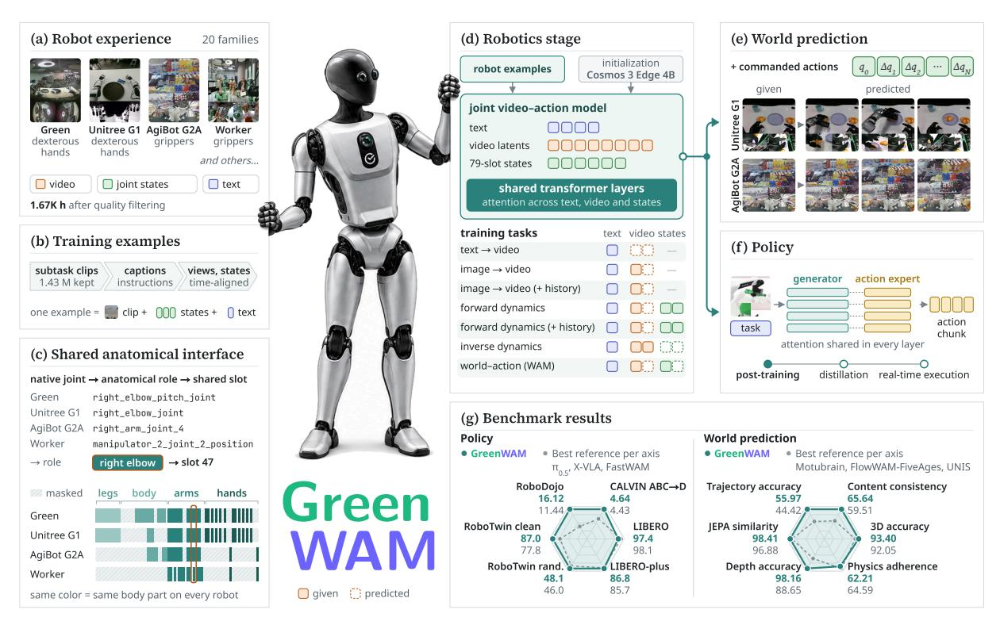

Figure 1 로봇 경험에서 예측 및 제어로. (a–b) 20개 로봇 패밀리의 비디오, 측정된 상태 및 텍스트가 정렬된 하위 작업 예시를 형성한다. (c–d) 공유 79슬롯 해부학적 동작 공간이 로봇 동작을 Cosmos 3 Edge 위에 구축된 관절 비디오–동작 모델에 연결한다. (e) GreenWAM의 Unitree G1 및 AgiBot G2A에 대한 앞쪽 예측(Section 5.1). (f) 정책으로서, 기초 모델은 결합된 동작 전문가를 추가하고 인간형 제어를 위해 증류한다. (g) GreenWAM이 모든 축에서 세 참조 중 최고와 비교 (회색 점선 윤곽). 왼쪽: 정책, $\pi_{0.5}$ [62], X-VLA [103] 및 FastWAM [95]에 대항; $\pi_{0.5}$ CALVIN 값은 $\pi_{\rm RL}$ [17]이 보고한 감독형 미세조정 체크포인트이며, RoboDojo 점수는 공식 리더보드 [67]에서 나온다. 오른쪽: WorldArena 1.0이 Motubrain [56], FlowWAM‑FiveAges [21] 및 UNIS [46]에 대항한다: 모션‑캡스 스코어의 세 범주(Section 5.2; 다른 모델은 상한값)와 세 충실도 메트릭. 모든 축은 Figures 9 및 11의 막대 차트가 시작하는 지점에서 시작하지만, 최상의 값의 절반 이하로 내려가지 않으며, 해당 축의 최상의 값에서 끝난다.

world–action 모드, 전체 하위 작업과 지침으로 준비된 녹음에서 (Sections 3.3 및 4). 셋째, 정책은 생성기에서 동작 전문가를 분리한다 (Section 6.1).

두 역할은 이 하나의 기반에서 하나의 동작 인터페이스를 통해 얻어진다. 하나의 모델이 여섯 개 로봇 패밀리의 보류된 녹음에서 비디오를 예측하며, 로봇별 생성기나 동작 투영이 없다. 로봇학 코퍼스에 없던 단일 팔 Franka는 동일한 공유 인터페이스를 통해 CALVIN 및 LIBERO에서 제어된다. 세계 모델로서 GreenWAM은 WorldArena 1.0에서 최고 수준의 궤적, 깊이 및 3D 정확도를 달성하며, 비교 대상인 모든 세계‑동작 모델 및 비디오 생성기보다 앞선다(모두 Motubrain [56] 및 FlowWAM‑FiveAges [21] 포함; Section 5.2). 정책으로서, RoboTwin 2.0 리더보드에서 상위 항목 중 하나로 점수를 기록하고, 비교된 방법 중 가장 높은 zero‑shot LIBERO‑plus 성공률을 달성하며 CALVIN 및 LIBERO에서도 경쟁력 있다 (Section 6). 실제 인간형에서, 95.6%의 분포 내 지침을 완수하고, 부모로부터 적응된 정책은 88.9%, $\pi_{0.5}$는 84.4%이며, 증류된 단일 단계 학생은 최적화되지 않은 정책보다 12.3배 빠르게 응답한다 (Sections 6.4 및 6.5).

제어된 비교(Section 7)는 이 작업을 가능하게 하는 요인을 식별한다. 첫째, 로봇 전문화가 세계 예측과 제어를 동시에 향상시킨다 (Section 7.1). GreenWAM에서 파생된 것이 아니라 동작‑훈련된 부모 모델에서 파생된 것이 아니라, 세계 모델은 WorldArena에서 궤적 정확도를 3.0점 높이고 비디오 예측 오류를 23% 낮춘다. 정책은 보류된 RoboTwin 프레임을 더 정확하게 예측하고 5.4% 더 자주 성공하며, 동작 전문가와 함께하면 8.4% 더 성공한다. 둘째, 생성기에서 동작 전문가를 분리한다.

정책 적응이 정책 성공률을 3.3% 향상시킨다 (Section 7.2). 세 번째로, 정책 적응 중 world-model 모드를 유지하면 무작위 장면에서 성공률이 8.0% 상승한다 (Section 7.3).

**기여.** 우리는 네 가지 기여를 한다.

- **레시피.** 공유된 해부학적 행동 공간과 데이터 파이프라인을 통해 행동 기반 세계 기초 모델을 20개의 로봇 패밀리로 적응시킨다 (Sections 3 and 4).
- 하나의 모델, 두 가지 역할. 시각, 행동-조건화 및 world-action 모드에서의 공동 훈련은 세계 모델을 생성하고, 생성기에서 분리된 행동 전문가를 통해 정책을 만든다 (Sections 3.3, 4.3, 6.1 and 6.2).
- 그것이 가져오는 것과 이유. WorldArena 1.0, RoboTwin 2.0, CALVIN, RoboDojo, LIBERO 및 LIBERO-plus에서 두 역할 모두에 대한 결과와 로봇 전문화가 두 역할 모두에 이익을 주는 것을 보여주는 통제된 비교 (Sections 5 to 7).
- **실제 로봇.** 실제 휴머노이드에 적응하고 실시간 제어를 위한 단일 단계 정책으로 증류한다 (Sections 6.4 and 6.5).

## 2 Related Work (Related Work)

GreenWAM은 네 가지 연구 라인에 기반한다: 세계 기반 모델의 로봇 전문화, 로봇 본체 전반에 공유되는 행동 표현, 비디오 생성기에서 파생된 정책, 그리고 장기 롤아웃 및 시뮬레이션을 위한 시간적 맥락. 표 1은 모델의 역량에 따라 가장 가까운 기술 보고서를 비교한다.

표 1 가장 가까운 기술 보고서: 모델이 제시하는 역량에 따라. 마크는 보고서가 해당 역할에서 모델을 제시함을 의미하며, 품질을 순위화하지 않는다. $Actions \rightarrow video$ : 로봇 행동(전방 역학, 행동-조건 시뮬레이션)에 조건화된 생성; $Video \rightarrow actions$ : 역 역학; Policy: 비디오와 행동의 공동 예측을 제어에 사용; $Long\ rollout$ : 과거 블록의 메모리를 갖는 자기 회귀 연속; $Real\ robot$ : 물리적 로봇에서의 실험, GreenWAM의 Green humanoid (섹션 6.5).

| 보고서 | 그룹 | 비디오 생성 | $Actions \rightarrow video$ | ${\rm Video}{\rightarrow} {\rm actions}$ | 정책 | 장기 롤아웃 | 실제 로봇 |
|-------------------------------------------------------------|---------------|------------|-----------------------------|------------------------------------------|--------|--------------|------------|
| Cosmos 3 [58] | NVIDIA | 1 | 1 | 1 |  |  | <b>√</b> |
| DreamZero [92] | NVIDIA | / |  |  | / | ✓ | / |
| DreamDojo [25] | NVIDIA | / | ✓ |  |  | ✓ | / |
| DreamGen [34] | NVIDIA | / |  | ✓ |  |  | / |
| GigaWorld-0, GigaWorld-1, GigaWorld-Policy-0.5 [27, 28, 29] | GigaAI | / | ✓ | ✓ | / | ✓ | / |
| Motubrain, Motus2 [56, 8] | ShengShu | / | ✓ | ✓ | / | / | / |
| GE-Act 2.0, GE-Sim 2.0 [2, 63] | AgiBot | / | ✓ | ✓ | / | ✓ | / |
| LingBot-VA, 2.0 [42, 97] | Robbyant | / | ✓ | ✓ | / | ✓ | / |
| ABot-PhysWorld [20] | AMAP | / | ✓ |  |  |  |  |
| WALL-WM, WALL-SS [44, 96] | X Square | / | ✓ |  | / | / | / |
| Xiaomi-Robotics-U0 [46] | Xiaomi | / | ✓ |  |  |  | / |
| 1X World Model [1] | 1X | 1 | ✓ |  |  |  | ✓ |
| GreenWAM | Sber Robotics | <b>✓</b> | 1 | 1 | 1 | 1 | <b>✓</b> |

Robotics specialization of world foundations. Cosmos 3는 이미 시각 생성, 순방향 및 역방향 역학, 그리고 세계-행동 모델링을 추론자-생성기 아키텍처에 통합하고 있다 [58]. 그러나 이 로봇 데이터는 여섯 가지 구현체를 포함하며, 한 데이터셋에서 81%의 시간을 차지하고, 행동을 그리퍼 열림과 함께 엔드에펙터 포즈 델타로 표현한다. GreenWAM은 20개 로봇 패밀리의 측정된 관절 및 카르테시안 궤적을 사용해 이 기반을 재학습하며, 하위 작업 비디오와 텍스트와 정렬한다. Genie Envisioner 역시 공유 세계 기반을 예측, 제어 및 시뮬레이션 애플리케이션에 연결한다 [47]. 대안 데이터 경로로는 DreamDojo의 잠재적 프록시 행동을 포함한 인간 비디오와 GigaWorld-0에서 생성된 로봇 경험이 있다 [25, 27]. 이전 연구에서는 다양한 데이터셋에서 학습된 상호작용 시뮬레이터로서 행동-조건화된 비디오 예측을 확립했으며, V-JEPA 2는 로봇 계획을 위한 잠재적 행동-조건화 세계 모델을 사후 학습한다 [6].

Correspondences across robot bodies. 교차 구현 정책은 동일한 대응 문제에 직면한다. Open X-Embodiment은 22개의 로봇 시연을 모으며 [60]; Octo는 새로운 센서와 행동 공간에 맞게 미세 조정된다 [59], CrossFormer는 관찰 또는 행동 공간을 수동으로 정렬하지 않고 조작, 탐색, 기동 및 항공을 위한 로봇을 제어한다 [22]. HPT는 각 구현체의 고유감각과 시각을 공유 트렁크에서 처리되는 토큰에 매핑한다 [80], X-VLA는 구현체별 소프트 프롬프트를 추가한다 [103], UniAct는 원자적 행동의 보편적 공간을 학습한다 [102], RDT-1B는 물리적 의미를 유지하는 좌표를 갖는 통합 행동 공간을 정의한다 [49]. Green-VLA는 통합되고 구현체를 인식하는 행동 인터페이스를 사용해 단일 정책이 휴머노이드, 모바일 조작기 및 고정 기반 팔을 제어하고, 이후 이 정책을 Green 휴머노이드에 적응시킨다 [5]. 세계 모델 중 Cosmos 3는 카메라와 엔드에펙터 움직임을 그리퍼 또는 손가락 끝 상태와 함께 나타내며, 각 구현체에 대해 입력 및 출력 프로젝션을 사용한다.

도메인 [&#91;58](#page-27-0)]. GE-Sim 2.0은 행동을 행동 맵으로 나타낸다: 각 팔의 엔드에펙터 포즈가 보정된 내부 및 외부 파라미터를 사용해 모든 카메라 이미지에 투영되고, 그리퍼 열림을 색조로 표시한 마커로 그려지며, 비디오 잠재 변수와 연결된다 [[63&#93;](#page-27-5). 이러한 맵은 비디오 생성기에 자연스럽고 구축이 간단하며, 모든 프레임에서 카메라가 보정된 로봇에 적합하다. 움직이는 머리와 손목 카메라를 가진 휴머노이드의 경우, 모든 뷰에 대한 정확한 보정이 필요하며 손가락 관절을 표현할 수 없다. GreenWAM은 대신 측정된 관절 및 카르테시안 상태를 하나의 통합 프로젝터(섹션 [3.2](#page-4-0))를 통해 전달하고, 명령된 행동을 여전히 밀접하게 따른다 (섹션 [5.1](#page-10-0) 및 [5.2](#page-11-0)). GreenWAM은 명시적 슬롯과 마스크를 사용한다: 79개의 해부학적 슬롯이 다리, 기초, 복부, 머리, 팔 관절 및 손가락 관절을 포함한다.

**세계 예측에서 정책으로**. 초기 접근법은 비디오로 계획을 생성하고 그 안에서 행동을 추출한다 [&#91;23](#page-26-11)], 또는 비디오에서 사전 학습하고 비디오와 행동 예측을 모두 미세 조정한다 [[16&#93;](#page-26-12). UVA는 분리된 디코딩 헤드를 가진 공동 비디오–행동 잠재 변수를 학습한다 [[43](#page-26-13)], UWM은 비디오와 행동 확산을 결합해 두 스트림의 노이즈 수준에 따라 하나의 모델이 정책, 순방향 역학, 역방향 역학 또는 비디오 생성기로 작동하도록 한다 [[104&#93;](#page-28-7); GreenWAM의 모드는 많은 로봇 본체에서 동일한 아이디어를 따른다. 비디오-모델 사전은 DreamZero의 공동 비디오–행동 생성, LingBot-VA의 인과 예측 및 비동기 실행, GE-Act 2.0의 시각적 계획 후 역방향 역학 등 여러 예측 인터페이스를 통해 제어를 지원한다 [&#91;92](#page-28-0), [42](#page-26-7), [2&#93;](#page-25-0). 정책으로서 GreenWAM은 공동 비디오–행동 예측을 유지하고 전용 전문가를 통해 행동 스트림을 전문화한다.

우리는 비디오 모델 기반 정책이 액션이 비디오 백본을 공유하는지, 자체 전문가를 받는지, 그리고 그 전문가가 어떻게 초기화되는지에 따라 차이가 있다는 점을 제시한다. Motus는 잠재 액션으로 액션 전문가를 사전 학습하고, ME-Dex는 비디오와 액션 전문가를 상속한다 [7], [99]. GreenWAM은 분할 시에 생성기를 액션 전문가로 복사하여, 추가 최적화 전에 부모 함수를 보존한다. Section 7.2는 동일한 시작점에서 공유 타워와의 분할을 비교한다.

로봇 데이터, 소스별 시간 비율 Cosmos 3 · 6 개 구현체 중 가장 큰 단일 비율 81% GreenWAM · 20 개 로봇 패밀리 중 가장 큰 단일 비율 15% 액션 유형 Cosmos 3 abs. Δ GreenWAM abs. Δ joint Cartesian hands gripper open/close finger joints

**Figure 2 로봇 데이터 및 액션 유형** of Cosmos 3 [[58](#page-27-0)] and GreenWAM: 로봇 시간 비율 (상단; AgiBot World는 Cosmos 3의 로봇 시간의 81%를 공급하며, 가장 큰 GreenWAM 패밀리는 우리 중 15%) 및 액션 표현 (하단).

**시간적 맥락 및 시뮬레이션.** WALL-WM은 캡션, 비디오 및 액션을 의미적 이벤트 수준에서 정렬한다 [[44](#page-26-9)], 우리 데이터 파이프라인에서 사용되는 완전 하위 작업 원자와 관련이 있다. Genie Envisioner와 GE-Sim 2.0은 긴 롤아웃을 위해 희소 히스토리를 사용하며, GE-Sim 2.0은 훈련 중에 히스토리를 섞어 생성된 컨텍스트 오류를 보정한다 [47,] [63]. DreamZero는 폐루프 실행 중 실제 관측으로 캐시된 예측을 업데이트한다 [92]. GreenWAM은 히스토리의 고정 위치에 네 개의 앵커를 가져오며, 각각을 별도로 인코딩하고 기록된 히스토리로 연속성을 훈련한다; Figure [10](#page-13-1)은 WorldArena에서 20초 이상 롤아웃을 보여준다.

세계 시뮬레이터는 비디오 예측을 넘어서는 사용도 지원한다. GigaWorld-1은 생성된 롤아웃과 실제 정책 실행 간의 일치를 연구한다 [28]; GE-Sim 2.0은 고유 감각을 예측하고 시뮬레이션 롤아웃에서 작업 완료를 평가한다 [63]. WALL-SS는 한정된 메모리와 드리프트에 대한 정렬을 통해 장기 액션-조건 시뮬레이션을 다룬다 [[96](#page-28-4)], 그리고 1X World Model은 정책 및 체크포인트 선택을 지원한다 [1].

## **3 그린와임 (3 GreenWAM)**

GreenWAM은 서로 다른 로봇의 상태를 공유 해부학적 좌표로 매핑하고, 하나의 생성기를 훈련시켜 비디오, 로봇 동작 또는 둘 다를 예측한다; 정책은 이 생성기에서 액션 전문가를 분리함으로써 얻어진다 (Section [6.1]) . 레이아웃별 코덱은 네이티브 로봇 인터페이스 간의 차이를 흡수한다; Section [4]는 데이터와 훈련을 설명한다.

### 3.1 모델 개요 (Model Overview)

우리는 공개된 Cosmos 3 Edge 4B 체크포인트 [58]에서 GreenWAM을 초기화한다. 그 혼합-트랜스포머 백본(그림 3)은 추론자와 생성기를 결합하고, 인과적 비디오 VAE와 정정 흐름 훈련[50]을 포함한다. 그러나 그 로봇 액션은 여섯 개 구현체에서 나오며, 그리퍼 개방과 함께 엔드 이펙터 포즈 델타로 표현된다 (그림 2); 로보틱스 단계에서는 20 개 로봇 패밀리의 측정된 관절 및 카르테시안 상태에서 액션 모드를 재훈련하며, 관절은 공유 해부학적 액션 공간에 있다.

로보틱스 단계에서는 추론자와 VAE가 고정된다. 생성기, 공유 액션 투영 및 액션 모달리티 임베딩이 훈련된다. 모든 모드는 Cosmos 3 JSON 프롬프트 형식을 유지한다 (Section 4.2).

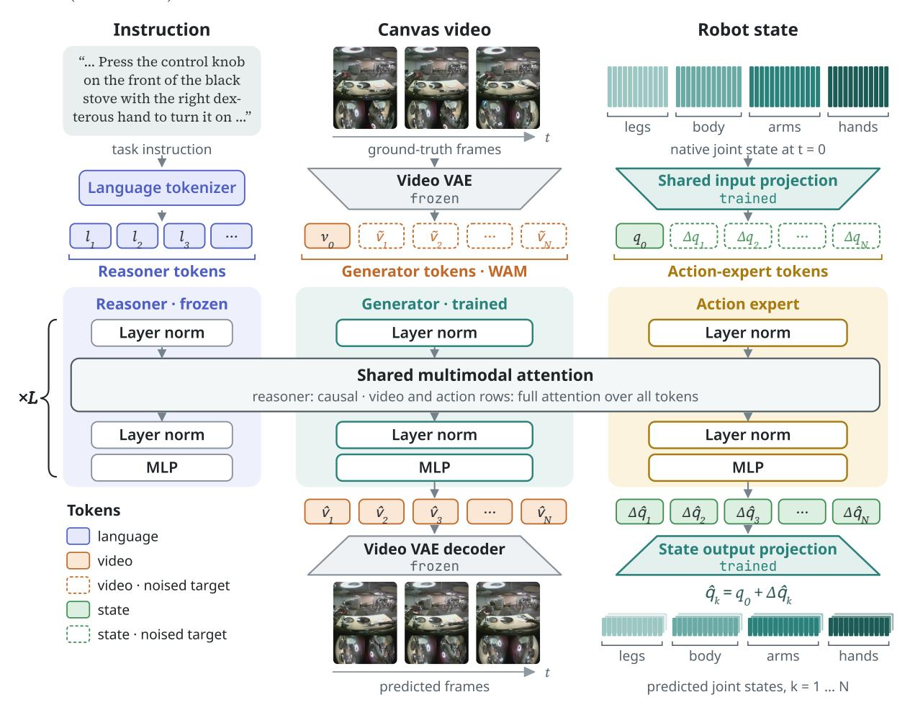

그림 3 GreenWAM 아키텍처는 한 개의 보류된 Green 휴머노이드 에피소드에서 세계‑액션(WAM) 모드에 대해 보여진다. 작업 지시, 다중 카메라 캔버스 및 t = 0에서 로봇의 네이티브 조인트 상태는 동결된 추론기(frozen reasoner), 비디오 토큰용으로 훈련된 생성기(generator)와, 적응된 정책에서 상태 및 액션 토큰용 액션 전문가(action expert)를 입력한다. 이들은 모두 멀티모달 어텐션(Cosmos 3 Edge 트랜스포머 혼합)을 공유한다; 레이아웃의 코덱은 네이티브 조인트를 79개의 해부학적 슬롯으로 매핑한 뒤 공유 입력 프로젝션(그림 4)으로 전달한다. GreenWAM에서는 상태 및 액션 토큰이 생성기를 통과한다; 액션 전문가는 정책 적응(섹션 6.1)을 위해 분리된다. 채워진 토큰은 깨끗한 조건이며, 점선 토큰은 노이즈가 가미된 목표이다; 어떤 스트림이 조건인지 모드는 모드(그림 29)와 함께 바뀐다. 예측된 상태 목표는 $q_0$(식 (2))에 대해 디코딩되고 네이티브 조인트 상태로 다시 매핑된다. 비디오: 실제(상단)와 GreenWAM 예측(하단). 동결 및 훈련은 로보틱스 단계와 관련된다.

### 3.2 Shared Anatomical Action Space (Shared Anatomical Action Space)

로봇 데이터셋은 상태 레이아웃, 조인트 순서, 단위, 부호 및 제로 규약에 대해 서로 다르다. 구현 특화 프로젝터는 이러한 형식을 수용하지만 입력 좌표와의 대응을 암시적으로 남긴다. GreenWAM은 투영 전에 그 대응을 확립한다: 레이아웃별 코덱은 네이티브 채널을 79개의 해부학적 좌표로 매핑한 뒤 하나의 공유 입력·출력 프로젝터(그림 [4](#page-6-0))를 통과한다. 따라서 왼쪽 팔꿈치는 모든 플랫폼에서 동일한 슬롯을 차지하며, 플랫폼별 규약은 코덱에 의해 처리된다. 모든 20개 가족은 하나의 액션 프로젝터를 공유하며, 로봇마다 고유한 액션 파라미터가 없다. 이는 Cosmos 3 Edge에서 구현 도메인마다 하나의 프로젝션을 사용하는 것보다, 또는 GE‑Sim 2.0[&#91;63](#page-27-5)]에서 카메라 이미지에 렌더링된 엔드에펙터 포즈를 사용하는 것보다 더 엄격한 설계이다. 어휘는 네 개의 블록으로 구성된다:

- **다리** (Legs) (12).
- **몸** (Body) (23): 베이스 포즈(7), 베이스 트위스트(6), 토서(7) 및 헤드(3). 포즈와 트위스트는 별개의 양이다.
- **팔** (Arms) (18).
- **손** (Hands) (26): 병렬 그리퍼마다 하나의 열림–닫힘 좌표와 정교한 손에 대한 각 손가락 좌표, 두 번째 그리퍼 손가락, 인코더 및 손가락 외전용 보조 슬롯을 포함한다.

레이아웃별 코덱은 네이티브 채널을 해부학적 슬롯으로 선택, 재정렬 및 정규화한다. 유효성 마스크는 손실에서 누락되거나 해결되지 않은 좌표를 제외한다. 대응은 문서화된 채널, 로봇 역학 및 측정된 궤적에서 확립되며, 섹션 [A.3](#page-30-0)에서 세부 사항을 제공한다. 사후 훈련 레이아웃은 동일한 슬롯과 공유 프로젝터를 사용한다. 레이아웃 ℓ에 대해 네이티브 상태 , 코덱은 슬롯에 네이티브 채널 ℓ ()를 할당하거나, 부호 ℓ ∈ {−1, 1}과 제로 오프셋 ℓ을 갖는 채널을 할당하거나, 아무것도 할당하지 않는다:

$$q_{j} = \begin{cases} \rho_{\ell j} (x_{\pi_{\ell}(j)} - o_{\ell j}), & m_{\ell j} = 1, \\ 0, & m_{\ell j} = 0, \end{cases} \qquad \bar{q}_{j} = \frac{q_{j} - \mu_{\ell j}}{s_{\ell j}}, \tag{1}$$

여기서 ℓ은 유효성 마스크이며 ℓ, ℓ은 레이아웃 학습 데이터의 통계값이다. 마스킹된 슬롯은 손실에서 제외되므로, 로봇이 갖지 않은 좌표는 목표를 받지 않는다.

**인코딩 모드.** 조인트 상태와 카르테시안 엔드-에펙터(EEF) 포즈는 로봇 상태의 두 가지 관점이며, 절대값과 상대값은 두 가지 인코딩이다. 역동학은 비디오만으로 초기 상태를 포함한 절대 경로 0∶ , 를 예측한다. 순방향 동역학, 과거를 포함한 순방향 동역학 및 WAM은 블록 경계에서의 상태에 대한 상대값으로 좌표의 부분집합을 표현한다.

$$\delta_k = q_k - d_\ell \odot q_0, \qquad \hat{q}_k = \hat{\delta}_k + d_\ell \odot q_0, \tag{2}$$

여기서 0은 블록 경계에서의 상태이며, -번째 목표 시점에서의 상태이고, ℓ은 레이아웃의 이진 마스크이다. 기본적으로 다리, 몸통, 머리 및 팔 관절은 상대적이며, 그리퍼, 손 및 손가락은 절대적이다; 레이아웃은 Green humanoid처럼 전체 상태를 상대적으로 선언할 수 있다. 상대값은 속도도 아니고 누적 증가량도 아니며, ℓ은 유효성 마스크 ℓ와 별개이며, 유효성 마스크는 손실에서 사용 불가능한 좌표만 제거한다. 소스가 신뢰할 수 있는 엔드 이펙터 포즈를 기록하는 경우, 윈도우가 샘플링된 뒤 관절 뷰와 EEF 뷰가 동일 확률로 선택되므로, 윈도우는 두 뷰를 가짐으로써 샘플링 가중치를 얻지 않는다. EEF 포즈는 자체 프레임을 가진 별도 슬롯을 차지한다; 그들의 코덱은 SE(3)에서 포즈를 합성하므로, 위의 가산 규칙은 관절 좌표에만 적용된다. 프로젝터는 순방향 또는 역방향 운동학을 수행하지 않는다.

가족들은 대부분 팔 블록에서 겹친다, 반면 다리, 몸통, 머리 및 손가락은 말뭉치의 일부에만 존재한다 (Figure [4)](#page-6-0)). 관절이 있는 모든 로봇은 해당 슬롯의 학습에 기여하며, 부재한 손가락 또는 다리 관절은 모델이 움직임으로 학습해야 할 제로 타깃이 되지 않는다.

### **3.3 Joint Video–Action Modeling**

로봇 클립과 그 상태는 하나 이상의 질문에 답할 수 있다: 장면이 어떻게 보일지, 주어진 궤적을 따라가면 로봇이 무엇을 볼지, 관찰된 비디오를 생성한 궤적은 무엇인지, 그리고 다음에 무엇을 해야 할지. 각 질문마다 별도의 모델을 훈련시키는 대신, 우리는 일곱 가지 모드(표 [2](#page-7-1))에서 하나의 생성기 가중치 세트를 훈련시킨다. 모드는 어떤 스트림이 깨끗한 조건인지, 어떤 스트림이 노이즈가 가미된 목표인지에 따라 정의된다. 모드 m에 대해, C_m을 깨끗한 조건, G_m을 생성된 스트림(예: 비디오 잠재 변수 또는 해부학적 상태)라 하자. 예제의 모든 생성된 스트림은 하나의 노이즈 수준 ∈ [0, 1]을 공유한다. Gaussian 노이즈가 가미된 깨끗한 목표 0는 정류 흐름 경로를 따라 노이즈가 가해지고, 생성기는 그 속도를 예측한다:

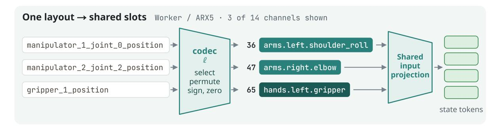

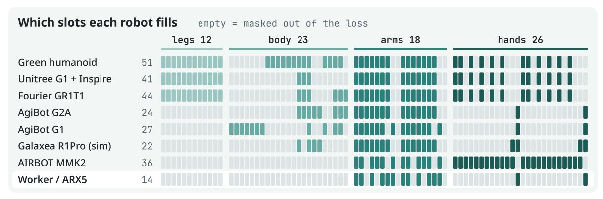

Figure 4 Shared 79-slot anatomical action space.  
Top: 한 레이아웃의 코덱이 네이티브 채널을 선택하고, 슬롯 순서대로 배치한 뒤 필요에 따라 부호를 뒤집고 0을 이동시켜, 슬롯이 모든 로봇에서 동일한 관절 움직임을 의미하도록 한다. 예를 들어 왼쪽 어깨 롤의 같은 양의 방향이다. 14개의 Worker 채널 중 3개가 표시된다.  
공유 입력 프로젝션이 슬롯 벡터를 상태 토큰으로 매핑한다.  
Bottom: 8개의 원본 레이아웃으로 채워진 슬롯; 빈 슬롯은 손실에서 마스킹된다.

$$x_{\sigma} = (1 - \sigma) x_{0} + \sigma \epsilon, \qquad v = \epsilon - x_{0}, \qquad \mathcal{L}_{m} = \mathbb{E}_{\sigma, \epsilon} \sum_{s \in \mathcal{S}_{m}} \lambda_{s} \frac{\left\| M_{s} \odot \left( \hat{v}_{\theta}(x_{\sigma}, c_{m}, \sigma)_{s} - v_{s} \right) \right\|^{2}}{\|M_{s}\|_{1}}, \tag{3}$$

여기서 $M_s$는 스트림 s의 유효한 요소를 마스킹하고, $\lambda_s$는 스트림에 가중치를 부여한다; 상태의 경우 평균은 신체 부위 그룹(Equation (6))에 걸쳐 계산된다. WAM 모드는 첫 번째 프레임 $z_0$, 측정된 상태 $q_0$ 및 명령 c에서 Equation (2)의 상태 오프셋과 미래 비디오를 생성한다. 히스토리 모드는 대신 순서가 지정된 튜플 $A_b$에 있는 네 개의 독립적으로 인코딩된 RGB 앵커를 사용해 다음 블록을 조건화한다:

$$p_{\theta}(z_{1:H}, \delta_{1:H} \mid z_{0}, q_{0}, c),$$

$$p_{\theta}(z_{b+1} \mid A_{b}, c_{b+1}), \qquad p_{\theta}(z_{b+1} \mid A_{b}, U_{b+1}, c_{b+1}),$$

$$(4)$$

마지막 두 분포는 각각 이미지-투-비디오와 과거를 포함한 전방 동역학에 해당하며, $U_{b+1}$은 제공된 상태-추적 토큰을 포함한다. 앵커는 과거가 짧을 때 반복될 수 있으며, 그 정확한 위치는 B.2절에 명시된다.

적격한 예시는 여러 모드에서 사용할 수 있으며, 허용 가능한 하위 집합은 사용 가능한 모달리티, 텍스트 및 결과 라벨에 따라 달라진다 (섹션 B.4 및 4.2).

고정된 혼합은 예시의 3/4를 비디오 예측에 할당하며, 로봇의 궤적이 있든 없든 관계없이, 나머지 1/4는 역동학과 WAM을 통해 로봇 상태를 생성하는 데 사용된다. 자기회귀 예시 중에서는 과거를 포함한 전진 동역학이 과거를 포함한 이미지-투-비디오보다 두 배의 비중을 받는다.

모드들은 비디오와 상태 목표를 위한 물리적 시간 격자를 공유한다. 시각 및 동역학 모드는 전체 준비된 하위 과제를 사용하며, 자기회귀 모드는 완전한 하위 과제 블록을 가로질러 계속되고, WAM은 성공적인 시연 내부에서 짧은 미래를 예측한다. 정확한 수평선, 재샘플링 규칙 및 조건-목표 배열은 섹션 B.2와 그림 29에 제시된다.

**Table 2 학습 모드.** 공유 비율은 토큰이나 연산이 아니라 예시를 기준으로 한 샘플링 확률이다.

| 모드 | 정리된 조건 | 목표 | 공유 |
|----------------------------------|-------------------------------------------------------|------------------------------------|-------|
| 텍스트-투-비디오 | 시각 캡션 | 하위 작업 비디오 | 20% |
| 이미지-투-비디오 | 시각 캡션, 초기 RGB | 하위 작업 비디오 | 10% |
| 이미지-투-비디오, 히스토리 포함 | 블록 캡션, 히스토리에서 가져온 네 개의 RGB 앵커 | 다음 블록 비디오 | 10% |
| 전방 역학 | 작업 지시, 초기 RGB, 미래 상태 | 하위 작업 비디오 | 15% |
| 전방 역학, 히스토리 포함 | 블록 지시, 네 개의 RGB 앵커, 미래 상태 | 다음 블록 비디오 | 20% |
| 역방 역학 | 관측된 비디오, 역방 지시 | 절대 상태 궤적(𝑞0 포함) | 10% |
| 세계-행동 | 작업 지시, 초기 RGB, 측정된 𝑞0 | 미래 비디오 및 상태 오프셋 | 15% |

### **3.4 다중 시점 관측 및 시간적 맥락 (Multi-View Observations and Temporal Context)**

우리 코퍼스는 한 대의 카메라 또는 세 대의 동기화된 카메라가 있는 에피소드를 포함한다. 세 시점 소스의 경우, 우리는 머리와 두 손목 시점을 오프라인에서 하나의 비디오로 합성하여 연속적으로 유지된 세그먼트마다 하나의 비디오를 만든다 (Figure [5)](#page-7-2)). 머리 시점은 대략 상단 2/3을 차지하며, 손목 시점은 고정된 Left | Right 순서로 아래에 배치된다. 480p 캔버스 버킷 5개 중 하나를 선택하면 머리-카메라 종횡비를 보존하고 각 패널의 종횡비 변화를 0.94–1.15 범위 내로 유지한다; 단일 카메라 소스는 전체 프레임을 사용한다. 카메라 역할은 각 소스마다 시점 움직임을 왼쪽 및 오른쪽 팔 움직임과 상관시켜 검증된다. 캔버스 크기와 시간 샘플링은 Section [B.2](#page-32-0)에 명시되어 있다.

자기회귀 모드는 Genie Envisioner와 GE-Sim 2.0 [[47,](#page-27-6) [63](#page-27-5)]와 같이 각 새로운 블록을 희소한 시각적 역사에 조건화한다. Genie Envisioner와 마찬가지로 생성기는 네 개의 RGB 앵커를 받는다; 훈련 중 무작위로 뽑는 대신, 우리의 앵커는 훈련과 추론 모두에서 동일한 고정 위치에 놓인다: 시작, 1/3, 2/3, 그리고 사용 가능한 역사의 끝(유효 비디오 그리드 상). 따라서 마지막 앵커는 항상 가장 최근 프레임이다. 각 앵커는 VAE에 의해 별도로 인코딩된다; 에피소드 시작 시 초기 프레임이 반복된다. 훈련은 실제 역사(teacher forcing)를 사용하고, 추론 시 역사는 생성된 비디오가 된다. 역사는 같은 에피소드와 카메라의 인접한 보존된 하위 작업을 가로질러서 이어질 수 있으며, 거절된 간격과 에피소드 경계에서 재설정된다. 각 블록은 자체 캡션 또는 지시문을 가진다.

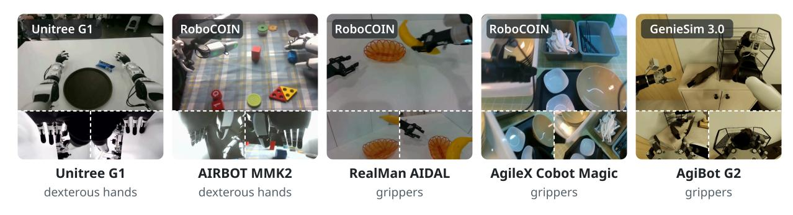

**Figure 5 다섯 로봇 패밀리의 훈련 캔버스.** 왼쪽부터: Unitree G1과 AIRBOT MMK2(민첩한 손), RealMan AIDAL, AgileX Cobot Magic, 그리고 그리퍼를 갖춘 AgiBot G2; AgiBot G2를 제외한 모든 것은 실제 로봇에서 기록되었으며, AgiBot G2는 시뮬레이션에서 나온 것이다. 머리 카메라는 캔버스 상단 2/3을 차지하고, 왼쪽과 오른쪽 손목 카메라는 하단 행(점선)을 공유한다; 각 시점은 자르지 않고 패널에 맞게 리사이즈된다. 다섯 개 모두 640×640 캔버스를 사용하며, 이는 다섯 캔버스 크기 중 가장 빈번한 크기이다.

## **4 로봇 경험 및 훈련 (Robot Experience and Training)**

로봇 데이터셋은 프레임 속도, 카메라 배치, 상태 의미론 및 작업 경계가 다르지만, 모든 훈련 예시는 동일 구간의 비디오와 언어와 로봇의 움직임을 정렬해야 한다. 우리는 녹화를 하위 작업 클립으로 자르고, 사용 불가능한 것을 필터링하며, 시각 예측과 행동 학습을 위한 별도 텍스트를 도출한 뒤 로봇학 단계에서 훈련한다. 애플리케이션별 적응은 Section 5.2와 6에서 그 평가와 함께 설명된다.

### **4.1 교차 구현체 코퍼스 (Cross-Embodiment Corpus)**

**Families.** 훈련 데이터는 20개의 주요 로봇 패밀리(그림 26)를 포괄하며, 모두 이중 팔을 가진다: 평행 그리퍼를 갖춘 양손 플랫폼과 그리퍼 또는 민첩한 손을 가진 휴머노이드, 실제 및 시뮬레이션 장면에서. Section A는 레이아웃과 훈련에 허용된 하위 집합을 나열한다.

그들은 LeRobot 포맷[13]의 공개 및 내부 로봇 데이터셋을 우리 휴머노이드 데이터와 결합한다. 훈련 단위는 *atom*이다: 하나의 에피소드에서 동기화된 시점, 측정된 상태, 텍스트 및 출처를 포함한 하위 작업 클립. Section A는 수락 규칙과 각 단계의 수를 제시한다.

### **4.2 데이터 큐레이션 및 훈련 혼합 (Data Curation and Training Mixture)**

공공 로봇 데이터셋은 전체 에피소드 형태로 제공되며, 각 에피소드는 자체 라벨, 카메라 세트 및 품질 정보를 갖는다. 고정 길이 윈도우를 샘플링하면 서로 관련 없는 하위 작업이 하나의 예제로 묶이고, 각 윈도우에 다른 구간에 대해 작성된 라벨이 부여된다. 따라서 우리는 이전 단계들을 재작성하지 않고 하나씩 결정을 추가하는 단계별로 데이터를 준비한다 (Figure 6). 등록 단계에서는 각 소스의 카메라 역할, 상태 레이아웃 및 로봇 속성을 고정하고, 원자 단위로 자르면 1.44백만 개의 전체 하위 작업 원자(1688.5 h)를 포함하는 허용 코퍼스를 얻는다. 품질 통과 단계에서는 1.43백만 개의 원자(1674.7 h)를 유지하고, 캡션 및 명령 파생 단계에서는 1.19백만 개의 원자에 수락된 명령을 부여한다.

**Admission.** 우리는 먼저 소스 주석에서 의미적 하위 작업 경계를 해결한다. 에피소드는 더 세밀한 시간 주석이 없을 때에만 전체를 사용하며, 모호하거나 불완전한 경계는 제외된다. A

### (a) 코퍼스 내 로봇

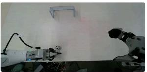

2-팔 플랫폼 그리퍼 638 h⋅38%

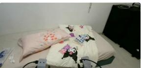

휴머노이드 그리퍼 624 h · 37%

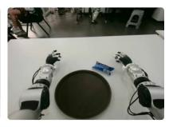

휴머노이드 섬세한 손 426 h · 25%

#### (b) 하위 작업 클립 선택

- 1 하위 작업 세분화
  - 주석된 하위 작업 경계
  - 길이 제한
  - 1.44 M clips · 1.69K h
- 비디오 품질 필터링
  - 유휴, 중복 또는 잘린 클립
  - 디코딩 불가 비디오
  - 1.43 M clips · 1.67K h

#### (c) 클립에서 훈련 예제로

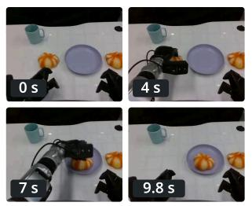

RoboCOIN · Unitree G1

#### **Visual description** (시각적 설명)

- → 텍스트-투-비디오
- → 이미지-투-비디오 (+ 이력) 예시의 40%

"흰색 테이블의 근접 가장자리에 은색과 검은색 관절 팔을 가진 휴머노이드 로봇이 실제 작업 공간에 서 있다. ..."

#### Command (명령)

- → 전방 역학 (+ 이력)→ 세계-행동
- 예시의 50%

"왼쪽 기민한 손을 테이블의 왼쪽에 있는 주황색과 흰색 빵 롤 쪽으로 확장하고 잡는다. ..."

#### State trajectory (상태 궤적)

- → 전방 역학 (+ 이력)
- → 세계-행동
- → 역방 역학 예시의 60%

왼쪽 팔
왼쪽 손
0 s 4 s 7 s 9.8 s

Figure 6 로봇 데이터. (a) 코퍼스: 20개의 로봇 패밀리, 입학 후 1688.5시간, 74% 실제, 모두 이팔, 세 가지 구현 그룹에 속함; 각 그룹은 그 시간에 비례하는 너비를 가진 헤드-카메라 프레임으로 표시된다. (b) 에피소드는 길이 제한(Equation (10)) 내에서 주석된 하위 작업 경계에서 하위 작업 클립(원자)으로 자른다 (144만 개 클립, 1688.5시간); 비디오 품질 필터링은 유휴, 중복, 컷 및 디코딩 불가 클립을 제거한다 (143만 개 클립, 1674.7시간). (c) 한 클립 (RoboCOIN, Unitree G1 with 기민한 손, 실제), 그 행동 단계의 경계에서 표시된다. 그 시각적 설명과 파생 명령은 일부를 그대로 인용한다; 그 기록된 상태 궤적은 왼쪽 팔과 왼쪽 손에서 가장 많이 움직이는 세 개의 관절을 보여 주며, 각각 자체 범위에 맞게 스케일링된다. 화살표는 각 출력을 사용하는 훈련 모드를 명시하며, 예시 비율(표 2)을 표시한다; 상태 궤적은 전방 역학의 조건이자 세계-행동 예측 및 역방 역학의 목표로서 세 가지 행동 모드 모두에 사용되므로 비율이 겹친다.

길이 제한은 과도하게 긴 원자들을 임의 창으로 자르지 않고 거부한다 (Figure 6b). 별도의 품질 검사는 유휴 간격, 중복 프레임 실행, 시간적 컷 및 읽을 수 없는 클립을 제거한다. 비디오 품질 검사를 통과한다고 해서 원자가 모든 훈련 모드에 자동으로 사용 가능한 것은 아니다: 텍스트 의존 모드도 승인된 캡션이나 명령이 필요하다 (Section A.2 및 Table 4).

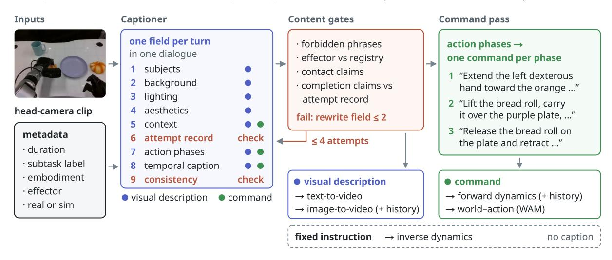

그림 7 캡션러와 명령 패스.  
입력은 그림 6c의 헤드-카메라 클립과 그 지속 시간, 하위 작업 라벨, 구현체, 효력기 및 도메인이다.  
캡션러(Qwen3.8-27B [64])는 한 대화에서 9개의 필드를 한 번에 작성하며, 한 번에 한 필드를 기록한다. 시도 기록과 일관성 필드(빨간색)는 검증용이며 훈련 프롬프트에 포함되지 않는다.  
파란 점은 시각적 설명을 구성하는 필드(주제부터 컨텍스트, 행동 단계, 시계열 캡션까지)를 표시하고, 초록 점은 명령 패스가 읽는 필드(컨텍스트, 행동 단계, 시계열 캡션)를 표시한다.  
콘텐츠 게이트는 금지된 문구, 효력기를 레지스트리와 비교하고, 접촉 및 완료 주장과 시도 기록을 검증한다. 실패한 필드는 최대 두 번 재작성되며, 전체 대화는 최대 네 번 시도된다.  
명령 패스는 행동 단계를 각 단계마다 하나의 명령으로 변환하며, 모든 단계를 순서대로 유지한다. 표시된 것은 입력 클립에 대해 도출된 세 개 명령의 시작 문구이다.  
하단: 시각적 설명은 텍스트-투-비디오 및 이미지-투-비디오를 조건화하고, 명령은 순방향 역학과 세계-행동 예측을 조건화하며, 역방향 역학은 고정된 지침을 받는다.

캡션에서 명령으로.  
텍스트 파이프라인은 각 원자(그림 6c 및 그림 7)에 대해 시각적 설명과 잠재적 명령을 생성한다.  
비디오 캡션러는 한 대화에서 한 번에 한 필드를 기록하며, 각 필드는 이미 작성된 필드에 조건화된다: 주제(로봇과 그 효력기), 배경, 조명, 미학, 컨텍스트, 시도 기록, 시간 기반 행동 단계, 시계열 캡션 및 일관성 검사.  
소스 작업 라벨은 의도된 목표를 제공하고, 레지스트리 사실은 구현체, 효력기 유형 및 실제 또는 시뮬레이션 도메인을 고정한다.  
행동 단계 이전에 캡션러는 시도가 얼마나 진행되었는지를 최종 프레임에서 읽어 기록한다. 이후 필드는 클립이 끝나는 지점에서 끝나야 하며, 라벨에 명시된 객체와 행동 종류와 일치하지 않는 움직임을 가진 캡션은 거부된다.  
두 번째 단계는 텍스트 전용 단계로, 행동 단계를 동일한 조각에 대한 잠재적 명령으로 변환한다.  
관찰된 움직임, 객체 참조 및 단계 순서를 보존하며, 부분적이거나 실패한 시도를 포함한다. 이는 시연되지 않은 의도된 작업을 완성하는 대신이다.  
소스 라벨을 명령으로 사용하면 대신 미완성 시도와 클립이 도달하지 못하는 목표를 매칭한다.  
변환 단계는 원본 데이터셋 지침을 보지 않는다.  
시각 모드는 시각적 설명을 사용하고, 순방향 역학과 WAM은 도출된 명령을 사용하며, 역방향 역학은 고정된 궤적 복구 지침을 사용한다.  
B.3절에서는 캡션러, 변환, 그들의 검증 및 최종 프롬프트 형식을 자세히 설명한다.

정렬된 훈련 입력.  
카메라 선택과 순서는 각 소스마다 명시된다.  
동기화된 RGB 뷰는 상태와 텍스트의 원본 에피소드 타임스탬프를 유지하면서 하나의 캔버스로 조합된다.  
프레임률 감소는 대응되는 비디오와 상태 시간을 선택하며, 물리적 관절 위치나 변위를 재스케일링하지 않는다.  
자기회귀 예시는 완전한 인접 원자를 결합하고 거부된 간격에서 멈춘다.  
WAM은 추가로 양성 성공 라벨을 요구한다. 실패, 알 수 없음 및 라벨이 없는 결과는 WAM에서 제외되지만 다른 적격 모드에는 들어갈 수 있다.  
짧은 예측 창은 포함된 원자의 명령을 유지하므로, 지침은 그 창 안에서 완료해야 할 작업이 아니라 진행 중인 하위 작업을 설명한다.

**상태 기반 목표.** 기록된 동작 열은 관절 목표, 속도, 원격 조작 마스터 상태 및 진행 신호를 혼합한다. 대신 우리는 측정된 상태와 방정식 (1)의 코덱을 사용하여 공통 궤적을 구성한다:

$$q_k = \operatorname{codec}_{\ell}(s(t_0 + \Delta_k)), \tag{5}$$

여기서 s는 기록된 상태이며,  $\Delta_k$ 는 한 개의 허용된 구간 내에서의 물리적 시간 지연이고,  $\operatorname{codec}_{\ell}$ 는 레이아웃  $\ell$ 을 공유된 해부학적 슬롯에 매핑한다. 역동역학은 절대  $q_k$ 를 예측하고, 순방향 동역학과 WAM은 (2)번 방정식의 목표  $\delta_k$ 를 사용한다. 따라서 목표는 실제 로봇 동작을 설명한다. 예측된 궤적을 실행하려면 추가로 Section 6.2에 있는 로봇 전용 디코더가 필요하다.

정규화 통계는 학습 세트에 대해서만 계산된다 (Section A.3).

**훈련 혼합**. 샘플링은 모드, 로봇 클러스터(Equation (12)), 데이터셋, 윈도우를 선택한다. Worker/ARX5 및 Green humanoid 클러스터는 고정 비율을 받으며, 다른 클러스터와 데이터셋은 허용 가능한 하위 작업 수의 제곱근으로 가중치를 둔다. 각 소스는 데이터가 지원하는 모드에서만 샘플링된다. 전체 샘플링 목표는 Section B.4와 Table 8에 제시된다.

### 4.3 GreenWAM Training (GreenWAM Training)

**목표**. 로봇학 단계는 rectified-flow 목표(Equation (3))로 모든 일곱 모드를 훈련한다. 생성기는 각 노이즈가 가미된 목표 스트림의 속도를 예측한다. 비디오 손실은 유효한 목표 요소에 대해 평균을 취한다. 상태 손실은 먼저 각 표현된 신체 부위 그룹 내에서 평균을 내고, 그 다음 그룹 간에 평균을 내므로 좌표가 더 많은 그룹이 자동으로 더 많은 가중치를 받지 않는다. $e_{tj} = \hat{v}_{tj} - v_{tj}$ 를 방정식 (5)의 상태 목표 속도 오차라 하고, $m_{tj}$ 를 유효한 노이즈 목표를 선택하며, $\mathcal{G}$ 를 최소 하나의 해당 목표를 포함하는 신체 부위 그룹으로 둔다. 그러면

$$\mathcal{L}_{\text{state}} = \frac{1}{|\mathcal{G}|} \sum_{q \in \mathcal{G}} \frac{\sum_{t} \sum_{j \in g} m_{tj} e_{tj}^{2}}{\sum_{t} \sum_{j \in g} m_{tj}}, \qquad \mathcal{L} = \lambda \left(\mathcal{L}_{\text{video}} + \mathcal{L}_{\text{state}}\right). \tag{6}$$

모든 생성된 스트림은 Equation (3)의 노이즈 수준 $\sigma$를 공유하며, 이는 Cosmos 3 Edge(Section B)의 노이즈 스케줄에서 추출된다. 손실은 노이즈 수준 가중치를 갖지 않으며, 두 항목 모두 $\lambda=10$으로 스케일된다(코스모스 3 엣지와 동일하게), 따라서 비디오와 상태가 동일한 가중치를 갖는다. 손실은 예제별로 평균화되며, 타깃이 없는 스트림은 0을 기여한다. 해부학적 그룹은 다리, 몸통, 팔, 손이며, 해결되지 않았거나 부재한 좌표는 마스킹된다. 정제된 조건(예: WAM에서 측정된 $q_0$ 포함)은 손실을 갖지 않는다; 역동역학에서는 초기 상태가 타깃이다. RoboTwin 정책 레시피는 대신 유효한 행동 좌표를 동일하게 가중한다(Section B.5). 텍스트 조건화는 classifier-free guidance [32]에 대해 0.1의 확률로 드롭된다.

리시너와 VAE가 고정된 상태에서, 훈련은 64개의 H100 GPU에서 전역 배치 256 예제로 실행된다. 파라미터는 8 GPU를 갖는 각 노드 내에서 샤딩되고 노드 간에 복제되며, 어텐션은 선택적으로 체크포인트된다. 전체 옵티마이저, 스케줄 및 샘플링 레시피는 Table 5와 Section B에 제공된다.

**훈련 규모.** 로보틱스 단계는 36,500 옵티마이저 스텝 후 GreenWAM을 생성하며, 이는 9.34백만 샘플링된 예제에 해당한다. 이 체크포인트는 다운스트림 적응을 초기화한다. 학습률 스케줄과 체크포인트 설정은 Table 5에 제공된다. 섹션 5와 6은 이 체크포인트를 세계 모델 및 정책으로 평가한다.

## 5 GreenWAM을 세계 모델로 (GreenWAM as a World Model)

섹션 5.1 (Section 5.1)은 로보틱스 체크포인트 자체를 테스트하며, 벤치마크 적응 없이 학습 코퍼스의 보류된 로봇 녹화에서 수행된다: 하나의 모델이 다른 몸체에 대해 비디오를 예측하는지, 생성된 동작이 명령된 궤적을 따르는지를 확인한다. 섹션 5.2 (Section 5.2)는 체크포인트를 WorldArena 1.0(공개 행동-조건화 비디오 예측 벤치마크)에 적응시키고, 리더보드에서 모델들과 비교한다. 이 섹션의 모든 결과는 생성기만 사용하며, 정책의 행동 전문가 없이 수행된다.

### 5.1 보류된 녹음에 대한 로봇 체크포인트 (The Robotics Checkpoint on Held-Out Recordings)

우리는 여섯 개의 로봇 패밀리(Agibot G2A, AgileX, Unitree G1, Fourier GR1, Worker/ARX5, Green humanoid) 각각에 대해 하나의 보류된 녹음을 사용한다. 마지막 두 로봇은 시뮬레이션과 실제 로봇 모두에서 사용된다. 첫 번째 프레임과 기록된 관절 궤적을 주면 모델은 전체 녹음의 비디오를 생성한다 (Figure [1](#page-1-0)e).

특히 명시되지 않는 한, 샘플링은 35 스텝, classifier-free guidance 6, shift 5를 사용하며, 체크포인트 간 비교 시 샘플러를 고정한다. 프로토콜 및 평가 세부사항은 섹션 [C](#page-37-0)와 [C.5](#page-40-0)에 제시된다. **행동 추적.** 세계 모델은 비디오가 명령된 행동을 따르지 않고 장면을 계속 진행하면 제어에 유용하지 않다. 각 녹음에 대해 첫 번째 프레임을 유지하고 시작 자세에서 명령된 변위에 0, 0.5, 1, 1.5를 곱한다: 0은 로봇이 정지하도록 명령하고, 1은 녹음을 재생한다 (Figure [8](#page-11-1)). 모든 로봇에서 생성된 움직임은 명령에 따라 증가한다. 변위가 0일 때 비디오는 기록된 명령 아래에서 보여지는 움직임의 5분의 1 이하를 유지하고, 변위가 1.5배일 때는 약 1/4 정도 더 보여준다; 움직임은 연속 프레임 간 평균 변화이다. 궤적 정확도는 WorldArena(섹션 [5.2](#page-11-0))에서 측정된다.

#### 한 개의 시작 프레임, 네 개의 명령된 행동

Unitree G1, 헤드 카메라 · 예측 전 기록된 행동 스케일링

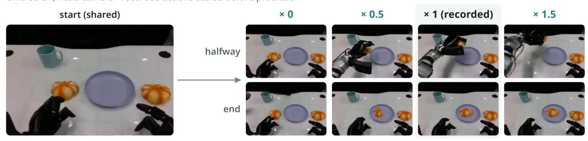

**Figure 8 Action following.** Unitree G1(헤드 카메라)의 시작 프레임이 기록된 상태 오프셋을 0, 0.5, 1, 1.5로 스케일링하여 앞으로 예측되었다. 각 열은 예측의 중간 지점(상단)과 끝(하단)을 보여준다. 오프셋이 0일 때 빵은 테이블 위에 머물며, 나머지 세 스케일에서는 플레이트 위에 도착하고, 중간 지점에서 스케일이 클수록 팔이 더 멀리 움직인다.

### **5.2 WorldArena 적응 및 결과** (WorldArena Adaptation and Results)

WorldArena 1.0은 구현된 비디오 생성을 위한 공개 벤치마크이며, 트랙 1은 시각 품질, 동작 품질, 내용 일관성, 물리 준수, 3D 정확도 및 제어 가능성으로 구성된 15가지 지표를 평가한다 [&#91;70](#page-27-13)]. 우리는 벤치마크가 허용하는 훈련 데이터를 사용해 GreenWAM을 적응시키고, 기록된 동작으로부터 테스트 에피소드를 예측한다. GreenWAM은 예측이 기록된 동작과 기하학을 일치시켜야 할 때 가장 강력하다: 비교된 세계-행동 모델 및 비디오 생성기 중에서 가장 높은 궤적, 깊이 및 3D 정확도(56.0, 98.2, 93.4)를 보이며, 보드의 127개 항목 중 JEPA 유사도에서 두 번째(98.41, BLM이 98.49 뒤)를 기록한다.

트랙 1의 액션 변형은 첫 번째 프레임과 보류된 에피소드의 로봇 동작을 제공하고 비디오를 요청한다. Figure [10](#page-13-1)은 두 개의 그런 에피소드를 보여준다. 이 변형은 과거를 포함한 순방향 역학에 매핑된다: 각 블록은 기록된 동작과 과거의 네 개 앵커에 조건화되며, 첫 번째 블록에서는 기록된 첫 번째 프레임을 반복한다 (Section [B.5)](#page-35-1)). 텍스트 프롬프트가 비어 있으므로 가이드 없이 35 단계로 샘플링한다 (Section [C.5)](#page-40-0)). 벤치마크의 구현체는 RoboTwin의 ARX5 팔을 갖고 있으며, 그 레이아웃 확장을 재사용한다. 따라서 벤치마크의 동작은 GreenWAM의 공유 프로젝션을 통해 들어오며, 자체 동작 프로젝션이 아니라 (Section [3.2](#page-4-0)).

전체 점수는 세 개의 동작 지표를 실제 값으로 제한한 뒤 보드의 15개 지표를 평균하여 계산한다. 이렇게 하면 모델이 기록된 로봇보다 더 많이 움직여 이득을 얻지 못하도록 한다:

$$\text{EWMScore} = \frac{1}{15} \sum_{k=1}^{15} \tilde{m}_k, \qquad \tilde{m}_k = \begin{cases} \min \left( m_k, \, m_k^{\text{GT}} \right), & k \in \mathcal{K}_{\text{motion}}, \\ m_k & \text{otherwise}, \end{cases} \tag{7}$$

여기서 모션은 동적 정도, 흐름 점수, 모션 부드러움을 포함한다. 이 지표들은 녹화 범위를 넘어선 모션을 보상하기 때문에 상한이 필요하다; WorldArena 2.0의 주최측은 이들이 도달한다는 것을 발견했다

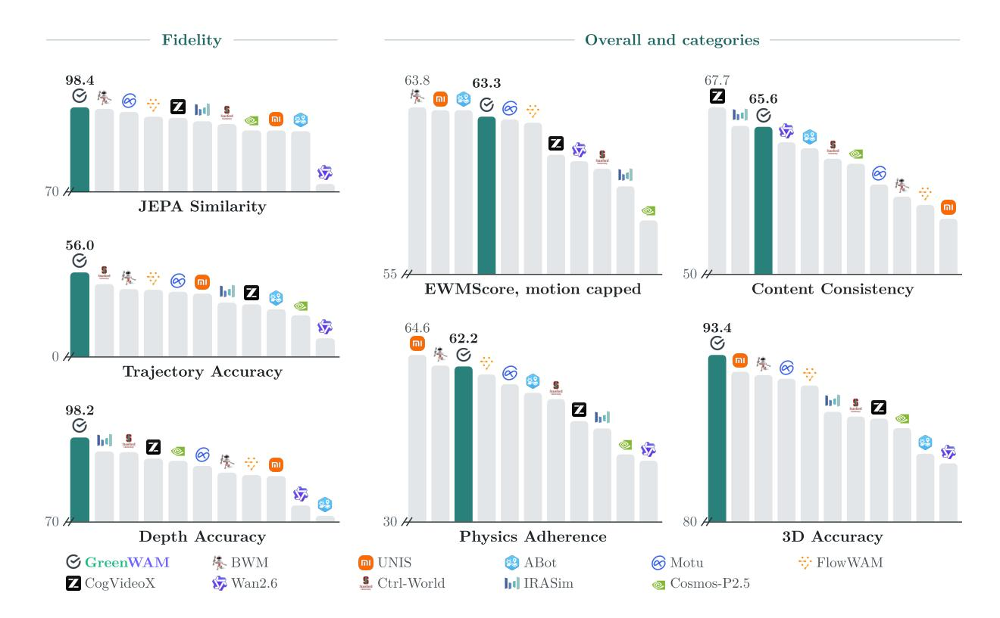

**Figure 9 WorldArena 1.0, track 1: GreenWAM이 리더보드 모델 중 하나입니다.** Fidelity: 실제 영상과의 일치도. JEPA similarity는 실제 영상과 생성 영상의 V-JEPA 특징 분포를 세트 수준에서 비교한다 (JEDi [[54&#93;](#page-27-14); 값이 높을수록 좋음); trajectory와 depth 정확도는 영상당 계산된다. 전체 및 카테고리: EWMScore (Equation ([7](#page-11-2))), dynamic degree, flow score, motion smoothness가 실제 영상에 맞춰 cap된 15개 보드 메트릭의 평균이며, 그 중 세 개 카테고리. GreenWAM은 모든 1,000개의 테스트 에피소드에서 영상당 cap된다; 다른 모델들은 리더보드 평균에 cap을 적용한다 [[84&#93;](#page-28-10), 이는 상한선을 제공한다. Controllability, visual quality, motion quality도 EWMScore에 포함되며 Table [11.](#page-40-1)에서 모든 카테고리와 함께 나열된다. Cut marks는 0에서 시작하지 않는 축을 식별한다.

동역학을 더 잘 모델링하지 않고 abnormally high 값을 보였으며 같은 규칙을 채택했다 [&#91;83](#page-28-11)]. WorldArena 1.0 보드의 127개 항목 중 112개가 dynamic degree에서 녹화 영상 기준을 초과하고 113개가 flow score에서 초과하며, 최고 항목은 각각 최대 4배와 8배 차이가 있다. cap 적용 시 선두 항목의 점수는 6~11점 감소한다; 예를 들어 UNIS는 73.64에서 63.65로 떨어지며, GreenWAM은 motion 점수가 기준 이하이므로 0.05만 감소한다.

이 집계에서 GreenWAM은 1,000개의 테스트 에피소드에서 63.31점을 기록한다 (Figure [9](#page-12-0)), 이는 공개된 world–action 모델 Motubrain [[56&#93;](#page-27-3) (63.16)와 FlowWAM-FiveAges [&#91;21](#page-26-1)] (62.99)보다 높으며, 재계산된 점수는 상한선이다. 다른 모델들의 점수는 동일한 motion cap 하에서 리더보드 항목으로부터 재계산되므로 보고서에 인용된 값과 다를 수 있다.

**The recorded videos as a reference.** 우리는 동일한 평가자를 사용해 실제 테스트 영상을 점수화한다. 그 점수는 67.23이며, 이는 모든 녹화를 정확히 재현하는 모델의 점수이다. 15개 메트릭 중 13개에서 GreenWAM은 이와 4점 이하 차이를 보인다. 뒤처지는 두 카테고리, visual quality와 controllability는 영상과 녹화본을 직접 비교하지 않는다: visual quality는 이미지 외관을 평가하고, controllability는 vision–language 판정자가 부여한다. 이 카테고리에서 많은 보드 항목이 실제 영상보다 높은 점수를 기록하므로, 이들은 녹화된 에피소드와의 일치보다 이미지 외관을 더 따르는 경향이 있다 (Section [C.1](#page-37-1)).

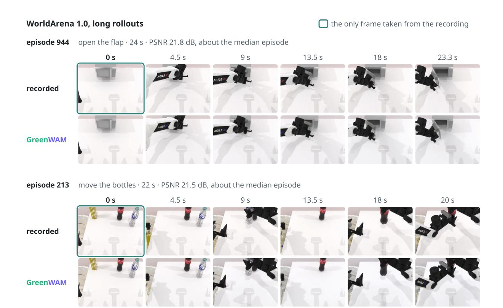

**Figure 10 Long WorldArena rollouts.** WorldArena 1.0의 두 테스트 에피소드, "open the flap"과 "move the bottles", 각각 20초 이상이며, 녹화본은 GreenWAM 예측과 6개의 시점에서 비교된다. 첫 번째 프레임(윤곽선 표시)만 녹화본에서 가져오며, 이후 모델은 약 7초 길이의 블록으로 기록된 행동을 따르며, 각 블록은 자신의 생성 프레임 4개에 조건부로 설정된다.

## **6 GreenWAM as a Policy (GreenWAM을 정책으로서)**

우리는 GreenWAM을 제어용으로 적응시켜, 미래 상태 궤적과 영상을 함께 예측한다. Sections [6.1](#page-13-0)과 [6.2](#page-14-0)는 정책을 얻는 방법을 설명한다: action expert는 생성기를 분리하고, 모든 벤치마크에 공통인 post-training을 수행하며, 각 벤치마크는 자체 시연, 명령 인터페이스 및 추론 설정을 유지한다. Section [6.3](#page-14-1)은 네 개의 시뮬레이션 벤치마크를 보고한다. 휴머노이드에서 실시간 제어는 더 빠른 정책이 유리하므로 Section [6.4](#page-17-0)은 정책을 한 단계 학생으로 증류하고 지연 시간을 측정하며, Section [6.5](#page-18-0)은 로봇에서 교사와 학생을 평가한다.

### 6.1 정책 아키텍처 (Policy Architecture)

GreenWAM의 로봇 단계에서 비디오 토큰과 액션 토큰은 하나의 생성기를 통과한다. 정책 적응을 위해 액션 토큰은 전용 트랜스포머로 이동하고 비디오 토큰은 생성기에 남아 있다. 공동 주의(attention)는 두 스트림을 각 레이어에서 연결하여 액션 예측이 시각적 동역학에 접근할 수 있도록 하면서, 스트림은 적응 과정에서 별도의 파라미터를 획득한다. 관련 전문가 아키텍처는 전문가가 초기화되는 방식에서 차이를 보인다 [[7,](#page-25-5) [99&#93;](#page-28-8)).

ℎ와 ℎ를 비디오 토큰과 액션 토큰이라고 하자. 생성기는 비디오 토큰을, 전문가(Expert)는 액션 토큰을 투영하고, 주의는 두 스트림을 함께 실행하며, 각 스트림은 자체 피드포워드 블록을 유지한다:

$$(Q,K,V)^z = W_G \, h^z, \quad (Q,K,V)^q = W_E \, h^q, \qquad \left[\tilde{h}^z; \tilde{h}^q\right] = \mathrm{Attn} \big([Q^z;Q^q], [K^z;K^q], [V^z;V^q]\big). \tag{8}$$

액션 전문가를 생성기 타워를 복사하여 초기화한다, ← . 전문가의 모양은 부모 타워와 동일하므로 분할은 초기화 시 예측을 바꾸지 않는다. 타워는 이후 사후 훈련 중에 분화된다. 전문가가 생성기 타워와 같은 수의 파라미터를 추가하고, 훈련 단계 시간의 약 8%를 더한다. Section [7.2](#page-22-0)에서는 분할이 가져오는 효과를 측정한다.

### 6.2 정책 사후 훈련 (Policy Post-Training)

정책 적응은 공동 비디오–상태 예측을 대상 로봇의 제어 루프에 연결한다. 각 벤치마크는 시연, 카메라 레이아웃 및 명령 인터페이스를 지정하며, 공통 학습 목표는 GreenWAM의 WAM 모드(Equation ([4)](#page-6-2); Section [B.5)](#page-35-1)에서의 레시피)이다.

**공유 레시피.** 정책은 작업 지시, 현재 카메라 캔버스 및 측정된 상태 0을 받고, 시점 범위에 걸친 상태 오프셋과 함께 미래 비디오를 예측한다. 훈련은 대상 로봇의 시연을 사용하며, 측정된 미래 상태를 감독으로 사용한다. 추론 시, 예측된 목표는 0 (Equation ([2)](#page-5-1))에 상대적으로 디코딩되어 로봇의 기본 명령 표현으로 변환된다. 컨트롤러는 예측의 접두사를 실행하고, 새로운 관측을 획득한 뒤 재계획한다. 디코더와 실행 간격은 각 애플리케이션에 특화된다.

**외관 증강.** 깨끗한 시연은 각 장면의 한 가지 외관을 보여주며, 장면을 무작위화하는 벤치마크는 다른 외관을 테스트한다. 두 가지 증강은 기하학을 건드리지 않고 이를 해결한다. 배경 교체: 샘플의 절반에서 정적 배경(테이블, 벽, 바닥)은 시뮬레이터에서 시연을 재생해 분할한 뒤, 원래 그림자를 보존하도록 원래 쉐이딩으로 조절된 프로시저 텍스처로 교체된다; 이는 시뮬레이터가 분할에 필요하며 RoboTwin에서 사용된다. 색상 증강은 각 카메라 이미지를 독립적으로 색을 변형시킨다; 이는 샘플의 80%에 적용되며 크롭이나 회전은 추가하지 않는다. Section [7.5](#page-24-0)에서는 배경 교체가 가져오는 효과를 측정한다.

각 벤치마크별 레시피, 카메라 레이아웃, 데이터 양 및 실행 설정은 Section [B.5](#page-35-1)에 제시된다.

### 6.3 시뮬레이션 벤치마크 (Simulation Benchmarks)

우리는 RoboTwin 2.0, CALVIN, RoboDojo 및 LIBERO에서 적응된 정책을 평가한다. 대상 벤치마크 프로토콜은 Table [9](#page-38-0) 및 Section [C.](#page-37-0)에 명시되어 있다. RoboTwin, RoboDojo, CALVIN 또는 LIBERO 데이터는 GreenWAM 코퍼스에 포함되지 않는다. 정책은 벤치마크별 denoising 단계, 가이드 및 재계획 간격을 사용한다](#page-35-1)). 다른 방법의 결과는 각 표에 기재된 대로 보고서나 리더보드에서 가져온다. Figure [11](#page-16-0)은 네 벤치마크를 요약하고, Section [D.1](#page-40-2)는 전체 CALVIN, RoboDojo 및 LIBERO 표를 제공한다.

#### 6.3.1 RoboTwin 2.0 (RoboTwin 2.0)

RoboTwin 2.0에서 GreenWAM은 리더보드 상위 항목 중 하나의 점수를 기록한다(Table [3)](#page-15-0); Figure [12](#page-17-1)은 정제된 설정과 무작위 설정에서 하나의 작업을 보여준다. 리더보드는 사후 훈련 데이터와 각 작업당 50개의 정제된 시연을 고정하지만 사전 훈련은 고정하지 않는다.

우리 RoboTwin 정책은 정제된 설정에서 86.98%, 무작위 설정에서 48.10%의 성공률을 달성하며, 두 설정에서 각각 50개 작업에 대해 100번의 시도를 수행해 평균 67.54%를 기록한다. 이는 공식 시드에 대한 리더보드 프로토콜에 따라 평가된다. 고정된 적응 예산에서의 통제된 비교는 두 설계 선택을 모두 지지한다: GreenWAM에서 초기화하고 적응 시작 시 행동 전문가를 분리하는 것이 Cosmos 3 Edge에서 적응된 단일 타워 정책보다 정제 성공률을 10.8% 향상시킨다(Sections [7.1](#page-21-0) 및 [7.2)](#page-22-0)). 리더보드는 정제된 시연만을 사용해 훈련하며; Section [7.5](#page-24-1)은 개별 장면 변화가 무작위 성공률에 미치는 영향을 조사한다.

GreenWAM 코퍼스에는 RoboTwin 데이터가 포함되어 있지 않으나, 사전 훈련은 정책이 무작위 RoboTwin 시연에 노출될 수 있다. ME-Dex-1.0은 Motus 전문가를 [[99&#93;](#page-28-8)] 상속하며, Motus와 X-WAM은 27,500개의 RoboTwin 사전 훈련 에피소드를 나열한다. 이는 2,500개의 정제 시연과 25,000개의 무작위 시연 세트와 일치한다([[7,](#page-25-5) [30](#page-26-16)]); WorldScape Policy 2.0은 35.7천 개를 나열하지만 분할을 명시하지 않는다 [&#91;74](#page-27-15)]. Table [3](#page-15-0)은 사전 훈련에 무작위 RoboTwin 장면이 포함된 두 개의 리더보드 항목을 표시한다.

#### **6.3.2 CALVIN (CALVIN)**

CALVIN은 정책이 보지 못한 환경에서 언어 조건화된 기술을 체인으로 연결할 수 있는지를 테스트한다: 각 성공적인 지시가 장면을 재설정하지 않고 다섯 단계의 체인을 진행하므로 이전 오류가 이후 지시로 이어진다. 우리는 환경 A, B, C에서 적응하고 D의 데이터는 사용하지 않으며, 1,000개의 체인에서 평가한다.

Table 3 RoboTwin 2.0, 50 tasks. Average success rate, %.

| 방법 | 클린 | 랜덤화된 | 평균 |
|------------------------------------------|----------------------------|------------|---------|
| 리더보드: 50개의 클린 시연 per | · 작업 |  |  |
| ME-Dex-1.0 [99] † | 89.6 | 68.1 | 78.8 |
| OLA-Sem | 75.1 | 67.6 | 71.3 |
| GigaBrain-0.7 [26] | 66.8 | 67.9 | 67.3 |
| WorldScape Policy 2.0 [74] | 84.9 | 38.5 | 61.7 |
| 4D-WAM [88] | 81.5 | 41.8 | 61.6 |
| $\pi_{0.5}$ [62] | 70.7 | 46.0 | 58.4 |
| OLA-Geo | 83.0 | 33.6 | 58.3 |
| Spatial Forcing [41] | 77.2 | 26.7 | 52.0 |
| $X-WAM^{\dagger}$ [30] | 70.0 | 25.8 | 47.9 |
| X-VLA [103] | 68.0 | 20.9 | 44.5 |
| ABot-M0 [90] | 57.4 | 30.4 | 43.9 |
| EventVLA [87] | 65.6 | 15.7 | 40.6 |
| Xiaomi-Robotics-0 [15] | 62.9 | 18.2 | 40.5 |
| Fast-WAM [95] | 77.8 | 1.9 | 39.9 |
| GalaxeaVLA [35] | 62.7 | 12.7 | 37.7 |
| AHA-WAM [14] | 64.3 | 3.2 | 33.8 |
| starVLA [73] | 46.5 | 3.2 | 24.8 |
| GreenWAM, 리더보드 프로토콜 | 86.98 | 48.10 | 67.54 |
| 리더보드 외부: 클린 시연 | 시연만, 자체 평가 | l |  |
| Qwen-RobotManip-Context [94] | 84.7 | 69.4 | 77.05 |
| 출판: 클린 및 랜덤화된 시연 | 시연 |  |  |
| $\pi_0$ [11] | 65.92 | 58.40 | 62.16 |
| $\pi_{0.5}$ [62] | 82.74 | 76.76 | 79.75 |
| X-VLA [103] | 72.80 | 72.84 | 72.82 |
| DeMaVLA [75] | 88.42 | 86.78 | 87.60 |
| Motus [7] | 88.66 | 87.02 | 87.84 |
| Fast-WAM [95] | 91.88 | 91.78 | 91.83 |
| DSWAM [106] | 92.38 | 91.90 | 92.14 |
| LingBot-VA [42] | 92.9 | 91.6 | 92.25 |
| LingBot-VA 2.0 [97] | 93.8 | 93.4 | 93.6 |
| Motubrain [56] | 95.8 | 96.1 | 95.95 |

우리는 50개의 깨끗한 시연을 각 과제마다 사용해 훈련되는 공식 리더보드(공동 훈련 트랙으로, 깨끗한 시연과 무작위 시연 성공률 평균으로 정렬됨; 단일 과제 기준 베이스라인인 $\pi_0$, DP3, RDT, ACT 및 DP는 평균 31.4 이하이므로 생략됨) [68]; †: 사후 훈련이 시작되는 체크포인트는 무작위 RoboTwin 장면에서 훈련됨. GigaBrain-0.7, WorldScape Policy 2.0 및 OLA-Geo, 그리고 리더보드 외부의 Qwen-RobotManip 보고서는 사전 훈련에 무작위 RoboTwin 장면이 포함되었는지 여부를 명시하지 않으며, 이 두 블록의 다른 항목들에서는 포함되지 않았음. 리더보드 외부: 깨끗한 시연만을 훈련하지만 자체 평가를 사용하는 보고서: Qwen-RobotManip-Context with joint control [94] (Table 5, easy and hard settings). 하단 블록: 500개의 무작위 시연을 각 과제에 추가하여 훈련한 공개 결과(모투스, Fast-WAM, LingBot-VA, LingBot-VA 2.0 및 Motubrain에 대해 명시됨), DSWAM [106] (Table 1)에서 보고된 $\pi_0$, $\pi_{0.5}$, DeMaVLA, Motus, Fast-WAM 및 DSWAM; Motus [7] (Table 2)에서 X-VLA; LingBot-VA 저장소 [66]에서 LingBot-VA; LingBot-VA 2.0 [97] (Table 1) 및 Motubrain [56] 보고서. GreenWAM은 리더보드 프로토콜을 따르며 해당 블록에 나열됨.

D (Table 12; Section C의 프로토콜). GreenWAM은 평균 4.64개의 명령을 체인당 수행하며, 표준 오차는 약 0.03이며, 이는 FLOWER(4.53)를 초과한다.

#### 6.3.3 RoboDojo (RoboDojo)

RoboDojo는 시뮬레이션에서 일반화, 정밀도, 장기 실행, 메모리 및 개방형 어휘 지시를 테스트한다 (Table 13). 그 과제들은 RoboTwin과 동일한 ARX5 팔을 사용한다. RoboDojo의 집계 결과는

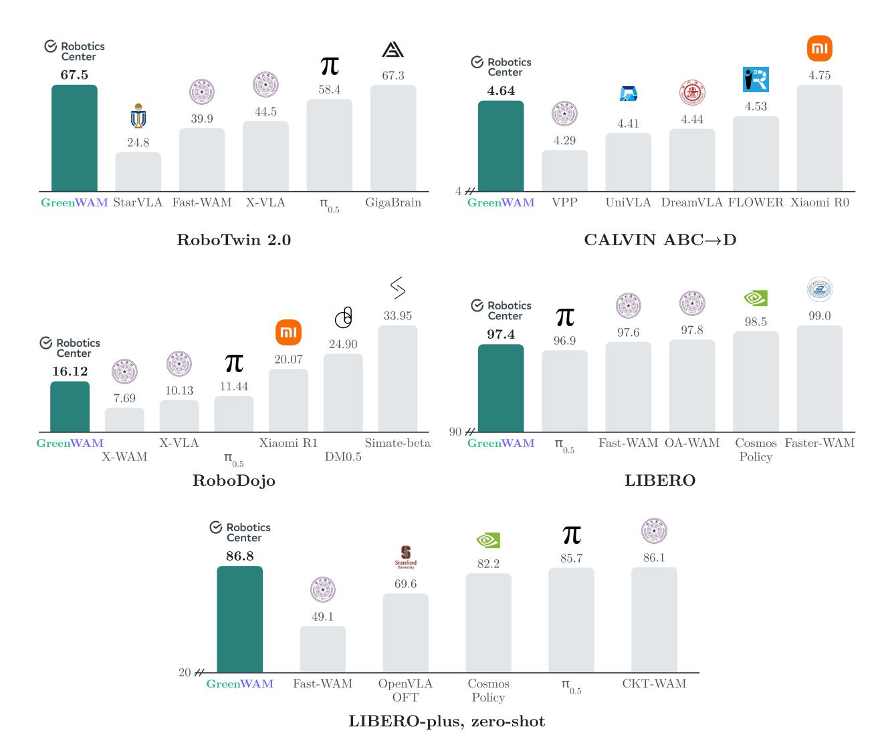

Figure 11 조작 벤치마크. GreenWAM(각 패널의 첫 번째 막대)과 Tables 3, 12, 13 및 공개 LIBERO[48]와 LIBERO-plus[24] 결과에서 선택된 베이스라인. RoboTwin은 50개의 과제에 대해 100번의 시도당 평균 깨끗/무작위 성공률을 보고하며, 무작위 RoboTwin 장면에서의 사전 훈련은 Table 3에 표시된다. LIBERO는 네 개의 과제 세트에 대한 평균 성공률을 보고하고, LIBERO-plus는 모든 변형 에피소드에 대한 제로샷 성공률을 보고한다; GreenWAM의 두 값은 동일한 정책( Table 14)에서 나온다. LIBERO와 LIBERO-plus 값 및 그 출처는 Table 14에 나열된다. 컷 마크는 0이 아닌 축을 식별한다.

각 개별 과제보다 다섯 가지 역량 차원에 동일한 가중치를 부여한다. 공식 훈련 세트에서 훈련되고 공식 리더보드와 비교할 때, GreenWAM은 16.12의 점수와 10.49%의 성공률을 달성하며, 두 집계 지표 모두에서 $\pi_{0.5}$, X-VLA 및 X-WAM보다 높다. 레시피는 Section B.5에 제시된다.

#### RoboTwin 2.0 · "stack blocks two" (RoboTwin 2.0 · "stack blocks two")

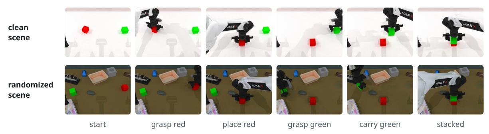

**Figure 12 RoboTwin 2.0 rollouts of the GreenWAM policy.** The task stack_blocks_two는 깨끗한 장면(상단)과 무작위 장면(하단)에서 수행된다. 헤드-카메라 프레임은 여섯 단계에서: 시작, 빨간 블록 잡음, 빨간 블록 배치, 초록 블록 잡음, 초록 블록 운반, 탑 건설. 두 에피소드 모두 성공한다.

#### **6.3.4 LIBERO and LIBERO-plus** (LIBERO 및 LIBERO-plus)

LIBERO는 프랑카(Franka) 팔을 사용한 단일 팔 조작을 시뮬레이션에서 네 가지 작업 세트(공간 배치, 물체, 목표 및 작업 길이 변동)에서 평가한다 [[48](#page-27-20)]. 최근 정책들은 평균 성공률이 96%를 초과한다. LIBERO-plus는 LIBERO 작업을 그대로 두고 카메라 시점부터 물체 배치까지 일곱 개 축을 따라 변형한다 [24](#page-26-22)]. 제로샷 설정에서 표준 LIBERO로 훈련된 정책을 변형된 에피소드에서 평가하면, 표준 세트가 숨기는 견고성 격차가 드러난다: 예를 들어 Fast-WAM [[95](#page-28-2)]은 LIBERO에서 97.6%, LIBERO-plus에서 49.1%를 달성한다 [100](#page-28-17)] (표 14(#page-41-1)). 단일 팔 프랑카 구현체는 로보틱스 코퍼스에 없으며, 그 가족들은 모두 양팔이다. 하나의 정책으로 GreenWAM은 LIBERO에서 전용 정책에 근접하고, 표 14(#page-41-1)에서 가장 높은 제로샷 LIBERO-plus 성공률을 달성한다. 그림 31(#page-42-0)은 일반적인 실패 사례를 보여준다.

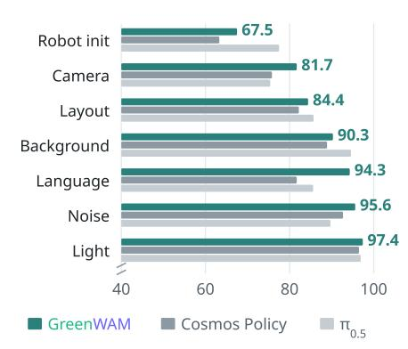

**그림 13 LIBERO-plus by axis.** 제로샷 성공; 기준선은 [[52](#page-27-21).

조명, 센서 노이즈, 언어 변형에서 성공률이 가장 높으며, 그곳에서 GreenWAM이 두 기준선을 앞선다 (그림 13(#page-17-2)). 시점이 바뀐 경우, 성공률은 81.7%로 두 기준선보다 높다. 배경이 바뀐 경우에도 RoboTwin에서 사용되는 배경 교체 없이 처리된다. RoboTwin은 시뮬레이터 세분화가 필요하다.

### **6.4 실시간 제어를 위한 증류**

우리는 적응된 정책을 모달리티별 일관성 목표를 갖는 한 단계 학생으로 증류한다, Flash-WAM [[4](#page-25-7)] (그림 14(#page-18-1))을 따른다. 학생은 교사의 관측, 상태 표현 및 비디오–액션 결합 출력을 그대로 유지하며, 배포 시에만 샘플링이 바뀐다. 우리는 고정된 교사, 학습 가능한 학생 및 EMA 목표 학생을 적응된 정책에서 초기화한다. Flash-WAM이 비디오와 액션에 별도 노이즈 스케줄을 사용하는 것과 달리, 비디오 잠재 변수와 액션 청크는 하나의 노이즈 수준을 공유한다. 교사는 4개의 노이즈 수준을 공유하는 스케줄의 인접 수준 사이를 이동하며, 더 노이즈가 많은 샘플에서 덜 노이즈가 있는 샘플로 이동한다. 교사는 지침과 빈 프롬프트를 사용해 두 번 통과하고, 비디오에 가이던스를 적용한다(스케일 3–4) 그러나 액션에는 적용하지 않는다; 학생은 두 지점에서 일관된 깨끗한 예측을 생성하도록 학습하며, 낮은 노이즈 목표는 EMA 학생에 의해 제공되고 기울기에서 분리된다.

비디오와 액션 목표는 별도의 일관성 맵을 사용한다. 비디오 맵은 노이즈에 따라 스킵 및 출력 계수를 사용하고, 액션 맵은 깨끗한 상태 목표를 직접 추정한다(− ̂ ). Flash-WAM이 정규화된 기준선에서만 사용하는 액션 흐름 매칭 항목은 학생을 시연 목표에 고정시킨다:

$$\mathcal{L}_{\text{distill}} = \lambda_v \mathcal{L}_{\text{CD},v} + \lambda_a \mathcal{L}_{\text{CD},a} + \lambda_{\text{FM}} \mathcal{L}_{\text{FM},a}. \tag{9}$$

손실 거리, 가중치 및 EMA 감쇠는 섹션 [B.5](#page-35-1)에 명시되어 있다.

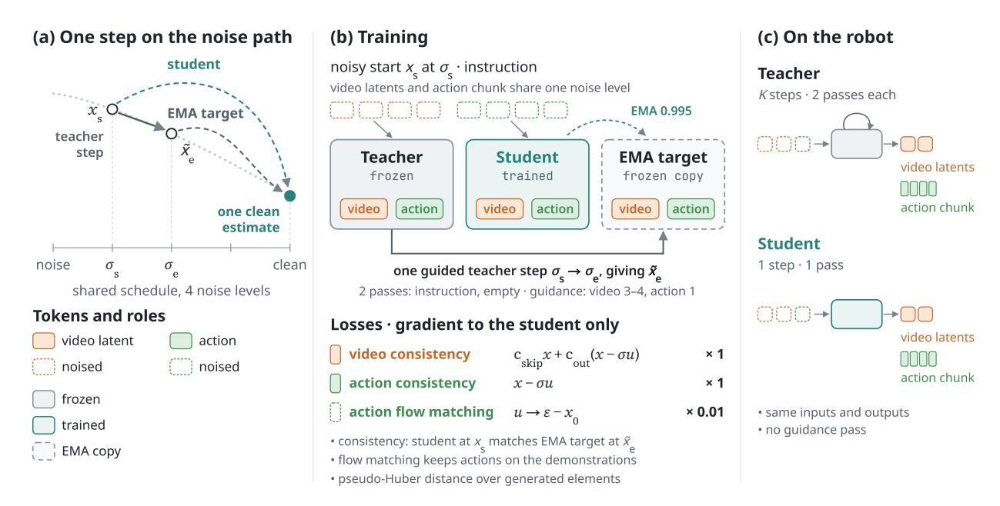

Figure 14 정책의 일관성 증류. 손실은 Equation (9)의 손실이다. (a) 공유 노이즈 경로에서 한 단계: 교사는 스케줄의 인접한 앵커 사이에서 $x_s$ 에서 $\tilde{x}_e$ 로 이동하고, 학생은 $x_s$ 에서, 지수 이동 평균(EMA) 타깃인 $\tilde{x}_e$ 에서 동일한 정제된 추정치를 제공해야 한다. (b) 훈련: 고정된 교사, 훈련된 학생 및 그 EMA 복사본을 타깃으로 사용; 비디오 및 액션 일관성 손실과 액션 흐름 매칭 항목, 기울기는 학생에게만 적용된다. (c) 로봇에서 학생은 교사의 가이드된 다중 단계 샘플링을 한 단계와 한 패스로 대체한다. 레시피는 Flash-WAM [4]를 따르며, 두 스트림 모두에 하나의 노이즈 수준을 사용하고 추가된 액션 흐름 매칭 항목을 포함한다.

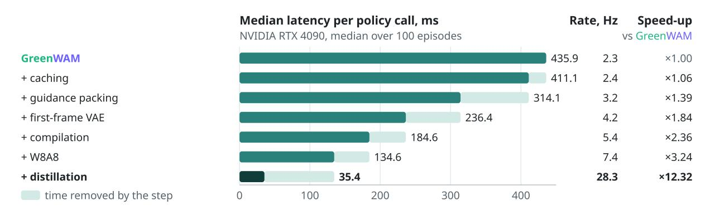

Figure 15 NVIDIA RTX 4090에서의 정책 추론 지연. 100 에피소드에 걸친 정책 호출당 평균 지연. 최적화는 GreenWAM 정책에 누적적으로 적용되며, 각 행의 밝은 구간은 해당 단계에서 제거된 시간이다. 속도 향상은 최적화되지 않은 GreenWAM에 대한 상대값이며, Table 10은 첫 번째 액션까지의 시간도 제공한다.

지연. 지우기 단계에서 명령어와 시각 키-값 상태를 캐싱하고, 분류기-프리 가이던스의 두 가지 분기를 한 번에 평가하며, 조건화 프레임만 인코딩하고, 생성기를 컴파일하고, 8비트 가중치와 활성화로 피드포워드 레이어를 실행하면 GreenWAM 정책이 134.6 ms(그림 15)로 달라진다. 증류는 이후 네 단계의 가이드된 지우기 단계 대신 한 단계의 일관성 단계로 대체한다: 증류된 정책은 35.4 ms에 응답하며, 최적화된 교사보다 3.8배, 최적화되지 않은 정책보다 12.3배 빠르고, 28.3 Hz를 달성한다. 증류는 로봇의 온보드 컴퓨터에서 가장 큰 효과를 보이며, 그 컴퓨팅 예산은 RTX 4090보다 훨씬 낮다; 학생을 그곳에서 실행하는 것이 다음 단계(섹션 8)이다. 섹션 C.3은 벤치마크와 각 최적화를 설명하고, 섹션 6.5는 휴머노이드에서 증류된 정책의 작업 성공률을 보고한다.

### **6.5 실세계 휴머노이드 평가 (Real-World Humanoid Evaluation)**

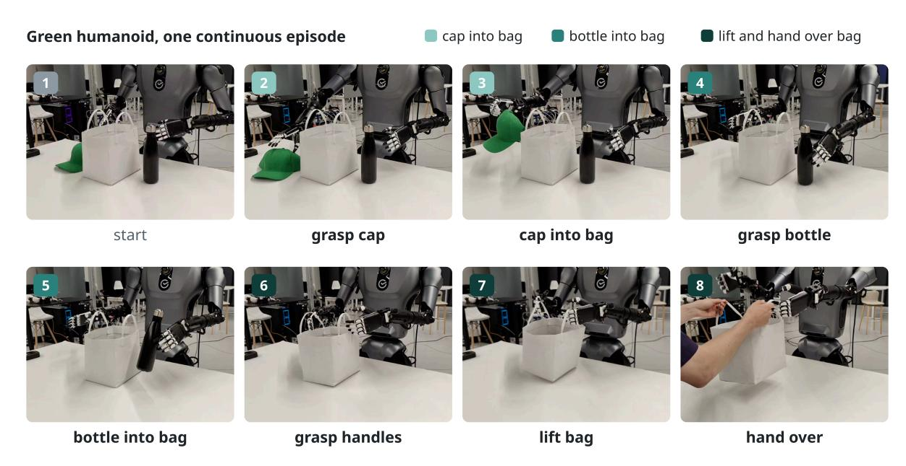

**Figure 16 GreenWAM 정책 추론 on the Green humanoid.** 한 연속 에피소드의 여덟 프레임, 측면 카메라에서 잘라낸 것: 로봇은 캡과 병을 가방에 넣고, 가방을 손잡이로 들어서 사람에게 건네준다. 색상은 세 개의 하위 작업을 표시한다.

우리는 Green humanoid가 병과 캡을 가방에 넣고, 가방을 양손으로 들어 올리는 포장 작업에서 정책을 평가한다. 평가를 위해 작업은 다섯 개의 연속 명령으로 주어지며, 각 객체를 잡고 놓고, 그 다음에 가방을 들어 올린다; 각 명령은 객체를 명시하고, 단일 팔 동작의 경우 사용할 손을 지정하며, 장면은 재설정되지 않는다. 변형은 다른 병을 사용하고, 픽 앤 플레이스 단계를 왼손 또는 오른손에 할당한다. 우리는 각 명령에서 성공 여부를 측정한다. Figure [16](#page-19-1)은 포장 롤아웃과 사람에게 인계하는 과정을 보여준다.

우리는 동일한 시연 분할을 사용하여 0.5 [&#91;62](#page-27-1), [61&#93;](#page-27-22), Cosmos 3 Edge [[58](#page-27-0)] 및 GreenWAM을 적용한다. 또한 증류된 GreenWAM 정책(섹션 [6.4](#page-17-0))을 교사와 비교 평가한다.

**Observation and control.** 모든 정책은 작업 명령, 현재 카메라 관측 및 측정된 로봇 상태를 받는다. 카메라와 제어되는 관절은 모든 정책에서 동일하며, 전처리 및 액션 표현은 각 모델의 적응 레시피(섹션 [B.5](#page-35-1))를 따른다. GreenWAM, 그 증류 학생 및 Cosmos 3 Edge 정책은 호출당 16개의 액션을 예측하고, 0.5는 50개의 액션을 예측한다.

**In-distribution (ID) and out-of-distribution (OOD) 평가.** ID 시도는 정책 적응에 나타난 객체와 장면을 새로 재설정한다; OOD 시도는 작업은 그대로 두되 적응에서 제외된 객체나 장면 조건을 변경한다. 각 정책은 14개의 장면 구성에서 70개의 지침을 평가하며, 그 중 9개는 ID, 5개는 OOD이며, 지침당 한 번 시도한다. 지침은 타임아웃 전에 인간의 도움 없이 완료되면 성공으로 간주되며, 성공률은 각 분할에서 성공한 지침의 비율이다 (Figure [17;](#page-20-0) protocol in Section [C.2]) . GreenWAM은 ID 시도에서 95.6%, OOD 시도에서 84.0%를 성공하며, Cosmos 3 Edge 정책(88.9% 및 80.0%)과 0.5(84.4% 및 76.0%)보다 앞선다.

**Distilled policy.** 교사와 증류된 학생은 동일한 관측, 행동 수평 및 재계획 일정을 사용하므로 성공률이 직접적으로 비교 가능하다 (Figure [17)](#page-20-0): 학생은 91.1% ID와 80.0% OOD 성공을 달성한다.

네 개의 시뮬레이션 벤치마크와 휴머노이드에서 동일한 기반과 동일한 행동 인터페이스가 그리퍼를 갖춘 양팔 로봇, 단일 팔 프랑카, 다재다능한 손을 가진 휴머노이드에 대한 정책을 생성한다. 섹션 [7](#page-19-0)에서는 이러한 결과 뒤에 있는 선택들을 분리한다.

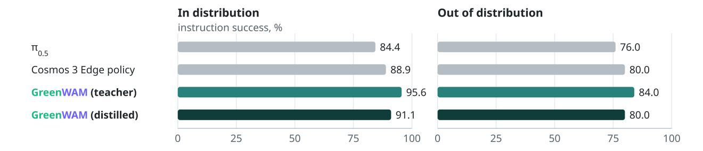

**Figure 17 Green humanoid에서의 명령 성공률.** In-distribution 및 out-of-distribution 성공률은 네 가지 정책의 각 분할에서 성공한 명령의 비율(Equation [(14](#page-39-3)))을 나타낸다. 교사와 증류된 학생은 동일한 실행 설정으로 실행된다.

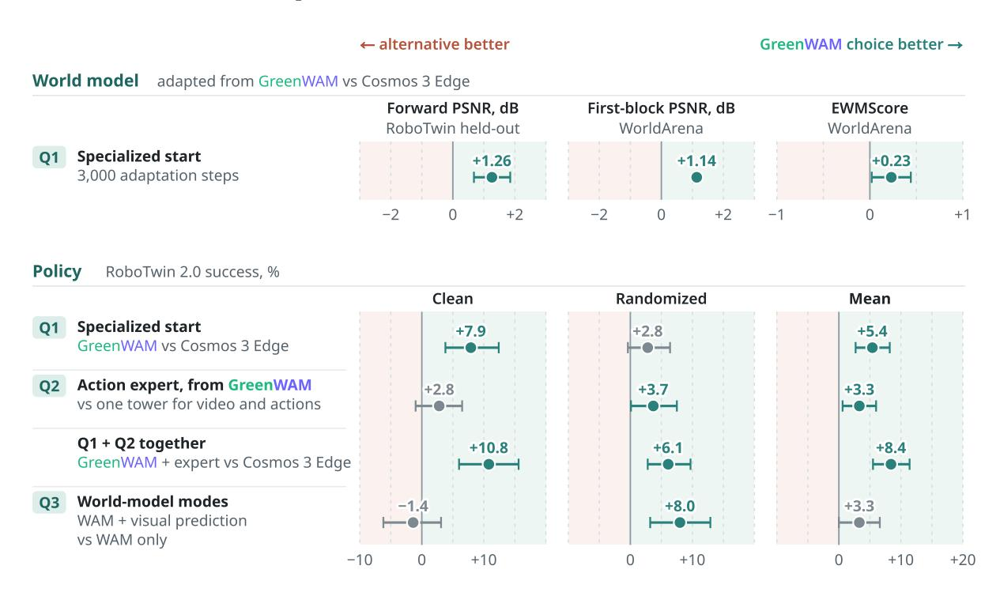

**그림 18 고정 예산에서의 통제된 비교.** 쌍 차이 (Equation [(15](#page-40-3)))는 작업과 에피소드에 대한 계층적 부트스트랩에서 95% 신뢰 구간을 갖는다; 부호는 GreenWAM에서 선택한 것과 대안의 차이이며, 청록색은 0을 제외하는 구간을 표시한다. 세계 모델: 50개의 보류된 RoboTwin 윈도우에서의 전방 PSNR, 그리고 1,000개의 WorldArena 테스트 에피소드에서의 첫 블록 PSNR 및 제한된 EWMScore, 에피소드별 부트스트랩; 각 열은 자체 스케일을 가짐. 정책: 50개의 작업에서 20개의 시도와 설정을 가진 RoboTwin 2.0 성공률. 세계 모델 모드: 시각 예측이 있는 WAM, 즉 전방 역학 및 이미지-투-비디오가 각각 0.05의 가중치를 가지며 WAM 옆에 0.9, WAM만과 비교. Q1: 로봇 전문화, GreenWAM 대 Cosmos 3 Edge; Q2: 단일 타워에 대한 행동 전문가, 둘 다 GreenWAM에서; Q3: 정책 적응 중에 유지된 세계 모델 모드. Q1 + Q2 행은 시작 시 분리된 행동 전문가와 함께 GreenWAM을 단일 타워 Cosmos 3 Edge 실행과 비교한다; 각 쌍은 두 실행의 공통 시드에서 추정된다 (Equation [(15)](#page-40-3)), 따라서 이 행은 Q1과 Q2의 합과 일치할 필요가 없다.

## **7 Empirical Analysis**

우리는 공유 기반을 적응시키는 세 가지 선택을 테스트한다: 로봇 전용 초기화, 독립적인 행동 전문가, 그리고 정책 적응 중 세계 모델 모드의 보존. 각 비교는 하위 데이터와 적응 예산을 고정한다 (Figure [18)](#page-20-1)). 그 다음에 개별 장면 변화가 정책에 미치는 영향과 외관 증강이 회복하는 바를 조사한다; 평가 세부 사항은 Section [C.5](#page-40-0)에 명시되어 있다.

**Comparisons.** 아래에 쌍이 명시되어 있다; 추가 비교는 첫 번째와 두 번째 선택(그림 18의 행 Q1 + Q2)을 결합한다.

- 로봇 전문화. GreenWAM과 그 부모인 Cosmos 3 Edge는 동일한 레시피를 사용해 3000 단계 동안 적응된다: WorldArena 1.0에 적용하고, 1000 테스트 에피소드를 평가하며, RoboTwin 2.0을 단일 타워 정책으로 적용하고, 각 작업 및 설정마다 20번의 시도를 평가한다; 두 RoboTwin 정책은 50개의 보류된 클립에 대한 전방 예측으로도 비교된다.  
- 액션 전문가. GreenWAM에서 단일 타워 RoboTwin 정책은 동일한 레시피로 훈련되었지만 시작 시 액션 전문가를 분리한 정책과 비교된다; 각 정책은 3,000 단계씩 훈련된다.  
- 월드‑모델 모드. 두 실행은 동일한 RoboTwin 정책에서 워밍 스타트되며, 전체 레시피로 훈련된다: WAM 0.9, 전방 역학 및 이미지‑투‑비디오 각각 0.05. 한 실행은 이 혼합을 계속하고, 다른 실행은 WAM만 사용한다; 각 실행은 2,500 단계씩 훈련된다.

쌍의 두 실행은 동일한 평가 코드, 샘플러 및 시드를 사용해 평가된다.

**통계.** 차이는 벤치마크와 같이 작업별 평균을 내며, 95% 신뢰 구간은 작업 및 에피소드를 대상으로 한 계층적 부트스트랩에서 도출된다 (Section C.4).

### 7.1 로봇 전문화가 각 역할에 가져다 주는 것 (What Robot Specialization Brings to Each Role)

GreenWAM에서 시작하면 고정된 적응 예산에서 전방 예측과 정책 성공을 모두 향상시킨다. 우리는 GreenWAM과 그 부모인 Cosmos 3 Edge를 동일한 레시피와 예산으로 한 번은 세계 모델로, 한 번은 정책으로 적용한다. 부모는 조인트-스페이스 액션 투영(joint-space action projections)을 처음부터 학습해야 하는데, 이는 조인트-스페이스 액션에 필수적이다. 반면 프롬프트 형식, WAM 모드, 다중 카메라 캔버스는 둘 다에 기본적으로 제공된다.

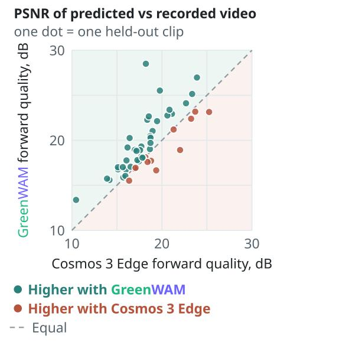

**그림 19: 보류된 클립별 전방 PSNR** GreenWAM 및 Cosmos 3 Edge 정책의: 50개의 RoboTwin 클립 중 38개가 대각선 위에 있다.

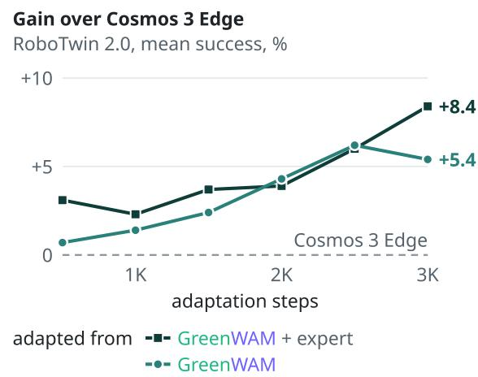

그림 20: 적응 중 Cosmos 3 Edge 대비 이득. 평균 RoboTwin $2.0~{\rm success}$ (그림 18).

**World model.** 우리는 Section 5.2의 레시피를 사용해 3000 스텝 동안 두 체크포인트를 WorldArena에 적응시키고, 모든 1000 테스트 에피소드에서 비교한다. 로봇 전문 체크포인트에서 적응된 모델이 87.1%의 에피소드에서 기록에 더 가깝다. PSNR은 첫 번째 블록에서 1.1 dB 상승하고, 기록된 프레임만으로 생성되며, 이후 블록에서는 1.2 dB 상승한다. 이는 모델의 자체 프레임에서 계속되므로 오류가 약 1/4 감소하고 이득이 자기회귀 연속을 통해 지속된다. 특수화는 GreenWAM이 가장 강한 지표를 개선한다: 경로 정확도는 3.0 상승(44.4에서 47.4로), 깊이 정확도는 0.5 상승(96.65에서 97.12로). 종합 점수는 0.23 상승하며, 대부분 물리 준수(+1.3)에서 비롯된다.

아래 비교된 RoboTwin 정책은 보류된 프레임에서도 동일한 효과를 보인다. 각 작업마다 하나의 보류된 윈도우에서, GreenWAM에서 적응된 정책이 부모에서 적응된 정책보다 다음 20 프레임을 1.3 dB 더 정확하게 예측하고, 50개의 윈도우 중 38개에서 기록에 더 가깝다 (그림 [19])

**정책.** RoboTwin 2.0에 single-tower 레시피로 3,000 스텝 동안 적응시킨 결과, GreenWAM에서 적응된 정책이 부모에서 적응된 정책보다 더 자주 성공한다: 깨끗한 장면에서 7.9 %, 평균 5.4 % (그림 [18])

이점은 훈련 초기에 나타나며 지속된다: 500 스텝 후 1 % 미만, 2,500 스텝에서 6.2 %, 3,000 스텝에서 5.4 % (그림 [20]). 검증 손실은 다르게 동작한다: GreenWAM은 8.15, 부모는 19.61로 크게 차이 나며, 3,000 스텝에서 거의 일치한다(1.51과 1.56), 반면 폐쇄 루프 성공률의 격차는 남아 있다. 이점은 WAM 모드만으로 훈련된 부모와 비교해도 유사하다(5.2 %). 특수화 시작에 행동 전문가를 추가하면(Section [7.2]) 평균 8.4 %, 깨끗한 장면에서 10.8 %로 확대된다. 실제 휴머노이드에서는 0.5, 부모, GreenWAM에서 적응된 정책을 비교해 같은 질문이 제기된다(Section [6.5])

### **7.2 세계 모델을 행동에 결합하기 (Coupling the World Model to Action)**

적응 시작 시 행동 전문가를 분리하면 정책 성공률이 증가하면서 초기 예측은 보존된다. 정책 적응 중에 GreenWAM은 행동 토큰을 전문가(Equation ([8)](#page-13-2))로 이동시키는데, 이 전문자는 생성기 타워의 정확한 복사본으로 시작하므로 분리는 학습 가능한 파라미터화를 변경하지만 초기 예측은 바꾸지 않는다(Section [6.1](#page-13-0)). 따라서 두 실행은 동일한 함수에서 시작한다.

GreenWAM을 Section [7.1](#page-21-0)의 레시피로 3 000 스텝 동안 훈련시킨 결과, 전문가를 사용한 정책은 공유 생성기를 유지한 정책보다 평균 3.3% 더 높은 성공률을 보이며, 깨끗한 장면에서는 2.8%, 무작위 장면에서는 3.7% 더 높다. 성공률은 깨끗한 장면에서 28개 과제에서 상승하고 11개 과제에서 하락하며, 무작위 장면에서는 22개 과제에서 상승하고 7개 과제에서 하락한다. 이 이득은 거의 동일한 검증 손실(전문가 사용 시 1.503, 사용하지 않을 때 1.510)과 함께 나타난다.

### **7.3 정책 적응 중 세계 모델 모드 보존 (Retaining World-Model Modes during Policy Adaptation)**

정책 적응 중 세계 모델 모드를 보존하면 장면 변화에 대한 견고성이 향상된다. RoboTwin에서 정책 적응은 WAM 모드를 훈련시키고, 순방향 예측과 이미지-비디오 생성 모드의 작은 비율(0.9, 0.05, 0.05)을 유지한다. WAM만을 사용한 경우와 비교해, 동일 체크포인트에서 2,500 스텝 훈련 후 동일하게 평가했을 때, 추가 모드가 무작위 성공률을 8.0% 상승시켰으며, 50개 과제 중 31개에서 이득을 보이고 9개에서 손실을 보였고, 정제된 성공률에는 유의미한 변화가 없었다 (Figure [21](#page-22-2)). 두 실행 모두 WAM 모드 내에서 비디오를 예측하므로, 성과 향상은 비디오 예측 자체가 아니라 추가 모드에서 비롯된다. 훈련 예시의 1/10을 받는 모드들은 WAM 목표만으로는 잃어버리는 장면 변화에 대한 견고성을 보존한다.

세 가지 비교를 종합하면, 공유 기반이 정책으로서 작동하도록 만드는 요소가 드러난다: 로봇 특화, 생성기에서 복사된 행동 전문가, 그리고 보존된 세계 모델 모드가 각각 고정된 적응 예산에서 성공률을 높이며, 특히 마지막 요소는 무작위 장면에서 주로 효과를 보이고, 특화는 동시에 세계 모델을 개선한다.

### **7.4 정책이 상상하는 것 (What the Policy Imagines)**

A world–action 모델은 각 행동 청크의 비디오를 행동과 함께 예측하므로, 행동만 예측하는 정책과 달리, 예상되는 일을 보여준다: 재계획 시마다 예측을 디코딩한다.

step는 정책의 상상력을 보여준다 (Figure [22)](#page-23-0)). 우리는 최종 RoboTwin 정책을 모든 50개 과제에서 두 가지 설정으로 평가한다: 적응에 사용된 각 과제당 50개의 깨끗한 시연과 일치하는 깨끗한 장면(분포 내)과, 새로운 배경, 잡동사니, 조명 및 테이블 높이가 포함된 무작위 장면(분포 외)으로, 이 시연이나 GreenWAM 코퍼스에 나타나지 않는다. 재계획마다

RoboTwin 성공, 무작위

한 점 = 한 과제, 20번 시도 100

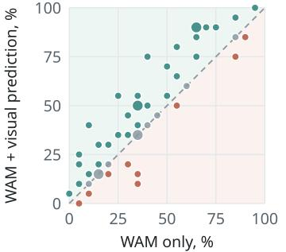

- WAM + 시각 예측 시 더 높음  
- WAM만 사용 시 더 높음  
- 동일

**Figure 21 시각 예측의 과제별 효과.** 무작위 RoboTwin 성공률은 과제별로, 20번 시도, 전방 역학과 imageto-video 유무에 따라 달라진다.

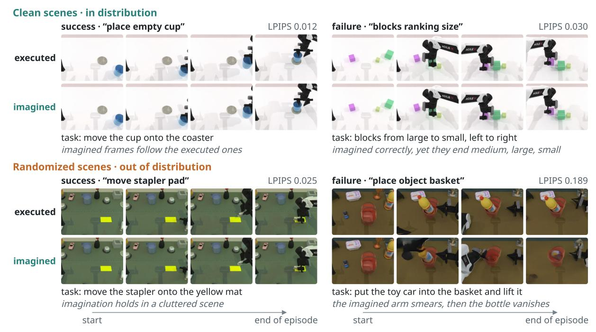

그림 22 로보트윈 정책이 행동할 때 상상하는 내용. 깨끗한 장면(분포 내)과 무작위 장면(분포 외)에서의 성공과 실패. 각 에피소드마다, 행동 청크가 실행된 후 렌더링된 헤드-카메라 프레임(상단 스트립)과 같은 순간에 WAM 모드에서 정책이 예측한 프레임(하단 스트립)이 시작부터 끝까지 네 시점에서 제공되며; LPIPS는 에피소드 전체 평균이다. 깨끗한 실패에서는 정책이 행동의 결과를 정확히 상상하며, 블록이 끝나는 잘못된 순서까지 포함한다; 무작위 실패에서는 상상된 장면이 실행된 장면과 다르다.

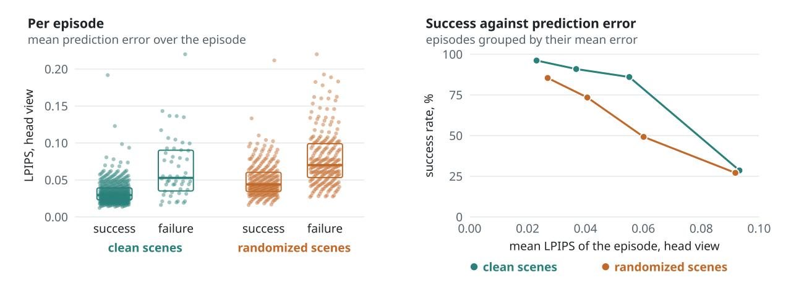

그림 23 RoboTwin 2.0에서의 예측 오차와 성공. 예측된 헤드-카메라 프레임과 실행된 프레임 사이의 LPIPS를 각 에피소드마다 평균한 값. 왼쪽: 깨끗한 장면과 무작위 장면에서의 성공 및 실패 에피소드(상자: 사분위, 선: 중앙값). 오른쪽: 평균 오차(0.03 미만, 0.03–0.05, 0.05–0.07, 0.07 이상)별로 그룹화된 에피소드의 성공률을 각 그룹의 중앙값 오차에 따라 그린 것.

우리는 예측된 헤드-카메라 프레임을 청크가 실행된 후 관찰된 프레임과 LPIPS와 PSNR으로 비교하고, 마지막으로 관찰된 프레임을 반복하는 기준선과 비교한다. 분포 내에서는 상상이 정확하다: 깨끗한 성공 에피소드에서 예측은 이 기준선을 평균 9.6 dB의 PSNR으로 초과하며, 그림 22의 깨끗한 성공에서는 상상된 프레임이 에피소드 끝까지 실행된 프레임을 따라간다.

성공은 두 설정 모두에서 상상을 따르지만, 분포 외에서는 훨씬 더 의존한다(그림 23). 깨끗한 장면에서는 성공률이 가장 큰 오차를 가진 6 % 에피소드를 제외하고 86 %에서 96 % 사이를 유지한다. 무작위 장면에서는 가장 정확한 상상에서 85 %에서 가장 부정확한 상상에서 27 %로 떨어지며, 그리고

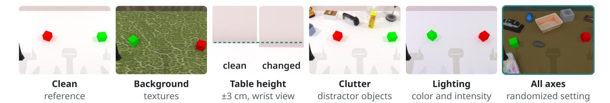

**그림 24 로보트윈 2.0의 무작위화 축**. 재설정 직후 stack_blocks_two 장면 하나를 정책 없이 각 축별로: 배경 질감, 테이블 높이(공식 설정에서는 최대 3 cm 낮추고, 테스트에서는 3 cm 올리거나 내림), 테이블 위의 방해 물체, 조명 색상 및 강도, 그리고 공식 무작위 설정과 같이 모든 축을 함께. 모든 타일은 헤드-카메라를 사용하지만 테이블 높이는 거의 보이지 않으므로 왼쪽 손목 카메라에서 보여준다; 점선은 깨끗한 장면의 테이블 가장자리를 표시한다. 장면은 각 설정마다 새로 생성되므로 타일 간 물체 위치가 다르다.

이 에피소드의 3분의 1이 그 최악 그룹에 속한다. 연결은 실패의 결과일 뿐만 아니라: 처음 100 단계만으로 판단했을 때, 무작위 에피소드에서 정확한 상상을 가진 것이 부정확한 상상을 가진 것보다 두 배 더 자주 성공한다.

각 설정에서 무작위로 추출한 20개의 실패를 검토하면 그들이 어떻게 발생하는지 보여준다. 깨끗한 장면에서는 19개가 실행된 장면을 정확히 상상한다(결과 포함): 절대로 놓지 않는 블록, 잘못된 순서로 쌓인 블록, 목표 옆에 떨어진 물체(그림 [22] (#page-23-0)). 정책은 자신의 행동이 무엇을 하는지 예측하고 여전히 잘못된 행동을 선택한다. 무작위 장면에서는 20개 중 13개의 실패가 정책이 변형된 장면을 보는 방식에서 비롯된다: 상상이 실제와 다르거나, 목표 대신 방해 물체를 잡아 상상한다. DreamZero는 대부분의 실패를 비디오 생성에 기인한다고 주장한다[&#91;92](#page-28-0)]; 우리의 측정은 분포 외에서는 이가 성립하며, 분포 내에서는 정책이 정확히 상상하고 행동에서 실패한다.

이것은 섹션 [7.3](#page-22-1)의 결과를 설명한다. 적응 과정에서 전방 역학과 이미지-비디오를 유지하면 무작위화된 성공률이 8.0% 상승하고 정제된 성공률은 변하지 않는다: 비디오 예측의 훈련 신호는 실패가 상상에서 비롯될 때 효과를 발휘하며, 정책이 이미 올바르게 상상하는 경우에는 그렇지 않다. 새로운 장면에 대한 견고성은 그 장면을 잘 상상하는 것과 함께 가며, GreenWAM은 행동을 학습하면서도 세계 모델 역할의 비디오 예측을 유지한다.

### **7.5 장면 무작위화에 대한 견고성**

무작위화는 외관과 기하학을 동시에 변경하므로 단일 성공률만으로 어떤 변화가 가장 중요한지 알 수 없다. 따라서 우리는 한 번에 한 축만 변형(그림 [24](#page-24-0))하고, 그 다음에 외관 증강을 테스트한다; 표 [3](#page-15-0)에는 다른 방법들의 정제 및 무작위화 성공률과 그들의 훈련 데이터가 나열되어 있다.

**개별 장면 변화.** 단축 축 테스트는 공식 세트 외의 시드를 사용한다. 배경 질감과 테이블 높이는 가장 큰 감소를 초래하며, 정제 기준 대비 각각 12%와 8% 감소한다; 방해 요소와 조명은 성공률을 1% 미만으로 변경하고, 보이지 않는 지시문은 감소시키지 않는다. 새로운 배경은 이미지만 변경하며, 증강은 이를 대상으로 할 수 있다. 테이블을 3cm 높이거나 낮추면 팔이 따라야 할 궤적이 바뀌며, 여기서 사용된 증강은 관측값을 변경하면서 기록된 상태와 행동은 그대로 유지하므로 이러한 동작의 시연을 추가하지 않는다.

**궤적 정확도와 재계획.** 실행은 작은 오류에 민감하다: 관절 노이즈 0.05 rad로 전문가 궤적을 재생하면 80%의 시도에서 성공하고, 0.1 rad에서는 30%에 불과하다. 재계획 전에 16단계 대신 8단계만 실행하면 정제 성공률이 14.8% 감소한다.

**외관 증강.** 배경 교체는 가장 비용이 많이 드는 외관 변화를 목표로 한다: 사전 훈련에서 선택된 작업에 대한 쌍 비교에서 무작위화 성공률을 13.1% 상승시키고 정제 성공률은 변하지 않는다.

## **8 논의 및 한계**

**두 역할을 위한 하나의 기반.** 하나의 로봇 체크포인트가 세계 모델과 정책을 모두 제공한다. 통제된 비교는 두 역할을 연결한다: 로봇 전문화는 동일한 예산에서 전방 예측과 정책 성공을 향상시키며, 보류된 프레임을 더 정확히 예측하는 정책은 더 자주 성공한다.

**제어의 일부로서의 세계 모델링.** 적응 중에 전방 역학과 이미지-비디오를 WAM 옆에 두면 무작위화된 RoboTwin 성공률이 8.0% 상승하지만 두 변형 모두 비디오를 예측한다. 정책의 자체 예측을 해독하면 동일한 연결이 모델 내부에서도 나타난다: 분포 외에서는 성공이 상상된 장면의 정확도를 따르며, 이곳이 세계 모델 모드를 유지하는 것이 효과를 발휘하는 곳이다 (섹션 [7.4](#page-22-3)).

**모든 바디에 대한 하나의 행동 공간.** 하나의 프로젝터가 20개 가족을 모두 지원하므로 새로운 로봇은 새로운 행동 매개변수 대신 코덱이 필요하다 (섹션 [A.3](#page-30-0)). CALVIN과 LIBERO의 단일 팔 프랑카는 로봇 코퍼스에 없었으나 동일한 인터페이스를 통해 진입하여 CALVIN에서 4.64, LIBERO에서 97.4%를 달성한다. **한계.** 정책은 RoboTwin의 테이블 높이 또는 LIBERO-plus의 로봇 초기 설정과 같은 작업 기하학 변화에 여전히 민감하다: 여기서 사용된 증강은 관측값을 변경하지만 새로운 동작을 추가하지 않는다. 긴 롤아웃은 모델 자체 프레임에서 계속되므로 예측 오류가 블록마다 누적된다. 각 벤치마크는 자체 사후 훈련을 통해 달성되며, 실제 로봇 평가에는 한 인간형과 한 포장 작업이 포함된다.

**전망.** 자연스러운 다음 단계는 정제된 단일 단계 정책을 로봇의 온보드 컴퓨터에서 실행하고, 부모나 로봇 단계가 본 적 없는 바디로 전이하며, 작업 기하학에 대한 견고성을 위해 모션 수준 증강을 적용하고, 상상 롤아웃에서 정책을 평가하기 위해 세계 모델 역할을 활용하는 것이다.

## **9 결론**

우리는 하나의 로봇 세계 모델(robot world model)이 서로 다른 몸체에서도 세계 모델(world model)과 정책(policy)으로 동시에 활용될 수 있는지, 그리고 이를 가능하게 하는 요인이 무엇인지 물었다. Cosmos 3 Edge에서 20개의 로봇 가족으로 확장된 공유 해부학적 행동 공간과 공동 비디오–행동 훈련을 통해 하나의 기반이 WorldArena 1.0에서 최고 수준의 궤적, 깊이 및 3D 정확도를 갖는 세계 모델을 제공하며, 이는 비교된 모든 세계-행동 모델(world–action models)과 비디오 생성기(video generators)보다 앞서고, RoboTwin 2.0 리더보드에서 상위 항목 중 하나인 정책을 달성하며, CALVIN과 LIBERO에서도 경쟁력 있고, 실제 인간형 로봇(humanoid)에서는 0.5와 Cosmos 3 Edge에서 적응된 정책보다 더 자주 성공한다. 통제된 비교를 통해 이 성과를 가능하게 하는 세 가지 선택을 확인했다: 로봇 전문화(robot specialization), 이는 두 역할을 동시에 향상시키며, 생성기에서 분리된 행동 전문가, 그리고 정책 적응 중에 유지되는 세계 모델 모드(world-model modes). 정제된 일단계 학생(distilled one-step student)은 28.3 Hz에서 응답하며, 로봇에서 0.5보다 우위를 유지한다. 우리는 RoboTwin 2.0, LIBERO 및 CALVIN 정책과 WorldArena 세계 모델의 가중치(weights)를 공개하며, 이를 평가하는 코드도 함께 제공한다. 새로운 로봇은 새로운 행동 매개변수 대신 코덱(codec)이 필요하기 때문에, 다음 단계는 훈련에서 보지 못한 몸체와 작업 기하학(task geometry)의 변화 하에서 보다 신뢰할 수 있는 장기 예측(long-horizon prediction)과 제어(control)를 목표로 한다.

# **References** (참고문헌)

- [1] 1X Technologies. 1X World Model: 비트 평가, 원자 대신. Technical progress report, 2025. URL [https://www.1x.tech/](https://www.1x.tech/1x-world-model.pdf) [1x-world-model.pdf](https://www.1x.tech/1x-world-model.pdf).

- [2] AgiBot Research Team, R. Liu, W. Zhao, Z. Yang, L. Chen, P. Zhou, S. Chen, G. Ren, Y. Peng, et al. GE-Act 2.0: 로봇 조작을 위한 세계-행동 모델의 사전학습 및 확장, 2026. URL <https://arxiv.org/abs/2609.05588>.

- [3] AgiBot World Team. AgiBot World 2026. Hugging Face 데이터셋, 2026. URL [https://huggingface.co/datasets/agibot-world/](https://huggingface.co/datasets/agibot-world/AgiBotWorld2026) [AgiBotWorld2026](https://huggingface.co/datasets/agibot-world/AgiBotWorld2026).

- [4] A. Akbari, C. Zhang, A. Akbari, L. Zhao, Y. Chen, W. Chen, X. Zhang, G. Yuan, and Y. Wang. Flash-WAM: 세계-행동 모델을 위한 모달리티 인식 증류, 2026. URL <https://arxiv.org/abs/2606.05254>.

- [5] I. Apanasevich, M. Artemyev, R. Babakyan, P. Fedotova, D. Grankin, E. Kupryashin, A. Misailidi, D. Nerus, et al. Green-VLA: 일반 로봇을 위한 단계별 시각-언어-행동 모델, 2026. URL <https://arxiv.org/abs/2602.00919>.

- [6] M. Assran, A. Bardes, D. Fan, Q. Garrido, R. Howes, M. Komeili, M. Muckley, et al. V-JEPA 2: 자기지도 비디오 모델이 이해, 예측 및 계획을 가능하게 함, 2025. URL <https://arxiv.org/abs/2506.09985>.

- [7] H. Bi, H. Tan, S. Xie, Z. Wang, S. Huang, H. Liu, R. Zhao, Y. Feng, C. Xiang, Y. Rong, H. Zhao, H. Liu, Z. Su, L. Ma, H. Su, and J. Zhu. Motus: 통합 잠재 행동 세계 모델, 2025. URL <https://arxiv.org/abs/2512.13030>.

- [8] H. Bi, Z. Zhou, Y. Tang, J. Pang, S. Huang, H. Liu, R. Wang, S. Huang, et al. Motus2: 정교한 조작을 위한 자가진화 일반 세계 모델, 2026. URL <https://arxiv.org/abs/2608.30237>.

- [9] BitRobot, Unitree, and Hugging Face. HIW-500: 로봇 학습을 위한 야외 인간형 데이터셋. Dataset, 2026. URL <https://bitrobot-foundation.github.io/humanoids-in-the-wild-500-hours>.

- [10] BitRobot Foundation. G1 WBT Dex1 건물-자녀-테이블, 2026. URL [https://huggingface.co/datasets/BitRobot/G1\\_WBT\\_](https://huggingface.co/datasets/BitRobot/G1_WBT_Dex1_Building-Children-Table) [Dex1\\_Building-Children-Table](https://huggingface.co/datasets/BitRobot/G1_WBT_Dex1_Building-Children-Table). Dataset on Hugging Face.

- [11] K. Black, N. Brown, D. Driess, A. Esmail, M. Equi, C. Finn, N. Fusai, L. Groom, et al. 0 : 일반 로봇 제어를 위한 시각-언어-행동 흐름 모델, 2024. URL <https://arxiv.org/abs/2410.24164>.

- [12] BWM Team. BWM: 로봇 학습을 위한 저비용 고충실도 세계 시뮬레이터, 2026. URL <https://arxiv.org/abs/2607.29302>.
- [13] R. Cadene, S. Alibert, A. Soare, Q. Gallouedec, A. Zouitine, S. Palma, P. Kooijmans, M. Aractingi, M. Shukor, D. Aubakirova, et al. LeRobot: PyTorch에서 실세계 로봇공학을 위한 최첨단 기계학습, GitHub repository, 2024. URL [https:](https://github.com/huggingface/lerobot) [//github.com/huggingface/lerobot](https://github.com/huggingface/lerobot).
- [14] J. Cai, L. Ling, S. Chu, Z. Liu, J. Kang, Z. Liang, W. Xu, Y. Mao, et al. AHA-WAM: 관측 가이드형 컨텍스트 라우팅을 통한 비동기적 수평-적응형 세계-행동 모델링, 2026. URL <https://arxiv.org/abs/2606.09811>.
- [15] R. Cai, J. Guo, X. He, P. Jin, J. Li, B. Lin, F. Liu, W. Liu, et al. Xiaomi-Robotics-0: 실시간 실행이 가능한 오픈소스 비전-언어-행동 모델, 2026. URL <https://arxiv.org/abs/2602.12684>.
- [16] C.-L. Cheang, G. Chen, Y. Jing, T. Kong, H. Li, Y. Li, Y. Liu, H. Wu, et al. GR-2: 웹 규모 지식을 갖춘 생성형 비디오-언어-행동 모델로 로봇 조작, 2024. URL <https://arxiv.org/abs/2410.06158>.
- [17] K. Chen, Z. Liu, T. Zhang, Z. Guo, S. Xu, H. Lin, H. Zang, X. Li, B. Wei, J. Zhou, Q. Zhang, Z. Yu, G. Fan, T. Huang, Y. Wang, and C. Yu. RL: 흐름 기반 비전-언어-행동 모델을 위한 온라인 RL 미세조정, 2025. URL [https://arxiv.org/abs/2510.](https://arxiv.org/abs/2510.25889) [25889](https://arxiv.org/abs/2510.25889).
- [18] T. Chen, Z. Chen, B. Chen, Z. Cai, Y. Liu, Z. Li, Q. Liang, X. Lin, et al. RoboTwin 2.0: 견고한 양손 로봇 조작을 위한 강력한 도메인 랜덤화를 갖춘 확장 가능한 데이터 생성기 및 벤치마크, 2025. URL <https://arxiv.org/abs/2506.18088>.
- [19] T. Chen, Y. Chen, Z. Li, J. Tang, K. Su, H. Lu, W. Wan, B. Chen, et al. RoboDojo: 일반 로봇 조작 정책의 종합 평가를 위한 통합 시뮬레이션-실제 벤치마크, 2026. URL <https://arxiv.org/abs/2607.04434>.
- [20] Y. Chen, R. Chen, D. Huo, Y. Yang, D. Qi, H. Liu, T. Lin, S. Zeng, et al. ABot-PhysWorld: 물리 정렬을 갖춘 로봇 조작용 인터랙티브 세계 기반 모델, 2026. URL <https://arxiv.org/abs/2603.23376>.
- [21] Y. Chen, P. Li, Y. Xu, Q. Ma, J. Yang, K. Wang, J. Yang, D. An, et al. FlowWAM: 세계 행동 모델을 위한 통합 행동 표현으로서의 광학 흐름, 2026. URL <https://arxiv.org/abs/2607.13017>.
- [22] R. Doshi, H. Walke, O. Mees, S. Dasari, and S. Levine. Scaling cross‑embodied learning: 조작, 탐색, 이동 및 항공을 위한 하나의 정책, 2024. URL <https://arxiv.org/abs/2408.11812>.
- [23] Y. Du, M. Yang, B. Dai, H. Dai, O. Nachum, J. B. Tenenbaum, D. Schuurmans, and P. Abbeel. 텍스트 가이드형 비디오 생성으로 보편적 정책 학습, 2023. URL <https://arxiv.org/abs/2302.00111>.
- [24] S. Fei, S. Wang, J. Shi, Z. Dai, J. Cai, P. Qian, L. Ji, X. He, S. Zhang, Z. Fei, J. Fu, J. Gong, and X. Qiu. LIBERO-Plus: 비전-언어-행동 모델의 심층 견고성 분석, 2025. URL <https://arxiv.org/abs/2510.13626>.
- [25] S. Gao, W. Liang, K. Zheng, A. Malik, S. Ye, S. Yu, W.-C. Tseng, Y. Dong, et al. DreamDojo: 대규모 인간 비디오에서 생성된 일반 로봇 세계 모델, 2026. URL <https://arxiv.org/abs/2602.06949>.
- [26] GigaBrain Team, A. Ye, A. Sun, C. Jin, C. Cheng, C. Shi, D. Shang, D. Zhang, G. Huang, et al. GigaBrain-0.7: 세 시스템 아키텍처를 통한 구현형 기반 모델의 확장으로 새로운 능력 도출, 2026. URL <https://arxiv.org/abs/2608.15875>.
- [27] GigaWorld Team, A. Ye, B. Wang, C. Ni, G. Huang, G. Zhao, H. Li, J. Zhu, K. Li, et al. GigaWorld-0: 구현형 AI를 강화하기 위한 데이터 엔진으로서의 세계 모델, 2025. URL <https://arxiv.org/abs/2511.19861>.
- [28] GigaWorld Team, A. Ma, B. Wang, B. Li, C. Ni, G. Li, G. Huang, G. Zhao, et al. GigaWorld-1: 로봇 정책 평가를 위한 세계 모델 구축 로드맵, 2026. URL <https://arxiv.org/abs/2607.02642>.
- [29] GigaWorld Team, A. Ye, A. Ma, B. Wang, C. Ni, F. Ye, G. Huang, G. Li, G. Zhao, et al. GigaWorld-Policy-0.5: 자동 연구로 강화된 빠르고 강력한 WAM, 2026. URL <https://arxiv.org/abs/2607.13960>.
- [30] J. Guo, Q. Li, P. Li, Z. Chen, N. Sun, Y. Su, H. Wang, Y. Zhang, et al. 비디오 사전 지식과 비동기 디노이징을 통한 통합 4D 세계 행동 모델링, 2026. URL <https://arxiv.org/abs/2604.26694>.
- [31] Y. Guo, L. X. Shi, J. Chen, and C. Finn. Ctrl-World: 로봇 조작을 위한 제어 가능한 생성형 세계 모델, 2025. URL <https://arxiv.org/abs/2510.10125>.
- [32] J. Ho and T. Salimans. 분류기 없는 확산 가이드, 2022. URL <https://arxiv.org/abs/2207.12598>.
- [33] Y. Hu, Y. Guo, P. Wang, X. Chen, Y.-J. Wang, J. Zhang, K. Sreenath, C. Lu, et al. 비디오 예측 정책: 예측 시각 표현을 갖춘 일반 로봇 정책, 2024. URL <https://arxiv.org/abs/2412.14803>.
- [34] J. Jang, S. Ye, Z. Lin, J. Xiang, J. Bjorck, Y. Fang, F. Hu, S. Huang, et al. DreamGen: 비디오 세계 모델을 통해 로봇 학습의 일반화를 열어준다, 2025. URL <https://arxiv.org/abs/2505.12705>.
- [35] T. Jiang, T. Yuan, Y. Liu, C. Lu, J. Cui, X. Liu, S. Cheng, J. Gao, et al. Galaxea 오픈월드 데이터셋과 G0 이중 시스템 VLA 모델, 2025. URL <https://arxiv.org/abs/2509.00576>.
- [36] Y. Jiang, Y. Guo, H. Yang, G. Lei, N. Chen, Y. Zhang, S. Yan, B. Lin, F. Gao, and B. Qi. CKT‑WAM: 세계 행동 모델 간 파라미터 효율적인 컨텍스트 지식 전이, 2026. URL <https://arxiv.org/abs/2605.06247>.
- [37] J. Ke, Q. Wang, Y. Wang, P. Milanfar, and F. Yang. MUSIQ: 다중 스케일 이미지 품질 변환기, 2021. URL [https:](https://arxiv.org/abs/2108.05997) [//arxiv.org/abs/2108.05997](https://arxiv.org/abs/2108.05997).
- [38] M. J. Kim, C. Finn, and P. Liang. Fine‑tuning vision‑language‑action models: 속도와 성공률 최적화, 2025. URL <https://arxiv.org/abs/2502.19645>.
- [39] M. J. Kim, Y. Gao, T.-Y. Lin, Y.-C. Lin, Y. Ge, G. Lam, P. Liang, S. Song, et al. Cosmos Policy: 시각-운동 제어 및 계획을 위한 비디오 모델 미세조정, 2026. URL <https://arxiv.org/abs/2601.16163>.
- [40] C. Li, R. Zhang, J. Wong, C. Gokmen, S. Srivastava, R. Martín‑Martín, C. Wang, G. Levine, et al. BEHAVIOR‑1K: 1,000개의 일상 활동과 현실적인 시뮬레이션을 갖춘 인간 중심 구현형 AI 벤치마크, 2024. URL [https://arxiv.org/abs/](https://arxiv.org/abs/2403.09227) [2403.09227](https://arxiv.org/abs/2403.09227).
- [41] F. Li, W. Song, H. Zhao, J. Wang, P. Ding, D. Wang, L. Zeng, and H. Li. Spatial forcing: 비전-언어-행동 모델을 위한 암시적 공간 표현 정렬, 2025. URL <https://arxiv.org/abs/2510.12276>.
- [42] L. Li, Q. Zhang, Y. Luo, S. Yang, R. Wang, F. Han, M. Yu, Z. Gao, et al. 로봇 제어를 위한 인과적 세계 모델링, 2026. URL <https://arxiv.org/abs/2601.21998>.
- [43] S. Li, Y. Gao, D. Sadigh, and S. Song. 통합 비디오 행동 모델, 2025. URL <https://arxiv.org/abs/2503.00200>.
- [44] S. Li, V. Yao, C. Yang, T. Qu, R. Cheng, R. Yu, H. Lu, N. Von, et al. WALL-WM: 이벤트 조인트에서 세계 행동 모델링을 조각, 2026. URL <https://arxiv.org/abs/2606.01955>.
- [45] X. Li, P. Li, L. Qian, M. Liu, D. Wang, J. Liu, B. Kang, X. Ma, et al. 일반 로봇용 비전-언어-행동 모델 구축 시 중요한 요소, 2024. URL <https://arxiv.org/abs/2412.14058>.

- [46] X. Li, J. Guo, Q. Li, L. Qian, H. Lai, Y. Wang, H. Yan, J. Cao, et al. Xiaomi-Robotics-U0: 세계 기반 모델을 활용한 통합 구현 합성, 2026. URL <https://arxiv.org/abs/2607.11643>.

- [47] Y. Liao, P. Zhou, S. Huang, D. Yang, S. Chen, Y. Jiang, Y. Hu, J. Cai, S. Liu, J. Luo, L. Chen, S. Yan, M. Yao, and G. Ren. Genie Envisioner: 로봇 조작을 위한 통합 세계 기반 플랫폼, 2025. URL <https://arxiv.org/abs/2508.05635v3>.

- [48] B. Liu, Y. Zhu, C. Gao, Y. Feng, Q. Liu, Y. Zhu, and P. Stone. LIBERO: 평생 로봇 학습을 위한 지식 전이 벤치마킹, 2023. In *Advances in Neural Information Processing Systems (Datasets and Benchmarks Track)*, 2023.

- [49] S. Liu, L. Wu, B. Li, H. Tan, H. Chen, Z. Wang, K. Xu, H. Su, et al. RDT-1B: 양손 조작을 위한 확산 기반 모델, 2024. URL <https://arxiv.org/abs/2410.07864>.

- [50] X. Liu, C. Gong, and Q. Liu. Flow straight and fast: 정정 흐름으로 데이터 생성 및 전이 학습, 2022. URL <https://arxiv.org/abs/2209.03003>.

- [51] Y. Liu, P. Ding, T. Jiang, X. Wang, M. Lin, W. Song, H. Zhang, Z. Zhuang, H. Zhao, W. Zhao, S. Huang, J. Shi, and D. Wang. MMaDA-VLA: 통합 다중 모달 지시 및 생성이 가능한 대형 확산 시각-언어-행동 모델, 2026. URL <https://arxiv.org/abs/2603.25406>.

- [52] Y. Liu, P. Sun, S. Li, Y. Xie, L. Zhang, X. Chao, S. Dong, F. Chen, X.-P. Zhang, and W. Ding. OA-WAM: 견고한 로봇 조작을 위한 객체-지향 세계 행동 모델, 2026. URL <https://arxiv.org/abs/2605.06481>.

- [53] I. Loshchilov and F. Hutter. 분리된 가중치 감쇠 정규화, 2017. URL <https://arxiv.org/abs/1711.05101>.

- [54] G. Y. Luo, G. M. Favero, Z. H. Luo, A. Jolicoeur-Martineau, and C. Pal. Beyond FVD: 비디오 생성 품질을 위한 향상된 평가 지표, 2024. URL <https://arxiv.org/abs/2410.05203>.

- [55] O. Mees, L. Hermann, E. Rosete-Beas, and W. Burgard. CALVIN: 장기 로봇 조작 과제를 위한 언어 조건 정책 학습 벤치마크, 2021. URL <https://arxiv.org/abs/2112.03227>.

- [56] Motubrain Team, C. Xiang, F. Bao, H. Liu, H. Tan, H. Bi, J. Li, J. Liu, J. Pang, et al. Motubrain: 로봇 제어를 위한 고급 세계 행동 모델, 2026. URL <https://arxiv.org/abs/2604.27792>.

- [57] NVIDIA, A. Ali, J. Bai, M. Bala, Y. Balaji, A. Blakeman, T. Cai, J. Cao, T. Cao, et al. 물리 AI를 위한 비디오 기반 모델을 활용한 세계 시뮬레이션, 2025. URL <https://arxiv.org/abs/2511.00062>.

- [58] NVIDIA, Aditi, N. Agarwal, A. Ali, J. Allen, M. Antolini, A. Aubame, A. Azzolini, J. Bai, et al. Cosmos 3: 물리 AI를 위한 올리모달 세계 모델, 2026. URL <https://arxiv.org/abs/2606.02800>.

- [59] Octo Model Team, D. Ghosh, H. Walke, K. Pertsch, K. Black, O. Mees, S. Dasari, J. Hejna, T. Kreiman, et al. Octo: 오픈소스 범용 로봇 정책, 2024. URL <https://arxiv.org/abs/2405.12213>.

- [60] Open X-Embodiment Collaboration, A. O'Neill, A. Rehman, A. Gupta, A. Maddukuri, A. Gupta, A. Padalkar, A. Lee, A. Pooley, et al. Open X-Embodiment: 로봇 학습 데이터셋 및 RT-X 모델, 2023. URL <https://arxiv.org/abs/2310.08864>.

- [61] Physical Intelligence. OpenPI: 오픈소스 로봇 모델 및 파인튜닝. 공식 소프트웨어 저장소, 2025. URL [https:](https://github.com/Physical-Intelligence/openpi) [//github.com/Physical-Intelligence/openpi](https://github.com/Physical-Intelligence/openpi).

- [62] Physical Intelligence, K. Black, N. Brown, J. Darpinian, K. Dhabalia, D. Driess, A. Esmail, M. Equi, C. Finn, et al. 0.5: 오픈 월드 일반화를 갖춘 시각-언어-행동 모델, 2025. URL <https://arxiv.org/abs/2504.16054>.

- [63] B. Qiu, L. Chen, Y. Liao, N. Wang, L. Wang, J. Luo, W. Zhao, S. Chen, et al. GE-Sim 2.0: 로봇 조작을 위한 종합 폐쇄 루프 비디오 세계 시뮬레이터를 향한 로드맵, 2026. URL <https://arxiv.org/abs/2605.27491>.

- [64] Qwen Team. Qwen3.8-Max: 코딩 및 공동 작업을 위한 새로운 기준, 블로그 포스트, 2026년 8월. URL <https://qwen.ai/blog?id=qwen3.8>. Model card: <https://huggingface.co/Qwen/Qwen3.8-27B>.

- [65] M. Reuss, H. Zhou, M. Rühle, Ömer Erdinç Yağmurlu, F. Otto, and R. Lioutikov. FLOWER: 효율적인 시각-언어-행동 흐름 정책으로 범용 로봇 정책을 민주화, 2025. URL <https://arxiv.org/abs/2509.04996>.

- [66] Robbyant. LingBot-VA 저장소, 2026. URL <https://github.com/Robbyant/lingbot-va>.

- [67] RoboDojo Team. RoboDojo 리더보드. 프로젝트 웹사이트, 2026. URL <https://robodojo-benchmark.com/leaderboard>.

- [68] RoboTwin Team. RoboTwin 2.0 리더보드. 프로젝트 웹사이트, 2026. URL <https://robotwin-platform.github.io/leaderboard>.

- [69] C. Schuhmann, R. Beaumont, R. Vencu, C. Gordon, R. Wightman, M. Cherti, T. Coombes, A. Katta, C. Mullis, M. Wortsman, et al. LAION-5B: 차세대 이미지-텍스트 모델 훈련을 위한 대규모 공개 데이터셋, 2022. URL [https://arxiv.org/](https://arxiv.org/abs/2210.08402) [abs/2210.08402](https://arxiv.org/abs/2210.08402).

- [70] Y. Shang, Z. Li, Y. Ma, W. Su, X. Jin, Z. Wang, L. Jin, X. Zhang, et al. WorldArena: 구현된 세계 모델의 인지 및 기능적 유틸리티를 평가하는 통합 벤치마크, 2026. URL <https://arxiv.org/abs/2602.08971>.

- [71] Y. Shang, Y. Tang, Y. Ma, Z. Li, L. Jin, W. Su, X. Jin, Z. Wang, et al. WorldArena 2.0: 모달리티, 기능성 및 플랫폼에 대한 구현된 세계 모델 벤치마킹 확장, 2026. URL <https://arxiv.org/abs/2605.17912>.

- [72] Y. Song and P. Dhariwal. 일관성 모델 훈련을 위한 향상된 기법, 2023. URL <https://arxiv.org/abs/2310.14189>.

- [73] StarVLA Community. StarVLA: 시각-언어-행동 모델 개발을 위한 레고 같은 코드베이스, 2026. URL [https://arxiv.](https://arxiv.org/abs/2604.05014) [org/abs/2604.05014](https://arxiv.org/abs/2604.05014).

- [74] H. Su, Z. Liu, X. Jin, H. Dou, C. Hu, B. Li, Z. Liu, R. Xu, J. Fang, X. Zhang, Z. Yang, X. Yang, C. Gao, J. Yan, Y. Li, and W. Wu. WorldScape Policy 2.0: 추론 강화 메모리와 인컨텍스트 학습으로 조정 가능한 세계 행동 모델링 강화, 2026. URL <https://arxiv.org/abs/2607.18840>.

- [75] T. Su, J. Zhu, T. Wang, Y. He, Z. Huang, J. Zhang, C. Ma, H. Wang, et al. DeMaVLA: 일반화 가능한 변형 조작을 위한 시각-언어-행동 기반 모델, 2026. URL <https://arxiv.org/abs/2605.31286>.

- [76] Y. Tian, S. Yang, J. Zeng, P. Wang, D. Lin, H. Dong, and J. Pang. 예측 역동 모델은 로봇 조작을 위한 확장 가능한 학습자, 2024. URL <https://arxiv.org/abs/2412.15109>.

- [77] Y. Tian, Y. Yang, Y. Xie, Z. Cai, X. Shi, N. Gao, H. Liu, X. Jiang, et al. InternData-A1: 범용 정책 사전 훈련을 위한 고충실도 합성 데이터 개척, 2025. URL <https://arxiv.org/abs/2511.16651>.

- [78] Unitree Robotics. Unitree 공개 로봇 데이터셋, 2025. URL <https://huggingface.co/unitreerobotics>. Dataset on Hugging Face.

- [79] T. Wan, A. Wang, B. Ai, B. Wen, C. Mao, C.-W. Xie, D. Chen, F. Yu, et al. Wan: 공개 및 고급 대규모 비디오 생성 모델, 2025. URL <https://arxiv.org/abs/2503.20314>.

- [80] L. Wang, X. Chen, J. Zhao, and K. He. 다종형 사전 훈련된 변환기를 활용한 고유감각-시각 학습 확장, 2024. URL <https://arxiv.org/abs/2409.20537>.

- [81] Y. Wang, X. Li, W. Wang, J. Zhang, Y. Li, Y. Chen, X. Wang, and Z. Zhang. 통합 비전-언어-행동 모델, 2025. URL https://arxiv.org/abs/2506.19850.
- [82] Z. Wang, C. Liu, Y. Xiang, R. Zhang, Q. Hao, H. Lu, H. Chen, Z. Feng, et al. The great march 100: 100 detail-oriented tasks for evaluating embodied ai agents, 2026. URL https://arxiv.org/abs/2601.11421.
- [83] WorldArena Team. WorldArena 2.0: Motion quality evaluation update. Project website, 2026. URL https://v2.world-arena.ai/WorldArena-2.0/motion-quality-evaluation-update.html.
- [84] WorldArena Team. WorldArena leaderboard. Hugging Face Space, 2026. URL https://huggingface.co/spaces/WorldArena/WorldArena.
- [85] K. Wu, C. Hou, J. Liu, Z. Che, X. Ju, Z. Yang, M. Li, Y. Zhao, et al. RoboMIND: Benchmark on multi-embodiment intelligence normative data for robot manipulation, 2024. URL https://arxiv.org/abs/2412.13877.
- [86] S. Wu, X. Liu, S. Xie, P. Wang, X. Li, B. Yang, Z. Li, K. Zhu, et al. RoboCOIN: An open-sourced bimanual robotic data collection for integrated manipulation, 2025. URL https://arxiv.org/abs/2511.17441.
- [87] G. Yang, Z. Tu, Y. Yang, S. Mao, J. Dong, T. Chen, J. Peng, J. Xiong, et al. EventVLA: Event-driven visual evidence memory for long-horizon vision-language-action policies, 2026. URL https://arxiv.org/abs/2606.20092.
- [88] L. Yang, W. Song, X. Wang, P. Sheng, Z. Fang, Z. Zhou, J. He, H. Yan, et al. 4D-WAM: Infusing spatiotemporal awareness into world action models through trajectory fields, 2026. URL https://arxiv.org/abs/2608.08023.
- [89] S. Yang, Y. Du, K. Ghasemipour, J. Tompson, L. Kaelbling, D. Schuurmans, and P. Abbeel. Learning interactive real-world simulators, 2023. URL https://arxiv.org/abs/2310.06114.
- [90] Y. Yang, S. Zeng, T. Lin, X. Chang, D. Qi, J. Xiao, H. Liu, R. Chen, et al. ABot-M0: VLA foundation model for robotic manipulation with action manifold learning, 2026. URL https://arxiv.org/abs/2602.11236.
- [91] Z. Yang, J. Teng, W. Zheng, M. Ding, S. Huang, J. Xu, Y. Yang, W. Hong, et al. CogVideoX: Text-to-video diffusion models with an expert transformer, 2024. URL https://arxiv.org/abs/2408.06072.
- [92] S. Ye, Y. Ge, K. Zheng, S. Gao, S. Yu, G. Kurian, S. Indupuru, Y. L. Tan, et al. World action models are zero-shot policies, 2026. URL https://arxiv.org/abs/2602.15922.
- [93] C. Yin, D. Huang, D. Yang, J. Wang, N. Zhao, C. Xu, W. Sun, L. Hou, et al. Genie sim 3.0 : A high-fidelity comprehensive simulation platform for humanoid robot, 2026. URL https://arxiv.org/abs/2601.02078.
- [94] H. Yuan, Z. Liang, A. Chen, Y. Wang, H. Li, P. Lin, Y. Huang, Z. Lei, et al. Qwen-robotmanip technical report: Alignment unlocks scale for robotic manipulation foundation models, 2026. URL https://arxiv.org/abs/2606.17846.
- [95] T. Yuan, Z. Dong, Y. Liu, and H. Zhao. Fast-WAM: Do world action models need test-time future imagination?, 2026. URL https://arxiv.org/abs/2603.16666.
- [96] M. Zhang, R. Sun, X. Wang, C. Zhang, S. Li, M. Cao, H. Lu, E. Chen, et al. WALL-SS: Scaling long-horizon world models via next-scale autoregression, 2026. URL https://arxiv.org/abs/2608.26239.
- [97] Q. Zhang, L. Li, L. Zhang, S. Yang, Y. Luo, S. Li, R. Wang, J. Wang, et al. Native video-action pretraining for generalizable robot control, 2026. URL https://arxiv.org/abs/2607.08639.
- [98] W. Zhang, H. Liu, Z. Qi, Y. Wang, X. Yu, J. Zhang, R. Dong, J. He, F. Lu, H. Wang, Z. Zhang, L. Yi, W. Zeng, and X. Jin. DreamVLA: A vision-language-action model dreamed with comprehensive world knowledge, 2025. URL https://arxiv.org/abs/2507.04447.
- [99] X. Zhang, X. Liu, Q. Tang, J. Wang, R. Wang, Z. Cheng, B. Lin, H. Wen, M. Li, K. Zhan, and Y. Liu. ME-Dex 1.0: Bringing Heterogeneous Tactile Sensing into World Action Modeling, 2026. URL https://arxiv.org/abs/2609.21449.
- [100] W. Zhao, H. Jiang, X. Shi, L. Liu, F. Huang, Z. Su, W. Sui, and X. Wang. Faster-WAM: Efficient inference-time future conditioning for robust world action models, 2026. URL https://arxiv.org/abs/2608.04404.
- [101] Z. Zhao, H. Jing, X. Liu, J. Mao, A. Jha, H. Yang, R. Xue, S. Zakharov, et al. Humanoid everyday: A comprehensive robotic dataset for open-world humanoid manipulation, 2025. URL https://arxiv.org/abs/2510.08807.
- [102] J. Zheng, J. Li, D. Liu, Y. Zheng, Z. Wang, Z. Ou, Y. Liu, J. Liu, et al. Universal actions for enhanced embodied foundation models, 2025. URL https://arxiv.org/abs/2501.10105.
- [103] J. Zheng, J. Li, Z. Wang, D. Liu, X. Kang, Y. Feng, Y. Zheng, J. Zou, et al. X-VLA: Soft-prompted transformer as scalable cross-embodiment vision-language-action model, 2025. URL https://arxiv.org/abs/2510.10274.
- [104] C. Zhu, R. Yu, S. Feng, B. Burchfiel, P. Shah, and A. Gupta. Unified world models: Coupling video and action diffusion for pretraining on large robotic datasets, 2025. URL https://arxiv.org/abs/2504.02792.
- [105] F. Zhu, H. Wu, S. Guo, Y. Liu, C. Cheang, and T. Kong. IRASim: A fine-grained world model for robot manipulation, 2024. URL https://arxiv.org/abs/2406.14540.
- [106] J. Zhu, J. Zhang, T. Su, T. Liu, Z. Wang, K. Xie, Z. Huang, C. Ma, Y. He, T. Wang, H. Wang, W. Ding, and Y. Xu. DSWAM: A dual-system world action foundation model for fine-grained robot manipulation, 2026. URL https://arxiv.org/abs/2607.04927.

# **데이터 인벤토리 및 해부학적 매핑**

### **A.1 가족 및 소스 인벤토리**

코퍼스는 데이터셋을 그들이 묘사하는 로봇 본체별로 그룹화한다 (Figure [25)](#page-29-2)). 모든 12개의 Unitree G1 레이아웃은 손과 카메라가 다르지만 하나의 가족을 공유한다; 두 개의 Worker 데이터셋은 또 다른 가족을 공유하며, Green humanoid와 그 시뮬레이터도 마찬가지다. 허용된 코퍼스에 기여한 가장 큰 가족은 AgiBot G2A (256.0 h), Piper / Cobot Magic (227.2 h), Green humanoid (214.8 h), Unitree G1 (204.9 h), AgiBot G1 / Genie‑1 (148.5 h)이다. Figure [26](#page-30-1)은 20개의 주요 가족과 그들의 실제/시뮬레이션 구성을 보여준다. 인벤토리는 1 217개의 데이터셋을 포함한다.

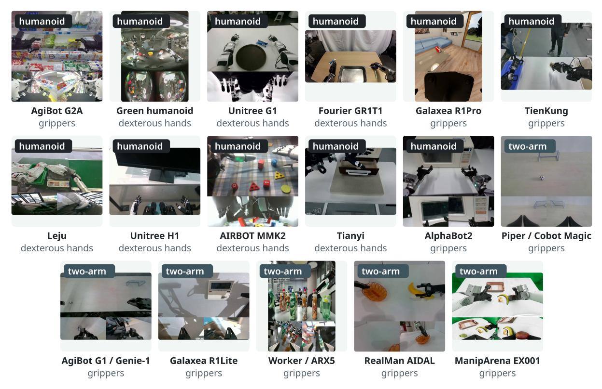

**Figure 25 코퍼스의 로봇 가족** 모델이 받는 방식으로 로봇 가족의 훈련 캔버스: 상단에 머리 뷰, 하단에 다른 카메라가 스트립 형태로 배치된다. 각 타일은 해당 가족의 하나의 데이터셋을 보여주며, 같은 가족의 다른 데이터셋은 손이나 카메라가 다를 수 있다. 휴머노이드는 먼저 나오고, 그 다음이 두 팔 플랫폼이다; 각 타일의 칩은 본체 유형을, 아래 라벨은 에펙터를 나타낸다.

소스 수준 필터링은 1.43백만 개의 원자(atom)를 보유하며 총 1 674.7 h를 포함한다. InternData-A1 [[77&#93;](#page-27-23), Green humanoid, RoboCOIN [&#91;86](#page-28-18)], GM100 [&#91;82](#page-28-19)] 및 AgiBotWorld-2026 [&#91;3](#page-25-8)]이 가장 큰 보존량을 제공한다; 추가 공개 소스에는 GR00T-Teleop-GR1 [[25&#93;](#page-26-2), BEHAVIOR-1K [[40&#93;](#page-26-23), Genie Sim 3.0 [&#91;93](#page-28-20)], RoboMIND [[85&#93;](#page-28-21), Humanoid Everyday [[101](#page-28-22)], HIW-500 [&#91;9](#page-25-9)], G1 IKEA 조립 녹화 [&#91;10](#page-25-10)] 및 Unitree 데이터셋 [&#91;78](#page-27-24)]이 포함된다. Galaxea Open-World [&#91;35](#page-26-20)]은 가장 큰 품질 필터 감소(6.84 h, 허용 시간의 9%)를 보유한다.

### **A.2 코퍼스 수락 및 품질 필터링**

**Sources.** 각 소스는 하나의 LeRobot 레이아웃으로 변환되고, 그 카메라 역할, 상태 레이아웃 및 캡션러가 이후에 받는 세 가지 정적 사실(구현, 엔드 이펙터 유형, 실제 또는 시뮬레이션 도메인)과 함께 등록된다. 카메라 역할과 상태 및 액션 열의 의미는 컬럼 이름이 아니라 메타데이터, 샘플링된 테이블 및 비디오에서 설정된다. 비디오 스트림은 10 FPS 초과와 짧은 변에서 최소 448 픽셀을 필요로 하며, 깊이 및 적외선 스트림은 사용되지 않는다. 실패 및 복구 시연은 보존된다; 세계 모델에 있어서는 유효한 물리 롤아웃이기 때문이다.

**Semantic atoms.** 원자는 기록의 가장 작은 주석된 시간 단위이며, 하위 작업 테이블, 작업‑인덱스 실행, 스킬 주석 또는 지시 구간에서 복원된다. 더 세분화된 주석이 없을 때 전체 에피소드는 하나의 원자가 된다; 누락되거나 겹치는 경계는 전체 에피소드를 대체하기보다 미해결로 표시된다. 소스 라벨은 훈련 지시와 별도로 보관된다.

**Length.** 수락은 머리 또는 자아 역할의 카메라를 사용한다. 허용되는 최대 길이는

$$e - s \le \min(B(h), \lfloor 10 f \rfloor), \qquad B(h) = \begin{cases} 300, & h \le 480, \\ 200, & 480 < h \le 1000, \end{cases}$$

(10)

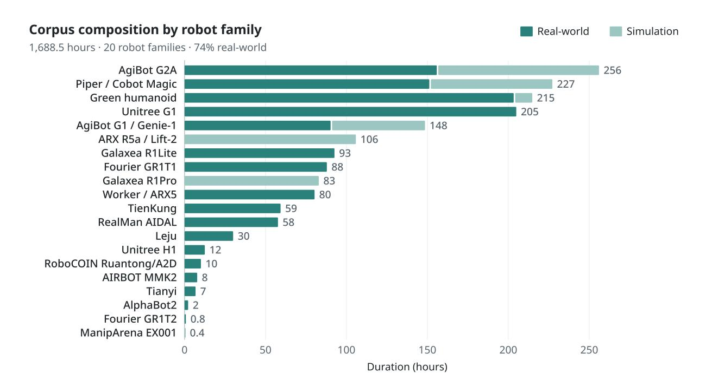

**Figure 26 로봇 가족별 시간, 실제 및 시뮬레이션** Piper / Cobot Magic와 같은 결합 이름은 하나의 로봇 본체의 데이터셋을 하나의 가족으로 그룹화한 것을 나타낸다 (Section [A)](#page-28-9)). 끝 라벨은 반올림된다. 시간 비율은 훈련에서 사용된 샘플링 확률(Section [B.4](#page-34-0))과 다르다.

여기서 ℎ는 수락 뷰의 높이와 그 프레임 속도이다. 과도하게 긴 원자는 전체로 거부되며, 게이트는 이를 단축하거나 새로운 경계를 만들지 않는다

**품질 필터링.** 품질 패스는 입학 카메라에서 계산되며, 유휴, 반복 프레임, 갑작스러운 컷 및 읽을 수 없는 클립을 제거한다 (표 [4](#page-30-2)). 원자가 유휴인 경우, 그 움직임 값의 70% 이상이 에피소드 중앙값의 0.2 이하일 때이며, 전체 에피소드는 같은 데이터셋의 에피소드 중앙값 움직임과 비교된다. 반복 프레임은 반복 비율이 0.30 초과이고 최소 두 번의 반복 전환이 필요하며, 이는 지속적인 정지와 프레임률 변환에 의해 남은 단일 복제본을 구분한다. 컷은 히스토그램 거리 피크와 큰 색상 및 그레이스케일 변화를 필요로 한다.

**분할 및 텍스트.** 훈련과 보류는 에피소드 수준에서 분리되어, 텍스트 제외 전 140만 개의 훈련 원자와 2만 8천 6백 개의 보류 원자를 제공한다. 캡션이 승인되지 않았거나 파생 명령이 없는 원자는 품질 승인 풀에 남아 있지만 텍스트 의존 모드에 진입하지 않는다; 네이티브 명령은 대체로 사용되지 않는다.

**표 4 데이터 품질 패스(입학 코퍼스).** 원자 수는 천 단위, 시간은 소수점 첫째 자리까지 반올림. 원자는 여러 이유로 제거될 수 있다(40개의 원자가 해당), 따라서 이유 행의 합계가 전체와 일치하지 않는다.

|  | 원자, 수천 | 시간 |
|----------------------------------|------------------|---------|
| 허용된 하위 작업 원자 | 1 437 | 1 688.5 |
| 점수 부여되지 않음, 제외됨 | 0.1 | 0.2 |
| 제거됨 |  |  |
| 유휴 클립 (유휴 점수 0.7 초과) | 7.3 | 8.5 |
| 반복 프레임 | 2.1 | 2.9 |
| 클립 내부의 급작스러운 컷 | 1.8 | 2.3 |
| 읽을 수 없는 비디오 | < 0.1 | < 0.1 |
| 총합 | 11.1 | 13.6 |
| 학습용으로 보관됨 | 1 426 | 1 674.7 |

#### A.3 해부학적 매핑 (Anatomical Mappings)

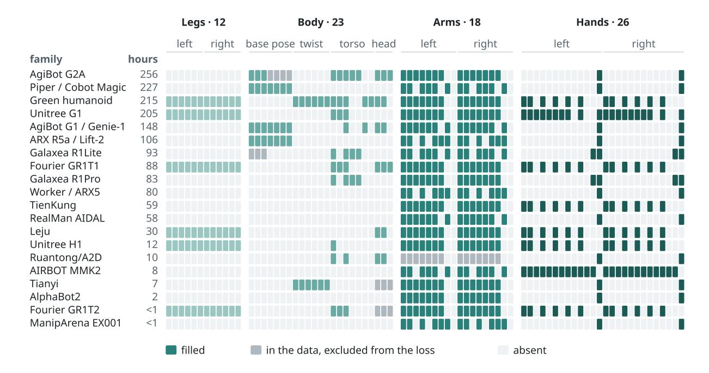

그림 27: 79개의 해부학적 슬롯(anatomical slots)을 가족(family)별로 보여준다.  

행: 허용된 시간(admitted hours)에 따라 정렬된 20개의 가족.  

열: 슬롯이 다리(legs) (12), 몸(body) (23: 기본 포즈, 회전, 상체 및 머리), 팔(arms) (18) 및 손(hands) (26)으로 그룹화되며, 좌우 하위 그룹이 있다.  

색칠된 셀은 해당 가족의 최소 한 개 레이아웃(layout)에서 명명된 채널(named channel)으로 채워진다.  

회색 셀은 해당 신체 부위의 해결되지 않은 채널(unresolved channels)만을 포함한다: 이 채널은 데이터에 남아 있고 손실(loss)에서 제외되며 슬롯과의 대응이 없음을 주장한다.  

연한 셀은 부재한 슬롯을 표시한다.  

Ruantong/A2D의 손은 해결되지 않았다.

그림 27(figure 27)은 각 패밀리가 채우는 슬롯을 보여준다. 등록된 43개의 소스 레이아웃 각각은 채널을 선택하고, 슬롯 순서로 순열하며, 각 슬롯 역할에 대해 부호와 제로를 고정하는 코덱을 갖는다; 스케일과 오프셋은 레이아웃별 통계에 흡수된다. 좌표는 URDF가 제로 포즈에서, 제조업체 문서 또는 명명된 채널에서 그 대응이 유도될 때만 공유 슬롯에 들어가며, 주요 패밀리의 경우 조인트 할당은 측정된 엔드-에펙터 포즈에 대한 순방향 운동학으로 검증된다. 확립된 대응이 없는 채널은 공유 슬롯 밖에 남는다. 유효성 마스크는 손실에서 부재하거나 해결되지 않은 좌표를 제거하므로, 같은 텐서 폭이 같은 의미를 의미하지 않는다. 예를 들어 Worker platform은 일반 채널 이름 아래 두 개의 6-DoF 팔과 두 개의 그리퍼를 저장하며, 그 코덱은 각 채널에 해부학적 역할을 할당한다(그림 4(figure 4)). 훈련 후에만 나타나는 로봇은 레이아웃 확장과 동일한 인터페이스를 통해 들어가며: 새로운 코덱이 그들의 채널을 기존 슬롯에 매핑하고, GreenWAM의 공유 프로젝터는 변하지 않는다. RoboTwin은 ARX5 팔을 사용하므로, 그 레이아웃은 Worker family를 재사용하며, 그 순방향 운동학은 기록된 RoboTwin 그리퍼 경로를 5.2mm와 7.1mm 이내로 재현한다; CALVIN의 단일 Franka arm은 Cartesian end-effector 슬롯을 통해 들어간다. 상태 행은 소스별로 비디오 프레임에 정렬된다. 정규화 통계는 훈련 세트에서만 계산되며, 절대 및 오프셋 인코딩을 별도로, 레이아웃별로, 그리고 물리 단위의 스케일에 대한 하한을 두고 슬롯별로 풀링된다; WAM 통계는 성공적인 시연만 사용한다.

# **B** 훈련 및 적응 레시피 (Training and Adaptation Recipes)

#### **B.1 로봇 훈련 레시피** (Robotics Training Recipe)

**Recipe.** 그림 28은 훈련 손실을 보여준다. 모든 생성된 스트림에서 공유되는 노이즈 수준은 Cosmos 3 Edge의 비디오 훈련에서와 같이 그려진다: $\tilde{\sigma} = 1 - u - s \left(\cos^2 \frac{\pi u}{2} - 1 + u\right)$ 여기서 $u \sim \mathcal{U}(0,1)$이고 s = 1.29이며, $\sigma = k\tilde{\sigma}/(1 + (k-1)\tilde{\sigma})$로 변환된다. k = 5는 480p 캔버스에 적용된다. 각 마이크로 배치는 한 모드의 4개의 예제를 묶으며, 이로 인해 히스토리 앵커가 있는 예제와 없는 예제가 섞이지 않도록 한다. 학습률

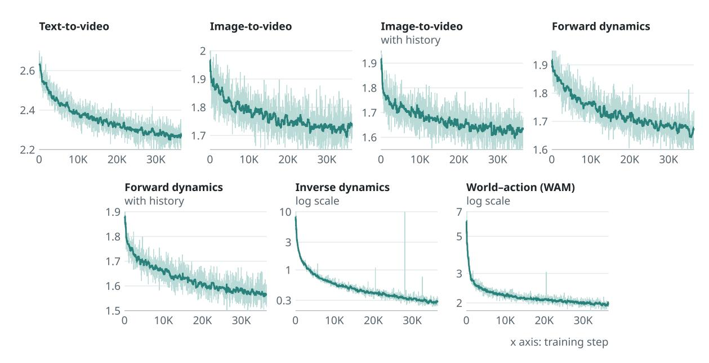

**Figure 28 Robotics-stage training.** 각 모드의 훈련 손실은 보고된 값(밝은 색)과 약 500 스텝 동안의 실행 중 중앙값(어두운 색)을 나타낸다; inverse dynamics와 WAM은 로그 스케일에 표시된다. 이는 그들이 한 차원 높은 값으로 시작하기 때문이며, 그들의 중앙값은 8.3에서 0.29로, 6.2에서 1.98로 감소한다.

2 × 10−5 배치 128, i.e. = 2 × 10−5√/128, 새로 초기화된 액션 프로젝션과 모달리티 임베딩은 5배 더 큰 비율을 사용한다.

**Table 5 로봇 단계 레시피.** (Table 5 Recipe of the robotics stage.)

| 설정 | 값 |
|----------------------|-------------------------------------------------------------------------------------------------------------------------------------------------------------|
| 초기화 | Cosmos 3 Edge 4B |
| 학습 가능 | 생성기, 행동 투영, 행동-모달리티 임베딩 |
| 동결 | 추론기, 비디오 VAE |
| 모드, 예시 비율 | 텍스트-투-비디오 20, 이미지-투-비디오 10, 이미지-투-비디오(히스토리 포함) 10, 포워드 다이내믹스 15, 포워드 다이내믹스(히스토리 포함) 20, 인버스 다이내믹스 10, WAM 15 |
| 프레임 속도 | 네이티브, 30 FPS로 제한 |
| 훈련 단위 | 전체 서브태스크; 각 자기회귀 블록이 하나의 서브태스크 |
| 롤아웃 | 전체 서브태스크 블록에서 최대 30초의 미래 비디오; 4개의 RGB 히스토리 앵커 |
| WAM 수평선 | 약 1.07초; 성공적인 시연만 |
| 조인트 목표 | 인버스 다이내믹스: 절대값, 𝑞0 포함; 다른 모드: 블록 시작으로부터의 오프셋 |
| 캔버스 크기 | 640×640, 736×544, 544×736, 832×480, 480×832 |
| 전역 배치 | 256 예시 (64 GPU × 4 패킹된 예시) |
| 옵티마이저 | AdamW [53], 𝛽 = (0.9, 0.99), 가중치 감쇠 0.05 |
| 학습률 | 2.83 × 10−5; 행동 투영 및 임베딩에 ×5 |
| 스케줄 | 500 워밍업 단계, 이후 선형 감소 |
| 그라디언트 클리핑 | 1.0 |
| 노이즈 수준 | 모든 생성된 스트림에 공유; Cosmos 3 Edge 비디오 스케줄, 480p에서 shift 5 (Section 4.3) |
| 손실 | 비디오 및 상태 항목, 각각 10배로 스케일링; 상태: 유효한 신체 부위 그룹 내 평균, |
|  | 그 후 그룹 간 |
| 프롬프트 | Cosmos 3 JSON, 최대 768 토큰, 텍스트 드롭아웃 0.1 |
| 검증 | 1,200 단계마다 |
| 훈련 단계 | 36 500 (9.34백만 예시) |

#### **B.2 시계열 샘플링 및 예측 대상 (Temporal Sampling and Prediction Targets)**

**물리적 시간.** 우리는 각 소스의 물리적 타이밍을 보존하고 유효 비디오 속도를 30 FPS로 제한한다. $f_s$ 로 기록된 소스는 stride $\max(1, \lceil f_s/30 \rceil)$ 로 읽는다: 15, 20, 30 FPS는 그대로 유지되며, 50 FPS는 25 FPS가 된다. 비디오 프레임과 측정된 상태는 같은 시간 격자에서 선택되며, 유효 속도는 모델에 전달된다. 이는 물리적 시간에서의 움직임 속도를 보존한다; 관절 위치와 변위는 샘플링 비율에 비례하여 곱해지지 않는다. 삼관점 소스는 헤드-카메라 종횡비에 따라 480p 캔버스 버킷 $640 \times 640$, $736 \times 544$, $544 \times 736$, $832 \times 480$, $480 \times 832$ 를 사용한다.

전체 하위 작업. 고정 길이 클립은 동작을 중간에서 자르고, 불완전한 그립을 전체 그립의 설명과 짝지을 수 있다. 따라서 텍스트-비디오, 이미지-비디오, 순방향 역학 및 역방향 역학은 고정 길이 클립 대신 완전한 준비된 하위 작업을 사용한다. 자기 회귀 모드에서는 하나의 블록이 하나의 전체 하위 작업이며, 다음 블록은 완전히 맞을 때만 추가되고 마지막 블록은 절대로 잘리지 않는다. 자기 회귀 예산은 물리적 시간으로 표현되며, 최대 30초의 미래 비디오를 포함한다. 따라서 예측되는 프레임 수는 소스의 프레임 속도를 따른다.

**역사 앵커.** 연속적으로 보존된 역사의 시작을 a, 마지막 관측 경계를 b(둘 다 네이티브 프레임 인덱스)라 하고, 효과 비디오 격자에서의 stride를 s라 하자. $N = \lfloor (b-a)/s \rfloor$ 이면 네 개의 RGB 앵커는 다음과 같다.

$$h_i = a + s \left\lfloor \frac{iN}{3} \right\rfloor, \qquad i = 0, 1, 2, 3.$$

(11)

각 프레임은 별도로 인코딩된다. 에피소드 시작 시 또는 허용된 롤아웃에서 a=b이며, 모든 네 개의 앵커는 초기 프레임이다; 짧은 역사는 앵커를 반복할 수 있다. 목표 프레임은 b+s에서 시작하므로, 모든 앵커는 예측 블록 앞에 있다. 역사는 같은 에피소드와 카메라의 인접한 보존된 하위 작업을 가로질러 확장되며, 거부된 간격에서 재설정된다. 목표 블록은 허용된 하위 작업 내에 맞아야 하며, 디코더 패딩은 누락된 역사나 목표 프레임을 제공하지 않는다.

**WAM 수평선.** WAM은 물리적 수평선이 약 $1.07 \, \text{s}$인 하위 작업 내부에서 짧은 미래를 예측한다. 비디오와 상태 목표는 이 구간을 덮으며, VAE 패딩은 추가적인 동작 목표를 생성하지 않는다. 명령은 감싸는 허용된 원자에 묶여 있으며, 짧은 WAM 창을 샘플링할 때 유지된다. 이는 진행 중인 작업을 지정하며, H 내에서 완료를 약속하지 않는다. WAM은 양성 성공 라벨만 허용하며, 실패, 알 수 없음 및 부재 결과는 훈련 세트 밖에 남는다.

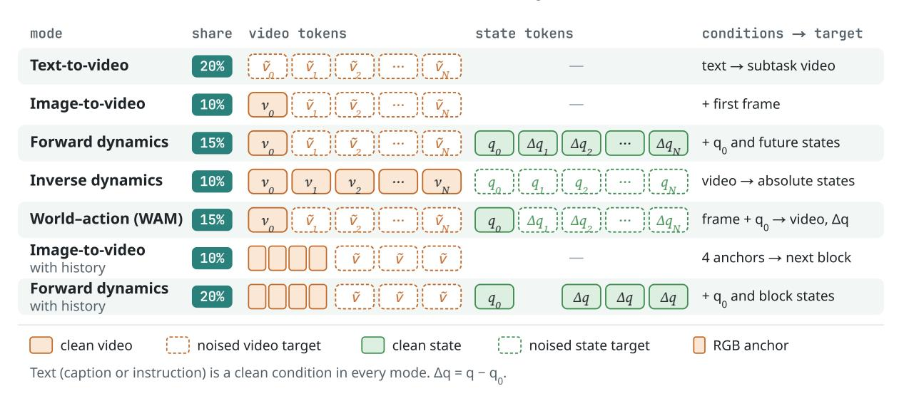

Figure 29 일곱 모드에서의 깨끗한 조건과 노이즈가 있는 목표, 각 모드의 훈련 예시 비율. 텍스트(캡션 또는 지시)는 모든 모드에서 깨끗한 조건이다. 순방향 역학은 역사와 무관하게 $q_0$와 방정식 (2)의 깨끗한 미래 목표 $\delta_k$에 조건을 둔다; 역방향 역학은 $q_0$를 포함한 절대 상태를 예측한다. WAM은 소스의 유효 프레임 속도에서 약 1.07초 동안 미래 프레임과 상태 오프셋을 예측한다. 자기 회귀 모드는 역사에서 네 개의 RGB 앵커를 사용해 다음 전체 하위 작업 블록을 예측한다.

### **B.3 구조화된 캡션 및 명령 (Structured Captions and Commands)**

시각적 설명은 장면과 관측된 결과를 포함하여 보이는 것을 기록한다. 행동 지시는 같은 구간에서 로봇이 수행해야 할 일을 지정한다. 우리는 과거 캡션을 정책 명령으로 취급하는 대신, 모든 원자에 대해 둘 다 보관한다.

**Captioner.** 비전‑언어 모델(Qwen3.8-27B [[64&#93;](#page-27-12) FP8 가중치 사용)은 하나의 원자에 대한 입장‑카메라 클립에 캡션을 달아준다. 또한 클립 길이, 소스 서브태스크 라벨, 그리고 세 가지 레지스트리 사실(구현체: 휴머노이드 또는 양손 플랫폼, 엔드 이펙터: 다재다능한 손 또는 두 손가락 그리퍼, 도메인: 실제 또는 시뮬레이션)을 받는다. 라벨은 목표와 대상 객체를 제공하지만, 프레임만이 시도 진행 정도를 결정한다. 레지스트리 사실은 주어진 것으로 간주되므로, 자르거나 가려진 이펙터가 구현체를 변경하지 않는다.

**Field‑by‑field generation.** 캡션러는 단일 대화에서 한 턴마다 하나의 필드를 작성하며, 각 답변은 다음 요청 전에 컨텍스트에 추가된다 (Table [6](#page-34-1)). 따라서 이후 필드는 이전 필드와 일치해야 하며, 하나의 객체는 기록 전체에서 하나의 이름과 하나의 색상을 유지한다. 행동 단계는 0:00에 시작하여 순서대로 연속적으로 진행되며, 클립 길이에서 끝난다. 공유 지시 블록은 어휘를 고정한다: 행위자‑상대적 왼쪽과 오른쪽, 레지스트리의 이펙터 용어, 카메라 언어 없음, 보수적 표현(hedging) 없음, 그리고 시각적으로 확인할 수 없는 접촉 세부사항 없음. 행동 단계 이전에 작성된 시도 기록은 최종 상태, 대상이 이동했는지 여부, 이펙터가 끝나는 위치를 명시한다; 중간에 끝나는 클립은 단계와 중간에 끝나는 서술을 받는다.

**Table 6 캡션 기록의 필드 생성 순서.** 두 개의 검사는 동일한 대화에서 생성되지만 캡션 외부에 저장되며 훈련 프롬프트에 포함되지 않는다.

|  | 필드 | 내용 | 역할 |
|---|------------------|---------------------------------------------------------------------------------------------------------------------------------------------------------------------------------|-------------------|
| 1 | 주제 | 로봇과 사람이 있는 경우: 구현, 효과기, lo cation, 방향, 자세, 동작, 상태 변화, 팔 및 다리 수; 사람 속성은 로봇에 대해 비워 둔다 | 캡션 |
| 2 | 배경 | 설정, 가구 및 물체의 색상과 재질; 실제 또는 시뮬레이션 도메인 | 캡션 |
| 3 | 조명 | 조건, 방향, 그림자, 장면에 미치는 영향 | 캡션 |
| 4 | 미학 | 구성, 색상 스킴, 분위기, 패턴 | 캡션 |
| 5 | 문맥 | 한 문장: 활동, 설정, 활성 효과기 및 그 측면 | 캡션; 재작성자 |
| 6 | 시도 기록 | 최종 프레임에서의 최종 상태, 목표가 이동했는지, 효과기의 최종 위치, 결과 | 확인 |
| 7 | 행동 단계 | 1~5개의 타임드 단계: 효과기, 물체, 이동 경로 | 캡션; 재작성자 |
| 8 | 시간적 캡션 | 120–180단어의 연대기적 단락으로, 최종 상태에서 끝나는 문장 | 캡션; 재작성자 |
| 9 | 일관성 | 라벨 및 레지스트리 사실과의 일치; 불일치 조항 | 확인 |

**콘텐츠 게이트.**  
각 답변은 금지된 문구, 레지스트리와 모순되는 효과기 용어, 접촉 주장 및 시도 기록이 제외하는 완료 단어를 검사한다.  
위반은 해당 문구를 모델에 다시 전달해 같은 필드를 재작성하도록 하며, 최대 두 번까지 허용한다. 남은 위반은 원자를 재시작하며 최대 4번까지 시도한다.  
승인된 캡션이 없는 원자는 품질 승인 풀에 남아 있지만 텍스트 의존 모드에는 포함되지 않는다.  

**커버리지.**  
총 124만 개의 원자에 대해 시각적 캡션이 승인되었으며 18만 7천 개는 승인되지 않았다; 이 중 119만 개는 또한 명령이 승인되었다.

**캡션에서 명령으로.**  
두 번째 언어 모델 파스는 순서가 지정된 동작 단계들을 각 단계마다 한 개의 명령으로 변환한다. 단계 순서, 효과기, 중요한 동작, 해제 및 공간 관계를 유지한다.  
본 모델은 네이티브 연산자 명령을 보지 못하며, 부분적이거나 실패한 동작은 완료된 동작이 아니라 시도(Attempt)로 남는다.  
모든 단계가 존재하고 순서대로이며 토큰 예산 내에 있을 때만 명령이 승인된다. 절단되지 않는다.  
표 [7](#page-35-2)은 소스 라벨에서 파생 명령까지 한 원자를 따라간다.

**표 7 원자: 소스 라벨에서 파생 명령까지 (Figure [6c](#page-8-1) 클립, RoboCOIN, Unitree G1, 정밀한 손, 실제).**  
캡션러와 리라이터 출력은 그대로 인용된다.

| 소스 라벨 레지스트리 사실 | 테이블에서 빵을 집어 들고 접시에 놓는다. 휴머노이드; 기민한 손; 실제 |  |  |  |
|--------------------------------|-----------------------------------------------------------------------------------------------------------------------------------------------------------------------------------------------------------------------------------------------------------------------------------------------------|--|--|--|
| 행동 단계 | 0:00–0:04 왼쪽 기민한 손이 테이블 왼쪽에 있는 주황색과 흰색 빵 롤에 손을 뻗어 잡는다. |  |  |  |
|  | 0:04–0:07 왼쪽 기민한 손이 빵 롤을 들어 올려 보라색 접시 위로 옮기고, 접시에 내려놓는다. |  |  |  |
|  | 0:07–0:10 왼쪽 기민한 손이 접시 위의 빵 롤을 놓고, 작업 공간에서 물러난다. |  |  |  |
| 시도 기록 일관성 | 목표가 이동: 예; 효과기 끝: 작업 공간에서 멀어짐; 결과: 도달 일치 |  |  |  |
| 파생 명령 | 왼쪽 기민한 손을 테이블 왼쪽에 있는 주황색과 흰색 빵 롤 쪽으로 뻗어 잡는다. 빵 롤을 들어 올려 보라색 접시 위로 옮기고, 접시에 내려놓는다. 접시 위의 빵 롤을 놓고, 왼쪽 손을 작업 공간에서 물러난다. |  |  |  |

#### **B.4 훈련 혼합 (Training Mixture)**

시간 비율에 따라 샘플링하면 네 개의 가족이 전체 예시의 절반 이상을 제공하게 된다 (Table [8](#page-36-0)); 데이터셋 전체를 균일하게 샘플링하면 반대로 가장 작은 데이터셋을 여러 번 반복하게 된다. 우리는 중간 경로를 사용한다. 샘플링은 먼저 모드를 선택하고, 그 다음 로봇 클러스터, 데이터셋, 그리고 윈도우를 선택한다. 모드 비율은 Table [2](#page-7-1)의 비율과 동일하다. 클러스터 비율은 우리의 두 주요 목표에 대해 고정된다: Worker/ARX5 클러스터는 예시의 12%를, Green humanoid 클러스터(실제 및 시뮬레이션)는 18%를 받는다. 이 구성된 혼합에서 나머지 19개의 클러스터는 √에 비례하여 70%를 공유한다. 여기서 √는 클러스터의 고유 허용 가능한 훈련 서브태스크 수를 나타낸다:

$$p_c = 0.70 \cdot \frac{\sqrt{N_c}}{\sum_{c'} \sqrt{N_{c'}}}.$$

(12)

샘플러는 텍스트 수락, 모달리티 검사 및 시간 윈도우 수락 후 각 모드, 클러스터 및 데이터셋에 대해 적격한 고유 서브태스크를 먼저 열거한다. Let과 be는 적격 데이터가 있는 구성된 모드–클러스터 쌍이다. 우리는 최대 엔트로피를 통해 이들의 결합 확률을 얻는다:

$$P^* = \arg\max_{P \ge 0} -\sum_{m,c} P_{mc} \log P_{mc},$$

$$\sum_{c} P_{mc} = p_m, \qquad \sum_{m} P_{mc} = p_c, \qquad P_{mc} = 0 \quad \text{if } (m,c) 
otin \mathcal{E}.$$

$$(13)$$

구현은 결합 표를 풀기 전에 지원 가능성을 확인하고, 한 한계분포를 다른 한계분포에 희생시키지 않는다. 지원되는 쌍 내에서 데이터셋은 √에 비례하는 조건부 확률을 갖는다. 여기서 √는 해당 모드에서 적격 고유 서브태스크 수를 나타낸다. 샘플링은 먼저 데이터셋 내에서 서브태스크를 균일하게 선택한 뒤, 그 시간 윈도우와 가능하면 결합 또는 EEF 뷰를 선택한다. 따라서 추가 윈도우나 두 번째 액션 뷰는 서브태스크의 샘플링 질량을 증가시키지 않는다. Table [8](#page-36-0)은 허용된 시간 비율 옆에 구성된 클러스터 목표를 나열한다; 모든 샘플링 비율은 예시를 기준으로 한다.

표는 이 균형을 명시적으로 보여준다. 우리의 두 배포 대상은 시간 비율보다 훨씬 높은 비율로 샘플링되며, 가장 큰 공개 가족은 그 이하로 샘플링된다. 몇 시간의 데이터만 가진 가족은 그 부피만으로는 정당화되지 않는 정도로 여러 번 더 자주 보게 되며, 이는 서브태스크를 반복하는 비용을 감수한다.

#### **B.5 정책 적응 레시피 (Policy Adaptation Recipes)**

**RoboTwin 2.0.** 정책은 리더보드 프로토콜에 따라 모든 2,500개의 깨끗한 시연(작업당 50개)에서 훈련된다; 작업당 40개의 훈련 에피소드와 10개의 보류 에피소드로 분할된 것은 레시피 선택에만 사용된다. The

**Table 8 등록된 가족별 구성된 샘플링 목표, 훈련 분할에서 계산된, 허용된 시간 옆에 표시. 목표는 텍스트 및 모드 수락 전에 설정된다.**

| 가족 | 입원, h | 시간, % | 샘플링, % |
|-----------------------|-------------|----------|-------------|
| Green humanoid | 214.8 | 12.7 | 18.0 |
| Worker / ARX5 | 80.3 | 4.8 | 12.0 |
| AgiBot G2A | 256.0 | 15.2 | 9.1 |
| Piper / Cobot Magic | 227.2 | 13.5 | 7.8 |
| Unitree G1 | 204.9 | 12.1 | 7.2 |
| Fourier GR1T1 | 87.9 | 5.2 | 6.9 |
| AgiBot G1 / Genie-1 | 148.5 | 8.8 | 5.2 |
| Galaxea R1Pro | 82.9 | 4.9 | 4.9 |
| Galaxea R1Lite | 92.6 | 5.5 | 4.3 |
| ARX R5a / Lift-2 | 105.8 | 6.3 | 4.2 |
| TienKung | 59.3 | 3.5 | 4.1 |
| RealMan AIDAL | 57.7 | 3.4 | 4.0 |
| Leju | 30.0 | 1.8 | 3.2 |
| AIRBOT MMK2 | 7.8 | 0.5 | 2.4 |
| Unitree H1 | 12.5 | 0.7 | 2.2 |
| RoboCOIN Ruantong/A2D | 10.1 | 0.6 | 1.7 |
| Tianyi | 6.8 | 0.4 | 1.4 |
| AlphaBot2 | 2.2 | 0.1 | 0.7 |
| Fourier GR1T2 | 0.8 | < 0.1 | 0.4 |
| ManipArena EX001 | 0.4 | < 0.1 | 0.2 |
| OpenArm | < 0.01 | < 0.01 | 0.04 |

정책은 관절 공간에서 양쪽 팔과 그리퍼를 제어한다. RoboTwin은 1/250초의 15개 플래너 스텝마다 한 프레임을 기록하므로, 실제 프레임 속도는 메타데이터에 명시된 30Hz 대신 16.67Hz이며, WAM 수평선은 GreenWAM의 1.07초를 유지한다. 에피소드는 최대 10초의 연속적인 원자로 동일하게 자르고, WAM 창은 전체 창이 맞는 모든 프레임에서 시작한다. 이로 인해 15,000개의 타일 창 대신 약 470,000개의 창이 생성된다. 모드 혼합은 WAM 중심(0.9 WAM, 0.05 forward, 0.05 image-to-video)이며, 14개의 액션 좌표 각각은 동일한 손실 가중치를 갖는다. 각 샘플은 해당 에피소드에서 본 지시문 중 무작위로 변형된 문장을 선택한다. 보고된 정책은 배경 교체, 색상 증강 및 액션 전문가와 함께 GreenWAM에서 단계별로 훈련된다. 평가 시 정책은 16단계를 예측하고, 가이드 없이 8개의 디노이징 스텝으로 샘플링한 뒤, 재계획 전에 전체 예측을 실행한다.

**WorldArena 1.0.** 세계 모델은 GreenWAM에서 시작하여 10,000 스텝 동안 전역 배치 64, 500 스텝의 워밍업 이후 최고 학습률 1.41×10⁻⁵를 사용하고, 최고값의 0.1까지 코사인 감소를 적용한다. 이는 깨끗한 RoboTwin 2.0 시연에서 훈련되며, 그 ARX5 팔은 벤치마크와 동일하고, 736×544의 단일 헤드-카메라 캔버스로 렌더링되어 최대 15초의 블록으로 자른다. 역학은 과거와 함께한 순방향 역학만 훈련되고, 텍스트 프롬프트는 항상 빈 상태이며, 이는 벤치마크의 액션 변형과 동일하다. 평가 시 첫 번째 블록을 포함한 모든 블록은 이 모드에서 과거의 네 개 앵커로 생성되며, 첫 번째 블록은 기록된 첫 프레임을 반복한다. 샘플링은 가이드 없이 35단계로 수행된다.

**LIBERO.** LIBERO 정책은 GreenWAM에서 단계별로 액션 전문가와 함께 적응되며, 외관 증강, 3인칭 카메라 이미지의 무작위 시점 왜곡, 그리고 변형된 지시문을 사용한다. 훈련에는 LIBERO-plus 에피소드를 사용하지 않으며, 동일한 정책이 두 벤치마크 모두에서 평가된다.

**RoboDojo.** 정책은 공식 프로토콜을 따르며, 공식 훈련 세트에서 훈련되고 공식 리더보드(섹션 [C.1](#page-37-1))의 항목과 비교된다. 이는 GreenWAM의 생성자–전문가 아키텍처를 사용하며, 스트림에 따라 주의가 제한된다: 역사(history)는 지시문과 자신에게 주의를 기울이고, 현재 프레임(current frame)은 지시문, 역사 및 자신에게, 상태(state)는 현재 프레임과 자신에게, 그리고 행동(actions)은 생성된 비디오, 상태 및 자신에게 주의를 기울인다. 역사는 지시문 뒤에 고정되고, 현재 프레임, 생성된 비디오 및 행동은 그로부터의 시간 오프셋에 배치된다. 훈련은 다음과 같이 진행된다

60,000 스텝, 전역 배치 352, 3,000 스텝에 걸쳐 8×10⁻⁵까지 학습률을 워밍업하고 코사인으로 10⁻⁶까지 감소시키며, 가중치 감쇠 0.01, 가중치의 지수 이동 평균, 분위수 정규화된 액션을 사용한다. 훈련 예시의 5분의 1은 이미지-투-비디오이다.

**CALVIN.** CALVIN 정책은 ABC 훈련 분할만을 사용해 훈련된다(섹션 [C)](#page-37-0)). 단일 Franka 팔은 GreenWAM에 카르테시안 엔드-에펙터 슬롯을 통해 per-frame SE(3) 오프셋과 절대 초기 포즈를 현재 상태로 사용한다. 평가 시 정책은 20단계를 예측하고, 4개의 UniPC 스텝, 3의 타임스텝 시프트, 1.5의 가이던스를 사용해 샘플링한 뒤, 재계획 전에 처음 10단계를 실행한다.

**그린 휴머노이드.** 비교는 세 가지 초기화: 공개 0.5 베이스 체크포인트 [61](#page-27-22), Cosmos 3 Edge, 그리고 GreenWAM을 사용한다. 이들은 동일한 그린 시연 분할에 적응된다. 증류 정책은 보고된 GreenWAM 교사에서 시작하며, 일관성 및 시연 손실에 대해 훈련 분할만 사용한다. 그 일관성 손실은 마스크된 가짜-허버 거리 [72](#page-27-26)를 사용하며, 사용 불가능한 행동 좌표와 깨끗한 조건은 제외된다; 손실 가중치는 (1, 1, 0.01)이고 EMA 감쇠는 0.995이다. 온라인 학생만 최적화된다; 교사와 EMA 타깃은 훈련 중에만 사용된다. 검증 에피소드는 체크포인트와 추론 설정을 선택하며, ID 테스트 에피소드나 OOD 시도는 선택에 사용되지 않는다.

각 정책은 자체 관측 전처리, 행동 표현 및 훈련 레시피를 유지하며, 로봇 인터페이스에서 공통 카메라 스트림과 제어 조인트를 사용한다. 정규화 통계는 훈련 데이터에 맞춰 적합된다.

# **C 평가 프로토콜**

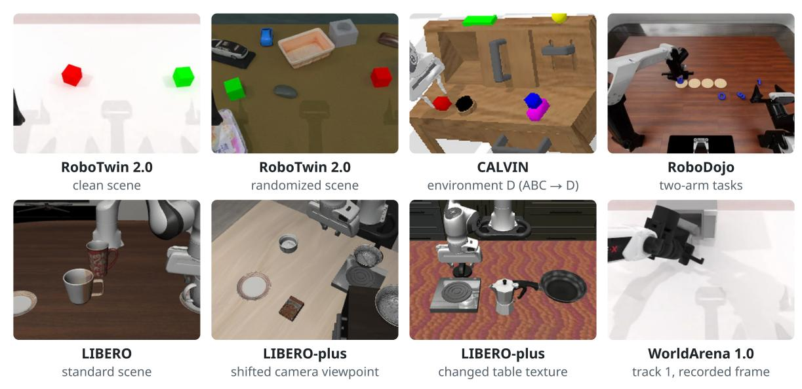

**Figure 30 벤치마크 장면들.** 벤치마크와 설정마다 한 프레임. RoboTwin 2.0, LIBERO 및 LIBEROplus 프레임은 우리 정책의 평가 에피소드에서 나온다: Figure [12,](#page-17-1)의 깨끗한 및 무작위 에피소드의 첫 번째 헤드-카메라 프레임, 표준 LIBERO 장면, 카메라가 −32∘ 회전된 LIBERO-plus 장면, 그리고 테이블 질감이 바뀐 장면. 나머지 프레임은 기록된 벤치마크 데이터이다: CALVIN의 environment-D 에피소드의 정적 카메라, RoboDojo 시연의 헤드 카메라, 그리고 WorldArena 1.0 테스트 에피소드의 기록된 프레임.

### **C.1 공개 벤치마크**

**RoboTwin 2.0.** 벤치마크는 Aloha-AgileX 구현체에서 50개의 양손 작업으로 구성되며, 팔은 ARX5 기구학을 공유한다 (섹션 [A.3)](#page-30-0)). 리더보드 프로토콜은 작업당 50개의 깨끗한 시연(총 2,500개)을 훈련하고, 깨끗한 장면(clean2clean, easy)과 잡동사니, 무작위 조명, 배경 질감 및 테이블 높이가 무작위화된 장면(clean2random, hard)에서 작업당 100개의 시도를 평가한다; 리더보드는 두 결과의 평균으로 순위를 매긴다. 리더보드 항목은 공개 코드, 공개 가중치 및 기술 보고서 [68](#page-27-18)]를 요구한다.

**Table 9 평가 프로토콜.** Figure [30](#page-37-2)는 각 벤치마크의 한 프레임을 보여준다.

| 벤치마크 | 프로토콜 | 메트릭 |  |  |
|------------------------------|--------------------------------------------------------------------------------------------|---------------------------------------------------------------------------|--|--|
| WorldArena 1.0, track 1 [70] | 행동-조건화된 예측 on 1 000 테스트 에피소드 | 지각 및 구현 메트릭; 모션 캡된 집계 Figure 9에 |  |  |
| RoboTwin 2.0 [18] | 50개의 양손 작업, 100번의 시도 per 작업, 깨끗하고 무작위화된 장면 | 성공률, 깨끗하고 무작위화된 |  |  |
| LIBERO [48] | 단일 Franka arm의 네 개의 작업 세트 in simulation | 세트 전반에 걸친 평균 성공률 |  |  |
| LIBERO-plus [24] | LIBERO 작업은 7개의 왜곡 축 아래에서, 표준 LIBERO 훈련 후 zero-shot | 모든 왜곡된 에피소드에서의 성공 |  |  |
| RoboDojo [19] | 42개의 시뮬레이션 작업 in five capability dimensions, 150번의 시도 per 작업 over 3 시드 | 차원별로 평균화된 점수와 성공률 |  |  |
| CALVIN [55] | ABC→D, 다섯 개의 지시문 체인 | 평균 완료 길이 |  |  |
| 그린 휴머노이드 | 𝜋0.5, Cosmos 3 Edge, GreenWAM 및 그 증류된 학생을 위한 ID/OOD 시험 세트 | 분할별 지시 성공 |  |  |

**WorldArena.** 평가는 WorldArena 1.0의 트랙 1을 사용한다. 메트릭 분해는 이미지 품질, 미적 품질, JEPA 유사성, 동적 정도, 흐름 점수, 동작 부드러움, 주제 일관성, 배경 일관성, 광도 일관성, 상호작용 품질, 궤적 정확도, 깊이 정확도, 원근감, 지시 따르기 및 의미 정렬을 포함한다 [&#91;70](#page-27-13). GreenWAM은 모든 1 000개의 테스트 에피소드를 대상으로 평가된다. GreenWAM의 경우, 동적 정도, 흐름 점수, 동작 부드러움은 평균화 전에 각 에피소드의 실제 값에 대해 개별적으로 제한된다. 경쟁자에게는 모델 수준의 메트릭 평균만 제공되므로, 제한값은 모든 1 000개의 참조 에피소드에 대한 해당 실제 평균값 23.05, 12.50, 69.79이다. 이는 WorldArena 2.0의 동작 제한 규칙을 따르며 [[71,](#page-27-28) [83&#93;](#page-28-11); 비디오와 테스트 에피소드는 WorldArena 1.0의 그대로이다. 재계산된 집계값은 공식 WorldArena 1.0 리더보드 점수와 다르다. 그림은 선택된 비교를 보여준다: BLM, WorldScape v0.2, GigaWorld‑1, GE‑Sim 2.0 및 SisyphusWorld는 제외된다. 시각적 품질은 녹화에 대한 참조 없이 계산된 두 점수, MUSIQ 이미지 품질 [[37&#93;](#page-26-26) 및 LAION 미적 품질 [[69&#93;](#page-27-29)와 JEPA 유사성을 결합한다; GreenWAM은 녹화 대비 57.2를 달성하고, 127개의 보드 항목 중 103개가 이미지 품질에서 녹화를 초과한다. 지시 따르기 및 상호작용 품질은 WorldArena 평가자 [[70](#page-27-13)]에서 Qwen3‑VL 비전‑언어 판사가 부여한다. 평가된 GreenWAM 비디오 전반에서 두 지표는 궤적 정확도와 약하게 상관(= 0.05)하고, 미적 품질과는 더 강하게 상관(= 0.29 및 0.32)하며, 41개와 67개의 보드 항목이 각각 녹화 대비 높은 점수를 기록한다.

**RoboDojo.** 벤치마크는 42개의 시뮬레이션 과제를 다섯 가지 능력 차원(일반화, 메모리, 정밀도, 장기, 오픈‑어휘 지시)과 18개의 실제 과제로 구성된다. 각 정책은 세 개의 시드에서 과제당 150번의 시도를 통해 평가되며, 점수와 성공률은 차원 내에서 평균화되고 이후 차원 간에 평균화된다 [[19](#page-26-25). 시뮬레이션 로봇은 25 Hz에서 두 개의 손목 카메라와 머리를 갖춘 양손 ARX5이며, 훈련은 3 500개의 시연을 사용한다. 각 34개 과제에 대해 100개, 보조 도메인‑랜덤화된 과제에 대해 100개를 사용하며, 오픈‑어휘 과제는 훈련에 포함되지 않는다. 검증된 리더보드 항목은 공개 레이아웃에서 세 개의 시드를 보고하고, 숨겨진 레이아웃 일관성 검사를 통과하며, 평가된 체크포인트와 코드를 공개한다 [[67](#page-27-2).

**LIBERO and LIBERO-plus.** LIBERO는 단일 Franka 팔을 위한 시뮬레이션 과제 세트를 제공한다 [[48](#page-27-20); 일반적인 관행을 따르며 [[38](#page-26-27)], 평가에서는 LIBERO‑Spatial, LIBERO‑Object, LIBERO‑Goal 및 LIBERO‑Long( LIBERO‑100의 장기 하위 집합)을 사용하고, 네 개의 세트에 대한 성공률을 평균하여 보고한다. LIBERO‑plus는 LIBERO 과제에 카메라 시점, 로봇 초기 상태, 언어, 조명, 배경, 센서 노이즈 및 객체 배치를 변형시켜 한 번의 시도당 하나의 변형된 에피소드를 제공한다. 제로‑샷 설정에서는 정책이 표준 LIBERO에만 훈련된다 [24](#page-26-22).

**CALVIN.** 정책은 환경 A, B, C에서 훈련되고, 보이지 않는 환경 D에서 다섯 개의 언어 지시 체인에 대해 평가된다. 메트릭은 완료된 지시의 평균 수이며 [55](#page-27-27). 훈련은 ABC 훈련 분할만 사용한다: 환경 D의 에피소드(검증 분할 포함)는 훈련에 사용되지 않으며, 결과는 1 000개의 체인에서 보고된다.

### **C.2 실제 휴머노이드 비교 프로토콜 (Real-Humanoid Comparison Protocol)**

**작업 및 분할.** 포장 작업은 장면을 재설정하지 않고 연속된 다섯 개의 지시문으로 제공된다 (Section [6.5)](#page-18-0)). ID 시험은 정책 적응에 표시된 객체와 장면을 새로 재설정한다; OOD 시험은 적응, 검증 및 증류 데이터에서 제외된 객체 또는 장면 조건을 변경한다. 모든 정책은 동일한 14개의 장면 구성(9 ID 및 5 OOD)에서 평가되며, 각 구성은 작업의 다섯 개 지시문을 포함한다. 이는 정책당 45개의 ID 지시문과 25개의 OOD 지시문을 제공하며, 각 지시문은 한 번 시도된다. 모든 정책은 동일한 지시문, 카메라 및 제어 조인트를 받는다.

**성공.** 지시문은 인간의 도움 없이 타임아웃 전에 완료될 때 성공한다; 실패, 타임아웃 및 정책에 의해 발생한 중지 역시 실패 지시문으로 간주된다. 분할과 정책에 대해, 성공 지시문 수를 \(s_{pd}\), 평가 지시문 수를 \(n_{pd}\)라 두면, 분할 점수는

$$SR_{p,d} = 100 \frac{s_{pd}}{n_{pd}},$$

(14)

ID와 OOD에 대해 별도로 보고된다.

### **C.3 지연 벤치마크**

우리는 FlashAttention-2가 적용된 단일 NVIDIA RTX 4090에서 추론 지연 시간을 벤치마크한다 (Table [10)](#page-39-0)). 비디오 브랜치는 세 개의 잠재 프레임에서 동작한다: 하나의 조건화 프레임과 두 개의 생성된 프레임으로, 이는 10Hz에서 8프레임 예측으로 디코드된다. 각 요청은 또한 고유 감각 상태와 128-토큰 명령어에 조건화된다. 모델 비용을 분리하기 위해, 관측 및 상태는 에피소드 내에서 고정되고, 명령어는 시작 시 한 번만 변경된다. 중앙값 지연 시간은 명령어에 따라 달라지는 양이 캐시된 이후의 정상 상태 지연 시간이며; 최초 행동까지의 시간(TTA)은 새로운 명령어 이후 첫 번째 요청의 지연 시간으로, 해당 캐시를 구축하는 시간을 포함한다. 각 값은 100개의 에피소드에 대해 계산되며, 비율은 밀리초 단위 지연 시간으로 1000을 나눈 값이다.

**Table 10 NVIDIA RTX 4090에서의 정책 추론 지연 시간.** GreenWAM 정책에 대해 최적화가 누적적으로 적용되며, 속도 향상은 그에 대한 상대값이다. 100개의 에피소드에 대한 중앙값 지연 시간; TTA는 새로운 명령어 이후 첫 번째 행동까지의 시간이다.

| 구성 | 중앙값, ms | 주파수, Hz | TTA, ms | 가속 |
|--------------------|------------|----------|---------|---------|
| GreenWAM | 435.9 | 2.3 | 435.9 | 1.00× |
| + 캐싱 | 411.1 | 2.4 | 430.8 | 1.06× |
| + 가이드 패킹 | 314.1 | 3.2 | 334.0 | 1.39× |
| + 첫 프레임 VAE | 236.4 | 4.2 | 256.5 | 1.84× |
| + 컴파일 | 184.6 | 5.4 | 195.5 | 2.36× |
| + W8A8 | 134.6 | 7.4 | 148.6 | 3.24× |
| + 디스틸레이션 | 35.4 | 28.3 | 48.8 | 12.32× |

최적화는 차례대로 적용된다. 캐싱은 디노이징 단계 전반에 걸쳐 instruction과 vision key–value 상태를 재사용하므로 이후 단계에서는 오직 생성 백본만 실행된다. 가이드 패킹은 classifier-free guidance의 조건부 및 빈 프롬프트 분기를 한 번의 순방향 패스에서 평가하고, 빈 프롬프트 key–value 상태도 캐싱한다. First-frame VAE 인코딩은 다른 두 latent 프레임이 정책에 의해 생성되므로 conditioning 프레임만 VAE 인코더를 통과시킨다. 컴파일은 이 단일 프레임 인코더와 함께 생성기 블록을 추적하고, W8A8은 8비트 가중치와 활성화를 사용해 피드‑포워드 레이어를 실행한다. Distillation은 네 개의 가이드 디노이징 단계를 하나의 일관성 단계로 대체하고 instruction 캐시를 유지한다. 캐싱이 활성화되면 새 instruction이 첫 번째 요청에 11–20 ms를 추가하고, Distilled policy에는 13.4 ms를 추가한다.

#### C.4 쌍 비교 (Paired Comparisons)

여기서 $y_{te}^A, y_{te}^B \in \{0, 1\}$ 은 두 실행의 결과를 나타내며, 이는 작업 t의 에피소드 e에서 공통 시드 $E_t$ 를 사용한 두 실행에 대해 정의된다. 보고된 차이는 벤치마크와 같이 작업별로 평균을 취한다:

$$\Delta = \frac{1}{|\mathcal{T}|} \sum_{t \in \mathcal{T}} \frac{1}{|E_t|} \sum_{e \in E_t} (y_{te}^A - y_{te}^B). \tag{15}$$

이 95% 구간은 5000개의 복제본을 사용한 계층적 부트스트랩에서 도출된다: 작업은 복원 추출로 재샘플링되고, 각 재샘플링된 작업 내에서 에피소드 쌍이 다시 샘플링된다. 구간은 2.5번째에서 97.5번째 백분위수를 포함한다. 따라서 이 구간은 두 체크포인트를 평가할 때의 불확실성을 나타내며, 훈련 실행 간의 변동성을 나타내지는 않는다. 순방향 예측은 y 대신 클립당 PSNR을 사용한 동일한 추정기를 사용한다.

#### C.5 평가 세부사항 (Evaluation Details)

빈 텍스트 프롬프트를 사용하면, WorldArena의 액션 변형과 같이, 클래스리스프리 가이던스는 효과가 없으며, 해당 변형은 가이던스 없이 샘플링된다. CALVIN 테스트 지침은 언어 증강 풀에서 제외된다. 보고된 RoboTwin 결과는 작업 및 설정당 100개의 시도를 사용하며, 통제된 비교는 공통 시드(Equation (15))를 기준으로 에피소드를 쌍으로 묶는다.

# **D** 추가 결과 및 정성적 예시 (Additional Results and Qualitative Examples)

#### **D.1** 벤치마크 표 (Benchmark Tables)

표 11은 Figure 9 뒤에 있는 WorldArena 카테고리를 제공하며, 표 12~14는 Figure 11에 요약된 CALVIN, RoboDojo, LIBERO 및 LIBERO-plus 결과를 나열하고, 각 값의 출처를 함께 제공한다.

표 11 WorldArena 1.0, 트랙 1: Figure 9에 있는 모델들의 전체 점수, 카테고리 및 충실도를 나타낸다. EWMScore(Equation (7))는 동적 정도, 흐름 점수 및 동작 부드러움을 실제 값으로 제한한 15개의 보드 메트릭 평균이다: GreenWAM은 비디오별, 다른 모델은 리더보드 평균(상한값)으로 계산한다. 마지막 행은 동일한 평가자를 사용해 녹화된 테스트 비디오 자체를 점수화한다.

|  |  | 카테고리 |  |  |  | 실제값에 대한 충실도 |  |  |  |
|----------------------------|----------|------------|---------|---------|------|--------------------------|------|-------|-------|
| 모델 | EWMScore | 시각적 | 콘텐츠 | 물리 | 3D | 제어 | JEPA | Traj. | 깊이 |
| GreenWAM | 63.31 | 57.2 | 65.6 | 62.2 | 93.4 | 84.1 | 98.4 | 56.0 | 98.2 |
| BWM-Fast [12] | 63.80 | 63.1 | 58.2 | 62.4 | 91.8 | 89.7 | 97.9 | 44.9 | 86.4 |
| UNIS [46] | 63.65 | 61.8 | 55.9 | 64.6 | 92.0 | 91.6 | 90.6 | 41.9 | 85.2 |
| ABot-PhysWorld (text) [20] | 63.65 | 64.4 | 63.4 | 56.7 | 85.5 | 90.8 | 90.4 | 31.5 | 72.0 |
| Motubrain [56] | 63.16 | 64.0 | 59.5 | 58.5 | 91.5 | 85.8 | 96.9 | 43.1 | 88.7 |
| FlowWAM-FiveAges [21] | 62.99 | 63.5 | 57.3 | 60.5 | 90.9 | 87.0 | 95.3 | 44.4 | 85.6 |
| CogVideoX [91] | 61.30 | 55.8 | 67.7 | 50.9 | 88.3 | 82.6 | 94.8 | 34.8 | 91.1 |
| Wan2.6 [79] | 60.96 | 61.4 | 64.0 | 42.7 | 84.7 | 89.0 | 72.6 | 12.2 | 75.4 |
| Ctrl-World [31] | 60.56 | 57.4 | 62.2 | 55.4 | 88.5 | 78.2 | 92.8 | 48.2 | 93.2 |
| IRASim [105] | 59.63 | 56.1 | 65.7 | 49.3 | 88.8 | 77.4 | 93.7 | 35.9 | 93.5 |
| Cosmos-Predict 2.5 [57] | 57.83 | 58.1 | 61.7 | 44.0 | 87.5 | 75.2 | 90.7 | 27.5 | 90.3 |
| 녹화된 테스트 비디오 | 67.23 | 59.5 | 66.7 | 79.6 | 95.4 | 87.2 | 99.9 | 86.9 | 100.0 |

#### D.2 실패 사례 (Failure Cases)

Figure 31은 LIBERO와 RoboTwin 정책의 전형적인 실패 사례를 보여준다. 두 에피소드 모두 작업은 마지막 단계까지 수행된다: 물체가 잡히고, 옮겨지고, 목표지점에 가져간다. 오류는 최종 배치에 있다. 그릇 가장자리에 기울어진 크림치즈와 스테이플러가 패드에 부분적으로만 놓여 있는 상황이며, 정책은 단계 제한 전에 이를 수정하지 못한다. 오류는 정밀 배치와 복구에 있다.

**표 12 CALVIN ABC**→**D, 1,000 체인.** 한 체인당 다섯 개의 지시문 중 완료된 지시문의 평균 수. 값은 Xiaomi-Robotics-0 [[15&#93;](#page-26-19) (Table 2)에서 가져왔으며, DreamVLA [[98&#93;](#page-28-25) (Table 1), MMaDA-VLA [[51](#page-27-32)] (Table 1) 및 RL에서 보고된 감독 기반 미세 조정 체크포인트 0.5 [&#91;17](#page-26-0)] (Table 5)를 제외한다.

| 방법 | 평균 길이 |  |  |
|------------------------|-------------|--|--|
| 공개된 방법 |  |  |  |
| 𝜋0.5 (SFT) [62] | 3.84 |  |  |
| RoboVLMs [45] | 4.25 |  |  |
| Seer-Large [76] | 4.28 |  |  |
| VPP [33] | 4.29 |  |  |
| UniVLA [81] | 4.41 |  |  |
| DreamVLA [98] | 4.44 |  |  |
| FLOWER [65] | 4.53 |  |  |
| Xiaomi-Robotics-0 [15] | 4.75 |  |  |
| MMaDA-VLA [51] | 4.78 |  |  |
| GreenWAM | 4.64 |  |  |

**표 13 RoboDojo 시뮬레이션 벤치마크.**

다섯 가지 능력 차원에 대한 평균 점수와 성공률은 공식 리더보드 [[67&#93;](#page-27-2)에서 가져온 것으로, 상위 다섯 개 항목과 Figure [11.](#page-16-0)에 표시된 방법을 포함한다. 인간 원격 조작은 80.42의 점수와 76.03%의 성공률을 달성한다 [&#91;19](#page-26-25)].

| 방법 | 순위 | 점수 | 성공 률, % |
|---------------------|------|-------|--------------------|
| 리더보드 항목 |  |  |  |
| PhysicalRSI | 1 | 36.27 | 31.38 |
| Awomo-0.5 | 2 | 35.34 | 29.64 |
| Simate-beta | 3 | 33.95 | 27.96 |
| Rex-M1 Preview | 4 | 33.79 | 27.44 |
| VPP2-Preview | 5 | 31.40 | 25.62 |
| DM0.5 | 10 | 24.90 | 19.34 |
| Xiaomi-Robotics-1 | 13 | 20.07 | 13.93 |
| 𝜋0.5 [62] | 20 | 11.44 | 6.93 |
| X-VLA [103] | 24 | 10.13 | 6.52 |
| X-WAM [30] | 28 | 7.69 | 3.83 |
| 우리의 적응 정책 |  |  |  |
| GreenWAM |  | 16.12 | 10.49 |

**Table 14 LIBERO and LIBERO-plus.** 네 개의 LIBERO 태스크 스위트에 대한 평균 성공률과 모든 변형 에피소드에 대한 제로샷 LIBERO-plus 성공률, %

| 방법 | LIBERO | LIBERO-plus, zero-shot |
|--------------------|--------|------------------------|
| Faster-WAM [100] | 99.0 | 73.6 |
| CKT-WAM [36] | 98.8 | 86.1 |
| Cosmos Policy [39] | 98.5 | 82.2 |
| OA-WAM [52] | 97.8 | 83.9 |
| Fast-WAM [95] | 97.6 | 49.1 |
| OpenVLA-OFT [38] | 97.1 | 69.6 |
| 𝜋0.5 [62] | 96.9 | 85.7 |
| GreenWAM | 97.4 | 86.8 |

GreenWAM: 두 벤치마크 모두 동일한 정책을 사용 (레시피는 Section [B.5](#page-35-1) 참조); LIBERO-plus는 전체 10 030개의 변형 에피소드에 대해 각각 한 번씩 시도. LIBERO: Cosmos Policy [&#91;39](#page-26-33)], Table 1 (0.5, OpenVLA‑OFT, Cosmos Policy), OA‑WAM [[52&#93;](#page-27-21), Table 1, Faster‑WAM의 LIBERO 표 [[100&#93;](#page-28-17) (Fast‑WAM, Faster‑WAM) 및 CKT‑WAM, Table 9. LIBERO‑plus: OA‑WAM, Table 2, zero-shot (제로샷) 후 표준 LIBERO 훈련 (0.5, Cosmos Policy, OpenVLA‑OFT, OA‑WAM), Faster‑WAM의 LIBERO‑plus 표 (Fast‑WAM, Faster‑WAM) 및 CKT‑WAM [[36&#93;](#page-26-32), Table 1. 모든 LIBERO‑plus 값은 벤치마크와 동일하게 모든 변형 에피소드에 대한 성공률이다.

#### ,PSUHFLVHìQDOSKDVHZLWKRXWUHFRYHU

LIBERO-Goal · "put the cream cheese in the bowl" 시작 잡기 그릇 위에서 놓으면 기울어져 멀어짐 단계 제한 RoboTwin 2.0 · "move stapler pad" 시작 잡기 부분적으로 패드에 올려서 잡고, 교정 없음 단계 제한

**그림 31 실패 사례: LIBERO와 RoboTwin 정책** (Tables [3](#page-15-0) and [14)](#page-41-1)). 정확하지 않은 최종 단계, 회복 없음. LIBERO-Goal, "put the cream cheese in the bowl": 치즈가 그릇에 도달하지만 가장자리에 기울어져 놓여 있어 성공 체크가 수락하지 않는다; 정책은 그 후 접시 쪽으로 이동하고 310 단계 제한 전에 돌아오지 않는다. RoboTwin 2.0, move_stapler_pad in a clean scene: 스테이플러가 녹색 패드로 옮겨지지만 부분적으로만 놓여지고, 그리퍼가 교정 없이 400 제어 단계 제한까지 유지한다.

