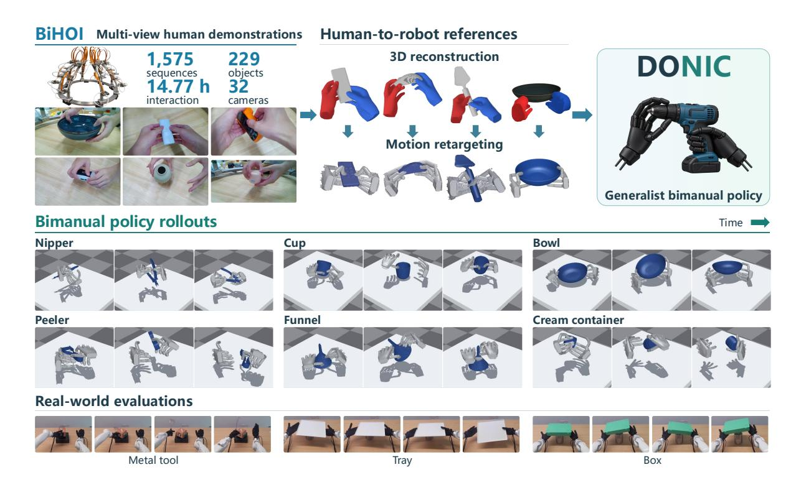
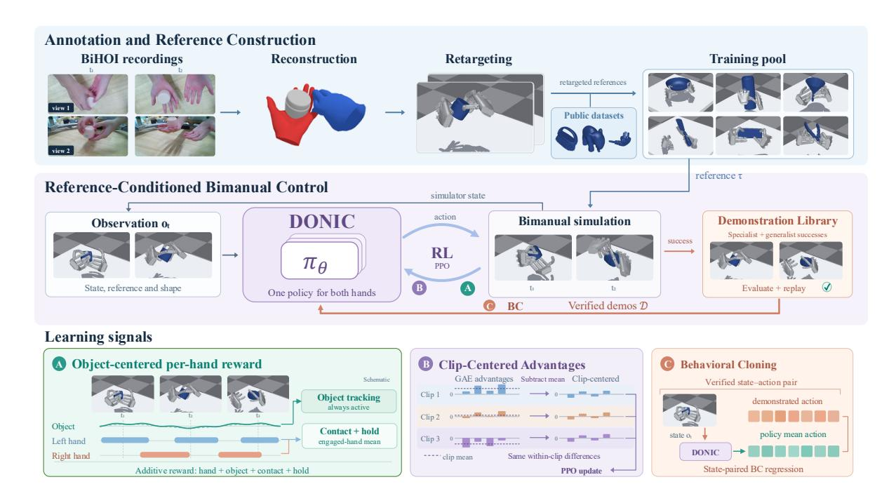
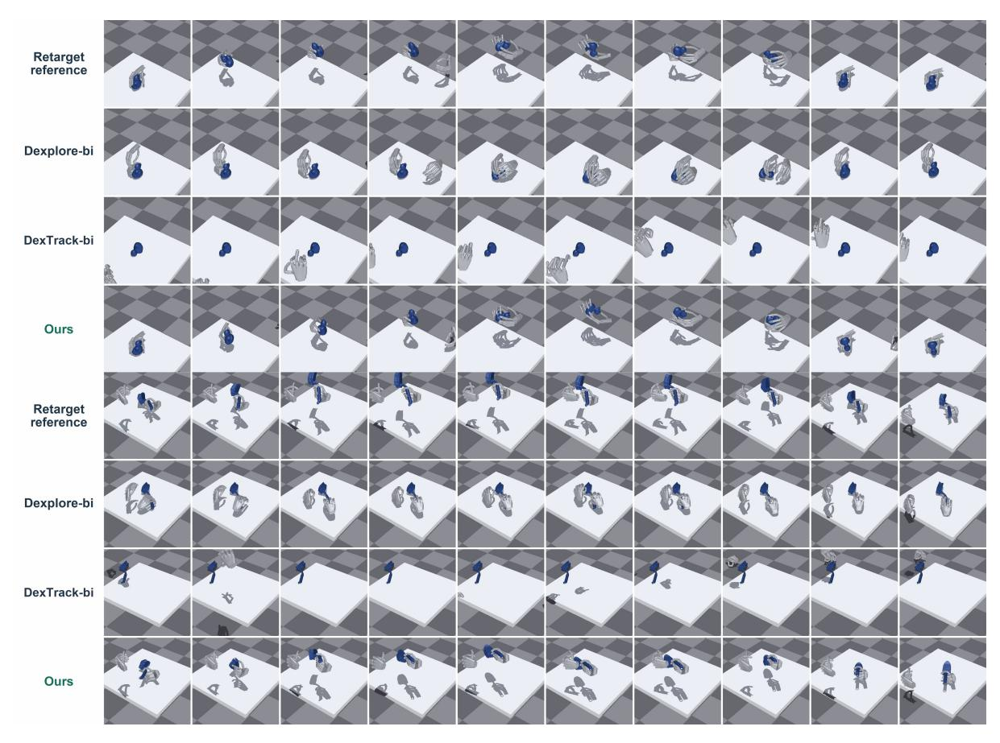
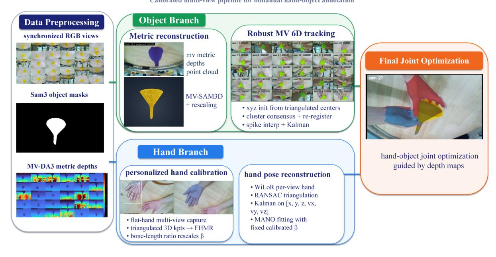
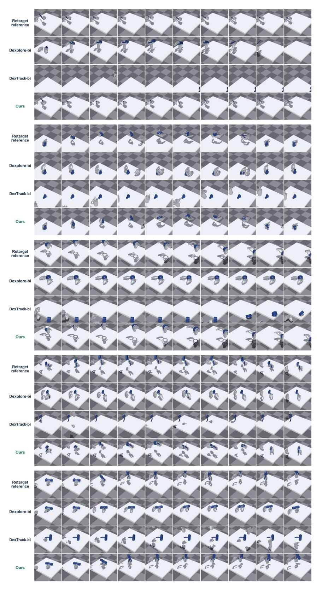

# DONIC: Generalist Dexterous Bimanual Tracking Control from Human Demonstrations

- 원제: DONIC: Generalist Dexterous Bimanual Tracking Control from Human Demonstrations
- 원문: [https://arxiv.org/abs/2610.29997](https://arxiv.org/abs/2610.29997)
- PDF: [https://arxiv.org/pdf/2610.29997](https://arxiv.org/pdf/2610.29997)
- arXiv ID: `2610.29997`

---

## **DONIC** (DONIC)

# **인간 시연으로부터의 일반화된 손재주 있는 양손 추적 제어 (Generalist Dexterous Bimanual Tracking Control from Human Demonstrations)**

Mingze Sun\* Ziang Cao\* Yuan Fei\* Qiankuan Tao\* Zihan Wang\* Tianqi Liu\* Junhao Chen\* Haiwen Diao\* Fangzhou Hong\* Zhaoxi Chen\* Ziwei Liu\*,†

**★** Ropedia

Project Page: ropedia.github.io/DONIC

Figure 1 | **DONIC 개요**. BiHOI는 재구성되고 로봇 손에 재타깃팅된 다중 시점 양손 시연을 제공한다. DONIC은 다양한 양손 참조-추적 과제를 위한 공유 정책을 학습한다.

### **초록 (Abstract)**

최근 손재주 있는 참조 추적 분야의 진전에도 불구하고, 기존 모델은 주로 단손 조작과 제한된 상호작용 범위에 초점을 맞추어 실제 생활에서 흔히 나타나는 양손 손재주 행동을 다루지 못한다. 접촉이 풍부한 양손 조작 데이터의 부족과 접촉을 조정하는 복잡성의 증가로 인해 일반화된 양손 트래커를 개발하는 것이 특히 어려워진다. 따라서 우리는 **1) DONIC**, 즉 다양한 연산 범주와 인간 동작 소스를 전반에 걸쳐 학습한 최초의 일반화된 양손 트래커를 제시한다.

† 응답 저자.

운영 범주와 인간 동작 소스를 함께 학습한 **2) BiHOI**, 229개 물체를 아우르는 1,575개의 시퀀스로 구성된 다중 시점 데이터셋으로, 재구성된 상호작용을 로봇 참조로 재타깃팅한다. DONIC은 근접 정책 최적화와 행동 복제를 피드백 루프에 결합하여 검증된 성공 실행을 학습 시연으로 재활용한다. 물체 중심의 손별 보상은 물체-운동 피드백을 유지하면서 각 손을 그들의 참조 접촉 역할에 따라 감독한다. Clip-Centered Advantages는 참조 의존적 이점 오프셋을 제거하면서 궤적 내 차이를 보존한다. 이러한 설계는 이질적인 참조를 가로질러 조정된 조작을 학습하는 단일 정책을 가능하게 한다. 미세 조정 없이 단일 체크포인트는 훈련 물체의 보이지 않는 궤적에서 86.79%의 성공률과 보류된 물체에서 57.32%를 달성하며, 기존 양손 추적 기준보다 77.36 및 45.73 퍼센트 포인트를 초과한다.

## **1. 서론 (Introduction)**

손재주 있는 조작은 가정 보조, 산업 조립, 보조 치료를 지원한다. 그리퍼 기반 조작과 달리, 손가락 동작의 정밀한 조정과 손–물체 접촉의 변화를 통해 물체를 잡고, 재배치하며, 재정렬해야 한다 [28,] [2,] [8,] [33]. 물체와 행동을 일반화하는 것은 어려우며, 특히 인간 시연을 다른 운동학을 가진 로봇 손에 재타깃팅해야 할 때 더욱 그렇다 [26,] [19,] [38]. 시뮬레이션 준비가 된 물체 [4–6]와 합성 궤적 [12, 40]은 대규모 상호작용 데이터를 가능하게 하지만, 자연스러운 인간 조작을 완전히 포착하지 못할 수 있다. 최근 트래커는 인간 손–물체 동작에서 학습하지만, 여전히 주로 단손 과제에 한정된다 [19, 38, 1]. 많은 일상 과제는 비대칭 양손 조정이 필요하다: 한 손은 물체를 안정시키고, 다른 손은 열고, 회전하거나 재배치한다 [9, 41, 43]. 이는 다양한 인간 동작에서 학습하여 하나의 정책으로 서로 다른 물체와 과제를 제어하는 일반화된 양손 참조 트래커를 동기화한다.

이러한 트래커를 개발하는 데는 두 가지 도전 과제가 있다. 첫째, 공개 데이터셋에는 양손 조작이 포함되어 있다 [9,](#page-10-6) [41,](#page-12-3) [20,](#page-11-3) [10](#page-10-7), 하지만 지속적인 양손 접촉이 있는 완전 추적된 손–물체 시퀀스는 드물어 사용 가능한 협동 패턴이 제한된다. 둘째, 공유 정책은 손 역할과 접촉 타이밍이 변하는 궤적을 학습해야 한다. 손 포즈 정확도만으로는 물체 조작의 성공을 보장하지 못하며, 양손이 접촉 조건을 만족하도록 요구하면 한 손의 진행 상황이 가려질 수 있다. 클립 난이도의 불균형은 또한 이점을 오프셋시켜 더 어려운 시퀀스에서 유용한 행동에 대한 업데이트를 약화시킬 수 있다. 따라서 공유 학습은 물체 움직임과 각 손의 참조 접촉에 기반한 피드백과, 각 클립 내 전이 간 차이를 보존하는 이점을 필요로 한다.

우리는 DONIC, 범용 양손 참조 트래커, 그리고 BiHOI, 다중 시점 손–물체 상호작용 데이터셋을 통해 이 도전 과제를 해결한다. BiHOI는 32개의 보정된 RGB 뷰에서 캡처된 229개의 물체와 14.77시간에 걸친 1,575개의 시퀀스를 포함한다. 대칭 조작과 비대칭 협동을 모두 다룬다. 우리는 양손과 물체를 재구성한 뒤 손 동작을 물체 궤적과 짝지어진 로봇 참조에 재타깃한다. 공개 참조와 결합하여 BiHOI는 훈련 물체와 협동 패턴을 확장한다. DONIC은 근접 정책 최적화(PPO) [31](#page-11-4)와 검증된 시연에 대한 행동 복제(BC)를 통해 양손에 대한 하나의 정책을 학습한다. 궤적별 정책은 선별된 참조를 최적화하고, 성공적인 공유 정책 실행은 검증되어 재사용된다. 추론 시에는 하나의 체크포인트가 추가 학습 없이 새로운 참조를 추적한다. 우리의 *object-centered per-hand reward*는 물체 움직임 피드백을 유지하고 각 손의 참조 접촉을 감독하며, 비동기 참여를 포함한다. 우리의 *Clip-Centered Advantages (CCA)*는 PPO 업데이트 전에 각 클립의 평균 추정 이점을 빼서 클립 의존적 오프셋을 제거하면서 클립 내 차이를 보존한다. 공개 데이터셋의 보류된 궤적과 물체에서 DONIC은 더 강력한 양손 기준보다 각각 77.36과 45.73 퍼센트 포인트의 성공률을 초과한다.

### 우리의 기여는 다음과 같습니다: (Our contributions are:)

- 우리에게 알려진 바에 따르면, DONIC은 운영 범주와 인간 동작 데이터셋 전반에 걸쳐 공동으로 훈련된 최초의 양손 참조 트래커이며, 하나의 체크포인트가 미세 조정 없이 보이지 않는 궤적과 물체에서 평가된다.  
- 우리는 협동 양손 조작을 강조하는 다중 시점 손–물체 상호작용 데이터셋 BiHOI를 도입하고, 그 녹음들을 로봇 동작 참조로 재구성한다.  
- 우리는 서로 다른 접촉 역할과 난이도를 가진 양손 참조 전반에 걸친 공동 PPO 훈련을 지원하기 위해 물체 중심 손당 보상과 CCA를 제안한다.  
- 우리의 두 개의 공개 데이터 평가 분할에서 DONIC은 DexTrack 및 Dexplore의 양손 적응보다 성공률과 완료율에서 우수하며, 보이지 않는 궤적과 물체에서 각각 86.79%와 57.32%의 성공률을 달성한다.

## **관련 연구** (2. Related Work)

**인간 참조에서 실행 가능한 조작으로**  
인간의 움직임 궤적은 동작 목표를 제공하지만, 재타깃팅만으로는 성공적인 접촉을 보장할 수 없다. 시퀀스별 정책은 일반적으로 강화 학습을 사용하여 재타깃팅된 동작을 수정한다. ManipTrans [15](#page-11-5)는 일반적인 손 동작 모방기를 재사용하지만, 상호작용을 위해 작업별 잔여 정책을 학습한다. Dex-Machina [23](#page-11-6)는 가상 물체 지원을 점진적으로 제거하면서 개별 시연으로부터 학습한다. CHORD [44](#page-12-5)는 접촉-원크 매칭을 통해 시퀀스별 학습을 안내하고, ConTrack [17](#page-11-7)는 객체 추적과 동작 충실성 사이의 적응형 균형을 통해 클립마다 하나의 정책을 훈련한다. 우리는 대신 테스트 시에 참조별 훈련이나 미세 조정 없이 다양한 참조를 추적하는 하나의 범용 양손 정책을 학습한다.

**일반화된 조작 정책.**  
범용 정책은 주로 단일 손 설정에서 물체, 동작, 또는 기술 간에 지식을 공유한다. UniDexGrasp++ [33](#page-12-0)는 물체 기하학을 넘어 그립을 일반화하고, UniCross [42](#page-12-6)는 여러 조작 기술을 통합하며, ArtManip [39](#page-12-7)는 범주 수준의 관절형 손 안에서의 조작을 학습한다. 참조 추적을 위해 DexTrack [19](#page-11-2)는 경로별 컨트롤러가 채굴한 시연과 강화 학습을 결합한다. Dexplore [38](#page-12-1)는 참조 동작 주변에서 탐색을 확장하고, AdaDexTrack [1](#page-10-5)는 전문화된 증류와 온라인 참조 변조를 결합한다. 양손 추적은 보완적인 손 역할과 접촉 타이밍을 조정해야 한다. 기존 연구는 보다 좁은 일반화를 탐구한다: BiDexHD [43](#page-12-4)는 교사들을 각 작업 범주에 대한 별도의 경로 조건화 정책으로 증류하고, 범주 내에서 새로운 물체–도구 조합과 사례를 평가한다; Phys-Graph [16](#page-11-8)는 작업 훈련된 정책을 새로운 도구 및 물체 기하학에 전이한다. 우리는 작업 범주와 인간 동작 데이터셋 전반에 걸쳐 하나의 양손 참조 추적기를 공동 훈련하고, 미세 조정 없이 보이지 않는 궤적과 물체에서 평가한다.

**양손 손–물체 상호작용 데이터셋.**  
GRAB [32](#page-12-8)는 상세한 접촉 정보를 포함한 전신 그립을 기록하고, ARCTIC [9](#page-10-6)는 두 손과 관절형 물체의 결합된 동작을 캡처한다. OakInk2 [41](#page-12-3)는 양손 조작을 기초 및 복잡한 작업으로 구성하고, TACO [20](#page-11-3)는 다양한 도구–행동–물체 구성을 다룬다. GigaHands [10](#page-10-7)는 언어 주석과 함께 양손 활동의 규모와 다양성을 더욱 확장한다. 이러한 동작 컬렉션을 보완하여 H2O [13](#page-11-9)와 HOI4D [21](#page-11-10)는 자기 중심 상호작용 이해를 지원하고, HOT3D [3](#page-10-8)와 HO-Cap [34](#page-12-9)는 손–물체 재구성 및 추적을 위한 녹음과 주석을 제공한다. 캡처 및 주석 규칙이 다르며, 인간 운동학은 실행 가능한 로봇 동작을 보장하지 않는다. 우리는 조화화, 재타깃팅, 그리고 제로-잔여 가능성을 선별하여 공동 훈련을 위한 공통 양손 참조 풀을 만든다.

## 3. 양손 손–물체 데이터셋 (Bimanual Hand–Object Dataset)

표 1 | 데이터셋 개요: 소스 통계 및 분석된 녹음에서의 동시 접촉 비율

| 소스 (Source) | 캡처 (Capture) | 시퀀스 (Sequences) | 프레임 (Frames) | 객체 (Objects) | 양손 접촉 (%) |
|----------------------|--------------------|-----------|---------|---------|-------------------------|
| BiHOI (ours) | 다중 시점 RGB (MV RGB) | 1,575 | ≈1.60M† | 229 | 65.91 |
| GRAB [2020] | 마커 모션 캡처 (Marker MoCap) | 1,334 | 1.622M | 51 | 32.21 |
| OakInk2 [2024] | 다중 시점 RGB + 마커 모션 캡처 (MV RGB + MoCap) | 627 | 4.01M | 75 | 24.97 |
| TACO (V1) [2024] | 다중 시점 RGB + 자기 시점 RGB-D (MV RGB + ego RGB-D) | 2.5K | 5.2M | 206 | 15.69 |
| GigaHands [2025] | 다중 시점 RGB (MV RGB) | – | 183M | 417 | 34.74 |
| H2O [2021] | 다중 시점 RGB-D (MV RGB-D) | – | 571.6K | 8 | 38.57 |
| HOI4D [2022] | 자기 시점 RGB-D (Ego RGB-D) | 4,000 | 2.4M | 800 | – |
| HO-Cap (rev.) [2025] | 다중 시점 RGB-D (MV RGB-D) | 64 | 656K | 64 | – |

MV: 멀티뷰; ego: 자가중심. † 30fps에서 14.77시간, 동기화된 타임스텝을 한 번만 계산. 공개 프레임 수는 소스 규칙을 따른다. Contact은 최소 한 손이 접촉한 프레임 대비 양손이 접촉한 프레임의 총 수이며, 분석된 클립 전체를 통합한 값이다; –: 사용 불가.

제한된 양손 훈련 데이터를 확장하기 위해, 우리는 **BiHOI**라는 다중 시점 손–물체 상호작용 데이터셋을 도입한다. 우리는 그 캡처 시스템과 구성을 설명하고, 이어서 녹화물을 로봇 참조로 변환하는 주석 및 재타깃화 파이프라인을 소개한다.

### 3.1. 멀티뷰 캡처 및 데이터셋 (Multi-View Capture and Dataset)

**멀티뷰 캡처 시스템.** 우리는 32개의 보정된 RGB 카메라를 테이블탑 작업 공간 주위에 배치하여 손–물체 상호작용을 1920 × 1232 픽셀 해상도와 30fps의 프레임 속도로 기록한다. 보완적인 뷰는 가려짐 상황에서 재구성을 지원하며, 보정은 공통의 메트릭 좌표계를 제공한다.

**데이터셋 구성.** BiHOI는 229개의 물체와 14.77시간의 고유 상호작용을 포함하는 1,575개의 상호작용 시퀀스를 담고 있다. 물체는 가정용품, 용기, 식기, 도구, 전자제품 등으로 구성된다. 참가자들은 고정된 동작 템플릿을 따르지 않고 자연스러운 물체 중심 상호작용을 수행한다. 녹화에는 대칭 양손 조작, 비대칭 양손 협조, 그리고 다중 물체 조작이 포함된다. 표 [1](#page-3-0)은 BiHOI와 일반적으로 사용되는 손–물체 상호작용 데이터셋을 비교한다. 우리의 컬렉션은 지속적인 양손 상호작용을 강조한다. 최소 한 손이 접촉한 프레임 중 65.91%가 양손이 접촉한 프레임이며, 이는 분석된 공개 서브셋 중 가장 높은 H2O(38.57%)를 27.34 퍼센트 포인트만큼 초과한다.

### 3.2. 주석 및 참조 구성 (Annotation and Reference Construction)

**재구성 및 주석.** 우리는 동기화된 RGB 녹화에서 메트릭 손–물체 궤적을 재구성한다. SAM3는 물체 마스크 [&#91;7&#93;](#page-10-9)를 제공하며, 멀티뷰 Depth Anything 3은 공간적으로 일관된 깊이를 제공하고, 우리는 보정된 카메라를 사용해 메트릭 스케일에 정렬한다.

extrinsics [18]. MV-SAM3D는 첫 프레임 뷰와 마스크 [14]에서 정준 물체 메쉬를 재구성하며, 역투영된 깊이가 물리적 스케일을 결정한다. FoundationPose는 이후 6-DoF 물체 움직임을 복구한다 [37], 멀티뷰 포즈 합의를 사용해 가려짐을 처리하고 합의가 실패할 때 재등록한다.

각 참가자마다 삼각측량된 보정 키포인트를 사용해 메트릭 손 스케일을 추정하고 참가자별 MANO 모양을 보정한다. WiLoR은 각 뷰에서 손 관측값을 제공한다 [24]; 이 관측값은 삼각측량되고, 시간적으로 부드럽게 처리되며, MANO 손 모델에 맞춰 적합된다 [29], 모양은 시퀀스 전반에 걸쳐 고정된다. 멀티뷰 메트릭 깊이에 대한 관절 정제는 기하학적 정렬과 재구성, 시간적 정규화를 결합하여 양손 MANO 파라미터, 메트릭 물체 메쉬, 그리고 공통 세계 프레임에서의 6-DoF 궤적을 생성한다. 재구성 및 정제 세부사항은 부록 B.2에 나타난다.

**리타게팅.** 우리는 재구성된 인간 동작을 프레임별 운동학적 적합을 통해 Wuji 로봇 손에 매핑한다, 표준 리타게팅 관행을 따른다 [11, 27, 19]. 손목 프레임 정렬 후, 관절 한계를 고려해 손 키포인트를 로봇 링크에 맞춘다, 각 프레임을 이전 솔루션에 대해 초기화하고 정규화한다. 스무딩은 리타게팅 전 단계에서만 수행된다. 결과적으로 손목과 손가락 참조는 물체 궤적과 짝지어진다.

## 4. 방법론 (Methodology)

DONIC은 운영 범주와 인간 데이터 소스를 아우르는 범용 양손 추적기를 학습한다 (Figure 2). 객체 중심의 손별 보상은 보완적 역할과 비동기 접촉을 지원하면서 객체 움직임 피드백을 유지한다. CCA는 일반화된 이점 추정(GAE) [30] 이후 참조 의존적 오프셋을 제거하여 참조 내 이점 차이를 보존한다.

### 4.1. 작업 정의 (Task Definition)

우리는 두 손과 객체에 대한 참조가 주어지면, 하나의 정책이 두 로봇 손을 제어하여 물리적 상호작용을 통해 객체 움직임을 재현합니다. DexTrack [19]을 따라, 훈련은 실행 가능한 시연에서의 BC와 PPO를 결합하며; 정책은 미세 조정 없이 보지 못한 궤적과 객체를 추적합니다.

T개의 제어 단계에 걸친 클립에 대해, 우리는 참조를 다음과 같이 씁니다

$$\tau = \left\{ (\hat{\boldsymbol{q}}_t^L, \hat{\boldsymbol{q}}_t^R, \hat{\boldsymbol{p}}_t^o, \hat{\boldsymbol{R}}_t^o) \right\}_{t=0}^T.$$

(1)

여기서 t는 프레임 인덱스이며, $h \in \{L, R\}$ 은 손을 식별하고, 하트는 참조 양을 나타냅니다. 구성 $\hat{q}_t^h \in \mathbb{R}^d$ 는 손목 좌표와 손가락 관절 각도를 포함하며, d는 손당 제어 좌표 수입니다. 객체 위치와 방향은 $\hat{p}_t^o \in \mathbb{R}^3$ 와 $\hat{R}_t^o \in SO(3)$ 이며, SO(3)은 3차원 회전 공간입니다. 우리는 두 손 구성을 $\hat{q}_t \in \mathbb{R}^{2d}$ 로 연결합니다. 하트가 없는 대응 양은 시뮬레이션 상태를 나타냅니다. 객체 선형 속도는 $v_t^o$ 로 표시되며, 그 참조 $\hat{v}_t^o$ 는 유한 차분으로 얻습니다. 위치, 회전, 선형 속도는 각각 미터, 라디안, 미터/초 단위를 사용합니다.

### 4.2. 참조 기반 양손 제어 (Reference-Conditioned Bimanual Control)

단일 확률적 정책 $\pi_{\theta}(a_t \mid o_t)$, 파라미터 $\theta$에 의해 매개화된 이 정책은 관측 $o_t$에서 두 손의 동작 $a_t$를 동시에 예측한다. 참조 기반 트래커[19, 38]를 따라, $o_t$는 두 개를 연결한다

Figure 2 | **개요 of DONIC. Top:** BiHOI 캡처는 재구성 및 재타깃팅되어 공개 데이터 참조와 결합되어 훈련 풀을 형성합니다. **Middle:** 공유 양손 정책은 시뮬레이션 상호작용과 검증된 시연을 통해 반복적인 PPO+BC 루프에서 학습합니다. **Bottom:** 객체 중심의 한 손 보상, Clip-Centered Advantages (CCA), 그리고 행동 복제는 보완적인 학습 신호를 제공합니다.

각 손 블록은 고유 감지, 객체 포즈 및 속도, 다가오는 참조 목표, 참조 상태 오차, 그리고 손끝-객체 거리 벡터를 포함합니다. 공간적 특징은 각 손목의 헤딩 프레임을 사용합니다. 우리는 베이스-포인트-셋 형태 인코딩 [25], 객체 스케일 및 중심점, 손 정체성, 그리고 고정된 왼손 보상 가중치 ∈ (0, 1]를 추가합니다. 접촉-힘 채널은 0으로 설정되며, 시뮬레이션 힘은 보상만을 감독합니다.

주어진 o 에 대해, 정책은 다음 참조에 대해 경계된 보정 a ∈ [−1, 1]² 를 예측하여, 이전 트래커들 [&#91;19,](#page-11-2) [23&#93;](#page-11-6)와 같이 비례-미분(PD) 제어 목표를 생성한다:

$$q_t^{\text{pd}} = \text{clamp}(\hat{q}_{t+1} + s \odot a_t, q_{\min}, q_{\max}),$$

(2)

여기서 s ∈ **R**² 는 보정 범위를 설정하고, ⊙ 은 원소별 곱셈을 나타내며, clamp 은 좌표 한계를 qmin 및 qmax 에 강제합니다. 보정은 매 단계마다 다음 참조에 고정되며 누적되지 않습니다. PD 컨트롤러는 목표를 실행하고, 그 결과 상태가 다음 관측을 제공합니다. 우리는 이 제어 인터페이스를 기반으로 다음 보상 및 훈련 절차를 구축합니다.

### **4.3. 객체 중심의 한 손 보상 (Object-Centered Per-Hand Reward)**

손 포즈 정확도는 접촉이나 객체 움직임을 보장하지 않으며, 손은 서로 다른 역할로 비동기적으로 참여할 수 있습니다. 따라서 우리는 클립 전반에 걸쳐 객체 움직임을 보상하고, 각 손의 접촉은 참조에 의해 요구될 때만 감독합니다.

**객체 추적.** 우리는 객체 위치, 방향, 그리고 선형 속도의 일치를 보상합니다:

$$r_t^{\text{obj}} = e^{-\kappa_p \| p_t^o - \hat{p}_t^o \|_2} e^{-\kappa_R \angle (R_t^o, \hat{R}_t^o)} e^{-\kappa_v \| v_t^o - \hat{v}_t^o \|_2}.$$

(3)

양수 계수 $\kappa_p$, $\kappa_R$, $\kappa_v$는 위치, 회전, 속도 오차에 대한 민감도를 제어한다. 여기서 $\|\cdot\|_2$는 유클리드 노름이며, $\angle(\cdot,\cdot)$는 회전 기하학적 거리이다. 곱은 공동 일치를 보상하며, 속도는 움직이는 기준에 대한 정지 해법을 벌한다. 이 운동학적 항목 [35, 36]은 접촉 게이트( contact gate)와 무관하다.

**Supervising each hand's contact.**  
객체 추적만으로는 손이 어떻게 움직임을 지원해야 하는지 명시되지 않는다. 프레임 t의 참조에 의해 물체와 접촉해야 하는 손 h의 손가락 끝 집합을 $C_t^h$ 라 두자. 손가락 끝 i에 대해, $\delta_{i,t}^h$ 를 물체 표면까지의 거리, $f_{i,t}^h$ 를 시뮬레이션된 순 접촉력 크기로 두자. 접촉을 추정한다는 것은

$$\alpha_{i,t}^{h} = \mathbf{1}[f_{i,t}^{h} > f_{\min}] \, \mathbf{1}[\delta_{i,t}^{h} < \delta_{\max}],$$

(4)

여기서  $\mathbf{1}[\cdot]$  은 지시자이며  $f_{\min}$ ,  $\delta_{\max} > 0$  은 힘과 거리 임계값이다. 근접성은 잘못된 물체 접촉 속성을 줄이지만, 순수 힘은 충돌 파트너를 식별하지 못한다.

필요한 손끝이 하나 이상인 손에 대해 다음과 같이 정의한다

$$r_{t}^{\text{cont},h} = \frac{1}{|C_{t}^{h}|} \sum_{i \in C_{t}^{h}} \left[ \zeta e^{-\kappa_{c} \delta_{i,t}^{h}} + (1 - \zeta) \alpha_{i,t}^{h} \right],$$

$$r_{t}^{\text{hold},h} = \frac{1}{|C_{t}^{h}|} \sum_{i \in C_{t}^{h}} \alpha_{i,t}^{h}.$$

(5)

여기서 $|C_t^h|$는 필요한 손가락 수이며, $\kappa_c > 0$는 거리 민감도를 제어하고, $\zeta \in [0,1]$는 근접성과 접촉을 균형시킨다. 근접성은 접촉 획득을 안내하며, 보유 항은 즉각적인 필요 접촉 범위 보상을 제공하여 유효한 슬라이딩 또는 롤링을 허용한다.

**Combining the learning signals.** 우리는 참여한 손 집합 $\mathcal{E}_t = \{h \in \{L, R\} : C_t^h 
eq \emptyset\}$ 에 걸쳐 접촉 보상을 집계한다. $u \in \{\text{cont}, \text{hold}\}$ 에 대해, 정의하자

$$r_t^u = \begin{cases} \frac{\sum_{h \in \mathcal{E}_t} w_h r_t^{u,h}}{\sum_{h \in \mathcal{E}_t} w_h}, & \mathcal{E}_t 
eq \emptyset, \\ 0, & \mathcal{E}_t = \emptyset, \end{cases}$$

(6)

여기서 $w_R = 1$ 과 $w_L \in (0,1]$ 은 고정된 손 가중치 (hand weights)이다. 평균화는 한 손이 접촉을 잃었을 때 다른 손의 피드백 (feedback)을 보존한다; 비활성 손을 제외하면 참조 해제 (reference release) 시 부착을 보상하는 것을 방지한다.

마지막으로, 우리는 이 신호들을 상속된 손 추적 보상(hand-tracking reward) $r_t^{\text{hand}} \in [0,1]$와 결합한다. 이 보상은 손목, 손가락 관절, 그리고 키포인트 일치를 측정한다 [38]:

$$r_t = (1 + w_L) \left[ \beta_{\text{hand}} r_t^{\text{hand}} + \beta_{\text{obj}} r_t^{\text{obj}} + \beta_{\text{cont}} r_t^{\text{cont}} + \beta_{\text{hold}} r_t^{\text{hold}} \right]. \tag{7}$$

비음수 $\beta$ 계수들은 합이 1이다; $(1 + w_L)$ 은 보상 스케일을 설정한다. 이러한 항목들은 손 움직임, 물체 결과, 그리고 참조 접촉 역할을 공동으로 감독한다 (Appendix C.2의 설정).

### 4.4. 검증된 시연으로부터 일반화 모델 학습

DexTrack [19]를 따라, 우리는 시연 수집과 함께 PPO+BC 훈련을 번갈아 진행한다. PPO는 시뮬레이션 상호작용을 통해 학습하고, BC는 공유 탐색이 발견하기 어려운 성공적인 행동을 제공한다. 궤적별 정책은 보유된 참조를 최적화한다

리플레이 스크리닝 (replay screening); 그들의 검증된 롤아웃은 관찰–행동 쌍 (observation–action pairs)의 시연 라이브러리 (demonstration library) $\mathcal D$를 형성한다. 일반화 모델 (generalist)이 향상됨에 따라, 그들의 검증된 성공 (verified successes)은 이후 업데이트를 위해 $\mathcal D$에 추가된다. 모든 시연은 훈련 참조 (training references)에서 나온다.

시연은 성공적인 행동을 제공하고, CCA는 PPO 업데이트에서 불균형한 참조 난이도를 해결한다.

클립 중심의 이점  
공유된 PPO 배치는 접촉 패턴과 조정 요구를 혼합한다.  
GAE는 시간 가중치가 부여된 가치 예측 잔차를 결합하지만, 참조 간에 비등한 비평가 정확도는 클립에 따라 달라지는 오프셋을 남길 수 있다.  
어려운 클립은 상대적으로 성공적인 전환에도 불구하고 일관되게 부정적인 이점을 받을 수 있다.  
CCA는 이 공통 오프셋을 제거하면서 클립 내부의 차이를 보존한다.

형식적으로, $\mathcal{B}$를 온-정책 롤아웃 배치(on-policy rollout batch)라고 하고, j는 전이(transition)를 인덱스하며, m(j)는 그 전이의 참조 클립(reference clip)을 식별한다. 보상과 학습된 가치 함수(learned value function)에서 표준 GAE 이점(advantage) $A_j^{\text{GAE}}$를 계산한 뒤, 우리는 전이를 참조별로 그룹화하여 $\mathcal{G}_m = \{j \in \mathcal{B} : m(j) = m\}$로 정의하고 사용한다

$$\widetilde{A}_{j} = A_{j}^{\text{GAE}} - \frac{1}{|\mathcal{G}_{m(j)}|} \sum_{k \in \mathcal{G}_{m(j)}} A_{k}^{\text{GAE}}.$$

(8)

클립 평균을 빼면 전이 간의 쌍별 이점 차이는 보존되면서 공통 경험적 오프셋은 제거된다. 이 조정은 GAE 이후에 적용되며, 학습된 비평가와 시간적 이점 추정은 변하지 않는다.

그룹은 환경 인스턴스나 시간 단계가 아니라 참조 정체성에 의해 정의되며, 같은 참조의 동시 롤아웃이 공통 기준선에 기여할 수 있다. 배치 전체 중심화와 달리 CCA는 모든 클립에 공유되는 이동을 적용하는 대신 각 참조에 특화된 오프셋을 제거한다. 우리는 그룹 평균만 빼고, 클립당 표준편차로 나누지 않으므로 클립 내 이점 차이의 규모를 보존한다. 이 조정은 정책의 학습 신호에 작용하며, 보상이나 비평가의 회귀 목표를 수정하지 않는다.

**Joint PPO와 BC 업데이트.** 우리는 표준 PPO 액터 손실 $\mathcal{L}_{PPO}$ 에 $\widetilde{A}_j$ 를 사용하며, 그 온-폴리시 확률 비율과 클리핑 규칙을 유지한다. 시연 관측–행동 쌍 $(\boldsymbol{o}^D, \boldsymbol{a}^D) \in \mathcal{D}$ 에 대해, $\mu_{\theta}(\boldsymbol{o}^D)$ 를 공유 가우시안 정책의 평균 행동으로 둔다. 결합 액터 목표는

$$\mathcal{L}_{\text{actor}}(\theta) = \mathcal{L}_{\text{PPO}}(\theta; \widetilde{A}) + \lambda \mathbb{E}_{(\boldsymbol{o}^{D}, \boldsymbol{a}^{D}) \sim \mathcal{D}} \| \mu_{\theta}(\boldsymbol{o}^{D}) - \boldsymbol{a}^{D} \|_{2}^{2},$$

(9)

여기서 $\lambda > 0$ 은 BC를 가중치하고, 기대값은 샘플링된 시연 쌍에 대해 평균을 취한다. 시연은 별도의 샘플링 예산을 사용하며 PPO 비율이나 GAE에 포함되지 않는다. 비평가는 표준 값 회귀 목표를 유지한다. 샘플링, 검증, 그리고 훈련 세부 사항은 부록 C.4–C.5에 제공된다.

## 5. 실험 (Experiments)

### 5.1. 설정 (Setup)

**데이터셋.** 우리는 GRAB [32], GigaHands [10], OakInk2 [41], TACO [20], 그리고 H2O [13]에서 양손 조작 참조를 수집한다. 두 손과 조작 대상이 모두 추적되는 클립을 보존하며, 각 손은 클립 중 어느 시점에서든 대상에 접촉한다; 동시에 접촉할 필요는 없다. 동작은 조화롭게 정규화되고 Wuji Hand V1에 재타깃팅되며 재생 화면화(Appendix B.1)된다. 이로써 1,845개의 공개 데이터 훈련 클립이 생성되며, 이는 ...

Figure 3 | 두 개의 보류된 객체 궤적에 대한 정성적 비교. 행은 참조, Dexplore-bi, DexTrack-bi, 그리고 DONIC을 보여주며, 시간은 왼쪽에서 오른쪽으로 흐른다.

보류된 평가 참조. Ours+BiHOI는 추가로 모든 1,575개의 BiHOI 시퀀스를 사용하여 훈련 풀을 3,420개의 클립으로 확장한다.

평가를 위해 공개 데이터셋에서 두 개의 분할을 보류한다: UNSEEN-TRAJ는 훈련 객체의 53개의 보이지 않는 궤적을 포함하고, UNSEEN-OBJ는 보류된 객체를 포함한 164개의 클립을 포함한다. 두 분할 모두 정책 훈련이나 시연 수집에 사용되지 않는다. 모든 방법은 동일한 분할에서 미세 조정 없이 평가된다.

**Metrics.** AdaDexTrack의 평가 프로토콜 [1]을 양손 추적에 확장한다.  
객체 오류($T_0$, $R_0$), 손목 오류($T_h$, $T_h$), 그리고 손가락 관절 오류($T_h$)를 보고하며, 변환은 센티미터와 라디안 단위로 표시한다.  
손목 오류는 로봇 전방 운동학을 재타깃 참조와 비교하여 계산하며, 손가락 오류는 20개의 손가락 관절에 대해 평균을 낸다.  
보고된 손 오류는 두 궤적 평균 손 오류 중 더 큰 값을 취한 뒤, 궤적 전반에 걸쳐 평균을 낸다.  
SR은 양손이 독립적으로 $\frac{1}{2}(T_0 + T_h) \le 10 \, \text{cm}$, $\frac{1}{2}(T_0 + T_h) \le \pi/3$, 그리고 궤적 평균 오류에서 $T_h$를 만족해야 한다.  
Comp는 양손 모두가 세 조건을 만족하는 프레임 비율을 궤적 전반에 걸쳐 평균한 값이다.

**Baselines.** *DexTrack-bi*와 *Dexplore-bi*를 비교하며, 두 개의 Wuji 손에 맞게 관측 및 제어 인터페이스가 조정된 공개 코드를 사용한다.  
두 베이스라인은 DONIC의 공개 데이터 풀, Isaac Gym 시뮬레이터, 로봇 모델, 그리고 보류된 스플릿을 공유한다.  
*DexTrack-bi*는 공개된 전문가–증류 파이프라인 [19]을 따른다.  
*Dexplore-bi*는 Dexplore의 원래 보상 및 참조 범위 탐색 [38]을 유지한다.  
추가 구현 세부 사항은 다음에서 제공된다.

Table 2 | 미세 조정 없이 참조 추적, 두 스플릿 모두에서 각 방법마다 하나의 체크포인트를 사용한다. 검정색과 파란색 볼드가 각 스플릿 내에서 가장 좋은 결과와 두 번째 좋은 결과를 표시하며, 동점은 하이라이트를 공유한다.

| 데이터셋 | 방법 | 𝑇𝑜 ↓ | 𝑅𝑜 ↓ | 𝑇ℎ ↓ | 𝑅ℎ ↓ | 𝐸finger ↓ | SR↑ | Comp↑ |
|------------|------------------|---------|---------|---------|---------|--------------|-------|-------|
|  |  | (cm) | (rad) | (cm) | (rad) | (rad) | (%) | (%) |
|  | DexTrack-bi | 41.86 | 2.3340 | 23.03 | 0.8296 | 0.6301 | 0.00 | 1.30 |
|  | Dexplore-bi | 14.73 | 0.8597 | 21.88 | 0.8412 | 0.3166 | 9.43 | 27.87 |
| 미확인 | CCA 없이 | 11.27 | 0.9585 | 4.34 | 0.2980 | 0.0433 | 81.13 | 62.72 |
| 경로 | 접촉 게이트 없이 | 10.26 | 0.9589 | 4.00 | 0.3013 | 0.0338 | 81.13 | 65.03 |
|  | 본 연구 | 10.27 | 0.9277 | 3.96 | 0.2905 | 0.0372 | 86.79 | 67.62 |
|  | 본 연구+BiHOI | 9.74 | 0.8637 | 3.32 | 0.2818 | 0.0338 | 88.68 | 68.72 |
|  | DexTrack-bi | 127.87 | 2.3532 | 72.83 | 1.0629 | 0.6455 | 0.00 | 0.88 |
|  | Dexplore-bi | 17.92 | 1.1431 | 19.46 | 0.9509 | 0.3685 | 11.59 | 26.37 |
| 미확인 | CCA 없이 | 16.83 | 1.1464 | 5.52 | 0.3235 | 0.0378 | 48.17 | 43.89 |
| 객체 | 접촉 게이트 없이 | 17.61 | 1.2041 | 4.97 | 0.3386 | 0.0371 | 48.78 | 49.52 |
|  | 본 연구 | 15.74 | 1.1310 | 4.58 | 0.3226 | 0.0373 | 57.32 | 54.69 |
|  | 본 연구+BiHOI | 13.96 | 1.1157 | 4.54 | 0.3206 | 0.0361 | 59.76 | 55.35 |

부록 [D.3.](#page-23-0)

### **5.2. 주요 결과 (Main Results)**

한 개의 DONIC 체크포인트가 미세 조정 없이 두 보류된 분할 모두를 개선한다 (Table [2)](#page-9-0)). UNSEEN-TRAJ에서 DONIC은 86.79% SR과 67.62% Comp를 달성하며, 강력한 기준 모델인 Dexplore-bi를 각각 77.36 및 39.75 퍼센트 포인트만큼 초과한다. UNSEEN-OBJ에서는 57.32% SR과 54.69% Comp를 기록하며, Dexplore-bi는 11.59%와 26.37%를 보인다. 이득은 손 추적에도 확장된다: 손목 변위 오류가 보이지 않는 궤적에서 21.88cm에서 3.96cm로, 보이지 않는 물체에서 19.46cm에서 4.58cm로 감소한다. DONIC은 UNSEEN-TRAJ에서 물체 회전을 제외하고 두 기준 모델에 비해 모든 보고된 오류를 감소시킨다. SR과 Comp는 양손이 추적 기준을 충족해야 하므로, 이러한 개선은 한 손만의 정확도가 아니라 양손 실행의 성공을 반영한다.

Figure [3,](#page-8-0)에서 두 보류된 물체 궤적에 대해 DONIC은 양손을 조정하고 참조 물체 움직임을 더 정확히 재현한다. Dexplore-bi는 손을 움직이지만 물체 움직임이 제한적이며, DexTrack-bi는 참조를 수행하는 데 필요한 손-물체 정렬을 잃는다.

### **5.3. 제거 연구 (Ablation Studies)**

학습 신호. CCA를 제거하면 보이지 않는 궤적에서 SR이 86.79%에서 81.13%로, 보이지 않는 물체에서 57.32%에서 48.17%로 감소하며, Comp도 낮아지고 다섯 가지 추적 오류가 모두 증가한다](#page-9-0)). 접촉 소유권 게이트를 제거하면 SR이 각각 81.13%와 48.78%로 감소한다. 일부 경우에 개별 오류가 낮아지지만 이 변형은 두 분할 모두에서 Comp도 낮게 만든다. 따라서 두 학습 신호는 공동 양손 성공과 완성도를 향상시킨다.

추가 양손 데이터. 1,575개의 BiHOI 시퀀스를 추가하면 훈련이 1,845에서 3,420 클립으로 확장되고 두 분할 모두에서 일곱 가지 지표가 개선된다 (Ours+BiHOI, Table [2)](#page-9-0)). SR은 보이지 않는 궤적과 물체에서 각각 88.68%와 59.76%에 도달하고, Comp는 68.72%와 55.35%이다. 보이지 않는 물체 변위 오류가 11.3% 감소하여 15.74cm에서 13.96cm로 줄어든다.

모든 보이지 않는 물체 지표에서 1위를 차지한 Ours+BiHOI는 추가 양손 데이터의 이점을 입증한다.

## **6. 결론, 한계 및 향후 연구 (Conclusion, Limitations and Future Work)**

우리는 일반적인 양손 추적기 DONIC과 다중 시점 양손 상호작용 데이터셋 BiHOI를 제시했다. 물체 중심의 손별 보상과 CCA는 반복적인 PPO+BC 훈련을 지원하여, 미세 조정 없이 보이지 않는 궤적과 물체에 일반화되는 하나의 체크포인트를 생성하고, 적응된 기준 모델을 크게 능가한다. 제거 실험은 두 학습 신호와 추가 BiHOI 데이터의 이점을 모두 뒷받침한다. 그러나 우리의 정량적 평가는 시뮬레이션된 단일 물체 상호작용에 초점을 맞추고 재구성·재타깃화된 모션 참조를 사용한다. 우리는 DONIC을 장기 및 다중 물체 조작으로 확장하고, 독립 벤치마크에서 평가하며, 물리적 양손 시스템으로의 전이 가능성을 탐구하고자 한다.

### **참고문헌 (References)**

- [1] Jianibieke Adalibieke, Qianwei Han, Xueyi Liu, Yuzhe Qin, and Li Yi. 2026. [AdaDexTrack: 동적 조절](https://janebek.github.io/AdaDexTrack/) [적응형 및 일반화 가능한 정교한 조작 추적을 위한](https://janebek.github.io/AdaDexTrack/) In *IEEE/CVF 컴퓨터 비전 및 패턴 인식 학회 (CVPR)*.

- [2] Marcin Andrychowicz, Bowen Baker, Maciek Chociej, Rafal Józefowicz, Bob McGrew, Jakub Pachocki, Arthur Petron, Matthias Plappert, Glenn Powell, Alex Ray, Jonas Schneider, Szymon Sidor, Josh Tobin, Peter Welinder, Lilian Weng, and Wojciech Zaremba. 2020. [정교한 손 안에서의 조작 학습](https://arxiv.org/abs/1808.00177). In *국제 로봇 연구 학회지*.

- [3] Prithviraj Banerjee, Sindi Shkodrani, Pierre Moulon, Shreyas Hampali, Shangchen Han, Fan Zhang, Linguang Zhang, Jade Fountain, Edward Miller, Selen Basol, Richard Newcombe, Robert Wang, Jakob Julian Engel, and Tomas Hodan. 2025. [HOT3D: 자가 시점 다중 뷰 비디오에서 3D 손 및 물체 추적](https://openaccess.thecvf.com/content/CVPR2025/html/Banerjee_HOT3D_Hand_and_Object_Tracking_in_3D_from_Egocentric_Multi-View_CVPR_2025_paper.html). In *IEEE/CVF 컴퓨터 비전 및 패턴 인식 학회*, pages 7061–7071.

- [4] Ziang Cao, Zhaoxi Chen, Liang Pan, and Ziwei Liu. 2025. PhysX-3D: 물리 기반 3D 자산 생성. In *신경 정보 처리 시스템의 진보 (NeurIPS)*, volume 38, pages 104070–104083.

- [5] Ziang Cao, Fangzhou Hong, Zhaoxi Chen, Liang Pan, and Ziwei Liu. 2026. PhysX-Anything: 단일 이미지에서 시뮬레이션 준비가 된 물리적 3D 자산. In *IEEE/CVF 컴퓨터 비전 및 패턴 인식 학회*, pages 5839–5848.

- [6] Ziang Cao, Yinghao Liu, Haitian Li, Runmao Yao, Fangzhou Hong, Zhaoxi Chen, Liang Pan, and Ziwei Liu. 2026. PhysX-Omni: 고체, 변형 가능, 그리고 관절이 있는 물체를 위한 통합 시뮬레이션 준비가 된 물리적 3D 생성. *arXiv preprint arXiv:2605.21572*.

- [7] Nicolas Carion, Laura Gustafson, Yuan-Ting Hu, Shoubhik Debnath, Ronghang Hu, Didac Suris, Chaitanya Ryali, Kalyan Vasudev Alwala, Haitham Khedr, Andrew Huang, Jie Lei, Tengyu Ma, Baishan Guo, Arpit Kalla, Markus Marks, Joseph Greer, Meng Wang, Peize Sun, Roman Rädle, and 19 others. 2026. SAM 3: 개념을 사용한 모든 것 세그멘테이션. In *학습 표현 국제 회의 (ICLR)*.

- [8] Tao Chen, Megha Tippur, Siyang Wu, Vikash Kumar, Edward Adelson, and Pulkit Agrawal. 2023. 시각적 정교함: 새로운 복잡한 물체 모양의 손 안에서 재배치. In *과학 로보틱스*, 8(84).

- [9] Zicong Fan, Omid Taheri, Dimitrios Tzionas, Muhammed Kocabas, Manuel Kaufmann, Michael J. Black, and Otmar Hilliges. 2023. ARCTIC: 정교한 양손 손-물체 조작을 위한 데이터셋. In *IEEE/CVF 컴퓨터 비전 및 패턴 인식 학회*, pages 12943–12954.

- [10] Rao Fu, Dingxi Zhang, Alex Jiang, Wanjia Fu, Austin Funk, Daniel Ritchie, and Srinath Sridhar. 2025. GigaHands: 양손 손 활동의 대규모 주석 데이터셋. In *IEEE/CVF 컴퓨터 비전 및 패턴 인식 학회*, pages 17461–17474.

- [11] Ankur Handa, Karl Van Wyk, Wei Yang, Jacky Liang, Yu-Wei Chao, Qian Wan, Stan Birchfield, Nathan Ratliff, and Dieter Fox. 2020. DexPilot: 정교한 로봇 손-팔 시스템의 시각 기반 원격 조작. In *IEEE 국제 로봇 및 자동화 회의 (ICRA)*.

- [12] Zhi Jing, Siyuan Yang, Jicong Ao, Ting Xiao, Yu-Gang Jiang, and Chenjia Bai. 2025. HumanoidGen: LLM 추론을 통한 양손 정교한 조작 데이터 생성. In *신경 정보 처리 시스템의 진보*, volume 38, pages 173413–173459.

- [13] Taein Kwon, Bugra Tekin, Jan Stühmer, Federica Bogo, and Marc Pollefeys. 2021. H2O: 두 손이 물체를 조작하여 1인칭 상호작용 인식을 수행. In *국제 컴퓨터 비전 회의(International Conference on Computer Vision, ICCV)*.
- [14] Baicheng Li, Dong Wu, Jun Li, Shunkai Zhou, Zecui Zeng, Lusong Li, and Hongbin Zha. 2026. [MV-SAM3D:](https://arxiv.org/abs/2603.11633) [레이아웃 인식형 3D 생성에 대한 다중 뷰 융합.](https://arxiv.org/abs/2603.11633) *arXiv preprint arXiv:2603.11633*.
- [15] Kailin Li, Puhao Li, Tengyu Liu, Yuyang Li, and Siyuan Huang. 2025. [ManipTrans: Efficient dexterous bimanual](https://arxiv.org/abs/2503.21860) [정교한 양손 조작 전이를 위한 잔여 학습.](https://arxiv.org/abs/2503.21860) In *국제 컴퓨터 비전 및 패턴 인식 회의(Computer Vision and Pattern Recognition, CVPR)*.
- [16] Runfa Blark Li, David Kim, Xinshuang Liu, Keito Suzuki, Dwait Bhatt, Nikola Raicevic, Xin Lin, Ki Myung Brian Lee, Nikolay Atanasov, and Truong Nguyen. 2026. [PhysGraph: Physically-Grounded Graph-Transformer Policies](https://arxiv.org/abs/2603.01436) [양손 정교한 손–도구–물체 조작을 위한 물리 기반 그래프-트랜스포머 정책.](https://arxiv.org/abs/2603.01436) *arXiv preprint arXiv:2603.01436*.
- [17] Yutong Liang, Quanquan Peng, Ri-Zhao Qiu, and Xiaolong Wang. 2026. [ConTrack: Constrained hand motion](https://arxiv.org/abs/2606.03177) [적응형 균형 제어를 통한 제약된 손 동작 추적.](https://arxiv.org/abs/2606.03177) *arXiv preprint arXiv:2606.03177*.
- [18] Haotong Lin, Sili Chen, Junhao Liew, Donny Y. Chen, Zhenyu Li, Guang Shi, Jiashi Feng, and Bingyi Kang. 2026. Depth Anything 3: 모든 관점에서 시각 공간을 복원. In *국제 학습 표현 회의(International Conference on Learning Representations, ICLR)*.
- [19] Xueyi Liu, Jianibieke Adalibieke, Qianwei Han, Yuzhe Qin, and Li Yi. 2025. [DexTrack: Towards generalizable](https://arxiv.org/abs/2502.09614) [인간 참조를 통한 정교한 조작의 일반화 가능한 신경 추적 제어를 향해.](https://arxiv.org/abs/2502.09614) In *국제 학습 표현 회의*.
- [20] Yun Liu, Haolin Yang, Xu Si, Ling Liu, Zipeng Li, Yuxiang Zhang, Yebin Liu, and Li Yi. 2024. [TACO: Benchmark](https://openaccess.thecvf.com/content/CVPR2024/html/Liu_TACO_Benchmarking_Generalizable_Bimanual_Tool-ACtion-Object_Understanding_CVPR_2024_paper.html)[일반화 가능한 양손 도구-행동-물체 이해를 위한 벤치마킹.](https://openaccess.thecvf.com/content/CVPR2024/html/Liu_TACO_Benchmarking_Generalizable_Bimanual_Tool-ACtion-Object_Understanding_CVPR_2024_paper.html) In *국제 컴퓨터 비전 및 패턴 인식 회의*, pages 21740–21751.
- [21] Yunze Liu, Yun Liu, Che Jiang, Kangbo Lyu, Weikang Wan, Hao Shen, Boqiang Liang, Zhoujie Fu, He Wang, and Li Yi. 2022. HOI4D: 범주 수준 인간-물체 상호작용을 위한 4D 자아중심 데이터셋. In *국제 컴퓨터 비전 및 패턴 인식 회의*.
- [22] Viktor Makoviychuk, Lukasz Wawrzyniak, Yunrong Guo, Michelle Lu, Kier Storey, Miles Macklin, David Hoeller, Nikita Rudin, Arthur Allshire, Ankur Handa, and Gavriel State. 2021. Isaac Gym: 로봇 학습을 위한 고성능 GPU 기반 물리 시뮬레이션. In *신경 정보 처리 시스템 데이터셋 및 벤치마크 트랙*.
- [23] Zhao Mandi, Yifan Hou, Dieter Fox, Yashraj Narang, Ajay Mandlekar, and Shuran Song. 2026. [DexMachina:](https://project-dexmachina.github.io/) [양손 정교한 조작을 위한 기능적 재타깃팅.](https://project-dexmachina.github.io/) In *국제 기계 학습 회의(ICML)*.
- [24] Rolandos Alexandros Potamias, Jinglei Zhang, Jiankang Deng, and Stefanos Zafeiriou. 2025. [WiLoR: End-to-end](https://doi.org/10.1109/CVPR52734.2025.01143) [실세계에서 3D 손 위치 추정 및 재구성을 위한 End-to-end.](https://doi.org/10.1109/CVPR52734.2025.01143) In *국제 컴퓨터 비전 및 패턴 인식 회의*, pages 12242–12254.
- [25] Sergey Prokudin, Christoph Lassner, and Javier Romero. 2019. 기반 포인트 세트를 이용한 포인트 클라우드의 효율적 학습. In *국제 컴퓨터 비전 회의*.
- [26] Yuzhe Qin, Yueh-Hua Wu, Shaowei Liu, Hanwen Jiang, Ruihan Yang, Yang Fu, and Xiaolong Wang. 2022. [DexMV: Imitation learning for dexterous manipulation from human videos.](https://www.ecva.net/papers/eccv_2022/papers_ECCV/papers/136990562.pdf) In *유럽 컴퓨터 비전 회의(ECCV)*.
- [27] Yuzhe Qin, Wei Yang, Binghao Huang, Karl Van Wyk, Hao Su, Xiaolong Wang, Yu-Wei Chao, and Dieter Fox. 2023. AnyTeleop: 일반적인 시각 기반 정교한 로봇 팔-손 원격 조작 시스템. In *로보틱스: 과학 및 시스템(RSS)*.
- [28] Aravind Rajeswaran, Vikash Kumar, Abhishek Gupta, Giulia Vezzani, John Schulman, Emanuel Todorov, and Sergey Levine. 2018. [Learning complex dexterous manipulation with deep reinforcement learning and](https://arxiv.org/abs/1709.10087) [시연.](https://arxiv.org/abs/1709.10087) In *로보틱스: 과학 및 시스템*.
- [29] Javier Romero, Dimitrios Tzionas, and Michael J. Black. 2017. [Embodied hands: Modeling and capturing hands](https://doi.org/10.1145/3130800.3130883) [및 몸을 함께.](https://doi.org/10.1145/3130800.3130883) *ACM Transactions on Graphics*, 36(6):245:1–245:17.
- [30] John Schulman, Philipp Moritz, Sergey Levine, Michael Jordan, and Pieter Abbeel. 2016. 고차원 연속 제어를 위한 일반화된 이점 추정치 사용. In *국제 학습 표현 회의*.
- [31] John Schulman, Filip Wolski, Prafulla Dhariwal, Alec Radford, and Oleg Klimov. 2017. [Proximal policy optimiza](https://arxiv.org/abs/1707.06347)[tion algorithms.](https://arxiv.org/abs/1707.06347) *arXiv preprint arXiv:1707.06347*.

- [32] Omid Taheri, Nima Ghorbani, Michael J. Black, 그리고 Dimitrios Tzionas. 2020. GRAB: 전체 신체 인간 그랩 데이터셋. In *European Conference on Computer Vision (ECCV)*.
- [33] Weikang Wan, Haoran Geng, Yun Liu, Zikang Shan, Yaodong Yang, Li Yi, 그리고 He Wang. 2023. [UniDexGrasp++:](https://openaccess.thecvf.com/content/ICCV2023/html/Wan_UniDexGrasp_Improving_Dexterous_Grasping_Policy_Learning_via_Geometry-Aware_Curriculum_and_ICCV_2023_paper.html) [정교한 그랩 정책을 기하학 인식 기반 커리큘럼과 반복적 일반화-전문화를 통해 향상](https://openaccess.thecvf.com/content/ICCV2023/html/Wan_UniDexGrasp_Improving_Dexterous_Grasping_Policy_Learning_via_Geometry-Aware_Curriculum_and_ICCV_2023_paper.html) [학습.](https://openaccess.thecvf.com/content/ICCV2023/html/Wan_UniDexGrasp_Improving_Dexterous_Grasping_Policy_Learning_via_Geometry-Aware_Curriculum_and_ICCV_2023_paper.html) In *IEEE/CVF International Conference on Computer Vision (ICCV)*, pages 3891–3902.
- [34] Jikai Wang, Qifan Zhang, Yu-Wei Chao, Bowen Wen, Xiaohu Guo, 그리고 Yu Xiang. 2025. [HO-Cap: 손-물체 상호작용의 3D 재구성 및 포즈 추적을 위한 캡처](https://doi.org/10.52202/085713-5683) [시스템 및 데이터셋](https://doi.org/10.52202/085713-5683) In *Advances in Neural Information Processing Systems*, volume 38.
- [35] Yinhuai Wang, Jing Lin, Ailing Zeng, Zhengyi Luo, Jian Zhang, 그리고 Lei Zhang. 2023. PhysHOI: 동적 인간-물체 상호작용의 물리 기반 모방. *arXiv preprint arXiv:2312.04393*.
- [36] Yinhuai Wang, Qihan Zhao, Runyi Yu, Hok Wai Tsui, Ailing Zeng, Jing Lin, Zhengyi Luo, Jiwen Yu, Xiu Li, Qifeng Chen, Jian Zhang, Lei Zhang, 그리고 Ping Tan. 2025. [SkillMimic: 농구 상호작용 기술을 시연에서](https://arxiv.org/abs/2408.15270) [학습.](https://arxiv.org/abs/2408.15270) In *IEEE/CVF Conference on Computer Vision and Pattern Recognition (CVPR)*.
- [37] Bowen Wen, Wei Yang, Jan Kautz, 그리고 Stan Birchfield. 2024. [FoundationPose: 새로운 물체의 통합 6D 포즈 추정](https://doi.org/10.1109/CVPR52733.2024.01692) [및 새로운 물체의 추적.](https://doi.org/10.1109/CVPR52733.2024.01692) In *IEEE/CVF Conference on Computer Vision and Pattern Recognition (CVPR)*, pages 17868–17879.
- [38] Sirui Xu, Yu-Wei Chao, Liuyu Bian, Arsalan Mousavian, Yu-Xiong Wang, Liang-Yan Gui, 그리고 Wei Yang. 2025. [Dexplore: 참조 범위 탐색에서 정교한 조작을 위한 확장 가능한 신경 제어.](https://arxiv.org/abs/2509.09671) In *Conference on Robot Learning (CoRL)*.
- [39] Yang Yang, Tengyu Liu, Puhao Li, Zeyuan Chen, Yuyang Li, Xingwan Wang, Yingying Wu, Zhaopeng Cui, 그리고 Siyuan Huang. 2026. [ArtManip: 범주 수준의 관절형 인핸드 조작.](https://arxiv.org/abs/2609.12498) *arXiv preprint arXiv:2609.12498*.
- [40] Zhao-Heng Yin, Changhao Wang, Luis Pineda, Francois Hogan, Krishna Bodduluri, Akash Sharma, Patrick Lancaster, Ishita Prasad, Mrinal Kalakrishnan, Jitendra Malik, Mike Lambeta, Tingfan Wu, Pieter Abbeel, 그리고 Mustafa Mukadam. 2025. DexterityGen: 전례 없는 기민성을 위한 기초 컨트롤러. In *Robotics: Science and Systems (RSS)*.
- [41] Xinyu Zhan, Lixin Yang, Yifei Zhao, Kangrui Mao, Hanlin Xu, Zenan Lin, Kailin Li, 그리고 Cewu Lu. 2024. [OakInk2:](https://openaccess.thecvf.com/content/CVPR2024/html/Zhan_OAKINK2_A_Dataset_of_Bimanual_Hands-Object_Manipulation_in_Complex_Task_CVPR_2024_paper.html) [복잡한 작업 완성을 위한 양손 손-물체 조작 데이터셋.](https://openaccess.thecvf.com/content/CVPR2024/html/Zhan_OAKINK2_A_Dataset_of_Bimanual_Hands-Object_Manipulation_in_Complex_Task_CVPR_2024_paper.html) In *IEEE/CVF Conference on Computer Vision and Pattern Recognition (CVPR)*, pages 445–456.
- [42] Hui Zhang, Julian Ferchow, Jie Song, 그리고 Mirko Meboldt. 2026. [UniCross: 통합 크로스-스킬 정교한](https://arxiv.org/abs/2607.28198) [조작 합성.](https://arxiv.org/abs/2607.28198) *arXiv preprint arXiv:2607.28198*.
- [43] Bohan Zhou, Haoqi Yuan, Yuhui Fu, 그리고 Zongqing Lu. 2026. [Learning diverse bimanual dexterous manipulation](https://doi.org/10.1609/aaai.v40i34.40127) [기술을 인간 시연에서 학습.](https://doi.org/10.1609/aaai.v40i34.40127) In *Proceedings of the AAAI Conference on Artificial Intelligence*.
- [44] Xinghao Zhu, Zixi Liu, Shalin Jain, Chenran Li, Milad Noori, Michael Andres Lin, Huihua Zhao, John Welsh, Mrinal Verghese, Wei Liu, Tingwu Wang, Xingye Da, Zhengyi Luo, Vishal Kulkarni, Naema Bhatti, Yuke Zhu, Linxi Fan, Bowen Wen, Danfei Xu, 그리고 2 others. 2026. [접촉 와rench를 활용한 정교한 조작 학습](https://arxiv.org/abs/2607.00033) [인간 시연에서의 가이던스.](https://arxiv.org/abs/2607.00033) *arXiv preprint arXiv:2607.00033*.

### 부록 내용 (Appendix Contents)

| A |  | 추가 관련 연구 | 15 |
|---|-----|-----------------------------------------------------------|----|
| B |  | 데이터셋 및 참조 구축 | 15 |
|  | B.1 | 캡처, 구성 및 훈련 인벤토리  | 15 |
|  | B.2 | 다중 뷰 재구성 및 주석 | 16 |
|  | B.3 | 운동학적 리타게팅 및 재생 스크리닝  | 19 |
| C |  | 방법 및 훈련 세부사항 | 19 |
|  | C.1 | 컨트롤러 인터페이스 | 19 |
|  | C.2 | 보상 정의 및 계수 | 20 |
|  | C.3 | 클립 중심 이점 및 PPO+BC  | 21 |
|  | C.4 | 시연 수집, 샘플링 및 호환성  | 22 |
|  | C.5 | 최적화 및 시뮬레이션 설정  | 22 |
| D |  | 실험 프로토콜 및 추가 세부사항 | 22 |
|  | D.1 | 평가 분할  | 22 |
|  | D.2 | 양손 추적 지표 | 23 |
|  | D.3 | 기준 구현 및 비교 범위  | 24 |
|  | D.4 | 제거 정의 및 추가 데이터  | 25 |
|  | D.5 | 정성적 비교 | 25 |
|  | D.6 | 제한 사항 | 25 |

본 부록은 추가 관련 연구(부록 [A)](#page-14-1), 데이터셋 구축 및 재타게팅 세부사항(부록 [B)](#page-14-2), 컨트롤러 및 훈련 사양(부록 [C)](#page-18-1), 그리고 실험 프로토콜 및 결과(부록 [D)](#page-21-2))를 제공한다.

### **A. 추가 관련 연구 (Additional Related Work)**

**실행 가능한 인간 참조와 공유 제어.** 인간 시연은 동작 목표를 제공하지만 로봇 동작을 직접 지정하지 않는다: 손 관절학과 시뮬레이션 접촉의 차이로 인해 기계적으로 타당한 참조가 물리적으로 실행하기 어려울 수 있다. 참조 기반 트래커는 폐쇄 루프 제어를 통해 이 격차를 해소한다. DexTrack [&#91;19&#93;](#page-11-2)는 궤적별 시연 생성과 일반화 학습을 결합하고; Dexplore [&#91;38&#93;](#page-12-1)은 참조 동작 주위에서 탐색을 확장하며; AdaDexTrack [&#91;1&#93;](#page-10-5)은 전문화된 증류와 참조 변조를 결합한다. 우리의 참조‑조건화된 동작 인터페이스와 반복적 강화‑모방 학습 루프는 이 연구 라인에 기반한다. 이 루프 내에서 우리의 기여는 객체 중심의 손별 보상과 Clip‑Centered Advantages (CCA)이며, 이는 이질적 참조 전반에 걸친 공유 양손 추적을 위해 설계되었다.

**여기서 일반화가 의미하는 바.** 잡힌 물체, 조작 기술, 완전한 참조 궤적 전반에 걸친 일반화는 서로 다른 요구를 부과한다. UniDexGrasp++ [&#91;33&#93;](#page-12-0)은 일반화 가능한 섬세한 그립을 연구하고, BiDexHD [&#91;43&#93;](#page-12-4)은 작업 범주 내에서 궤적‑조건화된 양손 정책을 학습한다. 우리의 컨트롤러는 작업 범주와 인간 동작 소스를 동시에 학습한다. 우리는 동일한 체크포인트로 훈련 물체의 새로운 궤적과 제외된 물체를 포함한 궤적을 평가한다. 이 두 분할은 참조와 물체 일반화를 테스트하지만, 단독으로는 제외된 작업 범주나 임의의 조작 목표에 대한 일반화를 확립하지 않는다.

**상호작용 캡처 및 활용 가능한 제어 데이터.** GRAB, GigaHands, OakInk2, TACO, 그리고 H2O는 손–물체 상호작용의 보완적 소스를 제공한다 [&#91;32,](#page-12-8) [10,](#page-10-7) [41,](#page-12-3) [20,](#page-11-3) [13&#93;](#page-11-9). HOI4D와 HO-Cap은 캡처 설정과 주석 도구를 더욱 확장한다 [&#91;21,](#page-11-10) [34&#93;](#page-12-9). 우리의 비교는 소스 데이터셋의 인벤토리와 로봇 훈련에 보존된 하위 집합을 구분한다. 클립은 필요한 손과 물체 트랙이 모두 존재하고 두 손이 어느 시점에 물체에 접촉할 때만 양손 풀에 포함된다. 이는 순차적이면서 동시에 손 참여를 허용한다. BiHOI는 분석된 녹화에서 동시에 양손 접촉이 측정된 비율이 더 높은 것으로 이 소스들을 보완한다.

### **B. 데이터셋 및 참조 구축 (Dataset and Reference Construction)**

### **B.1. 캡처, 구성 및 훈련 인벤토리 (Capture, Composition, and Training Inventory)**

BiHOI는 229개의 물체와 14.77시간의 고유 상호작용을 포함하는 1,575개의 상호작용 시퀀스를 포함한다. 물체는 가정용품, 용기, 식기, 도구, 전자제품을 포함한다. 32개의 RGB 카메라로 구성된 보정된 배열이 1920 × 1232 픽셀과 초당 30프레임으로 탁상 작업 공간을 기록한다. 지속 시간은 고유 상호작용 시간을 계산하며, 카메라 뷰의 합계가 아니다. 녹화는 대칭적 조작, 비대칭적 조정, 그리고 조정된 다중 물체 상호작용을 포함한다. 참가자들은 고정된 동작 템플릿 대신 자연스러운 물체 중심 상호작용을 수행한다. 이는 캡처 인벤토리를 설명하며, 제어 공식은 두 로봇 손과 하나의 참조 물체를 추적한다.

우리는 접촉을 동시적 또는 순차적으로 분류하고 동시 접촉의 지속 시간을 측정한다. 분석된 BiHOI 녹화에서 동시 양손 접촉은

Table S1 | 훈련 인벤토리 및 동시 양손 접촉.  
접촉 비율은 분석된 녹음에서 프레임을 풀링하며, 양손 접촉 프레임을 최소 한 손이 접촉한 프레임으로 나눈다.  
공개 전용 모델은 아래에 나열된 공개 서브셋을 사용하며, Ours+BiHOI는 모든 BiHOI 시퀀스를 추가한다.

| 소스 | 훈련 시퀀스 | 동시 접촉(%) |
|--------------------------|--------------------|--------------------------|
| GRAB | 505 | 32.21 |
| GigaHands | 592 | 34.74 |
| OakInk2 | 449 | 24.97 |
| H2O | 127 | 38.57 |
| TACO | 172 | 15.69 |
| 공공 데이터 풀 | 1,845 | _ |
| BiHOI | 1,575 | 65.91 |
| 공공 데이터 풀 + BiHOI | 3,420 | _ |

65.91%의 접촉-활성 시간(하나 이상의 손이 접촉하는 시간) 동안. 분석된 공개 하위 집합 중 가장 높은 비율은 H2O의 38.57%이며, 이는 27.34 퍼센트 포인트 차이다. Table S1은 선택된 공개 훈련 인벤토리와 측정된 접촉 비율을 보고한다. 이 하위 집합 측정값은 각 소스에서 공개된 모든 녹음에 대한 통계로 해석되어서는 안 된다.

공개 풀에서는 양손과 조작되는 객체를 모두 추적해야 하며, 각 손은 클립 동안 객체에 접촉해야 한다; 연속적이거나 동시에 접촉하는 것은 허용 조건이 아니다. 동작은 손별 MANO 파라미터, 객체 메쉬, 그리고 중력 정렬된 세계 프레임에서의 객체 위치와 방향으로 구성된 공통 표현으로 변환된다. 리타게팅과 재생 스크리닝은 이후 로봇 참조를 생성한다. 53개의 미지의 궤적과 164개의 미지의 객체 평가 클립은 훈련 수와 별개이다.

**접촉 측정.** 클립 m, 프레임 t, 손 h에 대해 $c_{m,t,i}^h$ 를 손끝 슬롯 $i \in \{3, 6, 9, 12, 15\}$ 에서의 참조 라벨이라고 하자. 활동 $a_{m,t}^h = \mathbf{1}[\exists i : c_{m,t,i}^h > 0.01]$ 를 정의하고, 이는 훈련과 동일한 참조 손 활동 규칙을 사용한다. 보고된 비율은

$$100 \frac{\sum_{m,t} a_{m,t}^L a_{m,t}^R}{\sum_{m,t} \mathbf{1} [a_{m,t}^L + a_{m,t}^R > 0]}.$$

(B.1)

따라서 분모는 접촉-활성 시간이며, 집계는 클립 전반에 걸친 프레임을 풀링한다. 이는 전체 시퀀스 프레임 비율도 아니고, 클립별 비율의 평균도 아니다. 분석된 공개 풀에서 이 측정값은 31.40%이며, 분모를 모든 프레임으로 대신하면 22.56%가 된다.

**단일 객체 표현.** 다중 객체 녹화에서는 변환이 하나의 주요 객체만 보존한다: TACO는 대상이 아닌 도구를 유지하고, OakInk2는 손 역할 프로그램 주석에서 주요 객체를 선택한다. 컨트롤러는 선택된 객체를 고정 메쉬와 강체 포즈로 표현한다. 관절 움직임과 변형은 명시적으로 모델링되지 않으며, 캡처된 객체가 해당 범주에 속하더라도 마찬가지다.

#### **B.2.** 다중 시점 재구성 및 주석

재구성 파이프라인은 학습된 이미지 예측을 사용해 기하학을 초기화하고, 그 다음에 보정된 다중 시점 관측을 통해 물리적 스케일과 시간적 일관성을 복원한다. 이 파이프라인은 마스크/깊이 추출, 객체 재구성 및 추적, 참가자별 손 보정-

Figure S1 | **재구성 및 주석 파이프라인.** 동기화된 다중 시점 RGB 관측은 SAM3 객체 마스크와 메트릭 깊이 지도를 얻기 위해 처리된다. 객체 브랜치는 메트릭 재구성을 수행한 뒤 견고한 다중 시점 6D 추적을 수행하고, 손 브랜치는 참가자별 손 보정과 다중 시점 손-포즈 재구성을 수행한다. 두 브랜치는 최종적으로 깊이 기반 손–객체 최적화를 사용해 공동으로 정제된다.

보정, 손-운동 재구성, 그리고 공동 정제. Figure [S1](#page-16-0)은 완전한 보정된 다중 시점 재구성 및 주석 파이프라인을 요약한다.

**마스크 및 메트릭 깊이.** 우리는 두 단계에서 SAM3 [&#91;7&#93;](#page-10-9)를 사용한다. 모든 카메라의 첫 프레임이 순서대로 교차 카메라 시퀀스를 형성한다: 단일 객체 프롬프트가 시점 간 일관된 마스크를 초기화한다. 각 카메라 비디오는 첫 프레임 마스크를 사용해 시간적으로 추적된다. 각 동기화된 시점에서 Depth Anything 3 [&#91;18&#93;](#page-11-11)는 보정된 내부 파라미터와 월드-투-카메라 외부 파라미터를 사용해 시점을 처리한다. 외부-스케일 정렬은 깊이를 메트릭 카메라 변환에 고정한다. 결과 깊이는 객체 스케일 회복과 이후 포즈 정제에 활용된다.

**Metric object reconstruction.** MV-SAM3D [14]는 분산된 첫 번째 프레임 뷰와 마스크에서 정규화된 메쉬를 재구성한다. 우리는 유효한 뷰에서 마스크된 깊이를 공통 세계 프레임으로 역투영하고, 카메라별 일관되지 않은 포인트 클라우드 중심을 거부한 뒤 남은 관측값을 융합한다. 모호한 정규화된 방향을 정렬하지 않고 물리적 스케일을 추정하기 위해, 우리는 깊이 클라우드와 메쉬 샘플의 견고한 주성분 범위를 비교한다. 방사형 이상치를 제거한 뒤, 깊이와 메쉬를 세 개의 주축을 따라 정렬된 1–99 퍼센타일 범위로 둔다. 등방성 스케일은

$$s_{\text{obj}} = \text{median}_{k \in \{1,2,3\}} \frac{e_k^{\text{depth}}}{e_k^{\text{mesh}}}.$$

(B.2)

스케일만 전송되며, 정규화된 메쉬 방향은 유지된다.

**Multi-view object tracking.** 우리는 객체 마스크에 맞춘 최소 면적 직사각형의 중심을 삼각측량하여 변환을 초기화하고, 이전에 수락된 포즈에서 방향을 초기화한다. 가장 큰 가시 마스크를 가진 열 개의 뷰는 Foundation-Pose [37]로 독립적으로 정제된다. 후보 포즈는 세계 프레임으로 변환되어 기하학적 일치에 따라 그룹화된다. 두 후보 $(R_i, \mathbf{t}_i)$와 $(R_j, \mathbf{t}_j)$는 회전 지오데식 거리 $d_{SO(3)}(R_i, R_j) < 30^\circ$이고 $\|\mathbf{t}_i - \mathbf{t}_j\|_2 < 5$ cm일 때 호환된다. 최소 네 개의 상호 호환 뷰가 필요하다. 변환은 마스크 면적 가중치로 평균화되고, 방향은 수락된 클러스터에서 가장 큰 마스크 뷰에서 가져온다. 합의 실패 시 재등록이 트리거된다.

객체 궤적은 변환 스파이크 수리와 칼만 필터링을 거친 뒤, 3차원 회전 공간인 SO(3)에서 회전 스파이크 수리와 필터링을 수행한다. 보간은 짧은 스파이크 버스트에 제한된다. 이후 우리는 융합된 메트릭 깊이를 사용해 교대 반복 가장 가까운 점 대응 업데이트를 통해 전체 궤적을 정제한다. 3 cm를 초과하는 대응은 거부된다. 점-면 및 점-점 잔차 $r_{\rm p2pl}$과 $r_{\rm p2p}$에 대해, 기하학적 기여는

$$\mathcal{L}_{\text{geom}} = 0.7 \,\rho(r_{\text{p2pl}}) + 0.3 \,\rho(r_{\text{p2p}}),$$

(B.3)

여기서 $\rho$는 견고한 잔차 패널티이다. 재구성 사전과 1차 및 2차 시간 정규화가 업데이트를 제한한다. 변환 및 회전 보정은 입력 궤적에서 3 cm 및 20° 이내로 유지된다.

**Participant-specific hand calibration.** 각 손마다 평면 손 캘리브레이션 시퀀스가 21 관절 골격에 대한 메트릭 삼각측량 위치를 제공한다. 초기 MANO 형태 $\beta_0$ [29]는 이 관측값에 맞춰 캘리브레이션된다. $\mathcal{B}$는 20개의 골격 뼈를 포함하고, $\mathbf{X}_a^{\text{tri}}$는 삼각측량된 관절 a이며, $\mathbf{J}_a(\beta_0)$는 해당 모델 관절이다. 물리적 스케일은

$$s_{\text{hand}} = \frac{\sum_{(a,b)\in\mathcal{B}} \|\mathbf{X}_b^{\text{tri}} - \mathbf{X}_a^{\text{tri}}\|_2}{\sum_{(a,b)\in\mathcal{B}} \|\mathbf{J}_b(\boldsymbol{\beta}_0) - \mathbf{J}_a(\boldsymbol{\beta}_0)\|_2}.$$

(B.4)

명시적 스케일은 MANO 형태 계수가 전역 스케일 매개변수가 아니기 때문에 유지된다. MANO 전용 형태 벡터가 필요한 구성 요소는 중심화된 정규화된 정점 공간에서 리지 피팅을 통해 근사 스케일 조정 형태를 받는다. 참가자별 캘리브레이션은 시퀀스 간에 재사용된다.

**손동작 재구성.** WiLoR [24]는 손과 뷰마다 21개의 이미지 공간 키포인트를 제공한다. 각 관절마다 유효한 두 뷰 쌍이 삼각측량 가설을 생성한다. 재투영 잔차가 50픽셀 이하인 경우를 내측점으로 정의하며, 최소 세 뷰가 필요하다. 선택된 가설은 모든 내측점을 사용해 다시 삼각측량한다. 재구성 단계의 10fps 샘플링 속도에서 각 관절은 상수 속도 상태 $[x, y, z, v_x, v_y, v_z]^T$ 로 필터링된다. 여기서 x, y, z는 좌표이고 $v_x, v_y, v_z$는 속도이다. 측정 및 가속 프로세스 표준 편차는 각각 0.01 m와 $0.12 \,\text{m/s}^2$이며, 관측이 없을 경우 예측만 사용한다. 이 재구성 샘플링 속도는 30fps 캡처 속도와는 별개이다. MANO 피팅은 필터링된 메트릭 관절, 다중 뷰 이미지 키포인트, 그리고 보정된 투영을 결합하여 손 모양을 고정한 채로 포즈와 전역 움직임을 추정한다.

**관절 손–물체 정제.** 손과 물체 추정값은 공유된 메트릭 깊이에 대해 정제된다. 변수는 프레임별 손 포즈와 전역 변환, 물체 포즈, 그리고 시퀀스 전체에 공유되는 하나의 물체 스케일 변수이다. 목적 함수는

$$\mathcal{L} = 10\mathcal{L}_{SDF} + \mathcal{L}_{reg}^{h} + \mathcal{L}_{reg}^{o} + \mathcal{L}_{smooth}^{h} + \mathcal{L}_{smooth}^{o}.$$

(B.5)

여기서  $\mathcal{L}_{SDF}$  는 깊이에서 구축된 부호 거리 필드(SDF)와 재구성된 기하학을 정렬한다;  $\mathcal{L}_{reg}^h$  와  $\mathcal{L}_{reg}^o$  는 손과 물체 초기화를 보존하며, 두 개의 부드러움 항은 그

시간적 진화를 정규화한다. MeshSDF 공식은 HO-Cap [34]를 따르며, 상호작용 영역에서 32개의 깊이 뷰와 3 mm voxel을 사용한다. 최적화는 먼저 사전 지식과 부드러움을 사용하고, 그 다음에 SDF 정렬을 활성화하며, 마지막으로 포즈를 고정한 채 물체 스케일을 정제한다. 명시적 접촉, 침투, 충돌, 또는 스냅핑 손실은 포함하지 않는다.

**내보내기 표현.** 표준화된 내보내기는 오른손 좌표계, +Z‑업 세계 프레임을 사용하며, 재구성 프레임에서 기록된 $4 \times 4$ 변환을 포함한다. 테이블탑은 z=0을 정의하며, 이는 물체 바닥의 5번째 백분위수에서 추정된다. MANO는 PCA 없이 45개의 축‑각 포즈 좌표를 사용하고, 평평한 손 평균과 추가 평균 포즈 오프셋이 없다. 물체 정점은 재중심화, 축 뒤집기, 또는 대칭 없이 그 고유 좌표를 유지한다.

### B.3. 운동학적 재타게팅 및 재생 스크리닝 (Kinematic Retargeting and Replay Screening)

재타게팅은 위치 기반 운동학적 피팅 [11, 27, 19]을 따른다. 각 프레임과 손마다 15개의 타깃 항목이 해당 Wuji-hand 링크에 맞춰진다: 다섯 개의 MANO 손끝(인덱스 4, 8, 12, 16, 20), 다섯 개의 추가 손가락 키포인트(3, 7, 11, 15, 19), 그리고 손목(인덱스 0)이 다섯 번 반복된다. 피팅은 전환 스케일 0.02 m를 갖는 SmoothL1 위치 손실과 로봇 관절 한계를 하드 바운드로 하는 NLopt 최적화를 사용한다. 구현은 관절 한계 허용오차 $10^{-3}$ 를 사용하고, 이전 프레임의 해를 초기값으로 삼으며, 프레임 간 정규화 매개변수 norm_delta = $4 \times 10^{-3}$ 를 사용한다.

변환 시, 소스 모션은 10fps에서 해석되고 30fps 제어 참조로 변환된다 (SOURCE_FPS=10, FPS_OUT=30, RESAMPLE_STRIDE=3). 소스 시각화 비디오와 클립별 기원은 이 타이밍을 결정하며, 내보내기 메타데이터의 명목상 30fps 필드는 소스 속도로 사용되지 않는다. 사전 재타게팅 정리 단계는 30fps에서 프레임당 0.10 m 이동 임계값, 최대 세 번의 디스파이킹 패스, 그리고 최근접 이웃 보간을 사용한다. 이 설정은 변환 정리 단계에 속하며, 재구성 필터링에는 포함되지 않는다.

트레젝토리 정리는 리타게팅 전에 수행된다. 리타게터의 저역통과 계수는 1이므로 추가적인 저역통과 부드럽게 처리하지 않는다. 손목 변위는 MANO 전역 변위와 형태에 따라 달라지는 루트 관절 $\mathbf{t} + \mathbf{J}_0(\boldsymbol{\beta})$ 를 합산하여 계산된다. 고정 프레임 보정은 전역 방향을 로봇 규약에 맞춘다. 출력은 로봇 손목/손가락 구성과 재구성된 물체 궤적을 쌍으로 제공한다.

정책 보정이 없는 개방형 재생은 각 후보 참조를 여섯 가지 결과로 분류한다: 즉각적인 물체 손실(A), 물체 배출(B), 리프트 없이 접촉(C), 부분 실행(D), 잘못된 해제 또는 종료와 함께 추적(E), 완전 실행(F). A와 B 카테고리는 제외되며, C–F는 폐쇄형 학습에 사용된다. C 카테고리는 참조 전용 재생에서 리프트 실패가 피드백 제어에 의한 회복을 배제하지 않기 때문에 보존된다. 스크리닝은 참조 적합성을 판단하며, 실행 가능한 시연을 허용하기 위한 검증과는 별개이다.

### C. 방법 및 훈련 세부사항 (Method and Training Details)

#### C.1. 컨트롤러 인터페이스 (Controller Interface)

참조 클립 m은 제어 단계 t에서 손 $h \in \{L, R\}$ 에 대한 로봇 구성 $\hat{\mathbf{q}}_t^h \in \mathbb{R}^{26}$, 물체 위치 $\hat{\mathbf{p}}_t^o \in \mathbb{R}^3$, 그리고 물체 회전 $\hat{R}_t^o \in SO(3)$ 를 포함한다. 물결표는 참조를, 물결표가 없는 수치는 시뮬레이션 상태를 나타낸다. 각 손은 손목 좌표 6개와 손가락 관절 20개를 갖는다. 공유 정책 $\pi_{\theta}(\mathbf{a}_t \mid \mathbf{o}_t)$, 파라미터 $\theta$ 는 관측 $\mathbf{o}_t$ 를 받아 두 손 모두에 대해 52차원 행동 $\mathbf{a}_t$ 를 생성한다.

3,016 차원 관측은 2,884 차원 기본 특징과 132 차원 물체 디스크립터(128 개의 베이스-포인트-세트 특징 [25], 스케일, 중심)를 결합한다. 손당 블록은 고유감각, 물체 자세 및 속도, 다가오는 참조 목표, 상태 오차, 그리고 각 손목 헤딩 프레임에서 손끝-물체 거리 벡터를 포함한다. 손 정체와 왼손 보상 가중치도 포함된다. 40 개의 접촉력 채널은 0 으로 설정되며, 접촉력은 보상 감독에 기여하고 정책 입력에는 사용되지 않는다.

두 참조 구성을 $\hat{\mathbf{q}}_{t+1}$ 로 연결하면 비례-미분 목표는

$$\mathbf{q}_t^{\text{pd}} = \text{clamp}(\hat{\mathbf{q}}_{t+1} + \mathbf{s} \odot \mathbf{a}_t, \mathbf{q}_{\min}, \mathbf{q}_{\max}), \qquad \mathbf{a}_t \in [-1, 1]^{52}. \tag{C.1}$$

벡터 $\mathbf{s}$ 는 좌표별 보정 한계를 설정하고, $\odot$ 는 원소별 곱셈을 의미하며, $\mathbf{q}_{\text{min}}$ 와 $\mathbf{q}_{\text{max}}$ 는 좌표 한계를 나타낸다. 한계는 손목 변위에 0.1 m, 손목 회전에 1.0 rad, 손가락 관절에 0.15 rad 이다. 보정은 매 단계마다 다음 참조 주위에서 적용되며 누적되지 않는다. 이 인터페이스는 참조 추적 접근법 [19, 38] 에서 유래한다.

#### C.2. 보상 정의 및 계수 (Reward Definition and Coefficients)

우리는 손 추적, 물체 움직임, 손당 접촉, 그리고 접촉 유지 보상을 결합한다:

$$r_t = (1 + w_L) \left[ \beta_{\text{hand}} r_t^{\text{hand}} + \beta_{\text{obj}} r_t^{\text{obj}} + \beta_{\text{cont}} r_t^{\text{cont}} + \beta_{\text{hold}} r_t^{\text{hold}} \right]. \tag{C.2}$$

고정된 손 가중치는 $w_L = 0.5$와 $w_R = 1$이며, 적응형 손 가중치는 비활성화되어 있다. $\beta$ 계수는 합이 1이 된다. 상속된 손 추적 항은 Dexplore의 손별 곱셈 체인을 사용한다. 손목, 손가락 관절, 핵심점 일치에 대해 [38]에서 공개된 하위 항계수는 그대로 유지된다. 두 손별 값은 $(r_t^{\text{hand},R} + w_L r_t^{\text{hand},L})/(1 + w_L)$ 로 결합된다. 이 손 체인 내의 물체 위치 및 회전 요인은 가중치가 0 (reward.op=reward.or=0) 이므로 별도의 물체 보상과 중복 계산을 방지한다.

객체 선형 속도 $\mathbf{v}_t^o$와 유한 차분으로부터 얻은 참조 속도 $\hat{\mathbf{v}}_t^o$에 대해 물체 보상은 다음과 같다

$$r_t^{\text{obj}} = e^{-\kappa_p \|\mathbf{p}_t^o - \hat{\mathbf{p}}_t^o\|_2} e^{-\kappa_R d_{\text{SO}(3)}(R_t^o, \hat{R}_t^o)} e^{-\kappa_v \|\mathbf{v}_t^o - \hat{\mathbf{v}}_t^o\|_2}.$$

(C.3)

구현된 물체 보상은 세 요인을 곱하고 $\eta$ 혼합 가중치를 갖지 않는다. 관절 위치, 방향, 속도 일치는 보상된다; 속도 요인은 움직이는 참조를 정지 상태로 유지하는 것을 벌한다. 이 항은 접촉 게이팅과 독립적이다. 양수 계수 $(\kappa_p, \kappa_R, \kappa_v) = (9, 2, 14)$는 세 가지 오차 민감도를 제어한다. 전체 보상은 여전히 손, 물체, 접촉, 보유 항을 더한다.

참조 필요 세트 $C_t^h$는 왼손에 대해 참조 접촉 열 [206:222] 내의 다섯 개의 손끝 슬롯 [3,6,9,12,15]을, 오른손에 대해 [222:238]을 사용한다. 손끝은 채널 값이 0.01을 초과할 때 필요하다; 손 활동은 이러한 테스트를 요소별 논리 OR로 사용하며, 부호가 있는 라벨의 합은 사용하지 않는다. 이 참조 마스크는 시뮬레이션된 접촉과 구분된다. 손끝 i에 대해 표면 거리 $\delta_{i,t}^h$와 시뮬레이션된 순수력 크기 $f_{i,t}^h$가 접촉 프록시를 정의한다.

$$\\alpha_{i,t}^{h} = \\mathbf{1}[f_{i,t}^{h} > f_{\\min}]\\mathbf{1}[\\delta_{i,t}^{h} < \\delta_{\\max}].$$

(C.4)

비어 있지 않은 $C_t^h$에 대해 근접성 및 순간적 필요 접촉 범위는 다음과 같다

$$r_t^{\\text{cont},h} = \\frac{1}{|C_t^h|} \\sum_{i \\in C_t^h} \\left[ \\zeta e^{-\\kappa_c \\delta_{i,t}^h} + (1 - \\zeta) \\alpha_{i,t}^h \\right],$$

$$r_t^{\\text{hold},h} = \\frac{1}{\\|C_t^h\\|} \\sum_{i \\in C_t^h} \\alpha_{i,t}^h.$$

(C.5)

Table S2 | 보상 및 일반화 훈련 설정. 보상 지수에서 거리 단위는 미터, 회전 단위는 라디안, 속도 단위는 미터/초이다.

| 파라미터 | 설정 |  |
|---------------------------------------------------------------------------------------|-------------------------------------|--|
| $(\beta_{\text{hand}}, \beta_{\text{obj}}, \beta_{\text{cont}}, \beta_{\text{hold}})$ | (0.25, 0.45, 0.15, 0.15) |  |
| $(\kappa_p, \kappa_R, \kappa_v)$ | (9, 2, 14) |  |
| $(f_{\min}, \delta_{\max})$ | $(0.5 \mathrm{N}, 0.03 \mathrm{m})$ |  |
| $(\kappa_c,\zeta)$ | $(30\mathrm{m}^{-1},0.5)$ |  |
| 병렬 시뮬레이션 환경 | 8,192 |  |
| BC 계수 / 미니배치당 쌍 수 | 50 / 4,096 |  |
| 복구 / 변동 훈련 과정 | 비활성화 |  |
| 고정 손 무게 $(w_L, w_R)$ | (0.5, 1) |  |

The set of engaged hands is  $\mathcal{E}_t = \{h : C_t^h 
eq \emptyset\}$ . Each contact-related term  $u \in \{\text{cont}, \text{hold}\}$  is aggregated as

$$r_t^u = \begin{cases} \frac{\sum_{h \in \mathcal{E}_t} w_h r_t^{u,h}}{\sum_{h \in \mathcal{E}_t} w_h}, & \mathcal{E}_t 
eq \emptyset, \\ 0, & \mathcal{E}_t = \emptyset. \end{cases}$$

(C.6)

따라서 비활성화된 손은 접촉 보상을 제공하지 않으며, 실패한 참여 손은 다른 손의 신호를 곱해 없애지 않는다. 힘–거리 규칙은 여전히 대리 변수이며, 순수 힘만으로 충돌 파트너를 식별할 수 없기 때문이다. 접촉 유지 측정은 순간적인 커버리지를 측정하고, 미끄러짐과 회전을 허용함으로써 무마찰 조건이 아니다. 근접성은 접촉 전에 손끝을 안내하고, 보유 항은 참조 접촉 간격 전체에 걸쳐 필요한 접촉 커버리지를 평가한다.

#### C.3. 클립 중심의 이점과 PPO+BC (Clip-Centered Advantages and PPO+BC)

우리는 근접 정책 최적화 [31]와 일반화된 이점 추정(Generalized Advantage Estimation, GAE) [30]을 사용하고, 검증된 시연에서 행동 복제를 추가한다. $V_{\phi}(\mathbf{o}_t)$ 를 학습된 가치 추정치, $\gamma$ 를 할인 인자, $\lambda_{\text{GAE}}$ 를 시간 추적 매개변수라고 하자. $b_t$ 를 부트스트랩 유효성 마스크라고 하면, 시간 차분 잔차는 다음과 같다.

$$\Delta_t = r_t + \gamma b_t V_{\phi}(\mathbf{o}_{t+1}) - V_{\phi}(\mathbf{o}_t). \tag{C.7}$$

GAE는 이러한 잔차를 가중치 $(\gamma \lambda_{GAE})^{\ell}$ 로 누적하며, 에피소드 경계에서 추적을 중지한다. 부트스트랩과 타임아웃 처리는 기본 구현을 따른다. 이 시간 추정치는 클립 수준 조정 전에 계산된다.

온-폴리시 배치 $\mathcal{B}$, 전이 인덱스 j, 그리고 참조 정체성 m(j)를 정의하고, $\mathcal{G}_m = \{j \in \mathcal{B} : m(j) = m\}$ 를 정의한다. CCA는 다음을 사용한다.

$$\bar{A}_m = \frac{1}{|\mathcal{G}_m|} \sum_{j \in \mathcal{G}_m} A_j^{\text{GAE}}, \qquad \tilde{A}_j = A_j^{\text{GAE}} - \bar{A}_{m(j)}. \tag{C.8}$$

각 비어 있지 않은 그룹은 중심화 후 샘플 평균이 0이 된다. 같은 클립에서 두 전이 j, k에 대해 $\widetilde{A}_j - \widetilde{A}_k = A_j^{\text{GAE}} - A_k^{\text{GAE}}$ 이다. 이러한 항등식은 의도된 동작을 설명한다: 공통 참조 의존 오프셋을 제거하면서 참조 내 차이를 보존한다. CCA는 평균 이동이며, 클립 표준 편차로 나누는 것이 아니라 학습된 비평가와 시간 GAE 계산을 유지한다. 그 경험적 중심화는 액터 업데이트를 변경한다; 대수적 항등식만으로는 편향되지 않은 정책-그라디언트 추정기를 확립하지 못한다.

old는 B를 수집한 정책을 나타내고, PPO 클리핑 반경, 그리고 () = (**a** | **o**)/old (**a** | **o**) 를 의미한다. 액터 손실은 다음과 같다.

$$\mathcal{L}_{PPO} = -\mathbb{E}_{j \sim \mathcal{B}} \left[ \min \left( \rho_j(\theta) \widetilde{A}_j, \\ \operatorname{clip}(\rho_j(\theta), 1 - \epsilon, 1 + \epsilon) \widetilde{A}_j \right) \right].$$

(C.9)

시연 라이브러리 D와 정책 평균 μθ에 대해, 결합 목적은 다음과 같다.

$$\mathcal{L}_{\text{actor}} = \mathcal{L}_{\text{PPO}} + \lambda_{\text{BC}} \mathbb{E}_{(\mathbf{o}^D, \mathbf{a}^D) \sim \mathcal{D}} \| \mu_{\theta}(\mathbf{o}^D) - \mathbf{a}^D \|_{2}^2, \qquad \lambda_{\text{BC}} = 50.$$

(C.10)

위 첨자는 저장된 관측–행동 쌍을 나타낸다. 시연은 별도의 샘플링 예산을 사용하며 PPO 확률 비율이나 GAE에 포함되지 않는다. 비평가는 가치 회귀 목적을 유지한다.

### **C.4. 시연 수집, 샘플링 및 호환성 (Demonstration Collection, Sampling, and Compatibility)**

DexTrack의 강화–모방 루프 [19]를 따라, 전문화 훈련은 재생 검증에 의해 보존된 모든 참조를 다룬다. 각 궤적별 컨트롤러는 자신의 참조를 실행 가능한 구현으로 찾는다; 성공적인 롤아웃은 내보내져 재생 검증을 거친 뒤 시연 라이브러리에 수용된다. 공유 컨트롤러는 주기적으로 훈련 풀에서 평가되며, 검증된 성공 사례는 이후 PPO+BC 업데이트를 위해 라이브러리를 보강한다. 전체 과정에서 보류된 참조는 제외된다.

검증은 물체 변위와 참조에 따라 필요 시 리프팅을 확인한다. 내보낸 롤아웃은 재생에서 다시 성공해야 한다. 이 수용 절차는 실행 가능한 감독을 선택하며, 섹션 D.2의 궤적 충실도 지표와는 구분된다. 각 BC 미니배치는 PPO 미니배치와 독립적으로 4,096개의 관측–행동 쌍을 샘플링한다.

버전이 지정된 액션/참조 계약은 액션 파라미터화, 참조 버전, 그리고 재타게팅 지문을 기록한다. 이 계약의 변경은 호환되지 않는 저장된 액션을 무효화한다.

### **C.5. 최적화 및 시뮬레이션 설정 (C.5. Optimization and Simulation Settings)**

일반화된 레시피는 8,192개의 환경을 갖춘 Isaac Gym [22]를 사용한다. 액터와 크리틱은 각각 [1024, 1024, 1024, 512] 너비와 ReLU 활성화를 갖는 별도 다층 퍼셉트론을 사용한다. 가우시안 정책은 sigma_init=-2.9로 설정된 고정된 비학습 스케일 파라미터를 사용한다. 입력, 가치, 그리고 이점 정규화와 가치 부트스트래핑이 활성화된다.

시연 감독은 별도 미니배치 예산을 갖는 BC=50을 사용한다. 적응형 회복 샘플링과 물체 위치 교란 커리큘럼은 비활성화된다. 체크포인트는 25번의 훈련 반복마다 저장된다.

### **D. 실험 프로토콜 및 추가 세부사항 (D. Experimental Protocols and Additional Details)**

#### **D.1. 평가 분할 (D.1. Evaluation Splits)**

공개 전용 모델은 1,845개의 참조를 사용하고, Ours+BiHOI는 3,420개의 참조를 사용하며, 이 중 1,575개의 BiHOI 시퀀스가 포함된다. 평가는 훈련 물체의 53개의 새로운 궤적(UNSEEN-TRAJ)과 보류된 물체를 포함한 164개의 클립(UNSEEN-OBJ)으로 구성된다. 두 분할 모두 정책 최적화, 전문화 훈련, 또는 시연 수집에 기여하지 않는다. 각 방법은 두 분할에 걸쳐 하나의 체크포인트를 사용하며, 미세 조정 없이 적용된다.

Table S3 | 최적화 및 시뮬레이션 구성

| 설정 | 값 |  |  |
|----------------------------------------------------------|--------------------------------------|--|--|
| 옵티마이저 / 학습률 / 스케줄 | Adam / $2 \times 10^{-5}$ / 상수 |  |  |
| 롤아웃 수평선 / PPO 미니배치 | 64 / 16,384 |  |  |
| 롤아웃당 PPO passes / 클리핑 반경 | 6 / 0.2 |  |  |
| 감소율 / GAE 트레이스 파라미터 | 0.99 / 0.95 |  |  |
| 값 / 엔트로피 / 액션-바운드 손실 계수 | 5 / 0 / 10 |  |  |
| 값 클리핑 / 그래디언트 트렁케이션 | 비활성화 / 비활성화 |  |  |
| 구성된 그래디언트 노름 / 시드 | 1.0 / 42 |  |  |
| 최대 에피소드 단계 | 2,000 |  |  |
| 제어 빈도 역수 / 시뮬레이션 서브스텝 | 2 / 4 |  |  |
| 물체 밀도 / 손 마찰 | 400 / 2.0 |  |  |
| 선형 / 각도 물체 속도 상한 | 20 / 50 |  |  |
| 각도 속도 상한 재설정 | 20 |  |  |
| Pre-grasp 초기화 | 0.9 |  |  |
| Reference feed-forward / 배포 마스크 | 활성화 / 활성화 |  |  |
| Reference-correction bounds (wrist trans./rot.; fingers) | 0.1 m / 1.0 rad / 0.15 rad |  |  |
| BC 계수 / 시연 배치 | 50 / 4,096 |  |  |
| 회복 / 물체-방해 커리큘럼 | 비활성화 |  |  |
| 롤아웃 반복당 환경 전이 | $8,192 \times 64 = 524,288$ |  |  |

주요 DONIC 결과는 하나의 동결된 체크포인트를 사용한다. 평가는 정책 평균을 사용하고 클립을 첫 프레임부터 시작한다. 평가 세트 중 어느 것도 훈련 전이나 시연을 제공하지 않는다.

### D.2. 양손 추적 지표 (Bimanual Tracking Metrics)

우리는 AdaDexTrack의 궤적 충실도 평가 [1]를 확장하여 양손이 추적 기준을 충족하도록 한다. $\mathcal{M}$을 평가된 클립 집합, $T_m$을 클립 m의 평가된 프레임 수, $h \in \{L, R\}$를 손으로 두고, 다음 정의는 각 프레임에 적용된다; 클립 인덱스는 모호하지 않을 때 생략된다.

**객체, 손목, 그리고 손가락 오류.** 객체 변위 오류 $e_{p,t}^o$는 시뮬레이션과 참조 위치 사이의 유클리드 거리이다. 단위 객체 방향 쿼터니언 $\mathbf{u}_t^o$와 $\hat{\mathbf{u}}_t^o$에 대해 회전 오류는

$$e_{R,t}^o = 2 \arccos\left(\left|\left\langle \mathbf{u}_t^o, \hat{\mathbf{u}}_t^o \right\rangle\right|\right).$$

(D.1)

절대 내적은 쿼터니언의 이중 덮개를 고려하여 $[0, \pi]$ 범위의 각도를 제공한다.

각 손에 대해 동일한 로봇 Unified Robot Description Format (URDF) 전방 운동학은 시뮬레이션 및 재타게팅된 참조 구성을 손목 포즈 ($\mathbf{p}_t^h, R_t^h$)와 ($\hat{\mathbf{p}}_t^h, \hat{R}_t^h$)로 매핑한다. 손목 오류는

$$e_{p,t}^{h} = \|\mathbf{p}_{t}^{h} - \hat{\mathbf{p}}_{t}^{h}\|_{2}, \qquad e_{R,t}^{h} = \arccos\left(\frac{\operatorname{tr}((R_{t}^{h})^{\top}\hat{R}_{t}^{h}) - 1}{2}\right).$$

(D.2)

본 비교에서는 원본 인간 손목이 사용되지 않는다: 이 지표는 재타깃화 이후의 추적을 측정하며, 인간-로봇 재타깃화 불일치를 추가하지 않는다. 손가락 관절 각도  $q_{t,k}^h$  및  $\hat{q}_{t,k'}^h$ 를 사용하여 손가락 오차는

$$e_{f,t}^{h} = \frac{1}{20} \sum_{k=1}^{20} |q_{t,k}^{h} - \hat{q}_{t,k}^{h}|.$$

(D.3)

가상 손목 좌표 6개는 제외된다. 모든 각도 오류와 임계값은 라디안으로 계산되며, 변위 오류는 보고 및 임계값 설정을 위해 센티미터 단위로 표현된다.

**보고된 오류의 집계.** 어떤 프레임 오류 e에 대해, 궤적 평균을 $\bar{e}_m = T_m^{-1} \sum_t e_{m,t}$로 정의한다. 보고된 객체 지표는

$$T_o = \frac{1}{|\mathcal{M}|} \sum_{m} \bar{e}_{p,m}^o, \qquad R_o = \frac{1}{|\mathcal{M}|} \sum_{m} \bar{e}_{R,m}^o. \tag{D.4}$$

손 지표는 먼저 두 손의 궤적 평균 중 더 나쁜 값을 취한 뒤 클립 전체에서 평균한다:

$$(T_h, R_h, E_{\text{finger}}) = \frac{1}{|\mathcal{M}|} \sum_{m} \left( \max_{h} \bar{e}_{p,m}^h, \max_{h} \bar{e}_{R,m}^h, \max_{h} \bar{e}_{f,m}^h \right). \tag{D.5}$$

가장 나쁜 손은 지표마다 다를 수 있다. 특히, 이는 손을 평균하거나 프레임별 최대값을 시간 평균 전에 적용하는 것이 아니다.

**성공률 및 완료.** 객체 오류 $x_p^o, x_R^o$와 손 오류 $x_p^h, x_R^h, x_f^h$에 대해 정의한다

$$\mathcal{K}(x^{o}, x^{h}) = \mathbf{1} \left[ \frac{x_{p}^{o} + x_{p}^{h}}{2} \le 10 \,\text{cm} \right] \mathbf{1} \left[ \frac{x_{R}^{o} + x_{R}^{h}}{2} \le \frac{\pi}{3} \right] \mathbf{1} \left[ x_{f}^{h} \le \frac{2\pi}{9} \right]. \tag{D.6}$$

각도 임계값 $\pi/3$와 $2\pi/9$는 각각 $60^{\circ}$와 $40^{\circ}$에 해당한다. 관련 궤적 평균을 $\bar{e}_m^o$와 $\bar{e}_m^h$에 수집한다. 평균 오류 성공률은

$$SR = \frac{100}{|\mathcal{M}|} \sum_{m} \prod_{h \in \{L,R\}} \mathcal{K}(\bar{e}_m^o, \bar{e}_m^h). \tag{D.7}$$

곱셈은 논리 AND를 구현한다: 양손은 각각의 궤적 평균을 사용해 독립적으로 통과해야 한다. 완료는 대신 각 프레임에서 동일한 테스트를 별도로 적용한다:

Comp =

$$\frac{100}{|\mathcal{M}|} \sum_{m} \frac{1}{T_m} \sum_{t} \prod_{h \in \{L,R\}} \mathcal{K}(e_{m,t}^o, e_{m,t}^h).$$

(D.8)

후속 유효 프레임은 이전 위반 이후에도 기여한다.  
Comp은 따라서 프레임별 만족도를 측정하며, 첫 번째 실패 이전의 접두사 길이를 측정하지 않는다.  
두 지표는 궤적을 동일하게 가중하며, 더 긴 클립을 더 많이 가중하지 않는다.

#### D.3. 기준 구현 및 비교 범위 (Baseline Implementations and Comparison Scope)

**DexTrack-bi.** 우리는 DexTrack의 공개된 전문-증류 파이프라인 [19]을 사용하며, 그 관찰 및 행동 인터페이스를 두 개의 Wuji 손에 맞게 조정한다. 트레젝터리별 컨트롤러는 일반화 증류를 위한 시연을 생성하고, 평가는 공개된 트레젝터리별 프로토콜을 따른다.

**Dexplore-bi.** 우리는 공개된 Dexplore 코드 [38]을 두 손 관찰 및 행동 인터페이스와 함께 실행하며, 원래 보상 및 참조 범위 탐색을 유지한다.

**Evaluation settings.** 모든 방법은 Isaac Gym, 두 개의 Wuji 손, 동일한 공개 훈련 클립, 그리고 동일한 보류된 분할 정체성을 사용한다. 추적 오류는 섹션 D.2에 정의된 양손 측정치를 사용해 계산된다. 164개의 보이지 않는 객체 클립과 53개의 보이지 않는 트레젝터리 클립이 모두 포함된다.

#### **D.4. 제거 정의 및 추가 데이터 (Ablation Definitions and Additional Data)**

주요 표의 학습 신호 절단은 CCA와 객체 중심 감독을 조사한다.  
w/o CCA 변형은 GAE 이후 클립 단위 평균 차감을 제거한다.  
w/o contact gate 변형은 DEXPLORE_CG_REWARD를 비활성화하고, 시뮬레이션된 힘-거리 접촉 프록시를 힘만을 이용한 테스트 **1**[ ℎ , > 0.5]로 대체한다.  
이 변형은 3 cm 접촉 소유 조건을 제거하지만 객체 움직임 보상은 그대로 둔다.  
보상 계수와 고정 손 무게는 변하지 않으며, 재정규화되지 않는다.  
Ours+BiHOI는 동일한 공개 평가 분할을 유지하면서 1,575개의 캡처된 시퀀스를 공개 풀에 추가하는 효과를 테스트한다.

**Ablation outcomes.** 어느 학습 신호를 제거하든 두 분할 모두에서 SR과 Comp가 감소한다. CCA 제거는 다섯 가지 추적 오류를 모두 증가시킨다; 접촉 게이트 제거는 일부 개별 오류를 개선하지만, 공동 양손 성공률은 감소시킨다. BiHOI를 추가하면 두 분할 모두에서 일곱 가지 지표가 개선되어 보이지 않는 트레젝터리와 객체에서 각각 88.68 %와 59.76 %의 SR을 달성한다. 보이지 않는 객체 번역 오류는 15.74 cm에서 13.96 cm로 감소한다.

학습 신호 ablation은 전체 모델의 학습 데이터와 최적화 설정을 그대로 유지하면서, 지정된 구성 요소만 변경한다. Ours+BiHOI는 확장된 참조 풀을 사용한 동일한 학습 레시피를 적용한다.

### **D.5. 정성적 비교 (Qualitative Comparisons)**

Figure [S2](#page-25-0)는 다섯 개의 양손 조작 시퀀스를 비교한다. 이 예시들에서 DONIC은 참조 손–객체 조정 및 객체 움직임을 더 밀접하게 재현하는 반면, 기준 방법들은 제한된 객체 움직임이나 손–객체 정렬 상실을 보인다.

### **D.6. 한계 (Limitations)**

정량적 실험은 시뮬레이션에서 참조 기반 단일 강체 객체 추적을 평가한다. 제한되지 않은 목표 기반 조작과 제외된 작업 범주 일반화는 이 평가 범위에 포함되지 않는다. 캡처 인벤토리는 섹션 [B.1.](#page-14-0)에서 설명된 강체 객체 표현보다 더 광범위한 객체 유형을 포함한다. 접촉 감독은 넷포스/근접 프록시를 사용하며, 재구성은 명시적인 접촉 또는 충돌 손실을 갖지 않는다.

Figure S2 | **정성적 양손 추적 비교.** 각 그룹의 행은 참조, Dexplore-bi, DexTrack-bi, 그리고 DONIC (Ours)를 보여주며, 시간은 왼쪽에서 오른쪽으로 흐른다.

