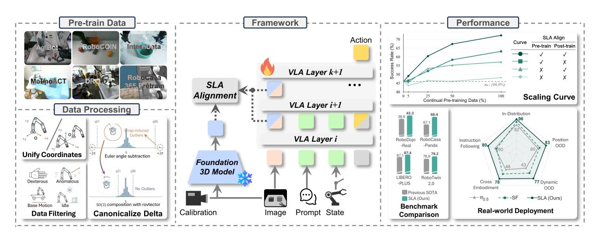
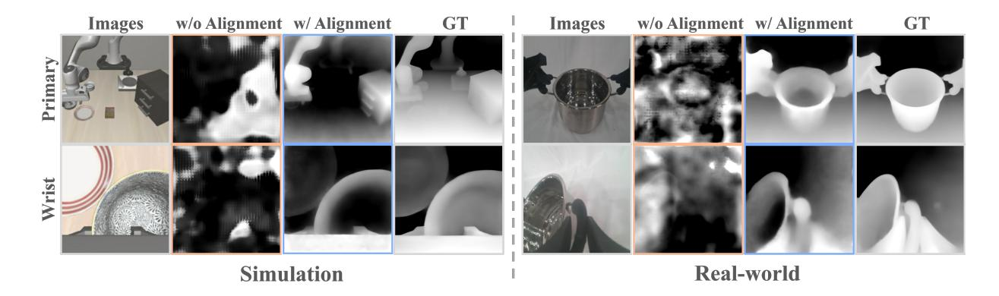
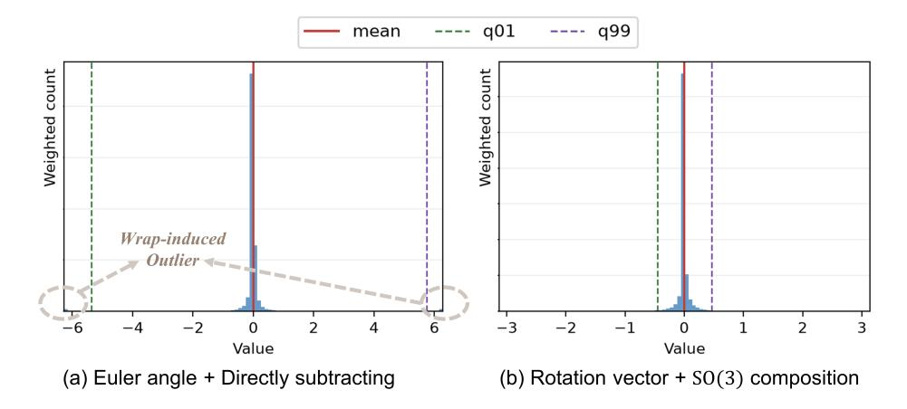
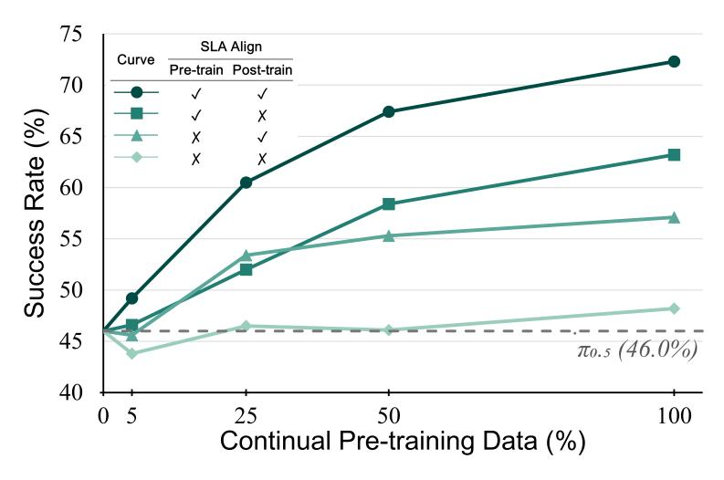
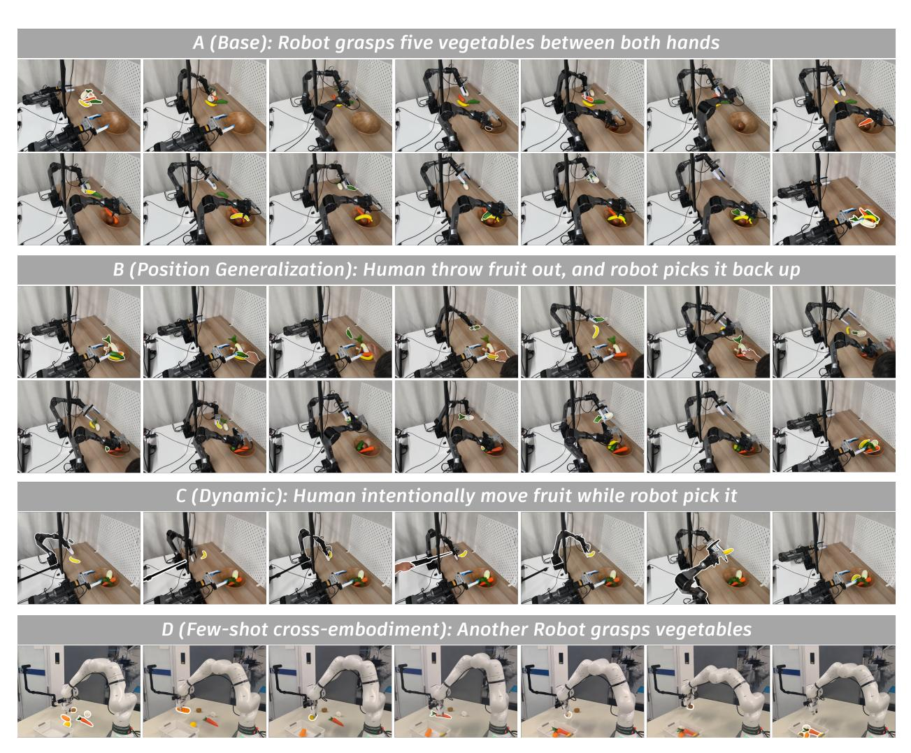
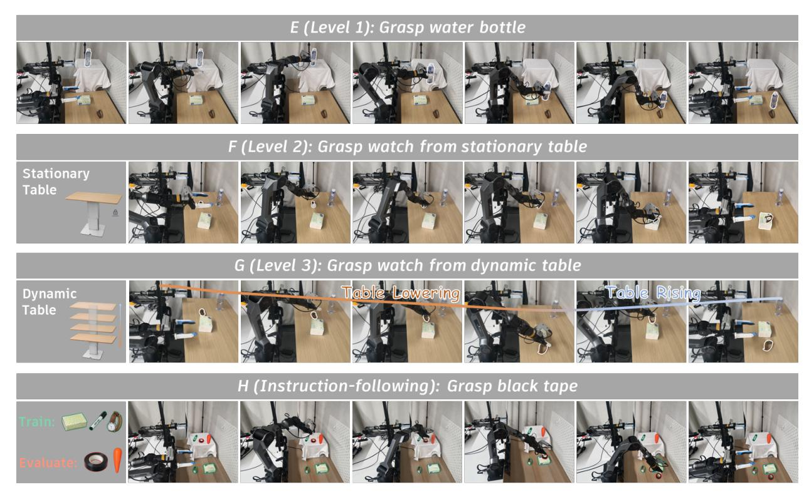

# SLA: 지속적 사전 학습을 통한 공간-언어-행동 모델 스케일링 (SLA: Scaling Spatial-Language-Action Model via Continual Pre-training)

- 원제: SLA: Scaling Spatial-Language-Action Model via Continual Pre-training
- 원문: [https://arxiv.org/abs/2611.08373](https://arxiv.org/abs/2611.08373)
- PDF: [https://arxiv.org/pdf/2611.08373](https://arxiv.org/pdf/2611.08373)
- arXiv ID: `2611.08373`

---

# SLA: 지속적 사전 학습을 통한 공간-언어-행동 모델 스케일링 (SLA: Scaling Spatial-Language-Action Model via Continual Pre-training)

Fuhao Li1,\*, Wenxuan Song1,\*,†, Qizhou Huang1, Ziyang Zhou1, Jingbo Wang1, Junwu E1, Pengwei Wang3, Yan Wang4, Shunbo Zhou2, Haoang Li1,⊠

1홍콩과학기술대학교(홍콩 University of Science and Technology) (광저우), 2OLA Dimensions, 3베이징 인공지능학원(Beijing Academy of Artificial Intelligence), 4청화대학교(Tsinghua University) *동등 기여, †프로젝트 리드, ⊠응답 저자

신뢰할 수 있는 로봇 조작은 3차원 공간에서의 의미 이해와 정밀한 제어를 모두 필요로 한다. 그러나 비전‑언어‑행동(VLA) 기반 모델은 대부분 2D 비전‑언어 사전 학습에서 시각 표현을 상속받으며, 공간적 감독은 종종 작업‑특정 적응 단계에서만 도입된다. 공간 이해를 전이 가능한 기초 모델 기능으로 개발하려면 보다 폭넓은 로봇 경험에서 학습해야 한다. 우리는 SLA, 즉 공간‑언어‑행동 모델을 제시한다. SLA는 암시적 공간 정렬을 지속적 사전 학습에 확장하고, 다운스트림 사후 학습에서도 이를 유지한다. 사전 학습된  $\pi_{0.5}$  정책에서 초기화된 SLA는 중간 시각 임베딩과 동결된 3D 인식 모델의 공간 표현 사이의 정렬과 행동 예측을 동시에 최적화한다. 우리는 다양한 구현체, 작업, 장면에 걸친 공간 학습을 지원하기 위해 이질적인 로봇 데이터셋을 선별하고 통합한다. 이러한 다양성을 수용하기 위해, 우리는 공간 감독을 위해 여러 VLA 층의 시각 임베딩을 적응적으로 집계하는 특징‑의존 게이트를 도입한다. 교사는 RGB 관측과 함께 부분적으로 이용 가능한 깊이 및 카메라 보정 정보를 활용하여 이질적인 기하학적 주석을 효과적으로 사용한다. 확률적 상태 드롭아웃은 시각적 단서에 대한 의존을 장려하고 시연 궤적에 대한 과적합을 완화한다. 모든 보조 구성 요소는 학습 시에만 사용되므로, 사전 학습된 VLA 가중치를 직접 재사용하고 원래 추론 아키텍처를 보존한다. 광범위한 평가를 통해 SLA가 RoboDojo‑Real, Clean2Random 설정 하의 RoboTwin 2.0, RoboCasa‑Panda, LIBERO‑Plus에서 최첨단 성능을 달성함을 입증하며, 강력한 일반화와 다운스트림 데이터 효율성을 강조한다. 여덟 개의 실제 배포 조건에서 SLA는  $\pi_{0.5}$  대비 평균 성공률을 24.0 퍼센트 포인트 향상시킨다.

Code: GitHub

Project Page:

Project Website

**Figure 1** SLA는 이질적인 로봇 데이터를 통합하고, 훈련 중에 중간 시각 임베딩을 동결된 3D 특징과 정렬하며, 벤치마크와 실제 세계 조작 성능을 향상시킨다.

## **목차** (Contents)

| 1 |  | # 소개 (Introduction) | 3 |
|---|------------|-----------------------------------------------|----|
| 2 |  | # 관련 연구 (Related Work) | 4 |
|  | 2.1 | # VLA 기초 모델 (VLA Foundation Models) | 4 |
|  | 2.2 | # 3D VLA 모델  (3D VLA Models) | 5 |
|  | 2.3 | # 지속적 사전 학습 (Continual Pre-training) | 5 |
| 3 |  | # 방법론 (Methodology) | 5 |
|  | 3.1 | # 동기  (Motivation) | 5 |
|  | 3.2 | # 모델 (Model) | 6 |
|  |  | # 3.2.1 모델 아키텍처 (3.2.1 Model Architecture) | 6 |
|  |  | # 3.2.2 외부 공간 감독  (3.2.2 External Spatial Supervision) | 7 |
|  |  | # 3.2.3 적응형 레이어 선택  (3.2.3 Adaptive Layer Selection) | 8 |
|  |  | # 3.2.4 상태 드롭아웃  (3.2.4 State Dropout) | 8 |
|  | 3.3 | # 데이터 (Data) | 8 |
|  |  |  |  |
|  |  | # 3.3.1 데이터 소스  (3.3.1 Data Sources) | 8 |
|  |  | # 3.3.2 데이터 처리  (3.3.2 Data Processing) | 9 |
| 4 |  | # 실험 (Experiments) | 10 |
|  | 4.1 | # 실험 설정  (Experimental Setup) | 11 |
|  | 4.2 | # 구현 세부사항  (Implementation Details) | 11 |
|  | 4.3 | # 최첨단 방법과의 비교  (Comparisons with State-of-The-Art Methods) | 11 |
|  |  | # 4.3.1 LIBERO-Plus (4.3.1 LIBERO-Plus) | 12 |
|  |  | # 4.3.2 RoboTwin (4.3.2 RoboTwin) | 12 |
|  |  | # 4.3.3 RoboCasa-Panda (4.3.3 RoboCasa-Panda) | 13 |
|  |  | # 4.3.4 RoboDojo-Real (4.3.4 RoboDojo-Real) | 13 |
|  | 4.4 | # 성능 분석 (Performance Analysis) | 13 |
|  |  | # 4.4.1 데이터 스케일링 트렌드  (4.4.1 Data Scaling Trend) | 13 |
|  |  | # 4.4.2 적응형 레이어 선택  (4.4.2 Adaptive Layer Selection) | 15 |
|  |  | # 4.4.3 상태 드롭아웃  (4.4.3 State Dropout) | 15 |
|  |  | # 4.4.4 회전 표현  (4.4.4 Rotation Representation) | 16 |
|  |  | # 4.4.5 카메라 보정  (4.4.5 Camera Calibration) | 16 |
|  | 4.5 | # 실제 배포와의 비교 (Comparisons on Real-world Deployment) | 16 |
|  |  |  |  |
|  |  | # 4.5.1 실제 세계 작업  (4.5.1 Real-world Tasks) | 17 |
|  |  | # 4.5.2 결과  (4.5.2 Results) | 18 |
| 5 |  | # 결론 (Conclusion) | 20 |
|  | # 참고문헌 (References) |  | 20 |
|  |  |  |  |
| # A (A) |  | # 추가 결과 (Additional Results) | 27 |
|  | # A.1 (A.1) | # 로보트윈 2.0 벤치마크에 대한 작업별 결과 (Per-task Results on RoboTwin 2.0 Benchmark) | 27 |
|  | # A.2 (A.2) | # 로보카사-판다 벤치마크에 대한 작업별 결과 (Per-task Results on RoboCasa-Panda Benchmark) | 27 |
|  | # A.3 (A.3) | # 로보도우-리얼 벤치마크에 대한 작업별 결과 (Per-task Results on RoboDojo-Real Benchmark) | 28 |
|  | # A.4 (A.4) | # 로보도우-심 벤치마크 (RoboDojo-Sim Benchmark) | 29 |
| # B (B) |  | # 메모리 메커니즘 (Memory Mechanism) | 29 |
|  | # B.1 (B.1) | # 메모리 구성  (Memory Construction) | 29 |
|  | # B.2 (B.2) | # 메모리 인코딩  (Memory Encoding) | 31 |
|  | # B.3 (B.3) | # 훈련 및 추론 (Training and Inference) | 31 |

## **1 서론 (Introduction)**

로봇 조작의 발전은 3D 실제 세계에서 의미론적 추론과 정확한 물리 제어를 통합하는 데 달려 있다. 최근, 지시를 따르고 로봇 동작을 실행할 수 있는 비전-언어-행동 모델 [(Black et al.,](#page-19-0) [2025;](#page-19-0) [Intelligence,](#page-21-0) [2025;](#page-21-0) [Yuan et al.,](#page-24-0) [2026a;](#page-24-0) [Team et al.,](#page-23-0) [2026b;](#page-23-0) [Liu et al.,](#page-22-0) [2026b;](#page-22-0) [Bu et al.,](#page-19-1) [2025;](#page-19-1) [Song et al.,](#page-23-1) [2026)](#page-23-1)는 지시를 따르고 로봇 동작을 실행할 수 있는 기능으로 인해 상당한 관심을 끌었다. 사전 학습된 비전-언어 모델(VLM)을 다양한 로봇 시연에서 학습한 동작 전문가와 결합함으로써, 이 모델들은 범용 조작을 위한 유망한 기반을 제공한다. 그러나 성공적인 조작은 물체를 인식하고 지시를 이해하는 것뿐만 아니라 3D 물리 세계에서 정밀한 동작을 수행하는 것을 요구한다. 전형적인 2D VLA 기반 모델은 2D 이미지–텍스트 쌍에서 사전 학습된 VLM의 지식을 상속받으며, 사전 학습 중에 명시적으로 3D 물리 지식을 통합하지 않고 로봇 제어를 학습한다. 이는 정밀한 공간 추론이 요구되는 장면에서 신뢰성을 제한한다.

공간 이해를 향상시키는 직접적인 접근법은 사전 학습된 2D VLA 기초 모델 위에서 사후 훈련 중에 3D 모달리티를 도입하는 것이다. 여러 접근 방식 [(Li et al.,](#page-21-1) [2026a;](#page-21-1) [Sun et al.,](#page-23-2) [2025;](#page-23-2) [Li](#page-21-2) [et al.,](#page-21-2) [2026c)](#page-21-2)는 깊이 카메라 또는 다른 3D 센서에서 얻은 깊이 맵이나 포인트 클라우드를 사용하여 그 기하학적 정보를 인코딩하고 VLM 백본 또는 액션 헤드에 입력한다. 그러나 몇 가지 한계로 인해 이 패러다임에 대한 보편적이고 확장 가능한 3D 전략을 개발하기 어렵다: (1) 신뢰할 수 있는 3D 센서 데이터는 획득하기 어렵다, 측정된 깊이 맵과 포인트 클라우드는 잡음이 많거나 불완전할 수 있다. (2) 로봇 센서는 종류, 위치, 보정 상태가 다양하여 데이터에 상당한 이질성을 도입한다. (3) 기존 대규모 로봇 데이터셋 [(O'Neill et al.,](#page-22-1) [2024;](#page-22-1) [Wu et al.,](#page-24-1) [2025b;](#page-24-1) [Lee et al.,](#page-21-3) [2026;](#page-21-3) [Walke et al.,](#page-23-3) [2023;](#page-23-3) [Brohan et al.,](#page-19-2) [2022)](#page-19-2)는 깊이 정보를 포함하지 않아 확장 가능성에 한계를 둔다.

이러한 문제를 해결하기 위해 Spatial Forcing [(Li et al.,](#page-21-4) [2025a)](#page-21-4)는 깊이 정보에 대한 명시적 요구 없이 2D VLA를 공간 지능으로 강화하기 위한 암시적 3D 표현 정렬 전략을 제안했다. 그러나 Spatial Forcing은 여전히 사후 훈련에 집중하여 공간 역량을 작업별 추가 기능으로 남겨 두고, 이식 가능한 공간 이해를 갖춘 확장 가능한 3D VLA 기초 모델 개발을 제한한다.

최근, 지속적 사전학습은 기초 모델 사전학습에서 획득한 지식을 보존하면서 규모에 맞춰 특정 기능을 개발하는 수단으로 널리 채택되고 있다 [(Yu et al.,](#page-24-2) [2026;](#page-24-2) [Guo](#page-21-5) [et al.,](#page-21-5) [2026b)](#page-21-5). 이러한 접근법에 동기를 두고, 우리는 강력한 2D 기초 모델을 기반으로 지속적 사전학습을 통해 공간적 이해를 개발하고 이후 적응을 위한 기반을 마련하고자 한다. 따라서 우리는 지속적 사전학습과 사후학습(post-training) 동안 암시적 표현 정렬(implicit representation alignment)을 통해 개발된 일반화된 공간적 이해 기능을 갖춘 로봇 기초 모델인 SLA를 제안한다. 직관적으로, 행동 생성은 시각적 및 언어적 표현에 조건화되어 시각 토큰의 공간적 내용이 행동과 직접적으로 관련된다. 풍부한 공간 정보를 포함하는 고품질 시각 토큰은 보다 정밀한 조작 행동을 생성하는 데 도움을 줄 수 있다. 이를 영감으로, 우리는 VLA의 중간 시각 임베딩을 동결된 3D 인식 기초 모델에서 추출된 외부 공간 표현과 정렬한다. 이 공간 정렬 목표는 표준 행동 학습 목표를 보완하며, 정책이 행동 예측에 사용되는 표현에 기하학적 정보를 내부화하도록 장려한다. 핵심적으로, 이 감독은 사전학습된 VLA 아키텍처나 행동 생성 헤드에 대한 변경을 필요로 하지 않는다. 따라서 우리는 사전학습된 π0.5 기초 모델을 직접 초기화하고 그 학습된 로봇 지식에서부터 훈련을 계속할 수 있다 [(Intelligence,](#page-21-0) [2025)](#page-21-0). 이 아키텍처적 호환성은 공간 감독이 기초 모델을 형성하면서 사전학습된 가중치에 인코딩된 일반 지식에 대한 접근을 유지하도록 한다.

기술적으로, 이질적인 로봇 데이터를 통한 지속적 사전 학습을 지원하기 위해 우리는 통합된 학습 코퍼스를 결합한다. 우리는 다양한 구현체, 작업, 장면 및 시각적 외관을 포괄하는 다수의 대규모 공개 데이터셋을 선별하고, 일관된 엔드 이펙터 표현과 좌표 규약을 통해 그들의 상태 및 동작 주석을 통합한다. 이 처리는 서로 다른 로봇이 공간에서 어떻게 행동하는지를 학습할 수 있는 공통 기반을 제공한다. 결과적으로 나타난 시각적 다양성은 수동으로 선택된 단일 정렬 레이어를 제한적으로 만든다: 한 도메인 데이터에 적합한 VLA 모델의 특정 중간 시각 레이어가 다른 도메인에 동일하게 적합하지 않을 수 있다. 따라서 우리는 기능 의존 게이트를 사용하여 여러 VLA 레이어의 시각 임베딩을 집계해 공간 감독을 위한 적응형 레이어 선택 메커니즘을 개발한다. 또한, 우리는 외부 3D 인식 기반으로 OmniVGGT [(Peng](#page-22-2) [et al.,](#page-22-2) [2025)](#page-22-2)를 채택하여 RGB 이미지와 함께 부분적으로 사용 가능한 카메라 보정 및 깊이 주석을 활용한다. 우리는 또한 훈련 중에 확률적 상태 드롭아웃을 도입하여 시연 궤적에 대한 과적합을 완화하고 정책이 시각적 단서를 더 잘 활용하도록 장려함으로써 일반화를 향상시킨다. 지속적 사전 학습 후, 우리는 후속 훈련 중에 공간 정렬을 유지하여 결과적으로 생성된 기초 모델을 특정 다운스트림 작업에 적응시킨다. 교사, 정렬 프로젝터 및 레이어 선택 게이트는 훈련 중에만 사용된다. 배포 시, 정책은 외부 인식 모델, 정렬 프로젝터 또는 레이어 선택 게이트를 필요로 하지 않고 원래 추론 아키텍처를 유지한다.

우리는 SLA의 효과를 입증하기 위해 세 개의 공개 시뮬레이션 벤치마크, 하나의 공개 실세계 벤치마크, 그리고 여덟 개의 실세계 배포 조건에 대해 광범위한 평가를 수행한다.  
LIBERO-Plus [(Fei et al.,](#page-20-0) [2025)](#page-20-0)에서, 다양한 관측, 언어, 장면 변동 하에서 전체 성공률이 87.4%를 달성하며 비교된 기초 모델을 능가한다.  
RoboTwin 2.0 [(Chen et al.,](#page-20-1) [2025a)](#page-20-1)에서, 깨끗한 시연을 기반으로 학습하면 Clean2Random 설정에서 72.3%의 성공률을, Clean2Clean과 Clean2Random 전반에서 79.2%의 평균을 달성하여 학습 조건을 넘어선 일반화를 보여준다.  
RoboCasa-Panda [(Nasiriany et al.,](#page-22-3) [2024)](#page-22-3)에서, SLA는 작업당 50개의 다운스트림 시연만으로 68.4%의 성공률을 달성하며, 작업당 300–3,000개의 시연으로 훈련된 비교 정책을 능가한다.  
RoboDojo-Real [(Chen et al.,](#page-20-2) [2026b)](#page-20-2)에서, 세 가지 구현체에 걸쳐 적응된 단일 정책이 33.9%의 전체 성공률을 달성하며, π0.5의 12.8%와 비교해 실제 로봇 조작에 적용 가능함을 뒷받침한다.  
우리의 여덟 개 배포 조건은 이중 손 조정, 공간 및 동적 일반화, 소수 샷 교차 구현체 적응, 그리고 지시 따르기를 추가로 검토한다.  
SLA는 모든 조건에서 비교된 방법 중 가장 높은 성공률을 달성하며, 평균 83.8%를 기록하고 π0.5보다 24.0 퍼센트 포인트 향상한다.  
제어된 데이터 스케일링 실험은 두 학습 단계 모두에서 공간 정렬을 적용하면 테스트된 모든 데이터 비율에서 단일 단계 대안보다 우수함을 추가로 보여준다.  
이러한 결과는 지속적 사전 훈련 중에 공간 이해를 개발하고 다운스트림 적응 시 이를 강화하는 것을 지원한다.

Our contributions are summarized as follows:

- 우리는 SLA를 도입한다, 이는 시각적 임베딩을 VLA에 외부 공간 표현과 통합하도록 암묵적으로 강제하는 로봇 기반 기초 모델이다.  
- 우리는 SLA를 신중히 선별되고 통합된 공개 로봇 데이터 세트 코퍼스를 대상으로 지속적 사전 학습으로 확장하여 공간 정보를 반영한 기초 모델을 개발한다.  
- 우리는 SLA 훈련 원칙을 다운스트림 사후 학습에 적용하고, 양손 협동, 공간 및 동적 일반화, 소수 샷 크로스엔보디먼트 적응, 그리고 지시 따르기를 포함한 강력한 벤치마크 성능을 입증한다.

## 2 관련 연구 (2 Related Work)

### 2.1 VLA 기반 모델 (2.1 VLA Foundation Models)

VLA 기반 기초 모델은 대규모, 다양한 데이터셋에서 일반적인 조작 정책을 학습하고 이를 다운스트림 작업에 적용한다. Cross-embodiment 데이터셋 [(O'Neill et al.,](#page-22-1) [2024;](#page-22-1) [Walke et al.,](#page-23-3) [2023;](#page-23-3) [Brohan et al.,](#page-19-2) [2022;](#page-19-2) [Wu et al.,](#page-24-3) [2024;](#page-24-3) [Fang et al.,](#page-20-3) [2024;](#page-20-3) [Allshire et al.,](#page-19-3) [2026;](#page-19-3) [Jiang et al.,](#page-21-6) [2026)](#page-21-6) 이 발전을 가속화했다. OpenVLA [(Kim et al.,](#page-21-7) [2024)](#page-21-7), π0 [(Black et al.,](#page-19-0) [2025)](#page-19-0), RDT-1B [(Liu et al.,](#page-22-4) [2024)](#page-22-4), 그리고 GR00T N1 [(Bjorck](#page-19-4) [et al.,](#page-19-4) [2025)](#page-19-4) 은 로봇 시연에서 언어 조건화된 행동 예측을 학습하며, GR-2 [(Cheang](#page-20-4) [et al.,](#page-20-4) [2024)](#page-20-4)는 대규모 비디오 사전학습과 로봇 궤적에 대한 정책 학습을 결합한다. 작업 이해를 향상시키기 위해 RT-H [(Belkhale et al.,](#page-19-5) [2024)](#page-19-5)와 π0.5 [(Intelligence,](#page-21-0) [2025)](#page-21-0)는 언어 조건화된 작업 계층을 채택하고, MolmoAct [(Lee et al.,](#page-21-3) [2026)](#page-21-3)와 MolmoAct2 [(Fang et al.,](#page-20-5) [2026)](#page-20-5)는 행동 추론을 로봇 제어에 통합한다. RT-2 [(Brohan et al.,](#page-19-6) [2023)](#page-19-6), π0.5, 그리고 Xiaomi-Robotics-0 [(Cai et al.,](#page-20-6) [2026b)](#page-20-6)는 로봇 및 시각-언어 데이터를 공동 학습하여 의미적 일반화와 지시 따르기를 지원한다. 원격 조작 로봇 데이터의 부족은 대체 감독 소스에 대한 동기를 더욱 부추겼다. HumanScale [(Ma](#page-22-5) [et al.,](#page-22-5) [2026)](#page-22-5)는 자가 중심 인간 비디오에서 사전학습을 수행한 뒤 로봇 데이터를 사용해 적응을 시도한다. 별도로, Universal Manipulation Interface (UMI) [(Chi et al.,](#page-20-7) [2024)](#page-20-7)는 수집 현장에서 로봇이 필요 없이 휴대용 그리퍼를 사용해 시연을 수집할 수 있게 한다. RDT2 [(Liu et al.,](#page-22-6) [2026a)](#page-22-6)와 Xiaomi-Robotics-1 [(Team et al.,](#page-23-0) [2026b)](#page-23-0)는 UMI 데이터를 활용해 훈련 규모와 환경·작업 범위를 확장한다. 이러한 진전은 일반적인 행동 학습을 지원하지만, 데이터 규모만으로는 사전학습 중 기하학적 표현이 어떻게 감독되어야 하는지를 명시하지 않는다. 우리의 보완적 목표

기존 VLA 기반 모델에서 공간적으로 감독된 지속적 사전 학습을 통해 3D 공간 이해를 개발하는 것이 목표이다.

### **3D VLA 모델 (2.2 3D VLA Models)**

기존의 3D VLA 방법들은 명시적 입력, 특징 융합, 또는 표현 감독을 통해 기하학을 도입한다. PointVLA [(Li et al.,](#page-21-1) [2026a)](#page-21-1)와 GeoVLA [(Sun et al.,](#page-23-2) [2025)](#page-23-2)는 포인트 클라우드 특징을 행동 예측에 통합한다. BridgeVLA [(Li et al.,](#page-21-2) [2026c)](#page-21-2)는 3D 관측을 다중 시점 이미지로 투영하고, FALCON [(Zhang et al.,](#page-24-4) [2025)](#page-24-4)는 공간 기반 모델에서 기하학 토큰을 추출해 행동 헤드 내에서 융합한다. 이러한 접근법은 여전히 배포 시 추가적인 기하학 입력 추출을 필요로 한다. 다른 연구들은 훈련 시 감독을 사용해 내부 정책 표현에 공간 구조를 인코딩한다. ROCKET [(Sun et al.,](#page-23-4) [2026)](#page-23-4)는 다층 공간 정렬을 탐구하고, VEGA [(Wang et al.,](#page-23-5) [2026a)](#page-23-5)는 시각 인코더 출력을 감독하며, Mind-VLA [(Ding et al.,](#page-20-8) [2026)](#page-20-8)는 대상 객체 표현의 지시어 인식 정렬을 도입한다. 이러한 접근법은 일반 2D VLA 사전 훈련 위에 포스트-트레이닝 중에 3D 기능을 추가하는 데 중점을 두며, 공간 이해를 확장 가능한 3D 인식 기반으로 구축하기보다 보조 기능으로 남긴다. 최근 연구들은 자가 중심 공간 임베딩 [(Qu et al.,](#page-22-7) [2025)](#page-22-7), 자가 중심 3D 주석 [(Feng et al.,](#page-20-9) [2026)](#page-20-9), 그리고 객체 포즈 추정 [(Lin et al.,](#page-22-8) [2026)](#page-22-8)을 통해 기하학을 사전 훈련에 통합한다. 그러나 이러한 3D 인식 사전 훈련 노력은 대규모 2D VLA 사전 훈련에 비해 상대적으로 규모가 제한적이다. 반면, 우리는 사전 훈련된 2D VLA를 지속적 사전 훈련을 통해 일반화 가능한 3D 인식 기반 모델을 개발한다.

### **2.3 지속적 사전 훈련**

지속적 사전 훈련은 기존 기초 모델의 도메인 역량을 추가 대규모 사전 훈련을 통해 확장하며, 다운스트림 적응의 기반을 제공한다. 초기 연구들 [(Lee et al.,](#page-21-9) [2020;](#page-21-9) [Alsentzer](#page-19-7) [et al.,](#page-19-7) [2019;](#page-19-7) [Araci,](#page-19-8) [2019;](#page-19-8) [Chalkidis et al.,](#page-20-10) [2020;](#page-20-10) [Gururangan et al.,](#page-21-10) [2020)](#page-21-10)는 도메인별 데이터 분포에 적응하는 데 초점을 맞춘다. Llemma [(Azerbayev et al.,](#page-19-9) [2024)](#page-19-9)는 수학 텍스트와 코드를 대상으로 지속적 사전 훈련을 통해 수학적 추론을 강화한다. AgentFounder [(Su et al.,](#page-23-6) [2026b)](#page-23-6)는 다양한 추론 및 행동 데이터를 활용해 포스트-트레이닝 전 에이전트 역량의 기초를 구축한다. 최근 연구들은 이 패러다임을 로보틱스에 확장한다: ET-VLA [(Li and Peng,](#page-21-11) [2025)](#page-21-11)는 합성 데이터를 사용해 지속적 사전 훈련을 수행하여 기존 VLA를 새로운 구현체로 전이하고, AXIS [(Zhao et al.,](#page-25-0) [2026)](#page-25-0)는 데이터에 따라 정책 성능이 어떻게 확장되는지를 조사한다. 이러한 VLA 노력은 주로 훈련 데이터 소스에 초점을 맞춘다. 반면, 우리는 지속적 사전 훈련 중에 암시적 공간 정렬 프레임워크를 사용해 일반화 가능한 3D 공간 이해를 개발하면서 사전 훈련된 VLA 백본 아키텍처를 보존한다.

## **3 방법론**

SLA는 지속적인 사전학습을 통해 확장 가능한 3D VLA 기초 모델을 개발하는 것을 목표로 한다. 사전 학습된 2D VLA 백본 [(Intelligence,](#page-21-0) [2025)](#page-21-0)에서 시작하여, 외부 공간 표현 감독을 사용해 시각적 표현을 형성하면서 백본과 행동 생성 아키텍처를 유지한다. [Section 3.1](#page-4-3)은 이 접근법을 동기화하고, [Section 3.2](#page-5-0)는 모델과 학습 메커니즘을 제시하며, [Section 3.3](#page-7-2)는 지속적 사전학습 코퍼스와 통합 처리를 설명한다.

### **3.1 동기 (Motivation)**

VLA 모델은 사전 학습된 VLM 위에 구축되며, 행동 전문가를 위한 특수 설계를 통해 행동을 생성한다. θ-파라미터화된 VLM 모델은 자동 회귀 방식으로 다음 토큰을 생성하기 위해 다중 인과 주의(attention) 레이어를 사용하며, 이는 xt ∼ pθ(xt | x<t) 형태로 표현된다. 여기서 {x_t} T t=1 은 토큰 시퀀스를 나타낸다.

VLA 모델에 적용될 때, 세 가지 정보 모달리티가 처리된다: 시각, 텍스트, 행동. 시각 모달리티는 로봇이 캡처한 다중 뷰 이미지를 포함하며, 이는 DINOv2 [(Oquab et al.,](#page-22-9) [2023)](#page-22-9) 또는 SigLIP [(Zhai](#page-24-5) [et al.,](#page-24-5) [2023)](#page-24-5)와 같은 사전 학습된 시각 인코더를 통해 N개의 시각 토큰 {x_V^t} N t=1 으로 변환된다. 텍스트 모달리티는 작업 지침으로 구성되며, 이는 M개의 언어 토큰으로 변환된다.

**Figure 2** VLAs의 시각 임베딩에 대한 깊이 프로빙. 정렬 없이 2D 이미지만으로 학습된 임베딩은 의미 있는 공간 구조를 생성하지 못한다. 정렬된 임베딩은 본질적으로 풍부한 공간 정보를 포함하여 깊이 프로빙에서 더 나은 성능을 이끈다.

$\{\boldsymbol{x}_t^{\mathcal{L}}\}_{t=1}^{M}$ 은 텍스트 토크나이저에 의해 생성된다. 그 다음, VLA 모델은 앞선 시각 및 언어 토큰에 조건화된 K개의 행동 토큰 $\{\boldsymbol{x}_t^{\mathcal{A}}\}_{t=1}^{K}$ 를 생성한다:

$$\boldsymbol{x}_{t}^{\mathcal{A}} \sim p_{\theta} \left( \boldsymbol{x}_{t}^{\mathcal{A}} \mid \{\boldsymbol{x}_{i}^{\mathcal{V}}\}_{i=1}^{N}, \{\boldsymbol{x}_{i}^{\mathcal{L}}\}_{j=1}^{M}, \boldsymbol{x}_{< t}^{\mathcal{A}} \right), \tag{1}$$

$$\mathcal{L}_{\text{action}} = \mathcal{L}[\mathcal{G}(\{\boldsymbol{x}_t^A\}_{t=1}^K), A_{at}], \tag{2}$$

여기서 $\mathcal{L}[\cdot,\cdot]$ 은 훈련 손실(예: L1, L2, 또는 교차 엔트로피 손실)을 나타내고, $\mathcal{G}$ 는 훈련 가능한 행동 전문가(예: 다층 MLP 또는 흐름 매칭 헤드 (Lipman et al., 2022))를 의미한다. 방정식 (1)은 시각 토큰이 중간 장면 표현으로서 행동 토큰 생성에 중요한 역할을 하며, 적절히 감독되어야 함을 보여준다.

VLA 모델은 3D 정보를 포착하고 로봇과 물체 간의 상대 위치를 추론하여 정밀한 공간 움직임을 생성해야 하므로, 우리는 3D 정보가 VLAs의 시각 임베딩에 암묵적으로 내재되어 있다고 가정한다. 이러한 임베딩은 추론 시 자동 회귀 메커니즘을 통해 행동 토큰이 3D 단서를 획득하도록 허용한다.

이 가설을 평가하기 위해 우리는 선형 프로빙(He et al., 2020; Wu et al., 2025a)을 따라 가벼운 깊이 프로빙 실험을 수행한다. 구체적으로, VLA 모델(Kim et al., 2025)의 모든 파라미터를 고정하고 DPT 헤드(Ranftl et al., 2021)만 훈련시켜 VLA의 시각 임베딩을 깊이 맵으로 변환한다. 이를 통해 VLA 표현 공간에 내재된 공간 정보의 풍부함을 정량화할 수 있다. Figure 2에 나타난 바와 같이, 2D 이미지만으로 학습된 시각 임베딩은 의미 있는 공간 구조를 생성하지 못해, 명시적 공간 입력이나 안내 없이 모델이 3D 구조 정보를 인코딩하는 능력이 제한적임을 시사한다.

우리는 추가 센서 입력이나 깊이 추정 모듈을 통해 이 3D 물리적 격차를 메우는 것이 원래 2D VLA 기반 모델의 아키텍처를 변경하고 사전 훈련 중에 이미 획득한 일반 지식을 방해할 수 있다는 점을 인식한다. 따라서 우리는 기존 VLA 아키텍처와 사전 훈련된 파라미터를 재사용하여 지속적인 사전 훈련을 통해 3D 물리 세계에 대한 일반화 가능한 이해를 열어주는 훈련 전략을 찾고 있다.

### 3.2 모델 (Model)

#### 3.2.1 모델 아키텍처 (Model Architecture)

우리의 주요 철학은 외부 감독 신호를 사용하여 시각 토큰 $x^{\mathcal{V}}$ 를 감독하는 것이다. 신호에 풍부한 공간 정보를 제공하기 위해, 우리는 먼저 다중 뷰 이미지 집합 $\mathcal{I}$ 를 고정된 외부 3D 인식 기반 모델 $f^{3D}$ 에 입력한다. 이 모델은 각 이미지에 대해 픽셀 수준의 3D 표현 $f^{3D}(\mathcal{I})$ 를 출력한다. 카메라 파라미터와 깊이 이미지 같은 사용 가능한 기하학적 주석도 이 외부 3D 기반 모델에 제공되며, 이는 3.2.2절에 설명되어 있다. 또한, 이 공간 표현은

위치 임베딩 E 를 사용하여 감독 토큰이 감독 훈련 중에 중요한 공간 위치 순서를 보존하도록 한다. 우리는 f 3D(I)의 최종 레이어 표현을 추출하고, 위치 임베딩과 함께 특징 그리드를 이중 선형 보간하여 VLA 토큰 해상도로 재샘플링하여 각 시각 토큰 위치에서 공간 목표 yi 를 얻는다:

$$\mathbf{y} = \mathcal{R}\left[f^{3D}(\mathcal{I}) + E\right],\tag{3}$$

여기서 R[·] 은 VLA 시각 토큰 해상도로의 이중 선형 보간을 나타낸다. 간결성을 위해 카메라 파라미터와 같은 사용 가능한 기하학적 주석은 I 에 암시적으로 포함된다.

VLA의 픽셀 단위 시각 토큰을 이 외부 3D 인식 기반 모델과 정렬하기 위해, 우리는 먼저 각 VLA 시각 토큰 xV 를 레이어 정규화 LN 으로 처리한 뒤 두 층의 MLP 를 적용하여 특징 차원에서 호환성을 확보한다. (ℓ)xV 는 VLA 시각-언어 백본의 주의 층 ℓ 이후의 시각 토큰을 나타낸다. 정규화와 MLP 파라미터는 층 간에 공유된다. VLA 모델에는 여러 개의 인과적 주의 층이 있으므로, 시각 토큰은 서로 다른 층 이후에 얻을 수 있다. 우리는 이 투영된 특징을 적응적으로 z 로 집계한다:

$$\mathbf{z} = \mathcal{F} \left[ \left\{ {}^{(\ell)} \boldsymbol{x}^{\mathcal{V}} \right\}_{\ell=1}^{L} \right]$$

$$= \sum_{\ell=1}^{L} {}^{(\ell)} \mathbf{g} \odot \text{MLP} \left[ \text{LN} \left( {}^{(\ell)} \boldsymbol{x}^{\mathcal{V}} \right) \right],$$

(4)

여기서 L 은 VLA 주의 층의 수이며, (ℓ)gi 는 토큰 및 채널별 게이트이고, ⊙ 은 원소별 곱셈을 나타낸다. 이 융합 연산자 F[·] 는 적응적 층 선택 전략을 의미하며, 이는 [3.2.3절](#page-7-0) 에 자세히 설명되어 있다.

그 다음 우리는 코사인 유사도 점수를 사용하여 VLA의 시각 토큰과 외부 공간 표현 신호 간의 정렬을 최대화한다. 정렬 손실은

$$\mathcal{L}_{\text{align}} = \frac{1}{N} \sum_{i=1}^{N} \left[ 1 - \mathcal{S}(\mathbf{z}_i, \mathbf{y}_i) \right], \tag{5}$$

여기서 S[·, ·] 은 코사인 유사도를 나타내며, N 은 시각 토큰의 총 수(모든 뷰를 포함)이다. 목표 yi 는 시각 토큰 zi 와 동일한 뷰 및 이미지 위치에 해당한다. 기울기는 VLA, MLP 프로젝터, 집계 게이트를 업데이트하며, 외부 3D 인식 모델 f 3D 는 고정된다.

최종 훈련 목표는 행동 생성에 대한 표준 훈련 손실과 3D 기반 모델 정렬 손실을 가중치 α 로 결합한 것이다:

$$\mathcal{L} = \mathcal{L}_{action} + \alpha \mathcal{L}_{align}, \tag{6}$$

α는 공간 정렬 강도를 제어한다. 우리는 사전 학습된 π0.5 정책 [(Intelli](#page-21-0)[gence,](#page-21-0) [2025)](#page-21-0)을 사용해 SLA를 구현한다. 이 정책의 액션 전문가가 흐름 매칭을 통해 연속적인 액션 청크를 생성한다.

추론 시, SLA 방식으로 훈련된 VLA 모델은 원래 VLA와 동일하게 동작하며 추가 구조나 계산 오버헤드를 도입하지 않는다. 동결된 3D 기반 모델, 정렬 프로젝터, 그리고 적응형 레이어 게이트는 훈련 시에만 사용되고 추론 시에는 버려진다. 깊이 맵이나 카메라 보정도 추론 시 추가 정책 입력으로 필요하지 않다.

#### **3.2.2 외부 공간 감독 (External Spatial Supervision)**

외부 3D 인식 기반 모델 f 3D는 정렬 신호로서 공간 표현을 제공한다. RGB 이미지 관측 외에 일부 소스 데이터셋은 보정된 카메라 파라미터와 깊이 이미지를 제공하고, 다른 데이터셋은 부분적인 기하학적 주석만 제공하거나 전혀 제공하지 않는다. 이러한 주석을 버리면 유용한 기하학적 제약이 활용되지 못하고, 완전한 주석을 요구하면 다른 유용한 시연을 제외하게 된다. 따라서 외부 모델은 지속적 사전 훈련 코퍼스 전반에 걸쳐 기하학적 주석의 불균형한 가용성을 수용해야 한다.

우리는 외부 공간 모델로 OmniVGGT [(Peng et al.,](#page-22-2) [2025)](#page-22-2)를 채택한다. VGGT [(Wang et al.,](#page-23-8) [2025)](#page-23-8)를 기반으로 하여, 프레임별 및 교차 뷰 어텐션을 번갈아 가며 지역 구조와 이미지 간 관계를 통합한다. GeoAdapter는 사용 가능한 카메라 내부 파라미터, 외부 파라미터, 깊이 맵을 별도의 카메라 및 깊이 브랜치를 통해 인코딩하며, 주석이 없을 때는 자리 표시 토큰을 사용한다. 확률적 다중 모달 융합은 RGB 전용 관측을 포함한 다양한 기하학적 입력 조합을 모델에 노출시킨다. 이러한 메커니즘은 시각적 증거와 임의로 사용 가능한 기하학적 제약을 통합된 잠재 표현에 결합한다. 따라서 우리는 그 백본 특징이 VLA의 시각 토큰에 대한 외부 감독으로 충분히 풍부한 공간 정보를 포함한다고 주장한다.

#### **3.2.3 적응형 레이어 선택 (Adaptive Layer Selection)**

다양한 사전 훈련 코퍼스는 고정된 정렬 레이어를 제한적인 선택으로 만든다. 수동으로 단일 레이어를 선택하려면 별도의 훈련 실험이 필요하며, 한 데이터 도메인에 선택된 레이어가 다른 도메인에서 동일한 시각적 세부 정보와 작업 문맥의 균형을 제공하지 않을 수 있다. 장면, 질감, 구현의 차이는 관측된 시각 콘텐츠에 따라 각 레이어의 기여도를 조정할 수 있는 메커니즘을 동원하도록 유도한다.

Gated Attention [(Qiu et al.,](#page-22-11) [2025)](#page-22-11)의 영감을 받아, 우리는 VLA 트랜스포머 레이어마다 모든 시각 토큰에 대해 특징에 의존하는 게이트를 학습한다. 비프로젝션된 임베딩 (ℓ)x V i 를 주어, 게이트는

$${}^{(\ell)}\mathbf{g}_{i} = \sigma \left( W_{g}{}^{(\ell)}\boldsymbol{x}_{i}^{\mathcal{V}} + \mathbf{b}_{g} \right), \tag{7}$$

여기서 Wg와 bg는 각각 게이트의 학습 가능한 가중치 행렬과 바이어스 벡터이며, σ는 원소별 시그모이드 함수이다. 이 게이트 파라미터는 레이어 전반에 걸쳐 공유된다. [Equation (4)](#page-6-1)의 융합 연산자 F는 이 게이트를 사용해 프로젝션된 특징에 가중치를 부여하고 레이어를 가로질러 합산해 zi 를 얻는다.

이 메커니즘을 통해 다중 레이어 VLA 시각 토큰은 동시에 감독될 수 있으며, 깊이와 채널 정보와 같은 다양한 시각적 단서가 통합된 공간 표현에 기여하도록 허용한다. 게이트는 보조 훈련 분기만 속하며 배포 시 추가 정책 계산을 도입하지 않는다.

#### **3.2.4 상태 드롭아웃 (State Dropout)**

공간적 감독은 정책이 제어를 위해 시각적 증거에 의존하도록 학습할 때만 유용하다. 로봇 상태는 정밀한 고유 감각 정보를 제공하지만, 단축 경로가 될 수 있다: 정책은 장면의 시각적 변화를 반응하기보다 특정 상태를 시연된 궤적과 연관시킬 수 있다 [(Lu et al.,](#page-22-12) [2026;](#page-22-12) [Zhao](#page-25-1) [et al.,](#page-25-1) [2025)](#page-25-1). 우리는 두 훈련 단계 모두에서 이 단축 경로를 억제하기 위해 상태 드롭아웃을 적용한다. 각 훈련 샘플마다 토큰화 과정에서 전체 상태-토큰 세그먼트를 무작위로 생략하고, 지시문 및 이미지 토큰은 보존한다. 외부 공간 정렬과 상태 드롭아웃을 함께 사용함으로써 모델이 장면 기하학을 인코딩하고 행동을 생성할 때 시각 관측을 사용하도록 유도한다. 정상 상태 입력이 사용 가능한 경우 추론 시 이 드롭아웃은 비활성화된다.

### **3.3 데이터 (Data)**

훈련 데이터의 품질과 다양성은 VLA의 일반화 능력에 근본적이다. 구현체, 과제, 환경 전반에 걸쳐 잘 일반화되는 VLA 모델을 구축하기 위해, 우리는 지속적인 사전 훈련을 위한 대규모 코퍼스를 신중히 선별한다. 또한 모든 소스에 일관된 로봇 상태 및 동작 주석을 보장하기 위해 통합 데이터 선별 및 전처리 파이프라인을 적용한다.

#### **3.3.1 데이터 소스 (Data Sources)**

[Table 1](#page-8-1)에 요약된 여섯 개의 소스 데이터셋은 총 약 170만 에피소드와 14,330시간의 시연을 포함한다.

RoboCOIN [(Wu et al.,](#page-24-1) [2025b)](#page-24-1)은 이질적인 로봇 플랫폼에서 수집된 실제 이중 손 조작 시연을 제공하며, 구현체와 관측 구성을 다양화한다.

AgiBot World Beta [(AgiBot-World-Contributors et al.,](#page-19-10) [2025)](#page-19-10)은 과제와 장면을 광범위하게 포괄하는 대규모 실제 조작 시연을 제공한다. 우리는 모바일 베이스 움직임 없이 두 손가락 그리퍼 시연만 보존한다.

**표 1 (Table 1)** 소스 데이터셋의 지속적 사전 훈련 개요. 통계는 데이터 선택 및 처리 이전의 소스 데이터셋을 나타내며, 과제 수는 데이터셋 전반에 걸쳐 합산된다.

| 데이터 소스 | 에피소드 | 작업 | 시간 |
|-----------------------------------------------------------|----------|-------|--------|
| InternData-A1 (Tian et al., 2025) | 630K | 70 | 7430 |
| AgiBotWorld-Beta (AgiBot-World-Contributors et al., 2025) | 168K | 217 | 2970 |
| RoboCasa365-Pretrain (Nasiriany et al., 2026) | 630K | 300 | 2090 |
| RoboCOIN (Wu et al., 2025b) | 183K | 808 | 1300 |
| DROID (Khazatsky et al., 2024) | 95K | 86 | 510 |
| MolmoAct (Lee et al., 2026) | 7.9K | 23 | 30 |
| 총합 | 1,713.9K | 1,504 | 14,330 |

DROID [(Khazatsky et al.,](#page-21-13) [2024)](#page-21-13)는 Franka 로봇으로 수집된 다양한 실제 환경에서의 시연을 제공한다. 시연 품질과 주석 정밀도는 다소 차이가 있다. 우리는 공개 데이터셋에서 비교적 드문 단일 팔 실로봇 경험을 위해 이를 포함한다.

InternData-A1 [(Tian et al.,](#page-23-9) [2025)](#page-23-9)은 스크립트 정책으로 생성된 합성 조작 궤적을 제공하며, 이는 규칙적이고 반복적인 동작 패턴을 생성하는 경향이 있다. 우리는 Split ALOHA, Lift2, 그리고 Franka 하위 집합을 사용하여 시뮬레이션 장면, 자산, 텍스처의 풍부한 변화를 활용하고 시각적 범위를 확장한다.

MolmoAct [(Lee et al.,](#page-21-3) [2026)](#page-21-3)은 집중된 작업 및 장면에 초점을 맞춘 실제 franka 시연을 제공한다. 이는 데이터셋에 귀중한 단일 팔 실로봇 경험을 보완한다.

RoboCasa365 [(Nasiriany et al.,](#page-22-13) [2026)](#page-22-13)은 시뮬레이션 주방에서 가정용 작업 시연을 제공한다. 우리는 베이스 모션이 포함된 궤적을 제거한 후 pre-training atomic, composite, 그리고 MimicGen 하위 집합을 사용한다. post-train 하위 집합은 사용하지 않는다.

post-training 이후 공정하고 유효한 비교를 보장하기 위해, 우리의 지속적 사전 훈련 코퍼스는 평가 누수를 초래할 수 있는 downstream 벤치마크 데이터를 제외한다.

#### **3.3.2 데이터 처리 (Data Processing)**

상태 및 동작 표현: 서로 다른 로봇 형태는 호환되지 않는 관절 상태 및 관절 동작 공간을 유발하여 관절 좌표를 공유 제어 표현의 기초로 사용하기 어렵게 만든다. 대신 우리는 엔드 이펙터(EEF) 포즈를 통해 동작을 표현한다. 이는 팔 관절의 수와 배열과 무관하게 동작의 공간적 효과를 설명한다. 우리는 절대 EEF 상태를 관측값으로 사용하고, 청크 단위의 델타 EEF 동작을 예측 목표로 삼는다.

우리는 먼저 모든 포즈를 일관된 로봇 중심 EEF 좌표 프레임에 표현한다. 단일 팔 로봇의 경우 좌표 원점을 팔 기저로, 양팔 로봇의 경우 두 팔 기저 사이의 중간점으로 통합하였다. 또한 축 방향을 전방(+x), 좌측(+y), 상방(+z)으로 통합하였다. 강체 좌표 변환은 각 소스 데이터의 EEF 위치와 방향을 이 규칙에 매핑한다. 따라서 공유 동작 표현의 수치 축은 구현체 전반에 걸쳐 일관된 물리적 의미를 갖는다.

회전 형식은 일관된 동작 목표를 위해 똑같이 중요하다. 일반적인 선택으로는 오일러 각, 연속 6D 표현, 회전 벡터, 사원수 등이 있다. 오일러 각을 델타 동작으로 직접 빼면 각도 래핑 경계에서 작은 물리적 회전이 큰 수치 변위로 변환될 수 있다. 우리는 사전 훈련 동작 분포에서 [Figure 3.](#page-9-2)에 표시된 래핑 유발 이상치를 관찰한다. 우리의 통제된 비교는 회전 벡터를 사용해 방향을 표현하고, 상대 회전을 SO(3) 합성을 통해 계산하도록 동기를 부여한다.

구체적으로, 한 팔에 대해 현재 절대 EEF 포즈를 (p0, R0)이라 하고, 절대 목표 포즈를 (pt, Rt)라 하자.

**Figure 3** 회전 동작 분포 비교. (a) 상대 회전 목표에 대해 직접 빼기한 오일러-각 표현. (b) SO(3) 합성을 통해 계산된 상대 회전을 사용한 회전 벡터 표현. (a)에서 각도 래핑은 ±2π 근처에 이상치를 생성하며, 이는 1번째와 99번째 백분위수 사이의 구간을 넓힌다. 이는 정규화 후 일반적인 동작 값 범위를 심각하게 압축하여 학습을 방해한다.

동작 t ∈ {1, …, H}가 H개의 동작 청크 내에 있을 때, 우리는 다음을 구성한다

$$\Delta \mathbf{p}_t = \mathbf{p}_t - \mathbf{p}_0,\tag{8}$$

$$\Delta R_t = R_t R_0^{\top}, \tag{9}$$

$$\Delta \mathbf{r}_t = \text{Log}(\Delta R_t)^{\vee},\tag{10}$$

여기서 Log(·) ∨는 상대 회전 행렬을 회전 벡터 표현으로 매핑한다. 청크 내의 모든 동작은 이전 동작이 아니라 동일한 현재 포즈를 기준으로 사용한다.

회전 벡터는 방향과 크기를 통해 통합된 물리적 의미를 가지므로, 세 채널을 공유 스케일로 정규화하는 것이 자연스럽다. 그러나 우리의 통제된 실험은 채널별 정규화가 훨씬 더 나은 성능을 보인다는 것을 보여 주었으며, 따라서 우리는 실험에서 이 접근 방식을 채택한다.

유사한 궤적을 대량으로 다운샘플링하면 동등한 행동 다양성을 추가하지 않고 혼합 훈련 코퍼스를 지배할 수 있다. 이는 반복 실행이 매우 규칙적인 동작 패턴을 따를 수 있는 스크립트된 시뮬레이션 데이터에 특히 관련이 있다. 우리는 작업 내에서 완전한 에피소드를 부분 샘플링하여 이러한 중복을 줄이고, 보존된 모든 궤적의 원래 시간 샘플링 속도를 유지한다.

예를 들어, InternData-A1의 경우, 매우 반복적인 궤적을 가진 선택된 작업에서는 에피소드의 3%를, 나머지 작업에서는 10%를 보존한다. RoboCasa365의 사전 훈련 하위 집합에서는 MimicGen 에피소드의 0.5%와 복합 에피소드의 15%를 보존한다. 이러한 소스-의존적 및 작업-의존적 보존율은 에피소드 수를 비슷한 차수로 맞추어 소수의 장면이나 작업이 지배하는 것을 줄인다.

필터링 우리는 두 손가락 그리퍼를 사용한 조작에 초점을 맞추고, 손재주가 뛰어난 손 데이터와 로봇 베이스 움직임이 포함된 궤적을 제외한다. 또한 동작 통계치를 사용해 비정상적인 팔 움직임 속도를 가진 데이터를 식별하고 제거한다. 기존 주석이 있는 경우 [(Ye et al.,](#page-24-7) [2026)](#page-24-7), 로봇과 장면이 모두 정지해 있는 유휴 프레임을 제거한다. 이 필터들은 코퍼스를 의도한 제어 설정에 맞추고, 무의미하거나 일관성 없는 감독을 줄인다.

## 4 실험 (**4 Experiments**)

### 4.1 실험 설정 (**4.1 Experimental Setup**)

우리는 SLA를 세 가지 시뮬레이션 벤치마크, 하나의 실제 세계 벤치마크, 그리고 다수의 실제 세계 배치에서 벤치마크별 사후 훈련을 통해 평가한다. 이 평가들은 시각 및 언어 변동에 대한 견고성, 장면 변형 하에서의 조작, 그리고 로봇 구현체 전반에 걸친 적용 가능성을 다룬다.

LIBERO-Plus [(Fei et al.,](#page-20-0) [2025)](#page-20-0)는 카메라, 로봇, 언어, 조명, 배경, 관측 노이즈, 객체 배치 등 일곱 가지 변동 차원에서 견고성을 테스트한다. 우리는 표준 LIBERO 시연을 사후 훈련하고, LIBERO-Plus에서 추가 훈련 없이 변형된 환경을 평가한다. 평가는 10,030개의 롤아웃으로 구성되며, 전체 SR은 각 차원의 평가 에피소드 수에 따라 가중치를 둔다.

RoboTwin 2.0 [(Chen et al.,](#page-20-1) [2025a)](#page-20-1)는 50개의 양손 조작 과제를 포함한다. 우리는 각 과제마다 50개의 깨끗한 시연을 함께 사후 훈련하고, Clean2Clean과 Clean2Random 설정 모두에서 각 과제를 100번의 시도에 대해 평가한다. Clean2Random은 깨끗한 훈련 조건을 넘어 일반화를 테스트하기 위해 도메인 랜덤화를 도입한다. 우리는 각 설정에 대한 과제 평균 SR과 그들의 동일 가중 평균을 보고한다.

RoboCasa-Panda [(Nasiriany et al.,](#page-22-3) [2024)](#page-22-3)는 픽앤플레이스, 관절 물체 상호작용, 그리고 Panda 로봇을 사용한 가전 기기 조작을 포함하는 24개 과제의 주방 조작 벤치마크를 포함한다. 우리의 사후 훈련은 과제당 50개의 시연을 사용한다. 각 과제는 세 개의 평가 시드 각각에서 50번의 시도로 평가되어 총 3,600개의 시도가 발생한다. 결과는 시드와 과제에 걸쳐 평균된다.

RoboDojo-Real [(Chen et al.,](#page-20-2) [2026b)](#page-20-2)는 ARX X5, Piper, Piper X에서 18개의 작업을 다루며, 각 구현체마다 6개의 작업이 있다. 우리는 세 구현체의 시연을 모두 사용해 하나의 모델을 공동 사후 훈련한다. 우리는 부분 작업 진행을 측정하기 위해 0–100 척도에서 점수를 보고, 전체 작업 성공률을 측정하기 위해 성공률을 보고한다. 집계는 각 구현체 내의 작업을 동일하게 가중치 부여한 뒤, 세 구현체를 다시 가중치 부여한다.

우리는 이 벤치마크 평가 외에, 8개의 사설 배포 조건 A–H에서 양손 Piper 플랫폼과 단일 팔 Franka 로봇에서 실제 배포 실험을 수행한다. Piper 플랫폼은 하나의 메인 카메라와 두 개의 손목 카메라를 사용하고, Franka는 하나의 메인 카메라와 하나의 손목 카메라를 사용한다. 모든 카메라는 Realsense D435이다. 각 방법마다, 우리는 A의 100개의 시연에서 하나의 정책을 사후 훈련하고, 이를 A–C 평가에 재사용한다. D의 경우, 우리는 A의 100개의 Piper 시연과 10개의 추가 Franka 시연에서 공동 사후 훈련한다. 작업 E–H의 경우, 하나의 정책은 E 장면 구성에서 수집된 100개의 시연에서 사후 훈련되고 E–H 전반에 걸쳐 평가된다. 우리는 각 방법과 조건마다 50개의 평가된 객체 인스턴스에 대한 객체 수준 성공률을 보고한다. A, B, D의 경우, 이 인스턴스는 10개의 롤아웃에서 각 롤아웃당 5개의 객체로부터 나오며, 각 객체는 별도로 점수화된다. C와 E–H는 각각 50개의 단일 객체 롤아웃을 포함한다. 성공은 평가된 객체에 대한 완전한 조작 시퀀스를 요구한다.

### **4.2 Implementation Details** (4.2 구현 세부사항)

우리는 SLA를 사전 훈련된 π0.5 정책 [(Intelligence,](#page-21-0) [2025)](#page-21-0)에서 초기화하여 지속적 사전 훈련을 수행하고, 이후 특정 작업에 대한 사후 훈련을 진행한다.

지속적 사전 훈련은 36k 옵티마이저 스텝 동안 진행되며, 효과적인 전역 배치 크기는 4,608이다. 이는 전역 배치 크기 2,304씩 두 개의 마이크로스텝에서 그래디언트를 누적하여 얻는다. 학습률은 처음 1k 스텝 동안 5 × 10−5로 워밍업되고, 코사인 감소를 따라 30k 스텝에서 1 × 10−5로 감소하며, 이후에는 일정하게 유지된다. 지속적 사전 훈련은 48개의 NVIDIA H100 GPU에서 약 110시간이 걸린다.

사후 훈련의 경우, LIBERO-Plus는 배치 크기 512와 30k 스텝을 사용하고, RoboTwin은 배치 크기 256와 30k 스텝을 사용하며, RoboCasa-Panda는 배치 크기 64와 60k 스텝을 사용하고, RoboDojo-Real은 배치 크기 512와 40k 스텝을 사용한다. 모든 실제 배포 실험은 배치 크기 64와 20k 스텝을 사용한다.

### **4.3 Comparisons with State-of-The-Art Methods** (4.3 최첨단 방법과의 비교)

우리는 벤치마크 표에 나열된 방법들과 비교한다. Spatial Forcing은 사전 훈련된 π0.5에서 사후 훈련 단계에서만 적용되는 우리의 원래 방법을 의미하며, 지속적 사전 훈련 단계는 포함하지 않는다.

**Table 2** LIBERO-Plus 벤치마크 성공률(%, ↑). 모델은 LIBERO-Plus 세트 없이 표준 LIBERO 훈련 세트에서 미세조정된다. 평균은 평가 에피소드 수에 가중치를 두어 계산된다. **굵게**와 <u>밑줄</u>은 각각 가장 높은 값과 두 번째로 높은 값을 나타낸다.

| 방법 | 카메라 | 로봇 | 언어 | 빛 | 배경 | 노이즈 | 레이아웃 | 평균 |
|---------------------------------------------------|--------|-------------|-------------|-------|-------------|-------|--------|-------------|
| $\pi_0$ (Black et al., 2025) | 13.8 | 6.0 | 58.8 | 85.0 | 81.4 | 79.0 | 68.9 | 53.6 |
| $\pi_{0.5}$ (Intelligence, 2025) | 78.4 | 73.6 | 80.8 | 96.2 | 94.1 | 89.0 | 84.5 | 84.4 |
| StarVLA (Community, 2026) | 52.5 | 49.8 | 88.5 | 95.7 | 95.7 | 73.0 | 76.9 | 74.1 |
| 4D-WAM (Yang et al., 2026a) | 45.1 | 64.3 | 90.6 | 94.3 | 57.7 | 69.1 | 79.2 | 71.0 |
| Abot-M0 (Yang et al., 2026c) | 60.4 | 67.9 | 86.4 | 96.2 | 91.6 | 86.4 | 82.6 | 80.5 |
| Cosmos Policy (Kim et al., 2026) | 75.8 | 63.3 | 81.7 | 96.5 | 88.9 | 92.7 | 82.2 | 82.2 |
| Being-H0.7 (Luo et al., 2026) | 82.0 | 59.0 | 82.8 | 97.8 | 90.0 | 93.5 | 88.5 | 84.8 |
| Qwen-RobotManip (robot-only) (Yuan et al., 2026b) | 72.8 | <u>78.2</u> | <u>88.7</u> | 97.5 | <u>97.6</u> | 95.4 | 85.4 | <u>87.1</u> |
| 공간 강제 | 70.2 | 79.3 | 85.6 | 96.8 | 96.2 | 86.0 | 88.3 | 85.1 |
| SLA (우리) | 82.2 | 73.8 | 83.5 | 98.8 | 98.0 | 95.4 | 86.2 | 87.4 |

#### 4.3.1 LIBERO-Plus (LIBERO-Plus)

표 2는 SLA가 가중 SR을 87.4% 달성했으며, 이는 $\pi_{0.5}$와 Spatial Forcing을 각각 3.0 및 2.3 퍼센트 포인트 개선한 결과임을 보여준다. SLA는 로봇 전용 Qwen-RobotManip 모델(Yuan et al., 2026b)을 0.3 퍼센트 포인트 초과한다. 기준선 $\pi_{0.5}$에 비해, 관측 잡음(89.0% → 95.4%)과 배경 변화(94.1% → 98.0%)를 포함한 일곱 가지 교란 차원에서 개선이 나타난다. SLA는 비교된 방법 중에서 조명 교란 SR이 가장 높으며 98.8%를 기록한다. 이러한 결과는 이점이 다양한 교란에 걸쳐 확장됨을 시사한다. 이러한 이득은 일부가 공간적으로 정보를 반영한 시각 표현이 정책이 도전적인 관측 교란 하에서도 작업 관련 장면 구조를 보존하도록 돕는 데 기인할 수 있다.

#### 4.3.2 RoboTwin (RoboTwin)

**Table 3** RoboTwin 2.0 벤치마크 성공률 (%, ↑). 모델은 각 작업마다 Clean 설정에서 50개의 시연을 사용해 50개의 표준 작업에 대해 공동으로 미세 조정된다. 작업별 결과는 표 12에 표시된다. 굵게와 <u>밑줄</u>은 표시된 값 중 최고와 두 번째 최고를 나타내며, 동점은 동일하게 취급된다.

| 방법 | Clean2Clean | Clean2Random | 평균 |
|------------------------------------------|-------------|--------------|-------------|
| Discrete Forcing (Wang et al., 2026c) | 59.3 | 11.2 | 35.3 |
| X-WAM (Guo et al., 2026a) | 70.0 | 25.8 | 47.9 |
| $\pi_{0.5}$ (Intelligence, 2025) | 70.7 | 46.0 | 58.3 |
| 4D-WAM (Yang et al., 2026a) | 81.5 | 41.8 | 61.7 |
| WorldScape Policy 2.0 (Su et al., 2026a) | 84.9 | 38.5 | 61.7 |
| GigaBrain-0.7 (Team et al., 2026a) | 66.8 | 67.9 | 67.4 |
| UniWAM (Chen et al., 2026a) | 75.1 | 67.6 | 71.3 |
| ViGAR (Gong et al., 2026) | 82.0 | 67.0 | 74.5 |
| ME-Dex-1.0 (Zhang et al., 2026) | 89.6 | <u>68.1</u> | <u>78.9</u> |
| Spatial Forcing | 74.7 | 62.6 | 68.7 |
| SLA (우리) | 86.0 | 72.3 | 79.2 |

SLA는 RoboTwin 2.0에서 86.0% Clean2Clean SR, 72.3% Clean2Random SR, 그리고 79.2% 평균을 달성한 것으로 Table 3이 보여준다. Clean2Random과 평균 결과는 각각 26.3점과 20.9점으로 $\pi_{0.5}$를 초과한다. Clean2Clean은 주로 훈련 시연과 유사한 조건에서의 성능을 평가하는 반면, Clean2Random은 도메인 랜덤화 하에서의 일반화를 테스트하므로 장면 변동성에 대한 견고성을 보다 까다롭게 측정한다. 표에서 평균 SR 기준으로 가장 강력한 경쟁 방법인 ME-Dex-1.0 (Zhang et al., 2026)과 비교할 때, SLA는 Clean2Random SR을 4.2점 향상시키면서 Clean2Clean SR은 뒤처진다. 평균은 또한 원래의 Spatial Forcing 방법을 10.5점 초과하여, 사후 훈련 전용 공간 정렬을 넘어선 완전 훈련 접근법의 효과를 뒷받침한다. Clean2Random 설정에서의 상당한 향상은 SLA가 정책이 깨끗한 훈련 조건을 넘어 더 다양한 조작 장면으로 일반화하도록 돕는다는 것을 시사한다.

#### **4.3.3 로보카사-판다 (RoboCasa-Panda)**

**Table 4** RoboCasa-Panda 벤치마크 성공률 (%, ↑). 각 과제별 결과는 [Table 13.](#page-27-0)에 표시된다. 볼드와 밑줄은 가장 좋은 값과 두 번째로 좋은 값을 나타낸다.

| 방법 | 교육 시연 작업별 | 평균 |  |
|-----------------------------------|----------------------------|---------|--|
| GR00T-N1 (Bjorck et al., 2025) | 300 | 49.6 |  |
| UVA (Li et al., 2025b) | 50 | 50.0 |  |
| DP-VLA (Han et al., 2024) | 3000 | 57.3 |  |
| DreamGen (Jang et al., 2025) | 300 | 57.6 |  |
| DUST (Won et al., 2025) | 300 | 58.5 |  |
| UWM (Zhu et al., 2025) | 1000 | 60.8 |  |
| π0 (Black et al., 2025) | 300 | 62.5 |  |
| GR00T-N1.5 (NVIDIA, 2025) | 300 | 64.1 |  |
| Video Policy (Liang et al., 2025) | 300 | 66.0 |  |
| FLARE (Zheng et al., 2025b) | 300 | 66.4 |  |
| HAMLET (Koo et al., 2026) | 300 | 66.4 |  |
| Cosmos Policy (Kim et al., 2026) | 50 | 67.1 |  |
| 공간 강제 | 50 | 67.6 |  |
| SLA (우리) | 50 | 68.4 |  |

[Table 4](#page-12-3)은 SLA가 RoboCasa-Panda에서 평균 성공률 68.4%를 달성함을 보여 주며, 이는 비교된 방법 중 가장 높은 결과이다. Cosmos Policy [(Kim et al.,](#page-21-14) [2026)](#page-21-14)보다 1.3 퍼센트 포인트, Spatial Forcing보다 0.8 포인트를 초과하며, 세 방법 모두 작업당 50개의 사후 훈련 시연을 사용한다. 다른 모델은 표에 명시된 대로 다른 시연 예산을 사용한다. 이 비교는 적응 데이터가 제한적일 때도 우리의 제안 방법이 경쟁력을 유지함을 보여 준다. [Table 13](#page-27-0)의 작업별 세부 분석은 SLA가 24개 작업 중 10개에서 80% 이상의 성공률을 달성했으며, TurnOffMicrowave에서는 100.0%를 기록했음을 보여 준다.

#### **4.3.4 RoboDojo-Real (RoboDojo-Real)**

[Table 5](#page-13-0)은 특히 하나의 정책이 여러 물리적 구현체에 동시에 적응될 때, 우리의 접근법이 실제 벤치마크에서도 유용한지를 평가한다. RoboDojo-Real 벤치마크에서 장기 작업과 장기 메모리 요구를 해결하기 위해, 우리는 사후 훈련 중 정책에 메모리 메커니즘을 도입한다(자세한 내용은 [section B.](#page-28-1) 참조). SLA는 비교된 방법 중 가장 높은 전체 점수와 성공률(42.3, 33.9%)을 달성하며, π0.5를 각각 19.4 점수 포인트와 21.1 퍼센트 포인트를 초과한다. 또한 InternW0-∆ [(Miao et al.,](#page-22-18) [2026)](#page-22-18)보다 3.4 점수 포인트와 2.2 퍼센트 포인트를 앞선다. Piper에서는 SLA가 Score 60.3, SR 55.0%로 두 지표 모두 선두를 달린다. ARX X5에서는 InternW0-∆ 뒤를 따라 두 지표 모두에서 두 번째로 높은 성과를 보인다. 이 결과는 다중 구현체 적응을 위한 우리의 훈련 접근법의 효과를 뒷받침하며, 실제 조작에서의 잠재력을 강조한다. 공간 정렬 분기(branch)는 오직 훈련 시에만 사용되며, 메모리 메커니즘의 과거 이미지 입력은 추론 시에 유지된다.

### **4.4 성능 분석 (Performance Analysis)**

#### **4.4.1 데이터 스케일링 트렌드 (Data Scaling Trend)**

지속적 사전 훈련에 대한 핵심 질문은 추가 훈련 데이터가 다운스트림 성능을 향상시키는가이다. 이 관계를 조사하기 위해, 우리는 전체 사전 훈련 혼합물의 각 작업에서 시연을 샘플링하여 원본 데이터의 5%, 25%, 50%, 100%를 포함하는 하위 집합을 만든다. 각 하위 집합에 대해 SLA 정렬이 있는 경우와 없는 경우를 모두 적용해 지속적 사전 훈련을 수행하고 별도의 체크포인트를 얻는다. 이후 사후 훈련 중에 정렬을 독립적으로 활성화하거나 비활성화하여 두 단계에서의 공간 감독이 어떻게 상호작용하는지 살펴보고, 그 결과 [Table 6](#page-13-1)과 [Figure 4.](#page-13-2)에 표시된 네 가지 구성을 도출한다.

우리는 모든 50개 작업에 대해 평균한 RoboTwin 2.0 Clean2Random SR을 보고한다. SLA 정렬이 두 단계 모두에서 적용될 때,

**Table 5** RoboDojo 실세계 벤치마크 결과는 세 가지 구현체에서 나타난다. Score ( $\uparrow$ )는 부분 작업 진행도를 나타내고, SR (%,  $\uparrow$ )는 이진 작업 완료를 측정한다. Per-task 결과는 Table 14에 표시된다. Bold와 <u>underline</u>은 가장 좋은 값과 두 번째로 좋은 값을 표시한다.

| 방법 | ARX X5 |  | Piper |  | Piper X |  | 평균 |  |
|----------------------------------------|-------------|-------------|-------|------|-------------|-------------|-------------|-------------|
| Newfor |  | SR | 점수 | SR | 점수 | SR | 점수 | SR |
| Spirit v1.5 (Team, 2026) | 0.0 | 0.0 | 4.0 | 1.7 | 0.7 | 0.0 | 1.6 | 0.6 |
| StarVLA (Community, 2026) | 0.0 | 0.0 | 12.0 | 5.0 | 0.5 | 0.0 | 4.1 | 1.7 |
| $\pi_0$ (Black et al., 2025) | 8.1 | 0.0 | 9.0 | 5.0 | 0.3 | 0.0 | 5.8 | 1.7 |
| GR00T-N1.7 (Bjorck et al., 2025) | 9.3 | 1.7 | 6.8 | 3.3 | 1.4 | 0.0 | 5.9 | 1.7 |
| X-VLA (Zheng et al., 2025a) | 6.8 | 1.7 | 15.9 | 8.3 | 0.1 | 0.0 | 7.6 | 3.3 |
| Xiaomi-Robotics-0 (Cai et al., 2026b) | 15.0 | 8.3 | 7.6 | 3.3 | 1.2 | 0.0 | 7.9 | 3.9 |
| GalaxeaVLA (Jiang et al., 2026) | 3.4 | 0.0 | 22.0 | 13.3 | 1.7 | 0.0 | 9.0 | 4.4 |
| InternVLA-A1 (Cai et al., 2026a) | 10.0 | 3.3 | 23.2 | 18.3 | 2.7 | 0.0 | 12.0 | 7.2 |
| $\pi_{0.5}$ (Intelligence, 2025) | 27.7 | 13.3 | 32.0 | 21.7 | 9.1 | 3.3 | 22.9 | 12.8 |
| OpenWAM- $\alpha$ (Wang et al., 2026e) | 39.0 | 23.3 | 46.7 | 36.7 | 27.2 | 13.3 | 37.6 | 24.4 |
| InternW0- $\Delta$ (Miao et al., 2026) | 59.7 | 50.0 | 39.3 | 31.7 | <u>17.8</u> | 13.3 | <u>38.9</u> | <u>31.7</u> |
| SLA (Ours) | <u>50.3</u> | <u>36.7</u> | 60.3 | 55.0 | 16.3 | <u>10.0</u> | 42.3 | 33.9 |

**Table 6** 계속적인 사전 학습 데이터 스케일링 소거. SLA 정렬은 계속적인 사전 학습 및 사후 학습 중에 독립적으로 활성화되거나 비활성화된다. 해당 선형 차트는 Figure 4에 그려져 있다. 실험은 RoboTwin Clean2Random 설정 하에서 수행되어 성공률 $(\%, \uparrow)$ 를 평가한다.

| SLA 정렬 |  |  | 계속적 사전 학습 | 학습 데이터 (%) |  |
|---------------|---------------|------|---------------------|---------------------|------|
| 사전 학습 | 후 학습 | 5 | 25 | 50 | 100 |
| x | Х | 43.8 | 46.5 | 46.1 | 48.2 |
| X | ✓ | 45.6 | 53.4 | 55.3 | 57.1 |
| ✓ | X | 46.6 | 52.0 | 58.4 | 63.2 |
| ✓ | ✓ | 49.2 | $\boldsymbol{60.5}$ | $\boldsymbol{67.4}$ | 72.3 |

Figure 4 지속적 사전 학습 데이터 스케일링 제거 실험. SLA 정렬은 지속적 사전 학습과 사후 학습 단계에서 독립적으로 활성화하거나 비활성화된다. 모든 곡선은 공유된 $\pi_{0.5}$ 기준선에서 시작한다. 실험은 RoboTwin Clean2Random 설정 하에서 성공률(%, $\uparrow$)을 평가하기 위해 수행된다.

SR은 5% 데이터에서 49.2%에서 전체 데이터에서 72.3%로 증가하며, 23.1 퍼센트 포인트의 향상을 보인다. 이 구성은 테스트된 모든 비율에서 가장 좋은 성능을 보인다. 어느 단계에서도 정렬이 없을 경우 SR은 43.8%에서 48.2%로 변하며, 25%와 50% 데이터 사이에 작은 감소가 있다. 따라서 데이터만 증가시키는 것은 이 비교에서 훨씬 작은 이점을 제공한다.

두 개의 단일 단계 변형은 공간 감독의 역할을 더욱 명확히 한다. 전체 데이터에서 SLA 정렬을 지속적 사전 학습 단계에서만 적용하면 63.2%에 도달하지만, 사후 학습 단계에서만 적용하면 57.1%에 머물러 있다. 두 단계 모두에서 정렬을 적용하면 각각 9.1 및 15.2 퍼센트 포인트가 향상된다. 전반적으로 일관되게 더 강력한 결합 구성이 공간 감독을 사전 학습 표현을 형성하고 다운스트림 적응을 안내하는 데 모두 활용하도록 지원한다.

#### **4.4.2 적응형 레이어 선택 (Adaptive Layer Selection)**

**Table 7** 적응형 레이어 선택 제거 실험. 고정 변형은 정렬을 위해 단일 VLA 트랜스포머 레이어의 시각 토큰을 사용하고, 적응형 변형은 학습된 융합 메커니즘을 사용한다. 실험은 RoboTwin에서 성공률(%, ↑)을 평가하기 위해 수행된다.

| 정렬 레이어 | Clean2Clean | Clean2Random | Average |
|-----------------|-------------|--------------|---------|
| 1 | 60.0 | 43.4 | 51.7 |
| 6 | 63.0 | 45.0 | 54.0 |
| 12 | 84.0 | 67.3 | 75.7 |
| 18 | 78.0 | 64.6 | 71.3 |
| Adaptive | 86.0 | 72.3 | 79.2 |

고정된 정렬 레이어는 수동 선택이 필요하며, 서로 다른 데이터 도메인에 적합하지 않을 수 있다. 따라서 우리는 각 레이어가 공간 감독에 기여하는 정도를 학습하기 위해 적응형 레이어 선택 메커니즘을 도입한다. 이는 [Section 3.2.3.](#page-7-0)에서 설명한 바와 같다. 구체적으로, 우리 PaliGemma VLM [(Beyer et al.,](#page-19-11) [2024)](#page-19-11)은 언어 백본에 18개의 트랜스포머 레이어를 갖는다. 우리는 레이어 1, 6, 12, 18에서 단일 레이어 정렬과 모든 18개 레이어에 걸친 적응형 융합을 비교한다. [Table 7,](#page-14-2)에서 고정 레이어 Clean2Random 성공률은 43.4%에서 67.3% 사이이다. 레이어 12가 가장 우수하며, 레이어 18은 64.6%로 감소해 더 깊은 정렬이 반드시 더 나은 것은 아님을 보여준다. 적응형 융합은 72.3% Clean2Random 성공률과 79.2% 평균 성공률을 달성해, 레이어 12보다 각각 5.0과 3.5 퍼센트 포인트를 초과한다. 이 결과는 단일 레이어 깊이에 고정하기보다 여러 레이어의 기여를 학습하는 것을 지지한다. 개선은 토큰 및 채널별 게이팅의 동기에 일관되며, 공간 정렬 신호가 서로 다른 표현 깊이의 특징을 활용하도록 허용한다.

#### **4.4.3 상태 드롭아웃**

**Table 8** 상태 드롭아웃 소거. 실험은 RoboTwin에서 수행되어 성공률(%, ↑)을 평가한다.

| 상태 드롭아웃 확률 | Clean2Clean | Clean2Random | 평균 |
|------------------------------|-------------|--------------|---------|
| 0% | 55.5 | 20.7 | 38.1 |
| 25% | 86.0 | 72.3 | 79.2 |
| 50% | 66.5 | 41.3 | 53.9 |
| 75% | 72.1 | 51.6 | 61.9 |
| 100% | 62.4 | 50.9 | 56.7 |

State dropout는 로봇 상태와 시연된 궤적 간의 연관성에 기반한 지름길을 억제하도록 설계되었으며, 정책이 장면 기하학을 인코딩하고 시각 관측을 사용해 행동을 생성하도록 유도한다. 조작 성능에 미치는 영향을 평가하기 위해, 동일한 지속적으로 사전 학습된 체크포인트에서 시작해 post‑training 단계에서 state dropout 확률을 변동시키고, 50개의 RoboTwin 과제를 모두 평가한다. [Table 8,](#page-14-3)에서 보듯이 25% dropout은 dropout이 없을 때 38.1%인 것과 비교해 평균 SR 79.2%를 달성한다. 또한 Clean2Clean과 Clean2Random 결과에서도 최고치를 기록한다. 더 높은 dropout 확률은 성능을 낮춘다.

음: 75%조차, 다음으로 가장 좋은 설정은 평균적으로 61.9%에 불과하다. 반응은 단조롭지 않으며, 모든 훈련 샘플에서 상태 입력을 제거하는 것도 최적이 아니다. 이러한 관찰은 부분 상태 드롭아웃을 선호하며, 시각적 증거에 대한 의존을 장려하고 훈련 중에 고유 감각 정보에 대한 접근을 보존하는 균형과 일치한다.

#### **4.4.4 Rotation Representation (회전 표현)**

**Table 9** 회전 표현 ablation. 모든 변형은 wrap-induced outliers를 피하기 위해 직접 뺄셈 대신 SO(3) 합성을 통해 상대 회전을 계산한다. 이는 [Equation (10).](#page-9-3)에서 자세히 설명된다. RoboTwin에서 실험을 수행하여 성공률(%, ↑)을 평가한다.

| 회전 표현 | Clean2Clean | Clean2Random | 평균 |
|-------------------------|-------------|--------------|---------|
| 오일러 각 | 71.6 | 59.3 | 65.5 |
| Rot6D | 66.9 | 58.8 | 62.9 |
| 쿼터니언 | 81.1 | 67.5 | 74.3 |
| 회전 벡터 | 86.0 | 72.3 | 79.2 |

회전 표현은 엔드‑이펙터 포즈를 기준으로 정의된 우리의 행동 공간에서 방향 변화를 행동 목표로 인코딩하는 방식을 결정한다. 우리는 동일한 지속 사전 학습 체크포인트에서 50개의 RoboTwin 과제에 대해 사후 학습 중 네 가지 회전 표현을 비교한다. [Table 9](#page-15-4)는 회전 벡터가 평균 SR 79.2%로 가장 높은 성공률을 달성하고, 그 뒤를 쿼터니언(74.3%), 오일러 각(65.5%), Rot6D(62.9%)가 따른다는 것을 보여준다. 회전 벡터는 Clean2Clean과 Clean2Random 설정 모두에서 가장 좋은 결과를 달성하여 하위 작업 학습에 사용될 수 있음을 뒷받침한다. 네 가지 변형 모두 [식 (10)](#page-9-3)을 따라 SO(3) 합성을 통해 상대 회전을 계산한다. 따라서 이 비교는 합성된 회전이 학습에 어떻게 표현되는지를 고립시킨 것이며, 합성과 직접 좌표 차이를 비교하는 것은 아니다. 결과는 이 통제된 사후 학습 환경에서 회전 벡터가 가장 효과적인 표현임을 확인한다.

#### **4.4.5 카메라 보정**

**Table 10** 카메라 보정 소거. 보정은 공간 감독을 위해 OmniVGGT에 제공되는 카메라 내부 파라미터와 외부 파라미터를 포함한다. 실험은 RoboTwin에서 수행되어 성공률(%, ↑)을 평가한다. 모델은 개인 수집한 RoboTwin 클린 데이터로 미세 조정된다.

| SLA 정렬(SLA Alignment) | Clean2Clean | Clean2Random | 평균 |
|--------------------------|-------------|--------------|---------|
| ✗ | 36.9 | 26.7 | 31.8 |
| VGGT | 50.2 | 34.8 | 42.5 |
| OmniVGGT w/o Calibration | 49.9 | 35.6 | 42.8 |
| OmniVGGT w/ Calibration | 54.7 | 37.3 | 46.0 |

OmniVGGT, 우리의 외부 공간 감독 모델은 RGB 이미지와 함께 카메라 보정 정보를 통합해 공간 표현에 추가적인 기하학적 제약을 제공할 수 있다. 우리는 수집한 RoboTwin Clean 시연을 50개 과제 전반에 걸쳐 활용해 이 정보의 이점을 평가한다. 동일한 지속 사전학습 체크포인트에서 출발하여, 사후 학습 중에 사용되는 공간 감독만을 변경한다. [표 10,](#page-15-5)에서는 사후 학습 정렬이 없을 때 평균 SR이 31.8%에서 RGB 전용 OmniVGGT 교사로부터 감독을 받을 때 42.8%로 증가한다. 이 공간 기반 모델에 카메라 내부 및 외부 파라미터를 제공하면 평균이 46.0%로 더 상승하며, Clean2Clean과 Clean2Random 설정 모두에서 개선이 나타난다. 따라서 공간 감독이 더 큰 이득을 제공하고, 보정은 추가로 3.2 퍼센트 포인트를 기여한다. 이 패턴은 기하학적 주석이 RGB 관측에서 추론된 공간 정보를 보완한다는 점과 일치한다. 보정은 훈련 중에 외부 교사에게만 제공되며, 배포 시 추가 정책 입력으로 필요하지 않다.

### **4.5 Real-world Deployment에 대한 비교 (4.5 Comparisons on Real-world Deployment)**

**Figure 5** 인간 방해 및 구현체 변화 하에서의 생산 조작 과제. A–C 조건은 A 장면 구성에서 수집한 100개의 시연으로 사후 학습된 정책을 공유하며, B 또는 C 장면에서의 방해 시연은 추가로 제공되지 않는다. D 조건은 A 장면에서 수집한 100개의 Piper 시연과 D 장면에서 수집한 10개의 Franka 시연을 공동으로 사후 학습한 정책을 평가한다.

#### **4.5.1 Real-world Tasks (실제 세계 과제)**

우리는 양손 협동, 공간 및 동적 일반화, 소수 샷 교차 구현체 적응, 지시 따르기 등을 평가하기 위해 다양한 도전적인 실제 과제 세트를 설계한다. 훈련 및 평가 프로토콜은 [Section 4.1.](#page-9-1)에서 명시되어 있다.

[Figure 5,](#page-16-0)에서 생산 과제에 대해 우리는 기본 장면 A의 100개 시연으로 단일 정책을 사후 학습시키고, 이를 A–C에서 평가한다. A (기본) 로봇은 양손으로 다섯 개의 채소를 잡는다: 로봇은 다섯 개의 물체를 팔 사이에서 전달하고 그들을 그릇에 넣어 양손 협동을 테스트한다. B (위치 일반화) 인간이 과일을 던지고 로봇이 다시 집어 든다: 우리는 사람이 그릇에서 물체를 테이블 위로 던진 뒤 로봇이 이를 회수하고 전달 및 배치를 반복하도록 요구함으로써 회복을 테스트한다. C (동적) 인간이 의도적으로 과일을 움직이는 동안 로봇이 잡는다: 우리는 그립 중 목표 물체의 움직임에 대한 반응성을 테스트하면서 이후 전달 및 배치를 요구한다. D (소수 샷 교차 구현체) 다른 로봇이 채소를 잡는다: 제한된 대상-로봇 데이터로 적응을 검토하기 위해, 우리는 100개의 Piper 시연과 10개의 추가 Franka 시연을 공동으로 사후 학습한 별도 정책을 사용하고, 이를 단일 Franka 팔에 배포해 다섯 개의 물체를 바구니에 놓는다.

[Figure 6,](#page-17-1)에서 탁상 과제에 대해 우리는 E 장면에서 수집한 100개의 시연으로 하나의 정책을 사후 학습시킨다.

**Figure 6** 물체, 테이블 높이, 지시 대상의 변화를 적용한 탁상 조작 과제. 모든 네 조건은 E 장면 구성에서 수집한 100개의 시연으로 사후 학습된 정책을 공유한다. 병, 휴지 상자, 펜, 시계는 이 시연에 포함되며, 검은 테이프와 당근은 제외된다.

구성하고 E–H 전반에 걸쳐 평가한다.  
E (레벨 1) 물병 그립: 기본 조작에 대한 참조를 제공한다. 로봇은 물병을 그립하고 목적지 테이블에 안정적으로 놓는다.  
F (레벨 2) 정적 테이블에서 시계 그립: 이미 훈련 데이터에 포함된 시계를 전송함으로써 다른 정적 테이블 높이에 대한 적응을 테스트한다.  
G (레벨 3) 동적 테이블에서 시계 그립: 지지 테이블이 상승하고 하강하면서 그립 중에 목표 높이가 변할 때의 반응성을 추가로 테스트한다. 추가 테이블‑모션 시연 없이 수행한다.  
H (지시 따르기) 검은 테이프 그립: 마지막으로, 우리는 E 테이블 구성을 유지하고 하위 단계 훈련에 없는 객체를 사용한 지시 따르기를 테스트한다. 로봇은 지시대로 검은 테이프를 선택하고 전송해야 하며 당근 디스트랙터를 무시해야 한다.

#### **4.5.2 결과 (Results)**

우리는 OpenVLA-OFT [(Kim et al.,](#page-21-8) [2025)](#page-21-8), SpatialVLA [(Qu et al.,](#page-22-7) [2025)](#page-22-7), π0.5 [(Intelligence,](#page-21-0) [2025)](#page-21-0), Spatial Forcing, 그리고 SLA를 비교한다. Spatial Forcing은 π0.5에서 사후 훈련 중에만 공간 감독을 적용하는 반면, SLA는 공간 감독이 있는 지속적 사전 훈련과 다운스트림 사후 훈련을 결합한다. [Table 11,](#page-18-1) 에서 보듯이 SLA는 모든 과제에서 가장 높은 성공률을 달성하고, Spatial Forcing은 대부분의 과제에서 두 번째로 높은 성과를 보인다. 이는 우리의 접근법이 효과적임을 뒷받침한다. 아래의 과제별 논의는 실제 세계 적용에 필수적인 모델의 여러 보완적 기능을 검토한다.

A: 양손 협동. 성공률은 π0.5가 74%, Spatial Forcing이 84%, SLA가 94%이며, 이는 기본 정책 대비 10점과 20점의 향상을 의미한다. 이러한 향상은 전체 그립–전달–배치 시퀀스에 대한 공간 감독의 가치를 뒷받침하며, 완전한 SLA 레시피는 사후 훈련만을 적용한 Spatial Forcing보다 추가적인 이점을 제공한다.

B: 위치 변화에서의 회복. 성공률은 π0.5에서 52%에서 Spatial Forcing이 66%, SLA가 82%로 증가한다. A와 비교했을 때, 해당 감소는 22, 18, 12점이다. SLA의 감소가 작다는 것은 물체 이동 후 학습된 조작 기술을 보다 견고하게 재사용한다는 것을 나타낸다. A와 B가 동일한 훈련 정책을 공유하므로, 이 비교는 적응에 대한 일반화와 관련이 있으며, 적합성(fitting)과는 다르다.

**Table 11** 실세계 배포 비교. 각 방법은 과제별로 50개의 개별 물체 인스턴스를 평가하여 물체 수준 성공률(%, ↑)을 보고한다. 평균은 A–H의 산술 평균이다. 굵게와 밑줄은 표시된 값 중 최고와 두 번째 최고를 나타낸다.

| 방법(Method) | A: 채소를 손 사이로 전달  | B: 그립 과일 인간이 던진 | C: 그립 과일 인간이 움직인 | D: 다른 로봇 채소를 그립 |  |
|--------------------------------|-------------------------------------|-------------------------------------|-------------------------------------|---------------------------------------|---------|
| OpenVLA-OFT (Kim et al., 2025) | 62 | 38 | 30 | 36 |  |
| SpatialVLA (Qu et al., 2025) | 70 | 46 | 46 | 44 |  |
| π0.5 (Intelligence, 2025) | 74 | 52 | 42 | 48 |  |
| 공간 강제화(Spatial Forcing) | 84 | 66 | 58 | 62 |  |
| SLA(우리) | 94 | 82 | 76 | 78 |  |
| 방법 | E: 그립 물병 | F: 그립 시계 정지 테이블에서 | G: 그립 시계 이동 테이블에서 | H: 그립 보이지 않는 검은 테이프 | 평균(Average) |
| OpenVLA-OFT (Kim et al., 2025) | 82 | 50 | 28 | 42 | 46.0 |
| SpatialVLA (Qu et al., 2025) | 88 | 58 | 38 | 38 | 53.5 |
| π0.5 (Intelligence, 2025) | 90 | 68 | 44 | 60 | 59.8 |
| 공간 강제화 | 94 | 64 | 60 | 56 | 68.0 |
| SLA(우리) | 98 | 84 | 78 | 80 | 83.8 |

#### 추가 복구 시연 (additional recovery demonstrations)

- C: 이동 목표에 대한 반응. 성공률은 π0.5가 42%, Spatial Forcing이 58%, SLA가 76%이며, SLA가 Spatial Forcing보다 18점 높은 수치를 보인다. 이 이점은 그립 중 목표가 이동할 때 현재 시각 관찰을 보다 효과적으로 활용하면서도 이후 인계 및 배치 과정을 완료할 수 있는 능력을 유지한다는 점과 일치한다.

- D: 제한된 목표-구현 데이터로 적응. 100개의 Piper와 10개의 Franka 시연을 사용한 훈련 예산 하에서 성공률은 π0.5가 48%, Spatial Forcing이 62%, SLA가 78%이다. 이러한 결과는 제한된 목표 도메인 데이터를 가진 구현 간 조작을 적응할 때 공간 감독의 유용성을 뒷받침한다. Spatial Forcing보다 16점 높은 차이는 이 공동 훈련 설정에서 완전한 SLA 레시피를 더욱 선호한다.

- E: 훈련 장면 설정에서 실행. 성공률이 90%, 94%, 98%라는 것은 π0.5와 우리 정책이 지표의 상단 근처에 있음을 의미한다. SLA와 Spatial Forcing 사이의 4점 차이는 50개의 사례 중 두 개의 추가 성공 사례에 해당한다. 이러한 밀접한 값은 기본 조작 역량을 확립하면서 개선 여지를 제한적으로 남겨 두어 F–H에서의 변경 조건이 일반화에 대해 더 많은 정보를 제공한다.

- F: 다른 테이블 높이로 적응. Spatial Forcing의 성공률은 64%로 π0.5의 68%보다 낮으며, SLA는 84%에 도달한다. 이 결과는 사후 훈련 전용 공간 감독의 이점이 조건마다 균일하지 않음을 시사한다. Spatial Forcing보다 20점 높은 차이는 테이블 높이 변화에 따라 완전한 레시피를 선호한다.

- G: 테이블 움직임 중 조작. 성공률은 π0.5가 44%, Spatial Forcing이 60%, SLA가 78%이다. F와 비교했을 때 감소량은 각각 24, 4, 6점이다. 이는 공간 감독 정책이 정적 조건 성능의 더 많은 능력을 유지하며, SLA가 가장 높은 절대 성공률을 유지함을 의미한다. 이 패턴은 변하는 기하학 하에서 공간 감독과 완전 레시피의 추가 이점을 지지하며, 우리 방법이 강력한 정적-동적 적합성을 갖는다는 것을 시사한다.

- H: 보이지 않는 물체에 대한 지시 기반 조작. 성공률은 π0.5가 60%, Spatial Forcing이 56%, SLA가 80%이다. Spatial Forcing보다 24점 높은 수치는 지정된 목표를 따르면서 하위 단계 훈련에서 제외된 물체에 그립-배치 행동을 전이하는 능력을 뒷받침한다. 이 비교는 우리 방법의 이득을 언어 추적 및 기하학적 추론 능력에 귀속한다.

이러한 결과를 종합하면, 우리의 SLA 훈련 접근법이 공간적 변형, 구현 적응, 언어 기반 객체 조작 전반에 걸쳐 중요성을 뒷받침한다. 우리의 SLAsupervision은 훈련 시에만 보조 구성요소를 사용하며, 배포 시에는 원래 정책 백본과 행동 생성 아키텍처를 그대로 유지한다. 이러한 호환성은 추론 시 정책 계산을 추가하지 않고도 지속적인 훈련을 가능하게 한다.

## **5 결론 (Conclusion)**

본 연구에서는 지속적 사전 훈련과 하위 단계 후 훈련을 통해 전이 가능한 공간 이해를 개발하는 공간-언어-행동 모델(SLA)을 제시하였다. 중간 시각 표현을 고정된 3D 인식 모델과 정렬함으로써, 본 접근법은 기하학적 감독을 행동 학습에 통합하고 사전 학습된 VLA 가중치를 직접 재사용한다. 통합 로봇-데이터 코퍼스와 적응형 레이어 선택은 이질적인 구현체와 장면 전반에 걸친 훈련을 지원하며, 사용 가능한 깊이 및 보정 주석은 공간 감독을 풍부하게 한다. 교사 및 정렬 모듈은 훈련 단계에서만 필요하다. 광범위한 평가를 통해 RoboDojo-Real, Clean2Random 설정 하의 RoboTwin 2.0, RoboCasa-Panda, LIBERO-Plus에서 최첨단 성능을 입증했으며, 공간 및 동적 일반화, 하위 단계 데이터 효율성, 소수 샷 교차 구현 적응이 향상되었다. 통제된 실험은 두 훈련 단계 모두에서 공간 정렬을 적용하는 것이 테스트된 데이터 규모 전반에서 단일 단계 대안보다 일관되게 우수함을 보여준다. 이러한 결과는 지속적 사전 훈련 중에 공간 이해를 개발하고 하위 단계 적응 중에 이를 강화함으로써 공간 정보를 반영한 로봇 기초 모델로 가는 실용적인 경로를 제공함을 시사한다.

# **참고문헌 (References)**

- AgiBot-World-Contributors, Qingwen Bu, Jisong Cai, Li Chen, Xiuqi Cui, Yan Ding, et al. AgiBot World Colosseo: 확장 가능하고 지능적인 구현 시스템을 위한 대규모 조작 플랫폼. arXiv preprint arXiv:2503.06669, 2025.

- Arthur Allshire, Himanshu Gaurav Singh, Ritvik Singh, Adam Rashid, Hongsuk Choi, David McAllister, Justin Yu, Yiyuan Chen, Huang Huang, Pieter Abbeel, et al. 오픈 데이터, 훈련, 평가를 통한 확장 가능한 행동 복제. arXiv preprint arXiv:2606.27375, 2026.

- Emily Alsentzer, John Murphy, William Boag, Wei-Hung Weng, Di Jindi, Tristan Naumann, and Matthew McDermott. 공개된 임상 bert 임베딩. 제2회 임상 자연어 처리 워크숍 논문집에 수록, 72–78쪽, 2019.

- Dogu Araci. Finbert: 사전 학습된 언어 모델을 이용한 금융 감정 분석. arXiv preprint arXiv:1908.10063, 2019.

- Zhangir Azerbayev, Hailey Schoelkopf, Keiran Paster, Marco Dos Santos, Stephen McAleer, Qiaochu Jiang, Jia Deng, Stella R Biderman, and Sean Welleck. Llemma: 수학을 위한 오픈 언어 모델. 국제 학습 표현 회의 논문집, 2024년, 40622–40649쪽, 2024.

- Suneel Belkhale, Tianli Ding, Ted Xiao, Pierre Sermanet, Quon Vuong, Jonathan Tompson, Yevgen Chebotar, Debidatta Dwibedi, and Dorsa Sadigh. Rt-h: 언어를 이용한 행동 계층 구조. arXiv preprint arXiv:2403.01823, 2024.

- Lucas Beyer, Andreas Steiner, André Susano Pinto, Alexander Kolesnikov, Xiao Wang, Daniel Salz, Maxim Neumann, Ibrahim Alabdulmohsin, Michael Tschannen, Emanuele Bugliarello, et al. Paligemma: 전이용 다목적 3B VLM. arXiv preprint arXiv:2407.07726, 2024.

- Johan Bjorck, Fernando Castañeda, Nikita Cherniadev, Xingye Da, Runyu Ding, Linxi Fan, Yu Fang, Dieter Fox, Fengyuan Hu, Spencer Huang, et al. Gr00t n1: 일반형 휴머노이드 로봇을 위한 오픈 기반 모델. arXiv preprint arXiv:2503.14734, 2025.

- Kevin Black, Noah Brown, Danny Driess, Adnan Esmail, Michael Equi, Chelsea Finn, Niccolo Fusai, Lachy Groom, Karol Hausman, Brian Ichter, et al. π0: 일반 로봇 제어를 위한 시각-언어-행동 흐름 모델. RSS, 2025.

- Anthony Brohan, Noah Brown, Justice Carbajal, Yevgen Chebotar, Joseph Dabis, Chelsea Finn, Keerthana Gopalakrishnan, Karol Hausman, Alex Herzog, Jasmine Hsu, et al. Rt-1: 대규모 실제 제어를 위한 로보틱스 트랜스포머. arXiv preprint arXiv:2212.06817, 2022.

- Anthony Brohan, Noah Brown, Justice Carbajal, Yevgen Chebotar, Xi Chen, Krzysztof Choromanski, Tianli Ding, Danny Driess, Avinava Dubey, Chelsea Finn, et al. Rt-2: 웹 지식을 로봇 제어에 전이하는 시각-언어-행동 모델. arXiv preprint arXiv:2307.15818, 2023.

- Qingwen Bu, Yanting Yang, Jisong Cai, Shenyuan Gao, Guanghui Ren, Maoqing Yao, Ping Luo, and Hongyang Li. 작업 중심 잠재 행동으로 어디서든 행동을 학습하기. arXiv preprint arXiv:2502.14420, 2025.

- Junhao Cai, Zetao Cai, Jiafei Cao, Yilun Chen, Zeyu He, Lei Jiang, Hang Li, Hengjie Li, Yang Li, Yufei Liu, et al. Internvla-a1: 이해, 생성 및 행동을 통합한 로봇 조작. arXiv preprint arXiv:2601.02456, 2026a.
- Rui Cai, Jun Guo, Xinze He, Piaopiao Jin, Jie Li, Bingxuan Lin, Futeng Liu, Wei Liu, Fei Ma, Kun Ma, et al. Xiaomirobotics-0: 실시간 실행이 가능한 오픈소스 비전-언어-행동 모델. arXiv preprint arXiv:2602.12684, 2026b.
- Ilias Chalkidis, Manos Fergadiotis, Prodromos Malakasiotis, Nikolaos Aletras, and Ion Androutsopoulos. Legal-bert: 법학과에서 바로 나온 뮤피트. In Findings of the association for computational linguistics: EMNLP 2020, pages 2898–2904, 2020.
- Chi-Lam Cheang, Guangzeng Chen, Ya Jing, Tao Kong, Hang Li, Yifeng Li, Yuxiao Liu, Hongtao Wu, Jiafeng Xu, Yichu Yang, et al. Gr-2: 웹 규모 지식을 갖춘 생성형 비디오-언어-행동 모델, 로봇 조작을 위해. arXiv preprint arXiv:2410.06158, 2024.
- Jiayi Chen, Wenxuan Song, Jingbo Wang, Shuai Zhou, Xicheng Gong, Zehua Fan, Ziyang Zhou, Haodong Yan, Fuhao Li, Qize Yu, et al. Uniwam: 통합된 세계-행동 모델. arXiv preprint arXiv:2610.02054, 2026a.
- Tianxing Chen, Zanxin Chen, Baijun Chen, Zijian Cai, Yibin Liu, Zixuan Li, Qiwei Liang, Xianliang Lin, Yiheng Ge, Zhenyu Gu, et al. Robotwin 2.0: 견고한 양손 로봇 조작을 위한 강력한 도메인 랜덤화를 갖춘 확장 가능한 데이터 생성기 및 벤치마크. arXiv preprint arXiv:2506.18088, 2025a.
- Tianxing Chen, Zanxin Chen, Baijun Chen, Zijian Cai, Yibin Liu, Zixuan Li, Qiwei Liang, Xianliang Lin, Yiheng Ge, Zhenyu Gu, et al. Robotwin 2.0: 견고한 양손 로봇 조작을 위한 강력한 도메인 랜덤화를 갖춘 확장 가능한 데이터 생성기 및 벤치마크. arXiv preprint arXiv:2506.18088, 2025b.
- Tianxing Chen, Yue Chen, Zixuan Li, Junyuan Tang, Kailun Su, Haoran Lu, Weijie Wan, Baijun Chen, Songling Liu, Haowen Yan, et al. Robodojo: 일반 로봇 조작 정책의 종합 평가를 위한 통합 시뮬레이션-실제 벤치마크. arXiv preprint arXiv:2607.04434, 2026b.
- Cheng Chi, Zhenjia Xu, Chuer Pan, Eric Cousineau, Benjamin Burchfiel, Siyuan Feng, Russ Tedrake, and Shuran Song. Universal manipulation interface: 실제 환경에서 로봇 없이 실제 환경 로봇 교육. arXiv preprint arXiv:2402.10329, 2024.
- StarVLA Community. Starvla: 비전-언어-행동 모델 개발을 위한 레고 같은 코드베이스. arXiv preprint arXiv:2604.05014, 2026.
- Xingyu Ding, Yuzhong Zhao, Yang Wu, Chunhai Zhao, Chaoyang Zhao, Yifan Zhang, and Jian Cheng. Mindvla: 비전-언어-행동 모델을 위한 지시 인식 공간 표현 정렬. arXiv preprint arXiv:2608.04633, 2026.
- Hao-Shu Fang, Hongjie Fang, Zhenyu Tang, Jirong Liu, Chenxi Wang, Junbo Wang, Haoyi Zhu, and Cewu Lu. Rh20t: 한 번에 다양한 기술을 학습하기 위한 종합 로봇 데이터셋. In 2024 IEEE International Conference on Robotics and Automation (ICRA), pages 653–660. IEEE, 2024.
- Haoquan Fang, Jiafei Duan, Donovan Clay, Sam Wang, Shuo Liu, Weikai Huang, Xiang Fan, Wei-Chuan Tsai, Shirui Chen, Yi Ru Wang, et al. Molmoact2: 실제 배포를 위한 행동 추론 모델. arXiv preprint arXiv:2605.02881, 2026.
- Senyu Fei, Siyin Wang, Junhao Shi, Zihao Dai, Jikun Cai, Pengfang Qian, Li Ji, Xinzhe He, Shiduo Zhang, Zhaoye Fei, et al. Libero-plus: 비전-언어-행동 모델의 심층 견고성 분석. arXiv preprint arXiv:2510.13626, 2025.
- Yicheng Feng, Wanpeng Zhang, Ye Wang, Hao Luo, Haoqi Yuan, Sipeng Zheng, and Zongqing Lu. Spatial-aware vla pretraining through visual-physical alignment from human videos. In Proceedings of the IEEE/CVF Conference on Computer Vision and Pattern Recognition, pages 712–723, 2026.
- Shukai Gong, Xuanran Zhai, Yintianrun Zhang, Ruopeng Cui, Ye Huang, Yiyang Fu, Dexuan Lyu, Chaojie Li, Xinyi Song, Peiwen Lin, et al. Rethinking world-action model for compositional and in-context robotic manipulation. arXiv preprint arXiv:2610.02368, 2026.
- Jun Guo, Qiwei Li, Peiyan Li, Zilong Chen, Nan Sun, Yifei Su, Heyun Wang, Yuan Zhang, Xinghang Li, and Huaping Liu. Unified 4d world action modeling from video priors with asynchronous denoising. arXiv preprint arXiv:2604.26694, 2026a.

- Yanjiang Guo, Haodong Yan, Zhide Zhong, Zhongru Zhang, Qingyuan Yang, Qingzhou Lu, Xiaoyu Chen, Yen-Jen Wang, Shuying Deng, Chenghan Yang, et al. 비디오 예측 정책 2: 더 나은 예측, 더 나은 행동. arXiv preprint arXiv:2610.10270, 2026b.
- Suchin Gururangan, Ana Marasović, Swabha Swayamdipta, Kyle Lo, Iz Beltagy, Doug Downey, and Noah A Smith. 사전 학습 중단 금지: 언어 모델을 도메인과 작업에 적응시키다. 계산언어학회 연례 회의 58회 회의록에 수록, 8342–8360쪽, 2020.
- ByungOk Han, Jaehong Kim, and Jinhyeok Jang. 이중 프로세스 vla: VLM을 활용한 효율적 로봇 조작. arXiv preprint arXiv:2410.15549, 2024.
- Kaiming He, Haoqi Fan, Yuxin Wu, Saining Xie, and Ross Girshick. 비지도 시각 표현 학습을 위한 모멘텀 대비. 2020 IEEE/CVF 컴퓨터 비전 및 패턴 인식 회의(CVPR)에 수록, 9726–9735쪽. IEEE, 2020.
- Physical Intelligence. π0.5: 오픈월드 일반화가 가능한 비전-언어-행동 모델. CoRL에서 발표, 2025.
- Joel Jang, Seonghyeon Ye, Zongyu Lin, Jiannan Xiang, Johan Bjorck, Yu Fang, Fengyuan Hu, Spencer Huang, Kaushil Kundalia, Yen-Chen Lin, et al. Dreamgen: 비디오 세계 모델을 통한 로봇 학습의 일반화 개방. arXiv preprint arXiv:2505.12705, 2025.
- Tao Jiang, Tianyuan Yuan, Yicheng Liu, Chenhao Lu, Jianning Cui, Xiao Liu, Shuiqi Cheng, Jiyang Gao, Huazhe Xu, and Hang Zhao. Galaxy 오픈월드 데이터셋 및 g0 듀얼 시스템 vla 모델. 2026 IEEE 국제 로봇 및 자동화 회의(ICRA)에 수록, 20749–20756쪽. IEEE, 2026.
- Alexander Khazatsky, Karl Pertsch, Suraj Nair, Ashwin Balakrishna, Sudeep Dasari, Siddharth Karamcheti, et al. DROID: 대규모 실세계 로봇 조작 데이터셋. arXiv preprint arXiv:2403.12945, 2024.
- Moo Jin Kim, Karl Pertsch, Siddharth Karamcheti, Ted Xiao, Ashwin Balakrishna, Suraj Nair, Rafael Rafailov, Ethan Foster, Grace Lam, Pannag Sanketi, et al. Openvla: 오픈소스 비전-언어-행동 모델. arXiv preprint arXiv:2406.09246, 2024.
- Moo Jin Kim, Chelsea Finn, and Percy Liang. 비전-언어-행동 모델 미세조정: 속도와 성공률 최적화. arXiv preprint arXiv:2502.19645, 2025.
- Moo Jin Kim, Yihuai Gao, Tsung-Yi Lin, Yen-Chen Lin, Yunhao Ge, Grace Lam, Percy Liang, Shuran Song, Ming-Yu Liu, Chelsea Finn, et al. Cosmos 정책: 시각-운동 제어 및 계획을 위한 비디오 모델 미세조정. arXiv preprint arXiv:2601.16163, 2026.
- Myungkyu Koo, Daewon Choi, Taeyoung Kim, Kyungmin Lee, Changyeon Kim, Younggyo Seo, and Jinwoo Shin. Hamlet: 비전-언어-행동 모델을 역사 인식 정책으로 전환. 국제 학습 표현 회의(International Conference on Learning Representations) 2026년, 101537–101558쪽, 2026.
- Jason Lee, Jiafei Duan, Haoquan Fang, Yuquan Deng, Shuo Liu, Boyang Li, Bohan Fang, Jieyu Zhang, Yi Ru Wang, Sangho Lee, et al. Molmoact: 공간에서 추론할 수 있는 행동 추론 모델. 2026 IEEE 국제 로봇 및 자동화 회의에 수록, 2585–2592쪽. IEEE, 2026.
- Jinhyuk Lee, Wonjin Yoon, Sungdong Kim, Donghyeon Kim, Sunkyu Kim, Chan Ho So, and Jaewoo Kang. Biobert: 생물의학 텍스트 마이닝을 위한 사전 학습된 생물의학 언어 표현 모델. Bioinformatics, 36(4):1234–1240, 2020.
- Chengmeng Li and Yaxin Peng. 비전-언어-행동 모델을 위한 구현체 전이 학습. arXiv preprint arXiv:2511.01224, 2025.
- Chengmeng Li, Junjie Wen, Yaxin Peng, Yan Peng, and Yichen Zhu. Pointvla: 3D 세계를 비전-언어-행동 모델에 주입. IEEE Robotics and Automation Letters, 11(3):2506–2513, 2026a.
- Fuhao Li, Wenxuan Song, Han Zhao, Jingbo Wang, Pengxiang Ding, Donglin Wang, Long Zeng, and Haoang Li. Spatial forcing: 비전-언어-행동 모델을 위한 암시적 공간 표현 정렬. arXiv preprint arXiv:2510.12276, 2025a.
- Hang Li, Fengyi Shen, Dong Chen, Liudi Yang, Xudong Wang, Jinkui Shi, Zhenshan Bing, Ziyuan Liu, and Alois Knoll. Remem-vla: 이중 수준 재귀 쿼리를 통한 메모리로 비전-언어-행동 모델 강화. arXiv preprint arXiv:2603.12942, 2026b.
- Peiyan Li, Yixiang Chen, Hongtao Wu, Xiao Ma, Xiangnan Wu, Yan Huang, Liang Wang, Tao Kong, and Tieniu Tan. Bridgevla: 비전-언어 모델을 활용한 효율적인 3D 조작 학습을 위한 입력-출력 정렬. Advances in Neural Information Processing Systems, 38:63635–63673, 2026c.

- Shuang Li, Yihuai Gao, Dorsa Sadigh, and Shuran Song. 통합 비디오 액션 모델. arXiv preprint arXiv:2503.00200, 2025b.
- Junbang Liang, Pavel Tokmakov, Ruoshi Liu, Sruthi Sudhakar, Paarth Shah, Rares Ambrus, and Carl Vondrick. 비디오 생성기는 로봇 정책이다. arXiv preprint arXiv:2508.00795, 2025.
- Haitao Lin, Hanyang Yu, Jingshun Huang, He Zhang, Yonggen Ling, Ping Tan, Xiangyang Xue, and Yanwei Fu. Posevla: 일반화 가능한 시각-언어-액션 정책을 위한 범용 포즈 사전학습. arXiv preprint arXiv:2602.19710, 2026.
- Yaron Lipman, Ricky TQ Chen, Heli Ben-Hamu, Maximilian Nickel, and Matt Le. 생성 모델링을 위한 플로우 매칭. arXiv preprint arXiv:2210.02747, 2022.
- Songming Liu, Lingxuan Wu, Bangguo Li, Hengkai Tan, Huayu Chen, Zhengyi Wang, Ke Xu, Hang Su, and Jun Zhu. Rdt-1b: 양손 조작을 위한 확산 기반 기초 모델. arXiv preprint arXiv:2410.07864, 2024.
- Songming Liu, Bangguo Li, Kai Ma, Lingxuan Wu, Hengkai Tan, Xiao Ouyang, Hang Su, and Jun Zhu. Rdt2: UMI 데이터의 스케일링 한계를 탐구하여 제로샷 크로스-에뮜디먼트 일반화에 기여. arXiv preprint arXiv:2602.03310, 2026a.
- Yicheng Liu, Zibin Dong, Baijun Ye, Tianyuan Yuan, Tao Jiang, Anqi Yang, Shicheng Cao, Haonan Liu, Yue Sun, Zihan Guo, et al. G0.5: 로봇 추론과 행동을 위한 하나의 자기회귀 스트림. arXiv preprint arXiv:2608.11739, 2026b.
- Jingxian Lu, Wenke Xia, Yuxuan Wu, Zhiwu Lu, and Di Hu. 로봇 조작에서 시각-고유감각 정책이 언제 실패할까? arXiv preprint arXiv:2602.12032, 2026.
- Hao Luo, Wanpeng Zhang, Yicheng Feng, Sipeng Zheng, Haiweng Xu, Chaoyi Xu, Ziheng Xi, Yuhui Fu, and Zongqing Lu. Being-h0.7: 자가중심 비디오에서 추출한 잠재적 세계-액션 모델. arXiv preprint arXiv:2605.00078, 2026.
- Juncheng Ma, Jianxin Bi, Yufan Deng, Xuanran Zhai, Kewei Zhang, Ye Huang, Bo Liang, Shukai Gong, Jiankai Tu, Xiaotian Tang, et al. Humanscale: 자가중심 인간 비디오가 실물 로봇 데이터보다 구현 사전학습에 우수할 수 있다. arXiv preprint arXiv:2606.20521, 2026.
- Xingyu Miao, Zizun Li, Baole Fang, Kaiwen Song, Tenghui Wang, Hanxue Zhang, Yating Wang, Xudong Li, Yuping He, Xueyuan Wei, et al. InternW0-∆: 20,000시간 이상의 공개 데이터를 활용해 예측 동역학과 행동을 연결하는 세계 액션 모델. arXiv preprint arXiv:2609.31394, 2026.
- Soroush Nasiriany, Abhiram Maddukuri, Lance Zhang, Adeet Parikh, Aaron Lo, Abhishek Joshi, Ajay Mandlekar, and Yuke Zhu. Robocasa: 범용 로봇을 위한 일상 작업의 대규모 시뮬레이션. arXiv preprint arXiv:2406.02523, 2024.
- Soroush Nasiriany, Sepehr Nasiriany, Abhiram Maddukuri, and Yuke Zhu. RoboCasa365: 범용 로봇 훈련 및 벤치마킹을 위한 대규모 시뮬레이션 프레임워크. arXiv preprint arXiv:2603.04356, 2026.
- NVIDIA. GR00T N1.5: 범용 휴머노이드 로봇을 위한 개선된 오픈 기초 모델, 2025. [https://research.](https://research.nvidia.com/labs/gear/gr00t-n1_5/) [nvidia.com/labs/gear/gr00t-n1\\_5/](https://research.nvidia.com/labs/gear/gr00t-n1_5/).
- Maxime Oquab, Timothée Darcet, Théo Moutakanni, Huy Vo, Marc Szafraniec, Vasil Khalidov, Pierre Fernandez, Daniel Haziza, Francisco Massa, Alaaeldin El-Nouby, et al. Dinov2: 감독 없이 강건한 시각 특징을 학습. arXiv preprint arXiv:2304.07193, 2023.
- Abby O'Neill, Abdul Rehman, Abhiram Maddukuri, Abhishek Gupta, Abhishek Padalkar, Abraham Lee, Acorn Pooley, Agrim Gupta, Ajay Mandlekar, Ajinkya Jain, et al. Open x-embodiment: 로봇 학습 데이터셋 및 rt-x 모델: Open x-embodiment 협업 0. 2024 IEEE 국제 로봇 및 자동화 학회 논문, 6892–6903쪽. IEEE, 2024.
- Haosong Peng, Hao Li, Yalun Dai, Yushi Lan, Yihang Luo, Tianyu Qi, Zhengshen Zhang, Yufeng Zhan, Junfei Zhang, Wenchao Xu, and Ziwei Liu. OmniVGGT: 옴니모달리티 기반 시각 기하학 기반 변환기. arXiv preprint arXiv:2511.10560, 2025.
- Zihan Qiu, Zekun Wang, Bo Zheng, Zeyu Huang, Kaiyue Wen, Songlin Yang, Rui Men, Le Yu, Fei Huang, Suozhi Huang, Dayiheng Liu, Jingren Zhou, and Junyang Lin. 대형 언어 모델을 위한 게이트드 어텐션: 비선형성, 희소성, 어텐션 싱크 프리. arXiv preprint arXiv:2505.06708, 2025.
- Delin Qu, Haoming Song, Qizhi Chen, Yuanqi Yao, Xinyi Ye, Yan Ding, Zhigang Wang, JiaYuan Gu, Bin Zhao, Dong Wang, et al. Spatialvla: 시각-언어-액션 모델을 위한 공간 표현 탐구. In RSS, 2025.

- René Ranftl, Alexey Bochkovskiy, and Vladlen Koltun. 밀집 예측을 위한 비전 트랜스포머. In IEEE/CVF 국제 컴퓨터 비전 회의 논문집, 페이지 12179–12188, 2021.
- Hao Shi, Weiye Li, Bin Xie, Yulin Wang, Renping Zhou, Tiancai Wang, Xiangyu Zhang, Ping Luo, and Gao Huang. Memoryvla++: 비전-언어-행동 모델에서 메모리와 상상력을 통한 시계열 모델링. arXiv 사전 인쇄 arXiv:2606.09827, 2026a.
- Hao Shi, Bin Xie, Yingfei Liu, Lin Sun, Fengrong Liu, Tiancai Wang, Erjin Zhou, Haoqiang Fan, Xiangyu Zhang, and Gao Huang. Memoryvla: 로봇 조작을 위한 비전-언어-행동 모델에서의 지각-인지 메모리. ICLR 논문집, 2026b.
- Wenxuan Song, Ziyang Zhou, Han Zhao, Jiayi Chen, Pengxiang Ding, Haodong Yan, Yuxin Huang, Feilong Tang, Donglin Wang, and Haoang Li. Reconvla: 효과적인 로봇 인지자로서의 재구성 비전-언어-행동 모델. AAAI 논문집, 2026.
- Ajay Sridhar, Jennifer Pan, Satvik Sharma, and Chelsea Finn. Memer: 경험 검색을 통한 로봇 제어용 메모리 확장. arXiv 사전 인쇄 arXiv:2510.20328, 2025.
- Haisheng Su, Zongdai Liu, Xin Jin, Haoxuan Dou, Chengming Hu, Baorun Li, Zhanwang Liu, Ruiyan Xu, Jianjie Fang, Xin Zhang, et al. Worldscape policy 2.0: 추론 강화 메모리를 통한 조정 가능한 세계 행동 모델링 강화. arXiv 사전 인쇄 arXiv:2607.18840, 2026a.
- Liangcai Su, Zhen Zhang, Guangyu Li, Zhuo Chen, Chenxi Wang, Maojia Song, Xinyu Wang, Kuan Li, Jialong Wu, Xuanzhong Chen, et al. 지속적 사전 학습을 통한 에이전트 확장. International Conference on Learning Representations 논문집, volume 2026, 페이지 22634–22659, 2026b.
- Guoheng Sun, Tingting Du, Kaixi Feng, Chenxiang Luo, Xingguo Ding, Zheyu Shen, Ziyao Wang, Yexiao He, and Ang Li. Rocket: 공간 인식 비전-언어-행동 모델을 위한 잔차 지향 다층 정렬. arXiv 사전 인쇄 arXiv:2602.17951, 2026.
- Lin Sun, Bin Xie, Yingfei Liu, Hao Shi, Tiancai Wang, and Jiale Cao. Geovla: 비전-언어-행동 모델에서 3D 표현 강화. arXiv 사전 인쇄 arXiv:2508.09071, 2025.
- GigaBrain Team, Angen Ye, Axiang Sun, Can Jin, Chenxi Cheng, Chong Shi, Dengke Shang, Dingqian Zhang, Guan Huang, Guangqiang Wang, et al. Gigabrain-0.7: 세 시스템 아키텍처를 통한 구현형 기반 모델의 부상 능력 확장. arXiv 사전 인쇄 arXiv:2608.15875, 2026a.
- Spirit AI Team. Spirit-v1.5: 깨끗한 데이터는 훌륭한 로봇 기반 모델의 적. Spirit AI 블로그, 2026. https://www.spirit-ai.com/en/blog/spirit-v1-5.
- Xiaomi Robotics Team, Jun Guo, Piaopiao Jin, Jason Li, Peiyan Li, Yingyan Li, Futeng Liu, Wanli Peng, Optimus Qin, Yifei Su, et al. Xiaomi-robotics-1: 10만 시간 이상의 실제 세계 궤적을 통한 비전-언어-행동 모델 확장. arXiv 사전 인쇄 arXiv:2607.15330, 2026b.
- Yang Tian, Yuyin Yang, Yiman Xie, Zetao Cai, Xu Shi, Ning Gao, Hangxu Liu, Xuekun Jiang, Zherui Qiu, Feng Yuan, Yaping Li, Ping Wang, Junhao Cai, Jia Zeng, Hao Dong, and Jiangmiao Pang. InternData-A1: 일반화 정책 사전 학습을 위한 고충실도 합성 데이터 개척. arXiv 사전 인쇄 arXiv:2511.16651, 2025.
- Homer Rich Walke, Kevin Black, Tony Z Zhao, Quan Vuong, Chongyi Zheng, Philippe Hansen-Estruch, Andre Wang He, Vivek Myers, Moo Jin Kim, Max Du, et al. Bridgedata v2: 대규모 로봇 학습을 위한 데이터셋. Conference on robot learning 논문집, 페이지 1723–1736, PMLR, 2023.
- Hao Wang, Xiaobao Wei, Jingyang He, Chengyu Bai, Chun-Kai Fan, Jiajun Cao, Jintao Chen, Ying Li, Shanyu Rong, Ming Lu, et al. Vega: 공간 인식 비전-언어-행동 모델을 위한 시각 인코더 기반 정렬. arXiv 사전 인쇄 arXiv:2605.10485, 2026a.
- Hao Wang, Jiajun Wen, Jingzhi Liu, Shuoshuo Xue, Zhiliang Chen, Min Lin, Yicheng Chang, Xiaoyu Guo, Yukang Zhuo, Zheng Chong, et al. Ewam: 통합 구현형 모델에서의 부상적 깊이별 전문화 – 시각 예측을 통한 의미 이해에서 행동까지. arXiv 사전 인쇄 arXiv:2609.39973, 2026b.
- Jianyuan Wang, Minghao Chen, Nikita Karaev, Andrea Vedaldi, Christian Rupprecht, and David Novotny. VGGT: 시각 기하학 기반 트랜스포머. IEEE/CVF 컴퓨터 비전 및 패턴 인식 회의 논문집, 페이지 5294–5306, 2025.
- Jingbo Wang, Wenxuan Song, Wenhao Yu, Han Zhao, Xi Wang, Jiayi Chen, Donglin Wang, Yan Wang, and Haoang Li. Discrete forcing: 적은 단계의 행동 전문가를 위한 연속적 노이즈 제거에 이산 가이던스를 주입. arXiv 사전 인쇄 arXiv:2609.39526, 2026c.

- Sen Wang, Liu Liu, Xinjiang Wang, Zequn Chen, Haoyi Jiang, Taojun Ding, Tingyang Xiao, Zhizhong Su, Jie Wang, and Sanping Zhou. Cogwam: 이벤트 기반 인터페이스를 통한 의미 인지와 세계 행동 모델링 정렬. arXiv preprint arXiv:2609.37721, 2026d.
- Yuran Wang, Siqiao Huang, Mingleyang Li, Chenhao Zhang, Jiaqi Liang, Weiyang Jin, Yue Chen, Xuemin Chi, Donghao Zhou, Qize Yu, et al. Openwam: 개방형 모듈식 탐구를 통한 체계적인 세계-행동 모델 사전학습. arXiv preprint arXiv:2609.07398, 2026e.
- John Won, Kyungmin Lee, Huiwon Jang, Dongyoung Kim, and Jinwoo Shin. Dual-stream diffusion: 세계 모델 보강 비전-언어-행동 모델을 위한 이중 스트림 확산. arXiv preprint arXiv:2510.27607, 2025.
- Haoyu Wu, Diankun Wu, Tianyu He, Junliang Guo, Yang Ye, Yueqi Duan, and Jiang Bian. Geometry forcing: 일관된 세계 모델링을 위한 비디오 확산과 3D 표현의 결합. arXiv preprint arXiv:2507.07982, 2025a.
- Kun Wu, Chengkai Hou, Jiaming Liu, Zhengping Che, Xiaozhu Ju, Zhuqin Yang, Meng Li, Yinuo Zhao, Zhiyuan Xu, Guang Yang, et al. Robomind: 로봇 조작을 위한 다중 구현 지능 규범 데이터 벤치마크. arXiv preprint arXiv:2412.13877, 2024.
- Shihan Wu, Xuecheng Liu, Shaoxuan Xie, Pengwei Wang, Xinghang Li, Bowen Yang, et al. RoboCOIN: 통합 조작을 위한 오픈소스 양손 로봇 데이터 수집. arXiv preprint arXiv:2511.17441, 2025b.
- Lishan Yang, Wenxuan Song, Xi Wang, Pingyue Sheng, Zheng Fang, Ziyang Zhou, Junjie He, Haodong Yan, Jiayi Chen, Nan Sun, et al. 4d-wam: 궤적 필드를 통한 시공간 인식을 세계 행동 모델에 주입. arXiv preprint arXiv:2608.08023, 2026a.
- Tianhang Yang, Yanze Zheng, Junjie Wang, Wei-Bin Kou, Ruotong Li, and Yujiu Yang. Route by kinematics, act by observation: MOE-증강 VLA에서 운동학 감독 전문가 라우팅. arXiv preprint arXiv:2607.26807, 2026b.
- Yandan Yang, Shuang Zeng, Tong Lin, Xinyuan Chang, Dekang Qi, Junjin Xiao, Haoyun Liu, Ronghan Chen, Yuzhi Chen, Dongjie Huo, et al. Abot-m0: 행동 다양성 학습을 통한 로봇 조작용 Vla 기반 모델, 2026. arXiv preprint arXiv:2602.11236, 2026c.
- Seonghyeon Ye, Yunhao Ge, Kaiyuan Zheng, Shenyuan Gao, Sihyun Yu, George Kurian, Suneel Indupuru, You Liang Tan, Chuning Zhu, Jiannan Xiang, et al. World action models are zero-shot policies. arXiv preprint arXiv:2602.15922, 2026.
- Cheng Yin, Wang Xu, Junpeng Yang, Sikyuen Tam, Hanyu Liu, Yuan Yao, Xiangrui Zeng, Junbo Cui, Yequan Wang, Zhouping Yin, et al. Simplememvla: 비전-언어-행동 모델을 위한 단순하지만 효과적인 네이티브 비디오 메모리. arXiv preprint arXiv:2609.05533, 2026.
- Qize Yu, Lianrui Fan, Boyu Chen, Jiaqi Liang, Xini Ding, Yue Chen, Zetian Song, Yuran Wang, Yi Zou, Kaixuan Wang, et al. Groundingpi: 시각적 프리미티브를 통한 물리적 지능을 향한 기반 모델. arXiv preprint arXiv:2609.39601, 2026.
- Haoqi Yuan, Zhixuan Liang, Anzhe Chen, Ye Wang, Haoyang Li, Pei Lin, Yiyang Huang, Zixing Lei, Tong Zhang, Jiazhao Zhang, et al. Qwen-robotmanip 기술 보고서: 정렬이 로봇 조작 기반 모델의 규모를 열어준다. arXiv preprint arXiv:2606.17846, 2026a.
- Haoqi Yuan, Zhixuan Liang, Anzhe Chen, Ye Wang, Haoyang Li, Pei Lin, Yiyang Huang, Zixing Lei, Tong Zhang, Jiazhao Zhang, et al. Qwen-robotmanip 기술 보고서: 정렬이 로봇 조작 기반 모델의 규모를 열어준다. arXiv preprint arXiv:2606.17846, 2026b.
- Yihan Zeng, Minghao Ye, Yiyuan Chen, Yide Shentu, Philipp Wu, Zike Yan, and Zhongyu Li. Kemo: VLA 정책을 활용한 장기 로봇 조작을 위한 이벤트 기반 키프레임 메모리. arXiv preprint arXiv:2606.23589, 2026.
- Xiaohua Zhai, Basil Mustafa, Alexander Kolesnikov, and Lucas Beyer. Sigmoid loss for language image pre-training. In Proceedings of the IEEE/CVF international conference on computer vision, pages 11975–11986, 2023.
- Renshan Zhang, Rui Shao, Gongwei Chen, Miao Zhang, Kaiwen Zhou, Weili Guan, and Liqiang Nie. Falcon: 고해상도 다중모달 대형 언어 모델에서 시각 레지스터를 통해 시각적 중복과 단편화를 해결. arXiv preprint arXiv:2501.16297, 2025.
- Xuancheng Zhang, Xuetao Liu, Qianying Tang, Jizhe Wang, Runsheng Wang, Zhijing Cheng, Bochen Lin, Haoran Wen, Ming Li, Kun Zhan, et al. Me-dex 1.0: 이질적 촉각 감지를 세계 행동 모델링에 도입. arXiv preprint arXiv:2609.21449, 2026.

- Juntu Zhao, Wenbo Lu, Di Zhang, Yufeng Liu, Yushen Liang, Tianluo Zhang, Yifeng Cao, Junyuan Xie, Yingdong Hu, Shengjie Wang, et al. 시각-운동 정책에서 고유 감각 상태가 필요한가? arXiv preprint arXiv:2509.18644, 2025.
- Mengfei Zhao, Dihong Huang, Yikai Tang, Peihao Li, Mingxuan Yan, Ruiqi Zhuang, Yanjia Huang, Jie Wang, Hai Zhai, Tony Zhou, et al. Axis: 확장 가능한 로봇 조작을 위한 성장 가능한 커뮤니티 기반 데이터 엔진. arXiv preprint arXiv:2607.21588, 2026.
- Jinliang Zheng, Jianxiong Li, Zhihao Wang, Dongxiu Liu, Xirui Kang, Yuchun Feng, Yinan Zheng, Jiayin Zou, Yilun Chen, Jia Zeng, et al. X-vla: 소프트 프롬프트 트랜스포머로서의 확장 가능한 교차 구현 시각-언어-행동 모델. arXiv preprint arXiv:2510.10274, 2025a.
- Ruijie Zheng, Jing Wang, Scott Reed, Johan Bjorck, Yu Fang, Fengyuan Hu, Joel Jang, Kaushil Kundalia, Zongyu Lin, Loic Magne, et al. Flare: 암시적 세계 모델링을 통한 로봇 학습. arXiv preprint arXiv:2505.15659, 2025b.
- Chuning Zhu, Raymond Yu, Siyuan Feng, Benjamin Burchfiel, Paarth Shah, and Abhishek Gupta. Unified world models: 대규모 로봇 데이터셋에서 사전 학습을 위한 비디오와 행동 디퓨전 결합. arXiv preprint arXiv:2504.02792, 2025.

## **A 추가 결과 (Additional Results)**

이 섹션은 본문에서 평가한 결과를 보완하기 위한 추가 실험 결과를 제공한다. 이 결과는 지속적인 사전 학습과 작업별 사후 학습 이후 SLA의 다운스트림 성능을 보다 상세히 보여 주며, 조작 작업 및 평가 설정 전반에 걸친 강점과 남은 과제를 시각화한다.

## **A.1 RoboTwin 2.0 벤치마크에서의 작업별 결과 (Per-task Results on RoboTwin 2.0 Benchmark)**

**Table 12** 작업별 성공률(%, ↑) of SLA on RoboTwin 2.0. 각 작업은 설정당 100번의 시도에서 평가된다. 작업 순서는 공식 리더보드 [(Chen et al.,](#page-20-16) [2025b)](#page-20-16)를 따른다: 작업 1–25는 왼쪽에, 26–50은 오른쪽에 있다.

| 작업 | Clean2Clean | Clean2Random | 작업 | Clean2Clean | Clean2Random |
|-----------------------|-------------|--------------|---------------------------|-------------|--------------|
| 병 조정 | 99 | 99 | 캔 바스켓 배치 | 80 | 57 |
| 블록 두드리기 해머 | 83 | 68 | 캔 플라스틱 박스 배치 | 96 | 40 |
| 블록 RGB 순위 | 94 | 90 | 컨테이너 플레이트 배치 | 100 | 98 |
| 블록 크기 순위 | 68 | 54 | 듀얼 신발 배치 | 61 | 41 |
| 알람 시계 클릭 | 100 | 96 | 빈 컵 배치 | 99 | 94 |
| 벨 클릭 | 100 | 93 | 팬 배치 | 75 | 66 |
| 대형 쓰레기통 버리기 | 97 | 85 | 마우스 패드 배치 | 70 | 53 |
| 롤러 잡기 | 100 | 100 | 객체 바스켓 배치 | 81 | 72 |
| 블록 전달 | 91 | 38 | 객체 스케일 배치 | 90 | 71 |
| 마이크 전달 | 100 | 94 | 객체 스탠드 배치 | 93 | 80 |
| 마그 걸기 | 41 | 31 | 폰 스탠드 배치 | 88 | 84 |
| 냄비 들어올리기 | 100 | 96 | 신발 배치 | 89 | 78 |
| 캔 냄비 이동 | 93 | 62 | 스테이플러 누르기 | 85 | 65 |
| 필병 패드 이동 | 94 | 67 | 병을 쓰레기통에 넣기 | 71 | 50 |
| 플레이잉카드 멀리 이동 | 100 | 95 | 객체 캐비닛에 넣기 | 73 | 66 |
| 스테이플러 패드 이동 | 33 | 41 | QR코드 회전 | 89 | 77 |
| 노트북 열기 | 96 | 94 | 객체 스캔 | 74 | 57 |
| 전자레인지 열기 | 96 | 59 | 병을 가로로 흔들기 | 100 | 99 |
| 다양한 병 집기 | 80 | 50 | 병 흔들기 | 100 | 100 |
| 듀얼 병 집기 | 97 | 55 | 블록 세 개 쌓기 | 41 | 27 |
| A2B 왼쪽 배치 | 97 | 89 | 블록 두 개 쌓기 | 100 | 86 |
| A2B 오른쪽 배치 | 92 | 80 | 그릇 세 개 쌓기 | 83 | 62 |
| 빵 바스켓 배치 | 87 | 79 | 그릇 두 개 쌓기 | 97 | 96 |
| 빵 스킬렛 배치 | 89 | 73 | 봉인 스탬프 | 77 | 52 |
| 버거 프라이 배치 | 98 | 96 | 스위치 돌리기 | 61 | 62 |
|  | 85.96 | 72.34 |  |  |  |

[Table 12]은 모든 50개의 RoboTwin 2.0 작업에서 SLA의 성공률을 보고한다. 정책은 깨끗한 시연에서 사후 훈련되며 Clean2Clean 및 Clean2Random 설정에서 각 작업당 100번의 시도를 평가한다. 후자는 도메인 랜덤화를 도입한다. 성능은 두 설정 모두에서 여러 작업에서 강력하게 유지된다: Grab Roller와 Shake Bottle는 각각 100% 성공을 달성하고, Adjust Bottle은 99%를 달성한다. 다른 작업에서는 두 설정 간의 격차가 더 크다. 예를 들어, Place Cans Plasticbox에서 성공률은 96%에서 40%로 감소하고, Handover Block에서는 91%에서 38%로 감소한다. 이러한 차이는 장면 변동에 대한 작업별 민감도를 드러낸다: 깨끗한 조건에서의 강력한 성능이 랜덤화 하에서도 동일하게 신뢰할 수 있는 실행으로 이어지지는 않는다.

## **RoboCasa-Panda 벤치마크에 대한 작업별 결과 (A.2 Per-task Results on RoboCasa-Panda Benchmark)**

[Table 13]은 24개의 RoboCasa-Panda 작업에서 SLA의 작업별 성공률을 제시한다. 각 값은 세 개의 평가 시드(195, 196, 197)를 평균한 것이며, 작업당 50번의 시도와 시드가 있다. 세부 분석은 주방 조작 작업 전반에 걸쳐 상당한 변동성을 드러낸다. SLA는 여러 articulated-object 상호작용에서 잘 수행되며, CloseDrawer에서 97.3%, OpenDoubleDoor에서 95.3%의 성공률을 달성한다. 강력한 성능은 가전 기기 조작에도 확장되며, TurnOnMicrowave에서 93.3%의 성공률을 보인다.

**표 13** RoboCasa-Panda에서 SLA의 작업별 성공률 (%, ↑). 각 값은 세 개의 평가 시드(195, 196, 197)의 산술 평균이며, 작업당 50번의 시도와 시드(총 150번의 시도; 총 3,600번의 시도)가 있다. 작업은 평가 프로토콜 순서에 따라 1–12번은 왼쪽, 13–24번은 오른쪽에 배치된다.

| Task | 평균 SR(%) ↑ | Task | 평균 SR(%) ↑ |
|-----------------------|------------------------|-------------------|---------------|
| PnPCounterToCab | 54.7 | OpenDrawer | 84.0 |
| PnPCabToCounter | 21.3 | CloseDrawer | 97.3 |
| PnPCounterToSink | 68.0 | TurnOnStove | 49.3 |
| PnPSinkToCounter | 58.0 | TurnOffStove | 22.7 |
| PnPCounterToMicrowave | 41.3 | TurnOnSinkFaucet | 72.0 |
| PnPMicrowaveToCounter | 34.7 | TurnOffSinkFaucet | 94.0 |
| PnPCounterToStove | 75.3 | TurnSinkSpout | 82.0 |
| PnPStoveToCounter | 67.3 | CoffeeSetupMug | 25.3 |
| OpenSingleDoor | 77.3 | CoffeeServeMug | 61.3 |
| CloseSingleDoor | 92.0 | CoffeePressButton | 85.3 |
| OpenDoubleDoor | 95.3 | TurnOnMicrowave | 93.3 |
| CloseDoubleDoor | 90.0 | TurnOffMicrowave | 100.0 |
|  | 평균 24개 작업 전반 |  | 68.4 |

## **A.3 RoboDojo-Real 벤치마크에서의 작업별 결과 (Per-task Results on RoboDojo-Real Benchmark)**

**Table 14** RoboDojo real-world benchmark에서의 SLA 작업별 결과. Score (↑)는 0–100으로 스케일링되며, SR (%, ↑)는 작업 완료를 측정한다. Means는 각 구현체 내의 여섯 개 작업에 동일한 가중치를 부여하며, 전체 평균은 세 개 구현체에 동일한 가중치를 부여한다.

| 구현 | 작업 | 점수 ↑ | SR(%) ↑ |
|------------|----------------------------|---------|----------|
|  | cover_blocks | 65.0 | 50 |
|  | store_in_safe | 100.0 | 100 |
|  | pack_and_pour_fruit | 70.0 | 40 |
| ARX X5 | make_bread | 0.0 | 0 |
|  | make_food | 29.0 | 20 |
|  | insert_tubes | 40.0 | 20 |
|  | Mean | 50.7 | 38.3 |
|  | stand_up_bottles | 95.0 | 90 |
|  | stack_bowls | 90.0 | 90 |
|  | stack_and_cover_blocks | 30.0 | 10 |
| Piper | insert_charger | 5.0 | 0 |
|  | fill_pen_holder | 72.0 | 60 |
|  | put_objects_into_basket | 70.0 | 70 |
|  | Mean | 60.3 | 53.3 |
|  | sweep_blocks | 0.0 | 0 |
|  | disassemble_LEGO | 0.0 | 0 |
| Piper X | classify_objects | 48.0 | 40 |
|  | hang_mugs | 8.0 | 0 |
|  | cap_pen | 18.0 | 0 |
|  | pack_objects_into_backpack | 22.0 | 20 |
|  | Mean | 16.0 | 10.0 |
|  | 전체 평균 | 42.3 | 33.9 |

[Table 14](#page-27-1)은 18개의 RoboDojo-Real 과제에서 ARX X5, Piper, Piper X에 걸쳐 단일 정책을 세 가지 구현체에 대해 공동 사후 훈련을 수행한 뒤 SLA 결과를 상세히 설명한다. 0–100 척도의 점수는 부분적인 과제 진행도를 나타내며, 성공률은 완전한 과제 수행을 측정한다. ARX X5에서 store_in_safe는 점수

100.0점과 100%의 성공률을 달성한다. Piper에서는 stand_up_bottles와 stack_bowls가 각각 90%의 성공률을 기록한다. Piper X에서는 classify_objects가 40%의 성공률을 달성하고, cap_pen과 hang_mugs는 완전한 성공이 없음에도 불구하고 18.0점과 8.0점을 얻는다.

## **A.4 RoboDojo-Sim 벤치마크 (A.4 RoboDojo-Sim Benchmark)**

**Table 15** RoboDojo 시뮬레이션 벤치마크 결과는 다섯 가지 능력 차원에서 나타난다. Score (↑)는 부분적인 과제 진행도를, SR (%, ↑)는 이진 과제 완수 여부를 측정한다. 비교된 방법들의 결과는 공식 리더보드 [(Chen et al.,](#page-20-2) [2026b)](#page-20-2)에서 가져왔으며, SLA는 로컬에서 평가된다. 과제별 결과는 [Table 16.](#page-29-0)에서 확인할 수 있다. **Bold**와 *underline*은 가장 높은 값과 두 번째로 높은 값을 표시한다.

| 방법 | 일반화 |  | 정밀도 |  | 장기 |  | 메모리 |  | 오픈 |  | 평균 |  |
|------------------------------------|----------------|-----|-----------|------|--------------|------|--------|------|-------|-----|---------|------|
|  | 점수 | SR | 점수 | SR | 점수 | SR | 점수 | SR | 점수 | SR | 점수 | SR |
| InternVLA-A1.5 (Cai et al., 2026a) | 10.4 | 6.8 | 15.2 | 10.2 | 23.8 | 13.8 | 4.9 | 3.6 | 1.4 | 1.4 | 11.2 | 7.1 |
| π0.5 (지능, 2025) | 13.4 | 8.2 | 12.4 | 5.5 | 23.5 | 14.7 | 5.9 | 4.7 | 2.0 | 1.7 | 11.4 | 6.9 |
| SimpleMemVLA (Yin et al., 2026) | 6.4 | 4.0 | 7.4 | 2.9 | 14.6 | 5.5 | 33.7 | 33.2 | 0.9 | 0.8 | 12.6 | 9.3 |
| KinRT (Yang et al., 2026b) | 14.0 | 8.6 | 15.7 | 9.9 | 26.4 | 18.1 | 4.8 | 3.6 | 4.2 | 3.8 | 13.0 | 8.8 |
| CogWAM (Wang et al., 2026d) | 12.8 | 9.3 | 20.5 | 14.6 | 27.4 | 18.2 | 8.2 | 7.0 | 2.9 | 2.7 | 14.3 | 10.3 |
| EWAM (Wang et al., 2026b) | 15.1 | 9.7 | 22.2 | 12.3 | 30.2 | 18.1 | 7.4 | 6.0 | 1.1 | 0.8 | 15.2 | 9.4 |
| 공간 강제 | 14.1 | 9.3 | 17.3 | 10.6 | 23.3 | 14.6 | 5.4 | 4.1 | 1.8 | 1.6 | 12.4 | 8.0 |
| SLA (우리) | 15.3 | 9.4 | 16.0 | 11.2 | 22.3 | 11.9 | 26.2 | 25.8 | 2.0 | 1.9 | 16.4 | 12.0 |

[Table 15](#page-28-3)은 공식 RoboDojo-Sim 리더보드 [(Chen et al.,](#page-20-2) [2026b)](#page-20-2)의 방법들과 SLA를 비교한다. 이 리더보드는 42개의 기본 과제를 다섯 가지 능력 차원에서 평가하며, 각 Generalization 과제는 무작위 변형을 포함해 총 54개의 과제 구성을 제공한다. 하나의 정책은 이 벤치마크를 위해 [section B;](#page-28-1)에서 메모리 메커니즘을 사용해 시뮬레이션 시연에 대해 사후 학습되며, 공간 정렬은 지속적 사전 학습 중에만 적용된다. SLA는 비교된 방법들 중 평균 Score와 SR이 가장 높으며, 16.4와 12.0%로 π0.5를 각각 5.0점과 5.1 퍼센트 포인트 초과한다. 가장 큰 성과는 Memory에서 나타나며, SLA는 26.2와 25.8%를 기록해 SimpleMemVLA에 이어 두 번째이며, 다른 방법들(최대 8.2%와 7.0%)보다 훨씬 높다. Generalization은 15.3의 최고 Score를 달성하는 반면, Long-Horizon은 대부분의 기준선보다 낮은 22.3과 11.9%를 기록한다.

[Table 16](#page-29-0)은 모든 54개 구성을 대상으로 한 결과를 상세히 제시한다. 가장 좋은 결과는 cover_blocks에서 얻어지며, Score는 92.2, 성공률은 90%이다. 반면 stack_bowls, put_bottles_into_dustbin, build_tower, match_and_pick_from_conveyor는 65%에서 70% 사이의 성공률을 기록한다. Memory 범주에서는 swap_blocks, swap_T, press_ by_number, imitate_sorting_sequence가 성공 사례가 전혀 없다. 무작위 레이아웃은 성능을 크게 저하시켜 stack_bowls의 성공률이 70%에서 10%로, pour liquid_into_cup의 경우 45%에서 15%로 감소한다. 몇몇 과제는 완전한 수행 없이 부분적인 진행을 보이는데, 예를 들어 organize_table은 Score가 41.2이고 성공률이 0%이다. Open 차원에서는 general_pickup만이 0이 아닌 성공률을 보이며, 여덟 개 중 일곱 개의 Open 과제는 사후 학습 시연에 포함되지 않았다. 이러한 결과는 무작위 레이아웃, 완전 다단계 완료, 그리고 시연이 없는 과제가 주요 도전 과제로 남아 있음을 시사한다.

# **B 메모리 메커니즘 (Memory Mechanism)**

다음과 같이 보여지는 [Section 4.3.4,](#page-12-0) 우리는 RoboDojo-Real 사후 훈련 단계에서 메모리 메커니즘을 활용한다. 여러 최근 VLA 모델은 전용 모듈을 통해 메모리를 통합한다 [(Shi et al.,](#page-23-15) [2026b,](#page-23-15)[a;](#page-23-16) [Zeng et al.,](#page-24-17) [2026;](#page-24-17) [Sridhar et al.,](#page-23-17) [2025;](#page-23-17) [Li et al.,](#page-21-18) [2026b)](#page-21-18). 우리의 메모리 메커니즘은 대신 메인 카메라의 선택된 과거 프레임을 정책에 추가 이미지 입력으로 제공하며, 이는 현재 뷰와 동일한 비전-언어 백본으로 처리된다.

## **B.1 메모리 구성 (Memory Construction)**

Ik를 현재 에피소드의 k번째 메인 카메라 프레임으로 정의하고, k = 0은 첫 번째 프레임이며, f를 구현체의 녹화 빈도로 두자 (Piper X는 f = 25, ARX X5와 Piper는 f = 30). When

**Table 16** RoboDojo 시뮬레이션 벤치마크에서 SLA의 작업별 결과. Score (↑)는 0–100으로 스케일링되며, SR (%, ↑)는 작업 완료를 측정한다. 이는 [Table 15.](#page-28-3)와 동일하다. 작업 순서는 공식 리더보드 [(Chen et al.,](#page-20-2) [2026b)](#page-20-2)를 따르며, 각 일반화 작업 뒤에 무작위화된 (_random) 변형이 따른다. 구성 1–27은 왼쪽에, 28–54는 오른쪽에 있다. 전체 평균은 다섯 가지 능력 차원에 동일한 가중치를 부여한다.

| 작업 점수 ↑ 성공률 (%) ↑ |  | 작업 | 점수 ↑ | 성공률 (%) ↑ |  |
|------------------------------------|-----------------------------------------|------|------------------------------|----------|----|
| stack_bowls | 74.5 | 70 | pour_balls_into_vase | 20.0 | 20 |
| stack_bowls_random | 19.0 | 10 | play_Xylophone | 0.0 | 0 |
| push_T | 0.0 | 0 | deposit_coin | 2.0 | 0 |
| push_T_random | 0.0 | 0 | insert_key | 12.8 | 0 |
| pack_objects_into_box | 17.2 | 5 | build_tower | 69.0 | 65 |
| pack_objects_into_box_random | 14.8 | 0 | put_bottles_into_dustbin | 76.8 | 65 |
| fold_clothes | 39.0 | 35 | play_tic_tac_toe | 3.0 | 0 |
| fold_clothes_random | 29.0 | 20 | classify_objects | 34.0 | 25 |
| hang_mugs | 14.8 | 0 | fill_pen_holder | 21.2 | 5 |
| hang_mugs_random | 3.0 | 0 | fill_egg_holder | 2.2 | 0 |
| sweep_blocks | 5.0 | 5 | organize_table | 41.2 | 0 |
| sweep_blocks_random | 0.0 | 0 | play_stacking_toy | 0.0 | 0 |
| pour_liquid_into_cup | 45.0 | 45 | make_kong | 0.0 | 0 |
| pour_liquid_into_cup_random | 15.0 | 15 | cover_blocks | 92.2 | 90 |
| make_toast | 13.8 | 0 | match_and_pick_from_conveyor | 65.0 | 65 |
| make_toast_random | 2.5 | 0 | swap_T | 0.0 | 0 |
| arrange_largest_number | 5.5 | 0 | press_by_number | 0.0 | 0 |
| arrange_largest_number_random | 1.0 | 0 | imitate_sorting_sequence | 0.2 | 0 |
| sort_nesting_dolls_by_size | 0.0 | 0 | swap_blocks | 0.0 | 0 |
| sort_nesting_dolls_by_size_random | 0.0 | 0 | align_blocks | 0.0 | 0 |
| store_laptop_and_headphones | 34.0 | 15 | solve_equation | 0.0 | 0 |
| store_laptop_and_headphones_random | 15.0 | 0 | stack_blocks_by_language | 0.0 | 0 |
| stack_blocks | 17.0 | 5 | general_pickup | 15.0 | 15 |
| stack_blocks_random | 1.5 | 0 | classify_objects_by_language | 1.0 | 0 |
| fasten_screws | 4.5 0 pick_from_conveyor_by_image |  | 0.0 | 0 |  |
| insert_tubes | 20.0 | 5 | store_tools_in_toolbox | 0.0 | 0 |
| plug_in_charger | 0.0 | 0 | pour_by_language | 0.0 | 0 |
| 모든 다섯 차원에 대한 평균 | 16.4 | 12.0 |  |  |  |

프레임 t에서 액션 청크를 생성할 때, 메모리 컨텍스트는 9개의 메인 카메라 프레임으로 구성된다:

$$\mathcal{M}_{t} = \left[ I_{0}, \ I_{\max(t-8f,0)}, \ I_{\max(t-7f,0)}, \ \dots, \ I_{\max(t-f,0)} \right], \tag{11}$$

즉, 에피소드 초기 프레임 뒤에 과거 8초 동안 매초 한 프레임씩을 가장 오래된 것부터 가장 최근 것까지 순서대로 배치한다. 초기 프레임은 조작 전 장면 레이아웃을 기록하며 에피소드 전반에 걸쳐 사용 가능하다. 반면 최근 프레임은 단일 프레임이 전달할 수 없는 단기 진행 및 움직임을 포착한다. 에피소드 첫 8초 동안 누락된 최근 프레임은 초기 프레임으로 대체된다. 메모리 프레임은 메인 카메라에서만 가져오며, 손목 카메라는 현재 프레임만 제공한다.

## **B.2 메모리 인코딩 (Memory Encoding)**

각 메모리 프레임은 현재 뷰의 해상도로 리사이즈되고 동일한 SigLIP 인코더 [(Zhai et al.,](#page-24-5) [2023)](#page-24-5)로 256개의 시각 토큰으로 인코딩된다. 프리픽스 안에서 이미지 토큰은 시간 순서대로 배치된다. 즉, 초기 프레임, 가장 오래된 것부터 가장 최근 것까지의 최근 프레임, 그리고 세 개의 현재 뷰, 그 다음에 언어 토큰이 이어진다. 이 순서는 토큰 위치만으로 전달되며 추가적인 시간 임베딩은 없다. 현재 뷰 토큰과 마찬가지로 메모리 토큰은 다른 프리픽스 토큰과 전체 어텐션을 통해 상호작용하며 액션 전문가에게 접근 가능하다. 메모리 프레임은 공간 정렬 분기에서 제외된다: OmniVGGT에 전달되지 않으며, [Equation (5)](#page-6-2)의 Lalign은 현재 뷰 토큰에 대해서만 계산된다.

## **B.3 훈련 및 추론 (Training and Inference)**

사후 훈련 중에 데이터 로더는 [Equation (11).](#page-30-2)에 따라 각 훈련 샘플의 메모리 프레임을 가져온다. 배포 시에는 온라인 버퍼가 카메라 주파수에 따라 메인 카메라 프레임을 기록하며, 새로운 액션 청크가 요청되지 않는 제어 단계도 포함하고, 초기 프레임과 가장 최근 8초 동안의 프레임을 함께 보관한다. 새로운 액션 청크가 요청될 때마다 버퍼는 [Equation (11),](#page-30-2)에 따라 Mt를 조립하여 추론 시 관측되는 메모리가 훈련 시 구성된 메모리와 일치하도록 한다. 버퍼는 각 에피소드 시작 시 비워져 에피소드 간 누수를 방지한다.

