# OmniCompass: A Holistic Benchmark for Omni-Modal Video Grounding and Understanding

- 원제: OmniCompass: A Holistic Benchmark for Omni-Modal Video Grounding and Understanding
- 원문: [https://arxiv.org/abs/2610.18829](https://arxiv.org/abs/2610.18829)
- PDF: [https://arxiv.org/pdf/2610.18829](https://arxiv.org/pdf/2610.18829)
- arXiv ID: `2610.18829`

---


oppo 슚

#### **POLYU VCLAB • PREPRINT 2026**

# OmniCompass: Omni-Modal 비디오 정착 및 이해를 위한 전체적 벤치마크

Xuyang Liu<sup>1,2</sup> Shihao Wang<sup>1</sup> Xinyu Wei<sup>1,2</sup> Minghan Li<sup>3</sup> Zeqing Wang<sup>1,2</sup> Zuhao Yang<sup>4</sup> Zichen Wen<sup>5</sup> Lei Zhang<sup>1,2⊠</sup>

홈페이지

GitHub

**Hugging Face**

**Abstract.** 다중모달 대형 언어 모델(MLLMs)의 급속한 발전으로 인해 그들의 비디오 이해 능력 평가가 점점 더 중요해지고 있다. 기존 비디오 이해 벤치마크는 평가 차원의 일부만을 다루어 다중모달 비디오 이해의 체계적 진단을 제한한다. 우리는 OmniCompass를 도입한다. OmniCompass는 다중모달 비디오 정착 및 이해를 위한 전체적 벤치마크이다. OmniCompass는 두 개의 평가 트랙을 정의한다: OmniCompass-VL은 시각적 증거가 필요한 작업에서 비전-언어 모델을 평가하고, OmniCompass-AV는 공동 오디오-비주얼 증거가 필요한 작업에서 다중모달 모델을 평가한다. 각 트랙은 시간 정착(TG), 공간 정착(SG), 질문 응답(QA)의 세 가지 보완적 작업을 포함하며, 이는 참조 대상이 언제 나타나는지, 어디에 있는지, 그리고 무슨 일이 일어나는지를 평가한다. QA는 OmniCompass-VL에서 다섯 개의 인지 및 세 개의 추론 범주를, OmniCompass-AV에서는 세 개의 인지 및 두 개의 추론 범주를 다룬다. OmniCompass-VL은 820개의 비디오와 2,460개의 인스턴스를 도메인별 및 세 가지 지속 시간 유형(짧음, 중간, 길음)으로 포함한다. 서사 및 오디오가 풍부한 하위 집합은 240개의 비디오와 720개의 인스턴스로 OmniCompass-AV를 형성한다. 각 인스턴스는 텍스트 전용과 텍스트+이미지라는 두 개의 쌍 설정에서 평가되며, 동일한 대상을 텍스트와 시각-언어 가이드를 통해 지정한다. 모든 인스턴스는 다중 라운드 품질 검증을 통해 수동으로 주석이 달린다. **50**개의 MLLM 평가 결과는 오픈소스 모델이 여전히 독점 모델에 뒤처지며, 특히 오디오-비주얼 이해에서 그렇다는 것을 보여준다. 정밀한 시간 및 공간 정착은 선도 모델에게도 여전히 도전 과제로 남아 있으며, 그들의 예측은 여전히 쌍 대상 사양 간에 불일치를 보인다.

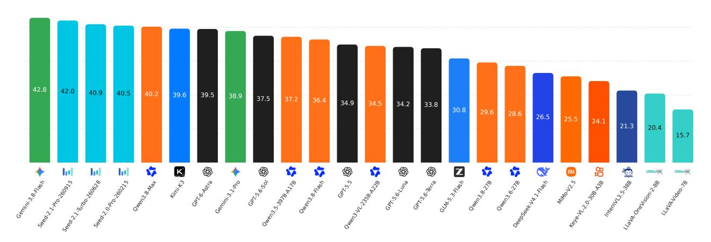

**Figure 1. OmniCompass-VL에서의 전체 모델 성능.** Gemini-3.8-Flash와 Kimi-K3는 각각 독점 모델과 오픈소스 모델 중 최고 점수를 기록했으며, 42.8%와 39.6%를 달성했다.

<sup>&</sup>lt;sup>1</sup> The Hong Kong Polytechnic University <sup>2</sup> OPPO Research Institute <sup>3</sup> Colorado School of Mines

<sup>&</sup>lt;sup>4</sup> Nanyang Technological University <sup>5</sup> Shanghai Jiao Tong University

$<sup>^{\</sup>bowtie}$  Corresponding author (cslzhang@comp.polyu.edu.hk).

본 연구는 PolyU-OPPO 공동 혁신 연구 센터의 지원을 받았다.

<span id="page-1-0"></span>


**Table 1. 기존 비디오 이해 벤치마크 비교.** Target Specification(대상 사양)은 대상이 텍스트만으로 지정되는지 (*i.e.*, Text) 또는 이미지와 함께 지정되는지 (*i.e.*, Text+Image)를 나타낸다; Video Evidence(비디오 증거)는 정답이 시각적 또는 원본 오디오 콘텐츠에 의존하는지를 나타낸다. TG/SG/QA(temporal grounding, spatial grounding, question answering)는 각각 시간적 기반화, 공간적 기반화, 질문 응답을 의미한다. Short/Med./Long(짧음/중간/긴)은 비디오 길이가 < 90초, [90, 300)초, 그리고 $\ge 300$초를 나타낸다. #Vid./#Inst.(비디오/인스턴스 수)는 비디오/인스턴스 수이며, M/A/H(수동/자동/하이브리드 주석)는 수동, 자동, 하이브리드 주석을 의미한다; Len.(평균 비디오 길이)는 평균 비디오 길이를 초 단위로 나타낸다.

| 벤치마크 | 목표 사양 |  | 비디오 증거 |  | 작업 범위 |  | 비디오 길이 |  | ation | #Vid | #Inct | Anno | Len.(s) |  |
|-----------------------------------|----------------------|------------|----------------|-------|---------------|----|----------------|-------|-------|------|-------|--------|---------|---------|
| Denemial Ro | 텍스트 | 텍스트+이미지 | 시각 | 오디오 | TG | SG | QA | 짧음 | 중간 | 길음 |  | пинь. | AIIIIO. | Len.(S) |
| 비디오 벤치마크 |  |  |  |  |  |  |  |  |  |  |  |  |  |  |
| Charades-STA (Gao et al., 2017) | 1 | Х | <b>✓</b> | Х | / | Х | Х | 1 | Х | Х | 1,334 | 3,720 | M | 30.0 |
| TVQA (Lei et al., 2018) | ✓ | × | 1 | X | X | X | 1 | 1 | X | X | 2,179 | 15,253 | M | 11.2 |
| TVQA+ (Lei et al., 2020) | ✓ | X | 1 | X | 1 | 1 | 1 | 1 | X | X | 403 | 2,821 | M | 61.5 |
| VidSTG (Zhang et al., 2020) | 1 | × | 1 | X | 1 | 1 | X | 1 | X | X | 732 | 10,303 | M | 28.0 |
| NExT-QA (Xiao et al., 2021) | 1 | × | 1 | X | X | X | 1 | 1 | X | X | 1,000 | 8,564 | Α | 44.0 |
| HC-STVG (Tang et al., 2021) | 1 | X | 1 | X | 1 | 1 | X | 1 | X | X | 1,160 | 1,160 | M | 20.0 |
| QVHighlights (Lei et al., 2021) | 1 | X | 1 | X | 1 | X | X | X | 1 | X | 1,529 | 1,542 | M | 149.6 |
| EgoSchema (Mangalam et al., 2023) | 1 | X | 1 | X | X | X | 1 | X | 1 | X | 5,063 | 5,063 | H | 180.0 |
| TempCompass (Liu et al., 2024b) | 1 | X | 1 | X | X | X | 1 | 1 | X | X | 410 | 7,540 | Н | 11.4 |
| MVBench (Li et al., 2024b) | 1 | X | 1 | X | X | X | 1 | 1 | X | X | 3,641 | 4,000 | Α | 16.0 |
| MLVU (Zhou et al., 2025a) | 1 | X | / | × | X | X | 1 | Х | 1 | 1 | 1,334 | 2,593 | Н | 720.0 |
| Video-MME (Fu et al., 2025a) | 1 | X | / | × | X | X | 1 | 1 | 1 | 1 | 900 | 2,700 | M | 1017.9 |
| LongVideoBench (Wu et al., 2024) | 1 | X | / | × | X | X | 1 | 1 | 1 | 1 | 3,763 | 6,678 | M | 473.0 |
| CG-Bench (Chen et al., 2025a) | 1 | X | 1 | X | X | X | 1 | X | X | 1 | 1,219 | 12,129 | M | 1624.4 |
| V-STaR (Cheng et al., 2026) | 1 | X | 1 | X | 1 | 1 | 1 | 1 | 1 | 1 | 1,000 | 2,094 | Н | 110.2 |
| IV-Bench (Ma et al., 2026) | X | 1 | 1 | X | X | X | 1 | X | 1 | 1 | 967 | 2,585 | M | 537.0 |
| OmniCompass-VL (Ours) | 1 | ✓ | ✓ | X | 1 | 1 | 1 | 1 | 1 | 1 | 820 | 2,460 | M | 354.0 |
| 오디오-비주얼 벤치마크 |  |  |  |  |  |  |  |  |  |  |  |  |  |  |
| AVUT (Yang et al., 2025) | 1 | Х | <b>√</b> | 1 | Х | Х | 1 | 1 | Х | Х | 2,662 | 11,609 | Н | 67.8 |
| Daily-Omni (Zhou et al., 2025b) | 1 | X | 1 | ✓ | X | X | 1 | 1 | X | X | 684 | 1,197 | Н | 42.8 |
| OmniVideoBench (Li et al., 2026) | 1 | X | 1 | 1 | X | X | 1 | / | 1 | 1 | 628 | 1,000 | Н | 384.2 |
| WorldSense (Hong et al., 2026) | 1 | X | 1 | 1 | X | X | 1 | / | 1 | 1 | 1,662 | 3,172 | M | 141.1 |
| JointAVBench (Chao et al., 2026) | 1 | X | 1 | 1 | X | X | 1 | / | 1 | 1 | 1,046 | 2,853 | Н | 97.2 |
| Video-MME-v2 (Fu et al., 2026) | 1 | X | 1 | 1 | X | X | 1 | / | 1 | 1 | 800 | 3,200 | M | 624.0 |
| OmniCompass-AV (Ours) | 1 | 1 | 1 | 1 | 1 | 1 | 1 | 1 | 1 | 1 | 240 | 720 | M | 427.5 |

## 1 서론 (Introduction)

인간의 인지는 언어적 또는 시각적 단서를 사용하여 목표를 식별하고, 공간과 시간에 걸친 시각 및 청각 증거에 주의를 기울이며, 목표 지향적 판단을 형성한다. 다중모달 대형 언어 모델은 이미지, 비디오, 오디오, 텍스트를 동시에 처리하여 다중모달 이해와 추론을 지원한다(Bai et al., 2025; Xu et al., 2025b; Google, 2025). 최근 MLLMs는 관련된 시간 클립을 재방문할 수 있다(Yang et al., 2026a; Zeng et al., 2026b), 작업과 관련된 공간 증거를 검사할 수 있다(Wang et al., 2026c; Meng et al., 2026), 그리고 추론 중에 선택적으로 음성-시각 증거를 획득할 수 있다(Xing et al., 2026; Chen et al., 2026). 이러한 발전은 옴니-모달 비디오 정밀 위치 지정 및 이해를 평가하도록 동기를 부여한다. 이는 텍스트 또는 시각 단서에서 목표를 식별하고, 시공간적으로 정밀 위치 지정을 수행하며, 음성-시각 증거를 통합하여 사건을 이해해야 한다.

MLLMs의 급속한 발전으로 복잡한 비디오 이해 과제에서 성능을 종합적으로 평가하는 방법이 중요한 문제가 되었다. 표 1은 기존 벤치마크를 네 가지 차원에서 비교한다. (i) 목표 사양은 목표가 어떻게 제시되는지를 정의한다: 텍스트 쿼리만을 통해 (Fu et al., 2025a) 또는 참조 이미지를 함께 제공하여 (Ma et al., 2026). (ii) 비디오 증거는 비디오 프레임에서 해결되는 작업(Chen et al., 2025a)과 동기화된 음성-시각 콘텐츠가 필요한 작업(Hong et al., 2026)을 구분한다. (iii) 작업 범위는 출력물을 명시한다: 시간적 정밀 위치 지정과 공간적 정밀 위치 지정은 목표별 간격과 영역을 예측한다(Lei et al., 2021; Cheng et al., 2026), 반면 질문 응답은 답변을 예측한다(Fu et al., 2026). (iv) 비디오 길이는 시간 범위를 결정한다: 짧은 비디오 벤치마크는 세밀한 움직임과 지역 역학을 강조한다(Li et al., 2024b), 반면 긴 비디오 벤치마크는 장거리 종속성과 시간적으로 멀리 떨어진 이벤트 간 정보 통합을 테스트한다(Zhou et al., 2025a).

이러한 진전에도 불구하고 기존 벤치마크는 옴니-모달 비디오 정밀 위치 지정 및 이해를 체계적으로 진단하는 데 세 가지 한계를 갖는다. (i) 비디오 증거 범위가 제한적이다. 벤치마크는 일반적으로 시각 정보(Chen et al., 2025a) 또는 동기화된 음성-시각 콘텐츠(Hong et al., 2026)를 평가한다. 뉴스 방송에서는 일부 쿼리가 보이는 장면에 관한 것이고, 다른 쿼리는 말로 된 보고를 인물이나 사건과 정렬해야 한다. 시각 인식과 음성-시각 통합을 평가하려면 두 설정이 모두 필요하다. (ii) 불변한 목표 사양 설정. 대부분의 벤치마크는 텍스트만을 사용한다(Fu et al., 2026), 반면 IV-Bench는 텍스트와 참조 이미지를 결합한다. 실제 목표는 구두로 또는 이미지로 지정될 수 있지만, 이러한 벤치마크는 두 설정 모두에서 동일한 목표를 평가하지 않는다. (iii) 분산된 작업 범위. 대부분의 벤치마크는 QA(Li et al., 2024b) 또는 정밀 위치 지정(Gao et al., 2026)에 초점을 맞춘다; 음성-시각 벤치마크는 후자를 거의 다루지 않는다(Li et al., 2026; Zhou et al., 2025b). 농구 경기에서 사용자는 참조된 선수가 득점하는 시점, 경기장 내 위치, 그리고 발생하는 사건을 물을 수 있다. 통합 평가는 시간적 검색, 공간적 위치 지정, 의미적 이해에서의 실패를 구분한다.


<span id="page-2-0"></span>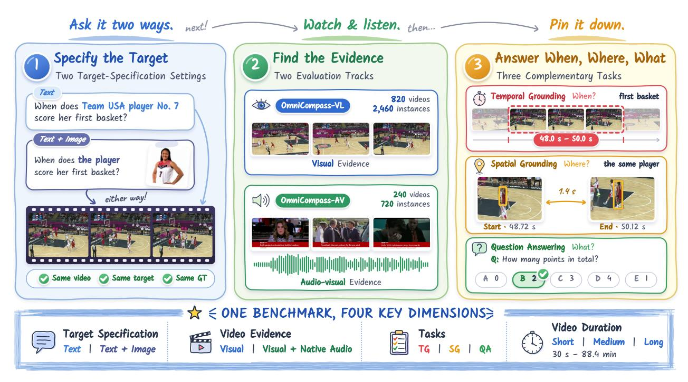

**Figure 2. OmniCompass 개요.** 벤치마크는 목표 사양, 비디오 증거, 작업 범위, 비디오 길이의 네 가지 차원을 포괄한다. *Text/Text+Image* 사양이 쌍으로 같은 목표에 대해 평가된다. OmniCompass-VL은 820개의 비디오와 2,460개의 인스턴스를 포함하고, 240개의 비디오를 포함하는 OmniCompass-AV 하위 집합은 720개의 인스턴스와 원본 오디오를 포함한다. 두 트랙 모두 시간적 정밀 위치 지정, 공간적 정밀 위치 지정, 질문 응답을 포함한다.

텍스트와 함께 제공되는 참조 이미지(Ma et al., 2026). 실제 목표는 구두로 또는 이미지로 지정될 수 있지만, 이러한 벤치마크는 두 설정 모두에서 동일한 목표를 평가하지 않는다. (iii) 분산된 작업 범위. 대부분의 벤치마크는 QA(Li et al., 2024b) 또는 정밀 위치 지정(Gao et al., 2026)에 초점을 맞춘다; 음성-시각 벤치마크는 후자를 거의 다루지 않는다(Li et al., 2026; Zhou et al., 2025b). 농구 경기에서 사용자는 참조된 선수가 득점하는 시점, 경기장 내 위치, 그리고 발생하는 사건을 물을 수 있다. 통합 평가는 시간적 검색, 공간적 위치 지정, 의미적 이해에서의 실패를 구분한다.

우리는 이러한 격차를 해소하기 위해 **OmniCompass**라는 전반적인 벤치마크를 도입한다. 그림 2에 나타난 바와 같이 OmniCompass는 네 가지 핵심 기능을 갖는다: (i) **보완적 비디오 증거**. OmniCompass-VL은 시각적 콘텐츠를 통해 이해도를 평가하고, OmniCompass-AV는 추가로 오디오를 요구한다. (ii) **유연한 목표 사양**. 각 인스턴스는 *Text*와 *Text+Image* 설정을 쌍으로 구성하며, 동일한 목표를 언어만으로 또는 참조 이미지와 함께 지정한다. 비디오, 작업 의미론, 그리고 정답은 동일하다. 우리는 교차-사양 일관성 점수(CS)를 도입하여 이러한 설정 간에 작업 정확도와 예측 일관성을 공동으로 측정한다. (iii) **통합된 작업 범위**. 두 트랙 모두 비디오당 TG, SG, QA 작업을 제공한다. VL 트랙은 다섯 개의 인지 및 세 개의 추론 범주를 다루는 반면, AV 트랙은 세 개의 인지 및 두 개의 추론 범주를 다룬다. (iv) **다양한 지속시간과 내용**. OmniCompass-VL은 짧음, 중간, 장시간에 걸쳐 820개의 비디오와 2,460개의 인스턴스를 포함한다. 이는 공공 스포츠, 교통, 감시, 다큐멘터리 비디오와 240개의 자체 수집한 영화, TV, 버라이어티, 뉴스 비디오를 결합한 것이다. 이 하위 집합은 720개의 인스턴스를 가진 OmniCompass-AV를 형성한다.

우리는 **50 MLLMs**를 평가한다. 여기에는 독점 모델과 오픈소스 모델이 포함된다. 가장 좋은 독점 모델은 VL 트랙에서 CS<sup>Avg</sup> 기준으로 가장 좋은 오픈소스 모델보다 **3.2**%를 초과하고, AV 트랙에서는 **32.8**%를 초과한다. 강력한 QA 성능은 약한 지향 및 교차 참조 불일치와 공존하며, 설정 간 총합 정확도가 유사할 때도 마찬가지다. 시각적 목표 사양은 일관되게 도움이 되지 않는다: *Text+Image*는 36개의 모델 중 11개에서만 단일 설정 평균을 개선한다. 추가 분석은 타임스탬프가 작업과 트랙 전반에 걸쳐 모델 성능을 크게 향상시키며, 오디오는 AV 트랙에서 QA와 TG 성능을 일관되게 향상시킨다는 것을 보여준다. 따라서 미래의 MLLMs는 더 강력한 교차 모달 정렬과 보다 신뢰할 수 있는 오디오 인식 지향이 필요하다. 우리의 기여는 다음과 같다:

- 1. **A Holistic Evaluation Framework.** OmniCompass는 목표 지향 omni-modal 비디오 지향 및 이해를 네 가지 차원에서 통합한다: 쌍으로 구성된 *Text*와 *Text+Image* 사양, VL/AV 증거 트랙, TG/SG/QA 작업, 그리고 짧음에서 긴 비디오까지. 우리는 CS를 도입하여 쌍으로 구성된 목표 사양 간에 작업 정확도와 일관성을 공동으로 평가한다.  
- 2. A Diverse, Rigorously Verified Benchmark. OmniCompass는 820개의 비디오, 80.6시간, 일곱 개의 도메인을 포괄한다,


그리고 52개의 하위 범주와 VL 및 AV 트랙에 걸쳐 240개의 비디오가 공유됩니다. 구축에는 주석자 교육, 보정, 주석, 전문가 판정 및 수정에 약 1,800인간시간이 소요되었습니다. 모든 사례는 다중 라운드 품질 검증을 거칩니다.

3. **A Diagnostic Evaluation of MLLMs.** 우리는 50개의 서로 다른 MLLM을 평가하여, 특히 오디오-비주얼 이해에서 독점 모델이 전반적으로 우위에 있음을 밝혀냈다. 강력한 QA 성능은 약한 근거화와 교차 사양 불일치와 공존한다. 추가 분석에서는 목표 사양, 비디오 길이, 타임스탬프 및 입력 모달리티의 영향을 조사한다.

## 2 관련 연구 (Related Work)

### 멀티모달 대형 언어 모델( Multimodal Large Language Models) 비디오 이해를 위한 (Multimodal Large Language Models for Video Understanding)

MLLMs는 언어 모델을 다중모달 인코더와 연결하여 인지 및 추론을 수행한다 [(Liu et al.,](#page-11-9) [2024a;](#page-11-9) [Chen et al.,](#page-10-7) [2024;](#page-10-7) [Xu et al.,](#page-13-6) [2025a;](#page-13-6) [Google,](#page-11-7) [2025;](#page-11-7) [Lin et al.,](#page-11-10) [2025a,](#page-11-10)[b;](#page-11-11) [An et al.,](#page-10-8) [2026;](#page-10-8) [Wang et al.,](#page-13-7) [2026b)](#page-13-7). LLaVA-OneVision과 LLaVA-Video는 이미지-비디오 모델링을 통합한다. 후자는 합성 캡션과 질문-답변 데이터를 사용하여 비디오 지침 튜닝을 수행한다. LLaVA-OneVision-2는 OneVision-Encoder를 채택하여 원본 해상도 시각 인코딩과 코덱 인식 토큰 압축을 통한 효율적인 장시간 비디오 처리를 수행한다. VideoLLaMA3과 InternVL3.5는 비디오 훈련과 추론을 강화한다. Qwen3-VL은 시간 정렬을 통해 장기 컨텍스트 비디오 이해를 향상시키며, Qwen3-Omni는 시각, 오디오, 언어를 동시에 처리한다. Keye-VL-2.0는 효율적인 장기 컨텍스트 처리를 위해 DSA를 적용하고 교차 모달 MOPD를 통해 작업별 기능을 통합한다. TimeLens는 교차 타임스탬프와 사고 없는 강화 학습을 통해 시간 기반 정리를 개선하고, TimeLens2는 검증된 다중 구간 감독과 시간 Wasserstein 보상을 통해 작업 범위를 더욱 확장한다. 에이전트형 확장 역시 도구 지원 비디오 추론을 탐구하여 작업 관련 시각 및 오디오 증거를 선택적으로 획득한다. 요약하면, 현대의 옴니모달 비디오 이해는 참조된 대상을 식별하고 시각 및 오디오 정보를 통합하여 시간과 공간에서 증거를 정리한다.

### **2.2 비디오 이해 벤치마크 (Video Understanding Benchmarks)**

표 [1]은 기존 벤치마크를 네 가지 설계 차원에서 비교한다. **(i) 타깃 사양**은 타깃이 어떻게 제시되는지를 정의한다. 대부분의 벤치마크는 텍스트 질문이나 지시문을 사용한다 [(Fu et al.,](#page-10-0) [2025a;](#page-10-0) [Cheng et al.,](#page-10-2) [2026)](#page-10-2), 반면 IV-Bench [(Ma et al.,](#page-12-2) [2026)](#page-12-2)은 시각적 사양을 위해 텍스트와 참조 이미지를 결합한다. **(ii) 비디오 증거**는 시각적 및 시청각적 요구를 구분한다. 비전-언어 벤치마크는 외관, 움직임, 시간 관계를 평가한다. TempCompass [(Liu et al.,](#page-12-1) [2024b)](#page-12-1)은 시간 인식을 평가하고, MotionBench [(Hong](#page-11-13) [et al.,](#page-11-13) [2025)](#page-11-13)은 세밀한 움직임을 목표로 한다. WorldSense [(Hong et al.,](#page-11-6) [2026)](#page-11-6)와 JointAVBench [(Chao et al.,](#page-10-3) [2026)](#page-10-3)은 동기화된 시각 및 원주 음성 증거를 요구한다. **(iii) 작업 범위**는 기대되는 출력을 정의한다. 질문-답변 벤치마크 [(Fu et al.,](#page-10-0) [2025a;](#page-10-0) [Li et al.,](#page-11-5) [2026)](#page-11-5)은 의미적 응답을 생성하고, 그라운딩 벤치마크는 명시적 증거 위치를 요구한다. OmniGround는 시간 간격 및 공간 영역을 평가한다 [(Gao et al.,](#page-11-8) [2026)](#page-11-8), 그리고 V-STaR [(Cheng et al.,](#page-10-2) [2026)](#page-10-2)은 TG, SG, QA를 공동으로 평가한다. **(iv) 비디오 길이**는 증거 통합의 시간 범위를 설정한다. MVBench는 지역 행동과 시간 역학을 강조한다 [(Li et al.,](#page-11-4) [2024b)](#page-11-4), 반면 LongVideoBench [(Wu et al.,](#page-13-2) [2024)](#page-13-2), MLVU [(Zhou et al.,](#page-14-1) [2025a)](#page-14-1), 그리고 LVBench [(Wang et al.,](#page-13-12) [2025a)](#page-13-12)은 멀리 떨어진 순간들 간의 장기 컨텍스트 관리를 강조한다. LongVideoBench는 또한 교차된 비디오 프레임과 자막에 대한 지시 추론을 평가한다. 기존 벤치마크는 선택된 차원이나 고정된 조합을 다루어 타깃 식별, 그라운딩, 그리고 다양한 타깃 및 증거 설정에서 옴니-모달 추론을 진단하는 데 한계를 가진다.

OmniCompass는 이 차원들을 쌍대 타깃-사양 설정, 보완 증거 트랙, 그리고 비디오 길이별 TG, SG, QA를 통해 통합한다. 타깃 식별, 시공간 그라운딩, 이벤트 이해를 쌍대 참조 설정에서 진단할 수 있다.


## 3 OmniCompass 벤치마크 (The OmniCompass Benchmark)

OmniCompass는 표 1의 차원에 따라 옴니-모달 비디오 그라운딩 및 이해를 평가한다. Figure 2는 평가 워크플로우를 요약한다. 각 인스턴스는 동일한 타깃의 *Text*와 *Text+Image* 사양을 쌍으로 사용한다. **OmniCompass-VL**은 시각적으로 해결 가능한 작업에서 비전-언어 모델을 평가하고, **OmniCompass-AV**는 시각 및 원주 음성 증거를 함께 사용하는 옴니-모달 모델을 평가한다. 두 트랙 모두 짧은 $(30s \le t < 90s)$, 중간 $(90s \le t < 300s)$, 긴 $(t \ge 300s)$ 비디오에서 TG, SG, QA를 다룬다.

### 3.1 평가 공식 및 지표 (Evaluation Formulation and Metrics)

두 개의 타깃 사양 설정 (Target-Specification Settings). OmniCompass는 텍스트와 텍스트+이미지 설정을 쌍으로 사용하여 모델이 참조 모달리티 전반에서 타깃을 일관되게 위치 지정하고 이해하는지 테스트한다. 타깃은 엔티티, 액션, 속성, 장면을 포함한다. 텍스트에서는 텍스트 설명 $\mathbf{r}^{text}$ 만으로 타깃을 지정한다. 예를 들어 “미국 선수 No. 33을 착용한 선수가 덩크를 완성하는 시점은 언제인가?” 같은 문장이다. 텍스트+이미지에서는 텍스트 표현 $\mathbf{r}^{text'}$ 와 참조 이미지 $\mathbf{r}^{image}$ 가 함께 타깃을 지정한다. 예를 들어 “선수가 덩크를 완성하는 시점은 언제인가?”는 이미지가 필요하여 어떤 플레이어가 언급되는지 해결한다. 따라서 $\mathbf{r} = \mathbf{r}^{text}$ 이거나 $\mathbf{r} = (\mathbf{r}^{text'}, \mathbf{r}^{image})$ 이다. 각 쌍은 동일한 비디오, 타깃, 작업 의미론, 그리고 정답을 공유하여 타깃 사양 간 직접 비교를 가능하게 한다.

**두 평가 트랙 (Two Evaluation Tracks).** 두 트랙은 동일한 타깃 사양 및 작업 계약을 공유하지만 모델이 사용할 수 있는 비디오 증거가 다르다. $\mathcal{F}_K(\mathcal{V})$ 를 K개의 균일하게 샘플링된 비디오 프레임과 그 타임스탬프를 쌍으로 나타낸 것으로, $\mathcal{A}(\mathcal{V})$ 를 동기화된 오디오 트랙으로 나타낸다. 타깃 사양 $\mathbf{r} \in \{\mathbf{r}^{\text{text}}, (\mathbf{r}^{\text{text}'}, \mathbf{r}^{\text{image}})\}$ 가 주어지면, **OmniCompass-VL** 은 $\mathbf{x}_{\text{VL}} = (\mathcal{F}_K(\mathcal{V}), \mathbf{r})$ 를 받으며, **OmniCompass-AV** 는 $\mathbf{x}_{\text{AV}} = (\mathcal{F}_K(\mathcal{V}), \mathcal{A}(\mathcal{V}), \mathbf{r})$ 를 받는다. VL 쿼리는 시각적 증거만으로 답할 수 있고, AV 쿼리는 동기화된 오디오의 정보를 필요로 한다.

**교차 사양 일관성 점수 (Cross-Specification Consistency Scores, CS).** 텍스트와 텍스트+이미지 설정을 쌍으로 사용하면 모델이 참조 모달리티 전반에서 동일한 타깃을 올바르게 식별하는지 평가할 수 있다. 우리는 **CS** 를 도입하여 작업 정확도와 쌍 예측 간의 일관성을 동시에 측정한다. 일치만으로 높은 점수를 보장하지 않는다. 각 작업 $q \in \{TG, SG, QA\}$ 에 대해, $N_q$ 를 평가된 쌍의 수로 두고, T와 TI는 각각 *텍스트*와 *텍스트+이미지* 설정을 나타낸다. TG의 경우, $g_i^T$ 와 $g_i^{TI}$ 를 예측 구간과 정답 구간의 tIoU, $a_i$ 를 두 예측 간의 tIoU 라고 두고, $CS_{TG} = \frac{1}{N_{TG}} \sum_{i=1}^{N_{TG}} \min\{g_i^T, g_i^{TI}, a_i\}$ 를 정의한다. SG의 경우, $g_{i,k}^T$ 와 $g_{i,k}^{TI}$ 를 시작과 끝 경계 $k \in \{s, e\}$ 에서 예측 박스와 정답 박스의 IoU 라고 두고, $a_{i,k}$ 를 경계 k 에서 두 예측 간의 IoU 라고 두며, $CS_{SG} = \frac{1}{2N_{SG}} \sum_{i=1}^{N_{SG}} \sum_{k \in \{s, e\}} \min\{g_{i,k}^T, g_{i,k}^{TI}, a_{i,k}\}$ 를 정의한다. QA의 경우, 예측 답변 $\hat{y}_i^T$ 와 $\hat{y}_i^{TI}$, 정답 $y_i$ 를 두고, $CS_{QA} = \frac{1}{N_{QA}} \sum_{i=1}^{N_{QA}} \mathbf{1}\{\hat{y}_i^T = \hat{y}_i^{TI} = y_i\}$ 를 정의한다.

### 3.2 벤치마크 구축 (Benchmark Construction)

OmniCompass를 구축하려면 쌍으로 된 주석, 목표 지향적 수정, 다중 라운드 품질 검증을 위해 약 **1,800 인력시간**이 필요하며, 이는 Figure 3의 파이프라인을 따른다.

1단계: 비디오 수집 및 선별. 우리는 **8,489개의 후보 비디오**를 **9개의 공개 데이터셋**에서 구성하고, 영화, TV 시리즈, 예능 프로그램, 뉴스 프로그램에서 **240개의 자체 수집 비디오**를 보완한다. 결과적으로 이 풀은 7개의 고수준 도메인을 포괄한다. 부록 표 C1은 최종 벤치마크에 기여한 공개 데이터셋의 선택 범위, 특성, 사용 조건 및 기여도를 상세히 기술한다.

우리는 Qwen3-VL-8B-Instruct를 사용하여 각 공개 후보를 구조화된 개체, 동작, 속성, 장면 단서로 프로파일링한다. 30초 미만이거나 네 가지 참조 단서 유형 중 하나라도 누락된 비디오는 제외하여 **6,946 적격 비디오**가 남는다. 우리는 이들을 참조 필요성, 기반 적합성, 시간-공간 활용도, 증거 다양성(부록 표 C2)의 네 가지 사전 정의된 기준으로 순위 매긴다. 단선은 도메인, 기간, 출처, 하위 범주 제약을 따른다. 수동 검토를 통해 **580 고품질 비디오**가 남으며, **240 자체 수집 비디오**와 함께 OmniCompass-VL은 **820 비디오**를 포함한다. 동일한 **240 비디오**는 추가적인 시청각 작업 주석과 함께 OmniCompass-AV를 구성한다. 부록 C는 프로파일링, 필터링, 평가에 대한 세부 사항을 제공한다.

**Stage 2: Task Annotation and Construction.** 주요 전문가는 전체 규모 주석 전에 네 명의 전문 주석자에게 2일간의 작업별 교육을 제공한다. 팀은 TG, SG, QA에서 *Text*와 *Text+Image* 설정이 쌍을 이루는 상황에서 일관된 대상 명세와 증거를 보장하기 위해 네 가지 원칙을 따른다.

(i) **Same-Target Pairing.** 각 *Text*와 *Text+Image* 쌍은 동일한 비디오, 대상, 작업 의미론, 그리고 정답을 공유한다. *Text+Image*에서는 텍스트 표현이 참조 이미지를 필요로 하여 대상을 식별한다. (ii) **Diverse Reference Types and Sources.** 참조는 개체, 동작, 속성, 장면 단서를 포함한다.


<span id="page-5-0"></span>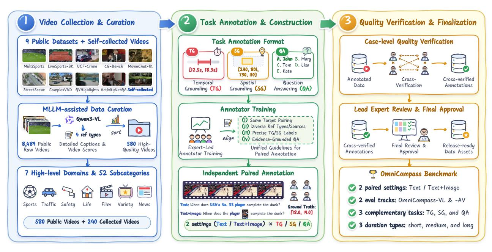

**Figure 3. Data construction pipeline.** OmniCompass는 엄격한 주석, 검증, 수정을 위해 약 **1,800 인력시간**이 필요하다. **Stage 1:** 우리는 9개의 공개 데이터셋에서 8,489개의 비디오를 선별하고, 기간 및 참조 단서 필터링 후 **6,946 적격 비디오**를 보유하며, 240개의 자체 수집 비디오를 보완하기 위해 580개를 선택한다. **Stage 2:** 네 명의 훈련된 주석자가 *Text*와 *Text+Image* 쌍의 TG, SG, QA 인스턴스를 독립적으로 구성한다. AV 사례에는 원본 오디오가 포함된다. **Stage 3:** 주석자들은 최종 수락 및 주요 전문가의 교정 전에 사례를 교차 검증하고 수정하여 7개 도메인, 쌍 설정, 2개 트랙, 3개 작업, 3개 기간 그룹에 걸쳐 **820 비디오**를 생성한다.

비디오 크롭 또는 의미적으로 일치하는 외부 이미지를 사용한다. 각 이미지는 주석된 사건이나 답변 증거를 드러내지 않으면서 대상을 식별한다. 비디오 내부 참조의 경우, 주석자는 가능하면 대상 구간이나 QA 단서 구간 외부의 별도 뷰를 선호한다. (iii) 정확한 TG/SG 라벨. TG 구간은 완전한 대상 관련 사건을 밀접하게 포함하며, SG 박스는 동일한 대상을 양쪽 구간 경계에서 위치시킨다. (iv) 증거 기반 QA 설계. CG-Bench (Chen et al., 2025a)를 따라 주석자는 단서 구간과 다섯 개의 상호 배타적 옵션을 짝지어 하나의 정답과 네 개의 그럴듯한 오답을 만든다.

주석자들은 먼저 30개의 VL과 30개의 AV 비디오에서 모든 7개 도메인과 3가지 기간 유형을 아우르는 **pilot annotation**을 수행한다. 각 비디오는 *Text*와 *Text+Image* 설정이 쌍을 이루는 상황에서 하나의 TG, 하나의 SG, 하나의 QA 인스턴스를 받아 **180 작업 인스턴스**를 생성한다. 이 파일럿은 대상 짝짓기, 시간 경계, 공간 대상 일관성, QA 증거에서의 불일치를 드러낸다. 주요 전문가는 팀과 함께 이 사례들을 검토하고 모호성을 해결하며 가이드라인을 정제한다. 주석자들은 이후 조정된 프로토콜에 따라 나머지 인스턴스를 독립적으로 구성한다. 가이드라인 교육, 파일럿 보정, 두 트랙과 세 작업에 걸친 초기 작업 구성은 약 **960 주석자-시간**을 차지한다.

3단계: 품질 검증 및 최종화. 모든 주석이 달린 사례는 공개 전에 사례 수준의 품질 검증을 거친다. 네 명의 주석자는 독립적으로 동료들의 주석을 2단계 원칙(같은 대상 매칭, 참조 다양성 및 누수 방지, 정확한 TG/SG 라벨, 증거 기반 QA 설계)에 따라 교차 검증한다. 그들은 시간적 이벤트 완전성, 경계 프레임 박스 정렬, 그리고 QA 답변의 고유성 및 증거 지원을 검사한다. AV 사례의 경우, 원본 오디오 의존성과 오디오-비주얼 정렬도 검증한다. 명확한 주석 오류를 수정하고, 수정된 사례를 재검토한 뒤, 확인된 사례를 주요 전문가에게 제출한다. 주요 전문가는 남은 불일치를 해결하고 필요한 수정을 수행하며 최종 수락을 진행하고, 출시 준비 데이터의 감사를 수행한다. 이 단계는 약 320 주석자-시간과 500 주요 전문가-시간이 소요된다. 부록 D에 프로세스가 상세히 기술되어 있다. 표 D1 및 D2는 비디오 수준 검증 결과와 일반적인 문제를 보고하고, 표 D3은 단계별 및 역할별 인력 소요를 상세히 제시한다.

### 3.3 벤치마크 통계 (Benchmark Statistics)

**비디오 다양성 및 시간 규모.** OmniCompass는 **820 비디오**를 **7 도메인과 52 하위 범주**에 걸쳐 보유하고 있으며, 하위 범주당 10–43 비디오와 평균 15.8개의 비디오를 포함한다. 비디오는 총 **80.6 시간**이며, 30초에서 88.4분까지 다양하고 평균 지속 시간은 354.0초이다. 그림 4(a,b)는 15개의 기간 구간에 걸쳐 **162개의 짧은 비디오, 309개의 중간 비디오, 349개의 긴 비디오**를 보여 주며, **580개의 VL 전용 비디오**와 두 트랙 모두에서 공유되는 **240개의 비디오**를 포함하여 매치된 비디오 평가를 위한 것이다.

평가 범위 및 주석 세분화. 통합 TG, SG, 및 QA 주석은 2,460개의 VL과


<span id="page-6-0"></span>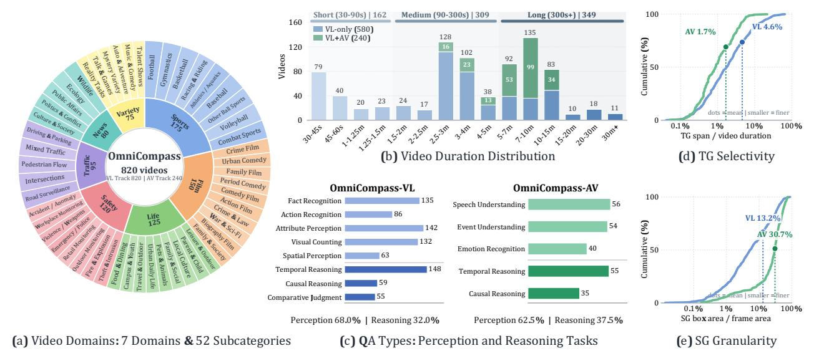

**Figure 4. Dataset statistics of OmniCompass.** (a) 820 비디오는 7 도메인과 52 하위 범주를 포괄하며, 각 하위 범주마다 최소 10개의 비디오가 있다. (b) 15개의 기간 구간은 짧은(30–90초), 중간(90–300초), 긴(≥300초) 범위를 포함한다. 색상은 580개의 VL-only와 240개의 공유 VL-AV 비디오를 구분한다. (c) 막대는 8개의 OmniCompass-VL과 5개의 OmniCompass-AV QA 유형의 수를 보고한다. 밝은 색과 어두운 색은 지각(Perception)과 추론(Reasoning)을 구분한다. (d) 누적 TG-스팬 비율은 시간 선택성을 보여준다. (e) 누적 SG-영역 비율은 공간 세분성을 보여준다. 점은 트랙 평균을 표시한다.

**720 AV task instances**. 각 비디오는 각 태스크에 하나의 인스턴스를 기여하여 VL에서는 820개, AV에서는 240개의 인스턴스를 제공한다. Figure 4(c)는 8개의 VL과 5개의 AV QA 유형을 보여준다. 지각은 각각 68.0%와 62.5%를 차지하고, 추론은 각각 32.0%와 37.5%를 차지한다. 820개의 비디오는 7 도메인과 52 하위 범주를 포괄하며, 하위 범주마다 10–43개의 비디오가 있다. QA 수는 VL 유형에서 55~148개, AV 유형에서 35~56개로 다양하며, 단일 질문 범주에 집중되지 않고 폭넓은 범위를 커버한다. Figure 4(d,e)는 grounding granularity를 요약한다: TG 간격은 VL 비디오 길이의 평균 **4.6**%, AV 비디오 길이의 평균 **1.7**%이며, SG 박스는 프레임 영역의 평균 **13.2**%와 **30.7**%를 차지한다. Paired *Text*와 *Text+Image* 설정은 대상 식별을 테스트하고, 공유 AV 서브셋은 매칭된 비디오 비교를 지원한다. Appendix Figure C4는 도메인별 참조 유형과 이미지 소스를 보고한다.

## 4 실험 (Experiments)

### 4.1 실험 설정 (Experimental Setting)

평가된 모델들. 우리는 트랙별로 50개의 모델을 평가한다. OmniCompass-VL은 Gemini 시리즈(Google, 2025), GPT 시리즈(OpenAI, 2026a,b,c), Seed 시리즈(Seed, 2026), 그리고 Qwen 클로즈소스 시리즈(Qwen Team, 2026a)를 포함한 독점 모델을 포함한 시각-언어 모델을 평가한다. 오픈소스 모델은 Kimi-K3(Kimi Team et al., 2026), GLM-5.3-Flash(Zeng et al., 2026a), DeepSeek-V4.1-Flash(DeepSeek-AI, 2026), MiMo-V2.5(MiMo-V2.5), Qwen 오픈소스 시리즈(Qwen Team, 2026b; Team, 2026a; Bai et al., 2025), InternVL3.5-38B(Wang et al., 2025b), Keye-VL-2.0-30B-A3B(Team et al., 2026), TimeLens 시리즈(Zhang et al., 2026; Zhu et al., 2026), 그리고 LLaVA 시리즈(An et al., 2026; Zhang et al., 2024)를 포함한다. OmniCompass-AV는 Gemini 시리즈, Qwen-Omni 시리즈(Team, 2026b; Qwen Team, Alibaba, 2025), Seed-2.0-Lite/Mini(Seed, 2026)를 포함한 원음 지원이 있는 옴니모달 모델을 평가하며, 또한 MiMo-V2.5(MiMo-V2.5), video-SALMONN 2+(Tang et al., 2025), MiniCPM-o-4.5-8B(Cui et al., 2026), Ola-7B(Liu et al., 2025), VideoLLaMA2-7B(Cheng et al., 2024), 그리고 VITA-1.5-7B(Fu et al., 2025b)를 포함한다.

**Implementation Details.** (i) **Frame sampling:** 우리는 독점 모델과 총 파라미터가 100B를 초과하는 오픈소스 모델에 대해 64프레임을 균일하게 샘플링하고, 작은 모델에는 32프레임을 샘플링한다. GPT 시리즈 모델은 50이미지 한계 내에서 *Text+Image* 참조를 수용하기 위해 49프레임을 사용한다. VITA-1.5-7B는 공식 16프레임 한계를 따른다. TimeLens(Zhang et al., 2026)를 따라, 각 프레임은 초 단위 타임스탬프가 바로 앞에 있다. (ii) **Input modalities:** OmniCompass-VL은 오디오를 제외하고, OmniCompass-AV는 WorldSense(Hong et al., 2026)와 Video-MME-v2(Fu et al., 2026)를 따라 네이티브 오디오를 추가한다. *Text+Image*에서는 참조 이미지가 이 입력들 뒤에 오고 바로 작업 프롬프트 앞에 위치한다. Appendix E는 실험 설정, 입력 직렬화, 그리고 작업별 프롬프트와 응답 형식을 상세히 기술한다.

<span id="page-7-0"></span>


**Table 2. Results on OmniCompass-VL.** 우리는 오디오 없이 TG, SG, QA를 균일하게 샘플링된 타임스탬프가 있는 프레임을 사용해 평가한다. 성능은 *Text/Text+Image*로 보고되며, **CS**는 예측이 정확하고 일관되도록 쌍으로 요구된다. **Average**는 TG m<sub>tloU</sub>, SG m<sub>sloU</sub>, 그리고 QA 정확도를 사양별 평균한 값이며, CS<sup>Avg</sup>는 세 CS 점수를 평균한다. 각 그룹 내에서 최고와 두 번째 최고 결과는 **bold**와 underlined, 각각이다.

| 모델 | 프레임 | 템포 | ral Ground | ding | Spatia | 공간 기반화 |  |  | 질문 응답 |  | 전체 |  |
|-----------------------------|--------|-----------|-------------------|-------------|---------------------------|---------------------------|------|-------------------|--------------------|-----------|---------|--|
| Wiodels | 프레임 | R.@0.5 | $m_{tIoU}$ | CSTG | AP@0.5 | $m_{sIoU}$ | CSSG | 정확도 | CS <sup>QA</sup> | 평균 | CSAvg |  |
| 독점 MLLMs |  |  |  |  |  |  |  |  |  |  |  |  |
| ♦ Gemini-3.8-Flash | 64 | 33.8/32.7 | 32.6/33.5 | 27.1 | <u>37.5</u> / <b>41.6</b> | 37.7/ <b>41.8</b> | 32.3 | 73.3/ <b>76.6</b> | 69.1 | 47.9/50.6 | 42.8 |  |
| ♦ Gemini-3.1-Pro | 64 | 24.9/24.9 | 25.6/26.6 | 19.3 | 34.9/35.2 | 36.5/37.3 | 31.8 | 71.4/73.6 | 65.7 | 44.5/45.9 | 38.9 |  |
| Seed-2.1-Pro-260915 | 64 | 27.9/29.8 | 29.3/29.9 | 23.7 | <b>40.9</b> / <u>38.9</u> | <b>40.6</b> / <u>39.6</u> | 34.9 | 73.4/ <u>74.3</u> | 67.4 | 47.8/47.9 | 42.0 |  |
| Seed-2.1-Turbo-260628 | 64 | 29.9/29.4 | 30.5/30.2 | 25.0 | 35.4/35.4 | 36.3/36.3 | 30.0 | <u>74.1</u> /74.1 | <u>67.7</u> | 47.0/46.9 | 40.9 |  |
| Seed-2.0-Pro-260215 | 64 | 30.7/31.0 | 30.6/30.9 | 24.9 | 30.6/31.7 | 34.9/35.3 | 29.4 | <b>74.5</b> /73.0 | 67.3 | 46.6/46.4 | 40.5 |  |
| ❖ Qwen3.8-Max | 64 | 29.3/30.3 | 30.7/32.2 | <u>26.7</u> | 30.1/32.1 | 33.9/34.0 | 26.7 | 72.4/72.5 | 67.2 | 45.7/46.2 | 40.2 |  |
| Qwen3.8-Flash | 64 | 28.5/30.1 | 29.5/30.6 | 24.1 | 22.6/24.4 |  | 22.6 | 69.2/71.0 | 62.4 | 42.5/43.6 | 36.4 |  |
| ₲ GPT-6-Astra | 49 | 30.0/30.3 | <u>30.9</u> /31.7 | 26.3 | 34.6/35.9 | <u>37.8</u> /38.3 | 32.7 | 69.4/65.6 | 59.4 | 46.0/45.2 | 39.5 |  |
| ₲ GPT-5.6-Sol | 49 | 25.2/28.7 | 27.2/30.5 | 22.2 | 31.7/29.8 | 34.8/33.8 | 28.0 | 69.5/69.1 | 62.4 | 43.8/44.5 | 37.5 |  |
| GPT-5.6-Terra | 49 | 20.1/23.7 | 24.1/26.3 | 19.3 | 19.4/20.9 | 26.3/26.6 | 20.1 | 68.4/69.5 | 62.0 | 39.6/40.8 | 33.8 |  |
| ₲ GPT-5.6-Luna | 49 | 21.0/21.3 | 24.7/24.8 | 19.2 | 27.3/28.9 | 32.2/33.1 | 26.8 | 65.5/64.6 | 56.7 | 40.8/40.8 | 34.2 |  |
| ₲ GPT-5.5 | 49 | 23.3/24.5 | 26.0/27.5 | 21.3 | 20.6/20.5 | 26.4/26.3 | 20.7 | 67.9/70.2 | 62.7 | 40.1/41.3 | 34.9 |  |
| 오픈소스 MLLMs |  |  |  |  |  |  |  |  |  |  |  |  |
| Kimi-K3 | 64 | 23.5/24.6 | 27.1/27.7 | 22.6 | 30.0/31.6 | 33.3/35.2 | 28.4 | 73.0/72.9 | 67.6 | 44.5/45.3 | 39.6 |  |
| Qwen3.5-397B-A17B | 64 | 28.9/28.5 | 28.6/28.7 | 23.1 | 28.2/29.6 | <b>33.4</b> /33.7 | 28.0 | 67.7/69.6 | 60.6 | 43.3/44.0 | 37.2 |  |
| Qwen3.5-122B-A10B | 64 | 27.2/27.2 | 29.7/29.1 | 24.3 | 20.0/19.4 | 25.2/25.2 | 20.8 | 62.6/62.5 | 55.4 | 39.2/38.9 | 33.5 |  |
| Qwen3-VL-235B-A22B-Instruct | 64 | 27.0/25.4 | 28.5/26.0 | 21.6 | 18.6/18.8 | 26.0/25.0 | 20.9 | 68.4/65.3 | 61.0 | 41.0/38.8 | 34.5 |  |
| <b>Z</b> GLM-5.3-Flash | 64 | 24.4/23.0 | 25.5/24.4 | 18.3 | 15.7/14.6 | 22.9/23.5 | 14.6 | 68.3/68.7 | 59.4 | 38.9/38.9 | 30.8 |  |
| ♥ DeepSeek-V4.1-Flash | 64 | 15.7/17.4 | 19.1/19.4 | 12.4 | 11.5/11.6 | 18.1/17.9 | 10.5 | 66.2/64.6 | 56.6 | 34.5/34.0 | 26.5 |  |
| MiMo-V2.5 | 64 | 17.8/18.6 | 21.6/20.8 | 13.8 | 14.2/15.3 | 21.9/22.3 | 13.6 | 62.0/60.8 | 49.0 | 35.2/34.7 | 25.5 |  |
| • Qwen3.8-27B | 32 | 17.5/19.1 | 20.3/22.2 | 16.0 | 16.2/19.0 | 23.9/25.4 | 17.2 | 64.8/62.6 | 55.7 | 36.3/36.7 | 29.6 |  |
| Qwen3.6-35B-A3B | 32 | 18.7/18.8 | 19.8/19.7 | 14.4 | 20.9/19.1 | 26.8/26.4 | 20.9 | 59.5/59.9 | 50.2 | 35.4/35.3 | 28.5 |  |
| • Qwen3.6-27B | 32 | 20.5/18.8 | 21.5/20.4 | 15.7 | 14.4/15.8 | 20.7/22.2 | 15.3 | 62.5/61.2 | 54.8 | 34.9/34.6 | 28.6 |  |
| Qwen3.5-35B-A3B | 32 | 17.3/16.4 | 19.5/18.7 | 13.7 | 13.3/13.4 | 21.2/21.9 | 15.8 | 61.3/60.9 | 51.9 | 34.0/33.8 | 27.1 |  |
| • Qwen3.5-27B | 32 | 19.4/18.0 | 22.0/21.1 | 17.4 | 11.3/11.5 | 18.6/19.1 | 15.3 | 61.5/58.4 | 53.9 | 34.0/32.9 | 28.9 |  |
| ❖ Qwen3.5-9B | 32 | 17.4/14.4 | 20.2/16.6 | 13.3 | 16.8/16.8 | 22.3/22.3 | 17.7 | 58.5/55.2 | 50.1 | 33.7/31.4 | 27.0 |  |
| Qwen3.5-4B | 32 | 16.6/12.4 | 19.5/15.3 | 12.6 | 13.0/11.6 | 18.9/17.1 | 13.8 | 55.7/54.0 | 46.6 | 31.4/28.8 | 24.3 |  |
| Qwen3-VL-30B-A3B-Instruct | 32 | 16.8/12.4 | 19.5/14.9 | 11.7 | 15.2/12.9 | 22.1/19.6 | 15.6 | 54.1/49.6 | 43.4 | 31.9/28.0 | 23.6 |  |
| Qwen3-VL-8B-Instruct | 32 | l | 16.3/13.9 | 11.3 | 1 | 20.4/19.3 | 15.9 | 59.9/56.7 | 51.2 | 32.2/29.9 | 26.1 |  |
| • Owen3-VL-4B-Instruct | 32 |  | 16.8/13.0 | 10.3 | 6.6/5.6 | 13.4/12.2 | 9.3 | 57.3/56.0 | 50.2 | 29.2/27.1 | 23.3 |  |
| ₫ InternVL3.5-38B | 32 |  | 16.3/13.6 | 10.1 | 0.2/0.1 | 2.5/2.5 | 1.4 | 61.3/58.4 | 52.4 | 26.7/24.8 | 21.3 |  |
| ₩ Keye-VL-2.0-30B-A3B | 32 |  | 15.8/13.7 | 11.2 | 2.7/3.3 | 11.5/12.2 | 8.2 | 60.2/61.8 | 53.0 | 29.2/29.2 | 24.1 |  |
| TimeLens2-8B | 32 |  | 20.8/18.5 | 15.3 | 2.4/2.6 | 9.1/8.0 | 6.3 | 59.5/57.0 | 51.0 | 29.8/27.8 | 24.2 |  |
| TimeLens-8B | 32 |  | 21.4/18.1 | 15.5 | 2.4/2.8 | 8.2/8.7 | 5.9 | 57.7/55.5 | 49.5 | 29.1/27.4 | 23.6 |  |
| LLaVA-OneVision-2-8B | 32 |  | 15.8/11.2 | 8.4 | 0.9/1.1 | 7.1/6.7 | 4.6 | 57.9/52.4 | 48.0 | 27.0/23.4 | 20.4 |  |
| LLaVA-Video-7B | 32 | 1.6/2.1 | 4.3/3.1 | 1.5 | 0.0/0.0 | 0.5/0.5 | 0.1 | 55.0/50.7 | 45.6 | 19.9/18.1 | 15.7 |  |
| LLaVA-OneVision-7B | 32 | 2.6/1.7 | 4.6/2.4 | 1.4 | 0.0/0.0 | 2.0/1.6 | 0.8 | 50.7/47.9 | 42.3 | 19.1/17.3 | 14.8 |  |

### **4.2** 주요 결과 (Main Results)

표 2와 3은 *Text*와 *Text+Image* 하에서 TG, SG, QA 평가를 보고한다. 그림 5는 두 트랙 모두에서 선택된 모델들에 대한 카테고리별 QA 비교를 제공한다. 부록 A는 비디오 길이, 도메인, 타깃 세분화에 따른 추가 결과를 제공한다.

OmniCompass-VL. 표 2는 Gemini-3.8-Flash가 CS<sup>Avg</sup> 점수 42.8%를 가장 높게 달성했으며, Kimi-K3는 39.6% 점수로 오픈소스 모델을 선도한다. 실험 결과는 다음과 같은 통찰을 제시한다. (i) Grounding과 Fine-Grained Perception이 Reasoning을 따라가지 못한다. 36개 모델 중 29개가 CS<sup>QA</sup>에서 50%를 초과하며 최고는 69.1%이다. 가장 높은 CS<sup>TG</sup>와 CS<sup>SG</sup>는 각각 27.1%와 34.9%에 불과하다. 그림 5(a)는 Visual Counting이 모든 8개 모델에서 CS<sup>QA</sup>에서 마지막으로 순위가 매겨지는 것을 보여준다(26.4%–48.1%). Spatial Perception은 평균 61.0%로 Causal Reasoning의 69.8%보다 낮다. (ii) Visual References는 Proprietary Models와 Grounding에 이점을 준다. *Text+Image*는 36개 모델 중 11개 모델의 평균 성능을 향상시킨다: 12개 Proprietary 모델 중 8개와 24개 오픈소스 모델 중 3개. 100B 파라미터 미만의 오픈소스 모델 중에서 Qwen3.8-27B만이 개선된다. TG m<sub>tIoU</sub>와 SG m<sub>sIoU</sub>에서 각각 1.9%와 1.5%를 얻지만 QA 정확도에서는 2.2%를 잃는다. Visual cues는 타깃 매칭을 돕지만 유용한 텍스트 세부 정보를 생략할 수 있다. (iii) 더 큰 모델이 모든 작업을 이끄는 것은 아니다. Qwen3.5 내에서 397B는 122B보다 CS<sup>Avg</sup>에서 37.2% vs 33.5%로 뛰어나지만 CS<sup>TG</sup>에서는 23.1% vs 24.3%로 뒤처진다. 마찬가지로 27B는 9B보다 CS<sup>SG</sup>에서 15.3% vs 17.7%로 뒤처진다. (iv) 교차 참조 일관성은 여전히 제한적이다. 36개 모델에서 CS<sup>TG</sup>, CS<sup>SG</sup>, CS<sup>QA</sup>는 각각 4.3%, 4.6%, 6.4%가 해당 단일 설정 점수보다 낮다. 강력한 단일 설정 결과가 모든 설정에서의 정확성을 보장하지 않는다.


**Table 3. OmniCompass-AV의 결과.** 모델들은 균일하게 샘플링된, 타임스탬프가 지정된 프레임과 동기화된 오디오를 사용해 TG, SG, QA를 평가한다.

<span id="page-8-0"></span>

| 모델 | 프레임 | 템포 | ral Ground | ling | Spatia | al Groundi | ng | 질문 응답 |  | 전체 |  |
|------------------------------|--------|-----------|------------|------|-----------|-------------------|------|--------------------|------|-----------|-------------------|
| Widels | Trancs | R.@0.5 | $m_{tIoU}$ | CSTG | AP@0.5 | m <sub>sIoU</sub> | CSSG | 정확도 | CSQA | 평균 | CS <sup>Avg</sup> |
| 독점적인 Omni-modal MLLMs |  |  |  |  |  |  |  |  |  |  |  |
| ♦ Gemini-3.8-Flash | 64 | 46.9/48.1 | 46.4/45.9 | 40.6 | 62.8/63.2 | 59.8/59.3 | 53.5 | 80.3/80.8 | 78.2 | 62.2/62.0 | 57.4 |
| ♦ Gemini-3.1-Pro | 64 | 15.1/17.6 | 16.6/17.7 | 9.0 | 54.8/56.1 | 52.0/52.1 | 45.8 | 72.4/71.1 | 64.9 | 47.0/47.0 | 39.9 |
| Qwen3.8-Omni-Flash | 64 | 26.3/28.5 | 29.2/30.9 | 21.8 | 60.1/59.5 | 56.8/56.0 | 50.9 | 75.9/78.9 | 73.2 | 54.0/55.3 | 48.6 |
| 🕏 Qwen3.5-Omni-Plus | 64 | 18.0/14.9 | 21.0/21.1 | 14.0 | 61.8/60.8 | 55.5/55.6 | 50.5 | 71.1/73.2 | 68.4 | 49.2/50.0 | 44.3 |
| Qwen3.5-Omni-Flash | 64 | 6.7/7.9 | 10.6/10.1 | 5.7 | 49.2/51.3 | 44.2/47.0 | 34.7 | 63.6/64.0 | 58.0 | 39.5/40.4 | 32.8 |
| Seed-2.0-Lite-260428 | 64 | 13.3/8.3 | 16.9/13.2 | 10.6 | 56.3/52.9 | 53.3/51.8 | 45.5 | 71.3/69.2 | 63.8 | 47.1/44.7 | 39.9 |
| Seed-2.0-Mini-260428 | 64 | 4.2/3.3 | 6.4/3.8 | 2.1 | 27.1/25.4 | 28.6/28.8 | 16.5 | 63.8/60.0 | 53.3 | 32.9/30.8 | 24.0 |
| Open-Source Omni-modal Mi | LLMs |  |  |  |  |  |  |  |  |  |  |
| MiMo-V2.5 | 64 | 6.3/8.6 | 9.4/8.7 | 3.1 | 29.2/33.2 | 34.9/36.0 | 23.4 | 59.2/58.7 | 47.3 | 34.5/34.5 | 24.6 |
| Qwen3-Omni-30B-A3B | 32 | 3.8/3.3 | 5.5/5.0 | 3.5 | 24.2/24.6 | 27.4/29.8 | 17.3 | 53.3/55.0 | 47.9 | 28.7/30.0 | 22.9 |
| 🗘 Qwen2.5-Omni-7B | 32 | 1.7/0.0 | 1.3/0.6 | 0.2 | 2.1/12.1 | 11.7/22.4 | 7.0 | 47.5/50.0 | 43.8 | 20.1/24.3 | 17.0 |
| Qwen2.5-Omni-3B | 32 | 1.3/2.1 | 1.4/2.5 | 0.8 | 0.4/2.5 | 1.9/7.6 | 0.7 | 48.8/50.0 | 45.0 | 17.4/20.0 | 15.5 |
| 👺 MiniCPM-o-4.5-8B | 32 | 0.0/0.0 | 1.9/1.4 | 0.4 | 1.3/1.7 | 10.4/9.0 | 5.0 | 52.1/52.9 | 47.1 | 21.5/21.1 | 17.5 |
| video-SALMONN 2+ 72B | 32 | 3.8/1.3 | 5.4/2.3 | 1.6 | 0.0/0.0 | 1.9/2.3 | 1.0 | 56.3/54.2 | 50.8 | 21.2/19.6 | 17.8 |
| video-SALMONN 2+ 7B | 32 | 2.9/2.1 | 3.1/1.8 | 1.0 | 0.0/0.0 | 0.9/0.1 | 0.1 | 47.1/51.3 | 42.9 | 17.0/17.7 | 14.7 |
| ◎ Ola-7B | 32 | 1.7/0.8 | 2.2/1.3 | 0.0 | 1.7/3.3 | 6.4/10.3 | 2.7 | 42.1/42.5 | 37.5 | 16.9/18.0 | 13.4 |
| 地格 VideoLLaMA2.1-7B-AV | 32 | 1.3/0.0 | 1.9/0.7 | 0.4 | 3.3/4.6 | 15.1/16.1 | 8.6 | 27.1/29.2 | 23.3 | 14.7/15.3 | 10.8 |
| <b>VITA-1.5-7B</b> | 16 | 0.0/0.8 | 0.5/1.2 | 0.2 | 0.0/0.0 | 1.1/1.3 | 0.5 | 34.2/34.6 | 27.5 | 11.9/12.4 | 9.4 |

OmniCompass-AV. Table 3은 Gemini-3.8-Flash가 CS<sup>Avg</sup>에서 57.4%로 선두를 보이고, 오픈소스 리더 MiMo-V2.5는 24.6%임을 보여준다. 결과는 다음과 같은 통찰을 반영한다. (i) 시계열 기반 정착 및 추론은 여전히 어려움이 있다. Qwen3.8-Omni-Flash는 CS<sup>QA</sup>에서 73.2%를 달성하지만 CS<sup>TG</sup>에서는 21.8%에 그친다; 모든 열 개의 오픈소스 모델은 CS<sup>TG</sup>에서 최대 3.5%만 기록한다. Figure 5(b)에서 시계열 추론은 여섯 모델 중 다섯 모델에서 가장 낮은 순위를 차지하지만, 인과 추론은 모든 모델에서 74.3%–94.3%로 선두를 달린다. Qwen3-Omni-30B-A3B는 Event Un-

derstanding at 31.5%. (ii) 오픈소스 모델은 오디오-비주얼 이벤트 결합에서 가장 큰 차이를 보인다. Figure 5(b)에서 가장 좋은 상용 및 오픈소스 CS<sup>QA</sup> 점수는 Speech Understanding에서 12.5% 차이를 보인다. 차이는 Event Understanding에서 38.9%에 이르며, 이는 오디오 신호를 가시적 엔티티, 동작, 또는 장면 맥락에 연결해야 한다. (iii) 참조 효과와 일관성 격차는 오디오와 함께 지속된다. *Text+Image*는 17개 모델 중 12개 모델에서 SG m<sub>sloU</sub>와 QA 정확도를 향상시키지만, TG m<sub>tloU</sub>는 오직 다섯 모델에서만 향상된다. MiMo-V2.5는 *Text*와 *Text+Image*에서 각각 59.2%와 58.7% QA 정확도를 달성하지만 CS<sup>QA</sup>에서는 47.3%에 그친다. 유사한 총합 정확도는 동일한 자격 있는 쌍에서 설정 간에 올바른 답변을 보장하지 않는다.

두 트랙 모두에서 오픈소스 모델은 상용 모델에 뒤처지며, 특히 오디오-비주얼 이해에서 그렇다. 교차 참조 일관성, 세밀한 인식, 그리고 오디오-비주얼 이벤트 결합은 여전히 도전 과제이다. 따라서 향후 모델은 더 강력한 멀티모달 정렬과 오디오 인식 기반 정착이 필요하다.

**그림 5. 트랙별 세분화된 QA 성능.** 카테고리별 CS<sup>QA</sup> 점수를 백분율로 보고한다.

음성 이해 31.5%에서. (ii) 오픈소스 모델이 오디오-비주얼 이벤트 바인딩에서 가장 뒤처진다. 그림 5(b)에서, 최상의 상용 및 오픈소스 CS<sup>QA</sup> 점수는 음성 이해에서 12.5% 차이가 납니다. 이 차이는 이벤트 이해에서 38.9%에 이르며, 이는 오디오 단서를 가시적 엔티티, 동작, 또는 장면 맥락과 연결해야 합니다. (iii) 참조 효과와 일관성 격차는 오디오와 함께 지속된다. *Text+Image*는 17개 모델 중 12개에서 SG m<sub>sloU</sub>와 QA 정확도를 향상시키지만, TG m<sub>tloU</sub>는 오직 5개에서만 향상됩니다. MiMo-V2.5는 *Text*와 *Text+Image*에서 각각 59.2%와 58.7%의 QA 정확도를 달성하지만, CS<sup>QA</sup>에서는 47.3%에 그칩니다. 따라서 유사한 집계 정확도는 설정 간 동일한 적격 쌍에 대해 올바른 답변을 보장하지 않습니다.

(a) OmniCompass-VL에서의 성능 (b) OmniCompass-AV에서의 성능

**Figure 5. 세분화된 QA 성능이 트랙별로 나타난다.** 우리는 카테고리별 CS<sup>QA</sup> 점수를 퍼센트로 보고한다.

**프레임 수준 타임스탬프의 영향**. Figure 6은 타임스탬프가 CS<sup>Avg</sup>를 모든 다섯 모델-트랙 구성에서 개선함을 보여 주며, 15개의 작업 수준 비교 중 **14개**에서 이득을 보인다. VL 트랙에서 Gemini-3.8-Flash, Qwen3.5-397B-A17B, Qwen3.8-27B는 각각 7.0%, 10.4%, 2.3%를 얻어 평균 **6.5%**를 달성한다. AV 트랙에서 Gemini-3.8-Flash와 Qwen3.8-Omni-Flash는 각각 3.6%와 6.2%를 얻어 평균 **4.9%**를 달성한다. VL에서는 TG에서 Gemini-3.8-Flash와 Qwen3.5-397B-A17B가 각각 **18.3%**와 **18.2%**를 얻는다. AV에서는 Qwen3.8-Omni-Flash가 SG에서 **16.0%**를 얻으며, TG는 두 모델 모두에서 -0.2%에서 +0.8%로 변동한다. QA는 모든 비교에서 0.7%–5.9%를 개선한다. 이 결과는 타임스탬프가 샘플링된 프레임을 시간 위치와 정렬하는 데 도움이 됨을 시사한다.


<span id="page-9-0"></span>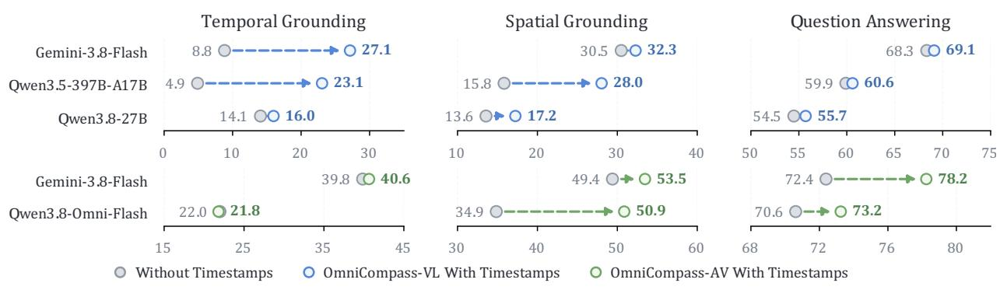

**Figure 6. 프레임 수준 타임스탬프의 영향.** 열은 CSTG, CSSG, CSQA를 퍼센트로 보고한다. 대시 연결은 타임스탬프가 없는 점수와 있는 점수를 연결한다. 축 범위는 패널마다 다르다.

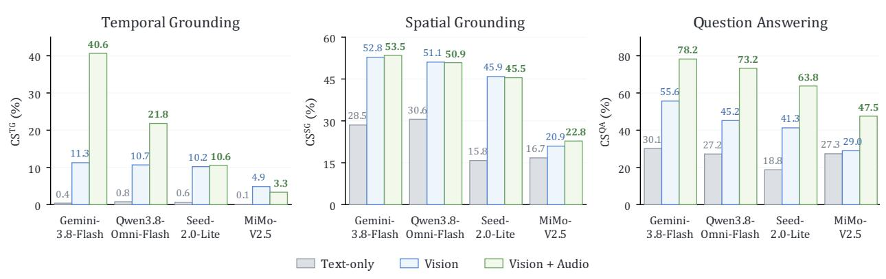

**Figure 7. OmniCompass-AV에서 입력 모달리티의 영향.** 막대는 Text-only, Vision, Vision+Audio에 대해 CS를 퍼센트로 보고하며, 각 모델과 작업 내에서 일치하는 적격 쌍에 대해 표시한다.

**입력 모달리티의 영향**. Figure [7](#page-9-0)은 네 개의 OmniCompass-AV 모델에 대해 Text-only, Vision, Vision+Audio 세 모달리티에서 작업 수준 CS를 비교한다. 모든 비교는 각 모델과 작업 내에서 일치하는 적격 쌍을 사용한다. Text-only는 두 가지 질문 문구를 모두 유지하지만, 참조 이미지 등 모든 미디어를 제거한다. 그 CSTG는 0.1–0.8%에 불과한 반면, CSQA는 18.8%–30.1%이다. Vision은 12개의 모델-작업 비교 모두에서 향상된다. 오디오를 추가하면 CSQA가 **18.6%–28.1%** 상승하며 평균 **22.9%**이다. Gemini-3.8-Flash와 Qwen3.8-Omni-Flash는 각각 CSTG에서 **29.4%**와 **11.1%**를 얻는 반면, MiMo-V2.5는 1.5%를 잃는다. CSSG 변화는 -0.4%에서 +1.8% 사이이다. 따라서 오디오를 추가하면 네 개의 테스트 모델 모두에서 CSQA가 **일관적으로 향상**되지만, TG 이득은 모델마다 다르고 SG 이득은 제한적이다. 추가 분석은 부록 [B.](#page-16-0)에 제공된다.

## **5 결론** (Conclusion)

본 논문에서는 omni-modal 비디오 정밀 지향 및 이해를 위한 전체적인 벤치마크인 OmniCompass를 소개한다. 이 벤치마크는 동일한 비디오, 대상, 작업 의미 및 정답에 대해 *Text*와 *Text+Image* 사양을 쌍으로 제공함으로써 VL과 AV 트랙에서 TG, SG, QA를 통합한다. 벤치마크는 7개 도메인에 걸쳐 820개의 수동 주석 비디오를 포함하며, 원음이 포함된 240비디오 AV 하위 집합을 포함한다. 쌍 설정과 CS 지표는 대상 사양 변경 시 예측 정확도와 일관성을 모두 평가한다. 주요 상용 모델은 특히 오디오-비주얼 이해에서 오픈소스 모델을 능가하지만, 정밀 정지, 세밀한 인식, 오디오-비주얼 이벤트 결합은 여전히 도전 과제이다. 참조 이미지는 작업에 따라 다른 효과를 나타내며, 타임스탬프는 두 트랙 모두에서 모델 성능을 향상시킨다. 이러한 결과는 대상 사양을 관련 이벤트와 증거와 연결하기 위해 보다 강력한 멀티모달 정렬 및 오디오 인식 정지를 촉구한다. OmniCompass는 QA, 정밀 정지, 교차 참조 일관성을 작업 및 모달리티 전반에 걸쳐 공동 평가를 지원하며, 모델 한계 진단 및 신뢰할 수 있는 omni-modal 비디오 이해를 향한 진전 측정을 위한 기반을 제공한다.


# **참고문헌** (References)

- <span id="page-10-8"></span>Xiang An, Yin Xie, Feilong Tang, Yunyao Yan, Huajie Tan, Didi Zhu, Changrui Chen, Xiuwei Zhao, Bin Qin, Kaicheng Yang, et al. Llava-onevision-2: Towards next-generation perceptual intelligence. *arXiv preprint arXiv:2605.25979*, 2026.
- <span id="page-10-5"></span>Shuai Bai, Yuxuan Cai, Ruizhe Chen, Keqin Chen, Xionghui Chen, Zesen Cheng, Lianghao Deng, Wei Ding, Chang Gao, Chunjiang Ge, et al. Qwen3-vl technical report. *arXiv preprint arXiv:2511.21631*, 2025.
- <span id="page-10-3"></span>Jianghan Chao, Jianzhang Gao, Wenhui Tan, Yuchong Sun, Ruihua Song, and Liyun Ru. Jointavbench: A benchmark for joint audio-visual reasoning evaluation. In *Proceedings of the International Conference on Learning Representations*, 2026.
- <span id="page-10-1"></span>Guo Chen, Yicheng Liu, Yifei Huang, Baoqi Pei, Jilan Xu, Yuping He, Tong Lu, Yali Wang, and Limin Wang. Cg-bench: Clue-grounded question answering benchmark for long video understanding. In *Proceedings of the International Conference on Learning Representations*, 2025a.
- <span id="page-10-13"></span>Joya Chen, Ziyun Zeng, Yiqi Lin, Wei Li, Zejun Ma, and Mike Zheng Shou. Livecc: Learning video llm with streaming speech transcription at scale. In *Proceedings of the Computer Vision and Pattern Recognition Conference*, pp. 29083–29095, 2025b.
- <span id="page-10-6"></span>Yu Chen, Caorui Li, Ziyu Xiong, Yidong Wang, Mingqi Gao, Shuman Liu, Biao Liu, Chunfeng Yang, Anxiang Zeng, Haibo Zhang, et al. Omnireasoner: Thinking with long audio-video via native tool use. *arXiv preprint arXiv:2607.19339*, 2026.
- <span id="page-10-7"></span>Zhe Chen, Weiyun Wang, Hao Tian, Shenglong Ye, Zhangwei Gao, Erfei Cui, Wenwen Tong, Kongzhi Hu, Jiapeng Luo, Zheng Ma, Ji Ma, Jiaqi Wang, Xiaoyi Dong, Hang Yan, Hewei Guo, Conghui He, Botian Shi, Zhenjiang Jin, Chao Xu, Bin Wang, Xingjian Wei, Wei Li, Wenjian Zhang, Bo Zhang, Pinlong Cai, Licheng Wen, Xiangchao Yan, Min Dou, Lewei Lu, Xizhou Zhu, Tong Lu, Dahua Lin, Yu Qiao, Jifeng Dai, and Wenhai Wang. How far are we to gpt-4v? closing the gap to commercial multimodal models with open-source suites. *arXiv preprint arXiv:2404.16821*, 2024.
- <span id="page-10-11"></span>Zesen Cheng, Sicong Leng, Hang Zhang, Yifei Xin, Xin Li, Guanzheng Chen, Yongxin Zhu, Wenqi Zhang, Ziyang Luo, Deli Zhao, et al. Videollama 2: Advancing spatial-temporal modeling and audio understanding in video-llms. *arXiv preprint arXiv:2406.07476*, 2024.
- <span id="page-10-2"></span>Zixu Cheng, Jian Hu, Ziquan Liu, Chenyang Si, Wei Li, and Shaogang Gong. V-star: Benchmarking video-llms on video spatio-temporal reasoning. In *Proceedings of the IEEE/CVF Conference on Computer Vision and Pattern Recognition*, pp. 9155–9164, 2026.
- <span id="page-10-10"></span>Junbo Cui, Bokai Xu, Chongyi Wang, Tianyu Yu, Weiyue Sun, Yingjing Xu, Tianran Wang, Zhihui He, Wenshuo Ma, Tianchi Cai, et al. Minicpm-o 4.5: Towards real-time full-duplex omni-modal interaction. *arXiv preprint arXiv:2604.27393*, 2026.
- <span id="page-10-9"></span>DeepSeek-AI. Deepseek-v4.1-flash: Pushing the limits of kv cache compression, 2026.
- <span id="page-10-0"></span>Chaoyou Fu, Yuhan Dai, Yongdong Luo, Lei Li, Shuhuai Ren, Renrui Zhang, Zihan Wang, Chenyu Zhou, Yunhang Shen, Mengdan Zhang, et al. Video-mme: The first-ever comprehensive evaluation benchmark of multi-modal llms in video analysis. In *Proceedings of the IEEE/CVF Conference on Computer Vision and Pattern Recognition*, pp. 24108–24118, 2025a.
- <span id="page-10-12"></span>Chaoyou Fu, Haojia Lin, Xiong Wang, Yunhang Shen, Xiaoyu Liu, Haoyu Cao, Zuwei Long, Heting Gao, Ke Li, Long MA, et al. Vita-1.5: Towards gpt-4o level real-time vision and speech interaction. In *Proceedings of the Advances in Neural Information Processing Systems*, volume 38, pp. 75300–75320, 2025b.
- <span id="page-10-4"></span>Chaoyou Fu, Haozhi Yuan, Yuhao Dong, Yi-Fan Zhang, Yunhang Shen, Xiaoxing Hu, Xueying Li, Jinsen Su, Chengwu Long, Xiaoyao Xie, et al. Video-mme-v2: Towards the next stage in benchmarks for comprehensive video understanding. *arXiv preprint arXiv:2604.05015*, 2026.


- <span id="page-11-8"></span>Hong Gao, Jingyu Wu, Xiangkai Xu, Kangni Xie, Yunchen Zhang, Bin Zhong, Xurui Gao, and Min-Ling Zhang. Omniground: 실제 복잡한 시나리오를 위한 종합적인 시공간 기반 벤치마크 (Omniground: A comprehensive spatio-temporal grounding benchmark for real-world complex scenarios). In *IEEE/CVF 컴퓨터 비전 및 패턴 인식 회의 논문집*, pp. 17588–17597, 2026.

- <span id="page-11-0"></span>Jiyang Gao, Chen Sun, Zhenheng Yang, and Ram Nevatia. Tall: 언어 쿼리를 통한 시간적 활동 위치 지정 (Tall: Temporal activity localization via language query). In *IEEE/CVF 국제 컴퓨터 비전 회의 논문집*, pp. 5267–5275, 2017.

- <span id="page-11-7"></span>Google. Gemini 3와 함께하는 새로운 지능 시대 (A new era of intelligence with Gemini 3), 2025. URL [https://blog.google/products/gemini/gemini-3/.](https://blog.google/products/gemini/gemini-3/)

- <span id="page-11-6"></span>Jack Hong, Shilin Yan, Jiayin Cai, Xiaolong Jiang, Yao Hu, and Weidi Xie. Worldsense: 다중모달 llms를 위한 실제 오미모달 이해 평가 (Worldsense: Evaluating real-world omnimodal understanding for multimodal llms). In *학습 표현 국제 회의 논문집*, 2026.

- <span id="page-11-13"></span>Wenyi Hong, Yean Cheng, Zhuoyi Yang, Weihan Wang, Lefan Wang, Xiaotao Gu, Shiyu Huang, Yuxiao Dong, and Jie Tang. Motionbench: 세밀한 비디오 모션 이해를 위한 비전 언어 모델 벤치마킹 및 개선 (Motionbench: Benchmarking and improving fine-grained video motion understanding for vision language models). In *IEEE/CVF 컴퓨터 비전 및 패턴 인식 회의 논문집*, pp. 8450–8460, 2025.

- <span id="page-11-14"></span>Kimi Team, Tongtong Bai, Yifan Bai, Yiping Bao, M. C., Jianfeng Cai, Xinyuan Cai, Peizhou Cao, Yuxuan Cao, Ziwei Chai, et al. Kimi K3: 개방형 프론티어 인텔리전스 (Kimi K3: Open frontier intelligence). *arXiv preprint arXiv:2607.24653*, 2026.

- <span id="page-11-1"></span>Jie Lei, Licheng Yu, Mohit Bansal, and Tamara Berg. Tvqa: 국소화된, 구성적인 비디오 질문 응답 (Tvqa: Localized, compositional video question answering). In *자연어 처리 경험적 방법 회의 논문집*, pp. 1369–1379, 2018.

- <span id="page-11-2"></span>Jie Lei, Licheng Yu, Tamara Berg, and Mohit Bansal. Tvqa+: 비디오 질문 응답을 위한 시공간 기반 정밀화 (Tvqa+: Spatio-temporal grounding for video question answering). In *계산 언어학 연례 회의 논문집*, pp. 8211–8225, 2020.

- <span id="page-11-3"></span>Jie Lei, Tamara L Berg, and Mohit Bansal. 자연어 쿼리를 통한 비디오에서 순간 및 하이라이트 감지 (Detecting moments and highlights in videos via natural language queries). In *신경 정보 처리 시스템 발전 회의 논문집*, volume 34, pp. 11846–11858, 2021.

- <span id="page-11-12"></span>Bo Li, Yuanhan Zhang, Dong Guo, Renrui Zhang, Feng Li, Hao Zhang, Kaichen Zhang, Yanwei Li, Ziwei Liu, and Chunyuan Li. Llava-onevision: 쉬운 시각적 작업 전이 (Llava-onevision: Easy visual task transfer). *arXiv preprint arXiv:2408.03326*, 2024a.

- <span id="page-11-5"></span>Caorui Li, Yu Chen, Yiyan Ji, Jin Xu, Zhenyu Cui, Shihao Li, Yuanxing Zhang, Jiafu Tang, Zhenghao Song, Dingling Zhang, et al. Omnivideobench: 오디오-비주얼 이해 평가를 위한 오미멀티모달 모델 (Omnivideobench: Towards audio-visual understanding evaluation for omni mllms). In *학습 표현 국제 회의 논문집*, 2026.

- <span id="page-11-4"></span>Kunchang Li, Yali Wang, Yinan He, Yizhuo Li, Yi Wang, Yi Liu, Zun Wang, Jilan Xu, Guo Chen, Ping Luo, et al. Mvbench: 종합적인 다중모달 비디오 이해 벤치마크 (Mvbench: A comprehensive multi-modal video understanding benchmark). In *IEEE/CVF 컴퓨터 비전 및 패턴 인식 회의 논문집*, pp. 22195–22206, 2024b.

- <span id="page-11-15"></span>Yixuan Li, Lei Chen, Runyu He, Zhenzhi Wang, Gangshan Wu, and Limin Wang. Multisports: 시공간적으로 국소화된 스포츠 동작을 포함한 다인원 비디오 데이터셋 (Multisports: A multi-person video dataset of spatio-temporally localized sports actions). In *IEEE/CVF 국제 컴퓨터 비전 회의 논문집*, pp. 13536–13545, 2021.

- <span id="page-11-10"></span>Weifeng Lin, Xinyu Wei, Ruichuan An, Gao Peng, Bocheng Zou, Yulin Luo, Siyuan Huang, Shanghang Zhang, and Hongsheng Li. Draw-and-understand: 시각적 프롬프트를 활용해 mllms가 원하는 것을 이해하도록 돕는 방법 (Draw-and-understand: Leveraging visual prompts to enable mllms to comprehend what you want). In *학습 표현 국제 회의 논문집*, 2025a.

- <span id="page-11-11"></span>Weifeng Lin, Xinyu Wei, Ruichuan An, Tianhe Ren, Tingwei Chen, Renrui Zhang, Ziyu Guo, Wentao Zhang, Lei Zhang, and Hongsheng Li. Perceive anything: 이미지와 비디오에서 모든 것을 인식, 설명, 캡션, 세그먼트 (Perceive anything: Recognize, explain, caption, and segment anything in images and videos). In *신경 정보 처리 시스템 발전 회의 논문집*, volume 38, 2025b.

- <span id="page-11-9"></span>Haotian Liu, Chunyuan Li, Yuheng Li, and Yong Jae Lee. 시각적 지침 조정을 통한 개선된 기준선 (Improved baselines with visual instruction tuning). In *IEEE/CVF 컴퓨터 비전 및 패턴 인식 회의 논문집*, pp. 26286–26296, 2024a.


- <span id="page-12-1"></span>Yuanxin Liu, Shicheng Li, Yi Liu, Yuxiang Wang, Shuhuai Ren, Lei Li, Sishuo Chen, Xu Sun, and Lu Hou. Tempcompass: 비디오 LLM이 실제로 비디오를 이해하는가? In *연산언어학회 연구 결과: ACL 2024*, pp. 8731–8772, 2024b.

- <span id="page-12-12"></span>Zuyan Liu, Yuhao Dong, Jiahui Wang, Ziwei Liu, Winston Hu, Jiwen Lu, and Yongming Rao. Ola: 점진적 모달리티 정렬을 통한 옴니모달 언어 모델의 최전선 추진. *arXiv 사전 인쇄 arXiv:2502.04328*, 2025.

- <span id="page-12-2"></span>David Ma, Yuanxing Zhang, Jincheng Ren, Jarvis Guo, Yifan Yao, Zhenlin Wei, Zhenzhu Yang, Zhongyuan Peng, Boyu Feng, Jun Ma, Xiao Gu, Zhoufutu Wen, King Zhu, Yancheng He, Meng Cao, Shiwen Ni, Jiaheng Liu, Wenhao Huang, Ge Zhang, and Xiaojie Jin. iv-bench: 이미지 기반 비디오 인식 및 추론을 위한 멀티모달 LLM 벤치마크. In *국제 학습 표현 회의 논문집*, 2026.

- <span id="page-12-0"></span>Karttikeya Mangalam, Raiymbek Akshulakov, and Jitendra Malik. Egoschema: 매우 긴 형식의 비디오 언어 이해를 위한 진단 벤치마크. In *신경 정보 처리 시스템 발전 회의 논문집*, volume 36, pp. 46212–46244, 2023.

- <span id="page-12-3"></span>Jiahao Meng, Xiangtai Li, Haochen Wang, Yue Tan, Tao Zhang, Lingdong Kong, Yunhai Tong, Anran Wang, Zhiyang Teng, Yujing Wang, et al. Open-o3-video: 명시적 시공간 증거를 통한 기반 비디오 추론. In *국제 기계 학습 회의 논문집*, 2026.

- <span id="page-12-9"></span>MiMo-V2.5. Mimo-v2.5. [https://huggingface.co/collections/XiaomiMiMo/mimo-v25,](https://huggingface.co/collections/XiaomiMiMo/mimo-v25) 2026.

- <span id="page-12-16"></span>Furkan Mumcu, Michael Jones, Yasin Yilmaz, and Anoop Cherian. Complexvad: 비디오에서 상호작용 이상 탐지. In *컴퓨터 비전 응용 겨울 회의 논문집*, pp. 1093–1102, 2025.

- <span id="page-12-4"></span>OpenAI. GPT-5.5 시스템 카드, 2026a. URL [https://openai.com/index/gpt-5-5-system-card/.](https://openai.com/index/gpt-5-5-system-card/)

- <span id="page-12-5"></span>OpenAI. GPT-5.6: 당신의 야망에 따라 확장되는 최첨단 인텔리전스, 2026b. URL [https://openai.com/](https://openai.com/index/gpt-5-6/) [index/gpt-5-6/.](https://openai.com/index/gpt-5-6/)

- <span id="page-12-6"></span>OpenAI. GPT-6 Astra: 새로운 세대의 인텔리전스, 2026c. URL [https://openai.com/index/gpt-6-astra/.](https://openai.com/index/gpt-6-astra/)

- <span id="page-12-8"></span>Qwen Team. Qwen3.8-max: 코딩과 협업을 위한 새로운 기준, 2026년 8월. URL [https://qwen.ai/blog?id=](https://qwen.ai/blog?id=qwen3.8) [qwen3.8.](https://qwen.ai/blog?id=qwen3.8)

- <span id="page-12-10"></span>Qwen Team. Qwen3.6-35B-A3B: 에이전시 코딩 파워, 이제 모두에게 공개, 2026년 4월. URL [https://qwen.ai/](https://qwen.ai/blog?id=qwen3.6-35b-a3b) [blog?id=qwen3.6-35b-a3b.](https://qwen.ai/blog?id=qwen3.6-35b-a3b)

- <span id="page-12-11"></span>Qwen Team, Alibaba. Qwen3-Omni-Flash-2025-12-01: 당신을 듣는다. 당신을 본다. 더 똑똑하게 따라간다!, 2025. URL [https://qwen.ai/blog?id=qwen3-omni-20251201.](https://qwen.ai/blog?id=qwen3-omni-20251201)

- <span id="page-12-15"></span>Bharathkumar Ramachandra and Michael Jones. Street scene: 비디오 이상 탐지를 위한 새로운 데이터셋 및 평가 프로토콜. In *IEEE/CVF 컴퓨터 비전 응용 겨울 회의 논문집*, pp. 2569–2578, 2020.

- <span id="page-12-7"></span>Bytedance Seed. Seed2.0 모델 카드: 실제 세계 복잡성을 위한 인텔리전스 프런티어. *arXiv 사전 인쇄 arXiv:2607.00248*, 2026.

- <span id="page-12-14"></span>Enxin Song, Wenhao Chai, Guanhong Wang, Yucheng Zhang, Haoyang Zhou, Feiyang Wu, Haozhe Chi, Xun Guo, Tian Ye, Yanting Zhang, et al. Moviechat: 밀집 토큰에서 희소 메모리로 긴 비디오 이해. In *IEEE/CVF 컴퓨터 비전 및 패턴 인식 회의 논문집*, pp. 18221–18232, 2024.

- <span id="page-12-13"></span>Waqas Sultani, Chen Chen, and Mubarak Shah. 실제 세계 감시 비디오에서의 이상 탐지. In *IEEE/CVF 컴퓨터 비전 및 패턴 인식 회의 논문집*, pp. 6479–6488, 2018.


- <span id="page-13-15"></span>Changli Tang, Yixuan Li, Yudong Yang, Jimin Zhuang, Guangzhi Sun, Wei Li, Zejun Ma, and Chao Zhang. video-SALMONN 2: 자막 강화된 오디오-비주얼 대형 언어 모델. *arXiv 사전발행 arXiv:2506.15220*, 2025.

- <span id="page-13-8"></span>Feilong Tang, Xiang An, Yunyao Yan, Yin Xie, Bin Qin, Kaicheng Yang, Yifei Shen, Yuanhan Zhang, Chunyuan Li, Shikun Feng, et al. Onevision-encoder: 코덱 정렬 희소성을 다중모달 지능의 기초 원칙으로. *arXiv 사전발행 arXiv:2602.08683*, 2026.

- <span id="page-13-1"></span>Zongheng Tang, Yue Liao, Si Liu, Guanbin Li, Xiaojie Jin, Hongxu Jiang, Qian Yu, and Dong Xu. 인간 중심 시공간 비디오 정착을 위한 시각 변환기. *IEEE Transactions on Circuits and Systems for Video Technology*, 32(12):8238–8249, 2021.

- <span id="page-13-10"></span>Kwai Keye Team, Bin Wen, Changyi Liu, Chengru Song, Chongling Rao, Guowang Zhang, Han Li, Haonan Fan, Hengrui Ju, Jiankang Chen, et al. Kwai keye-vl-2.0 기술 보고서. *arXiv 사전발행 arXiv:2606.10651*, 2026.

- <span id="page-13-13"></span>Qwen Team. Qwen3.5: 자연스러운 다중모달 에이전트 향해, 2026년 2월 a. URL [https://qwen.ai/blog?id=](https://qwen.ai/blog?id=qwen3.5) [qwen3.5.].

- <span id="page-13-14"></span>Qwen Team. Qwen3. 5-omni 기술 보고서. *arXiv 사전발행 arXiv:2604.15804*, 2026b.

- <span id="page-13-11"></span>Shihao Wang, Guo Chen, De-an Huang, Zhiqi Li, Minghan Li, Guilin Liu, Jan Kautz, Jose M Alvarez, Lei Zhang, and Zhiding Yu. Videoitg: 지시된 시간적 기반을 통한 다중모달 비디오 이해. In *Proceedings of the IEEE/CVF Conference on Computer Vision and Pattern Recognition*, pp. 24640–24650, 2026a.

- <span id="page-13-7"></span>Shihao Wang, Shilong Liu, Yuanguo Kuang, Xinyu Wei, Yangzhou Liu, Zhiqi Li, Yunze Man, Guo Chen, Andrew Tao, Guilin Liu, et al. Locateanything: 빠르고 고품질의 시각-언어 기반 정렬을 위한 병렬 박스 디코딩. In *European Conference on Computer Vision*, pp. 336–357. Springer, 2026b.

- <span id="page-13-12"></span>Weihan Wang, Zehai He, Wenyi Hong, Yean Cheng, Xiaohan Zhang, Ji Qi, Ming Ding, Xiaotao Gu, Shiyu Huang, Bin Xu, et al. Lvbench: 극단적인 장시간 비디오 이해 벤치마크. In *Proceedings of the IEEE/CVF International Conference on Computer Vision*, pp. 22958–22967, 2025a.

- <span id="page-13-9"></span>Weiyun Wang, Zhangwei Gao, Lixin Gu, Hengjun Pu, Long Cui, Xingguang Wei, Zhaoyang Liu, Linglin Jing, Shenglong Ye, Jie Shao, et al. Internvl3. 5: 다양성, 추론, 효율성에서 오픈소스 다중모달 모델을 발전시키는. *arXiv 사전발행 arXiv:2508.18265*, 2025b.

- <span id="page-13-4"></span>Weizhi Wang, Zili Wang, Yuqi Huo, Yuanting Chen, Xuezheng Xu, Jinguo Zhu, Wangbo Zhao, Wei Li, and Weijie Su. Vtool-r1: VLM이 강화 학습을 통해 이미지로 사고를 배운다. In *ICLR*, 2026c.

- <span id="page-13-2"></span>Haoning Wu, Dongxu Li, Bei Chen, and Junnan Li. Longvideobench: 장기 컨텍스트 교차 비디오-언어 이해를 위한 벤치마크. In *Proceedings of the Advances in Neural Information Processing Systems*, volume 37, pp. 28828–28857, 2024.

- <span id="page-13-0"></span>Junbin Xiao, Xindi Shang, Angela Yao, and Tat-Seng Chua. Next-qa: 질문-응답의 다음 단계: 시간적 행동 설명. In *Proceedings of the IEEE/CVF Conference on Computer Vision and Pattern Recognition*, pp. 9777–9786, 2021.

- <span id="page-13-5"></span>Zhenghao Xing, Ruiyang Xu, Yuxuan Wang, Jinzheng He, Ziyang Ma, Qize Yang, Yunfei Chu, Jin Xu, Junyang Lin, Chi-Wing Fu, and Pheng-Ann Heng. 자연스러운 능동 인지가 옴니모달 이해를 위한 추론. In *ICML*, 2026.

- <span id="page-13-6"></span>Jin Xu, Zhifang Guo, Jinzheng He, Hangrui Hu, Ting He, Shuai Bai, Keqin Chen, Jialin Wang, Yang Fan, Kai Dang, et al. Qwen2. 5-omni 기술 보고서. *arXiv 사전발행 arXiv:2503.20215*, 2025a.

- <span id="page-13-3"></span>Jin Xu, Zhifang Guo, Hangrui Hu, Yunfei Chu, Xiong Wang, Jinzheng He, Yuxuan Wang, Xian Shi, Ting He, Xinfa Zhu, Yuanjun Lv, Yongqi Wang, Dake Guo, He Wang, Linhan Ma, Pei Zhang, Xinyu Zhang, Hongkun Hao, Zishan Guo, Baosong Yang, Bin Zhang, Ziyang Ma, Xipin Wei, Shuai Bai, Keqin Chen, Xuejing Liu, Peng Wang, Mingkun Yang, Dayiheng Liu, Xingzhang Ren, Bo Zheng, Rui Men, Fan Zhou, Bowen Yu, Jianxin Yang, Le Yu, Jingren Zhou, and Junyang Lin. Qwen3-omni 기술 보고서. *arXiv 사전발행 arXiv:2509.17765*, 2025b.


- <span id="page-14-2"></span>Yudong Yang, Jimin Zhuang, Changli Tang, Guangzhi Sun, Yixuan Li, Peihan Li, Yifan Jiang, Wei Li, Zejun Ma, and Chao Zhang. Audio-centric video understanding benchmark without text shortcut. In *Proceedings of the Conference on Empirical Methods in Natural Language Processing*, 2025.
- <span id="page-14-4"></span>Zuhao Yang, Sudong Wang, Kaichen Zhang, Keming Wu, Sicong Leng, Yifan Zhang, Chengwei Qin, Shijian Lu, Xingxuan Li, and Lidong Bing. Longvt: Incentivizing thinking with long videos via native tool calling. In *Proceedings of the IEEE/CVF Conference on Computer Vision and Pattern Recognition*, 2026a.
- <span id="page-14-10"></span>Zuhao Yang, Kaichen Zhang, Sudong Wang, Keming Wu, Zhongyu Yang, Bo Li, Xiaojuan Qi, Shijian Lu, Xingxuan Li, and Lidong Bing. Paravt: Taming the tool prior paradox for parallel tool use in agentic video reinforcement learning. *arXiv preprint arXiv:2605.20342*, 2026b.
- <span id="page-14-12"></span>Zhou Yu, Dejing Xu, Jun Yu, Ting Yu, Zhou Zhao, Yueting Zhuang, and Dacheng Tao. Activitynet-qa: A dataset for understanding complex web videos via question answering. In *Proceedings of the AAAI Conference on Artificial Intelligence*, volume 33, pp. 9127–9134, 2019.
- <span id="page-14-11"></span>Aohan Zeng, Xin Lv, Zhenyu Hou, Zhengxiao Du, Qinkai Zheng, Bin Chen, Da Yin, Chendi Ge, Chenghua Huang, Chengxing Xie, et al. Glm-5: from vibe coding to agentic engineering. *arXiv preprint arXiv:2602.15763*, 2026a.
- <span id="page-14-5"></span>Xiangyu Zeng, Zhiqiu Zhang, Yuhan Zhu, Xinhao Li, Zikang Wang, Changlian Ma, Qingyu Zhang, Zizheng Huang, Kun Ouyang, Tianxiang Jiang, Ziang Yan, Yi Wang, Hongjie Zhang, Yali Wang, and Limin Wang. Video-o3: Native interleaved clue seeking for long video multi-hop reasoning. In *Proceedings of the International Conference on Machine Learning*, 2026b.
- <span id="page-14-7"></span>Boqiang Zhang, Kehan Li, Zesen Cheng, Zhiqiang Hu, Yuqian Yuan, Guanzheng Chen, Sicong Leng, Yuming Jiang, Hang Zhang, Xin Li, et al. Videollama 3: Frontier multimodal foundation models for image and video understanding. *arXiv preprint arXiv:2501.13106*, 2025.
- <span id="page-14-8"></span>Jun Zhang, Teng Wang, Yuying Ge, Yixiao Ge, Xinhao Li, and Limin Wang. Timelens: Rethinking video temporal grounding with multimodal llms. In *Proceedings of the IEEE/CVF Conference on Computer Vision and Pattern Recognition*, pp. 10419–10429, 2026.
- <span id="page-14-6"></span>Yuanhan Zhang, Jinming Wu, Wei Li, Bo Li, Zejun Ma, Ziwei Liu, and Chunyuan Li. Video instruction tuning with synthetic data. *arXiv preprint arXiv:2410.02713*, 2024.
- <span id="page-14-0"></span>Zhu Zhang, Zhou Zhao, Yang Zhao, Qi Wang, Huasheng Liu, and Lianli Gao. Where does it exist: Spatiotemporal video grounding for multi-form sentences. In *Proceedings of the IEEE/CVF Conference on Computer Vision and Pattern Recognition*, pp. 10668–10677, 2020.
- <span id="page-14-1"></span>Junjie Zhou, Yan Shu, Bo Zhao, Boya Wu, Zhengyang Liang, Shitao Xiao, Minghao Qin, Xi Yang, Yongping Xiong, Bo Zhang, et al. Mlvu: Benchmarking multi-task long video understanding. In *Proceedings of the IEEE/CVF Conference on Computer Vision and Pattern Recognition*, pp. 13691–13701, 2025a.
- <span id="page-14-3"></span>Ziwei Zhou, Rui Wang, and Zuxuan Wu. Daily-omni: Towards audio-visual reasoning with temporal alignment across modalities. *arXiv preprint arXiv:2505.17862*, 2025b.
- <span id="page-14-9"></span>Yuhan Zhu, Changlian Ma, Xiangyu Zeng, Xinhao Li, Zhiqiu Zhang, Songze Li, Jun Zhang, Tianxiang Jiang, Yuandong Yang, Ziang Yan, et al. Timelens2: Generalist video temporal grounding with multimodal llms. *arXiv preprint arXiv:2607.17423*, 2026.


# **부록 (Appendix)**

| A | 추가 결과 | 16 |
|---|-----------------------------------------------|----|
|  | A.1<br>비디오 지속 시간에 따른 성능 | 16 |
|  | A.2<br>타깃 세분화에 따른 근거화 | 17 |
|  | A.3<br>비디오 도메인에 따른 성능<br> | 17 |
| B | 추가 분석 | 17 |
|  | B.1<br>프레임 스케일링의 영향<br> | 17 |
|  | B.2<br>참조 사양의 영향<br> | 17 |
|  | B.3<br>교차 사양 일관성<br> | 18 |
|  | B.4<br>정성적 분석 | 19 |
| C | 벤치마크 구축 | 21 |
|  | C.1<br>비디오 소스 및 선택<br> | 21 |
|  | C.2<br>작업 지향 후보 점수화 | 22 |
|  | C.3<br>질문-답변 분류<br> | 22 |
|  | C.4<br>참조 설계 및 출처<br> | 23 |
| D | 주석 품질 및 검증 | 23 |
|  | D.1<br>검토 기준 및 수리 기록<br> | 24 |
|  | D.2<br>인간 노력<br> | 24 |
| E | 평가 프로토콜 및 프롬프트 | 29 |
|  | E.1<br>입력 및 쌍 설정 | 29 |
|  | E.2<br>프롬프트 예시<br> | 29 |

# <span id="page-15-0"></span>**A 부가 결과 (Additional Results)**

# <span id="page-15-1"></span>**A.1 비디오 지속 시간별 성능 (Performance across Video Durations)**

모든 10개 모델은 TG에서 긴 비디오보다 짧은 비디오에서 점수가 낮다. Seed-2.1-Pro-260915는 33.4%에서 15.1%로 가장 큰 감소를 보이며, Gemini-3.8-Flash는 33.8%에서 21.0%로 감소한다. SG에서는 5개 모델, QA에서는 6개 모델만 감소한다. 따라서 지속 시간 연관성의 방향은 다른 과제보다 시계열 위치 지정에 더 일관적이다. 이 그룹들은 내용과 대상 세분화에서도 차이가 있으므로, 비교는 비디오 지속 시간을 낮은 점수의 원인으로 고정시키지 않는다.

<span id="page-15-2"></span>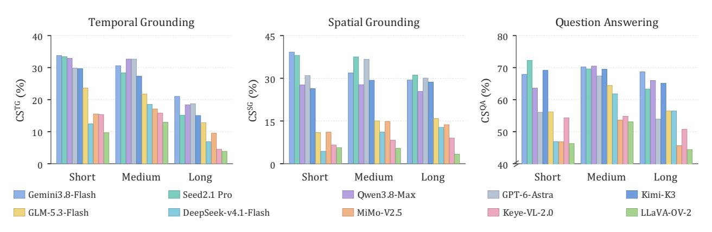

**Figure A1. OmniCompass-VL에서 비디오 지속 시간별 성능.** 막대는 90초 미만의 짧은 비디오, 90초에서 300초 미만의 중간 비디오, 300초 이상의 긴 비디오에 대한 작업별 CS(정확도)를 퍼센트로 표시한다. 각 모델은 자체 적격 쌍을 사용한다.


# <span id="page-16-1"></span>**A.2 대상 세분화별 기반화 (Grounding across Target Granularity)**

Figure [A2](#page-16-5)는 상대 타깃 지속시간과 박스 면적 그룹을 기준으로 열 개의 VL 모델과 여섯 개의 AV 모델을 비교한다. 모든 VL 모델은 상대 타깃 지속시간이 증가함에 따라 TG에서 단조롭게 향상된다. 모든 AV 모델 역시 가장 높은 지속비율 사분위에서 최고점을 기록한다. Gemini-3.8-Flash는 극단 그룹 사이에서 VL에서 7.9%에서 43.1%로, AV에서는 27.1%에서 56.2%로 상승한다. 공간적 경향은 다르다: 모든 VL 모델은 가장 큰 박스 그룹에서 최고점을 기록하고, 모든 AV 모델은 세 번째 사분위에서 최고점을 기록한다. Gemini-3.8-Flash는 세 번째 AV 사분위에서 65.5%, 네 번째 사분위에서 53.6%를 기록한다.

Quartile boundaries는 각 트랙마다 모든 비디오를 별도로 계산한다; 점수는 각 태스크 내에서 공통 자격 있는 쌍을 사용한다. 결과 그룹은 크기가 동일하지 않으며, 경계는 VL과 AV에서 다르다. IoU는 또한 타깃 범위에 따라 달라지므로, 이 곡선은 고립된 세분화 효과가 아니라 연관성을 설명한다. 이 대비는 오디오 효과를 분리하지 않는다: 태스크, 타깃 분포, 모델 명단이 다르다.

<span id="page-16-5"></span>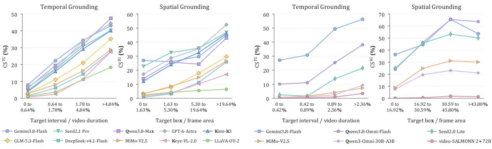

- (a) OmniCompass-VL에서의 근거 성능 (b) OmniCompass-AV에서의 근거 성능

**Figure A2. 타깃 세분화에 따른 근거** (Grounding across target granularity) 곡선은 타깃-비디오 지속시간과 평균 엔드포인트 박스-프레임 면적의 사분위수에 따른 CSTG와 CSSG를 백분율로 보고한다. 사분위수는 트랙별이며, 모델은 각 트랙과 태스크 내에서 자격 있는 쌍을 공유한다.

# <span id="page-16-2"></span>**A.3 비디오 도메인별 성능** (Performance across Video Domains)

Figure [A3](#page-17-2)는 일곱 도메인에서 열 개의 VL 모델을 비교한다. 모든 모델은 Traffic 도메인에서 가장 낮은 SG와 QA 점수를 기록하며, 등가 가중 모델 평균은 7.8%와 37.3%이다. Variety 도메인은 평균 TG 점수가 가장 낮은 8.1%이지만, 평균 SG 점수가 가장 높은 26.6%를 기록한다. 따라서 강한 공간적 근거는 같은 도메인 내에서 약한 시간적 위치 지정과 공존할 수 있다. 이 순위는 공유 자격 있는 하위 집합에 적용되며, 각 도메인의 모든 비디오에 반드시 해당되는 것은 아니다. 도메인 비교는 지속시간, 타깃 크기, QA 내용의 차이도 반영한다.

# <span id="page-16-0"></span>**B 추가 분석** (Additional Analyses)

# <span id="page-16-3"></span>**B.1 프레임 스케일링의 영향** (Impact of Frame Scaling)

프레임 예산을 늘리면 대부분의 설정에서 성능이 향상되지만, 그 효과는 트랙과 태스크에 따라 달라진다. OmniCompass-VL에서는 두 모델 모두 8프레임에서 128프레임으로 증가할 때 세 가지 태스크가 모두 크게 향상된다. TG CS는 Gemini-3.8-Flash에서 **22.2%**, Qwen3.5-397B-A17B에서 19.6% 증가하고, SG는 **22.8%**와 16.9% 증가하며, QA는 각각 20.0%와 18.6% 증가한다. OmniCompass-AV에서는 이득이 더 작고 태스크에 따라 달라진다. SG는 Gemini-3.8-Flash에서 18.3% 증가하고 Qwen3.8-Omni-Flash에서 **22.3%** 증가하며, QA는 8프레임에서 128프레임으로 9.9%와 13.4% 향상된다. 반면 TG는 거의 변하지 않는다. 우리는 오디오가 이미 AV TG에 유용한 시간적 단서를 제공한다(그림 [7] 참조)고 가정한다. 따라서 추가적인 시간적 증거가 제한된 상태에서 시각적 샘플링이 더 밀집되지만, SG와 QA는 더 세밀한 공간적 세부사항과 풍부한 시각적 맥락에서 이득을 얻을 수 있다. 또한 프레임이 많아질수록 시각 입력과 추론 비용이 증가하므로, 선호되는 예산은 항상 가장 큰 설정을 선호하기보다 태스크와 트랙에 따라 달라진다.

# <span id="page-16-4"></span>**B.2 참조 사양의 영향** (Impact of Reference Specification)

Figure [B2](#page-18-0)는 참조 유형별로 *Text*와 *Text+Image*를 비교한다. 행동-조건화 질문의 경우, *Text+Image*는 10개 모델 중 7개에서 TG를, 9개에서 SG를 향상시키지만, 8개에서 QA 정확도를 낮춘다. Gemini-3.8-Flash


<span id="page-17-2"></span>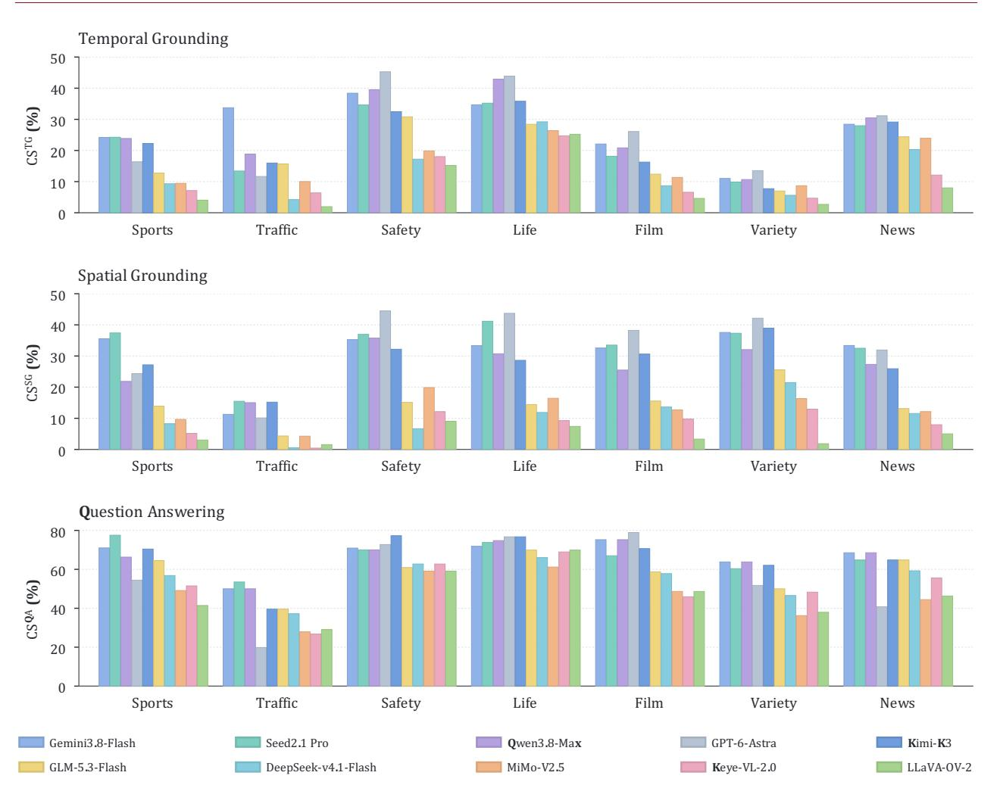

**Figure A3. 비디오 도메인별 OmniCompass-VL 성능** 막대는 10개 모델에 대한 태스크별 CS를 퍼센트로 보고한다. 공유 자격 있는 서브셋은 7개 도메인에 걸쳐 592 TG, 673 SG, 689 QA 쌍을 포함하며, 비교는 각 태스크 내 동일한 인스턴스를 사용한다.

행동-조건화 SG에서 10.4%의 이득을 보인 반면 Qwen3.8-Max는 7.6%를 잃는다. 페어링된 설정은 타깃 설명과 이미지 가용성을 모두 변경하므로, 이러한 차이는 순수한 이미지 추가 효과가 아니다. 이는 시각적 단서가 일치한 증거와 의미 하에서 텍스트 타깃 설명의 일부를 대체할 때 성능이 어떻게 변하는지를 측정한다.

각 태스크는 모든 10개 모델에서 동일한 자격 있는 서브셋을 사용한다. 행동-조건화 TG, SG, QA는 각각 50, 54, 31 쌍을 포함한다. 장면-조건화 TG는 단 8쌍만 포함하므로, 그 셀 값은 일반적인 추세에 대한 제한된 증거를 제공한다. 히트맵은 평균 차이를 보고하며, 유의성은 아니다; 서브그룹 크기는 방향을 해석할 때 중요하다.

# <span id="page-17-0"></span>**B.3 사양 간 일관성** (Cross-Specification Consistency)

Figure [B3](#page-19-0)는 페어링된 CS와 설정별 성능을 비교한다. 10개 모델 전반에서 TG와 SG CS는 각각 단일 설정 평균보다 5.0%와 5.7% 낮다. 이 격차는 두 설정 모두에서 실제와의 겹침을 요구하는 비용과 추가적인 예측-예측 겹침 제약을 모두 포함한다. 후자는 모델-태스크 조합마다 0.3%–1.8%만 기여한다. 전체 격차는 예측 불일치만을 측정하지 않는다.

<span id="page-17-1"></span>QA의 경우, 자격 있는 쌍 중 10.5–25.1%가 정확히 한 설정에서만 정답을 제시한다. Kimi-K3는 73.0%와 72.9%의 거의 동일한 정확도를 달성하지만, 두 설정 모두에서 정답을 제시하는 비율은 67.6%에 불과하다. 이 808쌍은 두 설정 모두에서 정답인 546쌍, *Text*에서만 정답인 44쌍, *Text+Image*에서만 정답인 43쌍, 그리고 어느 설정에서도 정답이 아닌 175쌍으로 구성된다. 따라서 유사한 집계 정확도는 서로 다른 인스턴스 수준 결과를 가려낼 수 있다. 정답이 아닌 쌍은 여전히 두 개의 다른 잘못된 답을 포함할 수 있다.


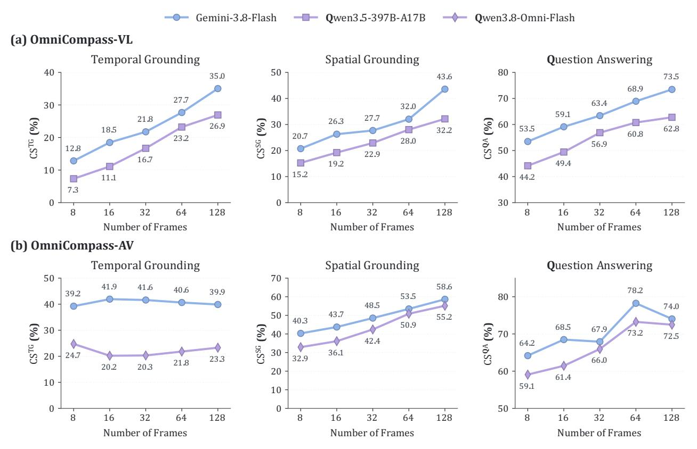

**Figure B1. 프레임 스케일링의 영향** 각 패널은 8, 16, 32, 64, 128개의 균일 샘플링된 프레임에서 태스크별 페어 CS(%)를 보고한다. 행은 VL과 AV 트랙을, 열은 TG, SG, QA를 나타내며, 곡선은 평가된 모델을 구분한다.

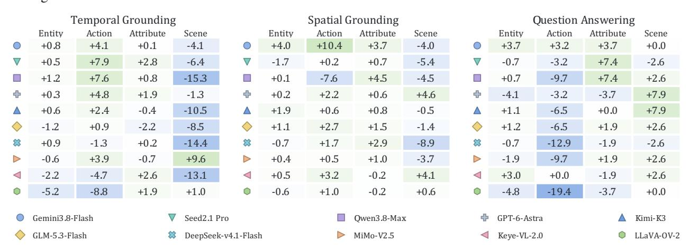

**그림 B2. OmniCompass-VL에서 참조 사양의 효과.**

셀은 TG mtIoU, SG msIoU, 그리고 QA 정확도에서 공유된 각 태스크 서브셋에 대해 *Text+Image*에서 *Text*를 뺀 백분율을 보여준다.

초록색은 증가를, 파란색은 감소를 나타내며, 색상은 통계적 유의성을 표시하지 않는다.

# **B.4 Qualitative Analysis**

Figure [B4](#page-19-1)은 QA, SG, TG 전반에 걸친 OmniCompass-VL 및 OmniCompass-AV의 정성적 예시를 보여준다. 첫 번째 OmniCompass-VL 사례에서, 노인 남성이 두 번 마시는 장면은 옵션 C에 해당한다. Seed-2.1-Pro는 *Text*와 *Text+Image* 모두에서 C를 예측한다. *Text*에서 *Text+Image*로 전환하면 Kimi-K3의 예측이 A에서 C로, GPT-6-Astra의 예측이 A에서 B로 바뀐다. 두 번째 OmniCompass-VL 사례에서, 체조 팀은 한쪽 무릎에 무릎을 꿇은 세 명과 서 있는 세 명으로 끝나며, 이는 옵션 C에 해당한다. Seed-2.1-Pro와 Gemini-3.8-Flash는 C를 선택하고, GPT-6-Astra는 A를 선택한다.

OmniCompass-AV의 경우, 우측 상단 QA 예시는 왜 그 남자가 감옥에 보낸 것인지 묻는다. 그는 공산주의 시위의 지도자와 착각되어 옵션 B에 해당한다. Qwen3-Omni-30B-A3B는 *Text*에서 C에서 *Text+Image*에서 B로 바뀌며, Gemini-3.8-Flash와 video-SALMONN-2+-72B는 두 설정 모두에서 B를 선택한다. 하단 우측 SG 예시는 SG의 어려움을 보여준다: Gemini-3.8-Flash는 세 모델 중 가장 높은 점수인 0.181만을 얻는다. Qwen3-Omni-30B-A3B와 video-SALMONN-2+-72B는 점수


<span id="page-19-0"></span>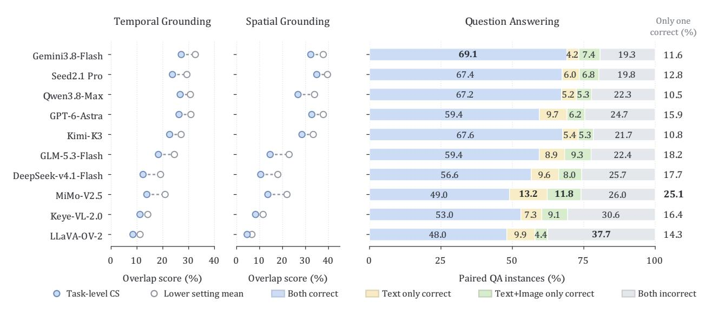

그림 B3. 쌍별 참조 사양에 따른 일관성. Grounding은 동일한 적격 쌍에서 낮은 설정별 평균과 CS를 비교한다. QA 막대는 두 설정에서의 정확성에 따라 쌍을 구분한다; 파란색은 CSQA를 나타낸다. 오른쪽

<span id="page-19-1"></span>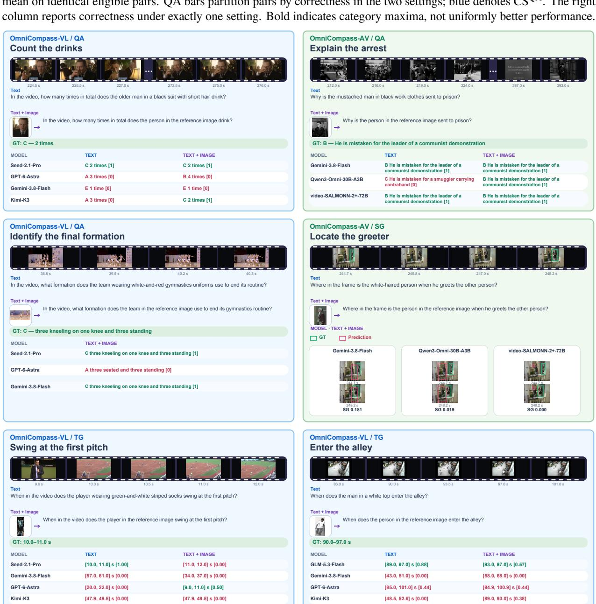

그림 B4. 우리 OmniCompass-VL 및 OmniCompass-AV에 대한 정성적 분석. 두 평가 트랙에서 여섯 가지 사례에 대한 서로 다른 모델의 예측.


obbo 🔨

0.019 and 0.000, respectively.

# <span id="page-20-0"></span>C Benchmark Construction

## <span id="page-20-1"></span>**C.1** Video Sources and Selection

<span id="page-20-2"></span>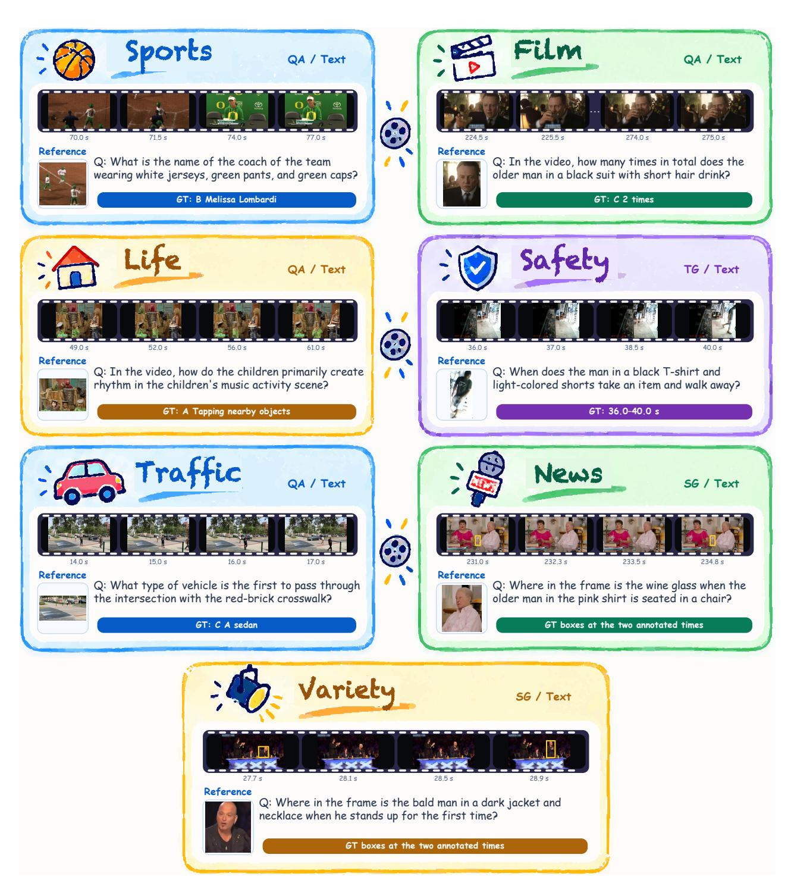

Figure C1. Seven high-level domains of videos in OmniCompass.

OmniCompass-VL은 580개의 선택된 공개 소스 비디오와 240개의 자체 수집 클립을 포함한다. 공개 구성 요소는 아홉 개의 데이터셋 패밀리에서 가져오며, Table C1은 820비디오 세트에 각 소스가 기여한 비율을 보고한다. 자체 수집 구성 요소는 70개의 영화 클립, 70개의 TV 시리즈 클립, 50개의 버라이어티 쇼 클립, 그리고 50개의 뉴스 클립으로 구성된다. 이 동일한 240개의 비디오는 OmniCompass-AV도 지원하며, 별도의 음성-시각 작업 주석이 있다. 두 트랙은 비디오를 공유하지만, 그들의 TG, SG, QA 주석은 공유된 비디오 콘텐츠에서 서로 다른 이벤트와 타깃을 선택할 수 있다. Figure C1은 OmniCompass의 7개 고수준 비디오 카테고리를 요약한다.

<span id="page-21-0"></span>


**Table C1. OmniCompass에 기여하는 9개의 공개 소스 데이터셋.** 수치는 선택된 비디오를 기준으로 하며 전체 소스 릴리스를 포함하지 않는다. 도메인은 최종 OmniCompass 분류 체계를 따르며, News는 다큐멘터리, 자연, 지식 콘텐츠를 포함한다. 링크는 다운로드를 가리킨다.

| 출처 | 비디오 | 선택된 도메인 | 라이선스 / 이용 조건 | 링크 |
|--------------------------------------------|--------|--------------------------------------------------|----------------------------------------------|---------------------------------------------------------------------------------------|
| MultiSports (Li et al., 2021) | 83 | 스포츠 | CC BY-NC 4.0 | https://huggingface.co/datasets/MCG-NJU/<br>SportsAction |
| LiveSports-3K (Chen et al., 2025b) | 92 | 스포츠 | 미정 | https://huggingface.co/datasets/stdKonjac/<br>LiveSports-3K |
| UCF-Crime (Sultani et al., 2018) | 111 | 안전 | CC0-1.0 (미러) | https:<br>//huggingface.co/datasets/AllenXeon/ucf_crime |
| CG-Bench (Chen et al., 2025a) | 58 | 영화, 버라이어티, 뉴스, 생활, 안전, 교통 | MIT; 학술 연구용 비디오만 | https:<br>//huggingface.co/datasets/CG-Bench/CG-Bench |
| MovieChat-1K-test (Song et al., 2024) | 20 | 뉴스 | 미정 | https://huggingface.co/datasets/Enxin/<br>MovieChat-1K-test |
| ActivityNetQA (Yu et al., 2019) | 37 | 생활 | MIT; 비상업적 사용 | https://huggingface.co/datasets/lmms-lab/<br>ActivityNetQA |
| QVHighlights (Lei et al., 2021) | 88 | 생활, 뉴스 | CC BY-NC-SA 4.0 (주석용) | https://huggingface.co/datasets/yeliudev/<br>VideoMind-Dataset/tree/main/qvhighlights |
| StreetScene (Ramachandra & Jones, 2020) | 32 | 교통 | CC BY-SA 4.0 | https://zenodo.org/records/10870472 |
| ComplexVAD (Mumcu et al., 2025) | 59 | 교통 | CC BY-SA 4.0 | https://zenodo.org/records/15707073 |

우리는 기본 미디어에 대한 전체 라이선스가 아니라 출처를 문서화한다. 우리의 주석과 소스 비디오는 별개의 자산이며, 데이터셋 저장소를 재사용한다고 해서 그 비디오를 재배포할 수 있는 권한이 생기는 것은 아니다. 자체 수집한 클립은 학술 평가에 사용되며, 원본 프로그램에 대한 권리는 소유자에게 남아 있다. 접근 및 재배포는 비디오와 참조 이미지에 대한 제한을 포함한 해당 소스 조건을 준수해야 한다.

우리는 Qwen3-VL-8B-Instruct [(Bai et al.,](#page-10-5) [2025)](#page-10-5)를 사용해 8,489개의 도메인 정렬 공개 후보를 프로파일링한다. 출력은 엔티티, 액션, 속성, 장면을 설명하며, 비디오 설명과 해당 수치를 함께 제공한다. 보관 기록은 엔티티 정보를 동일하게 사용한다. Figure [C2](#page-22-3)은 이 필드를 엔티티로 표시한 프로파일링 템플릿을 제시하며, 논문의 용어와 일관성을 위해 사용된다. 이러한 자동 설명은 후보 선택을 안내하고, 주석자는 질문을 구성하고 필요한 증거를 위치시키며 답변을 검증한다.

결정론적 필터링은 30초 미만인 1,454개의 후보를 제거해 7,035개의 비디오를 남긴다. 추가로 89개는 네 가지 단서 유형 중 하나라도 부족해 6,946개의 적격 공개 후보가 된다. 필터링 기준은 선택 파이프라인에서 사용되는 메타데이터와 함께 양의 엔티티, 액션, 속성, 장면 수를 요구한다. 이 수치는 수동 작업 구성 전 후보 풀을 설명하며, 검증된 벤치마크 질문은 아니다.

## <span id="page-21-1"></span>**C.2 Task-Oriented Candidate Scoring (작업 지향 후보 점수)**

후보 순위는 참조 필요성, 기반 적합성, 시공간 유용성, 증거 다양성을 각각 0.35, 0.25, 0.25, 0.15의 가중치로 결합한다. 이 휴리스틱 구성 요소는 모델 평가 점수가 아니라 구조화된 프로파일링 통계치를 사용한다. Table [C2](#page-23-0)은 0~10 척도에서 기록된 구성 요소 계산을 정의한다. 점수는 도메인, 지속 시간, 출처, 하위 범주 범위와 함께 단축 목록을 안내하며, 인간 큐레이션이 최종 공개 세트를 결정한다.

# <span id="page-21-2"></span>**C.3 Question-Answering Taxonomy (질문-답변 분류)**

QA 유형은 각 질문에 필요한 주된 연산에 따라 그룹화된다. 인지는 가용 증거에서 직접 인식 및 판단을 다루며, 추론은 시간적, 인과적, 비교적 관계를 다룬다. 두 트랙 모두 다섯 개의 답변 옵션을 사용하지만, AV 질문은 음성, 소리, 또는 공동 오디오-비주얼 증거를 활용하도록 설계되었기 때문에 유형 세트가 다르다. 공통 형식은 점수를 표준화하지만 트랙 간 난이도를 동일하게 만들지는 않는다.

OmniCompass-VL은 8개의 QA 유형을 포함하며, Table [C3](#page-25-0)에 나열되고 Figure [C3.](#page-24-0)에 표시된다. 사실 인식, 행동 인식, 속성 인지, 시각적 계산, 공간 인지가 인지 그룹을 형성한다.


}


```  
구조화된 비디오 프로파일링 프롬프트  
당신은 사실적인 비디오 캡션 및 구조화된 추출 보조자입니다.  
명확히 보이거나 들리는 것만 설명하십시오. 추측하지 마십시오.  
유효한 JSON 객체 하나만 출력하십시오.  
JSON을 어떤 필드 안에도 넣지 마십시오. 다음과 같이 작성하십시오:  
 1. detailed_description: 3–6 문장, 시간 순서대로.  
 2. entity: 카테고리와 instance_count, 짧은 노트를 포함한 목록.  
 3. action: 최대 12개의 시계열적으로 구분 가능한 액션 변형.  
 4. attribute: 최대 12개의 가시적 단서.  
 5. scene: 최대 6개의 단계, 샷, 또는 맥락.  
 6. counts: entity = entity.instance_count 합계; others = 목록 길이.  
필수 JSON 출력  
정확한 키를 가진 JSON을 반환하십시오:  
{  
"detailed_description":"...",  
"entity":[{"category":"...","instance_count":0,"notes":"..."}],  
"action":["..."],  
"attribute":["..."],  
"scene":["..."],  
"counts":{"entity":0,"action":0,"attribute":0,"scene":0}  
}  
```

**Figure C2. Qwen3-VL-8B-Instruct와 함께 사용되는 구조화된 비디오 프로파일링 프롬프트.**

Temporal Reasoning, Causal Reasoning, and Comparative Judgment은 추론 그룹을 구성한다. 라벨은 질문의 개별 단어가 아니라 답변 작업에 따라 결정된다.

OmniCompass-AV는 Table [C4](#page-25-1)와 Figure [C3.](#page-24-0)에 나열된 다섯 개의 QA 유형을 포함한다. Speech Understanding, Event Understanding, Emotion Recognition은 인식 그룹을 구성하고, Temporal Reasoning과 Causal Reasoning은 추론 그룹을 구성한다. Event Understanding은 청각적 단서를 가시적 참여자, 행동, 상태 또는 맥락에 연결한다. 이 라벨은 오디오가 제거될 때 모든 항목이 실패한다는 측정된 보장을 제공하기보다 의도된 증거 요구 사항을 설명한다.

## <span id="page-22-1"></span>**C.4 참조 설계 및 출처**

참조 이미지는 Table [C5.](#page-26-2)에서 정의된 대로 엔티티, 액션, 속성 또는 장면 정보를 통해 대상을 식별한다. 분석 단위는 고유 이미지 파일이나 비디오가 아니라 작업별 참조이다. 820개의 VL 비디오는 각각 TG, SG, QA에 대해 하나의 참조를 제공하여 총 2,460개의 작업 인스턴스를 생성한다. 작업은 서로 다른 대상을 선택할 수 있으며, 그 단서 유형과 출처는 별도로 계산된다.

엔티티 단서는 2,460개의 참조 중 1,960개, 즉 79.7%를 차지한다. 나머지 참조는 171개의 액션 단서, 200개의 속성 단서, 129개의 장면 단서로 구성된다. 예시에는 스포츠에서 인식 가능한 행동과 교통에서 외형 기반 차량 구분이 포함된다. Figure [C4](#page-26-1)은 도메인별 빈도를 보고하며, 단서 유형은 이 세트에서 균등하게 나타나지 않는다.

참조 세트는 1,933개의 비디오 내부 이미지와 527개의 인터넷 이미지를 포함한다. 비디오 내부 크롭은 녹화에 특화된 대상의 정체성을 보존하며, 외부 예시는 인식 가능한 사람, 물체 또는 행동을 지정할 수 있다. 소스 선택은 고정된 도메인 할당량이 아니라 각 주석의 식별 필요에 따라 결정된다. 이 변동은 벤치마크의 참조 조건의 일부이며 독립적으로 제어되는 소스-모달리티 실험이 아니다.

비디오 내부 참조의 경우, 주석 가이드라인은 가능할 때마다 대상 구간이나 QA 단서 구간 외부의 별도 시점을 선호한다. 검토자는 또한 이미지가 답변 이벤트를 드러내는지 여부를 검사한다. 이는 시간적 분리만으로는 의미적 누출을 배제할 수 없기 때문이다. 크롭은 대상 식별 내용을 보존하면서 불필요한 맥락과 직접적인 답변 증거를 제한한다. 이러한 검사는 대상 사양을 작업 해결에 필요한 증거와 분리하려는 목적을 가진다.

# <span id="page-22-2"></span><span id="page-22-0"></span>**D 주석 품질 및 검증**

<span id="page-23-0"></span>


Table C2. 구조화된 비디오 프로파일링 출력에서 작업 지향 점수 신호로의 매핑. 우리는 Qwen3-VL-8B-Instruct가 생성한 구조화된 비디오 프로파일링 출력을 중간 통계로 변환한 뒤, 이를 사용해 네 가지 점수 구성요소를 계산하는 방식을 요약한다.

| Component | Derived profiling fields | Computation | Intuition |
|-------------------------------------|----------------------------------------------------------------------------|-----------------------------------------------------------------------------------------------------------------------------------------------------------------------------------------------------------------------------------------------------------------------------------------------------------------------------------------------------------------------------------------------------------------------|-------------------------------------------------------------------------------------------------------------------------------------------|
| Reference Necessity (R) | entity_count, action_count, attribute_count, scene_count, repeated actions | We first compute <i>모호성</i> and <i>풍부함</i>. 모호성은 후보 엔티티가 많고, 반복된 행동, 장면 변동, 잠재적 속성 혼동이 있을 때 증가한다. 풍부함은 엔티티, 행동, 속성, 장면 신호를 더 넓게 포괄할 때 증가한다. 이후 이를 $R = 10 \cdot (0.60A + 0.20B + 0.20AB)$ 으로 결합한다. 여기서 $A$와 $B$는 정규화된 모호성 및 풍부함 점수이다. | 참조적 단서가 필요하다 |
| Grounding<br>Suitability (G) | <pre>entity_count, action_count, attribute_count, scene_count</pre> | 우리는 행동과 장면 수에서 시간적 기초 가능성을, 엔티티와 속성 수에서 공간적 기초 가능성을, 행동과 장면 관련 복잡성에서 질문 응답 가능성을 추정한다. 최종 점수는 $G = 10 \cdot \text{avg}(P_{\text{TG}}, P_{\text{SG}}, P_{\text{QA}})$ 이다. | TG, SG, VideoQA 구성을 지원한다 |
| Temporal-<br>Spatial Utility<br>(T) | video duration,<br>entity_count,<br>action_count,<br>scene_count |  | 충분한 시간 범위와 시각적 변화를 제공하여<br>증거를 확보한다 |
| Evidence Diversity $(E)$ | <pre>entity_count, action_count, attribute_count, scene_count</pre> | 우리는 네 가지 증거 수에 대해 정규화된 엔트로피를 계산한다: $E = 10 \cdot H_{\text{norm}}(c_{\text{ent}}, c_{\text{act}}, c_{\text{att}}, c_{\text{scn}})$ . |  |
| Final Score (S) | R,G,T,E | S = 0.35R + 0.25G + 0.25T + 0.15E | 다양한 참조 단서를 요구하고, TG/SG/VideoQA 구성을 지원하며, 주석을 위한 다양한 증거를 제공하는 영상을 장려한다 |

## **D.1** 검토 기준 및 수리 기록 (Review Criteria and Repair Records)

품질 관리는 의미적 검토와 구조적 검증을 결합한다. 검토자는 쌍 설정 대상 정체성, 시간-이벤트 완전성, 엔드포인트 박스 정렬, QA 답변 고유성, 증거 충분성을 확인한다. AV 검토는 추가로 음성 또는 소리 의존성 및 시청각 일치를 검토한다. 반환된 수정은 작업 수준 재검증과 리드-전문가 수락을 거친다. Tables D1과 D2는 검증 단계와 대표적인 문제를 요약한다.

## <span id="page-23-1"></span>D.2 인간 노력 (Human Effort)

구축 및 검증 기록은 1,784인간-시간, 즉 223개의 8시간 인원-일에 해당하는 회고적 추정치를 제공한다. 이는 1,280 어노테이터-시간과 504 리드-전문가-시간으로 구성되며, Table D3에 자세히 명시되어 있다. 이 추정치는 교육, 작업 구축, 교차 검증, 수정, 중재, 최종 감사를 포함한다. 이 추정치는 연속적인 시간 기록 대신 프로젝트 기록에서 재구성되었으며, 자동 처리, 모델 추론, 대기 기간은 제외된다.


<span id="page-24-0"></span>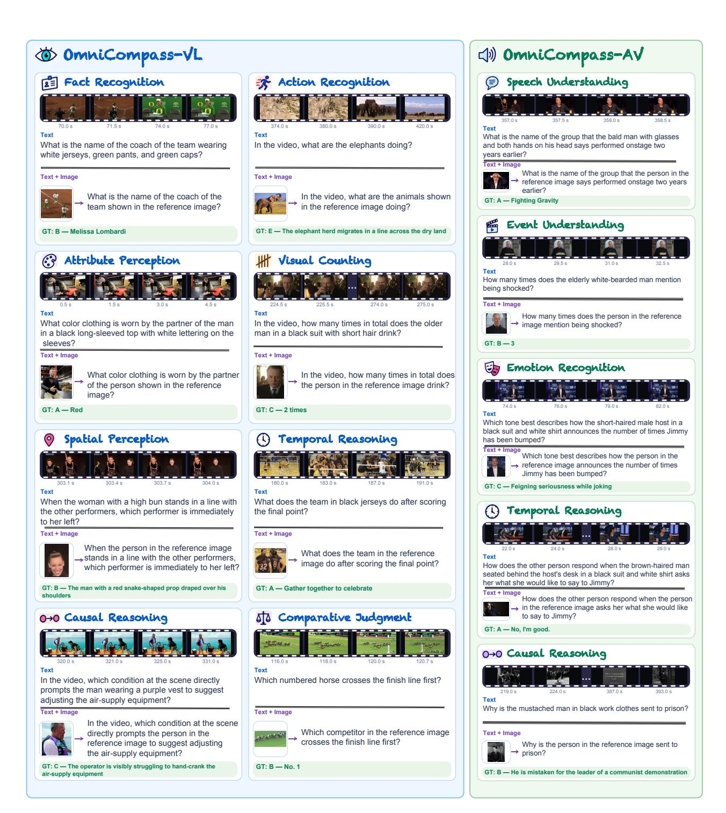

Figure C3. OmniCompass-VL 및 OmniCompass-AV의 QA 분류 체계.


**Table C3. OmniCompass-VL의 QA 분류 및 예시.** 우리는 여덟 가지 QA 유형을 지각 및 추론으로 구분한다. 예시는 *텍스트* 대상-사양 설정에서 질문 텍스트만을 보여주며, 답변 옵션은 생략된다.

<span id="page-25-0"></span>

| 카테고리 | QA 과제 | 과제 정의 | 예시 |
|------------|----------------------|----------------------------------------------------------------------------------------------------|--------------------------------------------------------------------------------------------------------------------------------------------------------------------------------------------------------------------------|
| 지각 | 사실 인식 | 참조 대상과 관련된 엔티티 또는 명시적 사실<br>을 식별한다. | 비디오에서, 검은 정장을 입은 남성<br>테이블 왼쪽에 앉아 두 사람에게 말하고 있을 때,<br>여성 앞에 있는 음료는 무엇인가? |
|  | 행동 인식 | 참조 대상이 수행한 행동을 식별한다. | 비디오에서, 분홍색 후디를 입은 젊은 남성이 집 안의 두 여성 각각에게 작별 인사를 할 때 어떤 제스처를 보였는가? |
|  | 속성 지각 | 대상의 외모, 속성 또는 관찰 가능한 상태를 식별한다. | 비디오에서, 빨간 모자를 쓴 여성<br>노란 옷을 입은 사람들과 함께 춤추고 있을 때,<br>뒤에 있는 여성이 들고 있는 기름종이 우산의 색은 무엇인가? |
|  | 시각적 카운팅 | 참조된 엔티티, 행동 또는 이벤트 발생을 세어라. | 비디오에서, 선수는 한 손을 들고 파트너와 하이파이브를 할 때 몇 번 회전했는가? |
|  | 공간 지각 | 참조 대상이 포함된 장면의 맥락, 위치 또는 공간 관계를 결정한다. | 비디오에서, 회색 모자와 연한 파란색 반팔 셔츠를 입은 남성이 차를 만들 때 바라보는 방향을 기준으로,<br>주전자는 그 남성에 대해 어디에 있는가? |
| 추론 | 시간적 추론 | 특정 참조 이벤트 이전, 중간 또는 이후의 사건 또는 상태를 식별한다. | 비디오에서, 파란 셔츠를 입은 남성이 첫 번째 엘리베이터에 들어가기 전에,<br>같은 엘리베이터에 들어온 이전 그룹 중 어떤 유형의 승객이 있는가? |
|  | 인과 추론 | 관찰된 사건을 연결하는 원인, 효과 또는 동기를 추론한다. | 비디오에서, 짧은 금발 머리 소년이 비밀스럽게 계란을 반복적으로 버리는 이유는 무엇이며,<br>직접 반환하거나 거절하지 않는가? |
|  | 비교 판단 | 대상, 사건, 상태 또는 결과를 비교하여 차이, 순위 또는 변화를 결정한다. | 비디오에서, 다채로운 무늬가 있는 무스커트 상의를 입은 여성 진행자가 질문을 했을 때,<br>무대에 있는 여러 사람이 번갈아 답변할 때 그들의 답변 시간 간의 관계는 무엇인가? |

**표 C4. OmniCompass-AV의 QA 분류 및 예시.** 우리는 다섯 개의 QA 유형을 인지와 추론으로 분류한다. 예시는 *Text* 대상-사양 설정에서 질문 텍스트만을 보여주며, 답변 옵션은 생략된다.

| 카테고리 | QA 과제 | 과제 정의 | 예시 |
|------------|----------------------|----------------------------------------------------------------------------------------------------|----------------------------------------------------------------------------------------------------------------------------------------------------------------------------------------------------------------|
| 지각 | 음성 이해 | 명시적 음성 내용을 이해한다,<br>사실, 수량,<br>설명, 의견을 포함하여. | 검은 가죽 재킷과 흰색 상의를 입은 회색 머리카락을 가진 남자가<br>당시 젊은이들에게 Nike 스우시가 의미했던 것을 어떻게 요약했는가? |
|  | 이벤트 이해 | 음성-시각 이벤트에서 참가자, 객체, 행동,<br>상태, 또는 수량을 식별한다. | 머리를 묶은 여성, 파란색 오프숄더 상의, 갈색 오버올을 입은 여성이 Sean의 최근 사망한 아버지를 소개할 때,<br>관련된 액자 사진 옆에 어떤 물건 쌍이 나타나는가? |
|  | 감정 인식 | 음성-시각 증거에서 감정, 어조, 태도, 또는<br>감정 반응을 인식한다. | 비디오에서 빨간 옷을 입은 남성의 반복적인 교정 이후,<br>어깨 길이의 적갈색 머리카락을 가진 여성은 그가 이야기를 말하고 싶어하는지 물을 때 어떻게 들리는가? |
| 추론 | 시간적 추론 | 발언, 사건, 상태의 순서 또는 시간적<br>관계를 결정한다. | 비디오에서 금발 여성이 회색 수염을 가진 남성을 오만하다고 부르기 전에, 그는 무엇을 하고 있는가? |
|  | 원인적 추론 | 음성-시각 맥락에서 원인, 동기, 또는<br>결과를 추론한다. | 왜 빨간 초커와 검은 상의를 입은 여성이 조이와의 어색함을 피하기 위해 거짓말을 했는지 그가 결국 직장을 잃게 될 수 있었는가? |


**Table C5. OmniCompass-VL에서 참조 정보의 기능적 분류**. 각 유형은 참조 이미지가 대상 식별에 기여하는 바를 명시하고 대표 예시를 제시한다.

<span id="page-26-2"></span>

| 참조 유형 | 목표 식별에서의 역할 및 일반 예시 |
|----------------|---------------------------------------------------------------------------------------------------------------------------------------|
| 개체 | 모델이 여러 관점에서 일치시켜야 하는 특정 인물이나 객체를 보여준다. 예를 들어, 운동선수,<br>배우, 차량, 가방 등이 있다. |
| 행동 | 목표 행동을 정의하는 인식 가능한 동작 또는 이벤트 패턴을 보여준다. 예를 들어, 던크,<br>농구 슛, 헤더, 태클 등이 있다. |
| 속성 | 가시적인 속성, 외관, 상태를 통해 목표를 구분한다. 예를 들어, 옷 색상,<br>차량 종류, 모양, 포즈 등이 있다. |
| 장면 | 비디오 세그먼트와 일치시키기 위해 장소나 주변 시각적 맥락을 보여준다. 예를 들어, 거리,<br>방, 무대, 경기장 등이 있다. |

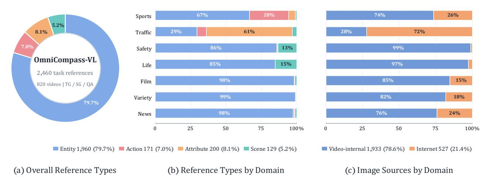

**Figure C4. 2,460개의 VL 작업 인스턴스에 대한 참조 구성.** 패널 **(a)**는 전체 큐 유형 빈도를 보여주며, **(b)**는 도메인별 비율을, **(c)**는 비디오 내부와 인터넷 소스를 비교한다. 수치는 작업 인스턴스당 보고되므로, 작업 간에 재사용되는 이미지는 두 번 이상 계산된다.

**Table D1. OmniCompass‑VL의 다단계 품질 검증.** 모든 수치는 최종 820비디오 릴리스 세트를 사용한다. 비디오는 연결된 *Text*와 *Text+Image* 사양 및 TG, SG, QA 주석이 검증 기준을 충족할 때만 통과한다. 대표적인 결과는 상호 배타적이지 않다.

| 검증 단계 | 비디오 | 단계 결과 | 대표적 발견 | 누적 합격 |  |
|--------------------------------------------------------|--------|----------------------------------------------------------------------------------|----------------------------------------------------------------------------------------------------------------------------------------------------------------------------------------------------------------------------------------|-----------------|--|
| 주석자<br>교차<br>검증 | 820 | 466은 수정이 필요하지 않으며;<br>354는 수정이 필요하도록 반환됩니다.<br> | 설정 간 목표 불일치; 텍스트+이미지 포인터가 이미지 없이 식별 가능;<br>부정확한 TG 경계;<br>잘못되었거나 불완전한 SG 목표;<br>불충분한 QA 증거;<br>중복되지 않은 답변,<br>또는 약한 방해 요소. | 466/820 (56.8%) |  |
| 주석자<br>수정<br>및<br>주요 전문가 수락 | 354 | 모든 수정된 사례는 주석자 재검토 및 주요 전문가 수락 후 통과된다. | 일반적인 수리는 지나치게<br>작거나 부분적인 SG 목표, TG가 이벤트의 일부를 생략하는<br>구간, 그리고 QA 질문, 답변, 유형 및 증거 간의 불일치를 다룬다. | 820/820 (100%) |  |
| 최종 공개 감사 | 820 | 모든 VL 사례는 주요 전문가 수락 후에만 포함된다. | 같은 목표 및 실제값이<br>전반적으로<br>설정 간에 일치;<br>완전한<br>TG<br>이벤트;<br>유효한<br>경계-프레임<br>박스;<br>증거가 뒷받침되는<br>QA 답변과 그럴듯한 방해 요소. | 820/820 (100%) |  |


<span id="page-27-0"></span>**표 D2. OmniCompass-AV의 다단계 품질 검증.** 모든 수치는 최종 릴리스의 240비디오 AV 하위 집합을 사용한다. 공유된 VL 기준 외에도, 주석자는 원본 오디오 의존성과 오디오-비주얼 정렬을 확인하며, 주요 전문가는 이 기준들을 최종 승인 및 감사에 포함한다. 대표적인 결과는 배타적이지 않다.

| Verification stage | Videos | Stage outcome | Representative findings | Cumulative pass |  |
|---------------------------------------------------------------|--------|--------------------------------------------------------------------------------------|---------------------------------------------------------------------------------------------------------------------------------------------------------------------------------------------------|-----------------|--|
| Annotator<br>cross<br>verification<br>(AV-specific<br>checks) | 240 | 151은 목표 재수정이 필요 없었으며; 89는 105개의 작업 수준 이슈에 대해 수리를 진행했다. | 불충분한 오디오 의존성; 필요한 음성 또는 소리를 생략한 단서 구간; 오디오-비주얼 대상 불일치; 잘못된 인물에 따라 SG 박스; 지원되지 않는 QA 답변. | 151/240 (62.9%) |  |
| Annotator revision and lead-expert acceptance | 89 | 24 TG, 70 SG, 11 QA 주석이 수정되었으며, 모든 89 비디오가 승인되었다. | TG 구간이 너무 일찍 시작; SG 참조, 질문, 박스가 다른 대상을 식별; QA 유형 또는 증거 불일치; 불균형한 방해 요소. | 240/240 (100%) |  |
| Final release audit | 240 | 모든 AV 사례는 선임 전문가 승인 및 감사를 거친 후에만 포함된다. | 필수 원본 오디오 증거; 정렬된 오디오-비주얼 단서; 설정 간 동일한 대상 및 답변; 유효한 TG, SG, QA 주석. | 240/240 (100%) |  |

<span id="page-27-1"></span>**표 D3. OmniCompass 구축 및 품질 보증을 위한 추정 인력 소요량.** 시간은 8시간 근무일을 기준으로 날짜가 기록된 프로젝트 기록에서 재구성되었다. 자동 처리, 추론, 대기 시간은 제외된다.

| Stage | Personnel | Scope | Person-days | Hours |
|-------------------------------------------------------------|---------------------------------|---------------------------------------------------------------------------------------------------------------------------------------------------------------------------|-------------|-------|
| 가이드라인 교육 | 4명 주석자 | 2일간의 가이드라인 교육 및 파일럿 프로토콜 보정. | 8 | 64 |
| 초기 작업 구성 | 4명 주석자 | 텍스트 및 텍스트+이미지 TG, SG, QA 인스턴스 820 VL 비디오에 대해, 240비디오 AV 하위집합 포함. | 112 | 896 |
| 상호<br>교차<br>검증<br>및<br>목표 지향적 수정 | 4명 주석자 | 354개의 플래그가 지정된 VL 사례와 검증 중에 확인된 트랙별 AV 수리 내에서 상호 교차 검증 및 수정. | 40 | 320 |
| 최종 승인 및<br>수정 | 주요 전문가 | 주석자 확인 사례의 최종 승인, 대상 쌍, 참조 필요성, TG/SG 유효성, QA 증거 및 AV 의존성에 대한 남은 수정 포함. | 31 | 248 |
| 수리 판정 | 주요 전문가 | 수리 패키지 검토, 분쟁 사례 해결, 수정된 주석의 재검증. | 16 | 128 |
| 주요 전문가 최종 릴리스 감사 | 주요 전문가 | 쌍 설정 일관성, 대시보드 재확인, 잔여 오류 검사, 최종 릴리스 검증. | 16 | 128 |
| 총계 | 4명 주석자 + 1<br>주요 전문가 | 전 과정 인간 구축 및 품질 보증. | 223 | 1,784 |


# <span id="page-28-0"></span>**E 평가 프로토콜 및 프롬프트 (E Evaluation Protocols and Prompts)**

# <span id="page-28-1"></span>**E.1 입력 및 쌍 설정 (E.1 Inputs and Paired Settings)**

프레임은 전체 비디오를 균일하게 샘플링한다. 표준 예산은 독점 모델과 총 파라미터가 100B를 초과하는 오픈소스 모델에 대해 64, 그렇지 않으면 32이다. GPT 시리즈는 평가된 50-이미지 입력 한계 내에서 참조 슬롯을 확보하기 위해 49 프레임을 사용하며, VITA-1.5-7B는 16을 사용한다. 예산은 모델 내에서 작업 및 참조 설정에 따라 고정된다. 따라서 교차 모델 결과는 명시된 입력 예산을 반영하며, 엄밀히 같은 연산량 비교는 아니다.

Figure [E1,](#page-29-0)의 52초 VL 클립에 대해 64프레임 입력은 다음과 같다:

텍스트: 타임스탬프: 0초. <프레임 0> →
           타임스탬프: 0.84초. <프레임 1> →
           ...
           타임스탬프: 51.96초. <프레임 63> →
           [Prompt]
텍스트+이미지: 타임스탬프: 0초. <프레임 0> →
           타임스탬프: 0.84초. <프레임 1> →
           ...
           타임스탬프: 51.96초. <프레임 63> →
           <ref 이미지> → [Prompt]

Figure [E4,](#page-32-0)의 270초 AV 클립에 대해 오디오는 샘플링된 프레임 뒤에 따라온다:

텍스트: 타임스탬프( Timestamp): 0 초( seconds). <frame 0> →
           타임스탬프: 4.3 초. <frame 1> →
           ...
           타임스탬프: 269.967 초. <frame 63> →
           <audio> → [Prompt]
텍스트+이미지: 타임스탬프: 0 초. <frame 0> →
           타임스탬프: 4.3 초. <frame 1> →
           ...
           타임스탬프: 269.967 초. <frame 63> →
           <audio> → <ref image> → [Prompt]

각 타임스탬프는 비디오 시작 시점부터 초 단위의 실제 텍스트이며, 해당 프레임 바로 앞에 배치된다. 이는 TimeLens [(Zhang et al.,](#page-14-8) [2026)](#page-14-8)의 설계에 따른다. 프레임 번호는 샘플링된 프레임을 0부터 인덱싱한다: <frame 0>이 첫 번째, <frame 63>이 이 64프레임 예시의 마지막이다. 각괄호로 묶인 항목은 미디어 콘텐츠를 나타내며 실제 텍스트 토큰은 아니다. <audio>는 비디오의 오디오 트랙, <ref image>는 작업별 참조 이미지이다. 화살표는 입력 순서를 나타내며, ...는 중간 타임스탬프–프레임 쌍을 생략한다; 이 둘은 모델에 전달되지 않는다. [Prompt]는 전체 비디오 길이를 포함한 작업 프롬프트를 의미한다. 표시된 타임스탬프는 이 클립에 특화된 것이며, 다른 비디오나 프레임 예산에 대해 고정된 것은 아니다. 각 쌍 내에서 비디오 증거, 작업 의미론, 그리고 정답은 공유되며, 타깃 사양만 변경된다.

TG는 시간 경계치를 반환하고, QA는 다섯 개의 답변 옵션 중 하나를 선택한다. V-STaR [(Cheng](#page-10-2) [et al.,](#page-10-2) [2026)](#page-10-2)를 따라 SG는 관련 구간을 받아 각 끝점에서 하나의 바운딩 박스를 반환한다. 따라서 제공된 시점에서 타깃 로컬라이제이션을 평가하며, 구간 전체에 대한 시간 검색이나 밀집 추적은 수행하지 않는다. Figures [E1](#page-29-0)[–E6](#page-34-1)은 주석이 달린 정답과 함께 응답 형식을 보여준다. 출력 패널은 두 설정 모두에서 모델에 제공되지 않는다.

# <span id="page-28-2"></span>**E.2 프롬프트 예시 (E.2 Prompt Examples)**

Figures [E1](#page-29-0)[–E3](#page-31-0]과 [E4](#page-32-0)[–E6](#page-34-1)은 각각 OmniCompass-VL과 OmniCompass-AV 프롬프트를 보여준다.

<span id="page-29-0"></span>


#### **입력**

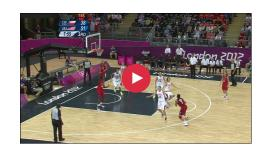

비디오 프레임

#### **프롬프트**

52초 비디오를 균일하게 샘플링한 프레임 시퀀스가 주어진다. 각 비디오 프레임 앞에는 초 단위 타임스탬프가 붙어 있다. 이 비디오 프레임의 시각적 내용에 따라 과제를 완수하라.

**질문:** 비디오에서 팀 USA 선수 No. 7이 첫 번째 바스켓을 득점한 시점은 언제인가?

**출력 형식:** 시작 시각과 종료 시각이 비디오 시작부터 초 단위로 측정된 JSON 객체만으로 답변하라.

{"start_time": <number>, "end_time": <number>}

## **출력 (Output)**

**실제값 (Ground Truth):** {"start_time": 48.0, "end_time": 50.0}

#### *텍스트+이미지 (Text+Image)*

#### **입력 (Input)**

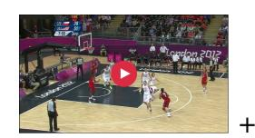

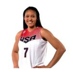

비디오 프레임 및 참조 이미지

#### **프롬프트 (Prompt)**

52초 길이의 비디오에서 균일하게 샘플링된 프레임 시퀀스와 그 뒤에 참조 이미지가 주어집니다. 각 비디오 프레임 앞에는 초 단위 타임스탬프가 붙어 있습니다. 비디오 프레임과 참조 이미지의 시각적 내용에 따라 작업을 수행하십시오.

**Question:** 비디오에서 참조 이미지에 있는 플레이어가 첫 번째 골을 득점한 시점은 언제인가?

**Output format:** 시작 시각과 종료 시각은 비디오 시작부터 초 단위로 측정한 값이며, 이 JSON 객체만으로 답하십시오:

{"start_time": <number>, "end_time": <number>}

### **출력 (Output)**

**실제값:** {"start_time": 48.0, "end_time": 50.0}

**Figure E1. OmniCompass-VL을 위한 Temporal Grounding 프롬프트.** 두 설정 모두 동일한 균일하게 샘플링되고 타임스탬프가 지정된 비디오 프레임(오디오 없이)을 받아 같은 이벤트 구간을 예측합니다. 대상 사양만 텍스트 설명에서 참조 이미지로 바뀝니다.


#### **입력 (Input)**

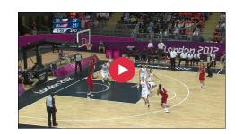

비디오 프레임

#### **프롬프트 (Prompt)**

52초 길이의 비디오에서 균일하게 샘플링된 프레임 시퀀스가 주어집니다. 각 비디오 프레임 앞에는 초 단위 타임스탬프가 붙어 있습니다. 비디오 프레임의 시각적 내용에 따라 작업을 수행하십시오.

**Question:** 팀 USA 선수 No. 7이 슈팅 동작을 시작한 시점부터 공이 들어가는 시점까지 프레임에서 어디에 있는가?

관련 구간은 48.72초에 시작해 50.12초에 끝납니다. 질문에서 묘사된 대상을 이 두 타임스탬프 각각에서 찾아 각 프레임에 대해 하나의 바운딩 박스를 보고하십시오.

각 박스를 [x1, y1, x2, y2] 순서로 작성하십시오. 이는 [왼쪽, 위, 오른쪽, 아래]에 해당합니다. 모든 좌표를 0에서 1000 사이로 정규화하고, 프레임의 좌상단을 원점으로 합니다.

**Output format:** 이 JSON 객체만 반환하십시오:

{"start_time": 48.72,

"start_bbox": [<x1>, <y1>, <x2>, <y2>],

"end_time": 50.12,

"end_bbox": [<x1>, <y1>, <x2>, <y2>]}

## **출력 (Output)**

**실제값:** {"start_time": 48.72, "start_bbox": [587.61, 473.21, 628.53, 666.34], "end_time": 50.12, "end_bbox": [644.16, 536.71, 694.75, 833.00]}

## *텍스트+이미지 (Text+Image)*

#### **입력 (Input)**


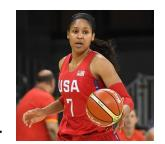

비디오 프레임 및 참조 이미지

### **프롬프트 (Prompt)**

52초 길이의 비디오에서 균일하게 샘플링된 프레임 시퀀스와 그 뒤에 참조 이미지가 주어집니다. 각 비디오 프레임 앞에는 초 단위 타임스탬프가 붙어 있습니다. 비디오 프레임과 참조 이미지의 시각적 내용에 따라 작업을 수행하십시오.

**Question:** 참조 이미지에 있는 플레이어가 슈팅 동작을 시작한 시점부터 공이 들어가는 시점까지 프레임에서 어디에 있는가?

관련 구간은 48.72초에 시작해 50.12초에 끝납니다. 질문에서 묘사된 대상을 이 두 타임스탬프 각각에서 찾아 각 프레임에 대해 하나의 바운딩 박스를 보고하십시오.

각 박스를 [x1, y1, x2, y2] 순서로 작성하십시오. 이는 [왼쪽, 위, 오른쪽, 아래]에 해당합니다. 모든 좌표를 0에서 1000 사이로 정규화하고, 프레임의 좌상단을 원점으로 합니다.

**Output format:** 이 JSON 객체만 반환하십시오:

{"start_time": 48.72,

"start_bbox": [<x1>, <y1>, <x2>, <y2>],

"end_time": 50.12,

"end_bbox": [<x1>, <y1], [x2], [y2]]}

## **출력 (Output)**

**실제값:** {"..."}

**Figure E2. 공간 기반 프롬프트 for OmniCompass-VL.** 두 설정은 동일한 균일하게 샘플링된 타임스탬프가 있는 비디오 프레임과 동일한 시간 간격을 받는다. 두 시간 간격 끝점에서 동일한 대상을 로컬라이즈한다; 대상 사양만 변경된다.

<span id="page-31-0"></span>


#### **Input**

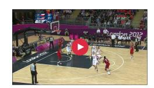

비디오 프레임

#### **Prompt**

52초 길이의 비디오에서 균일하게 샘플링된 프레임 시퀀스를 제공받는다. 각 비디오 프레임 앞에는 초 단위 타임스탬프가 있다. 이 비디오 프레임의 시각적 내용에 따라 과제를 완수한다.

**질문:** 팀 USA 선수 No. 7이 비디오에서 총 몇 점을 득점했는가?

- A. 0점  
- B. 2점  
- C. 3점  
- D. 4점  
- E. 1점

다섯 개 옵션(A, B, C, D, E) 중 가장 적절한 답을 선택해야 한다. 확신이 서지 않을 경우 제공된 입력을 바탕으로 최선의 선택을 하라. 옵션 문자만 출력한다.

## **Output**

**Ground Truth:** B

#### *Text+Image*

#### **Input**

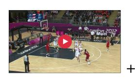

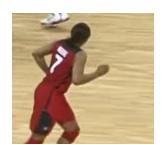

비디오 프레임 참조 이미지

## **Prompt**

52초 길이의 비디오에서 균일하게 샘플링된 프레임 시퀀스와 그 뒤에 참조 이미지가 제공된다. 각 비디오 프레임 앞에는 초 단위 타임스탬프가 있다. 비디오 프레임과 참조 이미지의 시각적 내용에 따라 과제를 완수한다.

**질문:** 참조 이미지에 있는 선수가 비디오에서 총 몇 점을 득점했는가?

- A. 0점  
- B. 2점  
- C. 3점  
- D. 4점  
- E. 1점

다섯 개 옵션 중 가장 적절한 답을 선택해야 한다. 확신이 서지 않을 경우 제공된 입력을 바탕으로 최선의 선택을 하라. 옵션 문자만 출력한다.

## **Output**

**Ground Truth:** B

**Figure E3. 질문 응답 프롬프트 for OmniCompass-VL.** 두 설정은 동일한 균일하게 샘플링된 타임스탬프가 있는 비디오 프레임과 동일한 답변 선택지 및 정답을 유지한다. 대상 사양만 변경된다.

<span id="page-32-0"></span>


#### **Input**

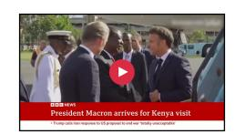

비디오 프레임 및 오디오

### **Prompt**

270초 길이의 비디오에서 균일하게 샘플링된 프레임 시퀀스와 해당 오디오가 제공된다. 각 프레임 앞에는 초 단위 타임스탬프가 있다. 비디오 프레임과 오디오를 사용하여 과제를 완수한다.

**질문:** 긴 갈색 곱슬머리, 흑백 하운드스투스 재킷, 그리고 검은 터틀넥을 입은 여성 뉴스 앵커가 프랑스가 아프리카에서의 역할을 재정의하려 한다는 보도를 언제 비디오에서 하는가?

**출력 형식:** 시작 시간과 종료 시간을 초 단위로 비디오 시작부터 측정한 이 JSON 객체만으로 답변한다:

{"start_time": <number>, "end_time": <number>}

## **Output**

**Ground Truth:** {"start_time": 89.0, "end_time": 92.0}

## *Text+Image*

#### **Input**

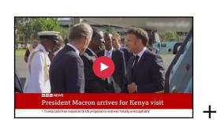

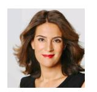

비디오 프레임 및 오디오 참조 이미지

#### **Prompt**

270초 길이의 비디오에서 균일하게 샘플링된 프레임 시퀀스와 해당 오디오, 그리고 그 뒤에 참조 이미지가 제공된다. 각 프레임 앞에는 초 단위 타임스탬프가 있다. 비디오 프레임, 오디오, 참조 이미지를 사용하여 과제를 완수한다.

**질문:** 참조 이미지에 있는 뉴스 앵커가 프랑스가 아프리카에서의 역할을 재정의하려 한다는 보도를 언제 비디오에서 하는가?

**출력 형식:** 시작 시간과 종료 시간을 초 단위로 비디오 시작부터 측정한 이 JSON 객체만으로 답변한다:

{"start_time": <number>, "end_time": <number>}

## **Output**

**Ground Truth:** {"start_time": 89.0, "end_time": 92.0}

Figure E4. OmniCompass-AV를 위한 시계열 기반 프롬프트. 두 설정은 동일한 타임스탬프가 있는 비디오 프레임과 해당 오디오를 받고 동일한 오디오-비주얼 이벤트 구간을 예측한다. 대상 사양만 변경된다.


#### **입력** (Input)


비디오 프레임과 오디오

#### **프롬프트** (Prompt)

270초 길이의 비디오에서 균일하게 샘플링된 프레임 시퀀스와 해당 오디오가 주어집니다. 각 프레임 앞에는 초 단위 타임스탬프가 붙어 있습니다. 비디오 프레임과 오디오를 사용하여 과제를 완수하십시오.

**질문:** 프랑스 대통령 엠만뉘엘 마크롱이 나이로비, 케냐에 도착했다고 보도할 때, 긴 갈색 곱슬 머리와 흑백 헌드스투스 재킷, 그리고 검은 터틀넥을 입은 여성 뉴스 앵커가 프레임에서 어디에 있는가?

관련 구간은 85.03초에 시작해 87.87초에 끝납니다. 질문에서 묘사된 대상을 두 타임스탬프 각각에서 찾아 각 프레임에 대해 하나의 바운딩 박스를 보고하십시오.

각 박스를 [x1, y1, x2, y2] 순서로 작성하십시오. 이는 [왼쪽, 위쪽, 오른쪽, 아래쪽]에 해당합니다. 좌표를 0에서 1000까지 정규화하고, 프레임의 좌상단을 원점으로 합니다.

**출력 형식:** 이 JSON 객체만 반환하십시오:

{"start_time": 85.03,

"start_bbox": [<x1>, <y1>, <x2>, <y2>],

"end_time": 87.87,

"end_bbox": [<x1>, <y1>, <x2>, <y2>]}

## **출력** (Output)

**정답:** {"start_time": 85.03,

"start_bbox": [278.96, 63.39, 749.11, 755.36],

"end_time": 87.87,

"end_bbox": [276.17, 68.35, 735.16, 760.32]}

#### *텍스트+이미지* (Text+Image)

#### **입력** (Input)


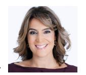

비디오 프레임과 오디오, 참조 이미지

#### **프롬프트** (Prompt)

270초 길이의 비디오에서 균일하게 샘플링된 프레임 시퀀스와 해당 오디오, 그리고 참조 이미지가 주어집니다. 각 프레임 앞에는 초 단위 타임스탬프가 붙어 있습니다. 비디오 프레임, 오디오, 참조 이미지를 사용하여 과제를 완수하십시오.

**질문:** 프랑스 대통령 엠만뉘엘 마크롱이 나이로비, 케냐에 도착했다고 보도할 때, 참조 이미지에 있는 뉴스 앵커가 프레임에서 어디에 있는가?

관련 구간은 85.03초에 시작해 87.87초에 끝납니다. 질문에서 묘사된 대상을 두 타임스탬프 각각에서 찾아 각 프레임에 대해 하나의 바운딩 박스를 보고하십시오.

각 박스를 [x1, y1, x2, y2] 순서로 작성하십시오. 이는 [왼쪽, 위쪽, 오른쪽, 아래쪽]에 해당합니다. 좌표를 0에서 1000까지 정규화하고, 프레임의 좌상단을 원점으로 합니다.

**출력 형식:** 이 JSON 객체만 반환하십시오:

{"start_time": 85.03,

"start_bbox": [<x1>, <y1>, <x2>, <y2>],

"end_time": 87.87,

"end_bbox": [<x1>, <y1>, <x2>, <y2>]}

### **출력** (Output)

**정답:** {"start_time": 85.03,

"start_bbox": [278.96, 63.39, 749.11, 755.36],

"end_time": 87.87,

"end_bbox": [276.17, 68.35, 735.16, 760.32]}

Figure E5. OmniCompass-AV를 위한 공간 기반 프롬프트. 두 설정은 동일한 타임스탬프가 있는 비디오 프레임, 해당 오디오, 그리고 시간 구간을 받고 동일한 대상을 두 구간 끝점에서 로컬라이즈한다; 대상 사양만 변경된다.

<span id="page-34-0"></span>


#### <span id="page-34-1"></span>**입력** (Input)

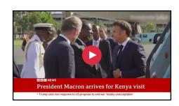

비디오 프레임과 오디오

#### **프롬프트** (Prompt)

270초 길이의 비디오에서 균일하게 샘플링된 프레임 시퀀스와 해당 오디오가 주어집니다. 각 프레임 앞에는 초 단위 타임스탬프가 붙어 있습니다. 비디오 프레임과 오디오를 사용하여 과제를 완수하십시오.

**질문:** 앞서 보도한 내용이 끝나고, 곱슬 갈색 머리와 흑백 패턴 재킷을 입은 여성 뉴스 앵커가 비엔나에서 수천 명의 팬이 모였다고 보도하기 직전, 무엇이 일어나는가?

- A. 승객들이 부두에서 하선한다
- B. 백발의 여성이 시상식에서 포옹을 받는다
- C. 깃발을 흔드는 팬들이 비엔나의 거리를 가득 메운다
- D. 두 스튜디오 진행자가 정치적 위기에 대해 논의한다
- E. 대피용 비행기가 비행장 앞마당에서 대기한다

다섯 가지 옵션(A, B, C, D, 또는 E) 중 가장 적절한 답을 선택해야 합니다. 확신이 없으면 제공된 입력을 바탕으로 최선의 선택을 하십시오. 옵션 문자만 출력하십시오.

## **출력 (Output)**

**정답:** B

#### *텍스트+이미지 (Text+Image)*

#### **입력 (Input)**

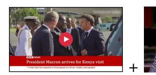

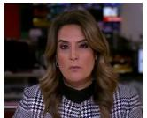

비디오 프레임과 오디오, 참조 이미지

### 프롬프트 (Prompt)

270초 길이의 비디오에서 균일하게 샘플링된 프레임 시퀀스와 해당 오디오, 그리고 참조 이미지가 주어집니다. 각 프레임 앞에는 초 단위 타임스탬프가 붙어 있습니다. 비디오 프레임, 오디오, 참조 이미지를 사용하여 과제를 완수하십시오.

**질문:** 앞서 언급된 보도 끝부분, 즉 참조 이미지에 있는 뉴스 앵커가 비엔나에 수천 명의 팬이 모였다고 보도하기 직전에는 무엇이 일어나는가?

- A. 승객이 부두에서 하선한다  
- B. 백발의 여성이 시상식에서 포옹을 받는다  
- C. 깃발을 흔드는 팬들이 비엔나 거리를 가득 메운다  
- D. 두 스튜디오 진행자가 정치 위기에 대해 논의한다  
- E. 대피용 비행기가 apron에서 대기한다

제공된 입력을 바탕으로 가장 적절한 답변을 A, B, C, D, 또는 E 중에서 선택해야 한다. 확실하지 않다면 주어진 입력을 바탕으로 최선의 선택을 하라. 옵션 문자만 출력하라.

#### 출력 (Output)

**정답:** B

**그림 E6. OmniCompass-AV의 질문 응답 프롬프트.** 두 설정 모두 동일한 타임스탬프가 지정된 비디오 프레임, 해당 오디오, 그리고 답변 후보를 받는다. 정답은 대상 사양에 따라 변하지 않는다.

